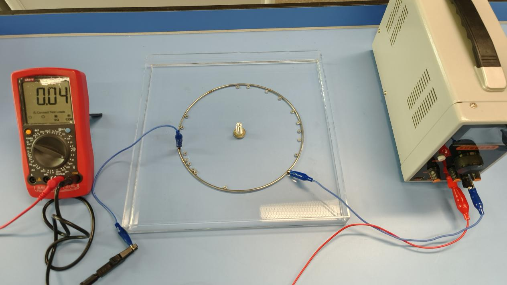
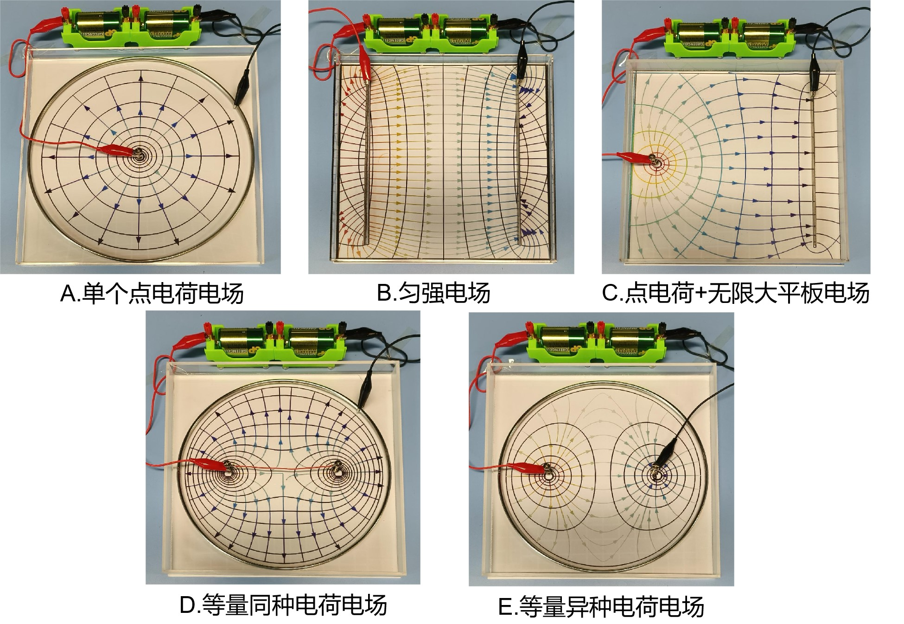
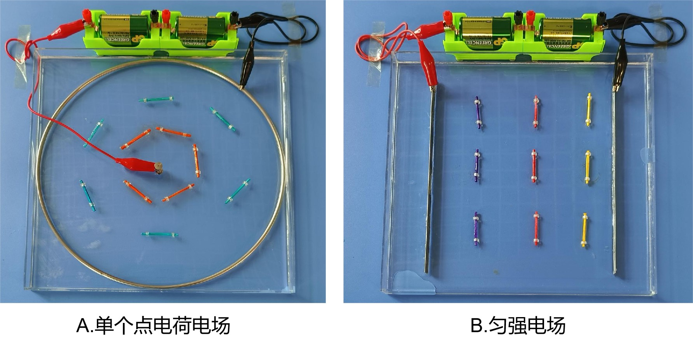
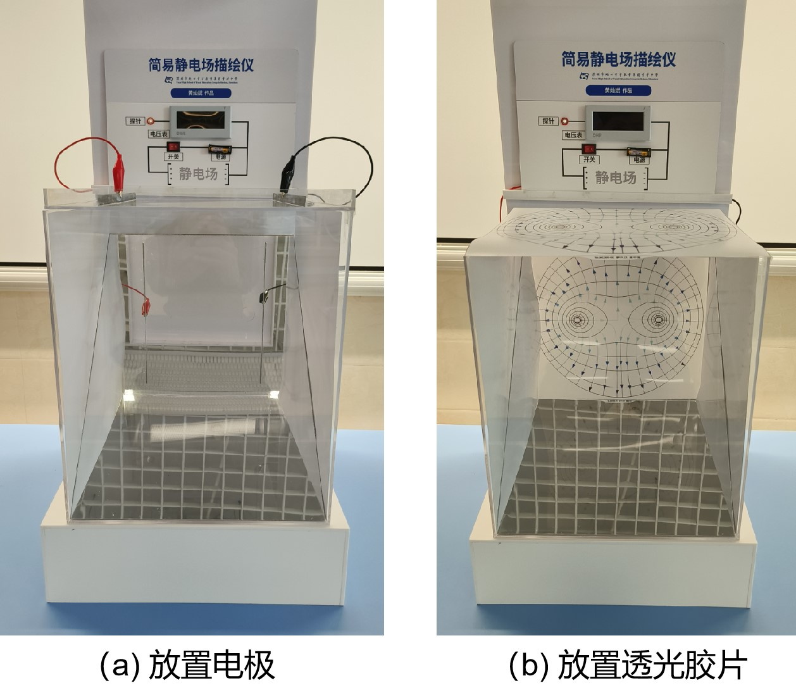
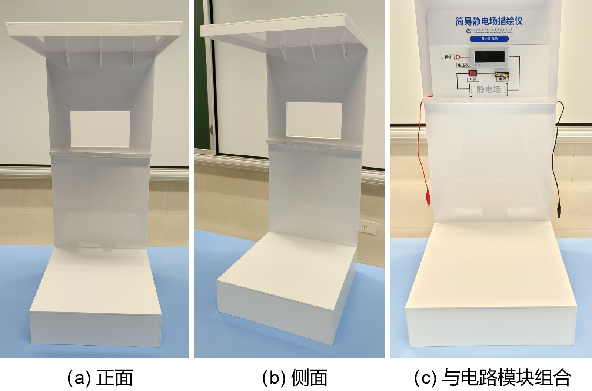
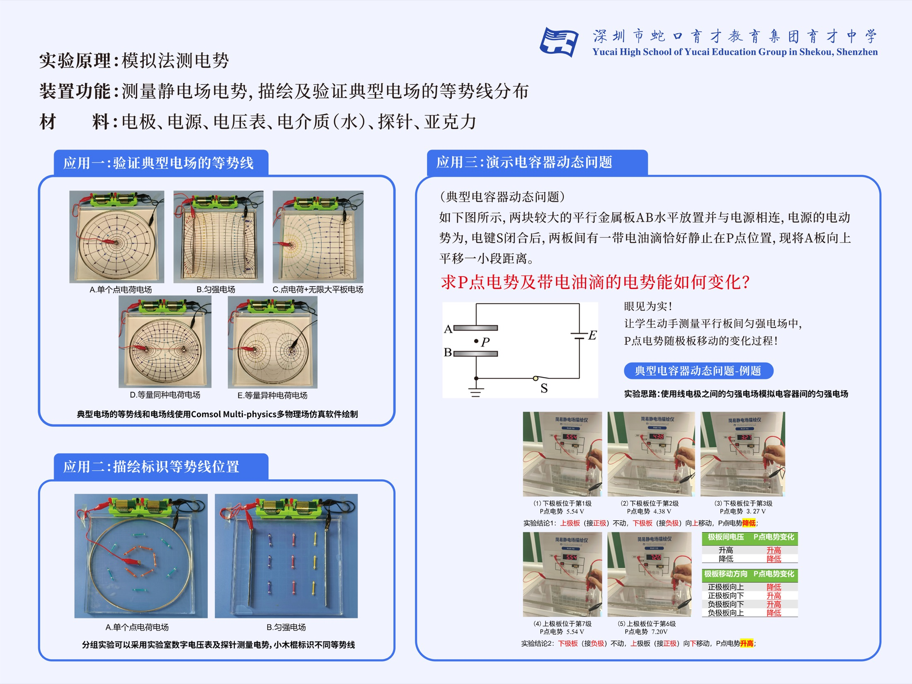
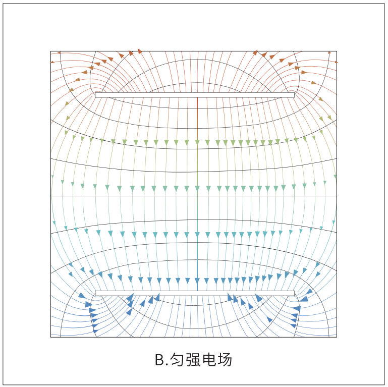
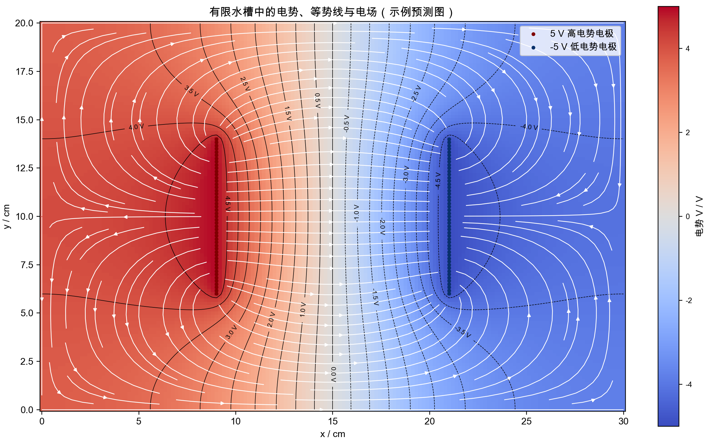

# 从 47 元水槽到可检验模型

## 一台静电场描绘仪怎样从课堂难题长成证据链

海报上有一个并不起眼的读数：5.54 V。移动一块极板后，它变成 4.38 V，再变成 3.27 V。换另一块极板移动，读数又从同一个 5.54 V 基准升到 7.20 V。

如果只看结果，这几张照片很容易被当成一次漂亮的实验展示。真正值得追问的却是：探针测到的究竟是什么？为什么极板一动，空间中一个固定点的电势会改变？水槽里的稳恒电流场与课本中的静电场是什么关系？一张计算机生成的彩色等势线图，凭什么能与水槽里的读数放在一起比较？

这也是本章要讲的主线。项目从 2023 年秋的一次高二静电场教学困惑开始，Python 和彩图都出现在后续阶段：电场强度还能借助受力和方向来想象，电势与等势面却常常只剩定义、公式和示意图。于是，我把一只透明水槽、一层自来水、几段金属电极和一支电压探针组合成了一个可以逐点提问的课堂装置。此后，它经历了低成本首版、三种场到五类场的扩展、预测图与测量的对照、大数显和镜面展示、动态电容器问题的水槽类比实测，以及 COMSOL 和 Python 模型的先后加入。

回看这段过程，最有价值的线索是教师怎样把一个模糊愿望——“让学生看见电势”——逐渐改写成一条可以核查的链：先提出物理预测，再规定测量位置和参考端，用读数寻找等势点，解释偏差，最后让模型接受实物数据的检验。

## 1. 先把问题说准：装置逐点测量的是电势差

静电场本身不可见。教科书中的电场线和等势线，是用来表达场的方向、强弱和空间结构的模型语言，不是空间里本来就存在的有色曲线。因而，“让学生看见电势”这句话若不继续追问，很容易滑向两种误解：一是把图像当成实物，二是把软件画出的图当成答案。

这台装置真正能做的，是把一个二维区域中的电势差变成可逐点读取的电压。学生选择一个参考电极，把电表公共端接在参考端上，再用探针接触水层中的不同位置。电表显示的，是探针位置相对于参考端的电势差。找到一批读数相同或足够接近的点，把它们连起来，才得到一条由测量支持的等势线。

因此，课堂任务应当从“观察场图”改写为四个动作：

1. 先画出自己预测的等势线和电场方向；
2. 再说明准备到哪些位置测、以哪一端为零点；
3. 用读数修正预测，而不是挑选看起来顺眼的数据；
4. 最后解释模型与实测为什么相同、为什么不同。

这里还有一个必须从开头说清的物理边界。水槽里存在由电源维持的稳恒电流，它不是真正的静电场。水层电导率为 \(\sigma\) 时，电流密度满足

\[
\mathbf J=\sigma\mathbf E=-\sigma\nabla V .
\]

稳定后，水层内部没有持续积累电荷，因此

\[
\nabla\cdot\mathbf J=0,
\qquad
\nabla\cdot(\sigma\nabla V)=0 .
\]

若水深 \(h\) 和电导率在平面内近似均匀，薄水层模型可写成

\[
\nabla_{2D}\cdot(\sigma h\nabla V)=0,
\]

进一步化为 Laplace 方程 \(\nabla^2V=0\)。无自由体电荷且介电常数在区域内近似均匀的静电区域也满足同一方程。两者可以类比，依靠的是相同的数学形式以及相应的边界条件，而不是“水里的电流就是静电场”。只有电极几何、定电势边界和外壁条件逐项对应，水槽中测得的电势分布才可以用来讨论目标静电场的空间结构；有限绝缘槽壁的零法向电流边界，不能直接当作一般自由空间边界。

这句话看似只是严谨，实际上决定了整个项目的方向：装置、测量和模型必须共享一套明确的几何与边界，谁也不能替代谁。

## 2. 第一版为什么只花了 47 元

第一版的思路来自大学物理中的静电场描绘实验，但做法被压缩到中学实验室容易获得的材料：透明亚克力浅槽、自来水、金属环或直线电极、用螺母形成的点状电极、导线、电压表和探针。原始市赛文稿把新增器材成本记为 47 元，同时明确没有把实验室已有的稳压电源和数字万用表计入。后来的宣传稿改用干电池，并重新描述了成本口径。因此，“47 元”是首版特定条件下的材料账，不是今天照单采购的价格，也不是成熟整机的总价。

*图 1　市赛版原始文稿中的首版照片。先辨认透明浅槽、点—环电极、实验室稳压电源和手持数字表，便能确认低成本原型把这些器材组合到了一起；单一视角无法完整追踪参考端和探针接线，接线关系须以正文和同期说明稿共同核对。出版授权待确认。*

操作也很朴素：让自来水刚好浸没电极，接通低压直流电源，等读数趋于稳定后移动探针。早期文稿用 6 V 举例，把环形电极记作 0 V、中心点电极记作 6 V；另一些稿件又出现 3 V、12 V 和 24 V。它们并不属于同一条被完整保存的供电方案：3 V 和 6 V 多见于早期或操作示例，12 V 出现在省赛场电源与一版大数显说明中，24 V 则出现在另一版大数显单独供电说明中。现有材料不能把这些数字拼成“最终标准电路”。

第一版很快暴露了三个问题。

第一，读数会漂。在端电势固定、\(\sigma\) 与 \(h\) 在平面内均匀的理想模型中，电导率或水深整体改变主要影响总电流，并不改变归一化电势分布。真实装置中，水深和电导率的空间不均、温度与离子分布变化、气泡、电极极化、探针浸入深度以及水面波动都会改变局部条件；电源内阻或输出波动还会改变实际端电势。这些因素叠加后，电表读数才会出现漂移。

第二，“大致像”并不足以支持判断。点—环或平行板的结果看起来接近课本图，只能说明值得继续测，不能说明模型已经被验证。若没有坐标、重复测量和偏差记录，漂亮的连线仍可能只是操作者的主观选择。

第三，实验者看得见，不等于全班看得见。浅槽水平放在桌上，探针、读数和水面反光都集中在一个狭小区域。比赛评委需要站到装置上方，课堂后排学生更难共享同一个观察视角。

这三个问题分别催生了后面的三条改进路线：把电极组合扩成多种典型场；把“找相同读数”与“看预测图”组织成两种模式；再为读数和水槽搭建面向观众的展示系统。

## 3. 装置不是一次完成的：三份留档讲出了不同版本

我没有保存一张无冲突的版本年表。相反，几份接近当时的文稿和后来讲座中的回忆存在差异，这种差异本身就是教师工程项目需要认真对待的历史。

市赛版器材说明仍列出三种电场，使用实验室稳压电源，并沿用 47 元的首版成本口径。省赛版说明已经列出五类场：单个点状电极与环形电极、两条平行直线电极、点状电极与直线电极、等量同种点状电极、等量异种点状电极。2024 年的一次讲座中，我又回忆市赛第二版已经增加到五组电极。两者说明“三种扩展为五类”确实发生过，却不足以确定它究竟发生在市赛准备的哪一天、哪一轮成品上。当前更稳妥的结论是：扩展发生在市赛迭代后期至省赛定稿之间，准确节点仍需我结合原始照片或采购记录确认。

另一个容易混淆的“三”，是成熟稿中所说的点、线、圆三类电极。三类电极可以组合出五种典型场，它不等于首版文稿中的三种场。

*图 2　成熟资料呈现的五类电场配置。放大比较可稳妥辨认出至少四种电极几何：点—环、双板、点—板、双点—环；同种与异种双点场可能由后一种几何改接线得到。它既不能证明历史上五只水槽同时到位，也不能证明使用了后来专利中的螺纹快拆结构。图中文字中的“单个点电荷”“无限大平板”是理想化名称，实物仍是有限尺寸电极和有限边界水槽。出版授权待确认。*

可以确认的迭代关系如下。

| 留档阶段 | 可以确认的变化 | 仍不能据此确认 |
| --- | --- | --- |
| 2023 年秋首版 | 亚克力浅槽、自来水、点/线/环形电极、实验室电源与数字万用表；新增材料记为 47 元 | 完整尺寸、坐标、水深、采购清单与重复测量记录 |
| 市赛版文稿快照 | 文稿列三种场，以 6 V 为操作示例；作品后来获 2023 年深圳市相关竞赛一等奖 | “三变五”的准确时间，以及比赛现场究竟携带了几只成熟水槽 |
| 省赛完成稿 | 文稿列五种场，出现独立干电池、透明预测片、大数字电压表、白色展示平台和 45°镜面结构；作品获 2023 年广东省相关竞赛高中物理组二等奖 | 12 V/24 V 大数显供电冲突、最终接线图、完整相机与投屏系统是否实际投入 |

奖项能够证明作品参加过相应竞赛并获得评审结果，却不能代替课堂学习效果证据。现有档案尚没有前后测、学生作品编码或稳定的课堂观察记录，因此本章只把“有助于理解”“能提升学习”写成需要验证的教学假设。

## 4. 两种模式，分别回答“在哪里”和“为什么”

成熟方案把实验组织成两种模式。它们使用同一只水槽，却承担不同任务；实际课堂顺序应先在纸上预测，再按读数测点，最后才叠放透明预测片比较。

第一种是测量模式。教师先给定一个目标电势，例如 2.00 V。学生沿不同方向移动探针，找到读数等于或足够接近目标值的位置，并用彩色小木条或标记片留下位置。换一个方向继续寻找，多个离散点逐渐勾勒出一条等势线。

*图 3　同期说明称这些彩色短木条用于标记按读数找到的等势点；照片本身只保存了标记结果。阅读时先看电极，再看同色标记是否沿一条合理轨迹分布；画面没有探针、目标电势与原始读数，不能据此核验每个标记是否合格。出版授权待确认。*

第二种是预测比较模式。项目先用 COMSOL 生成五类场的预测图，打印在透明片上，再与水槽几何叠放。学生选择预测线上的若干点逐个测量，让预测图接受读数检验，并把偏差带回边界、坐标和测量条件中解释。测量结果可以修订预测，预置图像没有要求读数服从的权力。

*图 4　沿“水槽顶面—45°反射面—正面观察区”追踪，左图可辨认把水平操作区转向观众的观察路径；再比较右图，可以看到透明预测片加入后的叠放位置。镜面结构有实物照片支持；省赛文稿还把顶置摄像头和补光列为展示方案，但现有视觉材料未见相机实物，不能写成已完成的投屏系统。出版授权待确认。*

两种模式最好按“先预测、后测量、再叠图”的顺序使用。如果一开始就把彩色答案片放在水槽下，学生很可能只在已知曲线上寻找合适读数；如果先让他们画预测，再选择测点，偏差才会成为问题。一次完整的小组记录至少应包含：装置俯视图与坐标系、参考端、两电极实际端电势、目标电势、每个测点的坐标与原始读数、重复次数、水深和静置时间、异常现象以及最终判断。

这正是旧档案最缺的一层。照片保存了成品，文稿保存了操作想法，却没有保存足够的逐点原始数据。今天要让装置真正可复现，不能只照着外形重做，还必须补一张能让别人复算的记录表。

## 5. 用一条等势线完成最小闭环

若只有一个下午，不必先复制五种电极、镜面平台和大数显。最可靠的起点，是两条平行电极之间的一条等势线。这个最小版本既能显出装置的价值，也最容易暴露问题。

### 5.1 先规定坐标和判断标准

把透明浅槽放在方格纸上，选定左下角为原点，记录槽内长宽。固定两条直线电极，记录它们的端点坐标、间距和浸水状态。电源接通后，不要只写“设为 6 V”，而要用电表复核两电极的实际电势差，并说明哪一端是参考零点。

旧项目没有留下成熟水槽的公制尺寸、最终电极坐标和稳定水深。因此，这里的尺寸不能冒充“原机参数”。复做者可以依据现有浅槽选择自己的几何，但必须把选择写入记录，让测点与模型共用同一坐标系。

测量前还要给“等势”一个可操作的容差。可采用下面的现场门槛：先让探针固定在一点，连续记录一段时间的基线，以基线中位数为中心，把各次读数对中位数的最大绝对偏差记为 \(\delta_{drift}\)；再把电表末位的最小变化步长记为 \(\delta_{meter}\)，取

\[
\delta=\max(\delta_{drift},\,3\delta_{meter}).
\]

把落在 \(V_t\pm\delta\) 内的点暂定为目标电势 \(V_t\) 的候选点；同一位置重复三次，并保留三个原始读数，而不是只抄平均值。这个门槛只是本章为复现实验提出的现场筛选规则，不是计量不确定度，也不是旧项目已经达到的性能指标。若漂移大到相邻网格都无法区分，就应停止画线，先处理装置。

### 5.2 再完成一次真正的测量

1. 向槽内加水，使电极连续接触水层且水面尽量均匀。旧稿只留下“水刚好淹没电极”的经验描述，没有毫米数；本次必须实际测量并记录。
2. 使用隔离低压直流电源并先设置较小的限流值，从电源可稳定控制的低端开始，边记录实际端电压与电流边缓慢调整，只调到电表能够分辨信号的最低水平。电极间距、水质与几何未冻结前，本章不给出可跨装置照抄的“安全电压”；任何旧稿中的单一电压都不是成熟标准。
3. 接通电源，固定探针在一个中部点，等待读数进入预先规定的稳定范围，记录实际等待时间。
4. 选取两电极实际电势差的某个中间比例作为目标值。沿一条横向或纵向测线移动探针，先找到目标值两侧的读数，再缩小位置范围。
5. 在不同测线上重复寻找目标值，记录坐标和三次读数。任何被排除的点也要保留原因，例如水面晃动、探针碰到槽底或端电压发生变化。
6. 在不看预测图的情况下连出等势线，然后才与理想判断和数值模型比较。

最小物理判断包含三件事：在两板中部、沿近似垂直极板且始终位于板间的测线上，从负电极到正电极，电势应整体上升；中部等势线应大致与板平行；靠近板端和水槽边界时，等势线会出现弯曲。若中央区域都无法分出这种结构，继续增加颜色和功能没有意义。

### 5.3 从等势线读回电场

在已经测得的电势图上，电场方向沿电势下降最快的方向，满足

\[
\mathbf E=-\nabla V .
\]

所以电场线应与等势线正交，并从高电势指向低电势。只有相邻等势线采用相同电势间隔，并沿局部法线比较它们的间距时，线越密才近似表示场越强。这里的“正交”和“疏密”都应允许测量误差：由少量离散点手工连出的曲线，不能承担精确梯度的结论。更适合学生的任务，是在若干位置画出方向判断，并沿局部法线选取邻近两点，用 \(|\Delta V|/\Delta s\) 比较相对强弱；任意方向的两点差分只对应电场在该连线方向上的分量近似。

## 6. 从实验桌走向全班：展示不是装饰

到省赛准备阶段，我面对的一个具体失败是“别人看不见”。水槽、探针和普通万用表都适合一两个人围看，却不适合讲台演示。于是装置加入白色平台、省赛文稿称为 D300 的大尺寸数字电压表、透明承托结构和 45°镜面。镜子把水槽底部或透明预测片的图案转到正面，数显把探针读数放大到远处可读；现存正面照片只能辨认大尺寸面板表，型号仍需铭牌或采购记录复核。

*图 5　成熟展示装置的三个视角。先比较正面、侧面和电路模块组合，可确认白色平台、上方面板表与装置框架已经制作；显示屏未点亮，这张图不能证明远处可读，也不能解决 12 V/24 V 的供电冲突。透明承托与镜面观察路径见图 4。出版授权待确认。*

这项改进有一个朴素但重要的教学含义：共享观察条件是证据链的一部分。若只有操作者看得到末位读数，其他学生便无法判断某个标记点为何被保留；若水槽被镜面或顶置画面共享，学生才可能当场质疑探针位置、读数稳定性和连线方式。

省赛文稿还提出顶置摄像头、补光和投屏。它们适合课堂版本，但目前只能视为有文稿依据的展示设计，因为现存照片没有显示完整相机系统已经安装并长期使用。今后若补做，摄像画面应同时包含坐标标尺、探针尖端和电表读数，避免把三个证据切成互不对应的镜头。

## 7. 一道动态电容器题，怎样转化为水槽类比实测

项目后期没有停留在“描出五种场”，而是把装置用于一个更具体的问题：平行板电容器始终与电源相连，空间中的固定点 \(P\) 保持不动，移动一块极板时，\(P\) 点电势如何变化？水槽测得的是稳恒导电场中的类比电势，并非真实电容器介质内的直接读数。下面的比较还要求电源维持两电极端电势、负极作为电表参考端、探针接入对场分布的扰动可忽略，且 \(P\) 在移动过程中始终位于两板之间的中央近似区。

*图 6　应用海报把五类场、等势点标记和动态平行板读数放在一起。把右下读数区放大，可读出两条序列：5.54→4.38→3.27 V，以及共享同一张 5.54 V 基准照片后到 7.20 V。五个图位不等于五次独立测量；海报只能作为历史展示材料，不能替代带坐标和重复读数的实验报告。正式版应从高分辨率原件裁出题图与两条序列，完整海报留在来源档案。出版授权待确认。*

在平行板中央区域的理想近似下，设下板位置为 \(a\)，上板位置为 \(b\)，固定点为 \(y_P\)，且 \(a<y_P<b\)。下板接参考电势 \(V_-\)，上板接 \(V_+=V_-+U\)，则

\[
V_P=V_-+U\frac{y_P-a}{b-a}.
\]

如果上方正极板固定，下方负极板向上移动，\(a\) 增大。此时

\[
\frac{\partial V_P}{\partial a}
=U\frac{y_P-b}{(b-a)^2}<0,
\]

所以 \(P\) 点相对于负极参考端的电势下降。海报上对应的标注读数是 5.54 V、4.38 V、3.27 V，方向与这个理想模型一致。

如果下方负极板固定，上方正极板向下移动，\(b\) 减小。因为

\[
\frac{\partial V_P}{\partial b}
=-U\frac{y_P-a}{(b-a)^2}<0,
\]

所以 \(b\) 减小时 \(V_P\) 上升。海报用 5.54 V 与 7.20 V 表示这一趋势，方向也与理想模型一致。

这组材料同时留下了一处不能忽略的证据问题：海报虽然有五个图位和五个标注读数，但第四个图位复用了第一个 5.54 V 的同一张照片，可理解为两组操作共享一个基准状态，却不能称为一次独立重测。原始照片目录中另有一张显示 1.53 V 的“平行板4.jpg”，它没有进入海报，也缺少可靠的极板位置映射，不能自行插回序列。

因此，当前证据只支持一个克制的结论：海报保存的两种移板操作，其标注读数变化方向与理想平行板模型一致。它不支持报告精度、重复性或定量吻合程度。要把这道题升级成可复算的数据案例，必须补测每一级极板的公制坐标、\(P\) 点固定坐标、两端实际电势、水深与稳定时间，并为每个状态独立重复测量。

## 8. 先处理失败，再谈“准确”

这类实验最危险的误判发生在数字看起来很稳定、实际条件已经改变的时候。下面的排查顺序应当进入实验单，成为学生和教师共同核查的步骤。

| 现象 | 优先怀疑 | 先做什么 | 必须留下的记录 |
| --- | --- | --- | --- |
| 全部测点一起缓慢漂移 | 电源端电压、水温、电极极化或水层变化 | 探针固定不动，同时复核两电极端电势；必要时断电、换水、清洁电极 | 端电压随时间、固定点读数、断电处理 |
| 探针轻微移动就跳数 | 探针浸入深度、接触方式、水面波动或电表接线松动 | 加定位导向，固定浸入深度，待水面静止，检查公共端 | 探针材料和直径、深度、读数稳定区间 |
| 左右结构明显不对称 | 电极没有平行/同心，水槽倾斜，水深不均 | 断电后重新量几何与水平；不要用软件“修圆” | 电极端点坐标、各处水深、俯视照片 |
| 边缘与预测图偏差很大 | 有限槽壁、实际电极尺寸与理想模型不同 | 先承认边界差异，再建立有限槽模型；不要只加密网格 | 槽内轮廓、电极厚度、预测图所用边界 |
| 出现气泡、发热或颜色变化 | 电解、电流过大或电极反应 | 立即断电，降低电压并限流，检查水和电极 | 电压、电流、持续时间、异常照片 |
| 操作者能判断、全班不能判断 | 视角和显示链不足 | 使用大数显、镜面或顶置画面，保证坐标与读数同屏 | 观众视角照片、屏幕可读性反馈 |

装置只应使用隔离的低压直流电源或电池，并设置合适限流；移动电极、加水和擦拭前必须断电。电源区和水槽区分开，导线接点保持干燥。出现持续气泡、明显升温或异味时，不得以“读数还在变化”为由继续实验。早期文稿出现过多个电压值，恰恰说明复作者不能照抄一个数字，而应在安全前提下记录实际端电压和异常阈值。

## 9. 两个复现层级：一个下午与一间教室

### 9.1 层级 A：一个下午完成的平行板最小版

最低配置包括：透明绝缘浅槽、两条可固定的直线金属电极、隔离低压直流电源或电池盒、限流措施、数字电压表、探针、导线、方格纸、直尺与少量自来水。供电从可稳定控制的低端起步，边观察实际端电压、电流、气泡和温升边调整，只提高到能够可靠分辨读数的最低水平。由于电极间距、水质和限流参数尚未冻结，本章不把历史上的 3 V、6 V 或 12 V 改写成通用复现范围。

一个下午要交付四样东西：一张含标尺的俯视装置照片；一份带坐标、端电势、水条件和三次重复读数的原始表；一条不看答案片得到的等势线；一条如实记录漂移、失败与处理的日志。四项完整后，即使曲线并不漂亮，也已经形成可供下一位教师复核的最小证据链。

### 9.2 层级 B：面向全班的五种场展示版

若目标是让五组学生同时工作，本章建议把五类场做成五只互不干扰的浅槽，分别配预测片，再把需要全班讨论的一只放到白色平台上，通过大数字电压表与 45°镜面共享观察。相机和补光可以作为课堂扩展，使探针坐标与读数同屏投出。这里的“五只独立浅槽”是面向课堂复现提出的配置选择，不是从现存拼图反推出的 2023 年历史事实；历史材料只能确认五类场配置，且视觉上至少有四种电极几何。后来的专利文本又提出单槽可拆电极方案，也不能倒推为 2023 年已经使用的实物。

要把展示版从“看得见的成品”升级为别人能照做的图纸，目前还缺六类关键参数：成熟版物料清单；槽体和平台尺寸；各组电极的公制坐标、材料与厚度；最终场电源和大数显电源；水源、电导率、水深与静置条件；每种场的原始重复测量。若要把“五套可同时分发”写成历史事实，还需作者补一张同期总览、BOM 或采购记录；若把它作为今后课堂方案，则应在新制后重新验收每一槽的几何与读数，而不能直接沿用旧拼图作证明。

课堂使用还需要另一类证据：学生在预测前后究竟改变了什么判断。可以让每组提交一张预测图、一张测后修订图和一段偏差解释，再用统一标准编码“是否说明参考端”“是否用数据修订”“是否区分理想边界和实际边界”。在这类数据真正收集以前，本项目可以被称为有明确教学目的的装置设计，不能被写成已经证明提高学习成效的研究结果。

## 10. 专利驳回暴露了说明不充分的工程缺口

项目后来尝试用专利文本表达装置，其中出现了可拆装电极、连接与展示结构等更完整的设想。申请被受理，只能说明申请材料进入了相应流程，不等于专利已经授权。现存审查文件显示，该申请于 2025 年 12 月 16 日因说明书对部件连接关系、配合方式与技术效果披露不充分，被指出无法据此具体实施。这个结论针对申请文本是否充分公开，不能被改写成“物理装置无效”，也不能反过来被竞赛奖项抵消。

对教师工程而言，这次经历反而点出了一个比“是否获批”更普遍的标准：如果另一位教师读完材料仍不知道哪根线接哪里、哪一部件怎样固定、改变这一结构会产生什么可观察效果，那么说明还没有完成。照片负责证明“做过”，图纸和参数负责说明“怎么做”，原始数据负责说明“发生了什么”，边界与失败记录负责告诉别人“哪些结论不能越界”。四者缺一，作品就很难从个人经验变成可继承的教学工具。

这也解释了为什么本章不直接把专利中的快拆结构写回 2023 年装置史。实物照片能证明当时做出了什么；后来文本能证明随后设想了什么。时间顺序一旦混写，看似完整，实际会让后来者复现一个从未同时存在过的版本。

## 11. COMSOL、AI 与 Python 应该站在项目的最后一段

### 11.1 旧 COMSOL 图留下了边界意识，也留下了复算缺口

项目早期我确实使用过 COMSOL。保存下来的操作笔记表明，当时建立的是二维静电模块中的空气域模型，电极边界采用正负表面电荷密度 \(\pm0.001\ \mathrm{C/m^2}\)。笔记还记录过“不收敛”，随后尝试无限元域、外边界接地和网格细化。项目档案中现存的多张输出图保存了模型探索的痕迹，却没有完整标题、图例、坐标、单位和参数链。共享深挖报告记录当时没有找到可继续打开的 `.mph` 工程文件；报告没有保留具体检索目录或模式，因此这里只能把它视为资料链缺口，不能据此断言工程从未存在。

*图 7　项目档案中的旧 COMSOL 平行板输出，原件题名“匀强电场”。先比较两板中央近似平直的等势线与板端明显弯曲的区域，便能看出有限电极已经产生边缘效应；图中没有坐标、图例、单位和完整参数链。空气静电、表面电荷边界等信息来自建模笔记，不能由图片单独推出，也不能把它当作浅水槽定电势问题的严格预测。第三方软件输出的出版使用需另行确认。*

这段历史留下的核心教训是：同一个 Laplace 型问题也会因边界而改变。空气静电模型中的表面电荷边界与电源维持的定电势电极代表不同条件；无限外域和有限绝缘槽壁也会给出不同约束。旧图可以说明当时怎样提出预测；可复算模型仍须重新声明几何、介质和边界。

### 11.2 AI 生成彩图很快，发现物理错误更重要

本项目后来参考的一篇研究，用生成式 AI 辅助编写 Python 静电场可视化程序，从单点电荷、偶极子扩展到鼠标交互加电荷。论文记录了一个很有教育意味的过程：一次美化让正电荷附近的场箭头方向出现错误，修正方向后，原有颜色映射又发生回退。它说明“能运行”“更好看”“物理正确”和“功能没有退化”是四道不同的门。

但那篇论文的程序本质上是二维网格上的自由空间点电荷库仑场，没有有限水槽、有限电极、供电回路、槽壁边界和电表参考端。它能支持 AI 协助编码与回归检查的讨论，不能被当成这台装置的数值复刻。

### 11.3 当前 Python 原型只做一件事：把边值问题说清楚

当前 Python 原型采用有限矩形槽、两条零厚度有限线电极、定电势边界和绝缘外壁，用红黑 SOR 迭代求解 Laplace 方程，再按 \(\mathbf E=-\nabla V\) 计算场方向。示例配置把槽设为 30 cm×20 cm、电极设为 +5 V 与 −5 V；这些都是测试用参数，不是从旧实物恢复出的尺寸与供电。

*图 8　当前 Python 原型的有限平行板示例。沿板间中部向端部比较，可以看到中部等势线近似平直、场线近似水平，板端与槽壁附近则明显弯曲。黑色等势线采用相同电势间隔时，其局部疏密可帮助判断梯度；白色流线的疏密受绘图播种参数控制，只用于读方向，不能定量比较场强。16 项程序测试说明代码按已经声明的示例边界运行；这不等于模型已经与实物定标，更不等于恢复了旧 COMSOL 工程。*

现有测试覆盖定电势节点保持、离散 Laplace 残差、绝缘外壁实现、最大值原理、通量平衡代理量、适用条件下的对称性、四个采样点的三档网格比较、两类解析解、整体电势平移，以及故意注入错误场方向时能否被发现。16 项测试全部通过，只能证明程序实现与它声称的数学模型一致。它尚未包含变量水深、电导率分布、电极厚度、探针扰动和真实测点，也没有证明真实槽壁就是理想绝缘边界。

模型真正进入项目，应当从下一轮实测开始：

1. 在俯视照片中放入标尺和至少四个配准点，定义原点与坐标轴；
2. 为每个极板状态记录电极端点、\(P\) 点、槽内轮廓和实际端电势；
3. 把水深、静置时间、探针位置、三次原始读数与照片状态编号绑定；
4. 每个状态建立独立配置，先比较归一化电势 \((V_P-V_-)/(V_+-V_-)\)，再比较等势线位置；
5. 若用部分数据调整模型，就把另一些状态留作独立检验，不用同一组数据既调参又宣称验证成功。

到这一步，AI 才真正进入一台教学装置：它帮助教师把照片和笔记整理成边界条件、生成代码候选、自动检查符号与回归测试，并把模型预测送回真实水槽接受质疑。教师仍须补测尺寸和数据，学生仍从自己的预测开始。

## 结语：最好的图，是下一次测量的起点

这台静电场描绘仪走过的路线，可以按它依次解决的问题来理解。47 元首版解决了能不能测；五种电极把一个演示扩展成一组可比较的问题；彩色标记和透明预测片把观察改成了测量与反驳；大数显和镜面让证据可以被全班共享；动态电容器的水槽类比实测把场图接回一道具体物理题；专利审查暴露了说明不充分的工程缺口；COMSOL 和 Python 则迫使我们重新说清几何、介质、边界和测试。

截至目前，成熟版 BOM、准确尺寸、最终供电、水条件、原始重复测量和课堂学习证据尚未补齐。这些缺口给出了下一步工作的真实入口。

如果下一位教师只复现一个下午版本，他应当带走一张可复算的数据表，而不只是一张彩图；如果要复现全班版本，他应当让每个学生看见同一个坐标、探针和读数；如果要继续模型版本，他应当让程序先预测尚未测过的状态，再把预测交回水槽。

到那时，静电场依然不可见，但判断它的过程已经可以被看见、被质疑，也可以被下一位教师接着做下去。
