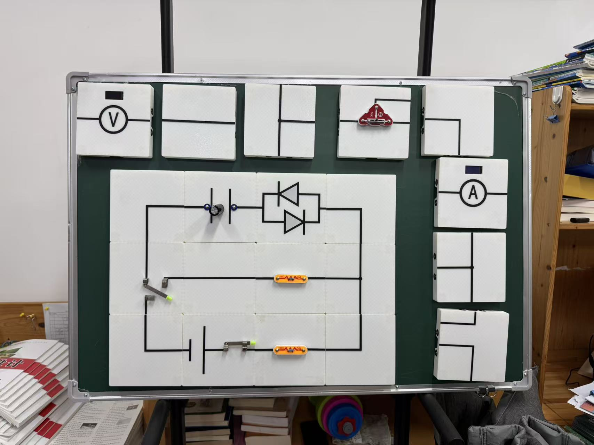
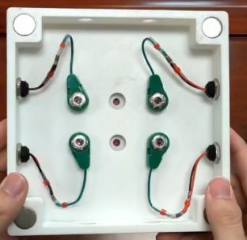
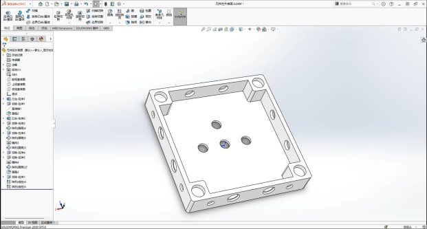
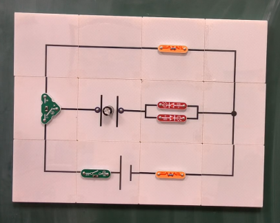
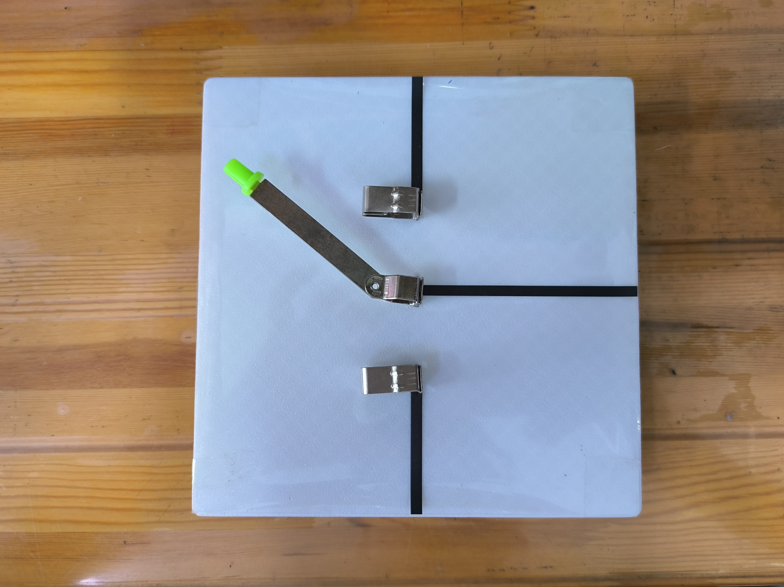
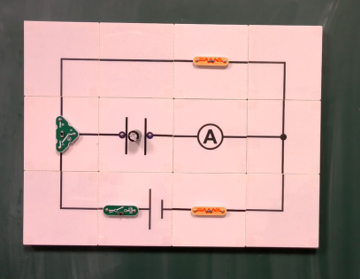
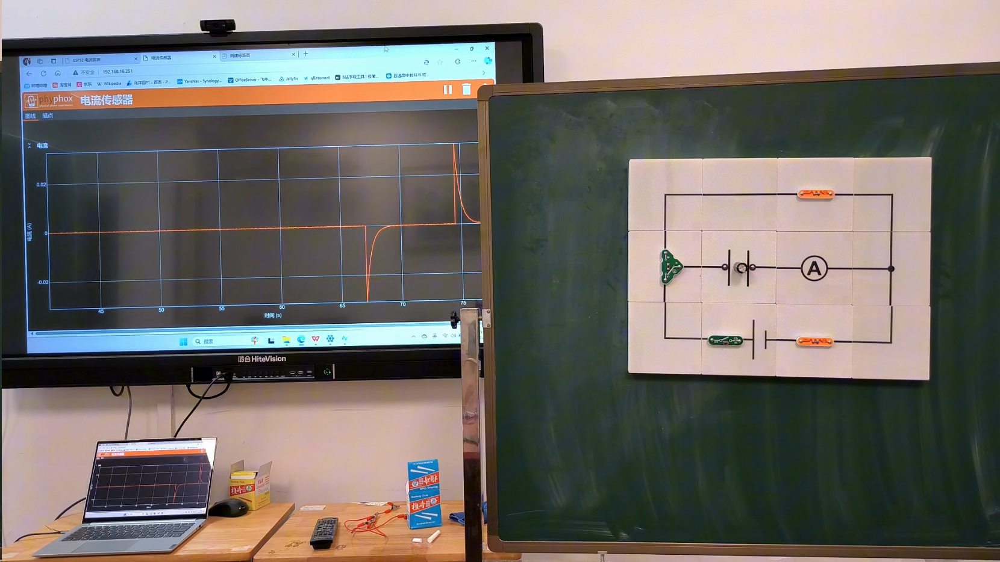
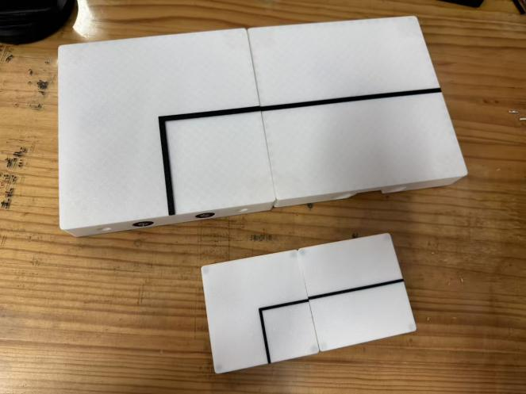

# 一张电路图怎样变成实体系统

*——以“活版电路拼图”中的电容器充放电为例*

严力耕老师最初面对的是接线灵活性与电路可读性之间的冲突。

常规演示需要临时取出电源、开关、电阻、电容器和导线，再按电路图逐一连接。导线一多，搭建耗时，线路容易交叠，学生也不易辨认图中连接与实际导线的对应关系。

一体式演示板虽然整洁，却把连接关系固定在板上。电路只能按预设方式工作，学生看到的是成品，不能真正改变拓扑（元件之间的连接关系），也难以亲手组装。

“散线”可以变，却不易读；“固定板”易读，却不能变。这对矛盾才是“活版电路拼图”发生的起点。

严老师借用了活字印刷的思路：把电路图中的基本对象做成可以反复组合的实体模块。需要哪种电路，就从模块库中选择相应对象，在黑板上重排；电路改变时，只需更换或移动其中几块。

真正困难的一步，是先回答一个教学问题：**一张电路图里，究竟有哪些东西必须被做成实体，学生才能一边搭建，一边读懂？**

*图1 活版电路拼图的整板组合。先沿黑色表面线路读闭合路径，再看元件模块和备用模块怎样进入同一套连接语法。*
<!-- 来源：S01 创新实验(1).docx，word/media/image2.jpeg，原文图10。权利状态：正式出版前待逐图确认。 -->

## 一张电路图至少有五类语法

初学者看电路图，常把注意力集中在电阻、电容器、开关这些醒目的符号上。一张可以工作的电路图还包含路径、节点、测量位置和数据去向。

若实体模块只覆盖“元件”，学生依然可能拼出一幅看起来像电路图、实际却没有形成正确闭合路径的图案。

从教学设计角度，可以把这套拼图理解成五类“实体语法”。

| 类别 | 它在电路中回答什么问题 | 做成模块时必须交代什么 |
| --- | --- | --- |
| 路径 | 电流可以从哪里通过 | 直线、转角或分支的有效端口，以及端口之间是否导通 |
| 节点 | 哪些支路在同一连接点相遇 | 哪些端口属于同一节点，不能只画出相交线而没有真实连接 |
| 元件 | 电路在这里发生什么作用 | 电阻、电容器、电源、开关、发光二极管等的内部接法、方向或极性 |
| 测量 | 被测量量在哪里取得 | 电流测量应串联，电压测量应并联；换入测量模块后拓扑发生了什么变化 |
| 数据 | 测量结果怎样获得时间、单位和符号 | 传感器、控制器、传输端与显示端的对应关系，以及单位、采样和正方向 |

这五类语法提供了一张设计地图。第一版即使只服务于一个电容器充放电电路，也要分清哪些块承载路径，哪一块表示节点，哪一块负责换路，哪一块观察现象，哪一块真正进入测量链。

每块模块还需要一份相同格式的“身份证”：表面符号、有效端口、内部连接、方向或极性、预期现象、核验方法。

只有这六项相互一致，学生在表面读到的电路，才和盒体内部真正工作的电路是同一张图。

## 吸附黑板与连通模块是两回事

模块上有两套容易被一个含混称呼掩盖的结构。

第一套是模块四角的扁圆磁铁。它们把模块吸附在黑板上，让整套电路可以竖直展示、移动和重排。

第二套是模块侧边的一公一母导电触点。相邻模块贴合时，触点帮助端口对齐，同时完成电气连通。触点本身是否带磁性、允许怎样旋转和换序，仍需依据型号与接线记录确认。

这两个系统必须分开验收。四角磁铁吸得牢，只能说明模块不会从黑板上滑落，不能据此判断电路已经导通；侧边触点可以导通，也不能证明模块在黑板上具有足够的保持力。

把二者笼统说成一个“磁性连接”，会遮蔽故障来源。一次不亮，可能是模块没有固定好、触点没有压实、内部导线断开，也可能是电路本来就没有闭合。先给结构分工，后面的诊断才有依据。

*图2 模块内侧的两套结构。先看四角扁圆磁铁怎样承担上板，再沿侧边连接件和导线追踪表面端口怎样进入真实电路。*
<!-- 来源：S01 创新实验(1).docx，word/media/image14.png，原文图7组图。权利状态：正式出版前待逐图确认。 -->

这种分工也给出一条按层排查的顺序：先查模块是否保持在位，再查相邻端口是否导通，随后查内部连接，最后回到闭合路径本身。故障由此不再被笼统归结为“接触不良”。

## 先在纸上定义模块，再打开 SolidWorks

严老师的制作过程可以概括为：根据模块功能在 SolidWorks（一款三维建模软件）中设计盒体，为四角磁铁、侧边导电触点、元件和内部走线预留位置；再用 PLA（一种常用的 3D 打印材料）打印外壳，安装部件并完成内部接线。

作品已经制成大、小两种尺度，以及电源、电阻、电容器、单刀双掷开关、双向发光二极管和测量等不同功能块。

建模前应先画目标电路，并为每块模块填写“身份证”。以电容器模块为例，如果表面画的是有极性电容器，端口位置、内部元件方向和外部接入方向就必须一致。

以开关模块为例，表面能看到的公共端和两个选择端，必须与内部三个触点一一对应。外壳只是这组关系的承载物。

*图3 模块框架的三维模型。读图重点是孔位分工：四角、侧边、元件安装区和走线空间必须在建模时同时安排。*
<!-- 来源：S01 创新实验(1).docx，word/media/image5.png，原文图3。权利状态：正式出版前待逐图确认。 -->

表面图案存在两个尚未理清的版本。新版文字一处写到先设计表面图案并采用多色 3D 打印，另一处又使用“贴有标识”的说法；旧版介绍则明确写过打印后制作贴纸。

它们可能属于不同代次，也可能是文字没有同步。读者复做时可以选择可靠工艺，但要把“符号位置稳定、与端口及内部接线一致”作为验收条件。严老师确认代次前，现有证据不足以把其中一种定为作品的唯一做法。

## 用一次充放电，把整套语法走通

模块库的教学价值要通过一个完整任务来检验。这个任务既要在短时间内改变电流方向，又要迫使学生追踪两条闭合路径。电容器充放电正适合承担这条主线。

在这一组合中，单刀双掷开关改变电容器所在公共支路的去向。公共端连接电容器与观察模块所在的支路，两个选择端分别通向充电支路和放电支路。

充电支路含电源和限流电阻；放电支路不含电源，也要保留限流电阻。实际模块上哪一端定义为“充电”、哪一端定义为“放电”，以及内部是否完全符合表面线路，都应以逐端通断测试和严老师的接线图为准，不能凭照片的上下、左右位置写死。

图4的充电支路还可见一只两端开关。现有材料没有说明它是否用于总控，也没有交代它的准确串接位置，因此这只开关的作用仍是待确认项。下表只概括单刀双掷开关承担的充、放电功能拓扑，不代表照片中所有开关都已经获得接线解释。

| 开关状态 | 电源是否在当前闭合路径中 | 学生要追踪的主要路径 | 观察支路中的约定电流 |
| --- | --- | --- | --- |
| 充电 | 在 | 含电源、充电限流电阻、开关、电容器与观察模块的闭合路径 | 初始较明显，随后减弱 |
| 放电 | 不在 | 含已充电电容器、放电限流电阻、开关与观察模块的闭合路径 | 正方向不变时，初始电流与充电阶段反向，随后减弱 |

这张表只给出功能拓扑，不代替作品逐端接线图。它把学生的注意力从“把开关拨过去”转向三个连续判断：现在闭合的是哪条路径？电源还在不在路径中？若正方向始终不变，观察支路中的电流为什么会改变符号？

*图4 电容器充放电的定性组合。沿表面线路分别追踪含电源和不含电源的闭合路径；照片方位不能替代公共端与两个选择端的正式定义。*
<!-- 来源：S02 活版电路拼图-创新实验PPT1.pptx，第8页，ppt/media/image16.png。权利状态：正式出版前待逐图确认。 -->

### 双向发光二极管先负责“看见方向”

双向发光二极管模块的表面画出了两个反向并联的发光二极管符号。在内部接线与表面符号一致的前提下，把它接入共同的观察支路，充电和放电时相反方向的电流会分别使其中一个方向的发光二极管满足正向导通条件。

学生由此可以把开关状态、闭合路径和发光方向对应起来，再解释放电电流为什么与充电电流反向。

这个现象有明确的物理边界。发光二极管只有在电流和端电压达到相应条件时才可见发光，它的非线性正向压降也会改变原电路。

灯变暗或熄灭，不代表电流在那一刻严格等于零；亮度也不是电流大小的线性刻度，更不能直接读出时间常数。充电、放电两条路径若没有分别设置合适的限流条件，还可能损坏器件。

双向发光二极管适合回答“方向有没有改变”和“变化是不是短暂的”，不能单独承担精确定量。

可视化单刀双掷开关把换路关系放到表面：拨杆接向哪个触点，哪条支路因此连通，学生可以直接对照。它的验收重点是可见动作与真实内部连接一一对应。

*图5 可视化单刀双掷开关。读者需要逐端确认公共端、两个选择端和拨杆位置，不能只凭表面动作推断内部导通。*
<!-- 来源：S02 活版电路拼图-创新实验PPT1.pptx，第10页，ppt/media/image23.jpeg。权利状态：正式出版前待逐图确认。 -->

第一次带入课堂时，可以先让学生完成四件事：不通电时分别描出两个开关状态下的闭合路径；标出电源是否在路径中；预测同一观察支路的电流方向；最后再通电，用现象修正自己的图。

拼图由此成为学生公开表达拓扑判断的媒介，而不只是教师加快接线的工具。

以上是基于现有装置提出的课堂试用方案，不是已经发生的课堂记录。它究竟能否减少误判、帮助多少学生解释电流反向，仍需在真实课堂中观察。

### 需要曲线时，再把观察模块换成测量模块

当问题从“方向是否相反”推进到“电流随时间怎样变化”，媒介也要随之升级。定量版把双向发光二极管模块替换为串联的电流传感模块，由以 ESP32 为核心的控制板获取信号，再在 Phyphox（一款手机实验应用）或网页端显示。

现有文字材料与实物、界面照片共同表明，作品包含这一数字分支；画面中可以看到装置与正、负方向的瞬态曲线界面同框出现。

*图6 从观察转向测量：双向发光模块被电流测量模块替换，其他路径应保持可追踪。加入传感器后仍要复核它是否改变原回路。*
<!-- 来源：S02 活版电路拼图-创新实验PPT1.pptx，第8页，ppt/media/image17.png。权利状态：正式出版前待逐图确认。 -->

这些截图不能单独证明屏幕信号来自同框装置在该次演示中的实时采集，也不能作为定量实验数据。传感器型号、量程、接线、采样率、触发时刻、符号约定、标定方法、负载影响和原始数据都没有完整交付；不同截图中的 A、mA 标注也不一致。

因此，现有证据不足以引用数值、报告精度、从截图反推电阻或电容，也不足以声称曲线已经完成拟合验证。

开发记录中还保留了一张带 AI 对话区的编程界面，并提出用 AI 辅助开发个性化网页显示。截图不能确认所用工具、模型、生成或修改了哪些代码，也不能确定 AI 的实际贡献比例。

即使后续补齐这些证据，AI 编程也只属于定量显示分支，不是实体电路完成充放电演示的前提。

*图7 装置与瞬态曲线界面同框出现。这张图不能单独证明信号来自同框装置；单位、零点、标定、采样条件和原始数据补齐后，才能进入定量解释。*
<!-- 来源：S02 活版电路拼图-创新实验PPT1.pptx，第9页，ppt/media/image21.png。权利状态：正式出版前待逐图确认。 -->

在理想、线性且等效电阻保持不变的 RC（电阻—电容）回路中，电流可以写成

\[
i(t)=I_0\mathrm{e}^{-t/(R_{\mathrm{eq}}C)}
\]

这里的 \(I_0\) 带有相对于既定正方向的符号。在测量正方向不变、且放电开始前电容器已按充电方向建立电压的条件下，充电与放电的初始电流符号应相反。

这个表达式只有在拓扑、\(R_{\mathrm{eq}}\)、\(C\)、初始条件和测量链都明确时，才适合与实测曲线比较。含发光二极管的观察回路具有明显非线性，不能把亮度变化直接套进理想指数模型。

定量实验应先换入传感模块，再用原始数据、单位和采样条件检验模型。若充、放电支路的等效电阻不同，两阶段应分别使用各自的 \(R_{\mathrm{eq}}\) 与时间常数。

技术的层级由物理问题决定。定性问题用开关与双向发光二极管已经足够；当学生开始追问时间序列、符号、峰值和模型时，ESP32、Phyphox 或网页才成为必要的测量延伸。

## 模块缩小后，五项条件都要重测

作品已经制成大、小两种尺度。大模块被设计用于在黑板上组成全班可见的电路，小模块则被设计为更接近学生桌面操作的版本。

截至现有确认日期，这两种课堂用途仍属于设计设想。“已经做大、做小”不能直接推出“已经适合全班或小组学习”。

*图8 同一种转角路径的大、小模块。缩小的不只是外壳；触点对准、符号可读、握持操作和保持力都要重新测试。*
<!-- 来源：S01 创新实验(1).docx，word/media/image22.jpeg，原文图15。权利状态：正式出版前待逐图确认。 -->

缩小尺寸会同时改变多项条件：模块质量与磁铁保持力的关系、侧边触点的对准容差、表面符号的可读性、元件与导线的安装空间，以及学生握持时误碰触点的可能性。

放大也可能增加下滑力矩，使相邻触点更难持续压紧。这些性能不能从照片直接判断，要由两种尺度分别测试。

若后续进入真实课堂，大板可以承担全班共同推理：一名学生改变开关，其他学生追踪同一条路径。

小板则可以承担小组证据生产：每组保存初始预测、第一次拼接、故障修正和最终解释。两种尺度由此形成不同任务，而非把同一活动简单放大或缩小。

## 读者怎样复做一套“最小可用”模块

下述六步足以支持过程级复做。CAD、STL、STEP 等三维制造文件，以及关键尺寸与公差、完整物料清单、逐块接线图、导电触点型号和额定参数仍待补齐，因此目前不能支持一比一复制。

读者可以先从一个代表性的电容器充放电电路起步，不必一开始追求模块种类齐全。

第一步，把充电和放电两种状态分别画成完整电路图。确定电源、两个限流路径、电容器、单刀双掷开关，以及双向发光二极管或电流测量模块的位置。先定正方向，再定观察量。自制版本若另设总控开关，还要明确其作用和串接位置，不能照搬照片中尚未解释的两端开关。

第二步，把图拆成模块清单。除了元件块，还要补齐必要的直线路径、转角、节点和测量接口。

为每一块写明表面符号、有效端口、内部连接、方向或极性、预期现象与核验方法。凡是不能从清单重新拼回两种闭合路径的设计，都还不能进入建模。

第三步，设计外壳。SolidWorks 或其他建模工具需要同时容纳四角黑板吸附磁铁、侧边一公一母导电触点、真实元件与内部走线，并为装配误差留下可验证的余量。

具体孔径、公差和材料参数应依据选用的实物测量，不能照着照片估算。

第四步，打印、安装并逐块接线。每完成一块，先脱离组合电路单独核对：表面声称导通的端口应导通，声称隔离的端口不能意外相连。

电容器、发光二极管、电源和传感器的极性或方向应与表面一致；开关两个位置对应的端口要逐一记录。四角磁铁的保持测试与侧边触点的通断测试分开进行。

第五步，把最小电路拼起来。先断电追踪两种开关状态，确认任何状态都不会绕过限流元件把电源低阻短接。

通电后采用经计算确认的低压、限流条件，观察两种方向的发光是否与预测一致，并重复拼接若干次，记录是否出现偶发断路。具体电压、阻值、电容和额定值必须由实物参数计算后确定，尚未核验的数值不能作为复做处方。

第六步，只在需要定量时加入数据链。电流传感模块必须串入规定位置，记录传感器型号、供电、量程、零点、正方向、采样率和触发方式。

保存原始数据，同时保留一次独立测量作为校核。网页或手机上“出现了一条曲线”只说明链路开始运行，还不能说明实验已经准确。

这六步背后只有三个验收层级：单块是否忠实，组合后拓扑是否正确，数据链是否可追溯。三层分别守住表里对应、闭合路径和测量证据。

## 模块库还能从哪里继续生长

完成电容器充放电主线后，模块库还可以向三个方向扩展，但每次扩展都应由新的物理问题推动。

- 闭合电路欧姆定律：增加内阻表征与端电压测量，讨论负载变化时电源端电压怎样改变。
- 伏安法测电阻：增加电流与电压测量模块，比较两种表接法带来的系统误差。
- 自感现象：增加线圈、换路和保护支路，观察断电或接通瞬间的暂态现象。

这些是模块库的可能出口，尚未成为经过验证的三套课堂案例。每增加一种电路，都要重新检查表面语法、内部连接、元件额定值与证据链。“模块能拼上”还不足以证明教学设计已经成立。

## 作品已经走到哪里，课堂证据还缺什么

这个案例以严力耕老师为主叙事者。多份作品证书中列出的作品作者为严力耕、汪小明、黄灿斌。三人在构思、建模、打印、接线、数字模块和教学设计上的具体分工尚未确认，现有证据不足以分配各自贡献。

国家知识产权局的受理文件记录：实用新型申请“一种磁吸电路拼图套件”已获受理；申请日为 2025 年 3 月 28 日，申请号为 202520568319.8，申请人为深圳市蛇口育才教育集团，发明人为严力耕。

受理不等于授权，现有材料也没有核验该申请此后的法律状态。

作品有公开展示、专家现场察看、获奖和展演记录。这些记录能证明装置、活动或证书存在，不能证明学生的理解、参与度或学习成绩已经提高。

严老师在 2026 年 8 月 12 日确认，该项目尚未进入真实课堂；现有材料中没有此后的课堂实施记录。因此，“提高参与度”“加深理解”仍是设计目标和未来要检验的问题。

第一次课堂试用需要留下能够回答教学问题的过程证据：学生通电前画出的两种闭合路径、对发光方向的预测、开关切换后对电源是否在回路中的解释、错误拼接的修正痕迹，以及定量分支中带单位、时间基准和采样条件的原始数据。

这些证据出现后，才能开始检验作品“可展示”与教学“有效果”之间的关系。

## 结语：把不能省略的判断留给学生

“活版电路拼图”把电路图的语法转化为可以拿取、重排、通断和测量的实体系统。它的价值来自连接过程中的可读性和可检验性，而非模块数量或外观变化。

路径、节点、元件、测量和数据被做成模块后，一部分机械动作被封装了，关键的物理判断仍要留在表面：哪条路径闭合，哪个元件在当前回路中，电流方向为什么改变，观察现象能证明到哪一步，测量曲线还缺哪些条件。

电容器充放电这条主线迫使学生把这些判断连在一起。

活版让每一次连接都可以被读、被问、被检验。实体模块由此从整洁的演示器生长为学生思考电路的公共语言。
