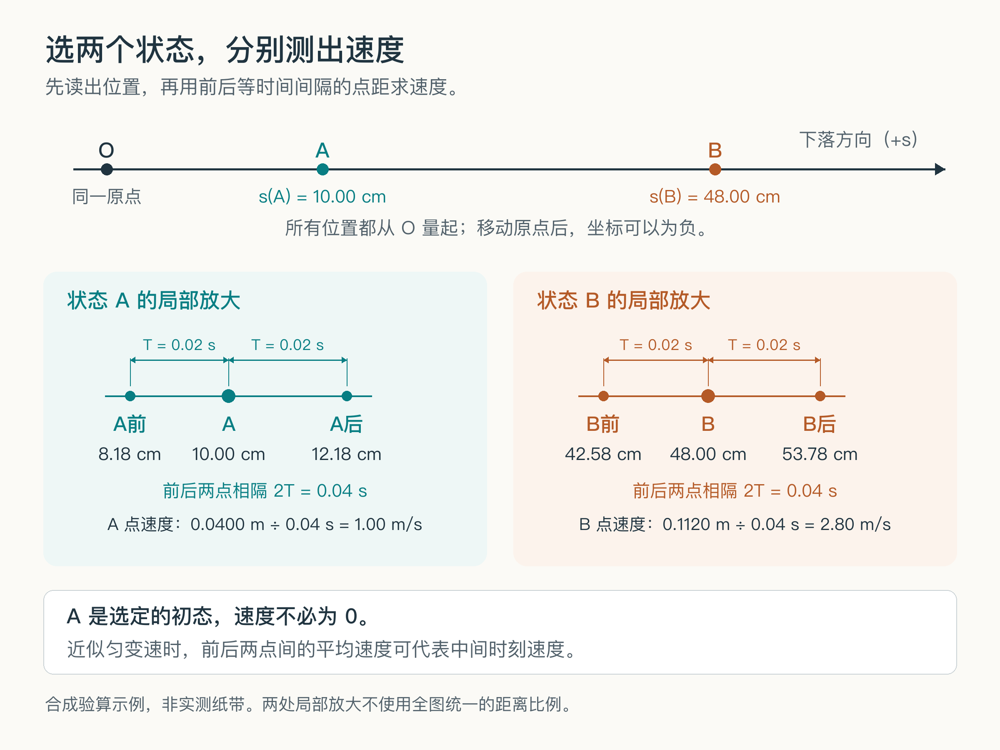
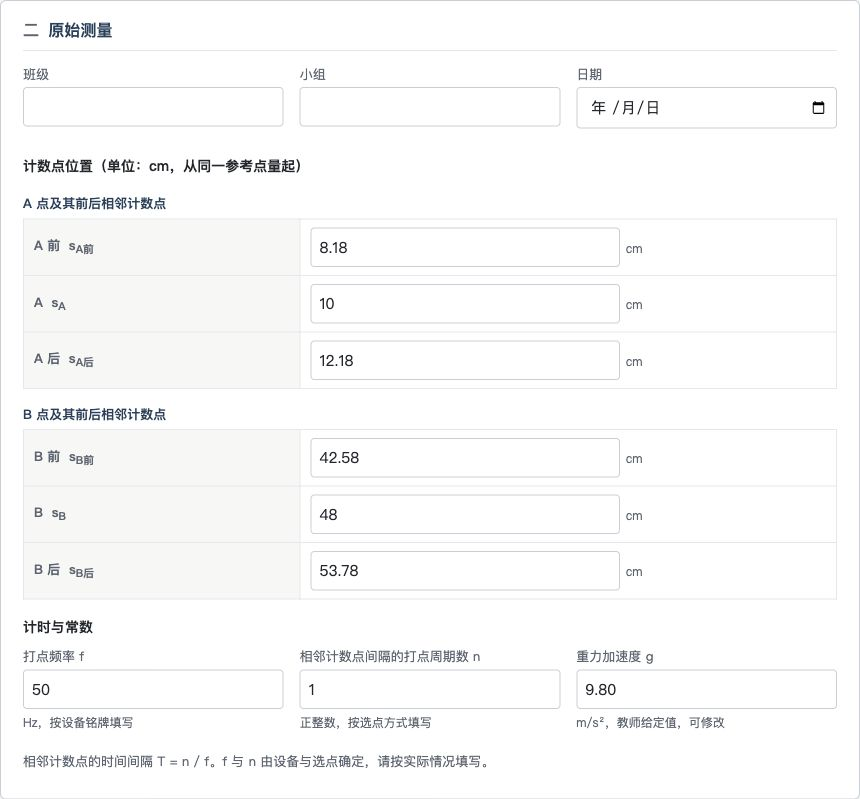
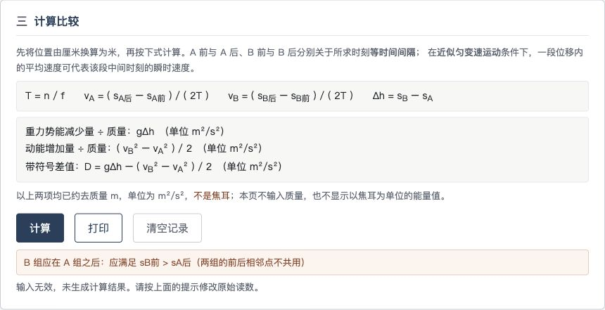
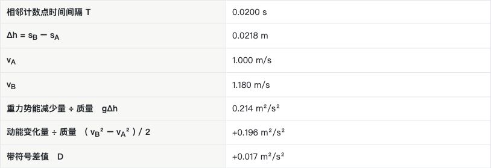
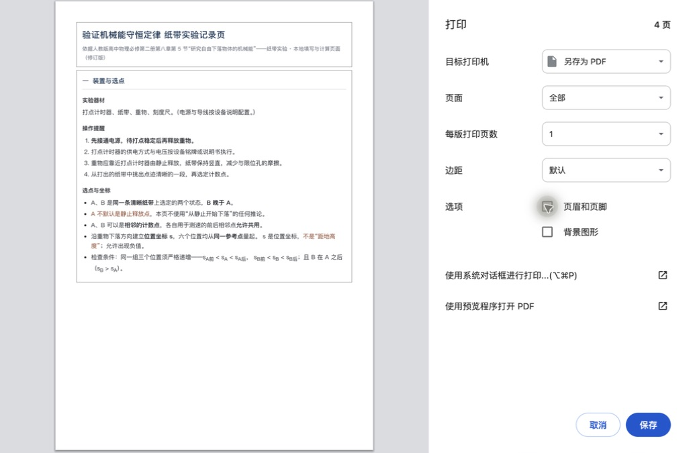

# 第一章 第一次用AI做出教学资源

## 1 先决定这张记录页要帮助学生做什么

研究自由下落物体的机械能时，学生要从纸带上选点、测量距离、求出速度，再比较重力势能的减少量与动能的变化量。教师准备记录单，实际是在安排这些动作：哪些量先量，哪些量后算，原始读数写在哪里，得出结果以后还要解释什么。

本章把这项熟悉的工作做成一份网页。学生可以填写原始读数，点击按钮完成重复计算，在同一页看见速度、下落高度差和能量变化的比较，然后自己写解释。填好的记录还要能够打印留存；没有电脑的小组，则使用配套的手写记录单。它的价值取决于这些安排是否符合你的课堂；如果现有表格已经合用，也完全可以继续使用。本章选择网页，是为了带你亲手完成一次“说明要求—生成文件—试用—修改”的过程。

一种可以采用的课堂安排是：学生先在纸带上选点，保留原始读数，独立算出一个状态的速度，再用页面核对并完成其余重复计算。小组讨论差值时，可以回到同一页的原始读数；没有电脑的小组则使用手写记录单。这里提出的是一项活动安排，是否适合自己的课堂，需要你结合学生的基础来决定。

我们采用人教版高中物理必修第二册第八章第5节的参考案例“研究自由下落物体的机械能”。主要器材是打点计时器、纸带、重物和刻度尺。其他教材的教师也可以跟做，因为本章会给出所用的选点和计算方法；迁移到自己的教学时，再核对器材、时间间隔和符号习惯。

先把作品的边界定小：只做这一项实验的记录与核算，不同时加入几种装置、动画、账号和评分。第一版要回答的是：一位教师能不能把自己对实验的要求说清楚，让AI保存为一份可独立打开的文件，再检查它是否照做。这个过程走通以后，增加什么功能才有具体依据。

## 2 把要求和作品放进一个找得到的文件夹

本章使用WorkBuddy完成实操。它是可以根据对话处理本地文件的AI工作工具。你输入的要求会交给所选模型处理，工具再完成读取、创建或修改文件等动作。第一次使用时，先从[WorkBuddy官方网站](https://www.codebuddy.cn/work/)下载与自己电脑相符的版本，按当前安装与登录提示完成准备。下面记录的是2026年9月8日为本书重新完成的一次演示。实操画面来自macOS上的WorkBuddy 5.5.3，所选模型为Hy4 preview；名称和可用额度以你自己的界面为准。

开始之前，先解压随书的[纸带实验练习包](../练习文件/纸带实验练习包.zip)，把其中的“起步练习”文件夹复制到一个容易找到的位置，例如桌面，并改名为“纸带实验练习”。文件夹里只需要认清两处：

```text
纸带实验练习
├── input
│   └── 纸带实验页面要求.md
└── output
```

`input`用来放你提供的材料，`output`用来放生成的作品。这两个英文名称分别表示输入和输出，只是本章约定的文件夹名称。它们能帮助你在修改时分清：正在改的是给AI的要求，还是学生真正使用的页面。

“纸带实验页面要求.md”是一份Markdown文件。它保存普通文字，并用少量标记表示结构，例如一行开头的`#`表示标题，`-`表示列表。你暂时不用学习整套语法，只需能打开、阅读和修改其中的文字。练习包已提供完整文件，第一次可以直接使用。

如果你平时把要求写在Word里，也可以先保留Word原件，把这一项任务有关的文字复制到对话或要求文件中。不要直接把`.docx`的后缀改成`.md`：文件名变了，内部格式并不会自动转换。含表格、公式或插图的材料，更要检查AI实际读到了什么。

在WorkBuddy的新建任务界面，点击输入框下方的“选择工作空间”，再选“打开本地文件夹”，找到刚才的练习文件夹并打开。输入框下方应出现该文件夹的名字。这里的“工作空间”就是本次任务使用的文件范围；确认它以后再发送要求，能减少把作品放错位置的麻烦。


图1-1　首次发送前的真实画面。输入框下方是已选定的练习目录，框内的短提示指向要求文件；实际发送的文字见第4节。

我们在演示中使用了单独的练习目录。你只需认准自己的目录，不必照抄截图中的完整路径。文件夹名称也不代表软件已经自动受到严格限制，任务里仍要写清可以读取和修改的范围；首次出现涉及文件访问的提示时，核对它确实指向这次练习。

## 3 教师先把选点和计算说清楚

在交给AI之前，先读一遍要求文件。判断它有没有写清你的意思，比寻找一句“万能提示词”更有用。尤其是那些你在课堂上觉得理所当然的条件，程序未必会按同样的方式处理。

这份要求选择纸带上的两个状态A、B，B晚于A。A可以取在清晰纸带的中间，不把它默认成静止释放点。因此，比较动能变化时，两处速度都要计算，不能直接把A的动能省去。

沿重物下落方向建立位置坐标s，所有读数使用同一个参考点。页面让学生输入A前、A、A后及B前、B、B后六个计数点的位置。这里的“前”和“后”指记录时间的先后，各处相邻计数点的时间间隔相同，记为T。两个测速区域可以共享计数点；它们不必在纸带上完全分离。



图1-2　同一原点下的六个位置读数。下方分别放大A、B附近的计数点，帮助区分相邻间隔T与测速使用的2T；图中距离不按全图统一比例绘制。

位置s和距地高度h的方向不同。重物下落时，按本章约定的位置s增大，距地高度则减小。为避免程序混用，输入框统一写“位置”，单位统一用厘米；开始计算时再换成米。

打点频率记为f，相邻计数点之间间隔n个打点周期，则

$$T=\frac{n}{f}.$$

纸带上连续打出的两个点之间是一个打点周期；如果相邻计数点之间隔了n个这样的周期，就填写n。频率来自设备，n来自自己的计数点选取，不能看到常见数值就不加核对地填入。要求文件让f和n保持空白，由使用者填写；页面计算T。

当所选小段可以近似看作匀变速运动时，前后等时间间隔内的平均速度可以代表中间时刻的速度。因此

$$v_A=\frac{s_{A后}-s_{A前}}{2T},\qquad v_B=\frac{s_{B后}-s_{B前}}{2T}.$$

A到B的下落高度差为

$$\Delta h=s_B-s_A.$$

比较同一重物从A到B的能量变化时，正质量m可以从等式两侧约去，页面直接列出

$$g\Delta h,\qquad \frac{v_B^2-v_A^2}{2}.$$

这两项分别是重力势能减少量和动能变化量除以质量后的结果，单位都是m²/s²。它们不是以焦耳为单位的能量；本页也不需要先输入质量。

最后保留两项带符号的差值

$$D=g\Delta h-\frac{v_B^2-v_A^2}{2}.$$

页面保留D的正负，不设百分比阈值自动宣布实验“成功”。解释和结论由学生根据读数、操作及误差分析完成。

还要在要求里写清：速度来自纸带读数，不用理想自由落体关系v=gt，或由能量关系得到的速度，替代独立测量。否则，页面可能算得很整齐，实验原本要完成的验证却被计算关系提前决定了。

这些条件不要求你每次写很长。本章把它们展开，是为了让你看到：教师熟悉的物理判断，落实到输入、计算和结果显示时，会成为哪些具体要求。完整的要求文件已经放在练习包中，后面的对话只需指向它。

## 4 发送任务以后 留意文件是否真正出现

确认工作空间选对以后，在输入框中发送：

> 请阅读 input/纸带实验页面要求.md，按照要求制作并检查页面。请先简述理解，再生成文件；没有实际执行的浏览器和打印检查请说明。

这条短提示没有重复整份要求，因为任务细节已经保存在文件里。它告诉AI去哪里读、接下来做什么，以及怎样报告检查范围。你也可以把一项很短的要求直接写在对话里；本章采用文件，是为了以后能修改、复用，并检查当时究竟交给了AI什么内容。

点击发送后，先确认回应中出现了正确的要求文件名。随后看它怎样理解学生任务，尤其注意A是否被当成静止点、速度是否来自前后计数点、两项比较结果的单位是否正确。发现关键理解偏差，就在同一任务里指出具体关系。一般的措辞差异可以等到页面出来以后，结合实物再讨论。

本次生成结束后，WorkBuddy列出了两个文件：“纸带实验记录页.html”和“使用说明.md”。点击对话中的文件卡片，右侧可以预览内容。先看题名是不是本次实验，再向下看原始测量、计算比较与结论区是否齐全。不要只看首页：学生真正要用的输入和按钮通常在下面。

接着离开对话，打开自己的练习文件夹，进入`output`。这里应当确实出现同名文件。`.html`是浏览器能够显示的网页文件，本次还把样式和计算程序放在同一个文件里，因此不必另外搭建网站。双击它；如果电脑打开了文本编辑器，就在文件上点右键，选择“打开方式”，再选择已安装的浏览器。看见网页标题、输入框和按钮，才算打开了要给学生使用的作品。

有时AI只在对话里给出代码，没有保存文件。这时不必自己从大段代码里寻找保存方法，直接补充：“请把刚才的完整页面实际保存到 output/纸带实验记录页.html，并告诉我文件是否已写入。”随后回到文件夹核对。如果目录仍然空着，先查工作空间和输出位置，不要马上重开一个任务再生成一份。

“使用说明.md”也要打开看。本次说明写清了没有自动保存，以及浏览器与打印尚未实际验证。这是下一步试用的起点。AI报告它检查过公式或按钮代码，能说明它做过相应检查；页面能否实际填入、清空、打印，还要继续操作。

## 5 用一组自己算得清的数据试用

第一次试用不急着放进课堂。先用一组容易独立核算的数据，让计算器、纸笔与页面相互对照。下面的数据专为检查程序而构造，不是一次真实实验的测量记录，也不能拿来代替学生的纸带读数。

在浏览器中逐项填写：

| 输入位置 | 填入数值 | 页面使用的单位 |
|---|---:|---|
| A前、A、A后 | 8.18、10、12.18 | cm |
| B前、B、B后 | 42.58、48、53.78 | cm |
| 打点频率f | 50 | Hz |
| 相邻计数点间隔的打点周期数n | 1 | 无量纲 |
| 重力加速度g | 9.80 | m/s² |



图1-3　真实浏览器中的输入区。图中是合成检查数据；学生使用的空白页面不预填这些读数。

这组数据中，T=0.020 s。A前到A后的位移是4.00 cm，即0.0400 m，所用时间为2T=0.040 s，所以vA=1.00 m/s。B处同样得到vB=2.80 m/s。两个状态的下落高度差是38.00 cm，即0.3800 m。

先用纸笔或计算器算到这里，再点击页面的“计算”，逐项对照：

| 结果 | 独立核算值 |
|---|---:|
| 相邻计数点的时间间隔T | 0.0200 s |
| A到B的下落高度差Δh | 0.3800 m |
| A点速度vA | 1.000 m/s |
| B点速度vB | 2.800 m/s |
| 重力势能减少量除以质量gΔh | 3.724 m²/s² |
| 动能变化量除以质量 | 3.420 m²/s² |
| 两项差值D | +0.304 m²/s² |

如果结果差很多，先看单位和时间间隔。4 cm若忘了换成米，速度会放大100倍；分母若误用T，速度会变成原来的2倍。这些差异通常比页面颜色是否顺眼更先暴露问题。至于显示1、1.00还是1.000，要分清是显示位数的不同，还是计算值真的不同。

本例D为正，表示重力势能减少量大于动能增加量。真实实验中，阻力做负功可能造成这样的差异，测量误差也会影响它，不能仅凭这个差值就求得空气阻力的损耗。这里讨论的重力势能涉及重物与地球的相互作用，采用地面参考系，并忽略地球动能的变化。

这组检查刻意保留了非零的A点速度，也保留了不为零的差值。这样能看出程序是否真的使用两个状态，是否擅自把比较结果凑成相等。不要用“恰好算出守恒”作为页面正确的唯一证据。

再做一个不必重新推导公式的检查：六个位置同时减去100 cm，其余输入不变，然后重新计算。纸带上的距离和时间都没有变，只是移动了坐标原点，速度与两项比较结果应当完全相同。这个动作还会顺带检验页面是否错误地拒绝所有负坐标。试完后恢复原数据，便于继续对照。

## 6 把发现的问题变成具体的修改要求

不同模型或同一模型的不同次生成，可能给出不一样的页面。先照本节的动作试用：已经正确的项目不必修改，把不符合要求的现象记下来。如果本节两个问题都没有出现，可以继续检查清空和打印，再按自己的实际需要提出修改。

本次首版通过了上面的常规核算，但在另一个合法选点方式上报了错。保持A组三个输入不变，把B前、B、B后改为10、12.18、14.72 cm，f、n、g仍用原值。这时B就是A后那个计数点：B前与A重合，B与A后重合，两处测速所用的三点区域部分重叠。

A、B仍是两个不同的时刻；各自前后两点也仍关于该时刻等时间间隔。这样的选点并不妨碍计算。可是首版提示“B组应在A组之后”，还要求两组的前后相邻点不能共用。



图1-4　真实试用中出现的提示。问题在于新增了“不共用点”的限制，不能靠把合法读数改成别的数值来迁就它。

回看WorkBuddy的生成说明，可以找到这条额外限制：它把“B晚于A”扩展成了两组三点在空间上完全分开。模型可能试图让数据检查更严格，但这项“严格”改变了实验允许的选点。教师此时要说明具体关系，单说“检查物理是否正确”还不够。

另一个问题出现在修改数据时。用常规数据计算成功后，把打点频率f删空，旧的速度和比较结果仍留在页面上；再点一次“计算”，它才清除旧结果并报告缺项。如果学生以为显示的结果对应眼前的新输入，就可能把两次状态混在同一份记录里。这里需要改变的是交互行为：凡影响计算的输入发生变化，旧结果应立即失效。

针对这两个问题，可以直接在同一任务里说：

> 请保留首版，生成“纸带实验记录页_修订版.html”。A、B的三点测速区允许共享计数点，取消sB前>sA后的限制，保留每组三点递增和sB>sA的检查。另请在任何计算输入改变时立即清除旧结果，提示重新计算。班级、小组和结论的编辑不影响计算，不需要清结果。

本次把上述要求与检查数据写进了“第一轮修改要求.md”，一并要求处理计算超出数值范围时的报错、动能变化量的命名，以及学生打印版的内容。跟做时，请先从练习包的“检查与修改”中复制“第一轮修改要求.md”，粘贴到当前工作空间的`input`文件夹，删改其中不适用于自己页面的条目。本次实际发送的是：

> 我已经实际试用首版并发现需要修改的地方。请阅读 input/第一轮修改要求.md，保留首版，生成修订版并检查。

完整文件放在练习包的“检查与修改”中。你可以借用它，但自己的页面若出现了不同问题，应替换为实际发生的现象。写修改要求时，把“做了什么、页面出现什么、预期怎样”连起来：例如“算完后删去f，速度还在；请立即清除并提示重新计算”。这样的描述能让AI找到需要改变的行为，也给你留下一次可以重复的复验动作。

修改要求也可能来自更清楚的教学选择。本次把结果中的“动能增加量”改为“动能变化量”，保留正负值；学生打印版隐藏教师提示，给学生自己的解释留下空间。这些取舍应由教师决定，不必等到程序报错才提出。

## 7 打开修订版，再做一遍原来的动作

WorkBuddy完成修改以后，先看它实际生成的文件名，再从`output`打开“纸带实验记录页_修订版.html”。如果浏览器里还开着首版，不要只看题名就继续试；两份页面可能题名相同，文件名才告诉你正在检查哪一份。本章保留首版，正是为了在需要时能直接比较和退回。

先输入刚才报错的共用点组。正确的结果应为vA=1.00 m/s、vB=1.18 m/s、Δh=0.0218 m，两个比较量分别为0.21364 m²/s²和0.19620 m²/s²，差值为+0.01744 m²/s²。页面若只显示三位小数，对应会出现0.214、0.196和+0.017；应按它的显示精度判断，不要把舍入差当成计算错误。



图1-5　同一组合法输入在修订版中的实际结果。计算列保留正负号，显示位数并不改变独立核算的依据。

接着删空f。修订后的页面应立即停止显示刚才的结果，提示输入已改变。再点击“计算”，应指出缺少打点频率。恢复f=50并重新计算后，结果才重新出现。这一串动作比“再检查一遍”更具体，也能直接检验修改是否兑现。

还要把已经正确的常规数据重新填一遍。修改共用点的检查，不应改变正常组的速度、单位和差值。一次修订往往牵涉同一段程序的几个地方，复验应同时看被修的问题与原来已经能用的功能。

最后试两个日常动作。先在结论里写一小段文字，点击“清空记录”，在确认框中选择取消：读数与结论应保留。再点击一次并确认清空：实验读数、结果和结论应清掉，g恢复本页约定的9.80。这样才能确认学生误点时有挽回机会，而教师准备下一组记录时也确实能从空白开始。

你不需要因为第一次制作资源，就学会检查每一行程序。至少应当独立算清一组数据，试一次自己的特殊选点，再做一次“改输入、重算、清空、取消”的操作。AI的说明帮助你理解它做了什么；这些动作帮助你判断成品是否符合课堂需要。本次修订版已经实际完成上述核算、改值、重算，以及清空时取消和确认的检查。

## 8 把记录真正保存下来

网页已经保存在文件夹里，学生刚填入的记录却不一定跟着保存。本次作品有意保持简单，没有自动保存功能。刷新或关闭页面，可能丢失当前输入。因此，完成一份需要保留的记录后，应先打印，或在打印窗口中保存为PDF。不要把重新保存网页文件当成已经保存了本次填写内容。

先给这一份检查记录填上容易辨认的班级或小组，例如“教师试用”，并在结论开头注明“合成数据检查，不是学生实测”。点击页面的“打印”。本次使用桌面Chrome检查，打印窗口中的目标打印机可以改成“另存为PDF”。本页按A4纸设置打印样式，逐页看预览，再决定是否保存；不同系统的入口文字可能略有不同，但应当先看见预览，再执行保存或打印。



图1-6　本轮打开的Chrome打印窗口。先核对目标是“另存为PDF”，再逐页看记录；不需要浏览器页眉和页脚时，可以取消对应勾选。图中预览仍有较多留白，是否适合发给学生，要结合自己的用纸安排判断。

预览时沿着学生记录的顺序看：原始点位有没有保留，计算值是否对应当前输入，结论是否完整，表格有没有被截断。学生版不应把折叠的教师提示自动展开印出。若准备发空白纸质记录单，还要看每项手算结果有没有书写位置，不能只确认输入框是空的。

本次首版在屏幕上能输入长结论，实际生成的打印文件却截掉了文本框下方的内容，教师提示也全部印了出来。它的计算并没有因此出错，但保留学生记录的承诺没有兑现。这个问题是在查看打印结果时发现的，单看网页的首屏无法判断。

修订要求因此写得很明确：“结论较长时打印应完整呈现，不能只打印文本框可见部分；学生打印版默认不含教师提示。”你也可以用类似方法检查自己的作品：输入一段比平时略长的文字，在末尾加一句容易辨认的话，例如“记录到此结束”，然后在预览或保存的PDF中找到它。末尾没出现，就还不能把文件当作完整记录交出去。

修订后，我们把同一段较长文字填回页面，再实际生成PDF。正文和末尾标记均完整保留，教师提示也没有印入学生版；练习包中的合成数据样张来自这次复验。

PDF保存到自己选定的位置以后，要再打开一次，核对文件名与内容。它保留了这一时刻的记录，适合阅读、打印和归档；如果要继续改数值和重新计算，应回到HTML页面。下一轮学生使用的空白页面，也仍然是那份HTML文件。

打印检查还暴露了两种用途的差别：保存已经算好的记录时，修订版会印出结果；直接打印空白网页时，结果表却不出现，只留下“点击计算”的提示。这种空白页不适合作为完整的手算记录单。因此，练习包另附本书整理的一页“纸带实验手写记录单”，保留相同的原始读数、计算量和结论区，为过程与结果留出空格。它是独立的配套资料，不是本次WorkBuddy直接生成的文件。

实际使用时，可以给有电脑的小组发HTML文件，给纸笔小组发手写记录单PDF；两种记录保留共同的测量与比较内容，便于讨论。浏览器和打印设置会影响网页分页，带进教室之前仍应在实际使用的电脑上看一遍预览。是否适合一节课，还要由学生人数、设备条件和教师的活动安排决定。

## 9 改成符合自己课堂的一份资源

现在回看完成的页面，教师真正决定了几件事：让学生保留六个位置读数，要求核对计时间隔，用纸带独立求出两个状态的速度，把重复计算交给页面，把解释留给学生。它们共同决定了资源怎样被使用。换一节课，功能应当跟着学生任务变化。

例如，你希望学生先手算vA，再用页面核对。可以在当前任务中继续提出下面的要求，并指定另存为新文件：

> 请在原始测量与计算结果之间增加“我的手算”区域，只提供空白位置，让学生写出vA的计算式和结果。不要自动代填。保留原来的输入、核算和打印功能，另存为“纸带实验记录页_先手算版.html”。请说明怎样试用这一改动。

这是一项留给读者的练习，随书完成示例尚未加入它。生成之后，先检查手算区是否真的留给学生，再输入本章的常规数据，确认原有计算仍然正确；最后打印一次，看手算区是否有足够的书写空间。只增加一个课堂动作，比较容易知道修改究竟有没有帮助。

若学生已经熟悉计算，你也可能更需要两组数据的对照，而不是手算区。此时先想清楚比较要回答什么：比较两个纸带区段，还是比较同一读数由不同小组测量的差异？对象不同，输入和解释就不应相同。把这一点写清以后，再让AI调整页面，资源才会围绕教学任务生长。

修改也可能是删减。页面解释太多，学生在寻找输入框时来回滚动，就可以把已教过的原理折叠，把关键操作放在更靠近输入的位置。是否保留某一段说明，要看它在这一次使用中帮助谁完成什么，不能仅凭“内容多一些总是更完整”作决定。

练习包中的文件分成三个位置：

| 位置 | 什么时候打开 |
|---|---|
| 起步练习 | 自己在WorkBuddy中生成第一份作品时，选这个文件夹为工作空间 |
| 完成示例 | 希望直接试用本章修订后的记录页，或与自己的产物比较时 |
| 检查与修改 | 查独立核算数据、完整修改要求、打印样张和手写记录单时 |

第一次可以沿着本章走完，再挑一个小环节按自己的教法修改。把修改前后的文件都留下，给正式使用的那一份取清楚的名字。以后回来查用，你应当能辨认哪份是空白资源，哪份是某次填写后的PDF，哪份仍是试验中的改法。

这份纸带页面把文字要求变成了输入、计算和打印行为。下一章会进一步处理时间：让位置随时间变化，让动画与图像同时呈现一个物理模型。到那时，教师仍要提供清楚的条件，但检查对象会从一次计算扩展到整个运动过程。
