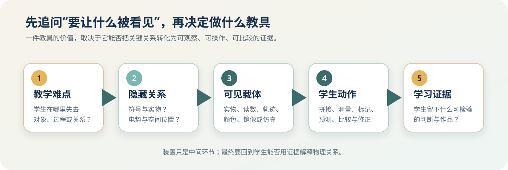
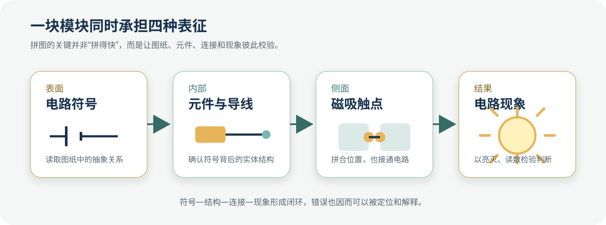
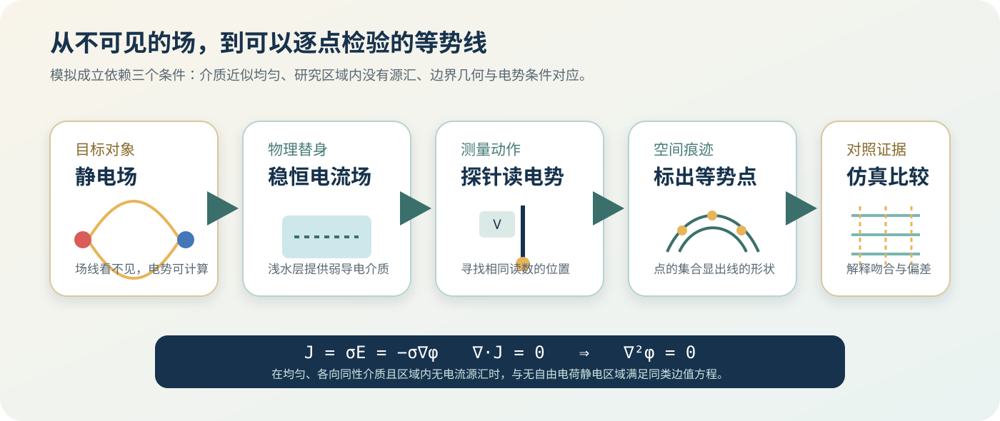

# 从用到造：高中物理可视化教学的自研之路

## 教师自研工具与科学思维培养实践

**作者：** 丁龙　黄灿斌　王硕　严力耕

<!-- 本文件由十二章正文自动合并。逐章Markdown是正文源文件。 -->

## 目录

- 第1章　从知识传授到思维培养：当学生需要现场建模
- 第2章　可视化与科学思维：从看见到建模、推理与论证
- 第3章　创新实验与自制教具：让不可见变为可见
- 第4章　计算机仿真与可视化：让模型可以操控、比较与检验
- 第5章　图形化编程：让代码驱动真实世界
- 第6章　数字化教学平台：让分散资源成为共同入口
- 第7章　概念课：让定义背后的关系逐步显现
- 第8章　规律课：让证据在预测与修正之间流动
- 第9章　习题课：把复杂情境展开成可检查的推理
- 第10章　科创课与项目式学习：让学生承担完整的创造
- 第11章　科学思维培养的效果评价：证据能把结论带到哪里
- 第12章　教师自研工具的可持续之路：把一次创造变成长期能力

---

# 第一篇　为什么：问题与方向

# 第1章　从知识传授到思维培养：当学生需要现场建模

2024年11月至2025年6月，我们仍在高三教学一线。收集学生错题，制作《一轮物理错题集》，组织考后反思，安排定期重做，对临界生面批面改，再根据考试结果分析知识和方法上的缺口。这些工作持续了一个学年中的多个阶段，也留下了题目、错误答案、反思和再次修改的记录。

错题整理很有价值。它让教师知道哪些知识反复出错，也让学生有机会重新面对自己的薄弱处。记录逐渐增多后，另一个问题变得清楚：一页错题通常保存了题干、解答和正确答案，却很少保存学生第一次读到陌生情境时做过哪些判断。

他研究的是哪个对象？怎样确定系统边界？长过程在哪里分段？哪个状态连接前后两个模型？使用守恒定律的条件是否满足？计算结果怎样回到情境中复核？如果这些判断没有留下来，教师看到的往往只剩某一步公式错了，学生也容易把改错理解为“把正确解法重新抄一遍”。


**图1-1　高三复习中的题目—错误—修正链。** 图中行动来自2024年11月至2025年6月的工作记录；解释性重绘不代表某一名学生的完整学习过程。

这段经历没有证明传统训练已经失效。它提出了一个更具体的问题：当考试和课堂都要求学生在新情境中现场建模时，我们怎样把建模、推理、证据和修正也纳入日常教学？

## 一、会做熟题，仍可能停在陌生情境之外

一套熟悉题型常常带有明显线索。看到“光滑斜面”，学生想到机械能守恒；看到“碰撞时间极短”，想到动量守恒；看到“导体切割磁感线”，想到感应电动势。经过充分训练，这些线索与公式之间可以形成快速联结。

真实情境题会把线索藏在装置、动作、图表和条件之中。学生先要从语言和图像中构造一个物理问题，再决定使用什么知识。这个转换发生在列式之前。

2023年广东高考的药品自动传送系统题提供了一个典型例子。药品盒先在传送带上由静止加速到共速，随后进入竖直螺旋滑槽，到达平台后发生碰撞，最后从平台边缘做平抛运动。题目中的知识点都来自高中物理，困难集中在四段过程怎样相接。


**图1-2　药品自动传送系统的四阶段地图。** 根据2023年广东高考题意改绘。原题考查传送带加速、滑槽运动、碰撞和平抛的连续衔接，本图只保留分析结构，不复制原题图与完整题干。

第一阶段中，药品盒与传送带存在相对运动，摩擦力改变盒子的速度；达到共速时，第一个状态接口出现。第二阶段需要比较滑槽入口和平台末端的能量，并把阻力做功纳入关系；盒子到达平台最右端时，第二个接口出现。第三阶段用碰撞前后的动量和能量损失连接两物体速度；第四阶段再把碰后水平速度与落地位置连接。

学生可能熟悉每一段对应的公式，却在接口处出错：把A盒的状态量带给B盒，把碰撞后的速度提前用于碰撞前，把滑槽中的能量关系延伸到平抛阶段，或没有检查另一组数学解是否符合碰撞情境。问题的核心是系统、阶段、状态和模型之间的连接。

2024年广东高考的电磁俘能器题把这种转换放到电磁感应中。两对永磁铁随发动机上下振动，固定线圈位于方向不同的磁场区域。学生需要先读懂空间分区和相对运动，再处理两个区域对总磁通量的代数贡献，接着判断磁通量变化率和感应电流方向。


**图1-3　电磁俘能器的五层变量链。** 根据2024年广东高考题意提炼。空间分区、相对运动和有符号磁通量先被确定，随后才能使用法拉第电磁感应定律和楞次定律。

若学生只记得“磁通量等于(BS)”，很容易把两个方向相反的磁场面积直接相加；若只关注磁铁处于高处还是低处，又会把位置、磁通量和变化率混在一起。公式没有变，公式中每个量的物理含义需要在新装置中重新建立。

两道题不能代表所有高考命题，也不能据此得出学生普遍失败的结论。它们与课程标准的命题要求处于同一方向：围绕生产生活、科技事件和具有真实性、探究性或开放性的情境设置任务，通过学生处理复杂情境的外在表现评价核心素养。对课堂而言，这意味着知识教学还要覆盖“怎样把情境转成物理问题”。

## 二、科学思维已经被写成可观察的表现

《普通高中物理课程标准（2017年版2020年修订）》把物理学科核心素养概括为物理观念、科学思维、科学探究、科学态度与责任。科学思维包含模型建构、科学推理、科学论证、质疑创新四个要素。


**图1-4　科学思维四要素。** 依据2020年修订高中物理课程标准重绘。四个要素在真实问题解决中相互交织。

这四个要素可以翻译成学生的具体行动。

**模型建构**要求学生从实际对象中选择需要保留的特征。把药品盒视为质点，需要确认盒子的形状和转动在当前问题中可以忽略；把俘能器中的磁场分成两个区域，需要确定方向、边界和线圈有效面积。模型始终带有条件。

**科学推理**要求学生让结论由条件和关系连续推出。传送带阶段的加速度怎样得到，共速条件怎样形成下一阶段初态，碰撞关系怎样给出平抛初速度，每一步都要接得上。推理链中断时，最后答案即使数值碰巧正确，也难以说明学生已经理解。

**科学论证**要求观点得到证据支持。实验课中的证据可以是测量数据、图像和误差；习题中的证据可以是条件、方程、量纲、极限状态和反代结果。学生还要判断一条证据究竟支持什么，能否排除其他解释。

**质疑创新**要求学生检查模型边界和证据可靠性，发现不一致时修正方案。它可以从很小的动作开始：指出另一个数学解不符合碰撞次序，发现仿真数据由同一公式循环生成，质疑一张图的坐标范围掩盖了差异，或提出更稳妥的测量与呈现办法。

课程标准的学业质量和核心素养水平进一步描述了这些行动怎样递进。低水平表现包括说出简单模型、区别观点和证据；随后进入熟悉情境中的模型应用和直接证据；更高要求是选择恰当模型、解释结论、提出有依据的质疑；再向上，学生要把实际问题转换成模型，用证据证明结论；最高层级要求在新情境中综合推理，考虑证据可靠性，并从多个视角审视和检验结论。


**图1-5　科学思维表现的动作阶梯。** 依据2020年课标五级描述作动作化概括；本图用于说明递进方向，不替代课标原表。

教学目标由此不再停留在“培养科学思维”一句话上。一节课可以进一步写成：学生能否画出系统边界，能否说明为什么选择某个模型，能否用数据支持规律，能否指出证据不足之处，能否在条件改变后修正结论。目标一旦转成动作，就能进入任务、作品和评价。

## 三、一道新情境题包含五次转换

学生从读题到列式，至少经历五次信息压缩。

第一层是情境信息。装置名称、生产用途、人物操作和背景叙述提供真实语境，其中只有一部分直接进入物理模型。

第二层是对象与系统。学生决定研究哪个物体，是否把多个物体看作系统，外界有哪些作用，系统边界怎样影响守恒关系。

第三层是过程与状态。连续叙述被分成若干阶段，阶段之间由共速、碰撞、离轨、开关闭合等状态连接。

第四层是模型与条件。学生判断能否采用质点、匀变速、平抛、完全非弹性碰撞、理想电源、匀强磁场等模型，也要写出适用条件。

第五层才是关系与证据。方程、图像、测量和逻辑关系被用来求解并复核。


**图1-6　新情境到物理模型的五层漏斗。** 每一层都在减少信息，同时要保留与当前问题有关的结构。

传统讲解容易直接展示第四、第五层。教师已经完成对象选择、阶段划分和模型判断，再把整齐的方程写在黑板上。学生看到的是成熟结果，很难知道模型从哪里来。换一道外形不同的题，熟悉线索消失，原先的公式联结便不容易启动。

课堂需要让前几层也留下痕迹。可以要求学生先画对象—过程图，再列状态表；可以让学生比较两个不同系统边界产生的方程；可以把相同公式放进两个条件不同的情境，判断何时可用；也可以故意提供一条与预期冲突的数据，要求学生解释是模型错误、测量误差还是实现问题。

这些动作并不会取代必要的运算训练。它们把运算安放在有来源、有条件、有去向的推理链中。学生算得快仍然重要，知道自己正在算什么、为什么这样算、结果怎样接受检验同样重要。

## 四、“讲清楚”和“学生想出来”之间有一段距离

教师对一道题非常熟悉时，往往能迅速抓住关键量，几句话便说清模型。讲解越顺畅，学生越可能产生“我听懂了”的感受。等学生独立面对题目，先前由教师完成的转换重新出现，困难随之暴露。

一条只强调公式的路径通常有四个断点。

第一个断点在情境与对象之间。学生读完题，却没有确定研究对象和系统。

第二个断点在过程与模型之间。学生看见“碰撞”“圆弧”“磁场”等词，立即调用公式，没有检查阶段和条件。

第三个断点在模型与方程之间。学生知道大致方向，却没有定义变量、正方向、参考平面和状态接口。

第四个断点在答案与证据之间。学生得到数值后停止，没有检查单位、数量级、极限状态、另一组解和情境约束。


**图1-7　公式前后容易被跨过的断点。** 方程计算只是完整问题解决链的一段，前后都需要可观察的判断。

刷题可以提高识别熟悉模式的速度，也可以积累模型经验。问题出现在课堂只记录“题型—公式—答案”时：学生用什么依据识别题型、哪些条件让模型成立、怎样发现选错模型，这些关键判断仍藏在头脑里。

高三错题本也可以向前走一步。除了抄题和订正，还可以增加四个栏目：我研究的对象与系统、我怎样分段、我选用模型的理由、我用什么证据复核。错因也可以从“计算粗心”进一步定位为对象混淆、状态量串用、条件遗漏、符号系统不一致或结果未复核。教师面批时便能针对断点提问。

没有匿名学生作品和课堂观察之前，我们不能声称这种改造已经提高成绩。它提供的是一条可实施、可收集证据的路径。未来可以比较同一学生修改前后的过程图、模型说明和迁移题作答，观察困难是否真正从某个断点移开。

## 五、把课程目标翻译成学习动作与证据

“培养模型建构能力”很难直接用来设计一节课。教师需要继续完成两次翻译。

第一次把目标翻译成学习动作。例如：从实物中标出系统边界；比较两个模型保留和忽略的因素；改变参数前写出预测；用图像斜率解释物理量；选择支持结论的数据；指出异常点并给出可能原因；修改装置或程序后重新验收。

第二次把动作翻译成学习证据。例如：一张结构标注图、一张预测卡、一组原始数据、一段带条件的解释、一次错误修正记录、一个迁移情境中的模型选择。教师看到这些产物，才能判断学生在哪一步需要支持。


**图1-8　课程目标到学习证据的翻译。** “培养”经过具体行动和可保存产物，才进入课堂反馈与后续评价。

同一个知识点可以设计出不同层级的任务。机械能守恒的低层任务是辨认动能和重力势能表达；更高一层要求选择系统与参考平面；再高一层要求用实测数据检验守恒，并分析转动能、空气阻力、轨道摩擦和测量模型；开放任务还可以比较自由落体、曲面下滑和气垫导轨三种方案的证据质量。

电容概念也一样。学生可以先指出两导体和介质，随后控制有效面积，解释静电计变化，再比较莱顿瓶与平行板装置的模型差异，最后迁移到触摸按键或液位传感器。知识内容没有被放弃，它被组织成逐步提高的认知行动。

## 六、让思维可见，需要一个共同工作的对象

科学思维发生在头脑中，教师无法直接观看。课堂能做的是让思维作用于外部对象，并要求学生留下可以讨论的产物。

这个对象可以是一件教具。活版电路把电路符号、元件、连接和现象放到同一界面，学生的连接动作可以被观察。静电场描绘仪把等势关系转成逐点测量，学生必须选择位置、读数并连接结果。

它也可以是一张图或一个仿真。过程图让多阶段情境展开，参数仿真让条件变化可重放，动态图像让学生比较瞬时状态与整体关系。第4章将进一步讨论仿真怎样避免沦为动画播放。

它还可以是一组数据。机械能实验中的三种方案把“守恒”放到不同测量链中，学生既看能量变化，也要判断速度怎样测得、系统边界是否一致。数据与理论冲突时，思考从确认结论转向检查证据。

智能硬件和网页平台则把对象、操作、记录和反馈连接起来。学生拖动积木编程控制真实传感器，浏览器收集数据，平台保存页面与作品。技术增加了可做的动作，也增加了物理正确性、隐私、版本和维护责任。


**图1-9　可视化让思维进入共同工作台。** 外部表征承担中介，学生需要通过标注、调参、测量、比较和解释公开自己的判断。

可视化的价值不等同于“画面更直观”。一张华丽动画可能替学生完成全部判断，只留下被动观看；一张简单状态表也可能迫使学生明确对象、变量和接口。选择媒介时应问：学生当前看不见什么？这个媒介增加了什么可观察量或可操作动作？它有没有隐藏本应由学生完成的判断？学生使用后留下什么证据？

第2章将详细讨论外部表征怎样与模型建构、推理、论证和质疑发生联系。这里先确定一个原则：看见只是起点，操作、解释、检验和迁移决定可视化是否真正进入思维教学。

## 七、复习课可以从四个小改动开始

思维教学不要求教师立刻重做整套课程。高三复习节奏紧，最可行的起点是改造已经在做的错题讲评和训练，让学生在原有解答旁边多留下几类过程证据。

第一个改动是“先分段，后列式”。遇到长情境，先给学生一分钟画过程线，只标对象、动作、状态和阶段接口。教师暂不评价方程，先比较不同分段是否覆盖了全部事件。药品传送题中，共速、到达平台、碰撞和离开平台就是关键接口。学生一旦漏掉接口，后续状态量很容易串用。

第二个改动是“写出模型理由”。学生在机械能守恒、动量守恒、平抛或匀变速公式旁写一句适用条件。句子不需要很长，例如“碰撞时间很短，外力冲量可忽略”“离开平台后只受重力”“研究A、B整体时碰撞内力不进入系统外功”。教师由此可以区分学生是公式不会，还是条件判断出了问题。

第三个改动是“保留一个错误解”。讲评时选择有代表性的错误路径，隐去姓名，要求学生指出第一个失效节点。错误解用于训练全班判断一条推理从哪里开始失效，不用于展示谁做错。若只看最终答案，学生容易把所有错误都归为计算；定位第一个失效节点，才能看见对象、符号、系统和模型层面的差异。

第四个改动是“答案之后再问一次”。可以问量纲是否正确，极端条件下关系是否合理，另一组数学解为什么舍去，换一个系统边界是否得到一致结果，仿真或实验能否独立检验。复核问题让答案重新回到情境，也给质疑创新留下入口。

四个改动都可以进入错题本：过程线、模型理由、首个失效节点、复核方式。教师不必为每一道题都完整执行，可以选择结构典型的题进行深度讲评，再让学生把方法迁移到同类陌生情境。知识点复习、运算熟练和思维显化由此处在同一条任务链中。

这些设计是否改善学生表现，需要真实作品、迁移任务和持续比较来回答。当前可以确定的是，它们为观察学生怎样解决问题提供了比“答案对错”更细的入口，也为第11章讨论的评价证据预先留下了位置。

## 八、教师为什么要从“用工具”走向“造工具”

现成资源当然重要。优质实验器材、仿真软件、开放课件和数字平台能显著扩展课堂。教师使用它们时也在做专业选择：选哪个页面，保留哪些功能，在哪个节点暂停，配什么问题。

真实课堂常常提出更细的要求。一个仿真缺少教师想比较的变量，一套商业实验无法接入本校器材，一张动态图隐藏了误差，一份通用练习与本班误区错位。过去，这些需求很容易停在“如果能改一下就好了”。生成式AI、网页技术、低成本传感器和开源工具缩短了从想法到原型的距离。

自研也带来新的责任。教师要定义问题，核对模型，测试功能，保留来源，保护学生数据，维护版本，并说明资源适用的条件。第11章的评价个案已经提醒我们，页面看起来完整，代码仍可能制造错误证据；第12章进一步把维护与授权纳入资源生命周期。

教师创造工具的意义，最终落在专业判断能否外化：把“我知道学生会在哪里卡住”写成一个任务，把“这个模型有条件”写进交互和验收，把“这条证据还不够”转成一次复核，把个人经验整理成同事可以继续使用的资源。

两项在研课题记录了这条探索路径。南山区课题聚焦科学思维培养与高中物理可视化教学，深圳市课题进一步扩展到互动平台、H5资源和AI辅助开发。课题提供问题框架和研究计划；课堂案例、装置、页面、数据与学生作品才是检验这些计划的具体证据。本书也会持续区分目标与结果。

## 九、本书怎样回答这个问题

全书分为四篇。

第一篇回答为什么。第1章从真实复习和新情境任务提出问题，第2章建立可视化与科学思维之间的机制框架。

第二篇回答怎么造。第3章讨论自制教具怎样减少无关信息、增加可测证据；第4章讨论仿真怎样从播放走向操作、比较和解释；第5章展开ESP32Blockly怎样把图形化编程连接到真实硬件；第6章说明分散资源怎样进入共同平台。

第三篇回答怎么用。概念课让定义背后的结构和关系显现，规律课让证据在预测与修正之间流动，习题课把复杂情境展开成可检查的推理，项目式学习让学生承担设计、实现、验收和答辩。

第四篇追问证据与持续性。第11章区分一次行为、本任务表现、学习变化和迁移能力，第12章把选题、开发、验真、入课、维护和共享连接成生命周期。


**图1-10　全书四篇路线。** 主线贯穿“为什么—怎么造—怎么用—怎样评价与维护”，所有技术最终回到真实教学问题和可检查证据。

我们不会把每件教具写成成功故事，也不会把每个网页当作AI能力的展示。没有课堂记录时，写清装置和任务设计；没有前后测时，不声称学习提升；图片只能证明外观时，不让它承担课堂效果；开发中的页面可以进入材料库，图注要说明版本和公开状态。

这样的边界不会削弱实践价值。它让教师能够准确判断：哪些做法可以直接借鉴，哪些结论仍待验证，哪些材料适合在自己的课堂继续做。科学思维教学本身就要求模型有条件、推理有链条、论证有证据、结论接受质疑。一本讨论科学思维的书，也应按同样的方式建立自己的可信度。

从知识传授到思维培养，知识仍然是学生理解世界的基础。变化发生在知识怎样被使用：学生要把真实对象抽象成模型，把分散条件组织成推理，用证据支持解释，在冲突中修正结论。可视化让这些行动拥有共同对象，教师自研让工具贴近真实课堂并能够持续迭代。下一章将从这里出发，解释可视化在什么条件下支持科学思维，以及哪些表征只增加了画面，没有增加学生的思考。

# 第2章　可视化与科学思维：从看见到建模、推理与论证

一段动画在大屏幕上流畅播放：小球沿曲面滑下，速度箭头不断变长，动能曲线上升，重力势能曲线下降，总能量曲线保持水平。画面清楚，关系完整，颜色也容易区分。教师讲完后问“看懂了吗”，学生通常会点头。

真正值得追问的是：学生刚才完成了什么？

他是否在动画播放前预测过变化？是否确定了研究对象和系统边界？是否知道总能量曲线为什么水平？若换成滚动小球，是否会考虑转动动能？若实测数据不守恒，是否能区分摩擦、空气阻力、测速方法和程序实现？如果这些判断都由页面替学生完成，学生得到的是一次清楚的观看体验，思维过程仍然没有展开。

物理教学中的可视化至少有三层含义。第一层让对象、过程或关系能够被感知；第二层要求学生对表征进行操作和加工；第三层让模型、条件、证据和修正形成可以检查的产物。


**图2-1　可视化的三层含义。** 画面解决信息可达，任务引发认知行动，产物使思路进入反馈。

这三层为本书提供一个共同判断标准。实物教具、计算机仿真、数据图、网页实验和智能硬件都属于外部表征。它们的教学价值由学生能够完成的行动决定，也由这些行动留下的证据决定。

## 一、先确定学生看不见什么

“这个知识太抽象，要做得直观一点”是教师开发资源时常说的一句话。它指出了方向，还需要继续拆解。学生看不见的对象可能完全不同。

有时看不见的是**结构**。静电场没有可直接观察的线条，电容器内部的导体与介质关系容易被外形遮蔽，复杂电路中的符号、元件与连接也常分散在不同表面。

有时看不见的是**过程**。碰撞时间很短，机械振动连续发生，磁通量随位置变化，多阶段情境中的状态接口藏在叙述中。学生需要暂停、分段和反复比较。

有时看不见的是**关系**。动能、势能和总能量同时变化，摆长与周期之间存在函数关系，电容与有效面积、间距、介质有关。单个瞬间或一组孤立数字很难显出整体结构。

有时看不见的是**证据**。一条拟合曲线可能遮住原始点，一张实验结果表可能没有说明速度怎样测得，一个仿真结论可能由同一公式循环生成。学生看到了结果，却没有看到结果由什么支持。

还有一种更隐蔽的对象：**解决问题的方法**。怎样选系统，怎样分阶段，怎样保留和忽略特征，怎样判断一条推理开始失效，这些动作通常由熟练教师在头脑中迅速完成。板书只留下整齐的结论，学生很难回看形成过程。

蔡钳、陈信余把物理问题解决中的思维可视化归纳为抽象物理量、运动过程、相互作用过程和解决方法四类。他们用能量图、阶段表、动态受力和粒子轨迹说明，物理量与方法同样可以成为外显对象。这类案例给教师一个重要提醒：先说清“要让什么可见”，再决定使用哪一种媒介。


**图2-2　同一物理过程的六种表征工作台。** 实物、结构图、图像、数据、符号和仿真分别适合回答不同问题。

选择媒介时可以问一个很朴素的问题：它增加了哪一种学生行动？实物适合观察、操作和测量；过程图适合标注、分段和排序；图像适合读趋势、斜率、面积和临界点；数据适合比较、拟合和诊断异常；方程适合精确表达、推导和量纲检查；仿真适合控制变量、重放过程和构造反事实情境。媒介之间没有高低顺序，任务需要决定组合方式。

## 二、外部表征怎样进入学习过程

学生头脑中的理解无法被教师直接观看。课堂能够共同处理的是外部表征：一个模型、一张图、一组数据、一段程序或一件装置。外部表征提供共同对象，随后还需要学生行动、可见产物和反馈。


**图2-3　外部表征进入科学思维的机制链。** 学生行动是机制发生处，可见产物是证据留下处。

这条链上有五个环节。

第一，教师定位学习障碍。学生究竟分不清对象、跟不上过程、连不起关系，还是不会判断证据？模糊地说“难”很难指导设计。

第二，选择或制作外部表征。表征应突出与当前问题有关的结构，同时保留必要边界。静电场描绘仪突出等势点的测量过程，活版电路突出连接与现象，能量曲线突出多个量的同步变化。

第三，安排学生行动。学生需要预测、标注、调参、测量、比较、解释、质疑或修改。没有行动要求，资源容易停在教师演示层。

第四，保存可见产物。一张模型图、一组原始数据、一段带条件的解释、一次错误定位或一个修订版本，都能成为反馈入口。

第五，依据产物设计下一任务。若学生画错系统边界，继续讲公式帮助有限；若学生模型正确却无法处理异常数据，下一步应进入测量链与证据可靠性。反馈要回到具体断点。

这条机制链是一套设计假设，不能自动推出学习效果。教学是否产生变化，还要看真实课堂中的学生行动、产物与迁移表现。现有可视化教学文献中，大量文章提供课例和策略，效果数据相对有限。赵慧臣、王玥对2003—2013年47篇国内文献的历史分析已经指出评价和长期证据不足。那是一段历史截面，不能代表今天的全部研究；它仍提醒我们，设计合理与效果成立属于两种证据任务。

## 三、表征转换比媒介数量更重要

一节课可以同时使用照片、视频、动画、曲线和公式，学生仍可能只记住最后一张结论图。真正有认知价值的环节往往发生在表征转换时：从实物抽象成模型，从模型写出关系，用关系产生预测，再用数据检验模型。


**图2-4　真实对象、物理模型、数学关系和数据证据之间的翻译环。** 每次转换都要解释选择、条件和检验方式。

以单摆为例，学生先面对真实摆球、摆线、支架和运动；随后选择摆长、摆角、质量、重力等变量，建立理想单摆模型；再由模型形成周期与摆长的数学关系；最后通过多组测量数据检验。每一次转换都可能出现新的理解断点。

从实物到模型，学生可能把摆线总长当作摆长，也可能忘记摆球半径。从模型到关系，学生可能没有说明小角度条件。从关系到数据，学生可能只测一次全周期，忽略反应时和计数误差。从数据回到模型，学生可能把偏离拟合线的点直接删除，没有先查原始记录和操作条件。

教师可以把“翻译理由”写进任务：你保留了哪些特征？忽略了哪些因素？为什么选择这个坐标？图像中的斜率对应什么量？这组数据支持哪个结论？若更换装置，关系中的哪些条件需要改变？这些问题让不同表征之间产生连接。

多表征也需要节制。若页面同时播放装置动画、矢量箭头、三条曲线、数字表和公式推导，学生的注意会在多个区域之间来回跳转。更稳妥的做法是按问题分步出现：先观察现象，再标状态；先预测一条曲线，再打开数据；先说明模型，再给公式；最后让学生把几种表征放在同一解释中。

## 四、模型建构：看清以后还要学会删减

模型建构常被理解为“把抽象对象画出来”。物理模型还承担另一项更重要的工作：从丰富现实中删去暂时无关的细节，保留决定当前问题的结构。

第7章的莱顿瓶案例很适合说明这一过程。真实装置有玻璃瓶、内外金属层、导线、瓶口和曲面外形。若研究电容形成条件，需要保留两导体、绝缘介质、有效面积和间距等关键属性；瓶口造型、曲率细节和边缘场可以在初步模型中暂时忽略。随后再把装置转成平行板电容器，控制面积、间距或介质，检验关系。


**图2-5　莱顿瓶到平行板电容器的结构模型。** 装置外形发生变化，两导体与绝缘介质的核心结构被保留。本图复用第7章书内重绘资产。


**图2-6　模型建构中的选择与删减。** 模型简洁来自有依据的选择，适用条件需要同时写出。

吴峤在质点教学案例中采用递进删减：从五官、人脸、人体、小球逐步过渡到点，再给这个点保留质量。这个设计的价值在于把“忽略大小和形状”转成一连串选择。学生看到模型并不等于学会建模；当学生能够说出为什么保留质量、什么时候物体不能视为质点，模型才具有条件意识。

在本书的案例中，模型建构可以由不同媒介承接。

静电场描绘仪把电场问题转成等势点的逐点测量，学生需要理解水槽、探针、电极与待研究电场之间的模拟关系。活版电路把电路符号、真实元件和连接关系并置，学生的连接动作直接暴露对节点的理解。习题课中的四阶段地图把长情境压缩成对象、状态与模型接口。ESP32Blockly中的积木则把传感器、引脚、动作和参数转成可组合的程序对象。

这些表征都可以支持模型建构，也都可能替学生完成建模。若教师直接给出完整过程图，学生只需照着列式，前一章所说的情境转换仍然由教师承担。可以采用渐进任务：先让学生从真实装置中圈出关键部分，再提供半成品结构图，最后让学生面对新装置独立选择模型。

## 五、科学推理：让动态过程可预测、可暂停、可比较

动画与仿真最直接的优势是控制时间。高速碰撞可以放慢，机械振动可以重放，磁通量变化可以分帧观察，参数可以连续调节。动态呈现只有进入推理链，才能超越“运动起来”。

尹庆丰、刘霁华的简谐运动设计提供了一条可借鉴的任务序列：先观察生活与实验中的振动，再抽象弹簧振子模型；用频闪图像猜测位移—时间关系；随后通过特殊值、几何画板拟合和DIS图线检验；最后迁移到单摆。文章没有提供学习效果测量，它清楚展示了媒介怎样服务不同认知动作。

一项动态资源至少可以安排五个动作。


**图2-7　动态表征进入推理的五个动作。** 页面运行只是其中一步，预测、暂停、比较、解释和迁移共同构成推理。

**先预测。** 改变摆长之前，先画周期变化趋势；增大电容器有效面积之前，先判断静电计指针怎样变化；改变传送带速度之前，先判断共速位置是否移动。预测让学生现有模型公开出来。

**单变量操作。** 一次只改变一个条件，保留其余状态，避免多个变化同时发生后无法归因。若真实装置很难控制，仿真在这里可以提供清楚的比较条件。

**在关键状态暂停。** 动态过程中的信息连续流动，暂停点帮助学生比较初态、临界态和末态。碰撞前后、离轨瞬间、磁通量最大处、速度为零处都适合成为任务节点。

**比较预测与结果。** 学生需要指出一致处和冲突处。若页面只给“正确”提示，没有要求说明依据，推理仍然很短。

**解释并迁移。** 学生用模型说明变化，再换一种装置或情境重新预测。简谐运动从弹簧振子迁移到单摆，机械能守恒从自由落体迁移到曲面轨道或气垫导轨，都是检验关系是否摆脱原画面的机会。

第4章将专门讨论仿真与可视化设计。这里先给出一条底线：动画负责让过程可达，问题链负责让推理发生。两者要在时间节点上相互配合。

## 六、科学论证：数据图要保留证据的来路

数据可视化经常被当作“更直观地证明规律”。科学论证要求更严格。学生需要知道数据从哪里来、怎样处理、是否存在异常、结论能够覆盖多大范围。

第8章的单摆原始表中有9组记录，其中一组写为摆长0.64 m、54 s、29.5次。把周期与摆长平方根作图后，这个点明显偏离其余数据。若只展示平滑拟合线，问题会消失；若把全部原始点保留下来，课堂便出现一个有价值的证据任务。


**图2-8　单摆原始数据中的需复核点。** 图由第8章原表复算。偏离点提示回查记录，不构成自动删点理由。

学生可以先回到原始表，判断“29.5次”是半个周期计数、记录错误还是另有操作含义；检查54 s是否对应完整计时；比较保留与暂不纳入该点时拟合参数怎样变化；最后说明当前数据能够支持的结论。整个过程把异常从“麻烦数据”变成论证入口。


**图2-9　数据图成为证据所需的四层说明。** 来源、处理、异常与主张边界缺一层，论证都会变弱。

机械能守恒实验中的三套方案也能说明这一点。自由落体、曲面下滑和气垫导轨都可以产生能量数据，它们的测量链不同。速度可能来自光电门遮光时间、位置差分或其他传感方法；研究系统可能包含或排除转动部分；轨道摩擦、空气阻力和仪器精度的影响也不同。三条“总能量接近不变”的曲线并不具有完全相同的证据质量。

网页仿真还要防止循环论证。若程序用机械能守恒公式计算速度，再由这个速度画出机械能守恒曲线，页面只能展示公式的一致性，无法构成对规律的独立检验。第11章的学生作品个案已经出现这种风险：过程对话中识别了循环论证，最终代码仍沿用同源关系。判断进入了过程，却没有进入成品。

数据可视化进入科学论证时，可以要求学生回答四问：数据怎样产生？图怎样处理？异常怎样解释？这张图最多支持什么？问题越具体，学生越容易把“我相信这条曲线”转成“我能说明这条证据”。

## 七、质疑创新：把冲突、错误和修复也做成可见对象

质疑创新常被安排在课堂末尾：“你还有别的方法吗？”学生缺少可检查对象时，这个问题很容易停在发散表达。真实项目提供了另一种入口：让模型、装置、代码、数据和失败记录都能被检查。

ESP32Blockly开发中，一块传感器没有响应，原因可能在接线、引脚、积木生成代码、通信模式或硬件本身。教学网页中的曲线不对，原因可能在物理模型、单位换算、参数范围、坐标映射或程序状态。学生或教师先定位冲突，再提出修改，用独立方式复核，并保留修订前后的证据。


**图2-10　质疑创新的证据循环。** 一次有依据的小修改，也可以承载完整的质疑、诊断与复核。

创新不必从“发明一套全新系统”开始。把速度测量由单点估算改成双光电门，把只能播放的动画增加预测与暂停，把没有来源的曲线接入真实传感数据，把一项容易误解的提示改成可解释反馈，都是面向真实问题的创造。

生成式AI降低了实现门槛，也会增加未经核验内容。页面生成得越快，越需要保留需求、模型、特殊点、错误版本和验证结果。质疑的对象不应只指向AI输出，教师提供的模型、现成软件和教材图也接受同样检查。学生由此学会一种更稳定的态度：信任来自可追溯、可复核的证据。

## 八、四要素与媒介之间没有固定配方

为便于解释，本书会突出若干常见关系：实物模型支持模型建构，动态仿真支持科学推理，数据可视化支持科学论证，开放项目支持质疑创新。这些关系提供设计入口，具体配方仍由任务和证据决定。

同一件实物可以同时承载四种行动。学生观察莱顿瓶结构是在建模；改变有效面积并预测现象是在推理；记录静电计变化并讨论误差是在论证；修改装置以减少干扰是在质疑创新。

同一个科学思维要素也需要多种媒介。模型建构可以通过实物、结构图、过程图、符号和代码完成；科学论证可以使用原始数据、图像、方程、反例和另一件仪器。媒介与思维是多对多关系。


**图2-11　媒介与科学思维四要素的多对多关系。** 圆点只表示可能的支持强度，具体机制仍由任务和产物决定。

刘健智、程婷对GeoGebra用途的归纳也说明了这一点：同一种软件既能处理实验数据拟合，也能呈现规律推导、临界过程、三维关系和动态过程。软件没有固定的认知角色。滑动条可以只是好玩的控件，也可以让学生控制变量；拟合图可以只是漂亮结论，也可以成为检查模型和异常的证据。

因此，评价一项资源时不宜只问“用了什么技术”，还要问学生做了什么。他是否选择了模型？是否在运行前预测？是否使用数据支持结论？是否指出边界和异常？是否根据冲突修改方案？同一页面因任务组织不同，会产生完全不同的学习机会。

## 九、可视化也可能遮住思维

画面直观并不天然可靠。朱亚军提出高中物理可视化教学应遵循科学性、生本性、创新性、整体性、层次性和反馈性等原则，其中科学性是首要门槛。回旋加速器轨迹若被画成等间距，动画再流畅也会制造错误物理印象。

本书案例中常见的失效模式可以归为六类。


**图2-12　六种会阻断思维的可视化。** 失效判断应落到具体问题和修复动作。

**模型错误。** 公式文字正确，动画轨迹、方向或比例却不符合规律。修复时选择能独立手算的特殊点，再与页面输出比较。

**替学生作答。** 页面一打开便显示变量关系、图像和结论。修复时隐藏部分关系，加入预测、选择和解释。

**信息过载。** 过多颜色、动画和文字同时出现，学生找不到当前任务。修复时分步揭示，并在关键状态暂停。

**数据失源。** 只展示处理后的漂亮曲线，原始记录、测量方法和误差范围消失。修复时保留数据链和复算方法。

**图像装饰。** 图片与正文和问题都没有关系，读者跳过图片也不影响理解。修复时明确读图动作；没有读图任务的图片可以删去或改成真正解释结构的图。

**操作无反馈。** 学生反复点击，却不知道结果为什么出现、怎样判断对错。修复时提供可解释反馈和再次验证入口。

可视化还可能制造过强的真实感。电场线、磁感线和波函数图像都是模型表征，画得像真实物体后，学生容易把图形本身当作客观存在。图注、图例和课堂提问应说明表征性质：哪些是测量结果，哪些是计算模型，哪些是生成式场景，哪些是真实照片。

## 十、让支架逐渐退出，观察学生能否自己生成表征

教师提供的高质量图示可以降低入门难度。若每次都给出完整过程图、状态表和模型关系，学生迁移到新情境时仍然可能无从下手。可视化支架需要逐步退出。


**图2-13　可视化支架的三阶段渐隐。** 教师提供的表征逐步减少，学生选择和生成的表征逐步增加。

第一阶段由教师示范。教师给出结构、变量和样例，演示怎样读一张过程图、怎样从图像找到临界点、怎样把数据与模型相连。学生主要完成辨认和解释。

第二阶段共同完成。教师保留坐标、栏目或部分节点，学生补画曲线、标注状态、选择系统、输入数据并修正。表征开始成为学生作品。

第三阶段独立选择。面对新的装置、数据或情境，学生自己决定画过程图、受力图、能量图、表格还是程序流程，并说明为什么这种表征适合当前问题。教师评价的不只是图是否整齐，还包括选择理由、物理条件、证据使用和修订过程。

支架退出可以进入日常练习。第一次处理多阶段题，教师提供过程线模板；第二次只提供关键对象；第三次要求学生自行分段。第一次分析能量数据，教师标出坐标；第二次由学生决定横纵轴；第三次给出含异常的原始表，让学生选择处理与呈现方式。这样的连续任务比单次“做一张思维导图”更容易观察迁移。

## 十一、用六问设计一项可视化任务

教师准备一项可视化资源时，可以用六个问题压缩设计过程。


**图2-14　一项可视化任务的六问设计画布。** 技术选择排在障碍、对象和任务之后。

**第一问：学生卡在哪里？** 从错题、课堂回答、实验记录或作品中定位具体断点。不要只写“概念抽象”“学生难理解”。可以写成“学生把电容器外形当作定义”“学生不会区分碰撞前后状态量”“学生把拟合曲线当作原始证据”。

**第二问：需要让什么可见？** 是两导体与介质结构，是碰撞前中后状态，是磁通量的有符号变化，还是数据生成链？对象越具体，图和任务越容易聚焦。

**第三问：哪一种表征最低而足够？** 能用一张状态表解决的问题，不必先做三维动画；需要连续调参的问题，静态图可能不够；需要真实测量证据时，仿真曲线不能替代传感数据。选择与教学条件相匹配的媒介。

**第四问：学生必须做什么？** 把“观看”“了解”换成预测、标注、调参、测量、比较、解释、质疑和修改。动作要能在课堂时间与设备条件下完成。

**第五问：留下什么产物？** 一张结构图、一组数据、一个程序、一段论证、一条修订记录都可以。产物要能对应原先的学习障碍。

**第六问：怎样独立验证？** 用特殊点、另一种仪器、另一条计算路径或迁移任务检查。验证同时决定结论边界：资源运行正确不等于课堂有效，一次任务表现也不等于稳定能力提升。

六问可以用于选择现成资源，也可以用于教师自研。自研的优势是能够把真实误区、学校器材和具体课堂流程写进页面或装置；现成资源的优势是成熟、稳定和节省开发成本。教师先确定最低足够方案，再决定直接使用、局部改造或重新创造。

## 十二、这套框架怎样贯穿全书

本书后面的章节不会把科学思维四要素分开讲成四套孤立方法。每个真实案例都有一个主要入口，同时承载多个思维动作。


**图2-15　科学思维四要素贯穿全书案例。** 教具、仿真、数据与平台改变主焦点，四种行动仍彼此连接。

第3章从实物与测量进入，讨论静电场和电路怎样成为可操作模型。第4章从动态与参数进入，讨论仿真怎样支持预测、比较和解释。第5、6章把图形化编程和网站平台变成共同工作环境，资源开发本身也接受物理与功能验真。

第7章的概念课强调结构、变量与模型转换；第8章的规律课强调预测、实验、数据与修正；第9章的习题课强调复杂情境的分段和表征选择；第10章的项目式学习把问题、设计、制作、测试和答辩连接起来。

第11章回到证据：学生作品、过程记录、任务数据和迁移表现各自能支持多强的结论。第12章再把规则、需求、验真、版本、授权和维护纳入教师自研资源的生命周期。

由此可以重新回答本章开头的问题。学生看见一段清楚动画，意味着信息入口已经建立；学生在运行前预测，在关键点暂停，用模型解释冲突，用数据复核，并把方法迁移到新情境，科学思维才开始留下可以讨论的痕迹。

可视化的目标也就更明确：让物理对象进入共同视野，让认知行动落在共同对象上，让证据和修正留在共同工作台上。教师从“找一张更好看的图”走向“设计一项学生必须完成的任务”，全书的后续创造便有了起点。

## 参考文献

1. 中华人民共和国教育部. 普通高中物理课程标准（2017年版2020年修订）[S]. 北京: 人民教育出版社, 2020.
2. 赵慧臣, 王玥. 我国思维可视化研究的回顾与展望——基于中国知网2003—2013年论文的分析[J]. 中国电化教育, 2014(4): 10-17.
3. 朱亚军. 论高中物理可视化教学的学术原则与实施[J]. 物理教师, 2015, 36(6): 32-34.
4. 尹庆丰, 刘霁华. 妙用“可视化”技术促进科学思维进阶——以“简谐运动”教学为例[J]. 物理教师, 2021, 42(1): 21-24.
5. 蔡钳, 陈信余. 解决问题过程中的“思维可视化”尝试[J]. 物理教师, 2021, 42(7): 92-95.
6. 刘健智, 程婷. GeoGebra软件在物理可视化教学中的应用[J]. 物理教师, 2021, 42(6): 70-73.
7. 吴峤. 信息技术环境下建构物理模型的思维进阶[J]. 福建教育学院学报, 2022, 23(11): 59-61.

# 第二篇　怎么造：教师自研可视化工具

# 第3章　创新实验与自制教具：让不可见变为可见

黑板上的电路图只有几条线和几个符号，真实电路却把接线端、元件外形、导线走向和空间位置同时摆到学生面前。静电场图中的曲线同样简洁，实验桌上却找不到一条可以直接看见的电场线。一个问题来自信息太多，另一个问题来自对象不可见。它们都要求教师在“真实”与“可理解”之间搭一座桥。

自制教具的起点就在这里：找出学生最需要看清的关系，再为这种关系选择合适的外显方式。符号与元件的对应可以变成模块；电势随位置的变化可以变成读数和标记；俯视结构可以借助反射镜转到学生正面；瞬间消失的实验痕迹可以留在照片、轨迹、表格或曲线上。材料、结构与技术都服从同一个问题——学生要依据什么证据理解眼前的物理过程？



**图3-1　自制教具的可视化设计链。** 装置位于“教学难点”与“学习证据”之间，承担关系转译的任务。（本书绘制，示意图）

本章选取两件由一线教师研制的装置。严力耕设计的“活版电路拼图”把电路符号、内部元件、磁吸连接和工作现象放在同一组模块中；黄灿斌研制的“简易静电场描绘仪”用浅水层中的稳恒电流场模拟静电场，以探针、标记条、反射镜和仿真图把电势分布逐步显现。两件装置面对不同内容，却遵循相近的设计顺序：确定隐藏关系，选择可以承载这种关系的实物表征，再安排观察、操作、比较和解释。

## 一、自制教具首先是一种关系设计

学生说“看不懂”，可能指向几种完全不同的困难。有时对象就在眼前，关键关系被杂乱细节遮住；有时研究对象无法直接观察，只能通过效应和测量间接认识；还有些内容能被看见，却持续时间太短、尺度太小或视角受限。教具若只追求做出一个醒目的物件，很容易绕开真正的学习困难。

一件面向理解的教具至少要回答五个问题。

1. **学生当前看不见什么？** 是元件之间的连接关系，还是空间中各点电势的分布？问题要落到具体对象和具体关系上。
2. **用什么现象承载这种关系？** 可以选择位置、方向、颜色、读数、轨迹、图像或声音。载体需要与物理量建立清楚对应。
3. **学生怎样参与？** 观察只能呈现结果；拼接、测量、标记、预测和比较能够让学生留下判断过程。
4. **怎样检验判断？** 电路能否工作、相同电势的点能否连成稳定曲线、实测与仿真是否大体一致，都是可讨论的证据。
5. **装置省略了什么？** 模块封装了内部线路，浅水槽模拟依赖边界条件。省略范围决定结论可以走多远。

这五个问题会反过来塑造教具。模块尺寸取决于全班能否看清；触点位置取决于电路拓扑能否准确表达；反射镜角度取决于学生视线；电极形状取决于要模拟的边界；测量精度则决定实测图能否支持比较。教师造出的每一个结构，都包含一次教学取舍。

## 二、案例一：活版电路拼图——把电路图拼成真实连接

下面这张照片给出了活版电路拼图最直观的样子。一个个模块吸附在磁性板面上，表面的线路和元件符号连成完整电路；模块背后安装真实元件与导线，侧面的触点在拼合时完成导通。学生面对的是一张可以拆开、移动、替换并真正通电的电路图。


**图3-2　活版电路拼图的组合状态。** 模块表面形成电路图，模块内部与侧面触点构成真实电气连接。（图片提供：严力耕）

这件装置已经完成制作并参加比赛，但尚未用于真实课堂。本节呈现它的设计动机、实物结构、制作过程和可开展的教学任务。学生反应、课堂效果和学习提升，要等实际使用后再依据课堂记录判断。

### 1. 一张电路图为什么会在实验桌上“失真”

电路图是一种高度压缩的模型。它省略导线的实际长度、器材外形和空间摆放，只保留元件功能与连接关系。学生读图时，需要识别节点、支路和电流路径；动手搭建时，还要找到实物端口、选择接线柱、整理导线并排除接触不良。两个任务同时出现，注意力很容易从“关系判断”转向“让装置赶快工作”。

固定演示板可以减少接线失败，却常把线路藏到板后。散装器材保留了真实操作，导线交叠又会遮蔽拓扑关系。活版电路拼图把内部的重复接线预先封装，把元件选择、模块排列和支路组织留给使用者。它削减的是与当前目标无关的操作负担，保留的是需要作出物理判断的组合过程。


**图3-3　部分独立模块。** 表面线路、元件符号和操作部件共同提示模块功能。（图片提供：严力耕）

模块化之后，抽象图与真实电路之间出现了一个可以逐层检查的中间表征。

| 表征层 | 学生看见什么 | 需要作出的判断 | 可用什么检验 |
|---|---|---|---|
| 电路原理图 | 符号、节点、支路 | 哪些元件相连，存在几条电流路径 | 口头描述或标画路径 |
| 模块表面 | 放大的符号和线路走向 | 应选择哪些模块，怎样排列 | 模块表面能否组成目标电路 |
| 模块内部 | 元件、导线和端口 | 表面符号怎样对应真实元件 | 打开或翻看模块，逐段追踪线路 |
| 模块侧面 | 磁吸触点 | 相邻模块是否形成可靠连接 | 通断检查、故障定位 |
| 工作电路 | 灯光、开关状态或仪表读数 | 现象是否支持原有判断 | 改变一个条件，观察结果是否随之改变 |



**图3-4　活版电路拼图的四层对应关系。** 学生可以沿着“符号—结构—连接—现象”往返推理。（根据装置结构绘制，示意图）

这里的关键并不在“拼图”形式本身。拼图只是操作界面，真正需要建立的是稳定对应：表面画出的每一段线路都能在内部找到去向，侧面每一个触点都有明确的电气功能，模块组合形成的图示能够接受真实通电检验。对应关系一旦模糊，操作越方便，误解越可能被快速放大。

### 2. 从三维模型到可工作的关系单元

模块先在三维建模软件中确定框架。设计者要同时安排元件尺寸、安装孔位、内部走线、表面图案和侧面触点。电阻、电容器等两端元件可以使用相近框架；开关需要给拨动部件留出空间；节点模块要表达分支；电源模块还要呈现极性。课本上看似统一的“一个符号”，到了实物设计中会分解成尺寸、端口、方向和安全等一组约束。


**图3-5　模块框架的三维建模图。** 外壳需要为元件、内部导线和侧面触点预留位置。（图片提供：严力耕）

外壳完成3D打印后，设计者安装真实元件和内部导线，再把表面线路与内部连接逐项核对。制作顺序体现了一个重要原则：先确定模块真实承担的电气功能，再设计表面图示。漂亮的图案若与内部走线不一致，会让教具变成带电的错误模型。


**图3-6　模块内部的元件与走线。** 表面符号只有能够追踪到这些真实结构时，才具有教学可信度。（图片提供：严力耕）

相邻模块依靠磁吸触点定位和导通。磁吸连接减少了拧接线柱的时间，也把“接点”变成可以直接指认的位置。学生看到两块模块靠拢，应当能够说明哪两个端点相连、连接后形成哪条路径、分开后又切断哪一部分电路。


**图3-7　模块侧面的磁吸触点。** 机械定位与电气连接发生在同一位置。（图片提供：严力耕）

磁吸结构也带来新的工程要求。触点要有足够接触面积，长期使用后仍需保持稳定；模块方向要清楚，防止错位吸合；电源模块应有醒目的极性提示和必要保护。课堂允许学生试错，装置结构要把试错限制在安全范围内。可靠性因此成为教学设计的一部分：连接不稳会把学生的推理时间重新变成排故时间，方向含混则可能制造与物理无关的失败。

### 3. 大模块与小模块服务不同视角

全班演示需要后排学生看清符号和线路，小组操作则要求模块轻便、数量充足、容易收纳。同一尺寸很难兼顾两种场景。装置设置了大小两套模块：较大的模块适合磁性板展示，较小的套件更接近桌面拼图。


**图3-8　两种尺寸的活版电路拼图。** 尺寸变化对应全班共同观察与桌面操作两类需求。（图片提供：严力耕）

尺寸直接影响教学用途。大模块让电路结构成为全班共享对象，教师可以请学生上台调整一处连接，其他学生同时观察结构变化。小模块提高了每个学生参与拼接的机会，却要求更清楚的端口标识和更精细的收纳管理。若要进入课堂，还需继续比较两套模块在辨认距离、连接稳定性、组合数量和准备时间上的表现。

### 4. 从“照图拼接”走向“用结构解释”

完整电路图加上全套模块，容易把活动变成形状匹配。要让拼接承载思维，任务中需要保留信息缺口。下面四类任务可作为课堂使用时优先尝试的方案；它们能否促成预期的学习判断，仍需在实际课堂中检验。

**任务一：从目标倒推电路。** 教师只给出实验目标、可选元件和安全条件，小组先画原理图，再选择模块完成组合。每加入一个模块，都要说明它的功能和端口关系。

**任务二：追踪不同状态的电流路径。** 学生改变开关或替换支路模块，用手指沿表面线路逐段说明当前闭合路径。电路现象用于检验路径判断，不能代替解释。

**任务三：诊断一处结构错误。** 教师预置缺少节点、测量位置不当或元件方向错误的组合。学生先预测可能出现的现象，再通过分段检查定位问题，留下修改前后的结构说明。

**任务四：把模块图迁移到散装器材。** 学生先用模块澄清拓扑，再用常规器材搭建同一电路；也可以先经历散装接线，再用模块复盘导线交叠处的真实关系。两种表征来回转换，能够检验学生是否只记住了模块形状。

| 任务 | 主要动作 | 应留下的学习证据 | 容易出现的表面完成 |
|---|---|---|---|
| 目标倒推电路 | 选元件、画图、拼接 | 选择理由、端口说明、方案图 | 只拼出能亮的电路 |
| 路径追踪 | 切换状态、指出支路 | 每种状态的电流路径与方向说明 | 只描述灯亮或不亮 |
| 故障诊断 | 预测、分段检查、修改 | 错误位置、依据和修改记录 | 不断换模块碰运气 |
| 表征迁移 | 模块与散装器材互换 | 图、模块和实物的逐项对应 | 只会使用其中一种器材 |

这套任务设计把“拼对”改造成“解释每一次拼接”。评价也应落在解释上：学生能否指出节点与支路，能否从符号找到真实端口，能否依据现象修正结构判断。拼接速度只能说明操作熟练度，无法单独证明对电路的理解。

### 5. 从作品到课堂工具，还要补上哪些环节

活版电路拼图已有实物、三维模型、内部结构和比赛展示，表面线路、内部元件与侧面触点之间的对应关系清晰可见。它要从作品走向课堂工具，还要经过真实使用的检验。

装置尚未在真实课堂中使用。本节列出的任务只能作为待实施的教学设计，后续需要用教学实录、学生方案、错误修改痕迹和访谈记录检验。数据采集扩展目前还缺少明确的硬件连接、采样协议、显示软件和运行记录。在这些条件明确之前，这一功能不能作为可运行系统讨论，也不能由此推断数据曲线或教学作用。

教具从“作品”走向“课堂工具”，需要依次检验结构对应是否准确、连接能否稳定重复、任务是否促使学生作出判断，以及能否留下支持教学改进的记录。比赛展示说明设计已经获得实物形态，课堂价值要由后续使用继续回答。

## 三、案例二：简易静电场描绘仪——用可测的电势显出空间中的场

静电场给可视化提出了另一类挑战。学生看不到电场本身，课本只能用电场线和等势线表示空间结构。图画得越流畅，学生越容易把这些线当成真实存在的细丝；教师若只说明“电场线是假想的”，又缺少可以操作的证据。黄灿斌研制的简易静电场描绘仪选择从电势入手：让探针在不同位置给出读数，把读数相同的位置逐点找出来，再把离散点组织成等势线。


**图3-9　简易静电场描绘仪。** 透明水槽、可更换电极、测量电路、45°反射结构和上方摄像位共同组成观察系统。（图片提供：黄灿斌）

这件装置没有试图制造“看得见的电场线”。它建立了一条证据链：边界形状决定电势分布，探针读取位置对应的电势差，相同读数的点组成等势线，等势线形状再与理论和仿真比较。学生看到的是测量留下的空间痕迹。

### 1. 模拟成立的物理条件

静电场中，电场强度与电势的关系为

$$
\mathbf{E}=-\nabla\varphi ,
$$

其中 $\varphi$ 表示电势。电势下降最快的方向对应电场方向；等势线上电势不变，电场线在局部与等势线垂直。

直接在空气中逐点测量静电场十分困难。装置改用浅水层形成弱导电介质，在两组电极之间建立近似稳恒电流场。对均匀、各向同性并满足欧姆定律的介质，有

$$
\mathbf{J}=\sigma\mathbf{E}=-\sigma\nabla\varphi ,
$$

其中 $\mathbf{J}$ 为电流密度，$\sigma$ 为电导率。稳恒状态下，研究区域内没有电流源汇时满足

$$
\nabla\cdot\mathbf{J}=0.
$$

若 $\sigma$ 可以近似看作常量，便得到

$$
\nabla^2\varphi=0.
$$

无自由电荷的静电区域也满足相同形式的拉普拉斯方程。只要导电介质近似均匀，电极几何形状与目标静电问题的边界相对应，边界电势条件也相匹配，两种场的电势分布就具有可比性。这里依据的是同类边值问题；水中的电流与空气中的静电荷仍属于不同物理对象。



**图3-10　静电场描绘仪的模拟链条。** 从稳恒电流场的电势测量出发，逐点得到等势线，再与数值仿真比较。（根据装置原理绘制，示意图）

这段推导也给出了装置的边界。水层深浅不均、电极摆放偏移、介质电导率变化、边缘形状不同，都会破坏理想对应。实测线与仿真线接近时，可以讨论模型怎样抓住主要关系；出现偏差时，同样要追问偏差来自测量、边界还是模拟条件。偏差本身就是认识模型的入口。

### 2. 五组电极把边界条件变成可更换部件

装置设计了五组可更换电极，分别近似表示单个点电荷、匀强电场、点电荷与大平板、等量同种电荷、等量异种电荷的典型情形。实际电极由不锈钢螺钉、圆环或平板构成，放置在透明水槽中。外侧圆环在“单个点电荷”模型中承担有限边界，平行金属板则为水层中的电势分布提供近似平行边界。


**图3-11　五组可更换的真实电极。** 字母A—E依次对应单点、匀强、点—板、同种双点和异种双点模型。（图片提供：黄灿斌）

一套装置保留相同的水槽、探针和测量方式，只替换电极几何，学生便可以把注意力集中到“边界怎样改变空间分布”。

| 电极组合 | 对应的理想模型 | 重点观察 | 可以提出的问题 |
|---|---|---|---|
| 中心点电极＋外圆环 | 单个点电荷场的有限边界近似 | 等势线近似同心分布 | 离中心越远，相邻等势线间距怎样变化？ |
| 两条平行电极 | 匀强电场 | 中部等势线近似平行、等间距 | 靠近边缘时为什么发生弯曲？ |
| 点电极＋大平板 | 点电荷与导体平板 | 点与板之间的曲线分布 | 平板附近的等势线和场方向有什么特点？ |
| 两个同极性点电极 | 等量同种电荷 | 中垂线附近的对称结构 | 两点连线中点附近的场有何特殊性？ |
| 两个异极性点电极 | 等量异种电荷 | 由一极指向另一极的对称结构 | 等势线与两点连线如何相交？ |

把五种配置并置还有一个好处：学生能够进行横向比较。电极数量相同，极性改变会怎样重组等势线；一侧电极从点变成平板，边界又怎样拉直局部结构。物理图像由此不再是一页页孤立结论，而成为可以通过改变条件连续追问的模型族。

### 3. 描绘模式：让离散读数留下空间痕迹

测量电路把一侧电极作为参考端，移动探针接到数字电压表的另一测量端。探针进入水层不同位置，电压表显示该位置相对于参考端的电势差。若目标是寻找某一电势值，操作者移动探针，直到读数接近目标值，再用彩色小木条标记这个位置。重复寻找多个同电势点，一条等势线便从离散标记中逐渐显现。


**图3-12　测量电路模块的正反面。** 探针、电压表和电极供电构成逐点测量链。（图片提供：黄灿斌）

供电方案和电压参数曾随设计调整。这里讨论不随参数变化的连接关系：电极获得独立供电，测量端以一侧电极为参考，移动探针读取相对电势差。具体电源规格应以实际使用装置的标识和安全测试为准。


**图3-13　用彩色标记条记录同电势点。** 离散读数经过空间定位，逐步形成可观察的等势线。（图片提供：黄灿斌）

描绘过程可以组织成一组连续判断。

1. 先根据电极形状预测等势线的大致对称性和弯曲方向。
2. 选定一个目标电势值，沿不同方向移动探针寻找同值位置。
3. 记录多个点，观察它们能否形成平滑、连续并符合对称性的曲线。
4. 更换目标电势，重复描点，比较相邻等势线的疏密。
5. 根据 $\mathbf{E}=-\nabla\varphi$ 判断电场方向，并用等势线疏密讨论电场强弱的空间变化。
6. 对离群点进行复测，区分偶然读数、操作误差与真实边界效应。

这样的任务把课本图中的每一条线还原为“许多位置共享同一电势”的测量结果。学生不必把等势线想象成水中的实体线，而能沿着数据如何变成图形的过程理解它的意义。

### 4. 验证模式：把预测图放到实物下面

装置还设置了另一种使用方式。教师先用COMSOL等软件计算相应电极边界下的电势分布，将电场线和等势线打印在透明胶片上，再把胶片置于水槽下方。操作者沿图中预测的等势线移动探针，观察读数是否大体保持不变；也可以在图线两侧取点，比较电势变化方向。


**图3-14　五组真实电极与仿真等势线、场线叠加。** 透明结构使“计算图”与“测量位置”进入同一坐标系。（图片提供：黄灿斌）


**图3-15　五种电极配置的数值仿真结果。** 连续图像提供整体预测，逐点测量负责检验局部位置。（图片提供：黄灿斌）

仿真图与真实电极叠放，缩短了计算坐标、实验坐标和学生观察之间的距离。图线仍然不能自动成为证据。学生需要说明：沿同一条预测等势线，哪些位置的读数接近；偏差集中在电极附近还是水槽边缘；改变电极位置后，原图为什么失效。这样，仿真承担的是可检验预测，测量承担的是现实约束。

描绘模式与验证模式适合不同任务。

| 模式 | 起点 | 主要动作 | 认识重点 | 常见风险 |
|---|---|---|---|---|
| 描绘模式 | 实测电势值 | 找同值点、标记、连线 | 数据怎样生成等势线 | 点数太少便直接画出理想曲线 |
| 验证模式 | 理论或仿真图 | 沿预测线测量、比较偏差 | 模型怎样接受实验检验 | 把接近误写成完全重合 |

两种模式可以组成一次完整探究：先不看仿真图，依据测量描出轮廓；再调出仿真结果进行对照；最后回到装置检查水深、电极位置和边缘条件。学生经历“预测—测量—比较—修正”，等势线便从知识结论转化为证据组织方式。

### 5. 45°反射镜解决“做得出却看不见”

浅水槽要求从上方观察，演示时却只有教师容易看到。前排学生可能看见探针移动，后排学生看到的只是水槽侧面。装置把一块反射镜以45°放入透明支架，水槽中的电极、探针和标记通过反射转向正面；顶部相机还可以把俯视画面投到大屏幕，补光灯改善透明材料下的对比度。


**图3-16　左图为45°反射镜形成的学生正面视角，右图为水槽下方放置透明仿真膜的状态。** （图片提供：黄灿斌）


**图3-17　装置的立体结构与主要尺寸关系。** 透明支架把水槽、反射面和观察方向固定在同一系统中。（图片提供：黄灿斌）

反射镜没有改变物理过程，却改变了课堂中的证据分配。全班能够共享同一实验画面，教师可以让学生指出探针位置、标记点和电极边界，讨论不再依赖少数近距离观察者的转述。这说明可视化设计还要处理视线、尺度和共同注意。一个实验即使原理成立，只要多数学生看不清，教学证据仍然无法进入公共讨论。

### 6. 误差让模型边界显形

使用装置时需要留意几类限制：电源可能产生电压波动，水体扰动会造成读数不稳，电极和水槽边界也难以与理想仿真完全一致。透明装置增加了可见性，也使光照反射、拍摄角度和胶片定位成为新的观察条件。

| 偏差来源 | 可能表现 | 检查办法 | 可以讨论的物理问题 |
|---|---|---|---|
| 水面波动或水深不均 | 同一点读数轻微变化 | 静置后复测，控制加水量 | 介质条件为何要尽量稳定 |
| 电极位置或形状偏差 | 对称性变差、局部曲线偏移 | 重新定位电极，测量几何尺寸 | 边界条件怎样决定解 |
| 电源波动 | 全部位置读数随时间漂移 | 固定参考点连续观察 | 绝对电势值与相对分布如何区分 |
| 探针接触差异 | 个别点跳动或重复性差 | 保持探入深度与接触方式 | 测量操作如何影响证据可靠性 |
| 水槽有限边界 | 边缘区域与理想图差异较大 | 比较中心区和边缘区 | 理想“无限空间”怎样在实验中近似 |
| 仿真膜对位误差 | 整体图线出现同向偏移 | 用电极位置作基准重新配准 | 坐标一致为何是比较前提 |

误差分析不应只在实验结尾列出几句话。学生可以先指出最怀疑的偏差来源，再改变一个条件进行复测。如果静置水面后读数更稳定，说明水体扰动的解释得到支持；若重新对准电极后对称性改善，边界条件的作用便获得直接证据。装置的“不完美”由此转化为模型、测量和论证的学习材料。

### 7. 从演示装置走向可验证的教学任务

装置已经制成，五组电极和两种测量方式可供演示。高中物理课程没有把它列为必做实验，目前也没有真实课堂记录。若今后用于课堂，应留存三类记录。

第一类是**装置运行记录**：相同配置下的重复测量、参考点稳定性、不同区域的偏差范围和典型故障。第二类是**学生思维记录**：测量前的预测图、实测点、连线理由、异常点处理和仿真比较说明。第三类是**教学条件记录**：完成一组描绘所需时间、分组人数、后排可见性以及器材复位和清洁成本。

这些记录能够回答一个关键问题：学生究竟看见了什么。若只拍下最终曲线，无法判断学生是否理解读数与位置的对应；保留预测、测点和修改痕迹，才能看见模型逐步形成。装置把场的空间结构显现出来，证据记录还要把学生的思维过程显现出来。

## 四、两个案例如何把“不可见”转化为证据

活版电路拼图处理的是被实物细节遮蔽的连接关系，静电场描绘仪处理的是无法直接观察的场分布。前者通过模块化减少杂乱信息，后者通过模拟测量增加可观察信息。两条路径共同指向“关系可追踪”。

| 比较维度 | 活版电路拼图 | 简易静电场描绘仪 |
|---|---|---|
| 原始困难 | 电路图简洁，真实接线杂乱 | 电场不可直接观察 |
| 需要显现的关系 | 符号、元件、端口与电流路径的对应 | 位置、电势、等势线与电场方向的联系 |
| 主要载体 | 3D打印模块、表面符号、内部导线、磁吸触点 | 浅水层、电极、探针、数字表、标记条、反射镜、仿真膜 |
| 学生动作 | 选择、拼接、追踪、诊断、迁移 | 预测、测量、标点、连线、比较、复测 |
| 检验证据 | 电路是否按预期工作，结构变化是否引发现象变化 | 同值点能否形成合理曲线，实测与仿真是否在条件范围内相符 |
| 模型边界 | 内部线路被封装，不能替代散装接线训练 | 模拟依赖均匀介质和匹配边界，有限水槽不同于理想无限空间 |
| 使用边界 | 已制成并参加比赛；尚未用于课堂，数据采集扩展的运行条件尚不明确 | 装置、图像与操作方式可供展示；目前没有课堂记录，学习效果须由实际使用判断 |

这两个案例还给出了五条可以迁移的设计原则。

### 1. 用一句可检验的话定义“看见”

“让电路更直观”太宽泛；“让学生能从模块表面的符号追踪到内部元件和真实连接”可以检验。“让电场可视化”仍然宽泛；“让学生用探针找出同电势点，并解释等势线形状与电极边界的关系”已经指向具体行动与证据。教具设计越早把“看见”写成可观察表现，后续功能越不容易失控。

### 2. 每一种视觉编码都要有物理对应

颜色、箭头、曲线、位置和亮灭都可能吸引注意。它们只有与物理量和操作条件建立稳定关系，才能成为表征。活版模块的表面线条必须对应内部导线；彩色木条标记的是同一目标电势的位置；仿真线表示计算结果，需要探针读数检验。课堂上要说明编码规则，也要允许学生追问规则何时失效。

### 3. 把模型和实物放在同一视野中

活版电路把符号画在真实模块表面，静电场描绘仪把透明仿真膜放在真实电极下方。模型与实物进入同一坐标或同一界面后，学生可以直接指出对应与偏差。这样的叠合比教师口头提醒“联系实际”更具体，也更容易形成共同讨论对象。

### 4. 让学生留下痕迹

完成操作只留下一个结果，预测图、模块组合、标记点、异常数据和修改记录能够呈现判断过程。教具设计时可以提前安排这些痕迹的保存方式：拍下初始与修改后的电路，保留不同颜色的等势点，记录参考点随时间的变化。痕迹越具体，教师越容易发现学生在哪一步发生了理解偏差。

### 5. 让局限随装置一起出现

模块封装让连接更清楚，也隐藏了部分接线技能；浅水模拟让电势可测，也引入有限边界与介质波动。教师在展示装置优势时同步说明省略和误差，学生才能把教具看作有条件的模型。成熟的可视化不会让一切显得毫无疑问，它会把值得追问的关系推到眼前。

## 五、从看见装置，到看见思维

两件教具都从真实教学难点出发，并在结构中保存了教师的学科判断。活版电路拼图用模块对应解决“图与实物怎样相连”，静电场描绘仪用模拟测量解决“场的空间结构怎样留下证据”。3D打印、磁吸触点、透明材料、数字电压表、反射镜和COMSOL各自承担一段明确任务。技术没有挤占物理关系，反而把关系转译为可以指认、操作和检验的对象。

装置完成只是第一层可视化。下一层要让学生的思维过程也留下痕迹：为什么选择这个模块，如何判断电流路径，怎样认定几个点属于同一条等势线，遇到偏差后修改了什么解释。真实课堂中的方案、读数、标记和讨论记录，将决定这些教具能够在多大程度上支持学习。

实体教具善于呈现结构和现场操作。面对连续运动、极短暂变化和多变量关系，数字仿真还能提供暂停、重放、调参和多视图对照。下一章将沿着这条线索，讨论教师如何把实物世界中的可见关系扩展到动态数字模型。

# 第4章　计算机仿真与可视化：让模型可以操控、比较与检验

一段动画开始播放，小球下落、撞击薄膜，薄膜发生形变，随后恢复。画面连贯，过程清楚。若把播放速度调慢，肉眼无法分辨的碰撞也能被逐帧观察。这样的资源已经解决了一个重要问题：高速过程终于能够进入课堂的共同视野。

接下来还可以继续追问。小球接触薄膜前的速度怎样得到？屏幕上显示的力箭头来自测量还是假设？峰值力相同，三角形、矩形和正弦形力时程会不会给出相同压缩时间？动画播放了几秒，真实碰撞也持续几秒吗？若输入一组不可能让小球停下的参数，页面会照常画出结果，还是明确拒绝计算？

这些问题把数字资源推向更深一层。物理仿真的核心是一套能够说明来源、接受操作、产生预测并暴露边界的模型。动画负责呈现状态，参数用于构造比较，图表连接定量关系，警告指出适用条件，测试帮助开发者发现错误，学习任务再把这些要素交给学生加工。


**图4-1　仿真可视化的三个层次。** 从看见过程、操控变量到追问模型，学生行动和学习产物逐层增加。（本书绘制）

本章讨论的重点由此确定：教师怎样把软件功能组织成可操控、可比较、可检验的物理模型。所用案例来自数智育才网站的本地开发页、静电场项目的数值仿真输出和本地文献资料。部分页面仍处于开发状态，本章只依据已经核验的模型、计算和测试说明设计方法，不报告尚未形成的课堂效果。

## 一、从一段动画走向一个模型工作台

计算机可视化常见三种层次。第一层负责播放过程。它适合展示尺度过小、速度过快、持续时间过长或空间关系复杂的对象。学生可以看到电荷附近的等势面、波形向前传播、碰撞发生的先后顺序。画面的优势主要是信息可达。

第二层允许操控变量。学生能够改变质量、初速度、频率、振幅或几何尺寸，在关键状态暂停，比较多组结果。此时，页面具备了构造反事实条件的能力：“其余条件不变，只把初速度放到临界值两侧，会发生什么？”参数不再只是让画面产生变化的控件，它们开始承担控制变量的任务。

第三层要求模型接受检查。输入量要注明来源，公式要说明适用条件，错误参数要被拒绝，近似失效要给出警告，已知特殊点要能够回归。学生还可以用手算、真实实验或另一种算法独立复核。页面在这一层成为模型工作台：它既给出结论，也给出质疑结论的入口。

一项可检验的物理仿真可以拆成六层。


**图4-2　可检验物理仿真的六层结构。** 六层分别回答来源、假设、计算、呈现、检查和学习任务问题。（本书绘制）

**来源边界**说明每个量从哪里来。原题直接给出的量、从图像读出的量、为演示方便设置的标准化输入、开发者增加的扩展参数，需要分别标记。学生据此判断一项结论究竟来自题目、测量还是建模选择。

**模型假设**说明研究对象和适用范围。忽略摩擦、把物体视为质点、采用一维碰撞、取线性磁场边界或假设力随时间线性增长，都会决定公式能够走多远。假设若只藏在代码里，页面就会把有条件的关系呈现为无条件事实。

**核心计算**把输入转成状态和物理量。单位换算、阶段切换、正负方向、临界条件应集中处理，动画、图表和读数都从这套计算读取结果。这样能够减少“公式区域改对了，动画仍按旧规则运动”的分裂。

**多种输出**服务不同读图任务。动画适合观察对象和顺序，矢量适合比较方向与相对大小，图表适合找趋势、斜率、面积和临界点，数字读数适合核对特殊时刻，公式则负责解释条件。它们需要共享状态，也需要分步出现。

**检查与警告**决定页面怎样面对异常。无效输入直接拒绝计算；仍有数学结果、物理近似已经变弱时，页面给出警告；回归或不变量检查失败时，输出被阻断。错误处理因此进入模型设计，而非等到课堂上偶然暴露。

**学习任务**决定学生如何使用工作台。预测、调参、暂停、比较、解释、质疑和迁移要留下可见产物。没有任务，完整模型也可能只被教师当作演示片播放。

## 二、薄膜冲击：从三帧位移到力时程假设

薄膜冲击开发页从三帧视频信息进入。小球质量为30 g，相邻两个帧间隔均为20 ms；前后两段位移分别为6.26 cm和6.66 cm。页面先处理这组三帧数据，再进入接触过程。这个顺序很重要：接触前速度有明确的数据入口，压缩时间则依赖后续受力模型。

设两段位移为$s_1$、$s_2$，帧间隔为$\Delta t$。在接触前近似匀加速的条件下，加速度可以由相邻位移差得到：

$$
a=\frac{s_2-s_1}{(\Delta t)^2}.
$$

接触前一帧末端的速度为

$$
v=\frac{3s_2-s_1}{2\Delta t}.
$$

代入数据，得到$a=10.0\ \text{m/s}^2$，$v=3.43\ \text{m/s}$。程序还比较反演加速度与重力加速度；偏差超过设定范围时，提示回查读图、帧间隔或匀加速假设。这个提示没有替学生选择原因，它只指出模型入口出现了值得复核的冲突。


**图4-3　三帧位移进入速度反演。** 图为依据三帧数据绘制的关系示意；数值来自开发页的原题参数，画面不对应原视频帧。（本书绘制）

### 1. 峰值力无法单独决定冲量

小球接触薄膜后速度降为零，忽略重力冲量时，有

$$
\Delta p=mv=\int_0^{\Delta t_c}F(t)\,\mathrm dt,
$$

其中$\Delta t_c$为压缩时间。质量与接触前速度给出动量变化量$0.1029\ \text{kg·m/s}$。若只知道最大接触力为100 N，还缺少力怎样随时间变化的信息。

开发页把这项缺失明确转成三种可选择的力时程。

- 线性增长的三角形，平均力系数$k=1/2$；
- 恒力矩形，平均力系数$k=1$；
- 四分之一周期正弦增长，平均力系数$k=2/\pi$。

三种模型都满足

$$
\Delta p=kF_{\max}\Delta t_c.
$$

在相同峰值力下，三角形、矩形和四分之一周期正弦对应的压缩时间分别约为2.058 ms、1.029 ms和1.616 ms。面积相同，曲线越接近峰值，所需时间越短。


**图4-4　相同峰值力下的三种力时程。** 三条曲线是用于比较的模型选择，不能写成薄膜真实接触力的测量结果。（根据本地开发模型重绘）

这一页把答案对模型假设的依赖显出来，价值远超过单独显示“2.06 ms”。课堂可以先隐藏三种结果，只给质量、视频位移和峰值力，请学生判断信息是否充分；随后让学生画出自己认为可能的力—时间图，并比较在同一动量变化下所需面积。最后打开三种模型，解释差异来自哪里。

学生的结论应带上条件。例如：“若接触力从0线性增加到100 N，并忽略重力冲量，压缩时间约为2.06 ms。”这句话保留了力时程、峰值和近似。直接写“薄膜压缩时间是2.06 ms”，会把模型选择藏起来。

### 2. 屏幕时间不能冒充物理时间

真实压缩过程只有约2 ms，肉眼无法观看。页面为了显示下落、接触、压缩和恢复，把一个完整视觉循环设置为5.2 s，其中压缩阶段占显示周期的一部分。动画被放慢了数千倍。

页面中同时存在三种时间：物理过程的毫秒时间、图表横轴使用的物理时间、屏幕播放使用的显示时间。前两者可以用于计算和读图，第三种只负责让过程可见。若页面没有标明这种差别，学生可能从播放条上读出错误的物理时间，教师也可能把“动画持续很久”当作过程本身的特征。


**图4-5　一项仿真中的三种时间。** 显示循环用于观察，物理量读取应回到毫秒坐标和计算结果。（本书绘制）

尺度放大还会改变直觉。2 ms过程放慢后，薄膜形变显得从容，力箭头缓慢增长；真实接触却非常短促。图注或页面提示应明确“运动节奏经过放大”。空间比例也遵循同样原则：速度箭头、形变量、场线密度常会为可见性而夸张，夸张的对象和比例需要标识。

### 3. 警告要说明模型在哪里变弱

薄膜模型还计算重力修正。若压缩阶段保留重力，停止条件可写为

$$
m v=(kF_{\max}-mg)\Delta t_c.
$$

在原题参数下，重力修正结果约为2.070 ms，与忽略重力的2.058 ms相近。页面不需要替教师宣布“重力永远可以忽略”，它计算重力冲量占动量变化的比例；超过5%时显示近似警告。

若平均接触力不大于重力，当前模型无法让下落小球速度降为零。程序在这种条件下拒绝给出停止解。负质量、零峰值力和非有限数也会被拒绝。警告与拒绝承担不同功能：警告表示结果仍可计算、解释边界正在变弱；拒绝表示当前方程没有所要求的物理状态。


**图4-6　参数变化后的三道输出门。** 输入可解、近似适用、测试通过三项条件共同控制书稿视图。（本书绘制）

开发页对原题参数、弱力、零力、负质量、无停止解、重力警告和三种力时程不变量进行了自动检查。2026年8月12日，1项原题回归、6项极端值检查和3项力面积不变量检查共10项全部通过。其中三种力时程均用数值积分检查$\int F\mathrm dt=\Delta p$，并检查末速度归零。

这组测试证明当前代码满足已经列出的内部检查。它没有测量薄膜真实受力，也没有说明课堂使用效果。测试的价值在于让开发者有机会在发布前发现单位、分支、趋势和边界错误。

## 三、从单个页面到一组模型资源

一项页面做好后，新的问题很快出现：十几个网页怎样组织，教师怎样找到真正适合当前任务的资源？只按“HTML动画”“GeoGebra文件”或“COMSOL图片”分类，容易把教学问题藏到技术名称后面。

数智育才网站的本地开发注册表当前登记20个高考情境仿真页，按实验测量、碰撞与动量、电磁过程、传感与控制、振动与波五类主题组织。每页还登记题号、年份、教材章节、主要交互和路径。例如，薄膜冲击页的交互写成“视频位移、接触前速度、力脉冲与压缩时间估测”；电磁俘能页写成“磁场分界移动、磁通量与方向判断”。教师搜索的是学习动作，不只是网页名称。

20个入口中，19个使用通用计算模型规格，薄膜冲击使用专用模型。通用规格把来源边界、模型说明、参数、指标、图表和测试集中到一起，再由统一页面负责呈现。这样做的意义在于模型和界面可以分别维护：物理计算发生变化时，动画、图表、读数和警告共同更新；页面布局变化时，不必把公式重新散落到各个组件中。


**图4-7　高考仿真资源的主题、页面与模型结构。** 20个页面和19+1个模型为当前开发版数量，只说明资源范围。（本书绘制）

这组通用模型还把“原题参数”和“标准化输入”分开。例如，软绳波原题涉及半周期后的质点位置和改变频率时的波速关系；页面为了连续演示还需要振幅、波速、频率和标记位置。后者是标准化输入，帮助构造多组情境，不应冒充原题数据。受迫振动与多普勒页面中的固有频率、阻尼比和声源速度同样属于演示参数，图注必须说明其来源性质。

模型组的价值还体现在否决性条件。电磁俘能模型使用$\Phi=2BLx$时，要求单条磁场分界保持在线圈内部；相对振幅超过$L/2$，线性几何失效，程序直接拒绝。被动吸能材料模型若算出碰后平动动能大于碰前，会提示外部能量输入或读数问题，并否决“被动吸能”的解释。页面由此不只告诉学生“参数变了，结果也变了”，还会指出某些参数让原来的模型退出适用范围。

## 四、曲面小车：用临界值构造反事实比较

薄膜案例突出数据入口和力时程。曲面小车页面更适合说明反事实比较。小球质量$m$、小车质量$M$、曲面高度$H$和小球初速度$v_0$均可调节；水平面和曲面取光滑，系统水平方向动量守恒，机械能中计入小球重力势能。

小球恰能到达最高点并相对小车瞬时静止时，临界速度为

$$
v_c=\sqrt{\frac{2gH(M+m)}{M}}.
$$

页面准备了两种参数组：低速组取当前临界速度的0.72倍，高速组取1.12倍。其余条件保持不变，低速时小球在左侧到达转折点后返回左端；高速时小球越过最高点，从右侧下滑。比较的重点是跨越临界条件前后的运动结局。


**图4-8　曲面小车的两种反事实情境。** 图依据开发页模型重绘，结论限于光滑水平面、给定对称曲面和守恒条件。（本书绘制）

这一案例可以安排四个连续任务。

第一步，学生依据$m$、$M$和$H$计算$v_c$，先判断给定$v_0$会从哪一侧离开。第二步，页面运行到转折点或最高点暂停，标出小球相对小车的速度。第三步，只改变质量比，重新计算临界值，预测两种预设参数是否仍位于临界值两侧。第四步，加入粗糙或外力条件，讨论当前页面的哪些结论需要重建。

最后一步没有要求页面继续“模拟一切”。当条件离开模型时，学生能够指出旧模型失效，已经完成了重要的建模判断。仿真的参数范围应帮助学生发现边界，不能用无限滑动条制造“所有条件都能由同一公式解释”的印象。

## 五、多表征需要共享状态，也需要分工

曲面小车页面同时提供场景动画、速度箭头、质心线、能量条、速度—时间图、数字读数和关键公式。多种表征若来自同一状态，学生在最高点暂停时，可以同时观察相对位置、速度变化、能量分配和临界条件。


**图4-9　多表征同步工作台。** 同源计算保持状态一致，各表征承担不同读图任务。（本书绘制）

共享状态能够减少表征之间的矛盾，却不构成独立验证。若速度图、能量条和动画都由同一个守恒公式计算，它们相互一致只能说明程序内部同步。验证机械能守恒，还要引入独立实验数据、另一种求解方法或可手算的特殊点。

多表征也不宜同时完全展开。上滑初段可以只开场景和速度箭头，让学生先描述动量转移；接近转折点时再打开速度图，找两条曲线的关系；讨论能量时显示能量条；最后用公式解释质量比和高度怎样改变临界条件。每次显示都应对应一个问题。

刘健智、程婷归纳的GeoGebra应用也呈现了类似功能跨度：实验点列可以拟合轨迹，滑动条可以帮助推导平抛规律，三维视图可以分析乒乓球过网的临界条件，动态图还可用于微元逼近、振动与波以及实验探究。[1] 同一种软件能够承担多种表征任务，选择依据应落到当前学习困难和学生动作。

## 六、COMSOL场图：输出图与实验测点各有位置

第3章的静电场描绘仪同时使用数值仿真与水槽测量。现有资料保存了五类电极边界下的COMSOL输出图：单点、近似匀强、点—板、同种双点和异种双点。数值场图能够在相同色标和视图下比较不同边界条件，帮助教师预先判断等势线的对称性、弯曲方向和疏密变化。


**图4-10　五类电极边界下的数值仿真输出。** 图来自静电场项目，属于数值预测；水槽探针读数才是该装置的实验测量。（图片提供：黄灿斌）

输出图进入课堂时，可以安排“先预测、后测点、再对照”。学生根据电极边界画出大致轮廓，在水槽中寻找同电势点，最后与数值图比较。仿真给出连续场，实验给出离散读数；两者的接近与偏离都需要解释。数值图不能替代探针数据，探针数据也不会自动复现理想无限边界。

当前资料中没有找到COMSOL的`.mph`工程文件、网格、材料参数和边界设置。因此，本书把图4-10称为“数值仿真输出”，不把它写成读者可以按现有资料完整复算的工程案例。若后续补齐工程文件，可以继续增加网格收敛、边界距离和材料参数的复现检查。

这项边界也提示教师：软件截图是结果证据的一部分，源模型、参数、版本和复算方法决定它能否成为可复用资源。图像越漂亮，越需要说明它由什么条件生成。

## 七、给物理模型安排可以失败的测试

测试的作用是用容易判断的条件主动攻击模型。它至少包括五类。

**输入与单位检查。** 质量、时间和几何量是否为有限数，单位换算是否统一，输入范围能否覆盖原题，又是否会越过模型边界。许多数量级错误在这里就能暴露。

**原题回归。** 把已知参数重新输入，结果应回到公开答案或已经独立核验的数值。薄膜三角形时程回归2.058 ms；安全气囊模型回归冲量330 N·s和反弹高度0.20 m；这些点为后续修改提供稳定锚点。

**趋势与对称检查。** 频率翻倍时波长应在同一介质中减半，交换左右传感器后差分和转向应同时反号，峰值力减小时压缩时间应增加。趋势错误常比单个数值偏差更能指出方向或依赖关系写反。

**守恒量与不变量检查。** 对三种薄膜力时程进行数值积分，力面积应等于动量变化，末速度应归零；理想波推进一个周期后，同一质点应回到原位移。不变量把连续动画压缩成可明确判断的条件。

**否决性边界。** 当平均接触力无法克服重力、被动吸能材料产生额外平动能、磁场分界离开线圈或目标速度让碰撞无法发生时，程序应拒绝原解释。这类测试问的是：“什么结果一出现，就说明当前模型不能继续使用？”


**图4-11　物理仿真的五类检查。** 2026年8月12日，19个通用模型的77项检查和薄膜专页的10项检查均通过；结果限于当前测试集。（本书绘制）

高考通用模型组当前有19个模型、77项自动检查。2026年8月12日运行时，77项全部通过。这个结果可重复执行，也有明确的测试名称。它仍有边界：测试集由开发者设计，未想到的错误不会自动出现；同源公式可能同时进入计算与测试，降低独立性；浏览器绘图、交互状态和真实课堂误操作还需要人工检查。

因此，正式发布前至少要再做一次人工物理审读：选取可手算的特殊点，检查正负方向和单位；尝试范围端点；查看动画是否忠实于计算状态；确认图注没有把标准化输入写成原题数据。自动测试帮助守住已知边界，人工审读负责发现测试没有覆盖的问题。

## 八、让学生使用模型，而不只观看结果

仿真进入课堂可以采用六步任务环：预测、操作、暂停、比较、解释、迁移。


**图4-12　仿真进入课堂的六步任务环。** 六步应留下预测稿、参数表、关键帧标注、证据解释和迁移判断。（本书绘制）

**预测**发生在页面运行前。学生先画力时程、判断出口方向或标出波上质点半周期后的位置。预测把当前理解外显出来。

**操作**要求控制变量。每次只改变一个有物理意义的量，并保存参数组。随意拖动多个滑块只会产生更多画面，难以说明因果关系。

**暂停**选择初态、临界态、阶段接口和末态。页面可以设置关键位置按钮，教师也可以要求学生截图或手画该时刻的对象、速度和受力。

**比较**把预测与输出放在一起。学生指出一致处和冲突处，并引用读数、图像或状态作为依据。页面给出的“正确／错误”提示不能替代这一步。

**解释**回到模型。学生说明系统怎样选、什么量守恒、哪一项近似被采用、结论覆盖哪些参数。解释要包含条件。

**迁移**更换参数、装置或模型。薄膜力时程由三角形换为正弦，曲面小车加入摩擦，波的介质条件改变，学生需要重新判断哪些关系保留、哪些公式需要修改。

当前开发页尚无可公开的真实课堂产物，本章不能据此报告学生理解提升。未来实施时，最值得保存的材料包括运行前预测、参数记录、错误解释、模型修订和迁移作答。访问量、点击次数或动画播放时长只能说明使用痕迹，无法单独说明思维发生。

## 九、成熟软件、模板页面与自研网页怎样选择

教师要解决的任务若能由成熟软件完成，直接使用通常更稳妥。GeoGebra适合动态图形、滑动参数、数据拟合和三维几何；COMSOL适合连续场、复杂边界和数值求解；电子表格适合快速处理数据和作图。选择成熟工具可以把时间集中到教学任务和模型说明上。

当多个页面需要相同的参数区、模型说明、图表和测试区时，模板化页面或低代码方式更合适。高考仿真组的通用页面就属于这种情形：外壳稳定，各题替换模型规格。统一结构还能让读者形成固定阅读顺序，先看来源和假设，再操作参数，最后检查测试。

定制自研网页适合三类缺口：现成工具无法提供所需交互；模型需要多个阶段或否决性边界；页面需要保存特定学习证据并接入本地平台。开发自由度增加以后，物理验证、交互可靠性、浏览器兼容和长期维护也会同步增加。


**图4-13　成熟软件、模板页面和自研网页的选择路径。** 工具取决于任务缺口与维护责任。（本书绘制）

生成式AI已经显著缩短网页实现时间。教师可以用自然语言说明情境、变量和交互，让AI生成初始代码，再逐步修改。实现变快以后，物理验收的重要性更高：一个带图表、动画和精致界面的错误模型，也能在很短时间内生成。教师需要保留需求、公式、特殊点、错误版本和测试结果，让AI协作过程可以追溯。第12章将继续讨论这套开发与审查流程。

## 十、六问设计卡：开发前先写清楚

开始制作页面前，可以先完成一张六问设计卡。


**图4-14　教师仿真设计卡。** 六问分别定位学习障碍、模型、参数、动作、测试和学习证据。（本书绘制）

第一问定位学生卡在哪里。结构不可见、过程太快、关系难以比较、证据链不清和模型边界混淆，需要不同的表征与交互。

第二问写研究对象、保留特征、忽略因素和失效边界。若这一步写不清，开发过程中很容易不断增加画面，却没有稳定模型。

第三问区分原题量、测量量、标准化输入和扩展参数，并选择一次比较只改变的变量。参数名称还要包含单位和合理范围。

第四问写学生动作和关键暂停点。学生运行前要做什么，运行中看哪里，运行后依据什么解释，都应在页面开发前确定。

第五问列出测试。至少准备一个原题回归、一个特殊点、一个趋势、一个不变量和一个必须被拒绝的参数。无法写出这些测试，通常说明模型边界还没有被充分理解。

第六问确定学习证据。预测稿、参数表、关键帧标注、警告解释、修订版本和迁移作答中，哪些需要保存？证据决定页面是否需要记录、导出或只做课堂共同演示。

六问完成以后再选工具。许多需求会在卡片阶段被简化：有的只需一张分步图，有的用GeoGebra即可，有的需要在现有页面上增加预测和暂停，只有少数确实需要完整自研。

## 十一、准确说明一项仿真已经走到哪里

开发中的物理仿真至少有三层证据。

第一层是内部一致性。原题回归、特殊点、趋势、不变量和否决边界检查程序是否满足预设模型。本章记录的77项和10项测试属于这一层。

第二层是外部验证。真实传感数据、另一种算法、不同软件、网格收敛或误差分析检查模型与现实相符到什么程度。薄膜页目前没有真实力传感器曲线，静电场资料目前没有COMSOL工程文件，外部验证仍需补充。

第三层是课堂证据。学生是否完成预测、能否解释警告、会不会在新情境中调整模型，需要时间、对象、任务、原始产物和评价规则。页面可用、教师觉得清楚、学生点击完成，都不能替代这一层。


**图4-15　仿真证据的三层边界。** 内部一致性、外部验证和课堂证据回答不同问题，不能互相替代。（本书绘制）

准确的阶段性表述可以写成：“当前开发版本通过列出的内部测试；模型假设、标准化输入与警告条件已经公开；外部实验验证和课堂应用证据仍待建立。”这样的说明不会削弱项目价值。它让读者知道哪些内容可以直接复用，哪些结论需要重新验证，也为后续迭代保留清楚起点。

计算机仿真真正带来的变化，是教师能够把自己的物理判断外化为可操作模型。一个参数为何出现，一条曲线怎样生成，一个边界为什么被拒绝，一项测试用什么条件攻击模型，都体现了教师对物理和教学的双重理解。

教师由软件使用者走向可视化方案设计者，关键一步就在这里：让画面承载模型，让参数产生比较，让错误能够暴露，让结论保留条件。下一章将进一步进入图形化编程系统，观察这种设计思路怎样延伸到真实传感器、ESP32设备和学生可组合的程序对象。

## 参考文献

[1] 刘健智, 程婷. GeoGebra软件在物理可视化教学中的应用[J]. 物理教师, 2021, 42(6): 70-73.

[2] 中华人民共和国教育部. 普通高中物理课程标准（2017年版2020年修订）[S]. 北京: 人民教育出版社, 2020.

[3] 朱亚军. 论高中物理可视化教学的学术原则与实施[J]. 中学物理教学参考, 2015, 44(15): 6-8.

# 第5章　图形化编程：让代码驱动真实世界

学生在平板上拖动一块“读取光敏亮度”，把它嵌进“串口打印”，再把两块积木放进“一直重复”。程序被送进桌上的ESP32，屏幕上开始连续出现数字。手掌慢慢遮住光敏传感器，数字随之变化。到了这一步，编程才从屏幕里的符号变成可观察的物理过程：光照改变，传感器输出改变，程序读到的数值也改变。

这类活动看起来并不复杂，放进真实课堂却会同时遇到几道门槛。学生要会写代码，终端要能运行开发工具，程序要能到达多块开发板，教师还要辨别错误来自程序、接线、供电、固件还是网络。任何一个环节卡住，学生的注意力就会从“数据为什么变化”转向“为什么我的板子没有反应”。

ESP32Blockly正是在这些问题中逐步形成的。我们开发它时记录的目标课堂条件是：学生以安卓平板为主，分组使用ESP32，教室有WiFi，教师需要集中管理设备。平台没有追求成为功能齐全的通用开发环境，它围绕一条课堂主线展开：让学生能够拼出程序，让程序可靠地到达指定设备，让传感器读数和执行结果及时回到眼前。


**图5-1　ESP32Blockly学生端工作区。** 左侧工具箱按硬件对象组织积木，中间是程序结构，右侧保留运行与反馈区域。图中设备处于未绑定状态。（界面截图：黄灿斌）

## 一、先把课堂条件写进系统架构

### 1. 平板条件改变了开发工具的形态

常见的单片机开发工具多以桌面电脑为中心：安装软件、连接串口、选择开发板、编译、烧录。机房或个人创客项目可以这样做，平板分组课堂却很难照搬。安卓平板无法运行Electron桌面应用；浏览器是否能够直接访问串口，又取决于终端和浏览器能力。把一个桌面IDE简单“缩小”到平板屏幕，并不能解决底层连接问题。

因此，我们把系统拆成三个相对独立的端：

- 学生端在浏览器中运行Blockly，负责组织程序、生成MicroPython和查看回显；
- 教师端服务器托管页面，维护设备注册状态，并把程序转送到指定开发板；
- 设备端运行MicroPython固件，连接网络，接收程序，执行后返回串口信息。

这种拆分把平板不擅长的设备管理与集中路由交给教师机，把学生需要频繁操作的编辑与观察留在网页里。学生面对的是任务、积木、设备编号和运行结果，不必先理解WebSocket、串口协议或服务器部署。


**图5-2　课堂条件如何转化为三端架构。** 安卓平板、分组设备和教室WiFi共同决定学生端、教师端与设备端的职责。（根据ESP32Blockly需求文档绘制，示意图）

### 2. 教师端要看见“哪块板正在做什么”

一名学生连接一块板时，设备名可以只是一串地址。多组同时操作时，地址必须转成课堂语言。我们为设备设置N01、N02等别名：MAC地址用于稳定识别硬件，短编号用于贴标签、分组和口头沟通。教师管理台按编号列出设备，支持集中查看与选择；学生端只需绑定自己桌上的编号。

编号的意义远不止“好记”。学生说“我的板连不上”，教师可以追问“你绑定的是N07吗”；更换板卡时，可以在台账中找到这块板的检测历史；程序上传时，服务器也能把它送往唯一目标。硬件身份、课堂组织和故障记录由同一个编号串了起来。


**图5-3　教师管理台。** 设备按照N01—N23显示，教师可以集中查看和选择。截图拍摄时显示0台在线，只用于说明界面结构，不对应课堂在线状态。（界面截图：黄灿斌）

服务器只需要保存完成路由所必需的信息。当前实现记录设备、时间和代码长度等元数据，不把学生代码正文或Blockly结构写入日志。这样做并不等于完成了全面的网络安全与隐私审计，却建立了一条清楚的底线：不能因为教师需要管理设备，就顺手长期保存学生的全部程序。

## 二、同一段程序，准备三条到达设备的路

课堂系统不能把所有希望押在一条连接方式上。网络、终端和设备状态都会变化，我们为代码保留了WiFi、USB和BLE三条路径。三条路径的任务不同，主次也不同。

### 1. WiFi负责多组课堂的主通道

在WiFi模式下，学生端先把MicroPython发送给教师服务器，服务器根据编号转给相应ESP32，设备执行后再返回串口信息。学生不需要把开发板插到平板上，桌面可以保持分组实验的形态。教师也能从管理台看到设备状态。

这条路径适合教室已有无线网络、多个小组同时工作的情形。它的前提同样明确：教师机服务器、局域网和设备端固件都要正常运行。将WiFi连接和断开做成学生可随意拖动的积木，会增加误操作导致设备离线的机会，所以网络连接由设备端和教师端维护，学生工具箱只开放完成学习任务所需的联网动作。

### 2. USB负责新板初始化和故障恢复

新开发板第一次进入设备池，要写入固件、确认MAC、配置网络并分配编号。设备无法上线时，也需要绕开无线链路检查串口和固件。USB有线页承担的正是这些课前准备与恢复任务。它适合支持Web Serial的桌面浏览器，不作为安卓平板的课堂主路径。

### 3. BLE负责单设备的简化连接

没有可用WiFi或只需单组调试时，BLE可以让终端直接连接附近的一块ESP32。它不依赖教师服务器的集中路由，但会受到浏览器支持、系统权限、连接距离和一对一连接方式的限制。多组课堂仍然优先使用WiFi。


**图5-4　WiFi、USB和BLE三种代码下发路径。** 三条路径服务不同终端与任务，不追求在所有场景中互相替代。（根据项目文档绘制，示意图）


**图5-5　有线烧录与设备准备页面。** 教师可以选择串口、识别设备、写入固件并完成新板初始化。（界面截图：黄灿斌）


**图5-6　学生按课堂编号绑定设备。** 短编号把设备身份转成可口头沟通、可贴在桌面的课堂语言。截图为未绑定状态。（界面截图：黄灿斌）

三条路径共同体现了一个朴素原则：课堂工具既要让学生的主要操作足够简单，也要给教师留下诊断和恢复的入口。学生端越简洁，后台准备越需要扎实。

## 三、积木要降低门槛，也要保留思考

### 1. 一块积木只完成一个基础动作

图形化编程容易落入两个极端。一种把底层API几乎原样搬成积木，学生仍然面对大量陌生参数；另一种为每个项目制作一个“智能路灯”“自动门”专用块，拖一块就完成整项任务。前者没有真正降低进入门槛，后者则把程序结构和物理关系全部藏了起来。

我们采用的办法是：一块积木只做一个基础动作，完整任务由通用块组合。例如，光敏传感器负责给出读数，比较积木负责判断是否低于阈值，数字输出或PWM积木负责控制灯。学生必须亲自搭出“传感—判断—动作”的关系。项目换成温度预警、泊车雷达或称重报警时，基本结构仍能迁移。

目前，工具箱中共有45个ESP32自定义积木。这个数字只能说明工具箱覆盖范围，不能说明教学质量。真正重要的是每块积木向学生暴露了什么：引脚是否可选，读数能否进入比较，阈值从哪里来，执行动作怎样排列，校准参数能不能修改。

工具箱负责提供可以反复组合的基础积木，例程库则按照合集、篇和章提供完整的起点工程。学生可以载入一个例程观察整体结构，再改动参数、替换传感器或增加输出；教师不必把同一段起始程序逐组重搭。


**图5-7　按合集、篇和章组织的课程例程库。** 例程提供起点工程，不替代教材中的问题、接线、验证与迭代任务。（界面截图：黄灿斌）

### 2. 形状本身就是数据关系

Blockly中的数值块可以嵌进打印、比较和运算，动作块则沿着上下连接顺序执行。传感器读数做成数值块以后，学生能直观看到“这个值被谁使用”；去皮、播放蜂鸣器、刷新OLED等动作做成语句块以后，先后关系也被保留下来。

下面三个例程分别对应观察、测量与校准。它们没有把项目封装成一个按钮，而是把关键关系放在界面上。


**图5-8　光敏任务先输出多次读数，再决定阈值。** 每套器材、每个环境的读数都可能不同，阈值应来自实际观察。（Blockly截图：黄灿斌）

光敏任务中，学生先让串口持续显示读数，分别记录开灯、关灯和遮挡时的变化，再选择阈值。这个顺序把“1200”从教师给出的标准答案变成一次测量后的决策。若读数在临界位置反复波动，后续还可以引出平均、迟滞和误触发等问题。


**图5-9　超声波例程保留Trig、Echo、距离和采样间隔。** 截图呈现测量动作，不作为测距精度证明。（Blockly截图：黄灿斌）

超声波模块用Trig发出脉冲，用Echo接收回声。积木保留两个引脚和采样间隔，学生能够把“发出—等待—换算距离”的物理测量过程与程序参数联系起来。拿手掌、硬纸板和软布做反射面，读数的稳定性还会暴露材料、角度和测量范围的影响。这些现象需要真实实验验证，不能仅由一张积木图推出。


**图5-10　HX711称重例程把去皮、读取、显示和校准参数分开。** 图中参数只属于例程起点，校准系数要由实际装置确定。（Blockly截图：黄灿斌）

称重任务更能说明“显式参数”的价值。称重盘、应变片与HX711把力转换成数字，程序还要处理去皮、比例换算、平均与显示。若把这些步骤全部塞进“电子秤”专用块，学生只会看到结果。把它们拆开以后，零点、校准系数和波动处理都能成为可以讨论和修改的对象。

### 3. 从“有读数”走向“读数可以相信”

传感器接上ESP32以后很快就会给出数字。数字出现只完成了第一步。物理实验更关心这个数字对应什么量、在什么条件下有效、为什么波动，以及能否支持后面的判断。为此，我们把传感器任务设计成四个连续动作：

1. **先读原始值。** 不急着控制灯或蜂鸣器，先把数据连续输出，让学生知道模块在当前环境中真正给出什么。
2. **改变一个条件。** 遮挡光敏、移动反射面、增加砝码，观察输入条件与读数如何一起变化。
3. **处理测量问题。** 根据对象选择平均、去皮、校准、采样间隔或迟滞，记录处理前后的差异。
4. **再作控制决策。** 阈值、报警和执行器动作建立在前面得到的数据上，并通过边界测试检查是否稳定。

这四步让图形化编程与物理实验共用同一条思路。积木减少了语法负担，测量对象、变量关系与证据判断仍然保留。学生如果直接载入“天黑自动亮灯”的完整例程，也需要重新测量本组光敏数据，解释阈值来源；如果直接载入泊车雷达，也需要检查软硬反射面、距离和角度对结果的影响。例程提供起点，不提供可以脱离条件使用的标准答案。

从教学证据看，平台目前可以保存或呈现程序结构、生成代码、串口数据和设备运行结果。学生能否由此建立模型、解释误差或形成迁移，还要看任务单、讨论、工程日志和作品。工具提供了让思维外显的条件，真正的学习证据仍需要在课堂行动中收集。

## 四、平台要跟着课程走

ESP32Blockly的功能由课程内容持续牵引。配套校本教材《从积木到智能体——ESP32智能硬件创意编程》先确定课程主线、安全引脚、器材范围和任务结构，平台再据此调整默认引脚、补充积木与例程。我们把这个关系概括为“教材为准，平台跟随”。

教材分为5篇32章：从积木编程进入MicroPython，再走向物联网、AI应用、Arduino与FreeRTOS。每个课时采用“问题—知识—接线—程序—验证—迭代”的基本节奏。这样，平台中的一个例程只是任务的起点，前面还有问题与接线，后面还有验证、修改和项目表达。

### 1. 42项例程没有覆盖32章

当前例程库有42项。其中28项集中在教材第一篇第1—7章，全部采用积木工程；8项对应第二篇第8、9、13、15章，采用“半积木＋代码”成对组织；6项对应第三篇第18、20章，用HTTP、JSON和MQTT的关键积木连接联网代码。合计36项积木或半积木、6项MicroPython代码。

这个分布是有意的。第1—7章面对零基础学生，完整积木可以帮助他们迅速建立输入、输出、循环、判断、传感与执行的直觉。第8章开始，学生已经有了一批可运行的旧作品，课程便把熟悉的积木结构与MicroPython并排，让嵌套关系变成缩进、积木参数变成函数参数。后续项目只保留容易绊住学生的硬件动作，变量、函数、状态机、异常处理和网络协议逐渐回到代码。第21—32章不再为了“平台全覆盖”制造专用积木，而是使用教材任务、Thonny、PlatformIO或专用固件。

| 阶段 | 教材范围 | 平台例程 | 脚手架强度 | 主要学习动作 |
| --- | --- | ---: | --- | --- |
| 完整积木 | 第1—7章 | 28项 | 高 | 载入、拆解、改参数、组合传感与动作 |
| 积木—代码桥梁 | 第8、9、13、15章 | 8项 | 中 | 对照结构，把校准、状态与算法移入代码 |
| 联网桥梁 | 第18、20章 | 6项 | 低 | 看清HTTP、JSON、MQTT关键对象，再进入完整代码 |
| 独立项目 | 其余章节 | 不设平台例程 | 逐步撤除 | 使用代码、专用工具和项目文档独立实现 |

### 2. 撤去脚手架要有过渡动作

“从积木到代码”不能靠一句“以后不用积木了”完成。教材第8章使用同一个点灯任务，把“一直重复”对应到`while True`，把积木的包围形状对应到Python缩进，把引脚与状态对应到函数参数。第13章的多档智能台灯先用积木保留按键、光照和PWM主线，代码阶段再处理档位表、非阻塞与迟滞。第15章的电子秤先用积木跑通去皮、读数和显示，代码阶段继续完成校准、滤波、数据记录与测力拓展。


**图5-11　课程中的脚手架逐步撤除。** 完整积木、混合对照、半积木和独立代码承担不同阶段的任务。（根据教材与例程目录绘制，示意图）


**图5-12　混合视图把积木和MicroPython放在同一屏幕。** 界面提供比较条件，是否形成代码理解仍需学生解释与作品证据。（界面截图：黄灿斌）


**图5-13　积木结构与代码语句的局部对照。** 参数、顺序和嵌套关系在两种表示之间保持对应。（Blockly截图：黄灿斌）

这套递进也提醒教师，图形化编程的目标不应停在“降低难度”。更重要的任务是选择何时提供完整脚手架、何时只保留关键结构、何时让学生离开图形界面。平台功能越丰富，课程边界越需要明确。

### 3. 同一物理对象可以在课程中反复升级

教材与例程的对应还解决了一个常见问题：学生做过一个项目以后，后续课程是否只是换模块、换名称。我们尽量让同一对象在不同阶段承担新的思维任务。

以光敏传感器为例，第一篇先要求学生读取亮度并设置感光灯阈值；第7章把它与灯条组合成智能夜灯；第13章再把同一个项目改造成多档智能台灯，引入状态机、非阻塞与迟滞。硬件对象没有变，学习任务从“能控制”逐步进入“控制稳定、用户随时可操作”。

称重任务也沿着相似路径生长。第5章用积木认识去皮和读数，第7章把称重、显示和报警组合成迷你打包台，第15章进入MicroPython后再处理校准、滤波、数据记录和测力拓展。到了这一阶段，学生要回答“怎样让力变成可信的数据”，调用HX711只是其中一个动作。

| 物理对象 | 积木入门 | 综合原型 | 代码项目 | 新增思维任务 |
| --- | --- | --- | --- | --- |
| 光照 | 输出读数、确定阈值 | 智能感光夜灯 | 多档智能台灯 | 平均、迟滞、状态机、非阻塞 |
| 距离 | 超声波测距 | 泊车雷达 | 小车避障 | 反射条件、分档反馈、动态控制 |
| 力与重量 | 去皮、读数、显示 | 迷你打包台 | 电子秤与测力仪 | 校准、滤波、记录、误差与应用 |
| 温度 | DHT11读取与预警 | 温控风扇 | 环境监测仪 | 采样节奏、多变量、数据保存 |

这种纵向复用也为平台开发划定了边界。教学任务增加时，我们优先复用通用积木和既有硬件，把新的复杂性放进任务、数据处理或代码结构；只有通用工具确实缺少一个基础动作时，才新增积木。这样，课程会继续生长，工具箱不必随项目数量无限膨胀。

## 五、可靠性是课堂功能的一部分

软件能够生成代码，不代表硬件可以稳定上课。ESP32、USB线、供电、固件、传感器和网络都会制造相似的故障表象。学生看到的只是“没有反应”，教师需要尽快判断问题处于哪一层。

我们为项目设置了四个不同的验证层级：

| 层级 | 回答的问题 | 当前证据 | 不能替代什么 |
| --- | --- | --- | --- |
| 源码与目录 | 积木、例程和路由是否存在 | 45个自定义积木、42项例程、服务器实现 | 代码是否生成正确 |
| 自动化测试 | 生成器和例程的关键行为是否回归通过 | 2026年8月12日运行34项测试，全部通过 | 实物是否接通 |
| 真机抽测 | 代表性输入、输出和执行器能否运行 | LED、蜂鸣器、舵机、灯条、光敏ADC和按键有真机记录 | 全部积木与多人课堂 |
| 课堂实施 | 学生怎样完成任务、发生何种困难 | 仍待补时间、对象、任务、作品与课堂记录 | 不能由前三层推断 |

测试层级必须保持分开。继电器和电机在现有真机记录中只完成同类代码机制检查，没有分别接实物，因此不能写进真机通过清单。34项自动化测试可以防止生成器和例程被后续修改破坏，也不能证明所有板卡、所有传感器和所有课堂网络稳定。

### 1. 板卡台账要保留失败和复测

截至2026年6月29日，板卡台账登记32块设备：N01—N23共23块为通过基础检测的N类板，S01为一块通过检测的ESP32-S3，另有7块C类和1块F类。这个数字不表示32块板同时进入某一节课，它记录的是当时设备池的检测与分类状态。

台账中最有价值的是同一块板的多次结果。有的板最初出现启动失败或蓝牙失败，更换USB口、供电条件或测试工具后重新通过。若只保留最后的PASS，我们会失去误判是怎样发生的；若只保留第一次失败，又会把线缆、供电和串口占用造成的问题错误归给开发板。


**图5-14　板卡检测、交换复测与分层使用。** 分类依赖多条件复核，不能凭一次脚本结果判定硬件质量。（根据板卡台账与批量测试文档绘制，示意图）

### 2. 设备编号把检测记录带回课堂

MAC地址适合机器识别，却不便于学生抄写。N01等编号既印在标签上，也保存在设备映射与管理台中。板卡出现问题时，教师可以把编号带回台账，查看它曾在哪个串口、哪一天、以何种条件测试。设备维护由此进入平台记录，不再只靠教师记忆。


**图5-15　N01设备二维码样张。** 人类可读编号连接课堂操作与底层MAC台账，不含学生个人信息。（设备标识：黄灿斌）

设备台账、自动化测试和真机抽测听起来像软件工程或实验室管理，实际都在保护课堂中的认知时间。学生要研究的是光照、距离、力、控制条件和程序结构。教师提前把可预测的故障隔离得越充分，学生越有机会把时间用在观察、比较与解释上。

## 六、AI降低了开发门槛，教学判断仍由教师负责

ESP32Blockly的需求文档从一开始就同时服务项目作者和后续AI协作。这样的写法迫使我们先说清楚目标终端、器材范围、传输路径、隐私边界和暂不实现的功能，再进入代码实现。AI可以帮助比较方案、生成代码、补测试和整理文档，却无法替教师决定哪些复杂性应该留给学生。

例如，是否开放WiFi连接积木，是课堂管理判断；光敏阈值是否直接给出，是测量与探究判断；第一篇是否使用完整积木、第八章何时转向代码，是课程进阶判断；日志是否保存代码正文，则涉及隐私边界。这些问题没有单纯的“技术最优解”，答案取决于学生基础、课堂条件和教学目标。

AI最明显的改变，是让一线教师有能力把这些判断落实成真正可运行的页面、积木、服务器和测试。教师不必先成为专业软件工程师，才能验证一个教学设想。但AI生成的代码仍要经过自动化测试、真机验证和课堂检验；没有原始记录时，也不能把开发完成写成教学效果。

目前，我们已经能够确认ESP32Blockly的平台架构、45个自定义积木、42项课程例程、34项自动化测试、部分真机运行记录和32块板卡台账。配套教材已经形成5篇32章的图文结构，并与例程库建立了分阶段对应。真实课堂中36名学生、8组的口径，整套“拼积木—绑定—下发—观察”流程发生在哪一节课，哪些例程产生了学生作品，还需要继续补充时间、对象、任务和原始材料。

这些缺口不妨碍我们看清平台已经解决的前置问题：它把平板、代码、设备、传感器和课程资源连接成一条可以继续检验的路径。下一步应让这条路径进入有记录的课堂任务，在学生的程序、数据、作品和解释中接受检验。继续增加功能数字反而排在后面。

## 结语：教师自研工具从教学问题开始

ESP32Blockly的设计远不止给通用编程软件换一套颜色。它的三端架构来自平板与多设备课堂，三种传输路径来自网络和设备恢复的现实需要，参数化积木来自保留程序结构与测量决策的要求，例程分布来自《从积木到智能体》的课程递进，板卡台账则来自课堂对可靠性的要求。

这条开发路径可以归结为一组连续的问题：学生要观察什么？哪部分技术负担会遮蔽这个目标？平台应替学生承担什么？又必须把哪些参数、关系和错误保留下来，让学生亲自判断？教师先回答这些问题，AI与数字技术才有明确的用武之地。

当学生拖动积木后看到的不再只是“运行成功”，而是光照、距离、力与控制条件在数据和动作中显现，代码便真正开始驱动真实世界。教师也由工具的使用者向教学环境的创造者迈出了一步。

# 第6章　数字化教学平台：让分散资源成为共同入口

一位物理教师的电脑里，常常同时保存着多套课件、实验照片、传感器程序、模拟动画、学生作品和课堂任务单。需要上课时，我们知道这些材料“应该在某个文件夹里”，真正找到、打开、连接设备并交给学生使用，却可能要经历一串临时操作。课件发在班级群，实验程序放在另一台电脑，数据采集软件只能在指定设备上运行，学生做完的网页又散落在各自的提交目录中。下一次再教同一内容，教师仍要从头寻找和组合。

资源的数量增加以后，困难逐渐从“有没有材料”转向“材料之间能否共同工作”。一个稳定的网页入口，可以让学生从同一个地址进入实验、程序、项目和模拟；教师也可以在同一套结构中继续修正内容，而不必每次重新分发文件。数智育才网站正是在这样的需要中逐步形成的。

图6-1是网站在2026年7月的首页。首页把项目式学习、科创天地、在线实验室和模拟实验并列呈现。它没有试图把全部内容塞进一个长页面，而是先回答读者最实际的问题：我现在要做什么，应该从哪里进入？


**图6-1　数智育才网站首页。** 页面把项目、科创、在线实验和模拟实验作为四个主要入口。截图反映2026年7月页面状态。（网站设计与截图：黄灿斌）

## 一、先把“一个链接”做成真正的教学入口

把文件上传到网站，只完成了资源存放。一个能用于教学的入口还要处理资源之间的关系：实验数据从哪里来，程序怎样进入设备，学生完成测量后到哪里分析，模拟页面与真实实验怎样区分，作品展示时保留哪些过程证据，开发中的内容什么时候可以公开。

这些关系决定了网站的内容架构。图6-2把当前材料归纳成五类：在线实验、真实硬件、模拟与模型、项目与课程、作品与评价。它们共享四条规则：来源可追溯、页面有版本、公开有边界、结论不过证据。


**图6-2　一个入口连接五类教学资源。** 网站通过统一导航连接实验、硬件、模拟、项目和评价材料；底部四项是这些资源进入平台时共同遵守的规则。（示意图：黄灿斌）

“共同入口”的价值首先体现在调用成本上。教师不必要求学生安装多套软件，也不必在课堂中临时解释某个文件应该用哪个应用打开。页面标题、器材说明、浏览器条件和操作入口可以预先写清。下一次修改时，教师更新一处内容，学生再次打开即可看到新版本。

更重要的变化发生在资源内部。过去的一张实验任务单通常到“记录数据”就结束了，计算、作图、误差讨论和课后练习分散在其他材料中。网站可以把这些学习动作安排在同一页面，并让三个实验方案复用同一套结构。这样做并不会自动提高学习效果，却为教师持续检查任务是否完整、术语是否一致、结论是否预填，提供了一个稳定对象。

## 二、浏览器把网页和真实世界接了起来

数字平台容易被理解成“在线阅读材料”。物理实验对它提出了更高要求：网页需要接触真实传感器、接收测量值，还要把程序写进设备。数智育才网站中，Web Serial和Web Bluetooth承担了这两个方向的连接。

Web Serial让支持该接口的浏览器通过串口向ESP32写入MicroPython程序和库文件；Web Bluetooth让浏览器接收ESP32通过蓝牙发送的力、距离或光电门时间等数据。图6-3展示了两个方向：程序从网页流向ESP32，传感器数据从ESP32返回网页。浏览器成为程序、硬件与实验数据之间的中间层。


**图6-3　浏览器连接ESP32的两个方向。** Web Serial用于写入程序，Web Bluetooth用于接收测量数据；两者都依赖兼容浏览器、安全连接以及已经准备好的设备和传感器。（示意图：黄灿斌）

网页版DIS把这一关系落到具体界面中。学生先选择实验模式和设备名称，再连接ESP32。页面显示当前物理量、时间和数据点数，采集过程中绘制实时曲线，随后可以暂停、清除或导出CSV文件。图6-4截取的是设备尚未连接的状态，所以图中的零读数只说明页面在等待数据，不能当作一次实验记录。


**图6-4　网页版DIS。** 左侧是实时曲线区，右侧是实验模式、设备、读数和操作区；截图处于等待ESP32距离传感器数据的未连接状态。（界面设计与截图：黄灿斌）

在线编程页解决另一个课堂问题：实验程序和学生操作入口分离时，教师经常要提前逐块设备烧录，或在课堂中处理不同电脑的开发环境。网页把程序模板、参数和程序正文放在同一界面。选择力传感器、光电门等模板后，可以查看程序的测量逻辑，再通过串口写入ESP32。图6-5中的力传感器模板明确列出去零、标准力校准、多次采样平均和单位换算，这些内容让程序和测量动作能够互相核对。


**图6-5　在线编程页面。** 左侧选择程序模板和设备参数，右侧保留可阅读的MicroPython程序；页面把烧录入口与测量逻辑放在一起。（界面设计与截图：黄灿斌）

浏览器接口也带来明确限制。Web Serial和Web Bluetooth主要由Chrome、Edge等Chromium系浏览器支持，Safari和Firefox不能直接使用同样的硬件连接方式；页面还需要在安全上下文中运行。网站因此在相关页面顶部加入兼容提示。把限制直接写在入口处，比上课后再排查故障更能保护课堂时间。

这也提醒我们，数字平台无法消除实验准备。ESP32需要正确程序，传感器需要接线和校准，蓝牙名称需要与页面筛选规则一致。网页降低的是软件分发和数据组织成本，真实装置的检查、测量条件与误差控制仍然由教师和学生完成。

## 三、一个定律为什么要准备三套实验方案

机械能守恒是网站在线实验室中结构最完整的一组资源。入口没有只提供一种“标准做法”，而是并列放置落体法、曲面下滑法和气垫导轨法。三种方案都指向机械能关系，却采用不同的研究对象、测量量和系统边界。


**图6-6　验证机械能守恒的三方案入口。** 页面并列呈现落体、曲面下滑和气垫导轨三种方案。页脚“累计访问140人次”是截图当时按浏览器会话统计的页面状态，不能解释为学生人数或学习效果。（界面设计与截图：黄灿斌）

落体法从纸带上的计数点位置估算瞬时速度，再比较重力势能变化与动能变化。学生需要处理计时器电源、纸带阻力、起点选择、相邻点取值和读数误差。曲面下滑法从不同高度静止释放圆柱体，用双头光电门测量通过指定位置的速度，比较势能减少与动能增加。气垫导轨法研究滑块—钩码系统，通过减少摩擦影响、测量两位置速度来比较系统机械能变化。三种方案的区别见图6-10。

页面之间既要保留这些模型差异，也要让学生形成稳定的实验思考顺序。当前三个页面采用七个共同环节：明确问题、准备测量、记录证据、完成计算、看见关系、检查误差、迁移应用。图6-7呈现了这条学习链。


**图6-7　实验资源页的共同学习链。** 三种装置改变测量模型，页面仍保持从实验问题到配套习题的七个学习动作，便于比较、复用和维护。（示意图：黄灿斌）

这条链把网页自动计算放在“记录原始证据”之后。学生先输入测量值，页面再完成物理量计算与能量图绘制。自动计算的用途是减少重复运算、让多组数据关系更快显现；它不能替代对原始数据来源、单位和误差的检查。如果页面一开始就生成一条漂亮的守恒曲线，学生看到的是预设结论，实验中的证据推理反而被省略了。

曲面下滑页面可以选择手动输入、串口和蓝牙等数据来源，并提供CSV导出。页面把实验说明、数据区和能量图组织在同一滚动路径中。气垫导轨页面则要同时处理滑块质量、钩码质量、不同位置速度和系统能量。图6-8与图6-9展示的是页面结构，不能用来证明测量精度或课堂完成情况。


**图6-8　曲面下滑实验页面。** 页面把释放位置、光电门速度、能量计算和图像分析放在同一实验任务中；截图反映2026年7月版本。（界面设计与截图：黄灿斌）


**图6-9　气垫导轨实验页面。** 页面围绕滑块—钩码系统组织质量、速度和系统能量数据，保留实验回顾与习题入口。（界面设计与截图：黄灿斌）


**图6-10　同一守恒关系的三种测量路径。** 落体法处理纸带与瞬时速度，曲面下滑法处理释放高度与光电门速度，气垫导轨法强调系统边界与摩擦影响；图中装置为结构示意，不代表真实外观和比例。（示意图：黄灿斌）

三页当前分别配置10、9、9道习题，共28题。题量本身没有教学意义，重要的是习题可以直接回到刚才的装置、公式、误差和图像。学生不必离开页面再寻找另一份练习，教师也可以在修改实验说明时同步检查练习是否仍与当前模型一致。

页面在开发中还经历过一些看似细小、实际会改变学习行为的修正。例如，单头光电门和双头光电门的时间列使用不同术语；“一键清零”改为“一键数据清除”；主数据表中的结论提示被移除；落体法补充计时器和计数点说明；曲面下滑输入高度时明确厘米与米的换算。这些修改共同指向一个原则：页面可以帮助计算，但不应抢先替学生给出结论；界面语言必须与实际测量动作对应。

## 四、平台沿着教学问题生长

网站的形成过程可以追溯到连续的版本记录。2026年4月18日至7月2日，开发大致经历六个可见阶段：门户与硬件接入、在线实验结构化、模拟实验与学生作品、复杂工程集成、课程扩展与公开边界、反向审查与证据化。图6-11记录了每个阶段的代表性功能和提交节点。


**图6-11　数智育才网站AI协作开发时间线。** 时间线覆盖2026年4月18日至7月2日，说明平台怎样从硬件入口逐步扩展到实验结构、项目资源和公开审查；7月2日之后的开发状态不包含在本图中。（过程图：黄灿斌）

最初的任务很具体：让网页连接ESP32，让浏览器能够采集数据和写入程序。随后出现新的教学要求：机械能实验不能只有数据面板，还需要目的、器材、步骤、表格、图像、回顾与习题。模拟实验和学生作品进入站点后，新的问题又出现了：资源如何分类，学生身份怎样保护，AI对话中的角色是否可靠，页面宣称的功能是否真的存在。

平台由这些问题逐步扩展，比先画一张庞大的功能蓝图更符合教师开发的实际条件。每一轮先解决一个可验证问题，再把可复用部分沉淀为组件、数据文件或检查规则。下一轮遇到相似任务时，已有结构可以直接调用。

AI显著加快了页面、组件和脚本的实现，也使教师可以快速比较多个候选方案。速度提高以后，裁决责任反而更需要清楚。图6-12把开发过程概括为五次裁决：先确定教学问题，再让AI实现候选方案；随后检查物理、验证使用条件，最后决定是否公开。发现问题后回到任务和实现，形成下一版。


**图6-12　AI协作开发中的五次裁决。** AI加快候选方案实现，教师持续负责教学目标、物理核验、使用验证和公开边界；问题会把流程带回下一轮修改。（示意图：黄灿斌）

“物理核验”需要检查公式、单位、模型边界、数据来源与误差；“使用验证”需要检查设备连接、交互、导出、兼容浏览器和失败路径；“公开裁决”还要处理姓名、作品授权、角色归属与版本说明。任何一项尚未通过，页面都可以继续保留在本地开发环境中，用于研究和修改。开发中页面同样有分析价值，只要书稿准确写明“本地开发版、未公开”，就不会把过程材料包装成已经上线的成果。

2026年7月2日的一次全站审查说明了质量门为何必要。审查发现并修正过学生姓名暴露、AI回复被误识别为学生指令、部分定级错误，以及首页声称存在站内尚未实现的模型等问题。它们分别落在隐私、证据角色、评价和内容真实性上。网页能打开，仅说明工程的一个部分可用；教学资源还要经过物理门、教学门、隐私门和工程门。


**图6-13　教学网页进入公开环境前的四道门。** 物理、教学、隐私和工程检查共同决定页面是发布还是继续保留为本地开发版。（示意图：黄灿斌）

## 五、学生作品进入网站后，评价对象发生了变化

网站早期曾用一个复核页面整理30份学生AI网页作品。这个页面把作品题目、对话轮次、阶段版本、评分和建议放在一起，为集中查看提供了便利。逐份回到原始对话后，问题也很快暴露出来：有些AI回复被当成学生指令，有些对话轮次只是模型连续输出，阶段HTML的数量也不能直接代表有效迭代。第二轮复核后，能够展示总分的作品从13份收紧为10份。

这30份材料已经退出当前论文统计，但它们保留了评价方法形成的原因。图6-14展示的是历史页面形态，不代表当前评审口径。


**图6-14　学生AI作品复核的历史页面。** 页面曾集中展示30份旧样本及复核状态；该批材料只用于回溯方法形成，不进入当前77份评审库或论文统计。（历史界面与截图：黄灿斌）

后续本地研究库把可用作品收敛为77份，并分开保存原始提交、对话证据、研究性评分、最优提示词和跨模型网页。其中物理25份使用论文版v4双轨量规，异常项由教师复核；全部77份形成L2双轨重评和L3最优提示词，跨模型标准网页共204份。这些材料没有作为学校五位评委的正式成绩，开发页面也没有因此自动进入公开网站。

真正重要的改进，是评价对象从一个总分拆成了两条证据轨。过程轨看学生在对话中是否提出约束、诊断失真、维护探究诚实并作出验收决定；成品轨看提交网页的模型、数据、运行与显示是否一致。最后只作“一致、分离、无法判断”三种有限对照。图6-15中的框架属于研究性观察工具，还没有经过评分者一致性或教学效度检验。


**图6-15　过程核验行动与成品一致性的双轨对象。** 左侧取证于可定位的用户消息，右侧取证于提交HTML、源码和有条件的运行；中间对照不等于已经验证的量表结构。（研究图：黄灿斌）

### 会说破循环，程序仍可能制造“守恒”

P06是四个厚描述个案中最清楚的一例。学生先指出动能和重力势能数据重复，要求明确参考平面，并描述机械能大致不变、势能减小、动能增加的趋势。随后又明确写出：使用`v=gt`计算速度，再用动能与势能去验证机械能守恒，会陷入理论循环。图6-16保留了两条已经核清角色归属的用户消息。


**图6-16　P06过程轨用户消息。** 上条消息诊断表图失真并要求说明参考平面；下条点名`v=gt`循环风险，同时提出页面呈现修改。图中已使用化名。（研究图：黄灿斌）

提交页面的问答区也能够解释循环论证。然而页面的理想数据仍由自由落体运动学关系生成，数据表中的机械能保持为98.000 J，能量图呈现近似水平的“守恒”表象。图6-17显示程序生成的页面数据，没有使用学生测得的真实实验数据。


**图6-17　P06提交页中的数据与能量图。** 页面在“理想实验数据”状态下给出恒为98.000 J的机械能；这一图像说明页面如何呈现守恒，不能当作真实测量证据。（研究图：黄灿斌）

源码进一步给出可核对的生成机制：位移使用自由落体关系，速度使用`v = g * t`。数值计算内部自洽，探究逻辑仍然循环。学生在对话里提出了正确质疑，页面表述层也能说出风险，生成程序却没有解除同一假设。过程和成品因此出现分离。


**图6-18　P06提交页的源码锚点。** 生成程序使用`v = g * t`等关系构造理想与随机数据；它支持对生成机制的判断，不能据此推断学生的主观意图。（研究图：黄灿斌）

这个个案对网站设计提出了直接要求。学生作品页不能只展示最终页面，还要保存可定位的对话证据、提交版本、源码或运行锚点；评价界面也要允许教师标记“证据不足”和“需要复核”。当页面数据很漂亮时，平台应帮助读者继续追问：数据从哪里来，程序用了什么假设，显示是否与模型一致。

P17、P20和P24提供了不同结构的对照。P17反复收紧圆周模型的参数和符号，提交页面却在历史运行记录中出现默认状态异常；P20提出大量暂停、分速度和多模型功能，交互密度可能掩盖测量逻辑；P24要求表格不要预填，并设计分层解锁页面。当前配图可以证明页面的静态结构与交互密度，未在本轮现场复现的运行现象仍保持“部分核验”，不写成确定缺陷。


**图6-19　P17、P20、P24提交网页首屏。** 三页分别展示参数化模型、复杂抛体交互和分层进阶结构；本图只说明静态外观，不承担运行缺陷定论。（研究图：黄灿斌）

这组材料将评价资源化的含义具体化了：评分结束后，结果不只停在名次或总分，还能转成最优提示词、缺口清单、教学检查点和下一次任务的验收要求。第11章将继续讨论这套评价方法的统计口径与边界；本章关注的是平台怎样为这些证据提供组织位置。

## 六、从资源网站到教师的数字教学基础设施

一个教师自建网站的价值，可以从四个方面判断。

第一，入口是否降低了调用成本。学生能否从一个清楚的地址进入任务，页面是否说明浏览器、设备和数据条件，教师修改后是否能让下一次使用直接受益。

第二，资源是否形成学习结构。实验页有没有把问题、测量、证据、计算、图像、误差和迁移连起来；自动功能是否保留了学生需要作出判断的环节。

第三，开发是否可追溯。页面为什么增加、哪次修正解决了什么问题、旧版本怎样退出当前口径，都需要在文档、提交或台账中留下记录。AI可以快速生成大量内容，版本记录能让教师在以后回看时分清“当时做到了什么”和“后来补了什么”。

第四，公开是否有边界。真实姓名、学生作品、研究性评分、本地开发页和访问数据都有各自的使用范围。把页面放在本地并不等于工作没有价值；有些内容适合先作为研究对象，等物理、教学、隐私和工程检查通过后再公开。

### 从一个反复出现的教学任务开始

教师第一次建设资源入口时，不必同时处理整门课程。更稳妥的起点，是选择一个每学期都会出现、目前调用成本较高、完成结果又容易核对的任务。机械能实验就是这样的任务：学生需要看器材说明、记录多组数据、换算物理量、观察能量关系、讨论误差，教师还要提供练习和实验后的回顾。每一项都不复杂，分散在多个文件和软件中以后，课堂切换成本会不断累积。

把这一任务放进网页，可以按六步推进。

| 步骤 | 教师要作出的决定 | 页面留下的可核验结果 |
| --- | --- | --- |
| 1. 写清任务边界 | 面向谁、解决什么问题、从哪里开始、完成后得到什么 | 页面标题、学习目标、入口和输出说明 |
| 2. 整理原始材料 | 哪些公式、器材图、表格、程序和习题属于当前版本 | 来源台账、图片目录和版本日期 |
| 3. 先闭合学习链 | 学生依次经历哪些观察、测量、计算和判断 | 从问题到迁移应用的完整页面结构 |
| 4. 再接真实设备 | 哪些数据必须由传感器获得，连接失败时怎样继续 | 设备条件、连接状态、手动输入和导出入口 |
| 5. 进行反向检查 | 公式、单位、极端输入、空数据和错误操作会产生什么结果 | 基准算例、异常提示、未连接状态和修正记录 |
| 6. 决定使用范围 | 当前适合公开、课堂内测还是继续本地开发 | 页面状态、隐私处理、授权和更新说明 |

第一步中的“任务边界”很容易被忽略。页面如果同时想讲概念、做实验、展示作品、自动评分和推荐拓展资源，学生进入后很难判断眼前最重要的动作。一个页面先承担一个主要任务，其他内容通过清楚的入口连接。机械能实验页的主要任务是形成并检查实验关系，配套习题放在学习链的末端；在线编程页的主要任务是读懂并写入设备程序，实验分析则回到相应实验页完成。

第二步把教师电脑里的材料变成可维护资源。公式、图片、数据字段和程序模板应有明确来源；同一张图如果进入书稿、网页和课程任务，可以保留一个正式底本，再为不同媒介生成副本。页面修改了器材名称或单位，相关表头、提示语和习题也要一起检查。资料台账的作用正是在这里显现：它让下一位作者或下一次开发知道哪些内容已经核验，哪些仍需回到原始文件。

第三步优先检查学习链能否闭合。硬件尚未接入时，页面仍可以先用少量基准数据验证输入、计算、图像和问题是否相互对应。等结构稳定后再进入第四步，把串口、蓝牙和传感器数据接进来。硬件连接页面至少要同时显示连接条件、当前状态和失败后的处理路径。手动输入也可以保留，它既能作为设备暂时不可用时的备用方案，也方便教师用已知数据检查页面算法。

第五步需要从“页面能打开”继续追问“页面能否经得住错误输入”。例如，质量为零、单位混用、两次光电门时间顺序颠倒、蓝牙没有返回数据、CSV缺少列名时，页面怎样响应？一组教师预先算过的基准数据，可以检查公式和图像；一组故意设置的异常数据，可以检查提示是否清楚。物理网页的验收记录应同时保留正常路径和失败路径，因为课堂中的设备、输入和网络状态不会永远理想。

第六步把开发状态写进资源本身。已发布页面给出更新时间和使用条件；课堂内测页说明对象与范围；本地开发页保留问题清单，不进入公开导航。学生作品还要增加脱敏、授权和角色核验。这样，正在开发的页面仍然能够进入资料库并参与分析，同时读者不会把它误认为已经稳定上线的教学产品。

六步完成后，教师得到的不只是一张网页，也得到一套可以迁移的资源模板。下一次建设电磁感应、平抛运动或传感器项目时，任务内容会改变，来源台账、学习链、连接说明、异常检查和公开状态仍可复用。平台由此获得持续生长的基础。

这四项也构成一条可复用的建站路径：先选择一个反复出现的教学问题，建立最小可用入口；把原始材料整理成同一学习链；需要连接硬件时明确浏览器与设备条件；用AI协助实现候选方案；完成物理和运行核验；最后决定公开、继续本地或停止使用。网站的栏目可以不同，判断标准保持不变。

数智育才网站仍在持续开发。部分高考模型和学生AI实验室页面目前只存在于本地，尚未公开，也没有全部完成作者审读。它们可以进入材料库，帮助我们分析资源结构和后续教学价值；书稿会持续标明版本和状态。平台的成熟不以页面数量衡量，而以资源能否被理解、调用、核验和继续维护来衡量。

第5章中的ESP32Blockly让教师能够为真实硬件设计编程入口，本章的网站进一步把实验、程序、项目、模拟和评价组织到一起。工具从单点功能走向共同入口以后，教师获得了一项新的能力：把散落在电脑里的经验保存成别人能够看见、自己以后还能继续修改的教学结构。这正是数字化教学平台最值得积累的部分。

# 第三篇　怎么用：课堂教学实践

# 第7章　概念课：让定义背后的关系逐步显现

学生第一次学习电容时，常常很快记住两句话：电容器由两个彼此绝缘又相距很近的导体组成；电容是表示电容器容纳电荷本领的物理量。等到公式写成

\[
C=\frac{Q}{U}
\]

新的困难随即出现。既然公式右边是电荷量和电势差，电容是不是由电荷量和电势差共同决定？同一个电容器多充一些电，电容是否跟着变大？如果电容不由二者决定，公式为什么又要写成它们的比值？

这类问题很难靠重复定义解决。学生面对的其实是三件不同的事：真实世界里的电容器长什么样，物理模型保留了哪些结构，符号关系在什么条件下成立。教师直接从名词跳到公式，学生只能把几句话并排记住；对象、模型和公式之间的转换仍然藏在教师的解释中。

概念课需要把这条转换路径展开。王硕设计的莱顿瓶实验提供了一个具体入口：先让学生看见两个导体和中间的绝缘介质，再用可改变覆盖高度的外层铝箔研究有效面积，最后把静电计现象连接到电容、电势差和系统状态。装置本身并不复杂，真正需要设计的是学生在每一步看什么、改变什么、怎样解释。

## 一、定义容易背，物理对象仍然模糊

教材中的平行板电容器结构清楚，两块金属板也容易画成示意图。实际演示时，装置会把多个变量同时带入。图7-1中的两块圆形金属板连接静电计，一块板能够移动。教师可以改变板间距离，也可以转动或横向移动极板以改变有效正对面积。


**图7-1　传统平行板电容器与静电计。** 两块圆形极板和静电计构成常见演示系统；真实操作还会带来极板不平行、接线移动、潮湿漏电和杂散电容等影响。（装置资料：王硕）

从读图开始，学生就可以区分两个层次。第一层是对象识别：哪两部分是导体，空气在哪里充当绝缘介质，静电计连接的是哪两个位置。第二层是模型判断：我们把两块板近似成平行板时，忽略了哪些细节？圆形极板边缘的电场、支架和导线的影响会不会消失？

如果课堂直接问“电容器由什么组成”，学生容易用背诵回答“两个绝缘且靠近的导体”。换一种问法，概念才开始作用：图中哪些部分可以拿走，剩下的结构仍可称为电容器？静电计是不是电容器的必要组成？两块导体接触以后还算不算？将一块金属板换成水会发生什么？

这些问题把定义从一句话变成一组判断标准。学生必须用“导体—绝缘—距离”重新审视实物。概念的第一项学习证据，也不再是能否背出定义，而是能否对一个真实对象作出结构标注并说明理由。

平行板装置在研究决定因素时还有一个操作难点。横向移动一块极板，目标是只改变有效正对面积；实际动作可能同时改变两板距离、平行程度和导线位置。空气潮湿时，绝缘支架、极板表面和周围物体也会形成漏电通道，静电计张角随时间衰减。课堂若只报告“指针变大了”或“指针变小了”，学生很难判断变化究竟来自目标变量，还是来自操作带来的其他条件。

概念课中的可视化因此不能只追求“现象明显”。更重要的要求是，让学生看得出研究对象、目标变量和需要保持的条件。莱顿瓶方案正是从这里切入。

## 二、一个瓶子把抽象结构摆到眼前

莱顿瓶的基本结构十分直观：瓶体内外各有一层导体，瓶壁将两层导体隔开，两根引线分别连接内外导体。图7-2中的样机在瓶内设置导体，瓶外包覆铝箔，内外连接分别接入静电计。真实制作会有多种形态，关键关系保持不变。


**图7-2　莱顿瓶装置近景。** 瓶内导体、外层铝箔与中间瓶壁共同构成电容器；照片说明结构和接线位置，不代表实验读数。（装置设计与图片：王硕）

这个对象适合承担概念引入，是因为它允许学生进行真实的结构操作。内层导体、外层导体和绝缘瓶壁可以被分别指出；铝箔包覆范围可以改变；导线接错时，学生也能沿着实物追查连接。课本定义中的“两个导体”不再只是两条平行线，而是能够被辨认、制作和修改的对象。

制作动作还会逼出一些定义没有直接回答的问题。内外导体是否必须形状相同？绝缘介质是否一定是空气？两导体一定要平行吗？瓶壁厚度不完全均匀时还能不能称为电容器？这些问题帮助学生区分“成为电容器所需的结构”与“为了计算而采用的理想模型”。

图7-3把真实结构作了必要简化。莱顿瓶更接近同轴圆柱电容器：内外导体在一定高度范围内重叠，瓶壁位于二者之间。升高或降低外层铝箔，主要改变内外导体的有效重叠长度，同时尽量保持介质、瓶壁厚度和导体基本形状不变。


**图7-3　莱顿瓶结构与有效重叠高度。** 内导体、瓶壁和外导体组成电容结构，外层铝箔的覆盖高度决定有效重叠长度；图为结构示意，不代表实物尺寸和严格同轴形状。（根据王硕装置重绘）

对理想平行板电容器，忽略边缘效应时有

\[
C=\frac{\varepsilon S}{d}.
\]

其中，\(\varepsilon\)表示介质的介电性质，\(S\)表示有效正对面积，\(d\)表示导体间距离。介质和距离不变时，正对面积增大，电容增大。

对于同轴圆柱近似，可以写成

\[
C=\frac{2\pi\varepsilon L}{\ln(b/a)}.
\]

这里，\(L\)是内外导体的有效重叠长度，\(a\)和\(b\)是内外圆柱导体的等效半径。几何形状和介质条件不变时，电容随有效重叠长度增大而增大。高中概念课不必要求学生推导这个公式；它的用途是提醒教师：莱顿瓶能够呈现与平行板相同的“面积增大，电容增大”趋势，同时保留圆柱结构的模型差异。定性研究可以利用这一共同关系，定量计算必须尊重几何差别。

从实物走到模型的过程中，教师要主动说出简化条件。瓶体可能偏离规则圆柱，内导体可能是金属棒、金属链或内壁铝箔，外层铝箔的边缘也会产生较强边缘场。模型删去这些暂不处理的细节，保留当前问题需要的结构和变量。

## 三、静电计张角背后有一条条件链

莱顿瓶与起电机、静电计连接后，实验系统如图7-4所示。起电机给装置充电，静电计用于观察两个连接端之间电势差的变化。照片能让读者看清装置组成，却不能单独说明张角将怎样变化。这个结论来自系统状态和变量关系。


**图7-4　起电机、莱顿瓶与静电计组成的实验系统。** 红色导线连接起电机、莱顿瓶和静电计，便于追踪充电与测量路径；照片只说明候选接线，不承担读数结论。（装置资料：王硕）

实验首先要区分两个阶段。充电阶段，起电机与莱顿瓶相连，电荷通过外部装置转移；研究面积阶段，应断开起电机，在尽可能短的时间内改变外层铝箔的覆盖高度。只有在漏电可以忽略的时间尺度内，才能把连接系统的电荷量\(Q\)近似看作不变。

在这一条件下，

\[
U=\frac{Q}{C}.
\]

有效面积减小时，电容减小，电势差增大，静电计张角增大；有效面积增大时，电容增大，电势差减小，静电计张角减小。图7-5把这条链和成立条件放在同一幅图中。


**图7-5　有效面积变化传到静电计张角的变量链。** 这条关系只适用于充电后断开电源、短时间内漏电可忽略的连接系统；面积与电容同向变化，电势差与电容反向变化。（示意图：王硕、黄灿斌）

这一步揭示了概念课最容易被省略的推理：静电计张角并不直接“显示电容”。仪表对电势差作出响应，电势差怎样变化又取决于电荷量是否近似不变。学生若只记住“面积减小，指针变大”，换成接有恒压电源的情境就会套用错误关系。

因此，课堂上的预测问题不能只给出动作，还要给出系统状态：

- 起电机是否仍连接？
- 移动铝箔前是否已经断开电源？
- 静电计和引线是否属于需要考虑的连接系统？
- 观察时间是否足够短，使漏电影响尚未占主导？

图7-6展示了另一种莱顿瓶样机和起电机的布置。不同样机提醒学生，概念不依赖某一种外形；同时也提醒教师，不同结构的内导体、外层包覆方式和接线位置会改变杂散电容和漏电情况。


**图7-6　另一版莱顿瓶样机与起电机。** 装置仍保留内外导体、绝缘瓶壁和两端连接，具体材料与几何形状有所变化。（装置资料：王硕）

概念教学需要允许这些“不理想”进入讨论。潮湿空气和瓶壁表面可能漏电；移动外层铝箔时，导线位置也会变化；静电计和引线本身会增加系统电容；外层铝箔边缘会改变局部电场。实验现象如果与预测不完全一致，教师可以引导学生检查条件，而不急于把异常解释成操作失败。

这样的误差讨论不同于计算一道相对误差题。它要求学生判断：哪个条件被破坏，破坏以后变量链中的哪一段失效。学生从“现象与答案是否一致”走向“模型与条件是否匹配”，概念的边界开始显现。

## 四、从实物、模型再走到符号

莱顿瓶案例中，学生需要跨越三层表征。第一层是真实对象：瓶体、铝箔、引线、静电计和起电机。第二层是物理模型：两个导体、中间的绝缘介质，以及面积、距离、介质等变量。第三层是符号关系：\(C=\varepsilon S/d\)和孤立带电近似下的\(U=Q/C\)。


**图7-7　概念建构跨越三层表征。** 学生需要在真实对象、物理模型和符号关系之间来回对应，并分别完成辨认、抽象、控制、解释与迁移。（示意图：王硕、黄灿斌）

这三层不能用一次教师讲解直接合并。学生看见铝箔，不一定会把它识别为导体；能画出两个导体，不一定知道当前要保持哪个距离；会代公式，也不一定知道\(Q\)为何可以近似不变。概念课中的“可视化”需要把每一次转换变成学生可完成、教师可检查的任务。

可以为三层分别设计学习证据：

| 表征层 | 学生任务 | 可以检查的证据 |
| --- | --- | --- |
| 真实对象 | 在装置照片上标出内外导体、介质和两个连接端 | 标注是否准确，理由是否符合定义 |
| 物理模型 | 画出简化结构，列出改变量、保持量和干扰量 | 是否保留关键结构，是否混淆面积与距离 |
| 符号关系 | 用变量链预测张角变化并写明条件 | 因果方向、系统状态和近似条件是否完整 |
| 迁移情境 | 判断触摸按键、液位传感器或可变电容器改变了什么 | 能否在新外形中识别同一概念 |

这张表也改变了课堂评价的对象。教师不必等到课后选择题才知道学生是否理解。结构标注暴露对象识别问题，模型图暴露简化问题，预测卡暴露变量控制问题，解释文字暴露因果链问题。概念理解被拆成连续证据，反馈可以发生在概念形成过程中。

## 五、五个动作组成一节概念课

从莱顿瓶案例可以提炼出一份概念课设计检查表：辨认对象、建立模型、分离变量、连接证据、检验迁移。五个动作有先后依赖，却不要求每节课采用完全相同的时长和组织形式。


**图7-8　概念课的五个连续动作。** 每一步都对应一种可检查的学习证据；这是一份设计检查表，尚未作为固定教学模式进行效度验证。（示意图：王硕、黄灿斌）

### 1. 辨认对象：先问“它是什么”

概念引入从真实对象开始，但不能停在展示。学生需要指出系统由哪些部分组成，哪些部分符合定义，哪些只是测量或供电装置。对莱顿瓶而言，静电计和起电机都很醒目，却不属于电容器的必要结构；内外铝箔和绝缘瓶壁反而需要仔细观察。

教师可以同时给出三种外形：平行板装置、莱顿瓶和普通电容元件，让学生寻找共同结构。外形差异越大，学生越需要调用概念的判据。辨认对象的目标，是让定义能够对真实事物进行分类和解释。

### 2. 建立模型：明确保留与忽略

从真实装置抽象模型时，学生要说明为什么可以把不规则铝箔近似成导体表面，把瓶壁视为介质，把局部重叠范围视为有效面积。教师还应追问模型没有包括什么：边缘场、瓶壁厚度变化、引线位置和静电计附加电容都被暂时放在模型外。

模型简化围绕当前问题保留因果关系，目标远不止把实物画得更整齐。若问题是“电容器由什么构成”，模型保留导体与介质；若问题是“有效面积怎样影响电容”，模型还要保留面积、距离和介质条件；若问题转向定量测量，几何形状和边缘效应就不能继续被轻易忽略。

### 3. 分离变量：先预测，再操作

学生在移动外层铝箔前，先填写预测卡：改变的是哪个量，希望保持哪些量，预计电容怎样变化，静电计张角又怎样变化。预测卡迫使学生把动作翻译成变量。

这一环节还可以设置“故意不完美”的操作：移动铝箔时同时拉动导线，或在起电机未断开时询问张角变化。学生需要识别哪个条件被改变，原有预测是否仍然适用。变量控制从实验要求变成可解释的物理选择。

### 4. 连接证据：用完整变量链解释

观察到张角变化以后，答案不能只写“与预测一致”。较完整的解释至少包含四个环节：有效面积怎样变化，电容怎样变化，系统电荷量在什么条件下近似不变，电势差和张角如何响应。任何一环缺失，都可能隐藏概念混淆。

实验现象不够稳定时，学生还要判断哪些干扰能解释偏差。若张角随时间持续减小，漏电是优先检查项；若升降铝箔时张角发生突跳，接线移动和杂散电容值得注意；若重复操作方向相同而结果差异很大，装置几何状态和充电初态需要重新检查。

### 5. 检验迁移：换一种外形再判断

概念是否形成，不能只看学生能否复述莱顿瓶实验。换成电容式触摸按键、液位传感器、可变电容器或同轴电缆，学生需要重新回答：哪两个部分是导体，介质是什么，哪个结构量发生变化，测量电路实际检测什么。

例如，电容式液位传感器可以利用液面高度改变有效介质分布或有效作用长度；触摸按键把人体和电极周围的电场变化转化为可检测的电容变化。具体结构不同，共同的判断路径仍是“对象—模型—变量—证据”。迁移题的价值正在这里：它检验学生能否把概念从一件熟悉装置中带走。

## 六、连续问题比连续讲解更能暴露理解

一节概念课可以围绕同一装置组织五个连续问题。图7-9给出候选任务链，教师可以根据器材、课时和学生基础调整。它用于备课设计，不预设学生一定会给出某种回答。


**图7-9　围绕莱顿瓶组织的连续问题。** 问题链从结构识别进入变量控制、证据解释、异常诊断和新情境迁移，供概念课设计使用。（任务设计：王硕、黄灿斌）

第一个问题要求学生标出哪两个导体构成电容器。第二个问题把升降铝箔的动作翻译为变量，并区分有效面积、距离、介质与杂散条件。第三个问题要求用\(S—C—U\)链解释静电计变化，同时写出\(Q\)近似不变的前提。第四个问题让学生主动寻找会破坏解释的现象。第五个问题把同一概念迁移到新装置。

五个问题形成一条逐步提高要求的证据链：

```text
能指出结构
    ↓
能抽象变量
    ↓
能解释现象
    ↓
能判断边界
    ↓
能迁移概念
```

教师可以根据学生产出决定下一步，而不必按固定节奏讲完全部内容。结构标注已经混乱时，继续推公式只会扩大困难；变量预测缺少条件时，应回到系统状态；解释完整但迁移失败时，需要再提供外形差异更大的对象进行比较。

这种课堂组织也为以后收集真实教学证据留下了位置。如果进行实际实施，可以保存匿名结构标注、预测卡、解释文字和迁移作答，比较学生在哪一步出现困难。没有这些原始作品之前，我们只能判断任务设计具有可实施性，不能声称它已经改善概念理解。

## 七、同一件装置可以承担不同层级的任务

莱顿瓶进入课堂，并不意味着每个学生都要完成同样的制作和测量。教师可以根据概念目标、课时和器材，把同一对象组织成三个层级。

第一个层级是观察与标注。教师提供实物或高清照片，学生标出内外导体、绝缘介质和连接端，再判断静电计、起电机是否属于电容器。这个层级需要的器材少，适合概念初见。它能够检查结构识别；控制变量和读数解释需要后续任务继续检查。

第二个层级是操作与预测。教师准备完成的莱顿瓶，学生在断开起电机后升降外层铝箔，操作前先写出改变量、保持量和预测链。教师重点观察学生是否把“外层铝箔升高”翻译为“有效重叠面积减小”，是否记得说明电荷量近似不变。这个层级把模型和现象连接起来，但仍不能仅凭一次张角变化作定量结论。

第三个层级是设计与比较。学生比较平行板装置和莱顿瓶方案，讨论两者在面积控制、距离保持、边缘效应、漏电和定量计算上的差异，并提出改进办法。可以进一步要求学生设计一张数据记录表，说明要记录哪些初始条件、怎样重复测量、什么现象会使本次数据失效。这个层级关注实验方案评价，适合在概念形成后继续发展科学论证。

三个层级之间没有固定的优劣。若本节目标只是建立电容器结构，强行加入起电机操作会增加无关负担；若目标是理解决定因素，只看一张照片又不足以形成变量关系；若要讨论测量可信度，单次演示现象不能承担全部证据。教师先确定需要学生留下哪种学习证据，再选择任务层级。

静电装置还要求明确安全边界。起电机和莱顿瓶可能产生较高电势，操作由熟悉器材的教师组织；充电后的装置先按规范放电，再进行拆装；对植入式医疗设备、易燃环境和敏感电子设备保持必要距离。安全说明直接决定哪些操作可以交给学生，哪些只适合观察和分析。

分层组织还有一个现实好处：即使某节课受湿度、器材数量或时间限制，概念建构也不必全部停止。实物标注、模型比较和变量预测仍可先完成；可靠演示或学生操作可以安排在条件合适时进行。可视化资源由此形成多条进入路径，而不把整节课押在一次静电现象上。

## 八、选择可视化手段时，先看概念困难发生在哪里

概念课并不总需要复杂技术。学生看不见对象结构时，实物拆解或照片标注可能最有效；过程变化太快时，慢动作视频或动态仿真更合适；变量关系难以比较时，数据表和图像能减少工作记忆负担；模型边界容易混淆时，解释性结构图和反例往往比动画更有价值。

可以用四个问题判断媒介：

1. 学生当前看不见的是对象、过程、关系还是证据？
2. 这个媒介增加了什么可观察量或可操作动作？
3. 它是否隐藏了需要学生自己作出的判断？
4. 学生看完以后要留下什么可以检查的产出？

莱顿瓶的优势在于把结构和变量动作放在同一实物中；它的局限也很清楚：静电现象受环境影响，几何结构不理想，仪表读数不能直接等同于电容。用真实照片承担外观，用结构图解释模型，用变量链说明条件，再用任务单检查学生解释，不同媒介各自解决一个问题。

第3章讨论自制教具时，重点是怎样减少无关信息、增加可测证据；本章进一步把装置放进概念建构过程。工具价值最终落在学生的认知动作上：能否辨认对象，能否把实物抽象成模型，能否控制变量，能否用条件完整的关系解释证据，能否在新情境中重新识别概念。

概念不再只是课本中加粗的一句话。它成为一套可以观察、操作、判断和迁移的关系。第8章将在此基础上继续前进：当教学对象从一个概念转向一条物理规律，学生还需要经历预测、测量、比较和修正，让规律从证据中逐步显现。

# 第8章　规律课：让证据在预测与修正之间流动

“验证机械能守恒定律”是一项熟悉的高中物理实验。学生知道结论，教材给出器材，实验步骤通常也很明确：安装装置、记录数据、计算动能和重力势能的变化量，再看二者是否接近。课堂推进得很顺利时，学生可以很快得到一个误差不大的结果。

困难也藏在这份顺利里。为什么研究的是物体—地球系统？光电门记录的时间怎样变成速度？曲面轨道上的物体发生滚动时，动能还只有\(\frac12mv^2\)吗？气垫导轨上的滑块和悬挂物，应该把谁放进研究系统？两个能量变化量不相等时，差值究竟说明摩擦、测量偏差，还是模型本身漏掉了某一项？

如果这些判断都由教师提前完成，实验就只剩下读数、代式和比较。规律已经写在黑板上，数据只负责给出一个接近预期的数值。学生完成了实验操作，却很少需要作出物理判断。

规律课可以把判断重新交还给学生：先界定要解释的现象，再选择研究系统；先预测量与量之间的关系，再决定测什么；获得数据以后，比较的对象既包括理论与实验，也包括不同小组和不同方案；出现偏离时，沿着公式、记录、操作和模型逐层复核。规律由此成为一条可以接受证据检验、也允许被修正的关系。

2026年4月，我们在“验证机械能守恒定律”公开课中组织了自由落体、曲面轨道和气垫导轨三套实验方案，并让蓝牙、平板网页和无线投屏参与数据处理与组间比较。本章以这节公开课的任务设计和资源为主案例，再用一组真实单摆数据说明：规律课真正珍贵的时刻，常常出现在数据没有整齐排列的时候。

## 一、实验开始以前，先把“验证什么”说清楚

机械能守恒常被压缩成一句公式：

\[
E_{k1}+E_{p1}=E_{k2}+E_{p2}.
\]

公式成立需要明确的系统和条件。在物体—地球系统中，若只有重力做功，或其他力做功可以忽略，系统机械能保持不变。把研究对象换成气垫导轨上的滑块，悬挂物的重力就成了系统外力做功，滑块的机械能不会单独守恒；把滑块和悬挂物一起纳入系统，才有条件比较系统动能增加量与重力势能减少量。

公开课的课前任务从生活中的能量转化现象开始。学生以小组为单位寻找并拍摄15—60秒的片段，说明现象中发生了哪些能量转化、机械能守恒需要什么条件，并提出可能的实验方案。任务允许使用AI辅助生成或完善方案，但课堂证据关注学生能否把建议转成可执行的测量设计，不把“使用过AI”当成完成探究的证明。

进入课堂以后，四个问题先于器材出现：

1. 这个过程中发生了怎样的能量转化？
2. 如果机械能近似守恒，需要验证哪两个量之间的关系？
3. 为了得到这两个能量变化量，必须直接测量哪些量？
4. 现有器材怎样测到这些量，测量模型有什么条件？

四个问题把一条公式拆成连续判断。第一个问题要求学生辨认过程；第二个问题要求选定系统并写出可比较关系；第三个问题从能量量追溯到质量、距离、时间和速度；第四个问题把物理量落到纸带、光电门和测距结构。器材选择发生在问题之后，学生才有机会说明“为什么用它”。

一份合格的实验方案，至少需要留下四类信息：研究系统、预期关系、直接测量量、可能破坏关系的因素。若只列“天平、光电门、刻度尺”，方案仍然无法判断这些器材各自为哪一个量服务。若只写“测速度和高度”，又会隐藏速度是一个导出量，实际需要通过遮光宽度和遮光时间，或固定间距和触发时差求得。

规律课的第一项学习证据因此不应是最终相对误差，而应是一张能被同伴复核的方案卡。学生的系统边界一旦含混，后面的精确读数只会把含混包装得更整齐。

## 二、三套装置对应三种证据翻译

同一条机械能守恒关系，可以通过不同装置接受检验。三套方案的价值不只在于增加选择，更在于让学生比较：系统不同，直接测量量和误差结构也随之改变。

### 1. 自由落体：从纸带点迹恢复速度

自由落体方案让重物拖动纸带运动，打点计时装置在纸带上留下等时间间隔的点迹。图8-1显示了装置的主要关系：物体下落、纸带随之运动，点迹位置记录了运动过程。


**图8-1　自由落体与纸带计时方案。** 纸带把连续下落过程转成等时间间隔的位置记录，学生需要由点间距离估算测量点速度。（公开课课程资源图：黄灿斌、王硕；绘制者与出版授权待确认）

在物体—地球系统中，选取两个位置1和2，可以比较

\[
\Delta E_k=\frac12m(v_2^2-v_1^2)
\]

与

\[
|\Delta E_p|=mg(h_1-h_2).
\]

纸带直接留下位置，瞬时速度需要由位置记录近似求得。学生通常用某点前后相邻等时段的位移除以总时间。这个近似把“读取点迹”转成“选择计算窗口”：取点过近，点迹识别误差占比变大；取点过远，区间平均速度与目标时刻速度的差异增大。

自由落体方案还要求辨认能量损失的方向。纸带与限位孔摩擦、空气阻力以及打点装置阻力会使重力势能减少量通常大于动能增加量。如果数据反而显示动能增加量明显更大，优先检查高度差、点位、速度计算和起始位置，不能把所有差异都归为摩擦。

### 2. 曲面轨道：速度测量背后还有运动形式

曲面轨道方案让物体从不同高度释放，在轨道下部通过光电门。图8-2把释放高度、轨道和光电门放在同一装置中。学生可由高度变化得到重力势能变化，再由遮光时间估算速度。


**图8-2　曲面轨道方案。** 释放位置确定高度变化，光电门记录物体通过测量位置的时间信息；实验前需要确认遮光物几何形状和物体是否滚动。（公开课课程资源图：黄灿斌、王硕；绘制者与出版授权待确认）

这里有一个容易被漂亮数据掩盖的模型问题。若实验物体沿轨道滚动，动能包括质心平动动能与绕质心转动动能：

\[
E_k=\frac12mv^2+\frac12I\omega^2.
\]

只计算\(\frac12mv^2\)，会系统性低估动能。学生即使操作稳定，也可能得到持续同方向的偏差。偏差没有说明实验“失败”，它提示所选模型遗漏了转动能。若想采用质点模型，可以使用沿轨道滑动且转动影响较小的滑块；若使用球或圆柱，就应把转动能纳入分析，或把这项遗漏明确列为模型边界。

这类讨论能帮助学生区分随机波动与系统偏差。释放动作轻微不同、光电门读数分辨率等因素可能使数据上下散开；漏掉转动能会让多组数据朝同一方向偏离。观察偏差方向，正是规律课中重要的证据判断。

### 3. 气垫导轨：系统边界决定公式写法

气垫导轨方案由导轨上的滑块、跨过滑轮的细线和悬挂物组成。滑块运动时，悬挂物同步下降，双光电门记录滑块在两个位置附近的速度。


**图8-3　气垫导轨机械能实验方案。** 滑块与悬挂物通过细线相连，双光电门提供速度信息；机械能比较需要把两者放进同一研究系统。（公开课课程资源图：黄灿斌、王硕；绘制者与出版授权待确认）

设滑块质量为\(M\)，悬挂物质量为\(m\)，二者速度大小相同。悬挂物下降高度\(h\)时，系统动能增加量近似为

\[
\Delta E_k=\frac12(M+m)(v_2^2-v_1^2),
\]

重力势能减少量为

\[
|\Delta E_p|=mgh.
\]

若只计算滑块的\(\frac12M\Delta v^2\)，就漏掉了悬挂物的动能；若只把悬挂物当成研究对象，细线拉力又对它做功。系统边界直接决定能量项如何组成，不能简化成实验报告开头的一句格式要求。

气垫导轨大幅减小接触摩擦，却没有消除所有非理想因素。导轨水平度、漏气、滑轮轴摩擦、滑轮转动惯量、细线伸长和光电门位置都会影响比较结果。规律课可以让学生按影响方向分类：哪些因素使系统动能增加量偏小，哪些测量错误可能使速度被高估，哪些因素会让不同次实验无固定方向地波动。

图8-4把三套方案放在同一矩阵中。矩阵不替学生选择“最好”的装置，它要求学生先看系统，再看测量模型，最后判断误差结构。


**图8-4　三套机械能实验的证据翻译。** 自由落体、曲面轨道与气垫导轨检验相近的能量关系，却需要不同的系统边界、直接测量量和误差解释。（示意图：黄灿斌、王硕）

## 三、光电门读出的时间，要经过模型才能成为速度

数字传感器容易制造一种错觉：屏幕显示了四位小数，物理量就已经被精确测出。光电门实际检测的是光束被遮挡或先后触发的时间，速度仍需由几何量和时间量共同得到。

### 1. 单光电门：有效遮光宽度除以遮光时间

图8-5中的单光电门在物体遮断光束时计时。若遮光片有效宽度为\(d\)，遮光时间为\(\Delta t\)，可以用

\[
v\approx\frac{d}{\Delta t}
\]

估算测量位置附近的速度。近似成立的关键，是\(d\)确实对应物体沿运动方向通过光束的有效遮光长度，而且遮光期间速度变化不大。


**图8-5　单光电门。** 仪器记录遮光持续时间，速度还需要结合有效遮光宽度计算；显示时间的精度不等于最终速度的准确度。（硬件图：数智育才项目）

使用球体时，常把直径作为\(d\)。只有球心路径稳定、光束接近通过球的最大截面时，这个代替才较可靠。通过高度发生变化，实际弦长会小于直径，计算速度因而被高估。学生若发现不同释放高度下能量偏差呈现规律性变化，可以检查球体通过光束的位置是否稳定。

### 2. 双光电门：固定间距除以触发时差

图8-6中的双光电门在同一外壳中设置两束光，本套结构的间距为1厘米。物体的同一前缘先后触发两束光，用固定间距\(L\)除以触发时间差\(\Delta t\)，得到这段短距离上的平均速度：

\[
v_{\text{avg}}=\frac{L}{\Delta t}.
\]


**图8-6　双光电门。** 两束光之间的固定间距和同一遮光边缘的触发时差共同确定短区间平均速度，测量模型与单光电门不同。（硬件图：数智育才项目）

双光电门减少了对遮光片宽度的依赖，但仍需要保证同一物体边缘依次触发两束光，固定间距经过核验，物体在短区间内的速度变化可以接受。它得到的是区间平均速度；把该值视为区间中点附近的瞬时速度，仍然是一项近似。

因此，规律课不能把“换成数字仪器”写成精度自动提高。学生需要完成一张测量映射：传感器直接记录什么，几何量来自哪里，哪个公式把二者转成目标物理量，近似条件是什么。数字读数只有进入这张映射以后，才成为可解释的证据。

## 四、网页缩短计算时间，也要把计算关系留在屏幕上

三套方案会产生不同格式的数据。自由落体需要由点迹求速度，曲面轨道要把高度与遮光时间连接起来，气垫导轨还要同时处理两个物体的质量和系统动能。若每组都在有限课时内重复计算、画坐标轴和描点，课堂很容易在得到图表之前结束。

数智育才网站为三套实验分别设置数据页面。曲面轨道页面保留质量、释放高度、遮光宽度和时间等输入，计算速度与能量变化，并生成比较图。图8-7是项目归档中的页面截图。


**图8-7　曲面轨道实验数据页面。** 页面把原始输入、计算结果和图表放在同一界面，便于检查某个异常点来自原始量还是计算关系；截图版本与公开课当天版本仍待核对。（页面：数智育才网站）

气垫导轨页面同时呈现滑块质量、悬挂物质量、下降高度和速度信息。把字段并置，有助于提醒学生系统动能包含两个共同运动的物体。


**图8-8　气垫导轨实验数据页面。** 两物体质量、运动数据和能量变化被放进同一页面，服务于系统边界的复核；截图是项目归档页面，不代表所有功能均在同一节课使用。（页面：数智育才网站）

公开课中，实验数据通过蓝牙传到平板，网页完成计算和绘图，结果可以经无线设备投屏。这样的技术链缩短了从读数到比较的等待时间，也降低了多次抄写造成的录入错误。它的教学价值取决于屏幕是否继续暴露物理关系。

如果网页只输出“守恒”或“不守恒”，学生会失去检查过程的机会。页面因此需要保留原始输入、使用公式、计算结果和图表，让学生能够追问：质量单位是否一致？双光电门间距填对了吗？曲面轨道是否漏掉转动能？气垫导轨的动能为什么出现\(M+m\)？


**图8-9　公开课的数据流与比较回路。** 蓝牙、平板网页和投屏让实验数据更快进入组间比较；比较以后仍需回到系统、测量模型和误差条件。（示意图：黄灿斌、王硕）

自动计算还带来一个新的课堂要求：学生修改原始数据时，要能够说明修改原因。为了让结果更接近理论值而反复调整输入，会破坏证据的真实性。较稳妥的做法是保留原始记录，另建复算或复测列，并写明“单位修正”“录入修正”或“重新测量”。网页若支持导出，可以把原始值、处理值和处理理由一并保存。

技术承担计算与呈现，学生承担模型与证据判断。二者的分工清楚以后，省下来的课堂时间才能真正回到科学推理。

## 五、比较不只看误差大小，还要看偏差方向

机械能实验常用相对差异表示两个变化量的接近程度，例如

\[
\eta=\frac{\left|\Delta E_k-|\Delta E_p|\right|}{|\Delta E_p|}\times100\%.
\]

这个数值适合快速比较，却不能单独解释实验。5%的差异可能来自若干随机波动，也可能来自模型中稳定遗漏的一项能量。规律课至少需要进行三层比较。

第一层是同一组的重复测量。改变释放位置以后，偏差是否始终朝同一方向？随速度增大，差值是否同步扩大？重复测量可以帮助判断偶然波动和稳定偏差。

第二层是小组之间的横向比较。使用相同装置的小组若得到不同结果，可以比较起点、遮光物、质量、间距和操作方式。投屏的作用正在这里：多个结果在同一画面出现，学生可以寻找共同模式，教师也可以要求每组指出一项可核查差异。

第三层是方案之间的比较。自由落体受到纸带和打点装置影响，曲面轨道可能包含转动能，气垫导轨需要考虑滑轮与两个物体的系统边界。不同方案的误差不能用同一句“摩擦和人为误差”概括。方案之间互相印证时，规律的证据更丰富；结论不一致时，差异本身成为模型审查的入口。

可以让每组提交一份“证据判断卡”，至少回答四个问题：

- 数据与预测的变化方向是否一致？
- 两个能量变化量的差异有多大？
- 差异是否具有稳定方向？
- 哪一个具体的测量、操作或模型因素能够解释这种方向？

这样的作业比写“在误差允许范围内机械能守恒”更能暴露理解。学生需要说明误差允许范围从何而来，也需要区分数据接近与规律成立条件。若一次实验明显偏离，诚实地保留并解释，比把它改到接近理论值更有科学价值。

## 六、单摆数据中的偏离点，是一份现成的规律课材料

王硕保存的一份单摆数据表包含9组非零记录。各组记录摆长\(L\)、多次全振动总时间\(t\)、振动次数\(n\)，再计算周期\(T=t/n\)。在小角度、摆线质量和伸长可忽略、摆球可以看成质点等条件下，单摆周期满足

\[
T=2\pi\sqrt{\frac{L}{g}}.
\]

若以\(\sqrt L\)为横轴、\(T\)为纵轴，数据应近似呈线性关系。图8-10保留了原表的全部9个点。其中一组记录为\(L=0.64\text{ m}\)、总时间54秒、29.5次，对应周期约1.83秒，明显偏离其余数据的总体趋势。


**图8-10　单摆原始数据与需复核点。** 绿色点和红色点均来自原表；红点只标为“需复核”。依据原表复算，全部9点线性拟合的\(R^2\)约为0.847，暂不纳入该点时其余8点约为0.970。拟合变化提示复核需要，不构成删除数据的理由。（原始数据：王硕；图表复算与重绘：黄灿斌）

面对这个点，直接判断“学生数错了”仍然缺少证据。29.5次可能是一种阶段性计数记录，也可能存在录入、起止时刻、摆长测量、振幅、释放动作或其他问题。现有表格没有复测记录，无法裁定唯一原因。

课堂可以要求学生按由近及远的顺序诊断。先复核公式和单位：周期是否用总时间除以次数，摆长和时间单位是否一致。再回到原始记录：54秒和29.5次是否抄写准确，一次全振动的起止边界如何确定。随后检查实验操作：摆长是否从悬点量到摆球重心，初始振幅是否足够小，释放时是否施加了推力，计时者与计数者是否协调。最后检查模型条件和仪器状态。


**图8-11　异常点的五层诊断流程。** 从公式、单位和原始记录开始，逐步回到操作与模型，最后用复测决定保留、修正或解释；“人为误差”不能替代具体证据。（示意图：王硕、黄灿斌）

复测之后可能出现三种合理处理。新数据仍然偏离，原点应保留并继续寻找模型或装置原因；新数据回到总体趋势，原点仍保留在原始记录中，处理表注明复测结果与可能原因；确认原表存在明确录入错误，可以在不覆盖原值的前提下建立修正值，并说明依据。

这组数据还适合讨论拟合的用途。决定系数增大只说明其余点更接近所选线性模型，不能证明红点必错，也不能证明这节课提升了学生能力。图像和拟合帮助我们发现问题、比较模型，它们没有自动裁决数据的权力。

规律探究因这个偏离点变得真实。学生会看到，科学规律要经过模型、测量和解释的反复校准，无法从一组预先整齐的数据中直接“读出来”。

## 七、把规律课组织成六个连续动作

机械能守恒与单摆案例可以归纳为六个相互依赖的动作：提出问题、选择系统、预测关系、设计测量、比较证据、修正解释。它们是一份课程设计检查表，不要求所有课堂采用相同的环节名称和时间分配。


**图8-12　规律课的六个连续动作。** 每一步都产生可检查的学习证据，修正以后可以回到前面重新界定问题、系统或测量方案；该框架来自本章案例归纳，尚未作为固定模式进行效度验证。（示意图：黄灿斌、王硕）

### 1. 提出问题：把“研究什么变化”具体化

问题需要指向可比较关系。与其问“机械能是否守恒”，可以问“物体从位置1运动到位置2时，系统动能增加量与重力势能减少量是否接近；偏差方向怎样随实验条件变化”。具体问题决定后续要保存哪些证据。

学生此时可以提交一段现象描述和一项可检验关系。生活视频、演示或仿真都可以引发问题，但不能替代关系表达。

### 2. 选择系统：先决定哪些对象共同接受检验

系统边界决定能量项和外力功。自由落体可以选择物体—地球系统，气垫导轨要把滑块与悬挂物共同纳入。学生需要画出系统边界，并列出系统内外的主要作用。

边界图是规律课的重要过程证据。它比最后写对一个公式更早暴露问题，也方便同伴指出遗漏对象。

### 3. 预测关系：在看到数据前写出方向和形式

预测可以是定性方向，也可以是函数关系。机械能实验预测\(\Delta E_k\)与\(|\Delta E_p|\)接近；单摆实验预测\(T\)与\(\sqrt L\)近似线性。预测先于数据，能够减少学生根据结果反向修改说法。

预测卡还应写明成立条件和可能偏差方向。例如曲面轨道漏掉转动能时，按平动动能计算的\(\Delta E_k\)会偏小。这样的预测为后续误差解释提供了可检验标准。

### 4. 设计测量：把目标量追溯到直接读数

学生列出目标物理量以后，继续追问仪器直接记录什么。纸带记录位置，单光电门记录遮光时间，双光电门记录触发时差，天平记录质量，刻度尺记录距离。目标量和直接量之间用公式连接，每个公式附带近似条件。

这个动作还能决定技术是否值得使用。蓝牙传输解决的是重复抄录，网页解决的是批量计算与绘图；它们没有替学生确定有效遮光宽度，也没有替学生选择系统。

### 5. 比较证据：让不同结果在同一问题下相遇

比较可以沿着时间、组别和方案三个方向展开。同组重复测量检验稳定性，小组横向比较寻找操作差异，方案比较揭示系统和模型差异。投屏、表格和图像都为比较服务。

教师评价的重点是解释是否具体：学生能否指出哪一项条件被破坏，它会使哪一个量偏大或偏小，现有数据是否支持这种方向。只有“存在摩擦”“有读数误差”还不足以构成解释。

### 6. 修正解释：让偏离推动下一轮探究

修正可能发生在任何层级。单位填错，修正数据处理；遮光宽度定义不准，修正测量模型；滚动动能被遗漏，修正能量模型；研究系统选窄了，重画系统边界。修正完成以后，再决定是否复测。

一节课不一定完成全部循环。只要学生留下原始记录、修改理由和下一步方案，探究就有继续的入口。规律课的结束可以是一条条件更清楚的结论，也可以是一个已经定位但尚未解决的问题。

## 八、规律学习的证据，应散落在整个探究过程中

评价规律课时，最终误差只是证据之一。更完整的过程证据包括：

| 探究动作 | 学生产出 | 可观察的科学思维 |
| --- | --- | --- |
| 提出问题 | 可检验问题与变量关系 | 能否把现象转成关系 |
| 选择系统 | 系统边界图、条件清单 | 能否辨认对象与作用 |
| 预测关系 | 方向、函数形式与偏差预测 | 能否从模型作出推理 |
| 设计测量 | 直接量—目标量映射 | 能否连接仪器读数与物理量 |
| 比较证据 | 原始表、图像、组间对照 | 能否用证据支持或限制结论 |
| 修正解释 | 复核记录、复测方案、修改理由 | 能否质疑既有解释并作出改进 |

这些产出可以在实验单、网页导出文件和小组汇报中保存。它们使教师能够判断困难发生在哪一步：系统边界错误时，继续练习相对误差帮助有限；测量映射不清时，增加传感器精度也不会自动解决；学生能够发现偏离却只会删除数据时，需要加强证据伦理和异常诊断。

现有公开课材料证明了三套实验、网页数据处理和课堂技术链的设计与使用，尚未形成可报告的前后测或对照数据。本章因此讨论的是任务怎样组织、证据怎样留下以及物理边界怎样守住，不把一次公开课写成学习效果已经确定的研究结论。后续若补充匿名小组方案卡、原始数据、修改记录和学生解释，可以继续分析学生在哪些动作上获得了进展。

规律课的可视化价值，落在关系与证据的转换上。纸带把连续运动变成点迹，光电门把通过过程变成时间，网页把原始量变成可比较图表，投屏让不同方案同时出现；学生再把图表中的一致、偏离和异常还原为系统、条件和模型。可视化没有替代推理，它为推理提供了可以被看见、被质疑和被修正的对象。

第9章将把这条路径带入习题课。没有真实实验读数时，学生仍需从复杂文字中辨认对象、划分过程、选择模型并组织推理。习题可视化的任务，是把这些隐藏在答案背后的思维动作展开。

# 第9章　习题课：把复杂情境展开成可检查的推理

学生在一道熟悉题型中，往往能迅速找到公式。文字换成长一些的工程情境，物体增加到两个，运动被碰撞、进入磁场或离开轨道分成几段，原本会用的公式就像突然失去了位置。

这类困难常被概括为“读题不仔细”或“综合能力不足”。真正进入学生的草稿，会看到更具体的问题：A的速度写到B身上；上一阶段的末速度没有成为下一阶段的初速度；传送带上的匀加速公式被沿用到共速以后；碰撞阶段仍在使用机械能守恒；代数得到两组解，只凭与参考答案不同就把一组划掉。

错误发生在对象、阶段、状态和模型的接口。学生掌握了一些公式，还缺少稳定的外部表征来安排这些公式。教师讲评时从题干快速跳到一串规范方程，学生看到的是完成后的路线，很难看见教师如何辨认对象、在哪里切分过程、为什么在这一段更换模型，又怎样检查代数结果是否符合原情境。

习题可视化要把答案之前的思维动作展开。过程分镜显示事件边界，状态表保存阶段接口，受力图和能量流图帮助选择模型，函数图呈现不可见的量怎样变化，推理图则要求每一条箭头都带有条件。图由此成为学生可以填写、修改和互相审查的思维工作面。

本章以2023年广东高考“药品自动传送系统”为主案例。题目把传送带、螺旋滑槽、碰撞和平抛连成一个完整过程，适合观察多阶段建模。案例保留必要题意，并依据物理关系重新绘制过程。随后用2024年广东高考“电磁俘能器”作短对照，说明同一方法怎样处理磁通量这样看不见、还带有方向的信息。

## 一、长题干的第一步，是找事件边界

药品自动传送系统中，药品盒A和B依次被轻放到匀速传送带上。二者达到传送带速度\(v_0\)后，从M点进入竖直螺旋滑槽。质量为\(m\)的A到平台右端N点时恰好停下；质量为\(2m\)的B随后以\(2v_0\)到达N点，与A发生极短碰撞。碰撞损失一定比例的动能，碰后两盒离开平台作平抛，分别落在圆盘某条直径的两端。题目依次询问传送带共速时间、B在滑槽中克服阻力做的功，以及圆盘圆心到N点的水平距离。

一段文字同时给出装置结构、先后顺序、对象质量、速度状态和几何条件。若从第一句话开始逐句写方程，学生很容易把后文条件提前使用，或在换段时遗漏状态。较稳妥的第一步，是找会改变运动模型的事件：达到共速、进入滑槽、发生碰撞、离开平台。


**图9-1　药品自动传送系统的四阶段过程地图。** 传送带加速、滑槽运动、极短碰撞和离台平抛分别采用不同模型；每段末状态需要成为下一段可核查的初始状态。（根据2023年广东高考题意改绘）

切分阶段不等于给题目加四个小标题。每一段还要写清三件事：当前研究对象是谁，起点和终点是什么，发生什么事件以后需要换模型。

传送带阶段的终点是药品盒与传送带达到共速；共速以后，盒子停止相对传送带滑动，原来的动摩擦力模型随之改变。滑槽阶段从M到N，题目没有给出螺旋路径的详细函数，也没有说明阻力恒定，因此更适合比较始末机械状态，无需逐小段列动力学方程。碰撞时间极短，水平外力冲量可以忽略，动量关系成为核心。离开N点以后，两盒失去平台支持，转入平抛模型。

阶段边界来自物理事件，不取决于题目分号。学生可以在题干中给事件加框，再画一条四格时间线。教师先检查过程是否切在模型发生变化的位置，再看方程怎样建立。

## 二、状态表让前后过程真正接上

阶段切开以后，还需要把它们重新连接。位置、速度和时刻等状态量承担连接任务。图9-2把四段的对象、始末状态、模型、输出和检查点并置。


**图9-2　四阶段的状态—模型矩阵。** 表格把每段输出明确为下一段输入，防止对象、状态和公式跨阶段错位。（根据2023年广东高考题意改绘）

传送带把A、B分别从静止加速到\(v_0\)，因此\(v_0\)既是第一段末速度，也是两个药品盒进入M点时的初速度。滑槽对A和B产生不同的出口状态：A到N恰好停下，B到N的速度为\(2v_0\)。碰撞前一瞬，A的速度为0，B的速度为\(2v_0\)；“A恰好停下”继续充当碰撞阶段的初始条件，不能在第一问结束后丢掉。

碰后得到的\(v_1\)和\(v_2\)，又成为平抛阶段的水平初速度。两盒从同一平台高度离开，初始竖直速度都为0，因此飞行时间相同。圆盘直径两端的几何条件，最终回头筛选碰撞阶段的速度解。

这种连接方式适合用“状态接力卡”表示：

```text
阶段1末：M点，速度v₀
        ↓
阶段2初：M点，速度v₀

阶段2末：N点，A为0，B为2v₀
        ↓
阶段3初：同一位置N，A为0，B为2v₀

阶段3末：A为v₁，B为v₂
        ↓
阶段4初：同一高度L，水平初速度v₁、v₂
```

学生若在某个接口写不出完整状态，就不急着进入计算。许多综合题的困难在这里已经暴露：对象没有标注，符号沿用不清，或上一段输出根本无法支持下一段模型。

## 三、传送带阶段：先判断相对运动是否结束

药品盒被轻放在向右匀速运动的传送带上，初始对地速度为0，相对传送带向左滑。传送带对药品盒施加向右的滑动摩擦力。若动摩擦因数为\(\mu\)，水平面上有

\[
f=\mu mg,
\qquad
a=\mu g.
\]

达到传送带速度\(v_0\)所需时间为

\[
t=\frac{v_0}{\mu g}.
\]

计算很短，建模条件却值得展开。质量被约掉，不说明质量没有作用，而是摩擦力与惯性质量都随质量同比例变化。加速度\(\mu g\)只适用于药品盒与传送带相对滑动的阶段。达到共速以后，若没有其他水平作用，盒子可以随传送带匀速运动；不能继续用同一加速度计算到M点。

习题讲评可以先让学生画两个速度箭头：传送带速度向右为\(v_0\)，盒子初速度为0；再用“接触面阻碍相对滑动趋势”判断摩擦方向。这样处理比背“传送带带动物体时摩擦向前”更稳健，因为传送带减速、物体本已有速度或斜面传送带时，摩擦方向可能改变。

这一小段适合受力图，不需要动画。学生卡住的是相对运动和摩擦方向，用动态画面播放盒子加速，若没有要求标出两者速度与共速事件，仍可能只是“看懂了运动”。可视化要对应具体认知任务。

## 四、滑槽阶段：全过程能量比逐段受力更合适

B在M点的速度为\(v_0\)，质量为\(2m\)，从M到N下降高度\(3L\)，到N点速度变为\(2v_0\)。题目要求克服阻力做的功，没有给出螺旋槽的路径长度和阻力随位置的关系。

若学生被复杂螺旋形状吸引，可能尝试计算每一小段的受力和位移。题目真正提供的是始末状态，能量观点恰好可以绕开路径细节。以B为研究对象，入口动能加上重力势能减少量，一部分转成出口动能，另一部分对应克服阻力做的功\(W\)：

\[
\frac12(2m)v_0^2+2mg\cdot3L
=\frac12(2m)(2v_0)^2+W.
\]

因此

\[
W=6mgL-3mv_0^2.
\]


**图9-3　滑槽阶段的能量流。** 始末动能与高度差已知时，可以用全过程能量账目求克服阻力做功，不需要假设阻力恒定，也不需要展开螺旋路径。（根据2023年广东高考题意改绘）

能量流图的箭头需要与方程逐项对应。入口动能、重力势能减少、出口动能和耗散不能只写成“能量转化”，还要标明正负和对象。图中的\(W\)表示克服阻力做的正功数值；若写阻力对B做的功，则为\(-W\)。符号含义必须在图和方程之间保持一致。

还可以用量纲和极限进行初步检查。\(mgL\)与\(mv_0^2\)都是能量量纲。若题设参数使算得的\(W<0\)，说明“克服阻力做功”为负，与通常阻力耗散的情境冲突，应重新检查题设可行条件或计算。化简到最后一行以后，还要检查答案的物理意义。

## 五、碰撞阶段：代数解要回到对象位置

碰撞前，A在N点静止，质量为\(m\)；B从后方以\(2v_0\)追上A，质量为\(2m\)。设碰后A、B速度分别为\(v_1\)、\(v_2\)，取向右为正。碰撞时间极短，水平方向外力冲量可以忽略，有

\[
2m\cdot2v_0=mv_1+2mv_2.
\]

题目还给出碰撞损失的能量为碰前总动能的四分之一，因而碰后总动能为碰前的四分之三：

\[
\frac12mv_1^2+rac12(2m)v_2^2
=\frac34\left[\frac12(2m)(2v_0)^2\right].
\]

两条约束联立会得到两组代数候选：

\[
(v_1,v_2)=(2v_0,v_0)
\]

或

\[
(v_1,v_2)=\left(\frac23v_0,\frac53v_0\right).
\]


**图9-4　碰撞速度的双约束与情境筛选。** 动量和能量损失关系给出两组代数候选；对象的前后位置和碰后分离条件负责最后裁决。（根据2023年广东高考题意改绘）

第二组为何舍去？碰撞前A在前、B在后。如果碰后B仍比A快，二者将继续接近，不能形成题目后续所描述的各自离台平抛。第一组中A速度更大，能够与B分离，并且更远的平抛落点应属于A。这项理由来自对象位置和运动连续性，不来自方程本身。

把“另一组舍去”写在答案上，学生只看到了裁决结果。习题课应要求在候选解旁画两个小方块和速度箭头，再回答：后方物体是否还会追上前方物体？若会，所谓“碰撞结束”是否成立？图形在这里承担情境检验，帮助代数重新连接到运动。

这个例子也提醒学生，碰撞损失动能不等于动量不守恒。动量关系由碰撞时间内外力冲量决定，机械能是否守恒则取决于碰撞类型。两个判断对应不同条件，不能互相替换。

## 六、平抛阶段：文字条件要翻译成几何关系

碰后两盒从平台N点水平飞出，平台高为\(L\)，忽略空气阻力。竖直方向均从静止下落，飞行时间相同：

\[
t_f=\sqrt{\frac{2L}{g}}.
\]

由碰撞阶段筛选出的速度，A以\(2v_0\)飞得更远，B以\(v_0\)飞得较近。设圆盘圆心到N点的水平距离为\(s\)，圆盘半径为\(r\)。两盒落在同一直径两端，因而

\[
s+r=2v_0t_f,
\qquad
s-r=v_0t_f.
\]

两式相加，得到

\[
s=\frac{3v_0}{2}\sqrt{\frac{2L}{g}}.
\]


**图9-5　平抛落点与圆盘几何。** 两盒从同一高度离台，飞行时间相同；“落在直径两端”被翻译为\(s-r\)与\(s+r\)两段水平位移。（根据2023年广东高考题意改绘）

学生常见的错误，是把圆盘直径直接等同于某个药品盒的水平位移，或把圆心距\(s\)与半径\(r\)混用。几何图在方程之前出现，可以让符号先附着到具体线段。图也能帮助检查落点顺序：A速度更大，应落在远端；若方程安排相反，错误无需等到算完才发现。

到这里，四个阶段完成闭合。传送带输出\(v_0\)，滑槽输出碰前状态，碰撞输出两盒水平速度，平抛几何再检验速度的相对大小。综合题通过状态与条件跨模型传递形成整体，公式数量本身说明不了这种“综合”。

## 七、错误地图比错题答案更值得保存

讲评结束后，学生往往把正确解抄进错题本。若错误发生在阶段接口，抄一遍规范答案不一定能改变下一次的判断。更有价值的记录是：我在哪一个接口断开了？


**图9-6　综合题的四类接口错误。** 对象错位、阶段越界、状态断裂和模型错配分别发生在不同连接处，纠错任务也应不同。（根据主案例归纳）

对象错位时，学生需要建立符号表，写清A、B质量和每个速度下标；再做更多同类计算题帮助有限。阶段越界时，要重新找事件边界，说明为什么共速、碰撞或离轨会改变模型。状态断裂时，用状态接力卡检查上一段末态是否完整传入。模型错配时，则要回答当前问题给出了哪些量、所选模型需要哪些条件、是否存在更少依赖未知路径的关系。

错题本可以增加三栏：

| 错误位置 | 原来的判断 | 修正后的检查动作 |
| --- | --- | --- |
| 对象 | 把质量\(m\)用于B | 先列对象—质量—状态符号表 |
| 阶段 | 共速后继续用\(a=\mu g\) | 给“达到共速”画事件边界 |
| 状态 | 忘记A在N点静止 | 每段末状态抄入下一段初状态 |
| 模型 | 碰撞中默认机械能守恒 | 分别检查动量条件和能量条件 |
| 检验 | 直接删掉第二组解 | 把速度箭头放回对象前后位置 |

这样的记录使错题从答案收藏变成诊断工具。教师也可以统计一个班级的错误类型，但在没有匿名原始作答之前，不能声称某种错误最常见，更不能据此报告可视化方法已经提升成绩。本章提供的是可收集、可比较的证据结构。

## 八、看不见的量，需要有符号的空间表征

多阶段力学题的主要困难是过程与状态。电磁感应题还增加了一层：磁通量本身不可见，而且必须在统一正方向下作代数计算。

2024年广东高考“电磁俘能器”情境中，固定正方形线圈跨在两个方向相反的匀强磁场区域，永磁铁随发动机上下振动，使磁场分界线相对线圈移动。选纸外方向为正，线圈上部正向面积为\(S_+\)，下部反向面积为\(S_-\)，总磁通量写成

\[
\Phi=B S_+-B S_-=B(S_+-S_-).
\]


**图9-7　电磁俘能器中的有符号磁通量。** 线圈跨越两个方向相反的磁场区域，总磁通量由两个有符号面积代数叠加；磁场分界线移动时，二者同时变化。（根据2024年广东高考题意改绘）

当线圈恰有相等面积处于两个等大反向磁场中时，总磁通量为0。零磁通量不意味着没有磁场，也不意味着运动时一定没有感应电动势。若分界线正在移动，\(S_+\)和\(S_-\)随时间变化，总磁通量的变化率可以不为0。

法拉第电磁感应定律给出

\[
|E|=n\left|\frac{\mathrm d\Phi}{\mathrm dt}\right|.
\]

电动势大小取决于磁通量变化率。磁铁“上升得更高”描述位置，磁铁“上升得更快”描述速度；同一位置可以以不同速度经过，同一瞬时磁通量也可以对应不同变化率。电流方向还需要依据磁通量变化趋势和楞次定律判断。


**图9-8　电磁俘能器的变量推理链。** 相对位置先改变有符号面积和总磁通量，运动速度决定磁通量变化率，电动势大小和方向再分别由法拉第定律与楞次定律判断。（根据2024年广东高考题意改绘）

王硕的法拉第电磁感应定律学习任务单也沿着相近路径组织学习：从定性现象提出猜想，讨论定量探究需要解决的问题，再用自制装置和数字化平台处理数据，最后分析误差与改进。习题课可以复用这种从对象到变量、从变量到证据的顺序。学生先在分区图上标正负，再画\(\Phi\)随分界线位置的草图，最后讨论\(\mathrm d\Phi/\mathrm dt\)和方向。公式出现得并不晚，只是它前面多了可核查的空间关系。

## 九、每一种图只解决一种主要困难

习题可视化容易走向另一个极端：一题配一段动画，图中同时出现运动轨迹、受力箭头、速度、能量柱和公式。信息虽然丰富，学生却不知道当前该看什么。


**图9-9　习题可视化媒介选择矩阵。** 过程分镜、受力图、能量流图、函数图和推理流程图承担不同任务，选择依据是学生当前的理解障碍。（根据本章两案例归纳）

过程分镜用于找阶段，学生必须给每一格写始末状态；受力图用于确定对象和相互作用，不应把不同阶段的力叠在一起；能量流图适合比较始末能量与耗散，但箭头仍需对应数量关系；函数图适合呈现量随时间或位置的变化，学生要解释斜率、面积和分段点；推理流程图显示条件依赖，每一条箭头都要能用物理关系说明。

动态仿真也应遵循同样原则。药品盒沿螺旋槽运动的动画能够还原过程顺序，却不能自动告诉学生应选全过程动能定理；磁场分界线上下移动的动画能够展示面积变化，却需要正负标记和\(\Phi-x\)关系才能支持方向判断。让学生拖动参数之前，先明确要观察哪个量、记录什么、怎样用记录反驳或支持一种判断。

可视化的质量可以用四个问题检查：

1. 这幅图具体暴露了对象、过程、关系还是推理中的哪一项？
2. 图中哪些信息来自题设，哪些是学生根据模型添加的？
3. 学生需要在图上完成什么动作，而不只是观看？
4. 拿走图以后，学生能否用语言和方程重新表达关系？

图若把全部判断都预先标好，只适合讲解结果；图若保留关键空位，让学生补对象、状态、箭头和理由，才更适合形成学习证据。

## 十、五个动作组成一节习题课

从两道题可以提炼出五个连续动作：读情境、切阶段、选表征、连状态、查结果。这份清单供教师设计和学生自检使用，具体题目仍需作出独立的模型判断。


**图9-10　习题课的五个连续动作。** 每一步都对应标注、分镜、模型图、状态表或检验理由等可检查产出；流程用于组织思维，不替代具体题目的模型判断。（示意图：王硕、黄灿斌）

### 1. 读情境：把生活语言改写为物理语言

学生先圈出对象、动作、约束和目标量。例如“轻放”意味着初始对地速度为0，“恰好停下”给出末速度，“碰撞时间极短”支持忽略外力冲量，“直径两端”包含中心和半径的几何关系。改写为每个关键词明确物理功能，同时保留情境对模型的限制。

### 2. 切阶段：在模型改变处画边界

达到共速、进入滑槽、发生碰撞和离开平台都是模型转换事件。学生用时间线或分镜写出阶段名称、对象和始末状态。若一道题只有一个阶段，不必为了形式强行切分。

### 3. 选表征：由当前困难决定画什么

摩擦方向不清时画相对速度和受力图；路径复杂但始末状态充分时画能量流；碰撞出现多解时画对象位置和速度箭头；分区磁场中用有符号面积和函数图。表征选择本身就是模型判断的一部分。

### 4. 连状态：逐项检查阶段接口

上一段的末位置、末速度和时刻要传入下一段。符号表应保持对象归属，不能让\(v_1\)在不同段落代表不同物体。学生可以用不同形状或下标区分对象，不依赖颜色。

### 5. 查结果：让代数重新接受物理约束

检查单位、正负、方向、数量级和极限情形；多组代数解要放回对象位置和运动连续性。答案还可反向代回阶段接口：碰后速度能否产生题设落点？算得的耗散功是否与阻力性质相符？

一节习题课不一定由教师完整演示五步。可以让不同小组分别承担过程切分、状态表、能量图或结果审查，再交换成果。教师收集的也不只有最后答案，还包括学生在哪个接口作出或修正了判断。

## 十一、从封闭题目返回真实世界

王硕为法拉第电磁感应实验课设计的作业，要求学生寻找器材完成定量探究，完成教材习题，并讨论实验改进。这个顺序为习题课提供了一个延伸方向：公式关系可以从实验进入题目，也可以从题目返回实验。

例如，电磁俘能器题可以改造成三个层级的任务。第一层只给分区磁场和线圈，让学生画总磁通量随分界线位置变化的草图。第二层让学生设计一段可控相对运动，说明要测位置、时间还是感应电压。第三层讨论真实磁场并不均匀、线圈有电阻和负载以后，理想题目中的哪些结论仍可保留，哪些需要修改。

药品传送题也可以转成方案评价：若平台高度改变，两落点怎样变化；若碰撞能量损失比例未知，需要增加什么测量；若希望两个药品盒落在指定区域，应调节哪个可控量。封闭题目的已知条件由此变成项目中的设计变量。

本章给出可实施的产出类型：过程分镜、状态表、有符号面积图、实验变量表和改进说明。真实学生实验、改进方案和课堂作答仍需在实施后收集。届时可以保存匿名过程产出，分析学生能否由“写出公式”进一步走向“说明接口与条件”。

习题课的目标不只是得到正确答案。学生需要学会把新情境拆成对象和事件，把每段压缩成适用的物理模型，再把模型结果送回完整情境接受检验。可视化把这些隐藏动作放到纸面和屏幕上，让教师能够指出困难发生在哪里，让学生能够修改自己的推理，而不只是替换答案。

第10章将继续打开题目的边界。条件不再全部给定，方案也不再只有一个；学生要自己确定目标、选择传感器、制作原型、测试失败并迭代。项目式学习会让“选择模型”和“检验证据”变成更长时间尺度上的创造活动。

# 第10章　科创课与项目式学习：让学生承担完整的创造

一块称重传感器接上ESP32，屏幕已经能够显示数值。把砝码放上去，读数随之改变。学生很容易把这一刻称为“项目完成”。教师再追问几句，任务才刚刚显露出它的真实难度：显示的数字是什么量？去皮以后为什么还会漂移？校准系数从哪里来？量程有多大？连续测量时怎样过滤波动？物体偏放在秤盘一侧，结果还能相信吗？装置要提醒超重，阈值由谁决定？

这些问题把一个能运行的例程推向了真实项目。学生需要把模糊愿望改写成可检验目标，需要在物理量、传感器、程序和结构之间建立关系，还要用原始数据说明作品在哪些条件下有效。作品第一次运行只是起点，失败、复测和改版会逐步占据主要时间。

第5章讨论了ESP32Blockly怎样降低编程和设备管理门槛。本章把平台技术放到背景中，关注学生开始创造以后会发生什么：教师怎样撤去脚手架，开放任务怎样保持清楚的学科主线，项目过程怎样留下证据，作品怎样接受答辩与公开展示。科创课的价值由这些行动构成。


**图10-1　项目能力随脚手架撤除而生长。** 完整积木、半积木、代码项目和公开研究承担不同任务；进阶表现为学生承担的判断逐渐增加。（根据《从积木到智能体》课程结构与ESP32Blockly例程分布绘制，示意图）

## 一、从“照着做”走向“自己决定”

### 1. 起始工程先解决进入问题

零基础学生第一次面对开发板、接线、程序和传感器，认知负荷很容易同时堆高。一个可以直接载入的完整积木工程能够先打通最短路径：接线正确，设备绑定成功，程序能够下发，传感器开始给出读数。学生由此获得一个可观察、可拆解的对象。

完整工程在第一阶段很有用。它把语法、库函数和通信细节暂时收起来，让学生把注意力放在输入、输出、判断和循环上。教材第一篇第1—7章所对应的28项平台例程就承担这样的任务。学生可以修改延时时间、引脚、阈值或显示内容，观察一个参数怎样改变装置行为。

起始工程也有明确边界。载入称重例程后看到了克数，只能说明“读取—换算—显示”这条程序链已经运行。图10-2中的校准值是例程参数，不能直接迁移到另一套秤盘、传感器和安装结构。学生仍需重新去皮、加载已知质量、求取校准系数并检查重复性。教师如果把能够显示读数直接判为完成，积木就会把测量问题遮住。


**图10-2　称重起始工程把去皮、读取、显示和校准参数分开。** 它提供可运行的结构，实际校准、量程、稳定性和偏载测试仍要由项目任务提出。（Blockly截图：黄灿斌）

### 2. 撤去脚手架需要可见的过渡

“下一阶段改用代码”说起来很短，学生面对的变化却很多。积木的包围形状变成Python缩进，参数槽变成函数参数，颜色分类变成模块和对象，运行失败时还会出现新的报错信息。直接撤去全部支持，学生可能只是在新的界面中复制代码。

我们采用同一任务、两种表示的过渡。学生先在混合界面中把积木和生成的MicroPython并排：找到循环、输入、判断和输出的对应位置，再改动一处积木，预测代码的哪一行会变化。接着保留传感器或通信的“半积木”，把变量、函数、数据处理和状态控制交给学生。到了独立项目，积木只在确有必要时承担底层硬件动作，方案和算法回到代码与项目文档。


**图10-3　同一屏幕中的积木与MicroPython。** 两种表示并排提供了结构对照条件；学生需要指出参数、顺序和嵌套怎样对应，才能形成可检查的理解。（ESP32Blockly界面截图：黄灿斌）

教材与平台的42项例程体现了这条撤架路径：28项完整积木集中在启蒙阶段；8项用半积木与代码连接温度预警、智能台灯和电子秤等任务；6项把HTTP、JSON、MQTT的关键对象显式化，再进入联网代码。平台没有为教材32章全部制作专用积木。后段项目使用文本代码、专用工具和真实工程环境，避免学生永远停留在“找到一块功能积木”的水平。

### 3. 同一对象要在后续任务中增加新问题

项目课程如果每节课只换一个传感器，学生会积累许多“做过”的作品，思维任务却没有明显变化。纵向复用同一对象，更容易看见能力怎样生长。

称重任务可以经历四次升级：第一次只读取原始量；第二次用已知质量完成去皮与校准；第三次增加显示、报警和包装台情境；第四次处理滤波、数据记录、偏载误差和测力拓展。光敏任务也可以从“读出亮度”进入“根据本组数据确定阈值”，再进入具有多档控制、迟滞和人工优先权的智能台灯。硬件没有频繁更换，学生承担的模型、证据和控制决策却持续增加。

这种安排还能减少器材准备压力。教师不必为了体现“创新”不断购买新模块，可以围绕少量可靠硬件设计更深的任务。学生熟悉器材后，调试时间逐步从基础接线转向数据质量、控制策略和用户需求。

## 二、先把开放问题写成可验证任务

### 1. 项目名称不能替代问题定义

“制作智能水杯”“设计校园环境监测器”“完成自动打包台”都只是方向。不同小组看到同一个名称，可能选择完全不同的对象、指标和完成标准。开放项目开始前，需要一页任务画布把六件事写清楚：真实问题、物理量与模型、传感与执行、控制规则、验收证据、边界与风险。


**图10-4　开放项目的六格任务画布。** 画布固定问题、证据和安全边界，传感器、结构、算法与表达方式可以由学生选择。（本书绘制，示意图）

以“自动提醒喝水的智能水杯”为例，任务还可以继续追问：提醒依据是固定时间、杯中水量变化，还是用户实际饮水行为？如果使用称重，杯子被拿起时怎样区分“正在喝水”和“装置故障”？不同杯型的皮重如何处理？液体晃动造成的读数波动如何过滤？提醒延迟允许多大？项目若只要求“到时间蜂鸣”，物理测量几乎消失；要求记录水量变化，质量测量、采样、阈值和状态判断才进入作品。

这里没有唯一的标准方案。学生可以缩小目标，只完成桌面固定杯型的水量变化提醒；也可以加入拿起检测、数据记录或联网功能。每个方案都要声明适用条件。一个边界清楚、证据充分的简单项目，通常比功能堆叠却无法解释的复杂作品更有研究价值。

### 2. 物理主线由量和关系维持

跨学科项目很容易被硬件和编程带着走。学生花大量时间调页面颜色、打印外壳、增加远程控制，最后说不清测量的是什么。教师可以用一条短链持续追问：现实对象发生了什么变化？哪个物理量能够描述？传感器直接输出什么？程序怎样把原始量转成目标量？控制动作依赖哪个条件？

以超声波测距为例，模块依据脉冲往返时间估算距离，无法直接给出“安全距离”。结果会受反射面材料、角度、测量范围和环境影响。学生做停车提示器时，应先用硬纸板、软布和不同倾角检查读数，再决定显示、蜂鸣或灯光规则。阈值应来源于使用情境和实测数据，不能只从示例程序复制。

称重、光照、温度、声音和运动项目都可以沿用这条主线。物理学在项目中的位置体现为变量选择、模型条件、测量方案、数据判断和误差解释。程序把这些关系自动执行，外壳把器件组织成可使用的装置。

### 3. 最低标准要能容纳不同水平

开放项目需要清楚的最低完成标准。对初学者，可以要求完成一条稳定的“传感—判断—动作”链，提交接线图、程序和三组测试数据；对有基础的学生，可以增加校准、滤波、状态机和异常处理；更高层任务再进入联网、多人协作、用户测试和系统集成。

分层不等于给不同学生贴固定标签。同一小组可以先完成底线功能，再根据剩余时间选择拓展。教师在节点检查中主要看证据是否齐全：当前版本完成了什么，在哪些条件失败，下一步修改哪一个变量。功能数量不能代替这些说明。

## 三、让失败成为项目资料

### 1. 每次改版要回答“为什么改”

科创课里最容易丢失的是中间过程。学生调试几个小时，最终只交一个能运行的成品；教师看见许多努力，却无法判断关键发现发生在哪里。项目日志要把迭代拆成预测、制作、测试、诊断和改版五类动作。


**图10-5　一次迭代需要保存的证据。** 接线、程序、数据、失败现象和修改说明共同构成可追溯的版本链。（本书绘制，示意图）

例如，电子秤读数持续跳动。学生可能先把问题归因于代码，换一个程序后现象仍然存在；随后检查供电、接线、机械固定和采样间隔，才发现秤盘受力位置改变会造成明显波动。有效日志应保留初始现象、排查顺序、被否定的解释和复测结果。这样，失败不再只剩一句“调试很久”，它成为判断能力的证据。

日志不必写成长篇日记。每个版本固定记录六项即可：目标、修改、预测、结果、解释、下一步。照片标器材状态，截图标程序版本，数据表标单位与条件。项目结束时，学生可以沿版本号还原自己的决策，而不必依靠记忆补写一个过于顺利的故事。

### 2. 教师把答案换成诊断问题

开放任务中，教师如果看到故障就直接改线、改程序，作品很快能运行，学生失去了定位问题的机会。完全不介入也不可取，供电、短路、发热、运动部件和网络权限都可能带来风险。教师需要保留安全和最低标准，同时把方案决策交还给学生。


**图10-6　开放项目中的职责分配。** 教师守住安全、资源与证据底线，学生承担问题定义、方案选择、测试、解释和答辩。（本书绘制，示意图）

常用的诊断提问可以分成四层。第一层问现象：“你能稳定复现吗？”第二层问边界：“换一根线、一个传感器或一个输入条件后还会发生吗？”第三层问模型：“程序中的这个数对应哪个物理量？”第四层问证据：“哪一条记录支持你的判断？”这些问题不直接给答案，却会缩小故障空间。

技术提示也应留下痕迹。教师、同伴或AI提供建议后，学生记录建议内容、采用与否以及验证结果。这样既承认协作，也能区分外部帮助和学生自己的判断。严力耕设计的“小课题汇报”方案明确允许学生请教技术问题，同时要求核心设计、制作和汇报独立完成。这条规则对AI协作同样适用。

### 3. 作品、过程和说明要互相一致

一个项目可能出现三种分离：说明写得很好，装置无法复现；装置能够运行，学生说不清原理；过程记录显示学生发现了问题，最终版本却没有落实修改。评价时要把成品、过程和口头说明放在一起。

可以用一次短验收完成交叉检查：学生先让作品在规定条件下运行，再指出关键物理量和程序位置，随后展示一次失败记录和改版证据，最后回答一个改变条件的问题。教师不必穷尽所有功能，只需选择能穿过“问题—模型—实现—证据”的关键链。

## 四、AI协作项目需要更清楚的过程证据

### 1. 给AI开放生成权，也给任务设置硬约束

2026年特优生评选的AI技能测试提出了一个具体任务：学生在60分钟内借助公开可用的AI工具，独立制作一个单文件、零外链、可本地打开的交互式知识科普网页。主题面向文理各科开放，最低标准要求知识准确、结构清楚、至少一处有效交互，页面能够直接运行。


**图10-7　AI网页任务用文件、知识与交互三组约束固定底线。** 任务方案说明评价意图和实施条件，学生表现仍要由提交作品及过程材料判断。（根据严力耕《特优生评选：AI技能测试》绘制）

这些约束很重要。单HTML文件减少了外部服务、素材丢失和环境配置带来的不确定性；本地打开提供统一验收条件；至少一处有效交互要求学生考虑“操作改变了什么”；知识准确性防止页面只剩视觉效果。时间限制又迫使学生筛选需求，无法无限叠加功能。

学生可以从一个通用提示词开始，但首轮生成很少等于完成。物理网页尤其要检查模型、公式、图像、动画和数值是否来自同一套条件。按钮能点击不等于交互有效；滑块改变了数字，也不等于帮助理解。学生需要对AI输出提出诊断，说明哪里错误、怎样修改、如何验收。

### 2. 对话记录与网页成品共同接受检查

只看最终网页，评价者很难区分学生的判断和AI的默认生成；只看对话，又不能确认代码是否真正运行。过程轨与成品轨需要相互核验。


**图10-8　AI协作作品的双轨证据。** 过程证据回答学生怎样提出约束、诊断错误和作出取舍，成品证据回答知识、数据、交互和运行是否可靠。（根据学生AI作品评价材料绘制，示意图）

过程证据可以截取学生自己提出的需求、发现的失真、修改指令和验收决定；成品证据包括静态源码、页面运行、数据与模型一致性、交互功能和来源说明。两条轨道出现冲突时，应暂缓下结论。例如，学生在对话中准确指出某公式适用条件，最终代码仍使用错误公式，说明诊断尚未落实；页面表述正确而生成程序暗中修正数据，也不能判为物理模型可靠。

本地开发中的学生AI作品复核页面已经把这种思路落实为可操作界面：评价先检查学生提示词中的约束、失真诊断、探究诚实和验收决策，再检查网页成品的模型—表述、证据—数据、运行—显示与功能覆盖。页面仍处于开发与研究使用阶段，相关统计口径放在第11章讨论，本章只取其项目过程管理价值。


**图10-9　学生AI作品复核页面。** 页面把过程证据与成品质量分开，证据不足时暂缓给出总分；截图来自本地开发版本，尚未公开发布。（开发页面截图：黄灿斌）

### 3. AI帮助跨过技术门槛，责任边界仍要写出来

AI可以解释库函数、生成初版代码、协助定位错误和整理说明文档。学生借此更快把物理想法变成可运行原型，也会遇到新的风险：引用不存在的资料，生成看似合理的错误公式，用平滑曲线掩盖原始波动，或把模拟数据说成真实测量。

项目规则应要求学生标明数据来源、AI参与位置和人工核验动作。模拟数据可以用于检查页面结构，图注要明确“模拟”；真实实验数据要保留时间、器材、单位和条件；来源不明的图片、代码和文字不能直接进入公开作品。AI协作水平体现在发现与修正问题的能力，不体现在生成内容的长度。

## 五、研究汇报让作品接受质疑

### 1. 八分钟足以暴露证据缺口

严力耕的小课题汇报方案把个人项目分成理科实验、文科调查、理论研究和科创制作四类，要求学生提交1000字以内摘要；科创制作还要携带实物并现场演示。汇报时间控制在8分钟，之后接受2分钟提问。

时间短，结构反而要更清楚。学生需要依次说明问题与边界、方法与制作、原始结果、分析与误差、结论与不足。参考文献和协助来源同样要交代。现场演示可以证明作品在当时条件下运行，无法独自证明长期稳定、测量准确或设计原创。


**图10-10　小课题汇报的证据结构。** 从问题到答辩，学生需要说明作品怎样形成、结果能支持多强的结论。（根据严力耕“小课题汇报”方案绘制）

评分设计也传递了明确导向：研究深度30分、选题价值25分、逻辑结构20分、表达15分、创新10分。创新所占比例并未压过研究深度。一个外观新奇的装置若缺少数据与分析，很难仅凭创意获得高评价；一个项目记录了失败、解释了异常并诚实划定边界，即使功能不多，也具有可讨论的研究过程。

### 2. 提问要落到条件、证据和反例

答辩最有价值的问题通常很具体：“换一种反射材料，超声波结果会怎样？”“你说装置更准确，和什么标准比较？”“阈值提高10%，误报和漏报会如何变化？”“这个建议来自AI，你做了哪一步复核？”“现场演示成功一次，重复十次的结果怎样？”

这些问题迫使学生离开预先排好的展示顺序，回到模型条件和原始记录。教师可以提前公布问题类型，不必提前公布具体问题。学生知道评价会追问边界、数据、版本和来源，项目开始时就更愿意保存证据。

答辩后的修改也应进入项目档案。学生可以补一段回应：哪些质疑已经通过复测解决，哪些需要缩小结论，哪些成为下一阶段任务。这样，公开汇报不会成为项目终点，它形成新的迭代输入。

## 六、校园科学活动为项目提供真实观众

### 1. “学·见·玩”把物理带到不同场景

2025年11月10日至14日，育才中学蛇口校区举办物理学科周。计划和总结把活动分为“学·见·玩”三组：笔记与前沿成果展示构成“学”，3D打印和医学影像讲座构成“见”，教师演示与自由体验构成“玩”。五天时间、活动安排和现场照片共同证明这些场景实际发生。


**图10-11　2025年物理学科周活动安排。** 海报列出“学·见·玩”三类活动和11月10日至14日的日程。（活动海报：育才中学物理教研组）

其中“单人拉动汽车”的现场很适合留下一个可继续研究的问题：为什么人在绳子中部横向拉动，会在两侧绳段中形成足以牵动车辆的张力？现场照片能够显示装置、动作和观众，后续课堂还可以用受力图、夹角和张力关系重新分析。照片本身只证明演示发生，不能证明围观学生已经掌握力的分解。


**图10-12　物理学科周中的单人拉车演示。** 图中可见人在绳中部横向施力以及两侧绳段形成的几何关系；活动涉及师生肖像，纸质出版前需完成统一授权确认。（现场照片：育才中学物理教研组）

学校活动为项目提供了课堂之外的观众。学生制作的测量装置、模拟网页或说明展板若进入展示，需要用几分钟让陌生人理解操作与原理。观众的误操作和追问会暴露说明书、交互与边界中的问题，这些问题可以返回项目日志。

### 2. 热闹场面不能替代学习证据

活动总结常用“激发兴趣”“深化理解”“培养能力”来概括效果。这些表述表达了组织者的观察和期待，若要作为研究结论，还需要问卷、访谈、学生作品或前后任务等独立证据。本章只确认活动日期、内容、现场组织、两个月前启动筹备、多轮演练、安全分区和专业防护等可以追溯的事实。


**图10-13　校园展示形成真实沟通和再设计机会。** 活动发生、作品展出与学习效果属于不同证据层级，应分别记录。（本书绘制，示意图）

如果希望学科周承接项目式学习，可以在活动前后增加三个小动作。活动前由学生写预测和原理图；现场安排观察记录与一项可安全操作的测量；活动后要求学生选择一个现象，用证据解释并提出改进。这样，观看、操作、解释和再设计才会连接起来。

有些演示不适合交给学生复现。液氮、高压高频放电、断电自感人体体验、爆燃装置和撞击表演涉及低温、电气、燃烧或人身风险，只能由经过培训的人员在审定条件下操作；本书不提供复现步骤。学生项目应优先选择低压、低能量、可隔离、故障后易停止的方案。

### 3. 安全与公开是项目的一部分

项目进入课堂、答辩或校园展示前，需要依次检查物理、工程、现场和公开四类边界。原理错误会造成误导，供电和机械问题会造成事故，现场组织不足会扩大风险，肖像、数据和代码来源不清会阻碍出版与传播。


**图10-14　开放项目进入课堂与公开展示前的四道闸门。** 未通过时应缩小任务、转为教师演示或暂缓公开。（根据教材安全规则、学科周计划与项目发布要求绘制，示意图）

安全审查也能成为学习内容。学生说明电压、电流、温升、运动范围、材料强度和失效状态，会发现工程可靠性本身就建立在物理判断上。公开审查要求学生给图片、代码和数据标注来源，处理个人信息与肖像授权，也会让“作品属于谁、证据从哪里来”变得具体。

## 结语：开放的是方案，收紧的是证据

科创课给了学生常规课中较难获得的连续时间：一个问题可以经过制作、失败、复测、解释和公开答辩。时间变长以后，教师更需要清楚地设计任务边界。完整积木帮助学生跨过第一道门槛，半积木和代码让他们逐步承担算法与系统判断，开放项目再把问题定义、器材选择、证据收集和风险控制交到学生手中。

一个项目的价值可以从几份材料中看见：一页说明问题与边界的任务画布，一条保留失败与改版的版本链，一组带单位和条件的原始数据，一份能够接受追问的汇报，以及一个在审定条件下可靠运行的作品。AI、传感器、网页和开发板扩大了学生可以创造的范围，也使事实、来源和责任边界更加重要。

当学生能够回答“我为什么这样设计”“哪条证据支持这个判断”“它在什么条件下会失效”“下一版准备改什么”，作品才真正从一次演示走向研究与创造。下一章将继续追问：这些过程资料怎样转化为可评价的科学思维证据，我们能够据此作出多强的结论。

# 第四篇　那又怎样：评价与持续发展

# 第11章　科学思维培养的效果评价：证据能把结论带到哪里

一节公开课准备了三套实验方案，网页能够接收数据、自动计算并绘图，学生也确实经历了预测、测量和比较。课后回看，课件完整，装置有照片，网页可以运行，教学流程能够复述。此时问一句“学生的科学思维提升了吗”，现有材料却很难给出可靠回答。

问题出在证据层级。教学设计说明我们打算让学生经历什么，课堂照片说明活动在某个时刻发生，学生作品显示他们完成了什么，问卷能够记录态度或自我判断。要证明“提升”，还需要知道学生原来的水平、学习以后面对未见任务的表现、变化是否来自这段教学，以及这种表现能否在新情境中保持。少了其中几环，结论就必须缩小。

机械能守恒公开课原本计划作为科学思维培养的实证案例。整理研究资料时，我们确认没有形成系统前后测、科学思维量表和学生访谈，随后将相关论文调整为教学设计型研究。这个调整保留了课程设计的价值，也守住了效果结论的边界。评价的第一项工作，正是让证据和主张保持同样的强度。


**图11-1　从一次行为到稳定能力的证据阶梯。** “出现过”“本任务表现”“发生学习变化”“形成稳定能力并迁移”需要逐级增加比较、未见任务与多来源证据。（本书绘制，示意图）

## 一、先决定究竟评价什么

### 1. “科学思维”不能直接压缩成一个总分

高中物理课程中的科学思维包含模型建构、科学推理、科学论证和质疑创新等要素。每个要素又跨越不同内容、任务和时间。学生会在斜面问题中建模，不一定能在电磁感应或开放实验中同样处理边界条件；一次答辩中提出好问题，也不能直接说明他已经形成稳定的质疑创新能力。

评价要从可观察动作开始。模型建构可以观察学生是否确定研究对象、变量、方向、理想化条件和适用范围；科学推理可以观察他是否由条件提出预测、比较结果并解释偏差；科学论证可以观察主张、证据和理由能否对应，能否回应替代解释；质疑创新可以观察他是否主动寻找失效条件、提出可检验问题、改造方案并复验。


**图11-2　四个科学思维要素的可观察动作。** 这些动作适合进入任务单、作品分析和答辩记录；单次动作不能覆盖完整构念。（根据课程目标与本书案例归纳）

这种转换会改变教师的提问方式。“你理解机械能守恒了吗”得到的是自我判断；“选择一个零势能面，说明它是否影响机械能守恒的判断”能够留下模型与表征证据。“你会检验网页吗”过于宽泛；“给定一组参数，先手算理论值，再与页面运行读数比较”能够留下数值验收证据。

评价对象越具体，反馈越可执行。学生在“验收与数据校验”上证据不足，下一次任务可以要求提交一组手算值和运行值；学生在“版本与取舍”上缺少记录，下一次可以要求比较两个版本并说明保留理由。一个笼统的“科学思维较弱”很难指导行动。

### 2. 表现、变化和能力要用不同词语

本书使用三个层次的语言。

第一层是“行为出现”。例如，学生在对话中主动指定了坐标正方向，或者在实验日志中记录了一次异常数据。它只说明一条可定位的证据存在。

第二层是“本任务表现”。同一学生在一项有明确条件的任务中，多次完成模型表达、预测、检验和修正，我们可以描述这些行为的质量与完整性。结论仍限定在任务、工具、时间和支持条件内。

第三层是“学习变化或能力”。这需要基线、后测、比较或多次任务，并且要处理先验知识、教师提示、AI工具、时间差异和样本选择等替代解释。若要谈迁移，还需加入学生没有练习过的新情境；若要谈稳定性，还需延时测查。

因此，读到“25份作品中只有1份达到数值校验层”时，我们应理解为特定任务中的行为分布。它不能改写成“只有4%的高中生具有科学思维”，也不能据此给学生贴上固定能力标签。

## 二、围绕同一任务组织证据

### 1. 过程、成品与解释各自回答不同问题

学生完成一个物理模拟网页，至少留下三类材料。对话和版本日志回答“学生怎样提出要求、诊断错误、作出取舍”；提交网页、源码和运行记录回答“作品实际采用什么模型、显示什么数据、能否运行”；访谈或答辩回答“学生怎样解释自己的选择，面对新条件能否重新判断”。


**图11-3　任务条件约束下的证据三角。** 过程、成品和解释相互补充，评价时必须保留对象、时间、工具和标准。（本书绘制，示意图）

三类证据不能互相替代。页面精美可能来自AI一次生成，无法说明学生承担了多少建模与检验；对话中说过正确原理，最终代码仍可能沿用错误机制；答辩时能够复述结论，也可能没有处理数据或反例。只有把材料放在同一案号下，才看得见一致、分离和暂时无法判断的部分。

实验课也适用这一结构。过程证据包括预测、操作日志和数据取舍；成品证据包括原始数据表、图像、计算与实验装置；解释证据包括误差分析、异常点讨论和口头追问。第8章单摆数据中那一组偏离记录之所以值得保留，正因为它给了学生解释和复测的机会。删去异常点会让表格更整齐，也会失去一段科学推理证据。

### 2. 效果结论先过五道检查

准备写“某种教学提高了科学思维”之前，可以连续问五个问题：测量的究竟是行为、作品还是稳定能力？样本是谁，缺失了谁？有基线、对照或其他比较吗？教师提示、先验水平、任务难度和工具版本能否解释变化？学生能否在新主题、延时任务或独立答辩中再次表现？


**图11-4　效果结论的五道检查。** 任一问题缺乏证据时，结论应降为任务观察、条件性关联或待检假设。（本书绘制，示意图）

这五问也能帮助教师判断常见材料的作用。课堂观察适合记录参与方式、讨论事件和策略变化，不能单独证明长期能力；学生问卷适合了解感受、自我效能与使用意见，不能替代物理任务；考试成绩能够反映特定内容的作答结果，未必覆盖建模、论证和创新；作品分析可以深入观察过程与结果，却会受任务和外部帮助影响。

多种方法一起使用时，价值来自相互校验。问卷显示学生认为网页帮助理解，未见任务表现也有所改善，访谈还能解释他们如何使用图像和数据，证据会更完整。三类材料结论不一致时，更应保留冲突，查找测量对象、时间和条件的差异。

## 三、现有资料能够回答什么

### 1. 一条教学设计线：有课堂，无完整效果数据

机械能守恒公开课有明确的课程任务、三套实验方案、网页数据链和公开课事实。我们可以分析课程怎样要求学生选择系统、比较能量、讨论误差，也可以说明蓝牙传输、网页计算和无线投屏怎样缩短数据反馈时间。

这些材料支持“课程提供了哪些科学思维机会”。它们没有形成系统前测、后测、科学思维量表和访谈，无法回答学生在课前课后发生了多大变化。公开课照片、页面截图和教学设计不应补位成效果数据。相关研究因此采用教学设计型定位：提出科学思维层级与网页资源要素的对应框架，保留未来实证检验的问题。

这个案例说明，评价结果也可以是“当前不能判断”。这条清楚的证据结论保留了研究价值。教师可以据此安排下一轮收集：在课前设置一个未见的能量判断任务，课后使用结构相近但情境不同的问题，保留小组原始表、解释文本和个别访谈，再讨论变化。

### 2. 一条研究性评价线：25份物理AI作品

另一组材料来自特优生AI网页任务。本地评审库有八学科77份可用作品，其中25份物理作品进入论文研究性评价。研究只使用P01—P25化名，不传播姓名映射；本地评分用于分析，不等于学校五位评委的正式成绩。


**图11-5　25份物理作品的数据与复核路径。** 研究从77份可用作品中选取25份物理样本，6份进入异常项教师复核，25份全部完成B1浏览器深度复核，并选取4案作双轨厚描。（根据2026年8月8日冻结口径绘制）

这25份材料的优势在于过程与成品都可定位：学生对话、最终HTML、逐项评分、浏览器复核和裁决日志被放在同一化名下。物理网页还有可计算的理论值，公式、动画、读数与源码应来自同一模型，因此适合观察模型表达、诊断和验收行为。

它的限制同样明显。样本来自单校特定评选任务，没有前测和对照；学生在60分钟内使用公开AI工具，表现受物理基础、AI经验、模型版本和任务压力影响；全量评分采用AI证据约束初评加教师复核异常集合，没有两名评定者独立评分。现有数据能够描述本任务中的协作行为与作品质量，不能证明活动提升了科学思维。

## 四、双轨量规怎样避免“看成品猜能力”

### 1. A轨只看可确认的学生过程

研究性v4量规把过程证据设为A轨60分：问题定义与规格前置15分，迭代诊断与纠错15分，物理建模表达12分，验收与数据校验12分，版本与取舍6分。只有明确标为学生用户且角色可信的消息可以计入。AI回复、模型代码、误标的整段HTML和最终页面复杂度都不能给A轨加分。

### 2. B轨检查作品本身

B轨40分用于最终提交页：物理正确性15分、教学可用性10分、交互完整性8分、呈现与可访问性7分。每份作品需要检查源码和实际运行，尤其要确认公式、动画、读数与数据表是否来自同一模型。学生主动要求某功能属于过程证据，页面实际具备该功能属于成品证据，两者分别记录。


**图11-6　v4研究性量规的双轨结构。** A轨与B轨分开取证；角色不明、运行缺证或物理硬错会触发封顶、暂缓或异常复核。（根据2026年8月4日v4量规绘制）

量规还设置了证据熔断。没有对话记录时，A轨只能给出极有限判断；分享页无法还原首问时，问题定义维度封顶；疑似误标轮次过多时，整份材料暂缓总分，只保留维度级描述。熔断的作用是承认“证据不足”，避免评分精确到个位却建立在错误归属上。

这里需要对量规名称保持克制。A1—A5与科学思维相关行为建立了映射，当前仍是一套试编的研究性观察框架。60/40权重、维度划分和阈值具有实践探索性质；缺少独立双评、构念效度和跨任务验证时，不宜称为已经验证的科学思维评价体系。

## 五、数据首先暴露了“验收”缺口

25份主数据中，A轨均值为35.08/60，B轨均值为29.44/40，总分均值为64.52/100。总分在这里主要承担汇总与排序导航，更有教学意义的是各维度的证据分布。A4“验收与数据校验”均值为5.48/12，在四个层级中，1份达到数值校验，11份停留在功能自查，7份只在出现故障后被动修改，6份没有验收证据。


**图11-7　25份物理作品中的验收行为分布。** 数值只描述单校特定AI网页任务中的可观察证据，不代表全体高中生，也不等于稳定能力比例。（数据：25份`score-v4.json`，冻结于2026年8月8日）

“功能自查”和“数值校验”之间差别很大。学生要求AI“检查代码是否能运行”，关注的是按钮、报错和程序流程；学生先指定一组参数，手算理论值，再比较动画、读数和数据表，才进入物理量层面的验收。页面没有报错，也可能稳定地显示错误结果。

这组数据能够支持一个限定性判断：在本次任务与现有取证规则下，数值验收证据很少，功能层自查更常见。它提示后续教学要把独立物理判据写入任务。它不能说明学生缺乏科学精神，更不能推出AI让学生变得懒惰。任务原本是否明确要求数值验收、时间是否足够、学生是否有调试经验，都可能影响结果。

## 六、P06：会指出循环论证，代码仍然制造守恒表象

P06是双轨评价中最清楚的分离案例。学生在对话中指出：如果用自由落体公式`v=gt`生成速度，再用这些数据验证机械能守恒，程序已经预设了运动规律，容易形成循环论证。学生还要求页面先说清参考平面，放大能量变化，并把注意事项改成可展开的问答。


**图11-8　P06过程轨中的诊断与呈现决策。** 学生能够指出参考平面和`v=gt`循环风险，说明对话里出现了模型检验意识。（脱敏消息摘录，研究化名P06）

提交页面的表述层看起来也很完整：表格列出重力势能、动能和机械能，折线图让机械能保持在98 J附近，问答区解释参考平面、速度公式和误差。页面甚至加入了随机波动，模拟真实测量中的小误差。


**图11-9　P06提交页的数据表、能量图与问答。** 页面呈现了守恒表象和误差说明；仅看页面文本，容易认为循环问题已经解决。（脱敏页面截图，研究化名P06）

源码却保留了同一机制：下落距离用$s=\frac{1}{2}gt^2$生成，速度用$v=gt$生成，再把两者代入动能和势能计算。这样的数据必然在理想条件下满足机械能守恒；随后加入的小误差只改变表面波动，没有让实验独立检验能量关系。学生在过程轨已经识别问题，成品生成层没有落实这一判断。


**图11-10　P06生成程序的关键源码。** 距离与速度来自同一自由落体运动学关系，机械能守恒由生成机制预先保证；页面问答与数据生成层发生分离。（脱敏源码摘录，研究化名P06）

这个案例展示了三点。第一，过程证据确实能发现仅看成品会遗漏的学生判断。第二，会说出正确原理不代表代码已经修正，评价要追踪判断是否进入成品。第三，反馈应该具体到下一步：让速度来自独立测量或另一传感通道，预先写出误差允许范围，再用未参与生成的理论关系检查数据。

P06不能代表25份作品的普遍模式。它是一例可反驳、可定位的厚描述，用于说明双轨证据为什么必要。P17、P20、P24还呈现了默认状态、显示链路、能量漂移和例题选项等不同问题，其中部分运行现象仍未完整复现，因此只保留为有限对照。

## 七、稳健性检查回答的是“换一步会不会变”

物理正确性B1最依赖实际运行。25份作品全部完成浏览器深度复核后，10份B1上调、5份下调、10份不变；B轨均值由29.44变为29.80，总分均值由64.52变为64.88。主数据总分与复核总分的Spearman相关为$\rho=0.964$。


**图11-11　B1浏览器深度复核的变化。** 局部分数被修正，总体排序保持较高相关；结果只支持本样本主要判断的稳定性。（根据冻结复算说明绘制）

这项检查说明两件事。真实运行能发现静态阅读遗漏的问题，因此物理网页评价还要超越截图和文字；复核没有改写总体排序，说明“验收证据不足”等主要观察不依赖少数B1裁决。全量流程没有采用两名教师独立评分，所以该结果不构成评定者间信度。相关高只说明两套相近计分结果排序接近，也不能证明量规效度。

权重敏感性也有类似边界。把A/B权重由60/40改成50/50或70/30，与基准排序的相关分别为0.999和0.992。这表明本样本排序对三组相邻权重不敏感，不能证明60/40具有普适效度或唯一合理性。

## 八、数据版本本身也是证据纪律

学生AI作品项目经过多轮评审，曾使用旧30份样本、S01—S30编号、早期总表和不同模型复核。当前研究冻结25份物理`score-v4.json`为主数据，B1浏览器复核只作稳健性，裁决日志解释异常，叙述性汇总只负责导航。旧材料保留追溯，停止回流当前正文。


**图11-12　研究数据的优先级与退出规则。** 逐项数据高于汇总，复核数据不覆盖主数据；旧口径保留历史但不再参与当前统计。（根据论文02数据口径绘制）

版本治理看起来像编务细节，实质上直接影响结论。同一个作品在静态检查和浏览器运行后可能得到不同B1判断；同一个跨模型主题的旧总表也可能与后续逐模型深度复评冲突。如果只挑一个方便的数字，研究会在不知不觉中混合不同对象和条件。

每次更新都应记录冻结日期、样本、排除规则、评分版本和数据优先级。新一轮研究若增加学生、修改任务或升级模型，应建立新版本并说明与旧数据能否比较，不能覆盖旧文件后继续沿用原结论。

## 九、下一轮怎样真正研究“变化”

现有资料已经帮助我们找到更具体的问题：加入模型卡、生成前预测、独立数值验收、偏差诊断和修正复验后，学生的模型表达与证据判断会怎样变化？这个问题能够转化为下一轮研究设计。


**图11-13　从课堂活动走向学习变化的前瞻设计。** 基线、干预、未见后测、迁移答辩和延时追踪分别回答起点、变化、迁移与保持。（本书绘制，设计建议）

第一步建立基线。用一个难度相当、主题不同的物理网页任务，记录学生的物理基础、编程与AI使用经验。第二步实施带有模型卡、预测和验收单的新任务，并完整保存过程与成品。第三步使用未见参数或新情境，避免学生只复现练习答案。第四步安排简短迁移答辩，让学生解释一个反例、指出责任归属并提出复验方案。第五步在一段时间后再次测查，判断表现是否保持。

比较设计还要处理教师提示、模型版本、生成时限和任务主题。条件无法完全一致时，应写出差异并降低因果措辞。评分尽量采用脱敏、盲评和独立复核，预先确定主结果，报告缺失、不利结果和个体差异。研究对象是未成年人时，还要完成校内研究与出版授权，原始对话、姓名和作品公开范围分别管理。

问卷与访谈可作为补充。问卷了解学生怎样感受可视化和AI任务，访谈解释他们为何选择某个模型或为何没有验收。真正承担学习结果判断的仍应是未见物理任务、作品与答辩中的可观察表现。

## 十、评价要返回下一次教学

评价的日常价值不必等到一项完整实验研究完成。教师可以在每次任务后做一个小闭环：定位一条证据，描述一个差距，设计一个下一步动作，再安排复验。P06的反馈可以是“下一次必须用独立数据源检验守恒”；单摆异常组的反馈可以是“保留原记录，复测摆长、计数和周期”；开放项目的反馈可以是“给出阈值来源和一次失效条件测试”。


**图11-14　形成性评价闭环。** 评价从可定位证据出发，把差距转成下一次任务，再用复验更新判断。（本书绘制，示意图）

这样的反馈不急于给学生下结论。它描述的是作品和行动：“你提出了模型条件，代码没有落实”“你完成了功能自查，还缺一组独立数值校验”“你删除了异常点，需要说明排除标准”。学生知道下一步做什么，也能用新证据改变原来的评价。

全书前面各章的材料也可以放入同一证据框架：自制教具照片证明装置存在，测试记录证明某项功能运行，教学设计证明任务怎样安排，课堂记录证明活动发生，学生作品和答辩证明本任务表现，前后测与迁移任务才有机会讨论学习变化。每一层都有价值，只要不越级。

## 结语：诚实的边界让改进有起点

“学生的科学思维真的提升了吗”目前没有一个覆盖全书案例的统一答案。机械能守恒公开课提供了成熟的教学设计和真实活动，缺少系统效果数据；25份物理AI作品提供了可审计的过程与成品证据，能够描述本任务中的模型表达、诊断和验收行为，缺少基线、比较、迁移和延时测查。

我们能够确认的是：可视化实验、网页和AI协作让一部分原本难以看见的行动留下了痕迹；过程与成品必须互相核验；在现有25份物理样本中，数值验收是最明显的证据缺口；研究工具和数据版本需要严格管理。我们暂时不能确认教学造成了多大提升，也不能把本任务表现推广到所有高中生。

这条边界给下一步提供了清楚方向：把模型条件、预测、独立验收、诊断和复验写进任务；用未见问题、迁移答辩和延时测查观察变化；把评价结果变成学生下一次可以执行的行动。评价由此不再只是章末的一张分数表，它成为教学设计继续生长的依据。

# 第12章　教师自研工具的可持续之路：把一次创造变成长期能力

一件自制教具第一次稳定工作，一个教学网页第一次在浏览器中呈现，一块ESP32开发板第一次按程序驱动传感器，都会给教师带来很强的成就感。真正考验随后才出现：下个学期还能不能找到它？换一台电脑能不能打开？参数更新后谁来检查？同事接手时是否知道使用条件？页面中的图片、学生作品和数据能否公开？一处错误修正后，原来满意的功能会不会被连带改坏？

这些问题决定了资源是一场演示，还是可以积累的教学能力。

前面的章节已经展开了装置、网页、智能硬件、资源平台和不同课型中的使用方法。本章把这些案例收束为一条可反复执行的路径：**选题—定义—开发—验真—入课—维护—共享**。每一步都要留下可追溯的产物。课堂使用带来的新问题，又会推动下一轮选题和修正。


**图12-1　教师自研资源的七步生命周期。** 一轮开发留下需求、证据、版本和授权记录，下一轮才有可靠起点。

## 一、忙碌的教师，为什么还要自己做

一线教师拥有一种软件公司和通用平台很难替代的判断：他知道学生在什么地方停住，知道本校有哪些器材，知道一节课只有多少时间，也知道某个“看起来很漂亮”的动画为什么会误导学生。这些判断十分具体，往往只差一个能够承载它们的对象。

第3章的静电场描绘仪，把看不见的等势结构转成可测对象；活版电路把封闭在整块示教板里的连接关系拆成可移动模块。第5章的ESP32Blockly，让程序积木和真实传感器之间建立联系。第6章的数智育才平台，把分散页面、硬件入口、实验任务和学生作品组织到共同入口。第7至第10章继续回答同一个问题：资源怎样进入概念建构、规律探究、习题推理和完整项目。

教师自研的价值，由四个紧密相连的条件产生。

第一，问题来源真实。它通常从某个反复出现的误区、某种难以观察的过程、某件不足以完成任务的器材开始。问题越具体，开发目标越容易收敛。

第二，修改距离很短。教师可以在一次使用后立刻调整参数、提示、任务顺序或图示，不必等待统一平台的产品周期。

第三，教学判断能够进入资源内部。按钮显示什么、变量怎样联动、学生必须留下什么记录，都可以直接体现教师对这节课的理解。

第四，成果能够成为下一次工作的起点。一个页面可以抽出通用交互，一套装置可以沉淀接线图和故障清单，一章教材可以与例程、截图和任务单建立对应。

这也解释了为什么“做出来”还不够。缺少选题标准，教师容易追逐新奇功能；缺少验收，页面可能制造错误的物理表象；缺少版本，修改会破坏已完成部分；缺少资产和授权记录，资源难以出版和分享；缺少维护责任，平台会随着浏览器、接口和材料变化逐渐失效。

可持续自研追求的是一个能够被重复使用的工作系统。

## 二、第一道门：选择值得创造的问题

AI降低了代码和图像生成的门槛，也扩大了无效开发的可能。一个网页在技术上可以生成，不等于课堂需要它。立项前先回答三问，能把注意力重新拉回教学。


**图12-2　三问选题法。** 学生难点、现有资源缺口和实际使用任务都清楚，才进入需求设计。

### 第一问：学生究竟在哪儿困难

“电磁感应很抽象”过于宽泛。教师需要继续追问：学生看不见的是磁通量变化、感应电流方向，还是导体棒运动与回路面积的关系？“机械能守恒不会做”也要拆开：困难来自参考平面、速度测量、能量表达，还是误差分析？

可开发的难点通常能够落到一个动作上：比较两种状态、改变一个参数、画出一条关系线、选择一个模型、解释一次冲突、用另一种方法复核结果。学生动作一旦明确，资源就有了设计中心。

### 第二问：现有资源缺少什么

这里要分析具体限制。静态图片无法呈现连续变化，实物实验无法独立控制某个变量，商用软件不能按本校器材修改，传统题解只展示最终式而没有中间模型，课堂照片缺少可复查数据。只有说清缺口，才能决定做网页、装置、动态图、数据采集还是一张结构图。

媒介选择也应保持克制。能用一张清楚的图解决，就不必增加复杂交互；能用真实装置观察，就不必用生成式场景图替代；交互只有在参数变化、状态比较或即时反馈能帮助推理时才真正有用。

### 第三问：学生或教师怎样使用

资源必须进入一个可描述的任务：教师在概念引入时演示，学生两人一组调节参数并记录临界点，实验后用网页比较三种方案，课后独立完成分层练习，或在项目答辩前用量规复核作品。

使用者、时机、设备、操作和产物都应明确。页面若只被打开观看，它承担的是呈现功能；学生若必须预测、操作、记录、解释并复核，它才进入学习过程。三问中任何一问答不清，都提示教师先补做教学分析。

## 三、从个人经验到一套可教、可学的方法

教师自研经验如果只存在于某次成功对话中，很难传给同事。继续教育课程《AI赋能教学资源开发：零基础教师的教学网页设计与网站建设——以高中物理“数智育才”网站为例》尝试把这条路径压缩为4课时课程申报设计。课程以WHY—WHAT—HOW—DO推进：发现问题，学习需求表达与工程协作，完整经历开发与修复，最后处理发布、反馈和迁移。


**图12-3　四课时课程设计路径。** 每个课时都对应一个可检查产物，最终汇聚为一轮完整开发。

第一课时要求学习者从自己的课堂出发，形成一个需求设想；第二课时把需求写成结构化说明，建立规则和版本习惯；第三课时观看并跟随一个教学网页从需求到错误修复的全过程；第四课时讨论本地、校内和公网发布，配置反馈方式并寻找可迁移的新选题。

课程把结业成果设为一个包含原理讲解、交互演示和配套习题的教学网页，同时要求保留需求文档、关键对话和发布说明。三段式结构适合课程训练，它让零基础学习者容易把握页面骨架。实际开发时，结构应服从教学任务：有的资源只需要交互模型和观察单，有的项目需要数据上传与复核，有的装置需要接线图、校准表和故障排查。

这套课程目前可以证明的是：课程结构、作业路径和随课工具包已经形成。资料库尚未收录课程正式开设后的学员人数、结业作品、完成率和后续复用记录。因此，本章把它作为可执行的教师发展方案，不报告培训成效。

课程中出现的具体AI工具和模型也不构成长期方法。软件会更新，模型能力、费用和服务政策会变化。能够迁移的是教师提出需求、限定边界、提供证据、做学科验收、保存版本和承担发布责任的能力。

## 四、五类工装，让AI协作保持稳定

一个教学网页脚手架把开发经验整理成五类文件：规则、技能、模板、验收和版本。它们承担不同层级的工作，合起来构成AI可以在其中持续工作的项目环境。


**图12-4　教师AI开发的五类工装。** 长期规则、重复流程、单次需求、质量检查和可回退版本各有载体。

### 规则：保存长期不变的约定

规则文件写清角色、对象、范围、视觉、科学性原则和修改纪律。例如：教师负责需求和学科验收；资源面向哪个学段；一次只改一个功能；接到修改任务先复述理解；物理结论不确定时标记请教师核对；用户要求只改一处时不扩展范围；满意阶段要提醒保存版本。

这些约定不需要在每次对话中重复。不同工具读取项目规则的方式可能不同，文件名也可能变化，方法保持一致：把稳定规则放在固定入口，让参与者先读同一份约定。

### 技能：封装反复出现的流程

当“新建实验页”“生成分层习题”“检查物理交互”“整理图书材料”反复出现时，可以把步骤、输入、输出和停止条件写成技能。技能的专业内容仍来自教师：怎样选择特殊点，怎样区分真实证据和生成式配图，怎样标注不能支持的结论。AI帮助把这些知识组织为可复用流程。

技能要保持单一职责。一次做一件事，触发条件和交付物清楚，更容易组合和修订。第三方技能进入项目之前还要检查来源、脚本行为和许可；技能能自动执行的范围越大，安全和权限边界越要写清。

### 模板：把单次任务说完整

模板承接当前资源的对象、难点、功能和验收条件。它与长期规则分开：规则说明“所有项目都怎样做”，模板说明“这一次具体做什么”。教师修改课题时主要更新模板，无需重写整套协作规范。

### 验收：把“看起来不错”变成可检查条目

验收清单至少覆盖学科正确性、功能、桌面可用性、隐私与授权、版本与记录。每一个未通过项都应返回对应环节修复，不能用总体印象掩盖具体错误。

### 版本：为试错保留退路

AI可以快速大改，也可能同时改动多个已满意部分。版本记录把试错变成可控过程：小步修改，现场验证，保存满意节点；重大调整前先建立回退点；提交说明写清“改了什么、为什么改、怎样验证”。

## 五、需求文档首先是一份教学设计

产品开发中常用PRD表示需求文档。教师不必掌握产品术语，只要把它理解为一张“开发前的教学决策表”。页面生成之前，先把六类问题写清。


**图12-5　教学资源PRD的六层结构。** 教学对象、误区和验收标准与功能要求同时进入需求。

第一层是对象与场景：学段、已有基础、课堂或课后、教师演示还是学生操作、使用电脑还是实验装置。

第二层是难点与误区：资源要改变什么理解，哪些错误在真实作业或课堂中反复出现。误区必须具体到可被任务触发和观察。

第三层是内容与交互：学生看到什么，能够改变什么，需要比较什么，操作后要记录或解释什么。原理、交互、练习可以组合，也可以按任务重新组织。

第四层是技术边界：是否需要离线，是否依赖特定浏览器，图片和字体是否本地化，是否连接传感器，数据是否保存，页面是否只在桌面端使用。边界决定开发难度和后续责任。

第五层是验收标准：公式、单位和答案怎样核对；哪些特殊状态可以独立计算；参数变化后图像或装置应出现什么行为；错误输入如何处理；学生数据怎样脱敏。

第六层是交付物：页面或装置本体、集中图片、源文件、说明、数据字典、版本和授权记录。只交一份能在作者电脑上打开的文件，难以支持长期维护。

长期规则、单次需求和过程证据应当分层保存。这样做可以避免一次临时修改覆盖项目原则，也便于在出现争议时回到当时的需求与证据。


**图12-6　规则、任务与证据的分层。** 三层文件分别回答“长期怎样做”“这次做什么”“怎样知道做过并做对”。

## 六、验真：教师必须保留最后的学科判断

生成式AI能够写出完整页面，也能把错误包装得十分完整。第11章的P06个案已经显示：学生在对话过程中识别了用同一公式生成位移和速度可能造成循环论证，最终页面的代码仍用这组关系制造了机械能守恒的表象。过程中的警觉没有自动进入成品。

验收要分开通过五道门。


**图12-7　教学资源发布前的五道门。** 学科、功能、桌面显示、合规和留档分别验收，问题回到对应环节修复。

**学科门**检查概念、公式、模型条件、单位、习题答案和可视化行为。文字正确、动画错误仍然不合格。

**功能门**检查参数是否真正联动，暂停、重置、判分和数据记录是否工作，交互有没有指向预定难点。装饰性运动不构成有效交互。

**桌面门**检查课堂实际使用的浏览器、加载速度、字号、图片路径和断网条件。本书的HTML审阅约定只看桌面端；若某个课程明确使用平板，再在该课程项目内增加触控和屏幕适配验收。

**合规门**检查个人信息、素材来源、师生作品授权、公开范围和第三方许可。研究化名不能与姓名映射一起公开，生成式场景图不能冒充课堂照片，同行材料必须保留署名。

**留档门**检查需求、关键问题、修复、版本和授权是否可追溯。通过这一关后，成果才适合交给同事、出版社或未来的自己。

物理正确性还需要一项简单而有效的动作：选择特殊点。先独立写出某个边界清楚、能够手算的状态，再运行页面比较输出。例如驻波页面可以核对相邻波节距离和波腹振幅，机械能页面可以选初始状态、零速度状态或明确的参考平面，传感器系统可以用已知距离或稳定周期做校准。


**图12-8　特殊点核验流程。** 独立预期与程序输出不一致时，按模型、公式、单位和实现逐项定位。

特殊点核验的关键是“独立”。如果预期值也由同一段代码生成，两个相同结果只能说明它们共享了同一个算法，无法排除共同错误。教师可以用手算、另一种仪器、另一条数据链或不同实现交叉检查。

## 七、入课：让资源成为任务的一部分

通过验收的资源还要回答一个教学问题：它怎样进入课堂行动。自研资源的价值很少来自“展示了多少功能”，更多来自它改变了学生能够完成的任务。

概念课可以要求学生在操作前预测关系，拖动参数后描述不变量，并用反例修正自己的定义。规律课可以把资源放入“预测—实验—建模—复核”链条，学生既看数据，也质疑数据怎样产生。习题课可以把复杂情境拆成状态图、受力图、能量图或电路连接图，要求学生检查模型边界。科创课则把选题、设计、实现、测试、答辩和迭代交给学生，教师用阶段证据支持过程。

每次入课至少保留三类信息。

一是实施条件：时间、对象、设备、分组和任务。二是学生产物：预测、数据、图、代码、解释或答辩记录。三是资源问题：哪一步中断，哪一种提示不清，哪一个参数范围产生误导，哪些功能没有被使用。

没有这些记录，也可以介绍装置或页面的设计价值；不能把设计意图写成已经发生的学习效果。静电场描绘仪目前没有高中课堂实施记录，活版电路保留待实施任务，继续教育课程也等待正式实施证据。清楚标注当前状态，能保护后续研究和出版的可信度。

## 八、交付：让资源离开作者仍然能用

可持续成果需要一个可移交资源包。书稿中的图片集中到章节资产目录，是同一原则的具体应用：正文不再依赖作者电脑其他位置的绝对路径，后续导出PDF、交给出版社或移动项目时，图片仍能解析。


**图12-9　可移交资源包。** 本体、集中资产、证据、版本、使用说明和授权共同组成可维护成果。

对于教学网页，资源包可以包括HTML或源代码、图片与数据、README、需求文档、验收记录、版本说明和许可。对于自制教具，还要增加结构图、物料表、接线图、校准方法、安全边界和故障排查。对于课程与教材，还要建立章节、例程、截图、任务和外部平台之间的对应。

《从积木到智能体》的综合插图版能够作为本书第5章的正式底本，正因为它已经把教材目录、正文、真实Blockly截图、工程示意图和生成式场景插图组织到同一资源结构中。书稿引用时仍要标明图片性质：真实页面截图证明界面与功能形态，工程示意图解释结构，生成式场景图承担情境表达，不充当真实课堂证据。

本书资料库采用资源ID、原件路径、内容哈希、转写文本、图片索引、材料卡和状态字段登记资料。写作时先查台账，再回到原件。资料变更时旧记录标记过期，新版本保留关联。这样的记录看似编务，实际上解决了多人合著最常见的损耗：重复找资料、重复转写、来源混淆和图片失联。

## 九、维护：小步修改，按风险排序

数智育才网站的开发记录显示，平台从2026年4月18日至7月2日经历了门户与硬件入口、光电门与机械能实验、模拟与学生作品、复杂集成与运维、项目式学习扩展、公开边界调整和学生作品复核等阶段。这个次序说明，平台是在真实问题推动下逐步形成的。提交记录能够证明开发顺序，不能证明每一项功能都已经进入课堂。

持续迭代需要版本保护。一次只改一个功能，修改后立即验证，保存满意节点；出现问题时回到最近节点，再用截图、报错、计算或对照数据定位。这样做也方便多人审查，因为每次变化都有清楚范围。


**图12-10　小步迭代与版本回退。** 可回退节点让教师敢于试验，也限制AI一次改动过大。

发布层级决定维护责任。本地直用适合单文件、断网可开的课堂资源；校内共享增加统一入口和协作；公网发布还要承担域名、服务器、访问、备案、隐私和持续更新。教师可以从最低足够层级起步，教学任务不需要公网时，无须先建设完整平台。


**图12-11　教学资源的三级发布。** 分享范围扩大，访问与合规责任同步增加。

维护任务很多，优先级可以由“发生风险”和“课堂影响”共同决定。物理错误、学生身份暴露和数据角色错位应立即停用或修复；核心入口打不开、课堂加载中断和关键交互失效要优先验证；低频说明、外观和归档问题可以进入计划或批量处理。


**图12-12　教学资源维护优先矩阵。** 会误导学生、暴露信息或中断课堂的问题先处理。

2026年7月2日的数智育才全站审查曾发现学生姓名暴露、AI回复与学生指令角色混淆、作品定级错误、首页宣传与实际功能不一致，以及字体、资源路径和错误页等问题。这些问题提醒我们：平台能运行，只说明最外层条件成立。物理、身份、叙述、访问和版本都属于维护对象。一次审查通过也不意味着永久无错，每次重要更新都需要重新经过相应关口。

维护成本无法凭感觉概括为“AI帮教师节省了大量时间”。现有资料没有统一工时记录。本书能够确认的是：规则、模板、集中资产和版本记录减少了重新寻找与重新解释的环节；它们是否节省时间、节省多少，需要后续按任务记录比较。

## 十、合著与教研组：围绕共同对象协作

四位教师合著一本书，多位教师共建一个资源库，都需要共同对象。一个人负责写作、另一个人负责配图，如果两者没有共享需求和证据，图片容易成为装饰，文字也可能越过事实边界。更稳妥的分工围绕同一份PRD和事实档案展开。


**图12-13　多人协作的角色责任。** 角色可以兼任，内容、实现、验真与出版维护四类责任都要有人承担。

内容负责人确认教学问题、任务结构和读者表达；实现负责人处理网页、装置、代码和图件；验真负责人检查物理、数据、来源与主张强度；出版维护负责人集中资产，维护版本、授权、图号和导出。四类责任可以由两个人或一个人兼任，关键是每项都有明确交付物。

交接时不传递一句“请继续完善”，而是传递一个任务包：当前目标、允许与禁止修改范围、原件入口、事实状态、待确认问题、完成标准和输出位置。资料挖掘与正文写作也适合分开：先建立材料卡与引用矩阵，再由写作者决定文字和视觉怎样共同服务读者。

教研组共享时可以保留最小标准：一个资源ID，一份使用说明，一份可打开成果，一张证据与授权表，一个当前版本。只有源文件而没有教学任务，别人难以判断什么时候用；只有成品而没有来源和版本，别人不敢修改；只有宣传而没有限制，风险会在传播中放大。

## 十一、教师需要发展的六种数字能力

AI时代的教师数字能力可以落到六项具体行动。

**问题定义。** 从学生误区、课堂条件和现有资源缺口中选出值得开发的对象。

**表达与建模。** 把教学目标转成状态、变量、关系、任务和验收标准，让学科判断能够进入页面或装置。

**人机协作。** 组织规则、需求、技能和修复循环，给AI足够上下文，也限制它的改动范围。

**学科验真。** 用特殊点、独立计算、真实仪器或另一条数据链检查模型和输出，保留教师最终判断。

**证据与评价。** 区分设计意图、课堂行为、本任务表现、学习变化与迁移，不让结论越过证据层级。

**维护与伦理。** 管理图片、代码、数据、版本、隐私、署名和授权，让资源可以长期使用和负责任地共享。

继续教育课程可以围绕这六项行动组织任务。培训评价也应查看真实产物：选题卡是否具体，PRD是否含特殊点，修复记录能否解释错误，版本是否可回退，页面是否通过学科与合规验收。学习者“听懂了AI”很难直接观察；完成一轮有证据的开发可以被检查。

## 十二、从用到造，最终得到的是专业自主

这本书从“看不见”的物理对象出发。教师用实物、图形、动画、数据和程序，把概念、过程和空间关系转成可以观察与操作的对象；再把这些对象放进概念课、规律课、习题课和项目式学习，让学生预测、测量、建模、解释和复核；最后用过程、成品、数据和边界检查自己究竟能够提出多强的结论。


**图12-14　全书从“看见”到“持续创造”的路径。** 教师把课堂判断转成可验证、可传递、可维护的作品。

AI扩大了教师能够实现的范围。它可以生成代码、重绘结构、整理资料、提出测试、转换文档和协助排错。教学问题从哪里来、模型条件怎样限定、什么现象值得学生观察、哪一种证据允许哪一种结论、哪些材料可以公开，这些决定仍然来自教师的专业判断。

“从用到造”也就有了更完整的含义。使用资源时，教师理解别人已经做出的选择；改造资源时，教师把本班学生、本校器材和自己的教学设计带入其中；创造资源时，教师承担从问题到验真的完整责任；维护和分享资源时，个体经验才可能成为团队与学校能够继续发展的共同资产。

一本书无法穷尽下一种工具，也不需要预测下一代模型。只要教师能够发现真实问题，把判断写成需求，让学生面对有意义的任务，用证据检验作品，并把成果保存为可维护的资源，技术变化就会成为新的材料。教师的专业自主，正体现在这种持续创造、持续校验和持续改进的能力中。
