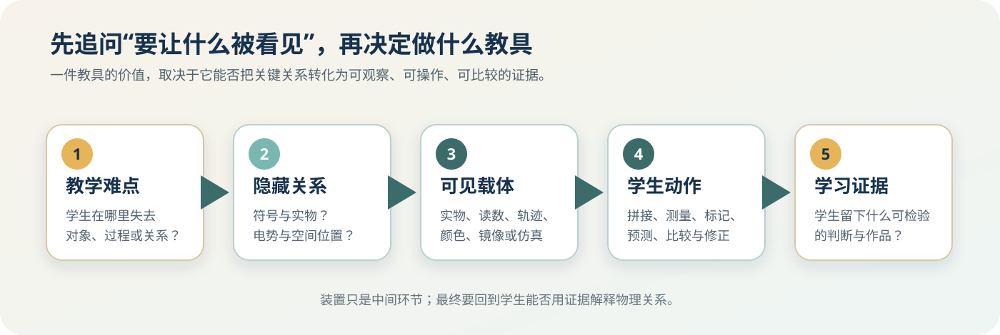
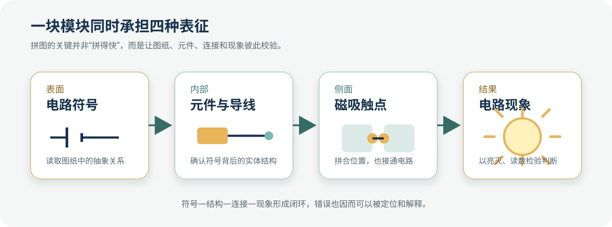
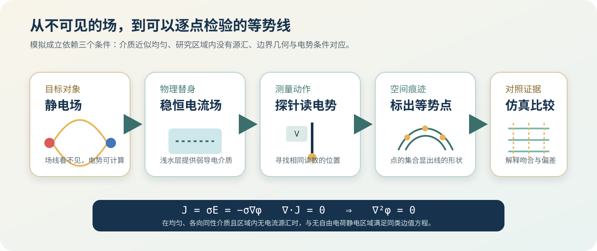

# 第3章　创新实验与自制教具：让不可见变为可见

黑板上的电路图只有几条线和几个符号，真实电路却把接线端、元件外形、导线走向和空间位置同时摆到学生面前。静电场图中的曲线同样简洁，实验桌上却找不到一条可以直接看见的电场线。一个问题来自信息太多，另一个问题来自对象不可见。它们都要求教师在“真实”与“可理解”之间搭一座桥。

自制教具的起点就在这里：找出学生最需要看清的关系，再为这种关系选择合适的外显方式。符号与元件的对应可以变成模块；电势随位置的变化可以变成读数和标记；俯视结构可以借助反射镜转到学生正面；瞬间消失的实验痕迹可以留在照片、轨迹、表格或曲线上。材料、结构与技术都服从同一个问题——学生要依据什么证据理解眼前的物理过程？

**图3-1　自制教具的可视化设计链。** 装置位于“教学难点”与“学习证据”之间，承担关系转译的任务。（本书绘制，示意图）

本章选取两件由一线教师研制的装置。严力耕设计的“活版电路拼图”把电路符号、内部元件、磁吸连接和工作现象放在同一组模块中；黄灿斌研制的“简易静电场描绘仪”用浅水层中的稳恒电流场模拟静电场，以探针、标记条、反射镜和仿真图把电势分布逐步显现。两件装置面对不同内容，却遵循相近的设计顺序：确定隐藏关系，选择可以承载这种关系的实物表征，再安排观察、操作、比较和解释。

## 一、自制教具首先是一种关系设计

学生说“看不懂”，可能指向几种完全不同的困难。有时对象就在眼前，关键关系被杂乱细节遮住；有时研究对象无法直接观察，只能通过效应和测量间接认识；还有些内容能被看见，却持续时间太短、尺度太小或视角受限。教具若只追求做出一个醒目的物件，很容易绕开真正的学习困难。

一件面向理解的教具至少要回答五个问题。

1. **学生当前看不见什么？** 是元件之间的连接关系，还是空间中各点电势的分布？问题要落到具体对象和具体关系上。
2. **用什么现象承载这种关系？** 可以选择位置、方向、颜色、读数、轨迹、图像或声音。载体需要与物理量建立清楚对应。
3. **学生怎样参与？** 观察只能呈现结果；拼接、测量、标记、预测和比较能够让学生留下判断过程。
4. **怎样检验判断？** 电路能否工作、相同电势的点能否连成稳定曲线、实测与仿真是否大体一致，都是可讨论的证据。
5. **装置省略了什么？** 模块封装了内部线路，浅水槽模拟依赖边界条件。省略范围决定结论可以走多远。

这五个问题会反过来塑造教具。模块尺寸取决于全班能否看清；触点位置取决于电路拓扑能否准确表达；反射镜角度取决于学生视线；电极形状取决于要模拟的边界；测量精度则决定实测图能否支持比较。教师造出的每一个结构，都包含一次教学取舍。

## 二、案例一：活版电路拼图——把电路图拼成真实连接

下面这张照片给出了活版电路拼图最直观的样子。一个个模块吸附在磁性板面上，表面的线路和元件符号连成完整电路；模块背后安装真实元件与导线，侧面的触点在拼合时完成导通。学生面对的是一张可以拆开、移动、替换并真正通电的电路图。

**图3-2　活版电路拼图的组合状态。** 模块表面形成电路图，模块内部与侧面触点构成真实电气连接。（图片提供：严力耕）

这件装置已经完成制作并参加比赛，但尚未用于真实课堂。本节呈现它的设计动机、实物结构、制作过程和可开展的教学任务。学生反应、课堂效果和学习提升，要等实际使用后再依据课堂记录判断。

### 1. 一张电路图为什么会在实验桌上“失真”

电路图是一种高度压缩的模型。它省略导线的实际长度、器材外形和空间摆放，只保留元件功能与连接关系。学生读图时，需要识别节点、支路和电流路径；动手搭建时，还要找到实物端口、选择接线柱、整理导线并排除接触不良。两个任务同时出现，注意力很容易从“关系判断”转向“让装置赶快工作”。

固定演示板可以减少接线失败，却常把线路藏到板后。散装器材保留了真实操作，导线交叠又会遮蔽拓扑关系。活版电路拼图把内部的重复接线预先封装，把元件选择、模块排列和支路组织留给使用者。它削减的是与当前目标无关的操作负担，保留的是需要作出物理判断的组合过程。

**图3-3　部分独立模块。** 表面线路、元件符号和操作部件共同提示模块功能。（图片提供：严力耕）

模块化之后，抽象图与真实电路之间出现了一个可以逐层检查的中间表征。

| 表征层 | 学生看见什么 | 需要作出的判断 | 可用什么检验 |
|---|---|---|---|
| 电路原理图 | 符号、节点、支路 | 哪些元件相连，存在几条电流路径 | 口头描述或标画路径 |
| 模块表面 | 放大的符号和线路走向 | 应选择哪些模块，怎样排列 | 模块表面能否组成目标电路 |
| 模块内部 | 元件、导线和端口 | 表面符号怎样对应真实元件 | 打开或翻看模块，逐段追踪线路 |
| 模块侧面 | 磁吸触点 | 相邻模块是否形成可靠连接 | 通断检查、故障定位 |
| 工作电路 | 灯光、开关状态或仪表读数 | 现象是否支持原有判断 | 改变一个条件，观察结果是否随之改变 |

**图3-4　活版电路拼图的四层对应关系。** 学生可以沿着“符号—结构—连接—现象”往返推理。（根据装置结构绘制，示意图）

这里的关键并不在“拼图”形式本身。拼图只是操作界面，真正需要建立的是稳定对应：表面画出的每一段线路都能在内部找到去向，侧面每一个触点都有明确的电气功能，模块组合形成的图示能够接受真实通电检验。对应关系一旦模糊，操作越方便，误解越可能被快速放大。

### 2. 从三维模型到可工作的关系单元

模块先在三维建模软件中确定框架。设计者要同时安排元件尺寸、安装孔位、内部走线、表面图案和侧面触点。电阻、电容器等两端元件可以使用相近框架；开关需要给拨动部件留出空间；节点模块要表达分支；电源模块还要呈现极性。课本上看似统一的“一个符号”，到了实物设计中会分解成尺寸、端口、方向和安全等一组约束。

**图3-5　模块框架的三维建模图。** 外壳需要为元件、内部导线和侧面触点预留位置。（图片提供：严力耕）

外壳完成3D打印后，设计者安装真实元件和内部导线，再把表面线路与内部连接逐项核对。制作顺序体现了一个重要原则：先确定模块真实承担的电气功能，再设计表面图示。漂亮的图案若与内部走线不一致，会让教具变成带电的错误模型。

**图3-6　模块内部的元件与走线。** 表面符号只有能够追踪到这些真实结构时，才具有教学可信度。（图片提供：严力耕）

相邻模块依靠磁吸触点定位和导通。磁吸连接减少了拧接线柱的时间，也把“接点”变成可以直接指认的位置。学生看到两块模块靠拢，应当能够说明哪两个端点相连、连接后形成哪条路径、分开后又切断哪一部分电路。

**图3-7　模块侧面的磁吸触点。** 机械定位与电气连接发生在同一位置。（图片提供：严力耕）

磁吸结构也带来新的工程要求。触点要有足够接触面积，长期使用后仍需保持稳定；模块方向要清楚，防止错位吸合；电源模块应有醒目的极性提示和必要保护。课堂允许学生试错，装置结构要把试错限制在安全范围内。可靠性因此成为教学设计的一部分：连接不稳会把学生的推理时间重新变成排故时间，方向含混则可能制造与物理无关的失败。

### 3. 大模块与小模块服务不同视角

全班演示需要后排学生看清符号和线路，小组操作则要求模块轻便、数量充足、容易收纳。同一尺寸很难兼顾两种场景。装置设置了大小两套模块：较大的模块适合磁性板展示，较小的套件更接近桌面拼图。

**图3-8　两种尺寸的活版电路拼图。** 尺寸变化对应全班共同观察与桌面操作两类需求。（图片提供：严力耕）

尺寸直接影响教学用途。大模块让电路结构成为全班共享对象，教师可以请学生上台调整一处连接，其他学生同时观察结构变化。小模块提高了每个学生参与拼接的机会，却要求更清楚的端口标识和更精细的收纳管理。若要进入课堂，还需继续比较两套模块在辨认距离、连接稳定性、组合数量和准备时间上的表现。

### 4. 从“照图拼接”走向“用结构解释”

完整电路图加上全套模块，容易把活动变成形状匹配。要让拼接承载思维，任务中需要保留信息缺口。下面四类任务可作为课堂使用时优先尝试的方案；它们能否促成预期的学习判断，仍需在实际课堂中检验。

**任务一：从目标倒推电路。** 教师只给出实验目标、可选元件和安全条件，小组先画原理图，再选择模块完成组合。每加入一个模块，都要说明它的功能和端口关系。

**任务二：追踪不同状态的电流路径。** 学生改变开关或替换支路模块，用手指沿表面线路逐段说明当前闭合路径。电路现象用于检验路径判断，不能代替解释。

**任务三：诊断一处结构错误。** 教师预置缺少节点、测量位置不当或元件方向错误的组合。学生先预测可能出现的现象，再通过分段检查定位问题，留下修改前后的结构说明。

**任务四：把模块图迁移到散装器材。** 学生先用模块澄清拓扑，再用常规器材搭建同一电路；也可以先经历散装接线，再用模块复盘导线交叠处的真实关系。两种表征来回转换，能够检验学生是否只记住了模块形状。

| 任务 | 主要动作 | 应留下的学习证据 | 容易出现的表面完成 |
|---|---|---|---|
| 目标倒推电路 | 选元件、画图、拼接 | 选择理由、端口说明、方案图 | 只拼出能亮的电路 |
| 路径追踪 | 切换状态、指出支路 | 每种状态的电流路径与方向说明 | 只描述灯亮或不亮 |
| 故障诊断 | 预测、分段检查、修改 | 错误位置、依据和修改记录 | 不断换模块碰运气 |
| 表征迁移 | 模块与散装器材互换 | 图、模块和实物的逐项对应 | 只会使用其中一种器材 |

这套任务设计把“拼对”改造成“解释每一次拼接”。评价也应落在解释上：学生能否指出节点与支路，能否从符号找到真实端口，能否依据现象修正结构判断。拼接速度只能说明操作熟练度，无法单独证明对电路的理解。

### 5. 从作品到课堂工具，还要补上哪些环节

活版电路拼图已有实物、三维模型、内部结构和比赛展示，表面线路、内部元件与侧面触点之间的对应关系清晰可见。它要从作品走向课堂工具，还要经过真实使用的检验。

装置尚未在真实课堂中使用。本节列出的任务只能作为待实施的教学设计，后续需要用教学实录、学生方案、错误修改痕迹和访谈记录检验。数据采集扩展目前还缺少明确的硬件连接、采样协议、显示软件和运行记录。在这些条件明确之前，这一功能不能作为可运行系统讨论，也不能由此推断数据曲线或教学作用。

教具从“作品”走向“课堂工具”，需要依次检验结构对应是否准确、连接能否稳定重复、任务是否促使学生作出判断，以及能否留下支持教学改进的记录。比赛展示说明设计已经获得实物形态，课堂价值要由后续使用继续回答。

## 三、案例二：简易静电场描绘仪——用可测的电势显出空间中的场

静电场给可视化提出了另一类挑战。学生看不到电场本身，课本只能用电场线和等势线表示空间结构。图画得越流畅，学生越容易把这些线当成真实存在的细丝；教师若只说明“电场线是假想的”，又缺少可以操作的证据。黄灿斌研制的简易静电场描绘仪选择从电势入手：让探针在不同位置给出读数，把读数相同的位置逐点找出来，再把离散点组织成等势线。

**图3-9　简易静电场描绘仪。** 透明水槽、可更换电极、测量电路、45°反射结构和上方摄像位共同组成观察系统。（图片提供：黄灿斌）

这件装置没有试图制造“看得见的电场线”。它建立了一条证据链：边界形状决定电势分布，探针读取位置对应的电势差，相同读数的点组成等势线，等势线形状再与理论和仿真比较。学生看到的是测量留下的空间痕迹。

### 1. 模拟成立的物理条件

静电场中，电场强度与电势的关系为

$$
\mathbf{E}=-\nabla\varphi ,
$$

其中 $\varphi$ 表示电势。电势下降最快的方向对应电场方向；等势线上电势不变，电场线在局部与等势线垂直。

直接在空气中逐点测量静电场十分困难。装置改用浅水层形成弱导电介质，在两组电极之间建立近似稳恒电流场。对均匀、各向同性并满足欧姆定律的介质，有

$$
\mathbf{J}=\sigma\mathbf{E}=-\sigma\nabla\varphi ,
$$

其中 $\mathbf{J}$ 为电流密度，$\sigma$ 为电导率。稳恒状态下，研究区域内没有电流源汇时满足

$$
\nabla\cdot\mathbf{J}=0.
$$

若 $\sigma$ 可以近似看作常量，便得到

$$
\nabla^2\varphi=0.
$$

无自由电荷的静电区域也满足相同形式的拉普拉斯方程。只要导电介质近似均匀，电极几何形状与目标静电问题的边界相对应，边界电势条件也相匹配，两种场的电势分布就具有可比性。这里依据的是同类边值问题；水中的电流与空气中的静电荷仍属于不同物理对象。

**图3-10　静电场描绘仪的模拟链条。** 从稳恒电流场的电势测量出发，逐点得到等势线，再与数值仿真比较。（根据装置原理绘制，示意图）

这段推导也给出了装置的边界。水层深浅不均、电极摆放偏移、介质电导率变化、边缘形状不同，都会破坏理想对应。实测线与仿真线接近时，可以讨论模型怎样抓住主要关系；出现偏差时，同样要追问偏差来自测量、边界还是模拟条件。偏差本身就是认识模型的入口。

### 2. 五组电极把边界条件变成可更换部件

装置设计了五组可更换电极，分别近似表示单个点电荷、匀强电场、点电荷与大平板、等量同种电荷、等量异种电荷的典型情形。实际电极由不锈钢螺钉、圆环或平板构成，放置在透明水槽中。外侧圆环在“单个点电荷”模型中承担有限边界，平行金属板则为水层中的电势分布提供近似平行边界。

**图3-11　五组可更换的真实电极。** 字母A—E依次对应单点、匀强、点—板、同种双点和异种双点模型。（图片提供：黄灿斌）

一套装置保留相同的水槽、探针和测量方式，只替换电极几何，学生便可以把注意力集中到“边界怎样改变空间分布”。

| 电极组合 | 对应的理想模型 | 重点观察 | 可以提出的问题 |
|---|---|---|---|
| 中心点电极＋外圆环 | 单个点电荷场的有限边界近似 | 等势线近似同心分布 | 离中心越远，相邻等势线间距怎样变化？ |
| 两条平行电极 | 匀强电场 | 中部等势线近似平行、等间距 | 靠近边缘时为什么发生弯曲？ |
| 点电极＋大平板 | 点电荷与导体平板 | 点与板之间的曲线分布 | 平板附近的等势线和场方向有什么特点？ |
| 两个同极性点电极 | 等量同种电荷 | 中垂线附近的对称结构 | 两点连线中点附近的场有何特殊性？ |
| 两个异极性点电极 | 等量异种电荷 | 由一极指向另一极的对称结构 | 等势线与两点连线如何相交？ |

把五种配置并置还有一个好处：学生能够进行横向比较。电极数量相同，极性改变会怎样重组等势线；一侧电极从点变成平板，边界又怎样拉直局部结构。物理图像由此不再是一页页孤立结论，而成为可以通过改变条件连续追问的模型族。

### 3. 描绘模式：让离散读数留下空间痕迹

测量电路把一侧电极作为参考端，移动探针接到数字电压表的另一测量端。探针进入水层不同位置，电压表显示该位置相对于参考端的电势差。若目标是寻找某一电势值，操作者移动探针，直到读数接近目标值，再用彩色小木条标记这个位置。重复寻找多个同电势点，一条等势线便从离散标记中逐渐显现。

**图3-12　测量电路模块的正反面。** 探针、电压表和电极供电构成逐点测量链。（图片提供：黄灿斌）

供电方案和电压参数曾随设计调整。这里讨论不随参数变化的连接关系：电极获得独立供电，测量端以一侧电极为参考，移动探针读取相对电势差。具体电源规格应以实际使用装置的标识和安全测试为准。

**图3-13　用彩色标记条记录同电势点。** 离散读数经过空间定位，逐步形成可观察的等势线。（图片提供：黄灿斌）

描绘过程可以组织成一组连续判断。

1. 先根据电极形状预测等势线的大致对称性和弯曲方向。
2. 选定一个目标电势值，沿不同方向移动探针寻找同值位置。
3. 记录多个点，观察它们能否形成平滑、连续并符合对称性的曲线。
4. 更换目标电势，重复描点，比较相邻等势线的疏密。
5. 根据 $\mathbf{E}=-\nabla\varphi$ 判断电场方向，并用等势线疏密讨论电场强弱的空间变化。
6. 对离群点进行复测，区分偶然读数、操作误差与真实边界效应。

这样的任务把课本图中的每一条线还原为“许多位置共享同一电势”的测量结果。学生不必把等势线想象成水中的实体线，而能沿着数据如何变成图形的过程理解它的意义。

### 4. 验证模式：把预测图放到实物下面

装置还设置了另一种使用方式。教师先用COMSOL等软件计算相应电极边界下的电势分布，将电场线和等势线打印在透明胶片上，再把胶片置于水槽下方。操作者沿图中预测的等势线移动探针，观察读数是否大体保持不变；也可以在图线两侧取点，比较电势变化方向。

**图3-14　五组真实电极与仿真等势线、场线叠加。** 透明结构使“计算图”与“测量位置”进入同一坐标系。（图片提供：黄灿斌）

**图3-15　五种电极配置的数值仿真结果。** 连续图像提供整体预测，逐点测量负责检验局部位置。（图片提供：黄灿斌）

仿真图与真实电极叠放，缩短了计算坐标、实验坐标和学生观察之间的距离。图线仍然不能自动成为证据。学生需要说明：沿同一条预测等势线，哪些位置的读数接近；偏差集中在电极附近还是水槽边缘；改变电极位置后，原图为什么失效。这样，仿真承担的是可检验预测，测量承担的是现实约束。

描绘模式与验证模式适合不同任务。

| 模式 | 起点 | 主要动作 | 认识重点 | 常见风险 |
|---|---|---|---|---|
| 描绘模式 | 实测电势值 | 找同值点、标记、连线 | 数据怎样生成等势线 | 点数太少便直接画出理想曲线 |
| 验证模式 | 理论或仿真图 | 沿预测线测量、比较偏差 | 模型怎样接受实验检验 | 把接近误写成完全重合 |

两种模式可以组成一次完整探究：先不看仿真图，依据测量描出轮廓；再调出仿真结果进行对照；最后回到装置检查水深、电极位置和边缘条件。学生经历“预测—测量—比较—修正”，等势线便从知识结论转化为证据组织方式。

### 5. 45°反射镜解决“做得出却看不见”

浅水槽要求从上方观察，演示时却只有教师容易看到。前排学生可能看见探针移动，后排学生看到的只是水槽侧面。装置把一块反射镜以45°放入透明支架，水槽中的电极、探针和标记通过反射转向正面；顶部相机还可以把俯视画面投到大屏幕，补光灯改善透明材料下的对比度。

**图3-16　左图为45°反射镜形成的学生正面视角，右图为水槽下方放置透明仿真膜的状态。** （图片提供：黄灿斌）

**图3-17　装置的立体结构与主要尺寸关系。** 透明支架把水槽、反射面和观察方向固定在同一系统中。（图片提供：黄灿斌）

反射镜没有改变物理过程，却改变了课堂中的证据分配。全班能够共享同一实验画面，教师可以让学生指出探针位置、标记点和电极边界，讨论不再依赖少数近距离观察者的转述。这说明可视化设计还要处理视线、尺度和共同注意。一个实验即使原理成立，只要多数学生看不清，教学证据仍然无法进入公共讨论。

### 6. 误差让模型边界显形

使用装置时需要留意几类限制：电源可能产生电压波动，水体扰动会造成读数不稳，电极和水槽边界也难以与理想仿真完全一致。透明装置增加了可见性，也使光照反射、拍摄角度和胶片定位成为新的观察条件。

| 偏差来源 | 可能表现 | 检查办法 | 可以讨论的物理问题 |
|---|---|---|---|
| 水面波动或水深不均 | 同一点读数轻微变化 | 静置后复测，控制加水量 | 介质条件为何要尽量稳定 |
| 电极位置或形状偏差 | 对称性变差、局部曲线偏移 | 重新定位电极，测量几何尺寸 | 边界条件怎样决定解 |
| 电源波动 | 全部位置读数随时间漂移 | 固定参考点连续观察 | 绝对电势值与相对分布如何区分 |
| 探针接触差异 | 个别点跳动或重复性差 | 保持探入深度与接触方式 | 测量操作如何影响证据可靠性 |
| 水槽有限边界 | 边缘区域与理想图差异较大 | 比较中心区和边缘区 | 理想“无限空间”怎样在实验中近似 |
| 仿真膜对位误差 | 整体图线出现同向偏移 | 用电极位置作基准重新配准 | 坐标一致为何是比较前提 |

误差分析不应只在实验结尾列出几句话。学生可以先指出最怀疑的偏差来源，再改变一个条件进行复测。如果静置水面后读数更稳定，说明水体扰动的解释得到支持；若重新对准电极后对称性改善，边界条件的作用便获得直接证据。装置的“不完美”由此转化为模型、测量和论证的学习材料。

### 7. 从演示装置走向可验证的教学任务

装置已经制成，五组电极和两种测量方式可供演示。高中物理课程没有把它列为必做实验，目前也没有真实课堂记录。若今后用于课堂，应留存三类记录。

第一类是**装置运行记录**：相同配置下的重复测量、参考点稳定性、不同区域的偏差范围和典型故障。第二类是**学生思维记录**：测量前的预测图、实测点、连线理由、异常点处理和仿真比较说明。第三类是**教学条件记录**：完成一组描绘所需时间、分组人数、后排可见性以及器材复位和清洁成本。

这些记录能够回答一个关键问题：学生究竟看见了什么。若只拍下最终曲线，无法判断学生是否理解读数与位置的对应；保留预测、测点和修改痕迹，才能看见模型逐步形成。装置把场的空间结构显现出来，证据记录还要把学生的思维过程显现出来。

## 四、两个案例如何把“不可见”转化为证据

活版电路拼图处理的是被实物细节遮蔽的连接关系，静电场描绘仪处理的是无法直接观察的场分布。前者通过模块化减少杂乱信息，后者通过模拟测量增加可观察信息。两条路径共同指向“关系可追踪”。

| 比较维度 | 活版电路拼图 | 简易静电场描绘仪 |
|---|---|---|
| 原始困难 | 电路图简洁，真实接线杂乱 | 电场不可直接观察 |
| 需要显现的关系 | 符号、元件、端口与电流路径的对应 | 位置、电势、等势线与电场方向的联系 |
| 主要载体 | 3D打印模块、表面符号、内部导线、磁吸触点 | 浅水层、电极、探针、数字表、标记条、反射镜、仿真膜 |
| 学生动作 | 选择、拼接、追踪、诊断、迁移 | 预测、测量、标点、连线、比较、复测 |
| 检验证据 | 电路是否按预期工作，结构变化是否引发现象变化 | 同值点能否形成合理曲线，实测与仿真是否在条件范围内相符 |
| 模型边界 | 内部线路被封装，不能替代散装接线训练 | 模拟依赖均匀介质和匹配边界，有限水槽不同于理想无限空间 |
| 使用边界 | 已制成并参加比赛；尚未用于课堂，数据采集扩展的运行条件尚不明确 | 装置、图像与操作方式可供展示；目前没有课堂记录，学习效果须由实际使用判断 |

这两个案例还给出了五条可以迁移的设计原则。

### 1. 用一句可检验的话定义“看见”

“让电路更直观”太宽泛；“让学生能从模块表面的符号追踪到内部元件和真实连接”可以检验。“让电场可视化”仍然宽泛；“让学生用探针找出同电势点，并解释等势线形状与电极边界的关系”已经指向具体行动与证据。教具设计越早把“看见”写成可观察表现，后续功能越不容易失控。

### 2. 每一种视觉编码都要有物理对应

颜色、箭头、曲线、位置和亮灭都可能吸引注意。它们只有与物理量和操作条件建立稳定关系，才能成为表征。活版模块的表面线条必须对应内部导线；彩色木条标记的是同一目标电势的位置；仿真线表示计算结果，需要探针读数检验。课堂上要说明编码规则，也要允许学生追问规则何时失效。

### 3. 把模型和实物放在同一视野中

活版电路把符号画在真实模块表面，静电场描绘仪把透明仿真膜放在真实电极下方。模型与实物进入同一坐标或同一界面后，学生可以直接指出对应与偏差。这样的叠合比教师口头提醒“联系实际”更具体，也更容易形成共同讨论对象。

### 4. 让学生留下痕迹

完成操作只留下一个结果，预测图、模块组合、标记点、异常数据和修改记录能够呈现判断过程。教具设计时可以提前安排这些痕迹的保存方式：拍下初始与修改后的电路，保留不同颜色的等势点，记录参考点随时间的变化。痕迹越具体，教师越容易发现学生在哪一步发生了理解偏差。

### 5. 让局限随装置一起出现

模块封装让连接更清楚，也隐藏了部分接线技能；浅水模拟让电势可测，也引入有限边界与介质波动。教师在展示装置优势时同步说明省略和误差，学生才能把教具看作有条件的模型。成熟的可视化不会让一切显得毫无疑问，它会把值得追问的关系推到眼前。

## 五、从看见装置，到看见思维

两件教具都从真实教学难点出发，并在结构中保存了教师的学科判断。活版电路拼图用模块对应解决“图与实物怎样相连”，静电场描绘仪用模拟测量解决“场的空间结构怎样留下证据”。3D打印、磁吸触点、透明材料、数字电压表、反射镜和COMSOL各自承担一段明确任务。技术没有挤占物理关系，反而把关系转译为可以指认、操作和检验的对象。

装置完成只是第一层可视化。下一层要让学生的思维过程也留下痕迹：为什么选择这个模块，如何判断电流路径，怎样认定几个点属于同一条等势线，遇到偏差后修改了什么解释。真实课堂中的方案、读数、标记和讨论记录，将决定这些教具能够在多大程度上支持学习。

实体教具善于呈现结构和现场操作。面对连续运动、极短暂变化和多变量关系，数字仿真还能提供暂停、重放、调参和多视图对照。下一章将沿着这条线索，讨论教师如何把实物世界中的可见关系扩展到动态数字模型。
