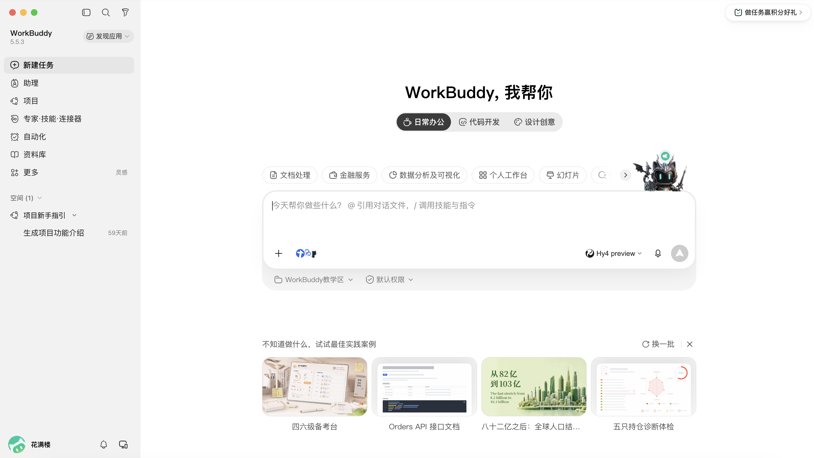
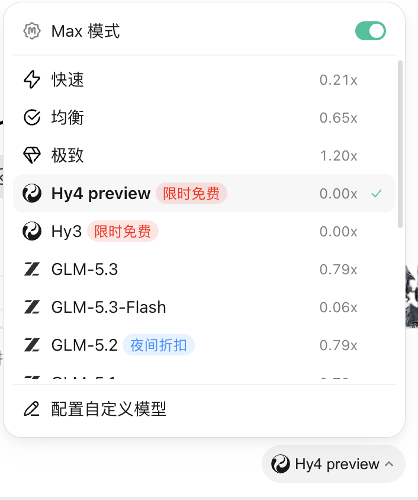
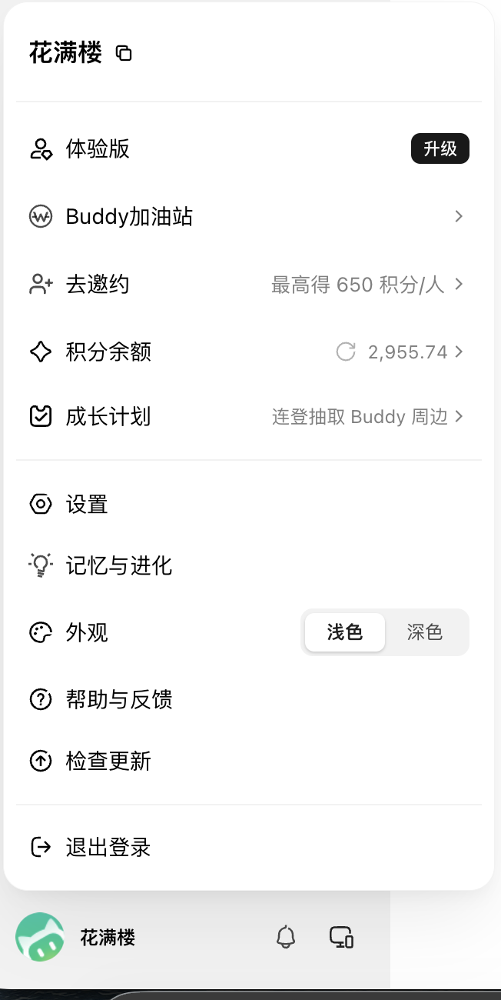

# WorkBuddy教学区与界面截图存档

登记日期：2026-09-05。来源：作者在本次对话上传的三张截图；按原始PNG文件逐字节复制，未裁剪、遮挡或重绘。

## 作者选择与使用边界

- 作者选定的实际教学区：`/Users/yaril/个人文档/WorkBuddy教学区`。
- 作者目的：使用独立教学区，减少演示路径暴露个人目录信息。教程中优先称为“WorkBuddy教学区”，不展示个人绝对路径。
- 已只读确认该文件夹存在，登记时为空；输入材料尚未复制，生成任务尚未执行。旧演练目录保留。
- 原始截图含账号昵称，第三张还含积分余额；本目录作为内部证据保存，公开配图时再制作脱敏副本。独立教学区名称并不能遮蔽完整路径中的用户名。
- “默认权限”只证明界面标签，不能据此断言实际访问范围仅限教学区。
- 截图中未见Craft字样，不推断“日常办公”或Max模式与Craft等价。免费标识、积分及模型列表仅代表截图时点。

## 原图与可确认信息

### 新建任务首页

显示WorkBuddy 5.5.3；“日常办公”选中；工作区显示“WorkBuddy教学区”；模型为“Hy4 preview”；权限显示“默认权限”。

- 原始文件名：`codex-clipboard-aca24211-50ef-449a-92d9-80125157c2c8.png`
- 尺寸：3000 × 1690；大小：703807字节。
- SHA-256：`e2264340f5b5bbab178a95ed27ee74d2a156722f2c91900c83ca40cb68ecd30d`

### 模型与模式菜单

Max模式开关开启；Hy4 preview被勾选，显示“限时免费”和0.00x。

- 原始文件名：`codex-clipboard-8f5f5998-8067-421d-b621-f58a16f63a4e.png`
- 尺寸：706 × 844；大小：93462字节。
- SHA-256：`00f02bb8fc493cc1c5a00c8575db65f1ab533b6046f3e3bf4ed73fb105624d0a`

### 账户菜单

显示体验版、积分余额2,955.74，以及设置、记忆与进化等入口。

- 原始文件名：`codex-clipboard-597b08c6-907d-4ff2-b33b-d750b9dce22b.png`
- 尺寸：652 × 1300；大小：110850字节。
- SHA-256：`2de14daa816d6f74aa770ab6ac7a5daf3b4f59160d02432d4b8d9142337faa6a`
