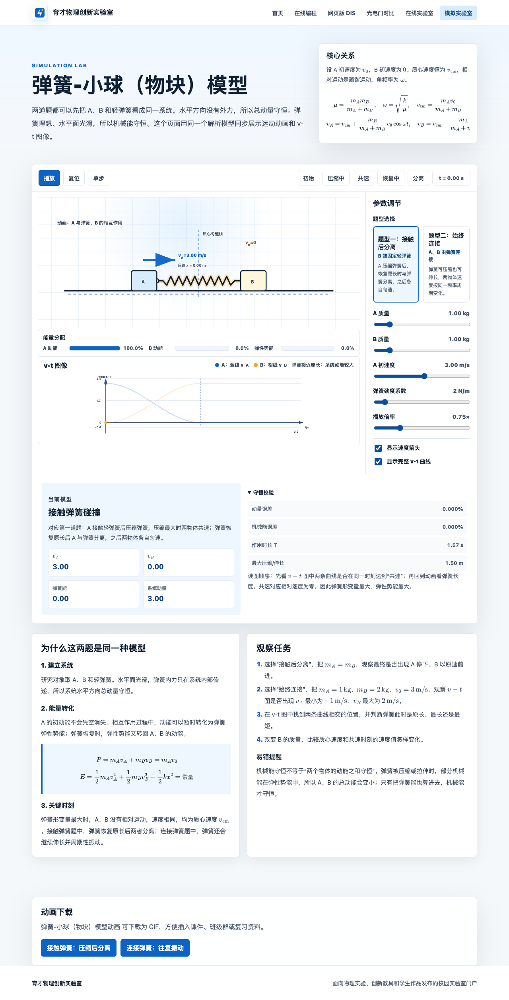

# 物理教师用AI制作模拟网页：以弹簧—小球模型为例

弹簧碰撞题讲到最大压缩时，教师常会写下“两物体共速”。这句话放进不同题目，后续运动并不相同。物体只与弹簧接触时，弹簧恢复原长后两物体分离；两物体由弹簧始终连接时，它们经过共速状态以后还会继续拉伸，随后往复振动。静态板书可以列出几个状态，却很难连续呈现速度怎样交换、弹性势能怎样变化，以及“共速”为什么只是一个关键时刻。

我为动量章节制作过六个模拟网页，分别处理弹簧、轻绳、滑环和可移动曲面中的典型模型。这是我目前比较满意的一组自研资源。以弹簧—小球（物块）页面为例，学生可以切换“接触后分离”和“始终连接”，改变质量、初速度与弹簧劲度系数，播放或逐步观察运动，并在同一页比较速度箭头、能量分配、速度—时间图和守恒检查。



*图1　弹簧—小球模拟页面。动画、参数、能量分配、速度—时间图、守恒检查和观察任务围绕同一个物理过程组织。*

AI已经能很快写出这样的页面。教师真正需要掌握的是怎样选择模拟对象，怎样把物理关系写成明确规格，以及怎样判断生成结果能不能用于教学。下面以这一页为例，把完整路径整理出来。

## 先选一个网页真正要解决的判断

第一次做模拟网页，最容易把任务写成“帮我做一个漂亮的动量守恒动画”。AI会据此补出小车、箭头、曲线和按钮，画面可能很热闹，教师仍然说不清学生要观察哪个状态、改变哪个条件、留下什么判断。

更有效的起点是一张很小的任务卡。

| 项目 | 弹簧—小球页面的约定 |
| --- | --- |
| 要解决的物理问题 | 两物体在弹簧形变量最大时为什么共速；接触弹簧与连接弹簧经过共速状态后为什么出现不同结局 |
| 学生要做的动作 | 先预测，选择模型，改变质量比，运行到最大压缩处暂停，比较速度和能量，再观察后续是否分离 |
| 页面必须给出的信息 | 物体位置、速度方向与数值、弹簧形变量、动能与弹性势能、速度—时间图、系统总动量与机械能检查 |
| 学生要留下的产物 | 一组参数、对关键状态的预测、暂停点读数，以及对两类模型差异的解释 |
| 这一页暂时不做 | 整个动量章节、真实碰撞力曲线、学生自动评分、账号系统和网站发布 |

这张卡把“做动画”改成了“帮助学生完成一次判断”。页面中的每个按钮和图像都要能回到这个判断；暂时没有作用的功能先不做。

## 把物理真值写在界面要求前面

AI擅长生成界面，也会根据常见题型补公式。教师若没有先写清研究对象和过程边界，页面越完整，错误越容易藏在动画、图表和文字之间。

弹簧—小球模型至少要冻结六项内容。

| 规格 | 教师需要写清的内容 |
| --- | --- |
| 研究系统 | 物体A、物体B和轻弹簧 |
| 理想条件 | 水平面光滑，弹簧质量不计，弹性形变满足胡克定律 |
| 初始量 | 质量\(m_A\)、\(m_B\)，A的初速度\(v_0\)，B初速度为0，弹簧劲度系数\(k\) |
| 守恒关系 | 系统水平方向总动量守恒；把弹性势能计入后，系统机械能守恒 |
| 关键状态 | 弹簧形变量最大时，A、B没有相对运动，两者速度相同 |
| 过程分支 | 接触弹簧恢复原长后分离；连接弹簧恢复原长后继续拉伸并周期运动 |

页面采用的两条总账关系为

$$
m_Av_A+m_Bv_B=m_Av_0,
$$

$$
\frac{1}{2}m_Av_A^2+\frac{1}{2}m_Bv_B^2+\frac{1}{2}kx^2
=\frac{1}{2}m_Av_0^2.
$$

当弹簧形变量达到最大值时，两个物体共速。这个速度由动量守恒直接得到：

$$
v_{\mathrm{cm}}=\frac{m_A}{m_A+m_B}v_0.
$$

教师还要准备一两组可以手算的输入，作为独立于网页的答案。比如在接触弹簧模型中取\(m_A=m_B\)，弹簧恢复原长并分离后，应出现A停止、B以A原来的速度前进。在连接弹簧模型中取\(m_A=1\,\mathrm{kg}\)、\(m_B=2\,\mathrm{kg}\)、\(v_0=3\,\mathrm{m/s}\)，两物体的公共速度为\(1\,\mathrm{m/s}\)；在理想模型的一个周期内，A的最小速度为\(-1\,\mathrm{m/s}\)，B的最大速度为\(2\,\mathrm{m/s}\)。

这些数值不由网页证明。它们是教师用来检查网页的基准。

## 第一版先做一个HTML文件

零基础教师第一次练习时，一个HTML文件通常已经够用。HTML文件可以同时容纳页面结构、样式和交互程序，保存后用浏览器打开，不必先理解服务器、数据库和网站框架。文件可以复制成`v0.html`、`v1.html`，每轮保留一个能退回的版本。

第一版只保留完成学习任务所需的模块：

- 页面顶部写清研究系统、正方向和理想条件；
- 提供播放、暂停、复位、单步和跳到关键状态；
- 在主画面中显示物体、弹簧、速度箭头和必要数值；
- 允许修改质量、初速度、劲度系数和播放倍率；
- 显示系统总动量、总机械能及其计算误差；
- 页面末尾给出两三个具体观察任务。

速度—时间图、能量条和更多动画效果可以在物理过程跑通以后逐项增加。每增加一种表征，都应从同一组计算状态读取数据。动画算一套、曲线再算一套、表格又写一套公式，修改参数或修正错误时很容易出现三处结果不一致。

“一个HTML文件”也不必然等于完全离线。当前六个动量页面中，有些公式显示依赖网络上的MathJax或KaTeX资源。准备在无网教室使用时，应先断开网络重新打开页面，检查公式、按钮和动画是否仍能工作；必要时把依赖保存到本地，或者改用浏览器可以直接显示的公式写法。

## 准备交给WorkBuddy的一份完整要求

下面这段要求根据现有弹簧—小球页面和当前教学判断整理，准备在WorkBuddy的MVP实操中使用。它不是当时开发页面的原始提示词，也还不是经过本轮操作验证的最终版本。后续稿将用WorkBuddy中实际输入、实际反馈和复验后的文本替换这一版。

```text
你要为一线高中物理教师制作一个教学模拟网页。请生成一个可用浏览器直接打开的单文件 index.html，把HTML、CSS和JavaScript写在同一个文件里。第一版不使用网站框架，不需要账号、服务器和数据上传。

教学目标：帮助学生比较“物体接触弹簧后分离”和“两个物体由弹簧始终连接”两种模型，理解最大压缩时共速、动量守恒，以及动能与弹性势能之间的转化。

物理模型：
1. 研究系统包含物体A、物体B和轻弹簧，水平面光滑，向右为正方向。
2. 初始时A以v0向右运动，B静止。可调参数为mA、mB、v0和弹簧劲度系数k。
3. 系统满足 mA*vA + mB*vB = mA*v0。
4. 系统机械能包含A、B的动能和弹性势能 1/2*k*x^2。
5. 弹簧形变量最大时vA=vB，公共速度为 mA*v0/(mA+mB)。
6. “接触后分离”模式中，弹簧恢复原长后A与弹簧分离；“始终连接”模式中，弹簧继续拉伸并往复运动。

学生操作：
1. 可切换两种模型。
2. 可播放、暂停、复位、单步，并能直接跳到初始、压缩中、共速、恢复原长和分离等关键状态。
3. 可修改mA、mB、v0、k和播放倍率。参数改变后，动画、读数、图像和结论必须同时更新。

页面输出：
1. 动画显示A、B、弹簧、地面参考线和速度箭头，箭头方向必须与速度正负一致。
2. 显示vA、vB、弹簧形变量、系统总动量、A与B的动能、弹性势能和系统总机械能。
3. 绘制A、B的v-t图，标出共速时刻。
4. 显示守恒检查，数值误差超过容许范围时明确报警，不要永远显示“守恒”。
5. 页面底部给出三项观察任务，引导学生先预测、再运行、在关键状态暂停并解释。

验收样例：
1. 接触模式取mA=mB，分离后应出现A停止、B以v0前进。
2. 连接模式取mA=1 kg、mB=2 kg、v0=3 m/s，公共速度应为1 m/s；A最小速度为-1 m/s，B最大速度为2 m/s。
3. 最大压缩时vA与vB相同，A和B的动能之和小于初始动能，减少部分进入弹性势能，系统总机械能保持不变。
4. 质量小于或等于0、空输入或非数字输入必须拒绝，不能继续计算出NaN。

工作顺序：先复述你理解的物理模型、页面模块和不做项，指出任何不确定或冲突；我确认后再写文件。完成后列出你实际检查过的样例、仍需教师人工检查的项目，以及如何双击打开页面。
```

提示词较长，原因很具体：AI需要知道教学目标、物理真值、交互动作、输出关系和验收样例。只给主题和配色，关键判断会被留给模型猜测。

## 第一次打开页面，按四道门验收

页面生成后，不急着继续美化。先按教师真正的使用顺序检查。

| 验收门 | 要检查的现象 | 弹簧页面的首轮动作 |
| --- | --- | --- |
| 运行门 | 文件能按交付方式打开，按钮和参数可以操作，页面没有明显报错 | 双击`index.html`，依次播放、暂停、单步、复位，再修改每个参数 |
| 物理门 | 方向、单位、公式、守恒量、关键状态和过程分支正确 | 代入两组手算样例，检查共速、分离、负速度、动量和总机械能 |
| 教学门 | 学生需要预测、选择、暂停、记录和解释，页面没有替他完成全部判断 | 先隐藏结论或不播放，让学生写预测；运行后只用页面检查自己的判断 |
| 交付门 | 目标电脑、浏览器、投影与网络条件下能使用，旧版本可恢复 | 断网重开，检查公式与动画；复制保留上一版，在教室设备上试开 |

四道门各自回答不同问题。一个页面可以运行顺畅，同时在物理关系上有错；它也可能计算正确，却把所有结论直接写在屏幕上，让学生只剩下观看。发布到网站之前，还要检查素材授权、隐私、移动设备和维护责任，这些可以留到后续文章展开。

## 把模糊意见改成可复验的退回要求

教师给AI的修改意见越具体，下一轮越容易复验。“动画不够好”“再专业一点”“图像清楚一些”都缺少可观察的完成标准。可以改写成下面这样的要求：

- “点击‘最大压缩’后，A、B速度箭头应等长同向，两个速度读数都等于当前参数算出的\(v_{\mathrm{cm}}\)。”
- “能量条必须把A动能、B动能和弹性势能同时列出；三项之和与初始机械能的相对误差超过\(10^{-6}\)时显示红色提醒。”
- “从接触模式切到连接模式后，弹簧恢复原长不能触发分离；继续播放应出现弹簧拉伸。”
- “速度为负时，箭头向左，数值保留负号，速度—时间曲线同时落到横轴下方。”

每次只改一项关键关系，改完重跑原来的手算样例。让AI为了一个小问题重写整个页面，常会把已经正确的部分一并改坏。保留`v0`、`v1`、`v2`等可退回版本，可以让教师放心比较，也便于找到某个错误从哪一轮开始出现。

## 按读者的真实使用方法试一遍

网页的交付方法写成“双击打开”，验收时就要实际双击。准备在无网教室投影，还要断开网络并接上目标设备试一次。文件结构检查和程序计算检查各有作用，无法代替教师在真实使用路径中的操作。

本轮重做MVP时，这段将由WorkBuddy中的真实过程补充：从创建文件夹、输入要求、生成文件，到双击打开、发现问题、退回修改和再次打开，每一步保存对应截图和结果。读者看到的应是一条亲自走通过的路径。

## 做到什么程度可以先停下来

第一个模拟网页达到下面这些条件，就可以暂时停止扩建：

- 能用一句话说清它解决哪个物理判断；
- 页面写明研究系统、正方向、理想条件和数据身份；
- 参数变化会同步改变动画、图像、读数和结论；
- 至少两个手算样例、一个负值或反向样例、一个非法输入得到预期结果；
- 学生可以在关键状态暂停，并留下预测、数据和解释；
- 教师知道页面是否依赖网络，旧版本能够恢复；
- 页面没有声称尚未取得的课堂效果。

接下来应把页面交给一位没有参与开发的物理教师，请他按文章和提示词重新做一遍，记录在哪一步停住、哪些词看不懂、哪些物理条件容易遗漏。真实跟做出现的问题，会决定下一轮该修改提示词、网页还是这篇文章。

做模拟网页的核心能力，是把教学中的一个判断翻译成可计算、可观察、可操作、可复验的规格。AI承担代码实现以后，教师有更多精力放在系统怎样选、哪些量必须守恒、哪个时刻值得暂停，以及什么结果绝不能带进课堂。第一页把这套判断走通，后面的模型和网站才有可靠的生长起点。
