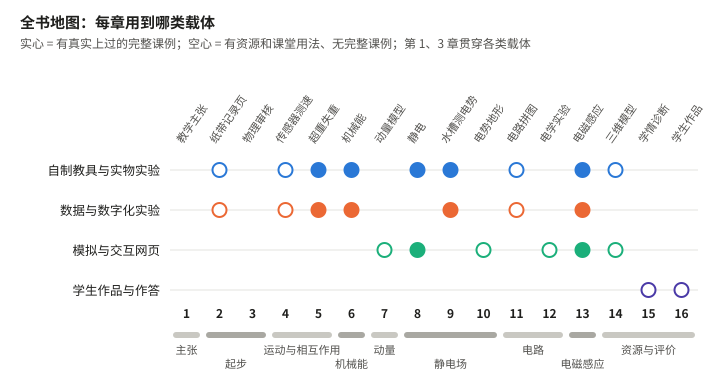

# 开始之前　这本书怎么用

## 写给谁

写给高中物理教师，尤其是想用 AI 做点东西、又不知道从哪里下手的老师。

不需要会编程，不需要懂软件术语，也不需要会写长提示词。需要的是你本来就有的东西：知道学生卡在哪里，知道一个结论在什么条件下成立，看得出一个数对不对。

## 书里有四类东西

课程标准要求教师“创造性地运用信息技术，让不易观察的世界变得可观察，不易观察的过程变得可观察”[1]。我们用过的办法可以归成四类，每一类让不同的东西变得看得见，教师要把的关也不同：

| 载体 | 让什么变得看得见 | 教师要把的关 |
| --- | --- | --- |
| 自制教具与实物实验 | 真实现象 | 装置科学、安全吗，现象明显吗，学生能不能自己动手 |
| 数据与数字化实验 | 测量数据及其规律 | 测到的到底是什么量，误差从哪里来，数据能支持什么结论 |
| 模拟、交互网页与图像 | 过程、模型和拍不到的对象 | 模型条件对不对，画面和数字是不是同一个状态，会不会引起误解 |
| 学生的作品与作答 | 学生自己的理解 | 哪些判断是学生做的，物理错在哪里，怎样追问 |

真实实验带着摩擦、噪声和器材的脾气，模拟便于慢放、改参数、看极端情况，两者常常配着用。动手做任何一样之前，先问自己两句：它要让学生看见什么？学生看见以后要做什么？答不上来，做出来的东西多半只是好看。

## AI 做什么，教师判断什么

| AI 助教擅长的 | 必须由教师判断的 |
| --- | --- |
| 按要求很快做出网页、程序、图像和文档 | 哪个教学问题值得做，学生卡在哪里 |
| 重复计算、批量检查、找程序里的毛病 | 模型条件怎么定，哪些因素可以忽略 |
| 整理数据、照片和记录 | 结果在物理上对不对，解释站不站得住 |
| 按原始条件独立重算一遍，供你比较 | 课上怎么用；学生作品里哪些判断是他自己的 |

右栏的事一直归教师。会变的，是你在右栏里能走多远：起步时只判断结果对不对；做过几章，能说清模型条件，看到不对知道该补哪一句；再往后，遇到滤波、网格、拟合这些生词，也敢先请 AI 讲明白，再拿实际结果去验它。

书里的界面截图和模型名称过一阵就会过时。我们想留下的是不过时的部分：怎样把一个教学问题说清楚，怎样用自己算过的结果去检查，怎样判断一样东西能不能进课堂。

## 工具和提示词

跟做的示范统一用 WorkBuddy：一个装在电脑上的 AI 工作台，能在你指定的文件夹里读写文件、运行程序。它调用的大模型在云端，所以学生的作品、照片和对话交给它之前，先确认授权、去掉身份信息。换成别的同类工具，方法照样适用。

书里的提示词都很短，只写必须由教师拿主意的事：教学问题、模型条件、自己算过的预期、哪些地方不许动。模型越强，写得过细反而束手束脚。背景材料则要给足：教材的哪一节、教师用书、手头的学案和数据。实在写不出来，就说一句“先问我一个你最需要知道的问题”，或者“先给我两三种做法，我来选”。

除了标明“原话”的，书中的提示词是按教学需求整理的示例。各章“自己做一遍”的示范，多数是 AI 按我们的授权在 WorkBuddy 里实际操作留下的记录；少数资源当初用的是别的 AI 编程工具，章内会说明。书中说“请另一个 AI 复查”，指的是一种分工：新开一个任务，只给原始条件和数据，让它独立算一遍，最后由教师比较。两个 AI 说法一致，也可能一起错。

## 怎样读

第 1 章是全书的几条教学主张，想先动手可以跳过，做过几章再回来。第 2、3 章是起步：装好软件，请 AI 做第一件事，再学会检查它，后面每章都用得上。之后的各章彼此独立，按教材进度挑着读就行。最后的第 17 章从研究的角度回头看这些做法，想追到文献的读者可以从那里查起。

每章大致回答五件事：学生难在哪里，我们做了什么，你怎样自己做一遍，怎样检查它对不对，怎样带进课堂。第 5、6、8、9、13 章写的是真实上过的课；其余各章哪些用过、哪些只是建议，章内都有交代。

| 教材 | 章节 | 本书 |
| --- | --- | --- |
| 必修第一册 | 第一章第 3 节 位置变化快慢的描述——速度 | 第 4 章 |
| 必修第一册 | 第二章第 1 节 实验：探究小车速度随时间变化的规律 | 第 2 章 |
| 必修第一册 | 第四章第 6 节 超重和失重 | 第 5 章 |
| 必修第二册 | 第八章第 5 节 实验：验证机械能守恒定律 | 第 6 章 |
| 必修第三册 | 第九章第 4 节 静电的防止与利用 | 第 8 章 |
| 必修第三册 | 第十章第 1、2 节 电势能和电势、电势差（等势面） | 第 9 章 |
| 必修第三册 | 第十章第 3 节 电势差与电场强度的关系 | 第 10 章 |
| 必修第三册 | 第十章第 4 节 电容器的电容 | 第 11 章；电容器动态问题见第 10 章 |
| 必修第三册 | 第十一章第 3 节 实验：导体电阻率的测量 | 第 12、14 章 |
| 必修第三册 | 第十一章第 4 节 串联电路和并联电路（限流与分压、内接与外接） | 第 12 章 |
| 必修第三册 | 第十二章第 3 节 实验：电池电动势和内阻的测量 | 第 12 章 |
| 选择性必修第一册 | 第一章第 3、5 节 动量守恒定律、弹性碰撞和非弹性碰撞 | 第 7 章 |
| 选择性必修第二册 | 第二章第 2 节 法拉第电磁感应定律 | 第 13 章 |
| 选择性必修第二册 | 第五章 传感器 | 第 5 章（压力传感器）、第 14 章（器件结构） |
| 选择性必修第三册 | 第二章第 5 节 液体（表面张力） | 第 14 章 |
| 各册 | 作业和考试的学情分析、笔记批改；学生的 AI 作品 | 第 15、16 章 |

## 谁在说话

本书由丁龙担任第一作者和主编，丁龙、黄灿斌、王硕、严力耕合著。每章的“我”就是这一章的主笔：第 1、6、13 章和第 4 章后半是王硕，第 5、11 章是严力耕（第 5 章的课例由丁龙执教），其余各章是黄灿斌。

封面和标明“AI 生成”的图只用来示意，不当作实验照片或测量证据；装置、读数和学生作品，以各章注明来源的原始材料为准。

## 配套材料

> **配套资源包获取**
>
> 本地阅读版：[打开随书配套包](../../随书配套包.zip)。解压后按章号查找网页、数据、学案和模型。
>
> **纸书下载网址：〔出版前填入正式地址〕　二维码：〔与正式地址核对后置入〕**

书里提到的网页、数据、打印文件和完整提示词，都按章收在配套包里，包内的《配套文件索引》写明每份材料的用途和数据性质。已经上线的网页同时放在数智育才网站（shuzhiyucai.cn）。单文件网页下载后双击就能打开；要连设备的，打开方法见对应章节和附录 C。各章要准备的器材见附录 D。
