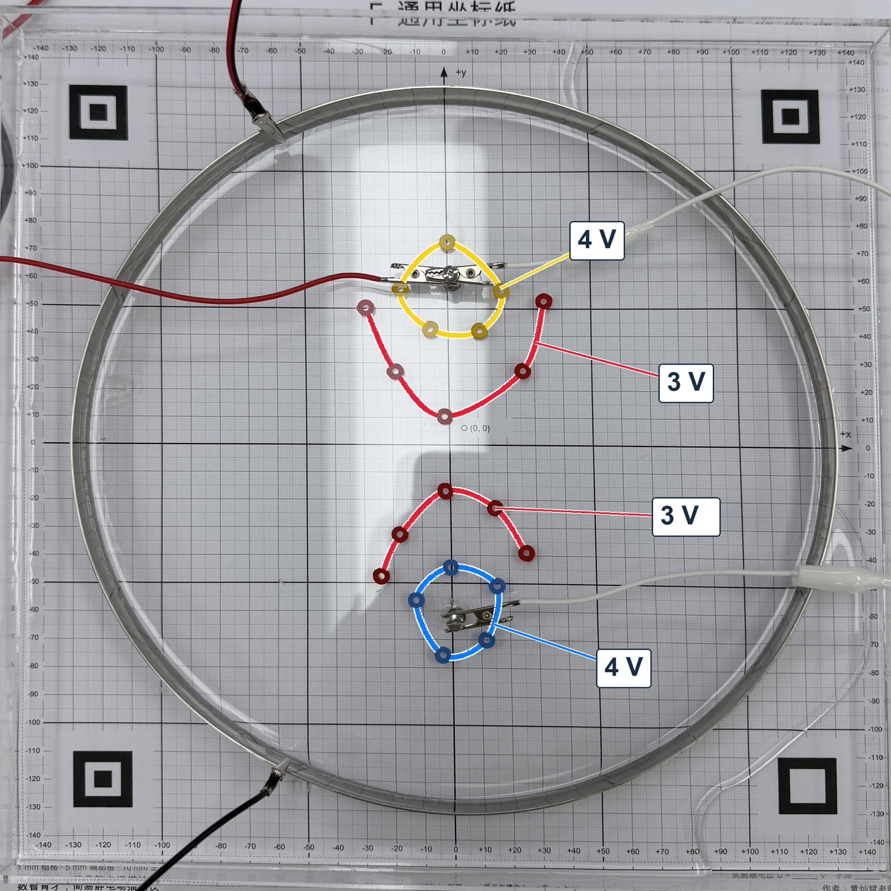

# 序言　不会编程的物理老师，能用 AI 做成什么

先说几个备课桌前的时刻，物理老师大概都遇到过。

讲电势，手里只有课本上那张画好的等势面图，学生点头，换一道题照样不会。讲碰撞，碰前两个速度、碰后两个速度，中间发生了什么，只能靠嘴说。分组实验做完，大半节课花在算速度、描点上，留给“这些数据说明什么”的只剩几分钟。想要一个能调参数、能暂停的模拟，网上找不到正合适的，自己又不会写程序。这两年 AI 很热，也试过让它写一个，网页倒是出来了，可它算得对不对，心里没底，不敢拿去上课。

这本书写的，是四位一线物理老师在这些时刻，怎样和 AI 一起把东西做出来、查清楚、用到课上。

不需要会编程。书里的每一件东西，都从教师自己说得出口的一句话开始：纸带记录页、传感器网页、动量模拟、静电教具、水槽描绘仪、电学实验的课堂页、作业和笔记的学情分析。配套包里有书中的网页和数据，可以先拿来用，再照着书改成自己的。

## 这本书有意思的地方

**看不见的东西，变成学生能检验的东西。** 水槽那节分组实验课上，有人问一组学生：“怎么知道这些点在一条等势线上？”他们没有只报读数，而是把两支表笔分别放进两个同色的环里：电压表示数约为零。等势面在课本上是一张画好的图，到了水槽里，成了学生自己能证明的东西。

第 10 章再把这些测点按电势抬高，得到一片可以转着看、可以竖直切开的电势地形。高处电势高，顺着最陡的坡往下就是电场方向，切口就是 φ–x 图像。

**学生的直觉，在画面里接受检验。** 不少学生说，滑块冲到圆弧轨道的最高点就“停住了”。第 7 章的网页先藏起答案，让学生写下判断，再放出结果：滑块和轨道正一起向右走。滑回底端以后，只改两者的质量比，滑块可能向左、停在原地、也可能继续向右，和课本里弹性碰撞的三种情况一模一样。

**AI 会犯错，抓住它的是物理。** 书里没有把 AI 写成无所不能。它把 4 V 的红线顺滑地连到 2 V 的蓝环上；交付时报告“24 项检查通过”，可质量填 0，页面照样算出“负能量”；它拟合出的电极电势，比电池电压还高。这些错，程序不报警，画面也顺眼，是物理老师先写下预期、再对照结果抓出来的。读这些地方，有点像读学生作业里的典型错误，也像读一段侦探故事：哪里对不上，原因藏在哪里，下一次该测什么。

**花小钱，做真东西。** 静电课上，一棵用绿布做树冠的小树立在两块金属圆片之间，起电机一摇，“云层”的火花打下来，树冠烧了起来；罩上厨房里的金属滤网，火花就只打在网外。描绘仪上的色环、调平楔片、收纳盒是 3D 打印的；那些小色环塑料比水重，放到水面上却浮着不沉，做一个零件，做出了一道表面张力的题（第 14 章）。

## 读完以后，你自己会多出什么

做成几件东西还在其次。更有用的，是做的过程里长出来的几样本事。

**知道 AI 擅长什么、哪里必须自己拿主意。** 写程序、算电场、整理照片、设计打印件，它都很快；学生卡在哪里、模型条件怎么定、结果对不对、课上在哪里停下来问学生，仍然要老师判断。

**会检查 AI 交来的东西。** 第 3 章只教一个办法：打开结果之前先写下预期，再把两样东西并排比较。推到极端，查单位，分清哪些数是测的、哪些是模型补的，请另一个 AI 只拿原始条件独立重算，后面各章用到时再讲。都是物理老师的老本行，用到了新的地方。

**提示词从说不清到说得清。** 每章正文给的都是教师自己写得出的简短提示词，只写必须由教师决定的事。看到哪里不对，就补哪一句。几章做下来，原来要 AI 替你想的事，有一部分已经变成你自己的了。

**学生也用 AI 以后，看得出作品里哪些理解是学生自己的。** 第 16 章审了 25 份学生网页和他们与 AI 的对话，给出一套按顺序检查、定向退回的办法。

这些本事不依赖某一个模型。模型会越来越强，老师的判断不会因此变得多余；判断越准，AI 帮得越多。

## 从哪里读起

第 1 章是我们的几条教学主张，篇幅不长，想先动手也可以跳过。第 2、3 章是起步：装好软件，用一句话请 AI 做第一件事，做出纸带记录页，再学会检查它。急着想看能做成什么，可以先翻第 7 章的动量模型、第 8 章的静电课或第 9 章的水槽，遇到操作问题再回到前两章。最后的第 17 章回头讲这些做法背后的研究。也可以按教材进度，直接找下学期要教的那一节，下一篇《开始之前》里有对照表。

这本书由四位一线物理教师合写。书里的装置、网页和数据都来自真实的教学和备课；哪些在课上用过、哪些还没有，各章都写明了。做对的和做错的，都写了进来。
