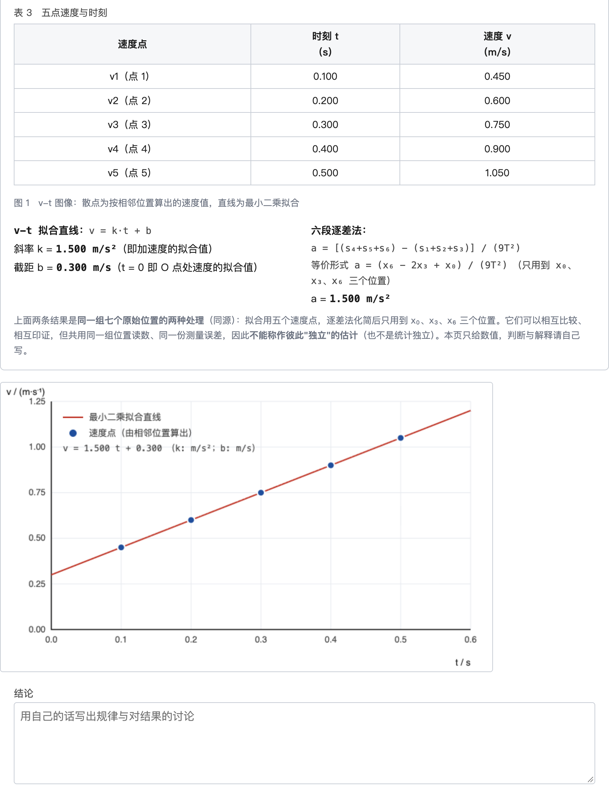
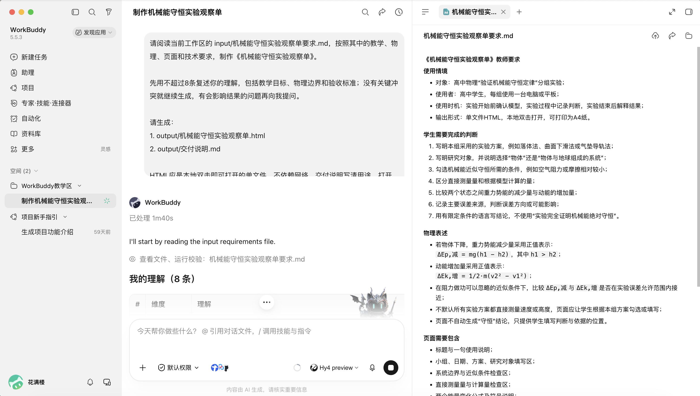
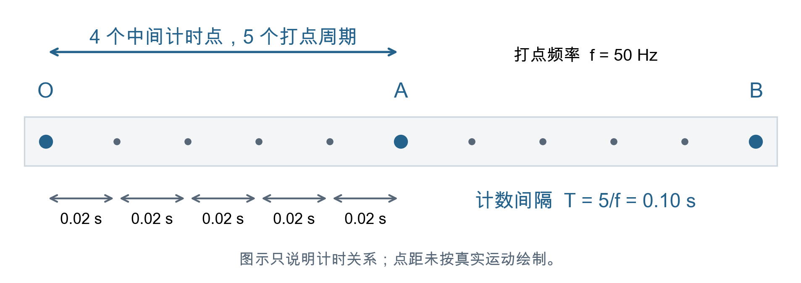
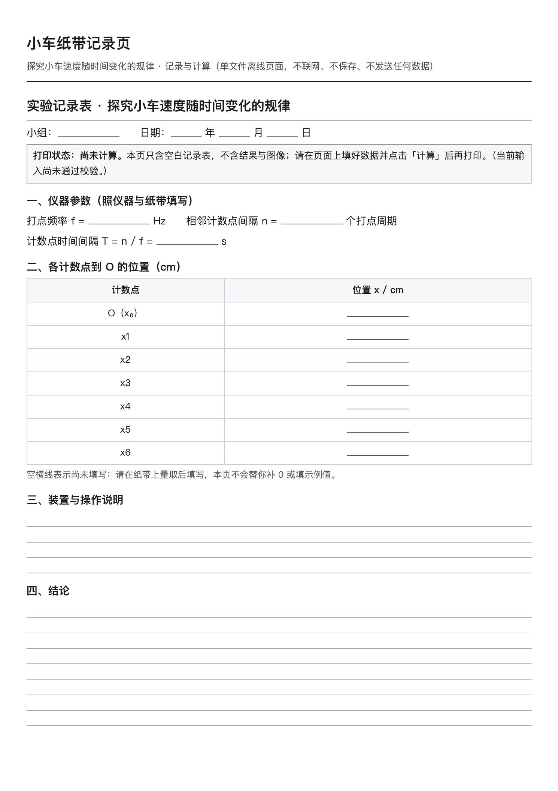

# 第 2 章　从一句话到一张记录页：请 AI 助教做第一件事



这一章只做一件事：上面这张小车纸带实验的记录页。学生填进各计数点的位置，页面算出速度、画出 v–t 图，还能打印成空表拿到实验室手写。

选它，是因为它正好卡在一节课的痛处。人教版必修第一册“实验：探究小车速度随时间变化的规律”，教师用书建议 2 课时，难点是数据分析。第二课时常见的样子是：学生埋头做除法、描点，等算完画完，下课铃也快响了，“这些点为什么落在一条直线上”只能匆匆带过。

选它还有一个理由：它算得对不对，你自己验得了。五个速度、一个斜率，手算几分钟。第一次和 AI 合作，就该选这种自己当得了裁判的任务。

你不需要会编程，也不必先弄懂“大模型”“智能体”是什么。

## 一、说一句话，拿到第一份文件

### 装好软件，建一个文件夹

WorkBuddy 是装在电脑上的 AI 工作台。你指定一个文件夹，AI 就在里面读写文件，做出的网页、文档都存在那里。从官网下载安装、登录，先认三个区：中间是对话区，左侧是任务和工作空间，打开文件后右侧出现查看区。别的入口先不用管。（示范用的是 macOS 上的 WorkBuddy 5.7.7，版本更新后布局可能变。）



在电脑上新建一个文件夹，比如叫“小车纸带记录页”。在 WorkBuddy 里点“新建任务”，在输入框下方把工作空间选成这个文件夹。发送前看一眼工作空间的名称，它决定文件写到哪里。

### 第一句话

用自己的话说就行：

```text
我是高中物理老师。请帮我做一张小车纸带实验的记录页：学生填七个计数点到起点的距离，页面算出各点速度、画出 v–t 图、求出加速度。做成一个网页文件，存到这个文件夹里，告诉我怎样打开。
```

这句话里没有一个软件术语，说的都是你上课要用的东西。发出去以后，AI 多半会先问你几件事，或者先做出一版再列出它替你假定了什么。不管哪一种，有两件事要由你说定，因为它们正是课上最容易错的地方：

- **计数点之间隔多久。** “每隔几个点取一个计数点”有歧义，要说成“两个计数点之间还有 4 个计时点”，也就是 5 个打点周期，50 Hz 时是 0.10 s。
- **填的是什么。** 各计数点到同一个起点的距离，单位 cm；不是每一段单独量出的长度，也不是算好的速度。



学生把“还有 4 个计时点”按 4 个周期算，得到 0.08 s，这是这节课的老毛病。你在这里对 AI 说清楚的话，就是课上要对学生说清楚的话。

它问的别的问题，听不懂就直接问回去：“这个词是什么意思？用高中老师能懂的话说。”拿不定主意，就说：“给我两三种做法，说说各自的好处，我来选。”

### 找到文件，打开它

任务结束时，回复里会出现一张文件卡片。点开它，再到文件夹里找到同名的 `.html` 文件，双击，浏览器就打开了。这张页面的文字、样式和计算都在这一个文件里，不联网也能用；发给同事，发这个文件就行。

只收到一段代码、没有文件，就补一句：“请把它保存成网页文件，再告诉我怎样打开。”双击后看到满屏代码，多半是扩展名被存成了 `.html.txt`，把这个现象告诉它。

## 二、填七个数，看它算得对不对

页面打开了，先别急着夸它。学生实测数据的正确答案，你也不知道；所以先编一组答案已知的数据。设小车过计数点 O 时速度 0.30 m/s，加速度 1.50 m/s²，计数间隔 0.1 s，按 $x=v_0t+\frac12at^2$ 算出各点位置：

| 计数点 | O | 1 | 2 | 3 | 4 | 5 | 6 |
| --- | --- | --- | --- | --- | --- | --- | --- |
| 到 O 的距离 / cm | 0 | 3.75 | 9.00 | 15.75 | 24.00 | 33.75 | 45.00 |

把频率 50、间隔 5 个周期和这七个位置填进去，点“计算”。页面应当给出：点 1 至点 5 的速度 0.45、0.60、0.75、0.90、1.05 m/s，五个点落在一条直线上，斜率 1.50 m/s²，截距 0.30 m/s。本章开头那张图，就是示范里的页面填进这组数以后的样子。

对上了，你手里就有了第一份自己验过的 AI 作品。对不上，把操作、预期和实际看到的数告诉它：

```text
我填了这七个位置，预期加速度是 1.50 m/s²，页面显示的却是【页面上的数】。请列出你实际用了哪些位置和公式，保留我的输入，找到原因后修改。
```

不必去猜代码哪里错。你给预期，它查原因。

## 三、改一处，学会怎样跟它说

第一版很少正好合用。示范里的第一版，计算全对，却有一处用不了：它有“打印”按钮，可没填数据时打出来的纸上，输入栏全没了。第一课时学生在实验室打纸带、量位置，要的恰恰是一张能手写的空表。

AI 交付时还附了一份自查清单，说在浏览器里查了 51 项，全部通过。“打印时隐藏输入区”正是其中一项。它按自己的设想检查，而它的设想里没有实验室里要用的那张空表。

这一处，一句话就能改：

```text
还没填数据时也要能打印一张空表给学生手写；现在打出来输入栏全没了。请改成：没算时打印空表，算过才附结果和图。别的地方不要动。
```



这句话里有三样东西：我看到了什么，我要的是什么，哪些别动。后面再大的任务，跟 AI 说话也就是这三样。它不需要你告诉它怎么改，它需要你告诉它课堂上要什么。

改完以后，自己再打开一次：打印预览里空表在不在；把那七个数重新填一遍，1.50 还对不对。它说“已经改了”，要看过新文件才算数。

到这里，你已经走完一个完整的来回：说出要什么，拿到文件，用自己算得出的数验它，指出一处不合用，核对修改。全书后面的每一件作品，都是这个来回转很多圈。

## 四、它说得笃定，不等于说得对

这位助教的脾气，还有一面要早点知道。

示范里，我们还请它用高一学生听得懂的话，解释纸带开头的点为什么密。主线是对的：打点的时间间隔相同，开头速度小，相同时间里走得短。可它顺手把“纸带卡住”列成了等时间间隔的例外。纸带卡住时，电源频率没有变，打点周期也没有变。

指出以后，第二版改掉了这一处，又添了三处新错，其中一句是“相邻两点之间永远是 0.02 s”，没想到漏点的情形。逐条指出，第三版才改准。

它动作快，表述流畅，说错的时候和说对的时候一样笃定；修掉一句错话，不保证新添的话都对。哪一句错、错在哪里，要由物理老师来判断。这正是你的长处，也是下一章的事。

## 五、带进课堂：页面替不了学生的地方

第一课时做实验、打纸带、量位置，学生手里只需要那张打印的空表。记录页用在第二课时。

教师用书提醒，软件处理数据便捷，但仍要加强学生亲手描点、拟合的能力。所以顺序是先手后机：学生先在坐标纸上描点、画线、求斜率，再用页面的结果核对。差得多，就回头查是描错了点，还是“目测的直线”画偏了。

设备不够时，教师用一台电脑逐组输入，每组截一张图，并排投影。几条纸带的 v–t 图放在一起，数据点不严格共线这件事，自然成了讨论的话题。

学生的常见错误，页面和课上各有对应：

| 易错点 | 课上的表现 | 怎样应对 |
| --- | --- | --- |
| 计数点间隔数错 | 把“还有 4 个计时点”算成 0.08 s | 学生先在纸带旁写下数到几个计时点；页面显示计数间隔，先口算再核对 |
| 分段测量 | 每段单独量，误差累积 | 记录表只收“到起点的距离”，段长由页面算 |
| 从第一个点开始计时 | 开头点迹密集，速度误差大 | 测量前先在纸带上圈出起点，说明为什么舍去 |
| 拟合时连折线 | 把各点依次连起来 | 先手工画直线，再和页面对比 |
| 把不在线上的点删掉 | 为了“好看”删点 | 要求写出偏离的可能原因，保留原始数据 |

故意把间隔填成 4 个周期，页面会如实算出 2.34 m/s²。这个数可以带到课上：计时点数错一个，加速度就大出一半多。

## 六、卡住了怎么办

页面白屏、按钮失灵、公式乱码时，先别删文件。把出问题的画面或报错、刚才的操作一起交给 AI，看不懂的报错原样贴过去就行：

- **白屏或按钮点不动：**“我打开页面后出现了这个问题，刚才做的是【操作】。请检查原因并修复，保留原文件，不要改物理公式。”
- **改好一处却改坏另一处：**“请找到上一份能正常使用的版本，另存后只改【这一处】。找不到旧版先告诉我，不要凭猜测重做。”
- **不知道该提供什么：**“先问我一个你最需要知道的问题。”

修好以后，先重复刚才出错的操作，再把那组已知数据填一遍。

这张记录页的计算链“各点位置 → 瞬时速度 → v–t 图 → 斜率”，换掉装置和参数，还能用于自由落体、探究加速度与力和质量的关系、验证机械能守恒（第 6 章）。做好的记录页收在配套包第 2 章。

读完这一章，如果只想再多做一件事，就做这一件：把自己的一份旧学案交给 AI，请它找物理表述和数字上的问题，再逐条看哪些确实是错、哪些是它没读懂上下文的误判。在自己最熟的材料上，最容易看清它哪里靠得住。

后面各章的“自己做一遍”都假定你读过这一章：会新建任务、选工作空间、找到文件，会把看到的问题照实说给它听。
