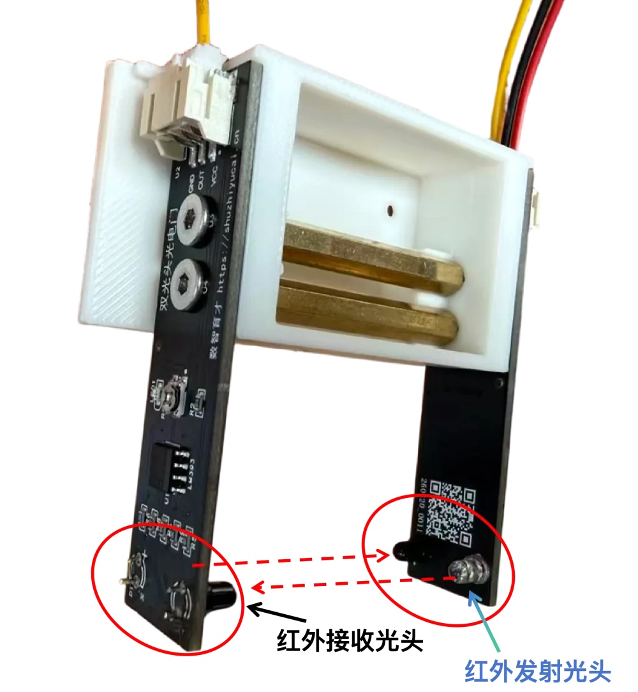
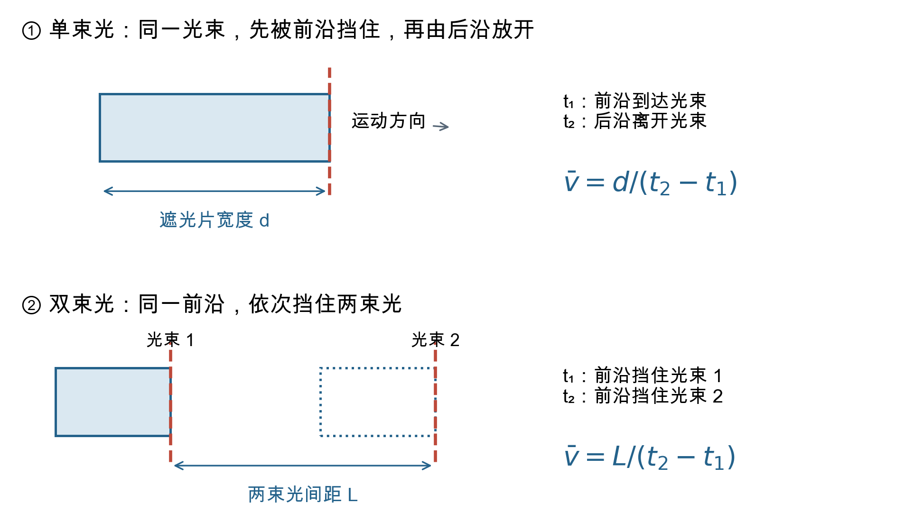
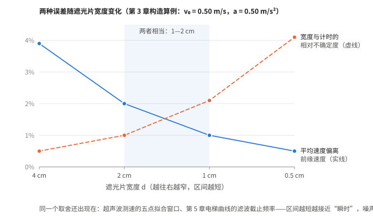
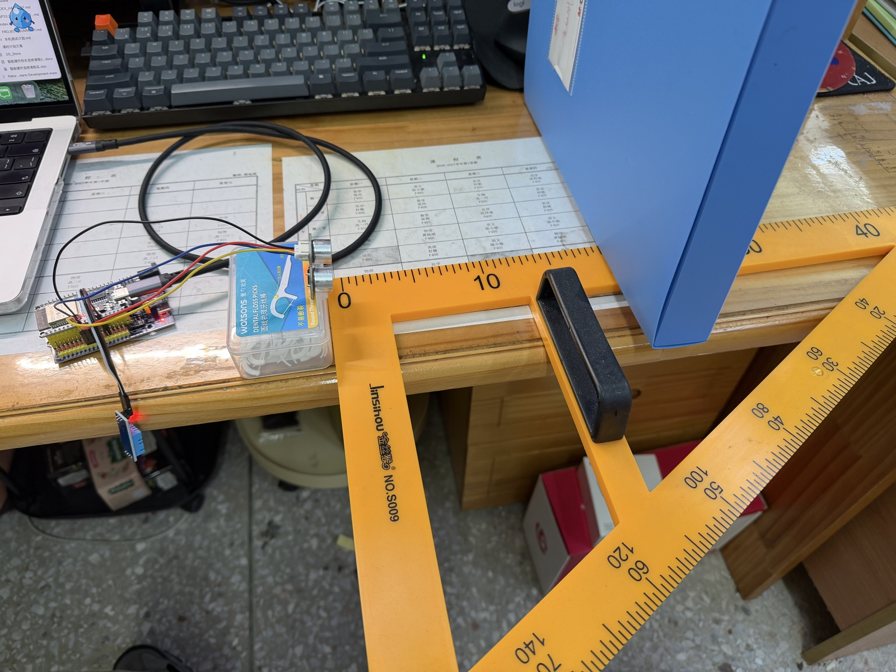
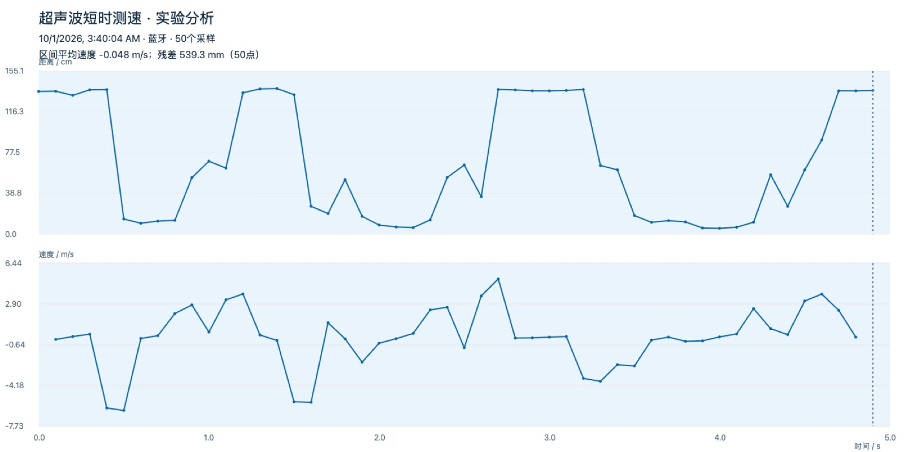
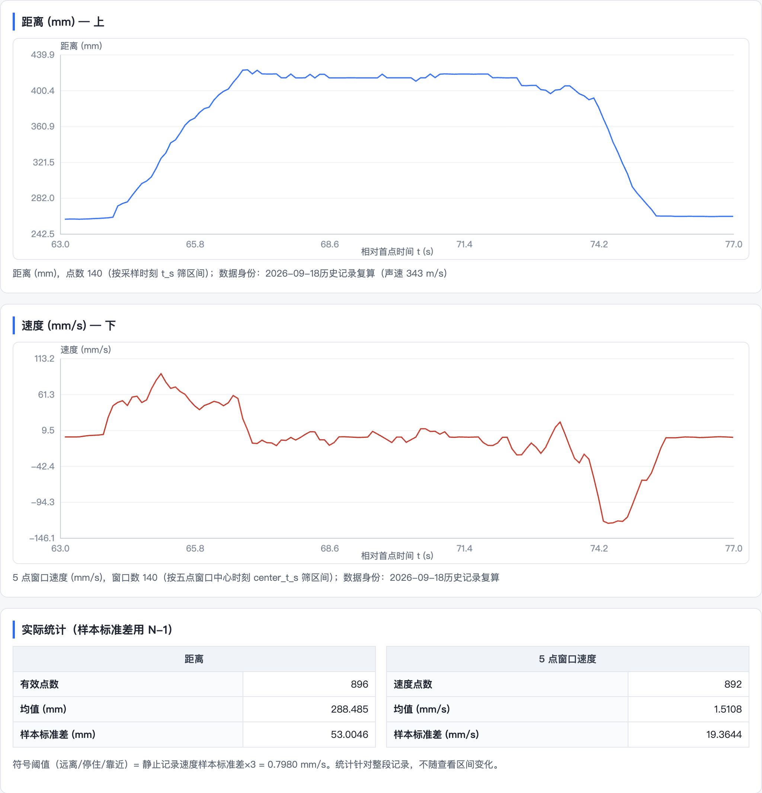

# 第 4 章　传感器测速：一个速度从哪里来

主笔：黄灿斌（第一至三节）、王硕（第四至六节）



小车穿过光电门，屏幕上跳出一个速度，学生自然以为光电门“看见”了速度。其实它只经历了光的亮、暗、再亮，记下的是一段时间；速度由这段时间和一个长度算出，而且是一段区间里的平均速度。超声波测速仪也一样：它每隔 0.1 s 测一次距离，速度是从距离曲线上算出来的。

这一章把两种传感器放在一起看。光电门只在物体经过光束的一小段测一次；超声波连续测几秒，得到一条距离—时间曲线。两者要回答的是同三个问题：仪器直接记下的是哪个量，算出的速度该标在哪一刻，这个速度能信到什么程度。

## 一、屏幕上的速度从哪里来

人教版必修第一册第一章第 3 节“位置变化快慢的描述——速度”，从平均速度引出瞬时速度：用 $t$ 到 $t+\Delta t$ 一小段时间内的平均速度代替时刻 $t$ 的速度，“当 $\Delta t$ 非常非常小时”，就把 $\dfrac{\Delta x}{\Delta t}$ 叫作瞬时速度。教师用书写明了两处难点：极限思想学生第一次接触，“一时不理解也不必强求”；理论上 $\Delta t$ 越小越接近瞬时速度，但时间太短时位移也很小，测量误差会增大，“实际测量中应当根据需要和所用仪器，选取合适的时间间隔”。

同一节的“拓展学习”介绍了两种位移传感器，其中一种只有一个不动的小盒：向物体发出超声波脉冲，接收反射波，由时间差和声速得到距离，再算出速度。教材说，借助传感器，“同学们就可以用更多的时间和精力对物理过程进行分析”。教师用书却特意提醒：配套软件虽能直接显示位移或瞬时速度，教学中仍应让学生弄清实验原理和数据处理方法。

学生在这里常有几种误解：

1. **光电门直接测速度。** 它测的是时间，速度要用一个长度去除。
2. **光电门测的就是瞬时速度。** 它测的是遮光片经过光束这一段的平均速度。
3. **遮光片越窄越好。** 越窄越接近瞬时速度，但宽度和时间的测量误差占的比例越大。
4. **距离是测出来的。** 超声波测的是声波往返的时间，距离 $=$ 声速 $\times$ 时间 $\div 2$；声速用错，所有距离都按同一比例偏。
5. **屏幕上的速度曲线就是“真实的速度”。** 物体不动时距离读数也在抖，相邻两次距离一相减，这点抖动就变成了“速度”。

## 二、光电门：测的是时间，速度是算出来的

### 双头光电门

数智育才网站用的是一种双头光电门。它和配套的原始程序来自翁浩峰老师的自制 DIS 资料，我负责把装置的含义、程序的输出和网页的字段对接起来。左右两块电路板上各有一个红外发射头和一个红外接收头，组成上下两条光路，两束光的固定间距 $L=1\ \mathrm{cm}$。

它和实验室常见的单头光电门测的是不同的时间：

| | 单头光电门 | 双头光电门 |
| --- | --- | --- |
| 记录什么 | 一片遮光片挡住光束的持续时间 $\Delta t$ | 物体先后挡住两束光的时间差 $\Delta t$ |
| 用哪个长度换算 | 遮光片沿运动方向的有效宽度 $d$ | 两束光的固定间距 $L$ |
| 速度 | $\bar v=\dfrac d{\Delta t}$ | $\bar v=\dfrac L{\Delta t}$ |
| 要事先知道什么 | 遮光片宽度，每换一片都要量 | 不需要知道物体尺寸，小球、滑块都能直接测 |



这里的“双头”指一台装置里的两束光，相距 1 cm，合起来测一个速度。考题里测加速度用的“两个光电门”是两台装置，彼此相距几十厘米，各测一个速度。

“有效宽度”的“有效”二字要留意：遮光片边缘有斜角、光束有一定粗细时，挡光的长度不一定等于尺子量出的宽度。双头光电门的 $L$ 由电路板结构决定，同样要实测，设计图上的数字只作参考。

### 速度应该标在哪一刻

网页最容易做的，是在收到数据的时刻画一个速度点。物理上要问：这个平均速度对应哪一时刻？

物体做匀变速运动时，一段时间内的平均速度等于这段时间中点的瞬时速度。所以单头光电门的速度应标在遮光开始与结束的正中，双头光电门标在两次挡光的正中：

$$t_v=\frac{t_\text{开始}+t_\text{结束}}2.$$

运动不是匀变速时，这个时刻只能作为区间的代表。这一区别在匀速运动中看不出，研究加速运动时会影响结果。第四节的超声波拟合窗口，用的是同一条原则。

### 遮光片该选多宽

下面用一组构造数据看这个取舍。设滑块的遮光片前缘到达光束时速度 $v_0=0.50\ \mathrm{m/s}$，加速度 $a=0.50\ \mathrm{m/s^2}$；宽度按毫米刻度尺测，标准不确定度取 0.02 cm，计时取 0.1 ms：

| 遮光片宽度 $d$ / cm | 遮光时间 / ms | 平均速度 / (m·s⁻¹) | 比前缘到达时的速度大 | 测量的相对不确定度 |
| --- | --- | --- | --- | --- |
| 4.00 | 77.0 | 0.519 | 3.9% | 0.5% |
| 2.00 | 39.2 | 0.510 | 2.0% | 1.0% |
| 1.00 | 19.8 | 0.505 | 1.0% | 2.1% |
| 0.50 | 9.95 | 0.502 | 0.5% | 4.1% |



第四列的偏差来自把平均速度当作“前缘到达光束时”的速度；第五列按 $\dfrac{u_v}{\bar v}\approx\sqrt{\left(\dfrac{u_d}d\right)^2+\left(\dfrac{u_t}{\Delta t}\right)^2}$ 估算。一列随遮光片变窄而减小，一列随之增大，教师用书说的“选取合适的时间间隔”，落到这台装置上就是两列都不太大。改用 50 分度游标卡尺量宽度，交叉点移到 0.5—1 cm 之间。

教师用书里有一组真实数据，问的正是这件事（必修第一册第一章第 3 节教学片段，表 1-2）。滑块每次从同一高度沿气垫导轨滑下，换不同宽度的遮光片，测它经过同一位置 A 的遮光时间，每种宽度测三次：

| 遮光片宽度 / cm | 30.0 | 20.0 | 11.0 | 3.8 | 2.4 | 0.86 |
| --- | ---: | ---: | ---: | ---: | ---: | ---: |
| 三次遮光时间的平均 / s | 0.634 | 0.459 | 0.263 | 0.094 | 0.058 | 0.021 |
| 用表中数据算出的平均速度 / (m·s⁻¹) | 0.473 | 0.436 | 0.418 | 0.406 | 0.411 | 0.410 |

从 30 cm 到 11 cm，平均速度单调下降，这就是“区间越小越接近瞬时”；3.8 cm 以下，三个数在 0.406 与 0.411 之间波动，不再单调，说明宽度和计时误差已与区间偏差相当，再换更窄的也看不出更多。0.86 cm 一行遮光时间仅 0.021 s，计时器只读到 0.001 s，末位差一个字就差约 5%。课上先让学生算出每行平均速度，再问“为什么不一直换更窄的”。

## 三、自己做一遍：一张追得回来源的光电门记录页

和第 2 章相比，这里多了一件事：数据不再手动输入，而由设备经蓝牙发来，所以先要弄清设备到底发送了什么。没有硬件，也能用书里的检查样例做完前两步；本书用的光电门程序和检查样例在配套包第 4 章。

### 先问清设备实际发来了什么

新建“光电门记录页”文件夹作为工作空间，把设备程序和数据说明的副本放进 `input`。先让 AI 读程序，比让它猜表格应有哪几列可靠。

提示词：

```text
我要做一张双头光电门记录页，能看清每个速度从哪里来。请先读 input 中的程序和说明，列出蓝牙和 USB 各自发了什么、单位是什么、哪些量没有发，设备时间是在哪一刻记下的。先不要改固件。网页把设备发来的量和自己算出的量分开，不能猜字段。
```

本书这台光电门，蓝牙只发速度和设备时间，USB 串口还多发两束光的时间差（μs）。蓝牙没发时间差，网页就应把这一栏留空；用 $L/v$ 倒算时间差再算回速度，只会得到原来的数，发现不了设备算错。设备时间记在哪一刻，决定速度能不能标在区间中点；按网站源码，这个模板记的是两次挡光时刻的平均值，换了固件要重新查。回答里出现“通知”“小端浮点数”这类词，可以说：“请用一两句话解释这几个词，再告诉我：作为物理老师，我只需要核对哪几项？”

### 先用三条已知输入做记录表

先只做表格、导入和导出，不急着连接实物。把下面三条按固件格式编写的检查样例交给 WorkBuddy：

```text
速度是 1.25 m/s，时间是 12.5 s，两门时间差是 8000 us
速度是 0.5 m/s，时间是 15 s，两门时间差是 20000 us
速度是 1 m/s，时间是 0.5 s，两门时间差是 10000 us
```

取 $L=0.0100\ \mathrm m$，前两条的网页复算应为 1.25 m/s 和 0.50 m/s；第三条设备时间从 15 s 退回 0.5 s，多半是开发板重启过，应另起记录段，不能和前两条连成一条曲线。

提示词：

```text
请先做记录表：能导入上面三条检查样例、导出 CSV，再按刚才从程序里读出的格式加蓝牙和 USB 连接。设备发来的原值和网页算出的值分开放；蓝牙没发时间差就留空，不要用 L/v 倒算。样例标明“构造检查样例，非实测”。
```

再用同一条时间差查长度和单位：8000 μs 是 0.008 s，1.00 cm 是 0.0100 m，速度 $0.0100/0.008=1.25\ \mathrm{m/s}$；页面若显示 0.00125 或 125，先查单位。把间距改为 2.00 cm 再导入同一条，新行应为 2.50 m/s，旧行仍为 1.25 m/s，这说明网页保存了每次计算用的间距。间距填 0、负数或留空，合格的页面拦下这次导入，表格不变；配套页面第一次生成时出现过“报了错，表格里却仍加了一行”。

### 接上实物之前要知道的一件事

浏览器只在安全地址下开放蓝牙。双击打开的网页地址以 `file://` 开头，通常连不上；`https://` 网址或本机网页服务地址（`http://localhost`）才能连。可以请 AI 在本机开网页服务，或者把页面放到网站上。先在电脑的 Chrome 或 Edge 上操作，确认浏览器弹出设备选择窗口、由教师亲手选中设备；AI 回复“已连接”，不代表浏览器真的连上了。第一次只看一条记录：设备速度与网页速度是否一致，设备时间是否在变。

## 四、超声波：从一条距离曲线求速度

（本节起由王硕执笔，“我”指王硕。）

在测速教学中，我希望学生把物体的运动、距离曲线和速度曲线联系起来，并追问速度是怎样算出的。这台超声波测速仪由黄灿斌老师借助 AI 制作：ESP32 开发板每 0.1 s 触发一次测距，HS-SR04P 模块测回波往返时间，DHT11 测气温用来算声速，小屏幕和蜂鸣器方便不连电脑时使用，外壳是 3D 打印的（第 14 章）。配套网页“超声波短时测速”在数智育才网站的在线实验室，选 USB 或蓝牙连接，点“开始采集”，默认记录 5 秒，可以导出表格。



装置保存的一份往返记录采于 2026 年 9 月 18 日：90 秒里，挡板先远离、停住、靠近、停住。其中三段：

| 时段 | 距离变化 | 速度均值 | 判断 |
| --- | --- | --- | --- |
| 64.2—67.1 s | 274 mm → 419 mm | +5.3 cm/s | 远离，速度为正 |
| 73.8—75.7 s | 397 mm → 262 mm | −7.2 cm/s | 靠近，速度为负 |
| 75.8—82.8 s | 262 mm → 263 mm | +0.03 cm/s | 停住，接近零 |

### 距离是怎样算出来的

超声波模块测的是回波往返的时间 $t$，距离 $x=\dfrac{c\,t}2$，$c$ 是声速，随气温变化，常用近似 $c\approx(331+0.6\,T/^\circ\mathrm C)\ \mathrm{m/s}$。28 ℃ 时 $c\approx348\ \mathrm{m/s}$；程序若固定用 343 m/s（约 20 ℃ 的值），距离和速度都偏小约 1.4%。上面那份记录就是这样：气温约 27—28 ℃，换算却固定用了 343 m/s。那是较早的测试程序，现在的程序用测得的气温算声速。

两类距离误差对速度的影响不同：固定偏差（探头前端和发声点差几毫米）让所有距离加上同一个数，速度不受影响；比例偏差（声速用错）让所有距离乘上同一个系数，速度也乘上这个系数。

### 先测静止，再测运动

物体不动时，读数也在抖。2026 年 9 月 18 日的静态测试，每次记录 45 s：

| 目标大约位置 | 距离读数的标准差 |
| --- | --- |
| 20 cm（文件盒） | 0.55 mm |
| 30 cm（文件盒） | 0.43 mm |
| 40 cm（文件盒） | 0.21 mm |
| 50 cm（文件盒） | 2.0 mm |

50 cm 处的波动明显增大，使用前应在这一距离重测，并查挡板朝向和周围的反射物。波动小只说明重复性好；距离准不准，还要用尺子或独立参照另查。

若各次距离误差近似独立，直接用相邻两次读数相减（间隔 0.1 s），距离抖动 0.5 mm 时，速度抖动约 $\dfrac{\sqrt2\times0.5\ \mathrm{mm}}{0.1\ \mathrm s}\approx7\ \mathrm{mm/s}$；距离抖动 2 mm 时约 28 mm/s。教材说的位移传感器间隔“通常设置为 0.02 s”，间隔缩短到五分之一，这种相减得到的速度抖动就放大到 5 倍。

### 窗口长短的取舍

所以不直接相减，而是取连续 5 个点，对“位置—时间”作最佳直线，用斜率表示速度：

$$v=\frac{\sum_i(t_i-\bar t)(x_i-\bar x)}{\sum_i(t_i-\bar t)^2}.$$

五点拟合不是对五个“速度”求平均。距离抖动 0.5 mm 和 2 mm 时，五点速度的抖动降到约 1.6 mm/s 和 6 mm/s。代价是反应变慢：五点窗口跨 0.4 s，结果属于窗口中心，实时显示时已经落后最新点约 0.2 s；挡板突然停住，约过一个窗口跨度速度才回到零。这和光电门遮光片的宽度是同一个取舍：区间越短越接近“瞬时”，噪声也越大。

教师用书讲纸带上求某点的瞬时速度时，让学生比较三种取法：区间在待测点之前、包含待测点、在待测点之后。速度标在窗口中心，就是“包含待测点”；标在最新采样时刻，等于用了“在待测点之前”的一段，所以晚了约 0.2 s。

### 看曲线，再看数



距离从约 10 cm 一下跳到约 140 cm 又跳回来，多半是目标移出了声束，传感器测到了后面的物体；±6 m/s 的尖峰来自这些突跳，在确认连续测到同一目标之前，它只是待查的计算值。页面顶部标的“区间平均速度 −0.048 m/s”其实是整段直线拟合的斜率，残差 539 mm，约为 1.3 m 变化范围的四成，一条直线描述不了这段记录。读传感器数据的顺序因此是：先看距离曲线有无不合理的跳变，再选平滑的区间，最后读速度。

还要记住两件事：超声波算出的是沿探头方向的速度分量，目标斜着走，测到的只是分量；这台装置把“远离探头”记为正。要知道运动时的误差，得给同一次运动加一个独立参照，例如手机慢动作录像里放一把尺子逐帧读，或者让小车同时通过一个光电门，比较同一段区间、同一方向的速度。

## 五、自己做一遍：先分析记录，再接传感器

先用现成记录练数据处理，开发板以后再接。配套包里有 2026 年 9 月 18 日的静止记录和往返记录，以及本节的分析页（分析页由黄灿斌组织，借助 WorkBuddy 生成）。

### 让 AI 先帮你问清需求

提示词：

```text
我想让学生看到小车越走越快时，距离曲线和速度曲线怎样变化，测完最好能存下来。我不会编程。请先问我一个最影响做法的问题，再把需求整理成一张短表。先只做一个超声波模块，不加屏幕、蜂鸣器和其他传感器。
```

它可能先问用什么电脑、测多远、要不要实时投屏。按自己教室的条件回答，不懂的词让它解释再选。需求说清了，屏幕、蓝牙这些附加功能要不要，也就清楚了。

### 分析一段静止记录，再求速度

把静止记录的副本放进 `input`。每行是一次测量：设备序号、触发时刻、回波往返时长（都以微秒计）、是否收到回波。一个是“什么时候测的”，一个是“声波来回用了多久”，要让 AI 分清。

提示词：

```text
请读 input 里的静止超声波原始记录。先告诉我记录了多少点、有没有缺号、时间有没有倒退，再用回波时间重算距离，画距离—时间图，算平均值和样本标准差。保持这次记录的声速 343 m/s，原文件不要改。
```

第一条有效回波 1770 μs，距离 $343\times1770/2000\approx303.6\ \mathrm{mm}$。先让 AI 算对第一行，再看整段：446 个有效点，距离均值约 304 mm，样本标准差约 0.11 mm。然后在同一份数据上求速度：

```text
请用每一段连续的 5 个有效超声波点，对“距离随板端时间”做直线拟合，用斜率表示速度，标在这 5 个点的时间中心。遇到无效回波、缺号或时间倒退，重新开始凑 5 个点，不跨过去拟合。先看这份静止记录算出的速度是否接近零，再看运动记录的正负号。
```

静止记录应得到 442 个五点速度，平均值和零没有差别，标准差约 0.27 mm/s。再读往返记录，检查距离增加的一段速度为正、减少的一段为负。



最要紧的是时间口径：每个距离有自己的采样时刻，每个五点速度属于其 5 个点的时间中心，两者相差约 0.2 s。配套分析页第一次生成时正是在这里出错：按最新采样时刻截取 10—11 s，速度图里却混入了中心时刻约 9.8 s 的点。这是另请一个 AI 独立重算时发现的。画速度—距离图也是同一个道理：速度要配同一时刻的距离，往返两段要按时间先后连线。横坐标也是计算的一部分，不能只核对纵轴。

### 自己接一个模块

接线和烧录（把程序写进开发板）第一次要预留一两个小时。本装置的接法是 TRIG 接 GPIO25、ECHO 接 GPIO26、VCC 接 3.3 V、GND 共地；GPIO 是印在板上的引脚编号，不是从边上数第几根排针。**换用常见的 HC-SR04 时要小心：它用 5 V 供电、ECHO 输出 5 V 信号，直接接到只能承受 3.3 V 的 ESP32 引脚上可能损坏开发板。**

把开发板型号、模块照片和接线表交给 WorkBuddy，让它逐项核对接线，再写最小程序：

```text
帮我写一个最简单的测距程序：每 0.1 秒测一次，把序号、时间、回波时长发到电脑；测不到就标出来，不要当成 0。先别烧录，告诉我怎样检查它真的在运行。
```

烧录卡住时，多半是 USB 线只能充电、缺少 USB 驱动，或者要按住 BOOT 键，把现象告诉 AI 即可。烧录完成后，先把挡板正对探头放在约 30 cm 处摆住 30 s，看序号是否连续、时间是否约每 0.1 s 增加一次，统计重复性；再慢慢远离、停住、靠近，每次停一两秒。出现突跳先回到原始距离查原因，不在速度图上抹掉。

## 六、带进课堂：两种传感器各怎样用

### 光电门：从平均速度到瞬时速度

放在第一章第 3 节，学生学过平均速度、用纸带测过速度之后。实验室常见的单头光电门、数字计时器和几片不同宽度的遮光片就能上；有双头光电门和记录页，可以在最后加一个“不用遮光片也能测”的对照。这些建议还没有在课堂上试过。

| 易错点 | 课上的表现 | 处理办法 |
| --- | --- | --- |
| 以为光电门直接测速度 | 只记读数，不记遮光片宽度 | 先只给计时器，不给速度显示，让学生自己说缺什么 |
| 宽度量错 | 量了遮光片的长度而不是沿运动方向的宽度 | 让学生指出“哪一段挡住了光” |
| 释放位置不一致 | 换遮光片后从不同位置释放 | 用挡块固定释放点 |
| 认为越窄越准 | “0.5 cm 的最准” | 对比第二节表格的最后两列 |

各组测过 4 cm、2 cm、1 cm、0.5 cm 几片遮光片后，最值得讨论两件事：遮光片越窄越接近某一时刻的速度，但同样量差 0.2 mm，0.5 cm 片的速度差约 4%，4 cm 片只差约 0.5%；同一片遮光片重复测三次，宽度误差不会表现为读数的离散，三次读数接近只说明重复性好。汇总画 $\bar v$–$d$ 图时要注意，匀变速运动中 $\bar v=(v_0+\sqrt{v_0^2+2ad})/2$，并非严格直线，只有在较小区间内才适合直线外推。

### 超声波：用动作把曲线“画”出来

放在第一章第 3 节之后或第二章第 1 节之前。课上用测速仪和网站上的网页，分析页留给课前课后。

| 易错点 | 课上的表现 | 处理办法 |
| --- | --- | --- |
| 把 $x$–$t$ 图当成运动轨迹 | 看到曲线往上，以为物体“往上走” | 先让学生预测“远离—停住—靠近”的曲线，再实测 |
| 速度和距离混淆 | “距离大，速度就大” | 让挡板停在远处，看速度为零 |
| 把尖峰当成真实运动 | “这里速度有 6 m/s” | 回到距离曲线找突跳 |

先描述一段运动，例如“慢慢远离，停 1 秒，快速靠近”，请学生在学案上画出预测的 $x$–$t$ 和 $v$–$t$ 草图；再请一位学生手推挡板完成这段运动，网页投屏，对照预测找画错的地方。接着给出一两条目标曲线，请学生上台用动作把它“画出来”。最后展示一段有突跳的数据，请学生指出哪一段不能用、为什么。
