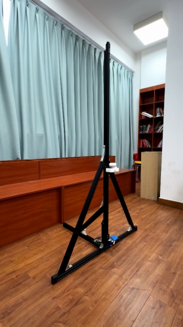
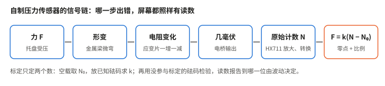
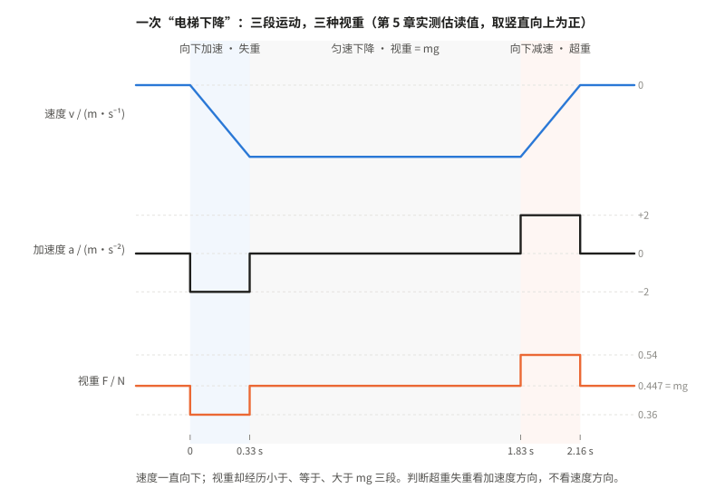
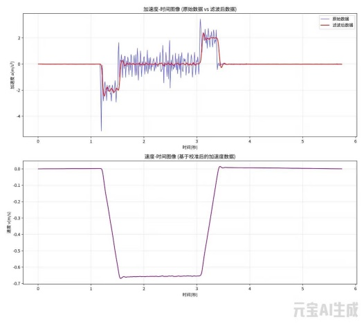

# 第 5 章　超重与失重：把电梯变成可控、可测的课堂实验

主笔：严力耕



学生站上体重秤，蹲下、站起，示数忽大忽小，全班都看得见。可是接着问一句“电梯向上减速时，是超重还是失重”，常有学生答成超重。蹲起一次不过一两秒，加速和减速紧挨着，学生只来得及记住“变大了”“变小了”，来不及把它和运动的哪一段对上。电梯录像、电梯里的体重秤也一样：运动由不得教师，过程一闪而过，没法重来，示数也留不下来。

我们做了一台听指挥的电梯模型。它按设定的速度和加速度，一遍遍重复加速、匀速、减速三个阶段；压力传感器同步采集物体对滑台的压力，网页实时画出视重曲线，做完还能导出原始数据。教师管得住电梯“怎样动”，学生拿得到数据去检验“示数为什么这样变”。

本章先看这台电梯模型怎样设计，再读一次实测曲线，最后是丁龙老师 2025 年 12 月 19 日在育才一中用它上的一节课。

## 一、学生看见了示数，却看不见运动过程

人教版必修第一册第四章第 6 节“超重和失重”，要求学生应用牛顿运动定律分析超重和失重现象。教师用书把这一点列为教学重点，并指出难点所在：“由于超重和失重现在已经演化成了生活语言，与物理学中超重和失重本来的意义有较大的不同，因此引导学生对超重和失重的物理内涵有清晰的认识是本节的教学难点”。

学生首先需要分清两个量：物体所受的重力并没有改变，改变的是支持力或拉力；体重秤显示的是物体对秤的压力，其大小等于秤对物体的支持力，这就是通常所说的“视重”。

丁龙老师在课后反思里写到：课前预设学生普遍把秤的示数当作重力，课堂上却有学生主动联系起乘电梯启动时的感觉；讲到完全失重，仍有学生把它理解为重力消失。学生的起点并不一样，常见的误解有三种：

1. **超重就是变重了，失重就是变轻了。** 物体所受的重力没有变，变的是支持力（或拉力）。
2. **向上运动就是超重，向下运动就是失重。** 决定超重还是失重的是加速度的方向。电梯向上减速时，是失重。
3. **完全失重就是没有重力。** 完全失重时重力仍在，只是支持力为零。

第二条最难纠正。传统演示往往把这一过程压缩在一两秒内，学生只能记住示数变大或变小，难以看清它对应哪一种运动状态。

| 常用方案 | 能看到什么 | 主要局限 |
| --- | --- | --- |
| 真实电梯或电梯录像 | 启动、匀速、制动时示数的变化 | 运动不可控，过程难以重复，示数变化短促，普通体重秤未必跟得上 |
| 体重秤上蹲下、站起 | 站起时示数先大后小，下蹲时相反 | 加速与减速紧挨着，每次动作快慢不同，没有可持续观察的匀速段 |
| 弹簧振子与台秤 | 示数随重物振动起伏 | 重物持续变速，读数变化快，运动与示数不易对应 |

蹲起过程中，示数也会经过重力值。站起时，示数先大于重力（向上加速），后小于重力（向上减速），穿过重力值的那一刻加速度为零、向上的速度最大。人在动、示数却等于重力，正是要让学生看到的现象，可它只有一瞬间，在体重秤上看不出来。

要让学生真正理解“看加速度，不看速度方向”，需要把运动过程置于教师的控制之下：既能重复同一种运动，又能把不同阶段区分开，还能把示数变化记录下来。由此，我们给教具定下三个目标：**运动可控、数据同步显示、原始数据可导出。**

## 二、一台听指挥的电梯：运动可控，数据可测

### 1. 装置构成

这台“基于 ESP32 的智能超失重现象演示仪”参加了 2025 年南山区中小学优秀自制教具评选。装置由框架与轨道、动力与传动、压力测量、控制和电源几部分组成。压力传感器是黄灿斌老师参照翁浩峰老师公开的自制 DIS 方案复刻的：一根称重梁、一块 HX711 放大模数转换模块、一块 ESP32 开发板，几十元就能做一台。梁的一端固定，另一端装托盘，受压时微微弯曲，贴在梁上的应变片一个被拉伸、一个被压缩，电阻一增一减，电桥输出几毫伏的电压，放大转换成原始计数，再扣零点、乘比例换算成力。



标定只定两个数：空载取零点，放上已知质量的砝码求比例，再用没参与标定的砝码检验。读数能报告到哪一位，要看物体静止时读数的波动，屏幕显示到 0.001 N 不等于能准到 0.001 N。传感器的采样频率也要心里有数：常见的 HX711 模块每秒只输出 10 次，电梯加速段只有零点几秒，只能采到三四个点。

| 部分 | 器材 | 在教学中的作用 |
| --- | --- | --- |
| 框架与轨道 | 2040 铝型材、龙门滑车 | 承载被测物体，限制其沿竖直方向运动 |
| 动力 | 闭环 42 步进电机及驱动板 | 按设定完成加速、匀速、减速，减少失步造成的运动偏差 |
| 传动 | 2GT 同步带和带轮 | 将电机转动转化为滑台的直线运动 |
| 测量 | 自制压力传感器 | 测量物体对滑台的压力，即视重 |
| 控制 | ESP32 开发板 | 接收网页指令，控制电机并采集传感器数据 |
| 电源 | 12 V / 5 V 锂电池 | 为电机和控制电路供电 |

### 2. 运动可控：同一种过程可以反复呈现

这台装置首先要做到的，是“说好怎么动，就怎么动”。普通步进电机负载一变就可能“失步”，转子跟不上指令，滑台的实际运动就和设定的不一样。闭环步进电机内置编码器，实时比较转子位置与指令并进行补偿，配合同步带传动，使滑台能够重复执行相同的运动程序。教师可以让它上升或下降，也可以控制运动的速度和加速度，使加速、匀速、减速三个阶段按设定顺序出现。

其中，匀速段有特别的教学价值。蹲起时，“人在运动而示数等于重力”只出现在一瞬间；电梯模型则能把这一瞬间延长为一段清楚可见的过程。滑台仍在运动，视重却回到静止值，学生由此看到：匀速运动既不是超重，也不是失重。

匀速段的长短受立柱行程限制。设加速段和减速段的加速度大小都是 $a$，匀速段速度为 $v$，行程为 $L$，则

$$
t_{\text{加}}=\frac{v}{a},\qquad s_{\text{加}}=\frac{v^2}{2a},\qquad t_{\text{匀}}=\frac{L-v^2/a}{v}.
$$

速度 $v$ 定得越高，加速、减速占去的行程越多，匀速段反而越短；加速度 $a$ 越大，视重变化越明显，加速段的时间却越短，传感器采到的点越少。行程是固定的，这几个量只能权衡着选。

### 3. 数据可测：运动与视重同步显示

网页借助 AI 编写，通过蓝牙分别连接电机控制器和压力传感器。点击“电梯上升”或“电梯下降”，滑台按设定动作，网页同步画出力的变化；实验结束后，数据可以导出为时间和力两列。学生据此选定加速、匀速、减速区间，算各段的平均视重，再换算加速度。是否保留原始数据、怎样分段、异常变化有没有物理意义，由教师和学生判断。手里有导出数据的老师，可以这样开始：

```text
这是电梯模型一次“下降”的视重数据，有时间和力两列，物体静止时读数约 0.447 N。请画出原始曲线，标出加速、匀速、减速三段，算出各段的平均视重和对应的加速度。尖峰先不要删，告诉我它可能来自哪里；如果要滤波，原始曲线保留在同一张图上。
```

### 4. 视重能变多少

由 $F_\mathrm N=m(g+a)$，

$$
\frac{F_\mathrm N}{mg}=1+\frac{a}{g}.
$$

视重的相对变化只取决于 $a/g$，与放多重的物体无关。加速度为 $2\ \mathrm{m/s^2}$ 时，视重只比静止时大或小约 20%。曲线上的台阶本来就不高，振动造成的抖动一旦大起来，台阶就会被淹没。抑制振动和晃动因此是这台装置设计时的一项基本要求。

## 三、一次实测：把曲线读成物理过程





实测中，滤波后的加速度先约为 −2 m/s²，持续约 0.3 s；随后接近零，持续约 1.5 s；最后约为 +2 m/s²，再持续约 0.3 s（时长均从图上估读）。速度则由零变为约 −0.66 m/s，保持一段时间，最后回到零。它对应一次完整的下降过程：先向下加速，再匀速下降，最后减速停住。

物体放在滑台上，取竖直向上为正方向。由牛顿第二定律：

$$
F_\mathrm N-mg=ma,\qquad F_\mathrm N=m(g+a).
$$

| 运动阶段 | 加速度 | 视重与重力的关系 | 现象 |
| --- | --- | --- | --- |
| 向下加速 | 向下，$a<0$ | $F_\mathrm N<mg$ | 失重 |
| 匀速下降 | $a=0$ | $F_\mathrm N=mg$ | 不超重，也不失重 |
| 向下减速 | 向上，$a>0$ | $F_\mathrm N>mg$ | 超重 |

整个过程中，滑台的速度方向始终向下，视重却经历了小于、等于、大于重力三个阶段。这一组对应关系直接说明：判断超重和失重，要看加速度方向，只看运动方向是不够的。中间持续约 1.5 s 的匀速段，比加速、减速两段加起来还长，把前面的失重和后面的超重清楚隔开，使学生有足够时间观察并解释。

### 1. 先算出曲线应该是什么样

一次“电梯上升”，理想的视重曲线分三段：加速上升时 $a>0$，视重大于 $mg$；匀速时等于 $mg$；减速上升时 $a<0$，视重小于 $mg$。“电梯下降”正好反过来。

最该检查的是匀速段：读数应回到运动前的静止值。匀速段的平均读数如果明显偏离静止值，先查滑台是不是真的匀速，再查传感器有没有随运动漂移，不要急着说“匀速时也有超重”。

电梯从静止开始、到静止结束，速度的变化为零，所以加速度对时间的总面积为零：

$$
\int a\,\mathrm dt=0,\qquad \int(F_\mathrm N-mg)\,\mathrm dt=0.
$$

视重曲线在 $mg$ 上方的面积，应当等于下方的面积。这个检查要用导出的原始数据做，再比较滤波改变了多少。怎样在导出数据上选段求面积、零点偏一点会积出多大误差，第 11 章用电流曲线讲全。

### 2. 这张图可以自己检查自己

加速段：$2\ \mathrm{m/s^2}\times0.33\ \mathrm s\approx0.66\ \mathrm{m/s}$，与速度图的平台相符。速度图下的面积就是滑台走过的距离：

$$
s\approx0.66\ \mathrm{m/s}\times(1.5\ \mathrm s+0.33\ \mathrm s)\approx1.2\ \mathrm m,
$$

和“一人多高”的立柱相当。拿尺子量一下滑台实际走了多远，就能检验这条速度曲线可不可信。图中的速度是用“校准后”的加速度算的，如果滑台实际行程和 1.2 m 差得多，就要回头查校准这一步。

### 3. 尖峰不是视重

原始曲线还保留了启动和停止时的尖峰与抖动。网页截图中，物体静止时的读数约为 0.447 N，对应质量约 46 g。若加速度大小为 $2\ \mathrm{m/s^2}$，理论视重应在

$$
0.447\times\left(1\pm\frac{2}{9.8}\right)\ \mathrm N\approx0.36\ \mathrm N\ \text{到}\ 0.54\ \mathrm N
$$

之间，也就是在静止读数上下变化约 0.09 N。

截图里的原始曲线，在启动和停止的瞬间向上冲到 1.1 N 左右，是理论变化的六七倍，向下甚至跌到 0 以下。跌到零以下这一点就足以说明问题：物体只是放在滑台上，滑台只能托它、不能拉它，视重最小是零，那是完全失重。这些远超范围、甚至小于零的瞬时读数，不能直接解释为物体的视重：梁和托盘像一个小弹簧振子，突然加载时读数会冲过头再回来。

再看截图：滑台静止的几段，曲线几乎是平的；滑台一动，曲线就抖起来。抖动跟着运动出现，主要来自机械振动，不是传感器自身的电噪声。

课上先让学生看原始曲线时，可以直接问：放在滑台上的物体，对滑台的压力能是负的吗？

### 4. 不知道质量，也能算出加速度

教材这一节“练习与应用”第 5 题，让学生在电梯里用测力计挂一个重物，读出加速上升和减速上升时的两个示数 $G_1$、$G_2$，求电梯的加速度。两段加速度大小相同时，由 $G_1-mg=ma$、$G_2-mg=-ma$ 消去 $m$：

$$
a=\frac{G_1-G_2}{G_1+G_2}\,g .
$$

这台装置正好可以这样用：读出加速段和减速段两个平台的视重，不用称质量，也不用静止读数，就能算出滑台的加速度。按上面的估算，两个平台约 0.54 N 和 0.36 N，算出 $a\approx\dfrac{0.18}{0.90}\times9.8\ \mathrm{m/s^2}\approx2.0\ \mathrm{m/s^2}$，和滤波后的加速度曲线一致。如果两个平台算出的结果和静止读数换算的结果差得多，先查加速、减速两段的加速度大小是否相同，再查零点和取段。

### 5. 滤波只是帮忙看清平台

低通滤波把变化快的抖动压下去，留下持续零点几秒的运动变化。网页上用的是巴特沃斯低通滤波器，一种常用的数字滤波方法，程序借助 AI 写成。向学生介绍时，说“这是一个低通滤波器，AI 帮我们写了程序”就好。

截止频率和第 4 章的遮光片宽度、拟合窗口，问的是同一个问题：测量区间取多长。截止频率越低，曲线越平，平台的边缘也越圆，实时滤波还会让曲线滞后。滤波可以帮助看清平台，但代替不了物理判断，也不应覆盖原始数据。滤波后的曲线用来看形状，读数回到原始数据，选定平台段取平均值。

还有两件事要在定量使用前弄清：一是采样够不够密，加速段只有零点几秒，从数据的时间列算出实际间隔就知道；二是电机和压力是两路独立的蓝牙连接，要把视重的变化和运动阶段对上，需要知道指令发出到滑台起动的延迟。要定量检验 $F_\mathrm N=m(g+a)$，滑台的加速度还应由录像或位置记录独立测出，不能只用电机的设定值。

## 四、丁龙老师的一节课：把关键一问留给学生

2025 年 12 月 19 日，丁龙老师在育才一中用这台教具执教《超重与失重》，课时 40 分钟。整节课从“怎样让体重秤示数暂时改变”的问题出发，蹲起、纸带重锤、电梯模型和漏水瓶分别承担不同任务：归纳现象、联系加速度、分析电梯中的视重变化、理解完全失重。下面按丁龙老师的教学设计、课件和课后反思整理；标为“本书建议”的内容不是课上实际做过的。

### 一个问题串起整节课

课一开始，丁龙老师向学生“求助”：

> 丁老师最近在减肥，但是效果不明显，想利用物理知识短暂“改变”一下体重秤的示数，拍个照发朋友圈“晒”一下，请大家帮忙想想办法？（要求：1. 不能改装体重秤；2. 不能在身体上施加其他外力。）

两条限制把“踮脚”“扶桌子”这类答案排除了，学生只能从运动上想办法。课件把学生的想法收成三个猜想，整节课就是逐个验证：

1. 在体重秤上做下蹲或者快速站起来的动作；
2. 在运动的电梯中称体重；
3. 把丁老师送到外太空称体重。

三个猜想对应三层内容：蹲起引出超重、失重的概念和条件；电梯把运动阶段拉开，看清示数由加速度决定；太空引出完全失重。顺势追问的那一句，“体重秤的示数到底反映的是哪个力？它有没有可能不是重力？”，把生活里的“体重”和物理里的视重分开了。

### 教学流程

| 阶段 | 时间 | 教师 | 学生 |
| --- | --- | --- | --- |
| 情境与问题 | 约 5 min | 提出“减肥”求助和两条限制；板书学生的想法；追问体重秤示数反映哪个力 | 小组讨论；上台下蹲、踮脚，看示数变化 |
| 探究与建构 | 约 24 min | 环节一 蹲起：讨论三个问题，归纳超重、失重的概念和条件；环节二 纸带重锤：谁最快拉断，归纳动力学原因；环节三 电梯模型：在运动的电梯中称体重；环节四 太空与漏水瓶：理解完全失重 | 上台演示、填表、画受力图；设计拉法；协助演示，观察加速和减速区间；解释漏水现象 |
| 迁移与应用 | 约 8 min | 生活中还有哪些超重、失重现象；例题；把实验现象改编成物理试题 | 举例并解释；尝试命题 |
| 反馈与总结 | 约 3 min | 什么是超重和失重；发生的条件；动力学原因 | 总结陈述 |

### 四个实验的递进分工

**蹲起：先归纳现象。** 学生在体重秤上下蹲、站起，填一张表：运动方向、运动状态（加速 / 匀速 / 减速）、示数与重力的关系。蹲起能填出四行：向上加速、向下减速时示数大于重力，向上减速、向下加速时示数小于重力。课件追问：哪几段示数比重力小？这几段运动有什么共同特征？这一问把注意力从“往哪走”引到“怎样变速”。表头里有“匀速”一项，蹲起却填不出来。

**纸带重锤：把示数变化和加速度连起来。** 用纸带拴住一个重物，手提纸带从静止向上拉，看哪一组最快把纸带拉断。学生很快发现猛拉比慢拉容易断：由 $T=m(g+a)$，向上的加速度越大，拉力越大，越容易超过纸带能承受的上限。“用力大”这种笼统的说法就站不住了。

**电梯模型：在运动的电梯中称体重。** 学生协助丁龙老师演示，台下观察加速和减速区间，讨论支持力的变化。课件随后放了一道力传感器蹲起图像题，正确选项之一是“站起过程中 c 点重心速度最大”，c 点正是示数回到重力值的那一刻：示数等于重力，说明加速度为零，人仍在运动。

**漏水瓶：完全失重。** 瓶底有小孔，瓶子自由下落时，瓶和水的加速度都是 $g$，水不再压瓶底，就不流了。竖直上抛的整个过程，包括向上飞的那一段，水也不流。学生容易以为“往上飞时会漏”，这正好再检验一次：看的是加速度，不是速度方向。

### 课上发生了什么

课后丁龙老师在反思里记下了预设与实际的两处差别：

- 预设学生普遍认为“体重秤示数等于重力”，所以用蹲起制造认知冲突。实际课上，有学生主动提出“电梯启动时感觉变重”，丁龙老师把它纳入了模型分析的主线。
- 讲完全失重时，仍有学生认为“完全失重就是重力消失”。课上临时增加了受力分析，强调重力始终存在，只是支持力为零。

改进方向有两条：电梯 $v$–$t$ 图分析环节，可以让学生用手机加速度传感器自己采集数据、绘制图像；结合我国载人航天的成就，适度融入工程设计背景。

### 评价和作业

教学设计附了一张评价量表，学生自评、同伴互评、教师评价三栏，看四个维度：能否说出“体重秤示数是支持力”并判断某一阶段是否超重失重；能否对站在秤上的人做受力分析、列出牛顿第二定律方程；能否说清“失重≠无重力”；是否积极参与实验和讨论。作业分基础、拓展、实践三层，实践性作业是记录一次乘电梯的感受，画出“体重感觉变化示意图”，可以用手机 Phyphox 记一次电梯数据。

### 电梯模型这一环还可以这样做（本书建议）

这台教具最独特的是匀速段。电梯模型环节还可以组织成三步，课上没有实际这样做过：

1. **先预测。** 开动装置前，请学生画出“电梯上升”时视重的变化，写明匀速阶段的读数。蹲起填不出的“向上匀速”“向下匀速”两行，留到这里再填。
2. **再观察。** 对照实际曲线找出三个阶段。原始曲线跌到零以下时问：“物体对滑台的压力能是负的吗？”
3. **后解释。** “滑台明明还在运动，匀速阶段的视重为什么回到静止值？”

站起过程中示数也有一瞬间等于重力，但那时人的速度并不为零。电梯模型把这一瞬间拉长成一秒多，两种情境放在一起，学生看到的就不是某台装置的奇特现象，而是“视重由加速度决定”。
