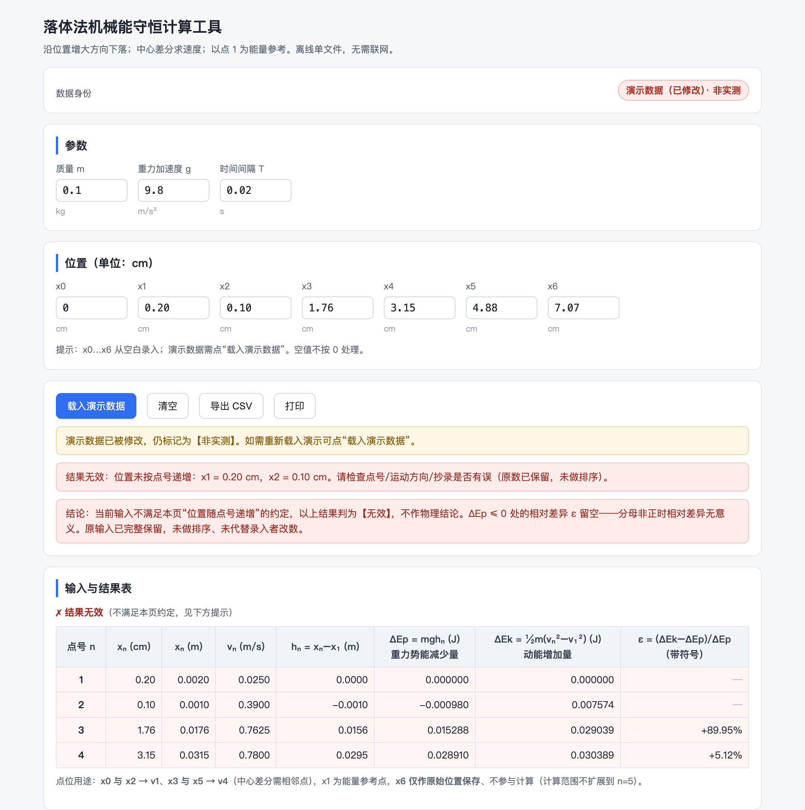

# 第 6 章　验证机械能守恒：三种方案、三张计算网页

主笔：王硕


“验证机械能守恒定律”的实验做完，学生把数据填进计算网页，屏幕上出现两列数：重力势能减少量和动能增加量。两者接近，却不相等。学生说一句“机械能基本守恒”，或者“实验有误差”，这节课好像就可以收尾了。

其实问题才刚开始。差多少？往哪边差？动能增加量比势能减少量小 2%，可以想到阻力；要是动能反而多出 13.6% 呢？阻力不会让能量变多（第四节）。学生能凭这些下判断，再说出下一步该测什么，这节课才算做完。

这节课我们几位老师都上过。2026 年 4 月，我在深圳市南山区把它作为区级公开课上了一次，全班六个小组采用三种实验方案并行探究，每种方案由两个小组承担，借助三张计算网页整理和展示数据。网页确实把计算省下来了，可也留下两个我们至今还在琢磨的问题：七八名学生围着一台平板，怎样让更多人真正参与分析？省下来的计算时间，怎样变成思考和论证的时间？

## 一、数据处理吃掉了分析的时间

人教版必修第二册第八章第 5 节“实验：验证机械能守恒定律”，安排在学生学习机械能守恒定律之后。教材给了两个参考案例：研究自由下落物体的机械能（打点计时器和纸带），研究沿斜面下滑物体的机械能（倾斜的气垫导轨和光电门）。学生已经能写出动能和重力势能的表达式，但面对一套具体的实验，还要重新确定研究对象、初末状态、测量方法和比较依据。这些判断不能从守恒公式中直接得到。

教师用书写明，本节的重点与难点是“实验的设计思路、瞬时速度的测定及数据的处理及误差分析”，并特别提醒：速度不能用 $v_n=gt_n$ 或 $v_n=\sqrt{2gh_n}$ 计算。用 $v=gt$ 等于假定加速度恰为 $g$，机械能必然守恒，就成了“用机械能守恒定律验证机械能守恒定律”；高度同样只能用刻度尺直接测量。教师用书还要求学生“会分析动能增加量小于重力势能减少量的原因”。这节课的难处因此有三：

1. **算得多。** 量取纸带位置、求速度、平方、换算单位、算能量变化，再比较差异，学生容易把“算完了”当成“做完了”。
2. **方案不同，算法不同。** 纸带记录位置和时间，双头光电门记录时间差，水平气垫导轨实验还要把滑块和钩码视为一个系统。一张通用表格很容易让学生把数填错位置。
3. **差异要解释。** 学生即使得到了差异百分比，也容易简单归因于“摩擦”或“实验误差”，没有联系数据的方向、大小和重复性作判断。如果动能增加量反而更大，又说明什么？

验证实验的教学重点，是让学生形成“确定系统、明确测量、比较数据、解释差异、进一步检验”的研究意识，两列数算得多接近并不是目的。实际测量存在一定偏离并不可怕，要看学生能否根据数据说明自己的判断。计算网页可以承担稳定、重复的换算；选哪几个点、差异从何而来，仍由学生判断。

## 二、一节公开课和三张网页

### 公开课怎样组织

公开课前的集体备课，把全班的实验任务组织成三个方案，六个小组每个方案两组：一组负责展示实验和数据，一组承担追问。学生在课前分组拍摄校园和生活中的机械能转化现象（秋千、滑梯等），可借助 AI 设计实验室可行的验证方案；课上先借助这些情境讨论机械能变化，再进入不同方案的操作和比较。实验完成后，小组把测得的数据手动录入对应网页，用平板投屏呈现结果并开展交流。

三种装置的结果放进同一节课，学生看得到自己方案的能量变化，也能比较别的方案选了什么研究系统、怎样测量。课后反思也指出了问题：七八名学生共用一台平板，参与机会不均衡；网页省下了计算时间，这些时间能不能变成分析，还要靠学案和课上的追问。

### 三种方案：让研究对象、测量方法和模型条件清楚可见

**落体法：从纸带位置建立能量关系。** 落体法使用打点计时器、纸带和重物。学生先在纸带上选取点迹清楚的一段，规定沿下落方向位置增大的正方向，测量各计数点到同一参考位置的距离。输入量包括重物质量 $m$、重力加速度 $g$、相邻计数点的时间间隔 $T$ 以及各点位置 $x_0,x_1,\dots,x_6$。位置可以先以厘米记录，计算前统一换算为米。

本方案以 1 号计数点为能量比较的起始状态，0 号点只参与计算 1 号点的速度，并不等同于释放点。对于间隔相等的计数点，用相邻两点的位移除以对应时间，近似求中间时刻的速度：$v_n=\dfrac{x_{n+1}-x_{n-1}}{2T}$。相对 1 号点，$h_n=x_n-x_1$，重力势能减少量 $\Delta E_\mathrm p=mgh_n$，动能增加量 $\Delta E_\mathrm k=\frac12m(v_n^2-v_1^2)$。

**沿曲线运动法：把释放高度和最低点速度对应起来。** 第二种方案使用 DIS 机械能实验器和双头光电门。金属圆柱体固定在摆杆末端，分别从 A、B、C 三个位置静止释放，测量它通过最低点 D 附近的速度。三个释放位置相对 D 点的高度分别为 15 cm、10 cm、5 cm。双头光电门记录两探头间的时间差，速度按两探头之间的实际距离 $L$ 和时间差 $\Delta t$ 计算，即 $v=L/\Delta t$。教学网页的标称探头间距为 1 cm，使用时仍要核查实际间距。

在忽略摆杆质量和转动影响、以圆柱体为近似研究对象的条件下，可以比较单位质量的重力势能减少量 $gh$ 和动能增加量 $\frac12v^2$。这样写省去了称质量，也留下一个值得讨论的模型条件（第四节第 4 小节）。这个方案最值得问学生的是：几个高度的差异比例很接近时，该先检查哪一个共同的测量条件？

**气垫导轨法：把两个物体作为一个研究系统。** 第三种方案在水平气垫导轨上放置滑块，通过细绳和滑轮连接钩码，利用两个光电门测量滑块在不同位置的速度。这里要把滑块和钩码作为研究系统。在绳子始终拉紧、两物体速度大小相同、滑轮转动影响可以忽略的条件下，钩码下降 $h$ 时重力势能减少 $mgh$，滑块和钩码的动能共同增加：$\Delta E_\mathrm k=\frac12(M+m)(v_2^2-v_1^2)$，其中 $M$ 为滑块质量，$m$ 为钩码质量。

学生容易出现两类错误：一是只计算钩码的动能而遗漏滑块；二是把两次实验中不同时刻的速度填成同一组 $v_1$、$v_2$。网页应按输入和测量的时间顺序保留速度，不自动把较小值排在前面。钩码下降的高度和滑块在两测量位置之间的位移应当相互对应；导轨如果没有调平，滑块本身的重力势能变化也可能进入能量分析，理想关系便需要重新检查。

| 方案          | 主要测量信息                     | 能量比较                                 | 需要特别说明                       | 和教材的关系                                                           |
| ------------- | -------------------------------- | ---------------------------------------- | ---------------------------------- | ---------------------------------------------------------------------- |
| 一 落体法     | 重物质量；各计数点位置；时间间隔 | $mgh_n$ 与 $\frac12m(v_n^2-v_1^2)$   | 1 号点为参考；速度来自纸带         | 教材参考案例 1                                                         |
| 二 沿曲线运动 | 释放高度；双头光电门时间差       | $gh$ 与 $\frac12v^2$（单位质量）     | 圆柱体随摆杆转动；注意模型近似     | 教材之外的方案；教师用书说“如果实验条件允许的话，也可以采用其他方案” |
| 三 气垫导轨   | 两物体质量；下降高度；两次速度   | $mgh$ 与 $\frac12(M+m)(v_2^2-v_1^2)$ | 两物体作为系统；导轨水平、配对取速 | 由参考案例 2 的倾斜导轨改为水平导轨加钩码                              |

### 三张网页

三张网页放在数智育才网站的在线实验室，结构相同：实验目的、器材、步骤，数据表和能量图，实验回顾。共用功能有手动录入、一键清除、导出 CSV 和截图；方案二、三还可经串口或蓝牙直接接收光电门数据。它们的作用是缩短重复计算和整理图表的时间，让课堂更快进入数据比较和解释。

落体法以 1 号计数点为能量参考点，0 号点只用于算 1 号点的速度。页面特别提示“0 号点不是纸带上打下的第一个点”：学生最常见的错误之一，就是默认从纸带第一个点开始、默认该点速度为零。这是教师把经验写进了网页。

### 网页是怎样一步步生长出来的

研发的顺序首先是教学需求，再是计算规则，最后才是界面。三张网页并非一次做成：

1. **学案先划定边界。** 学案写的是学生要回答的四个问题：选什么研究系统，选哪两个状态，怎样测速度和高度，怎样比较两种能量变化。这些问题决定了网页该收什么数、算什么数。
2. **Excel 先把计算固定下来。** 正式做网页之前，我们先做了一张落体法的 Excel：哪些列是学生输入的，哪些列是公式算出的，单位用什么，参考点选哪个，都在表里定下来。表里还有一张“AI 模拟数据”工作表，用来检查公式和图表。
3. **网页照着 Excel 做。** 先做落体法，再做另外两个方案。后两张网页复用了第一张的表格、图表和导出功能，物理量则按各自的方案重新处理，没有照搬落体法的公式。

学案和网页因此分工：网页只负责收数、换算和画图；四个问题的回答、选点理由和差异解释写在学案上。网页的计算表可打印或截图贴入学案，结论由学生自己写。

## 三、自己做一遍：先写数据约定，再做计算网页

第 2 章的做法本章照用，不再重复：动手前想清五件事，先用答案已知的数据核对，再查旧结果和打印。新增的是两件事：把“五件事”细化成一张数据约定，写定单位、参考点、比较方式和数据身份；做好以后专门试学生可能输错的数。本节的落体法计算网页由 WorkBuddy 按下面的数据约定生成，使用原 Excel 的演示数列。

### 动手之前，先写一份“数据约定”

以落体法为例：

| 约定什么 | 落体法的约定                                                                                           | 为什么要先定                                                         |
| -------- | ------------------------------------------------------------------------------------------------------ | -------------------------------------------------------------------- |
| 学生输入 | $x_0$—$x_6$（cm），$m$、$g$、$T$                                                            | 输入和计算分开，学生知道自己负责什么                                 |
| 公式     | 速度用中心差分，即用前后两点的位置差除以 $2T$，得到中间那一点的速度；不用 $v=gt$                   | 用 $v=gt$ 等于假定加速度恰为 $g$，算出来必然守恒                 |
| 单位     | 位置 cm，计算换成 m；能量 J                                                                            | 单位不统一，结果差 100 倍                                            |
| 参考点   | 1 号点；0 号点只用来求 1 号点的速度                                                                    | 不默认起点速度为零                                                   |
| 比较方式 | 相对差异 $\varepsilon=\dfrac{\Delta E_\mathrm k-\Delta E_\mathrm p}{\Delta E_\mathrm p}$，保留正负号 | 分母前后一致；负号表示动能增加量偏小，正号表示偏大，方向本身就是线索 |
| 数据身份 | 演示数据始终标“非实测”                                                                               | 防止演示数据被当成学生的实验结果                                     |
| 不做什么 | 不自动排序、不自动改数、不判定“验证成功”                                                             | 保留原始数据的含义                                                   |

一时写不全这张表，可以让 AI 先提问、给两三种做法，答出一项填一项。

### 第一步：把数据约定和一组检查数据交给 WorkBuddy

新建“落体法计算网页”文件夹作为工作空间，网页保存在 `output`。已有学案或 Excel 的，把副本放进 `input` 并说明哪些列是公式；没有 Excel 也可以，数据约定表加下面这组数就够做第一版。

发送下面的提示词时，在同一条消息里附上数据约定表和下面的参数表：

```text
我想做一个“验证机械能守恒”的落体法计算网页，让学生少算一些重复的数，把时间留给误差分析。学生输入纸带各点的位置，网页用相邻两点求中间点速度，以 1 号点为参考比较势能减少量和动能增加量。不要用 v=gt，也不要替学生改数或判定“实验成功”。先按我给的数据约定列出输入项、公式和单位，核对一行，再做能离线打开的网页。
```

| 参数                            | 值                                       |
| ------------------------------- | ---------------------------------------- |
| 重锤质量 $m$                  | 0.100 kg                                 |
| 重力加速度 $g$                | 9.80 m/s²                               |
| 相邻计数点时间 $T$            | 0.020 s                                  |
| $x_0,x_1,x_2,x_3,x_4,x_5,x_6$ | 0、0.20、0.79、1.76、3.15、4.88、7.07 cm |
| 数据身份                        | 演示数据，非实测                         |

演示数列取自我们原来那张 Excel。第一次只要输入表、结果表、公式和单位；图表、导出和打印，等计算核对无误再加。输入 0—6 号点，结果只算到 4 号点（0 号点用来求 $v_1$，5 号点用来求 $v_4$），页面要写明这个范围，免得空着的结果像是漏算。

先让它解释公式，容易及早发现误解。例如它若说“重物从静止下落，所以 1 号点速度为零”，要立即指出：1 号点是在清晰纸带上选出的参考点，不是释放点，速度要用 0 号和 2 号点计算。

### 第二步：打开文件，按同一组数逐项对照

任务结束后用浏览器打开 `output/index.html`，载入演示数据，核对质量、时间和七个位置，再对照结果表：

| 点号 $n$ | $v_n$ / (m·s⁻¹) | $h_n$ / m | $\Delta E_\mathrm p$ / J | $\Delta E_\mathrm k$ / J | 相对差异 $\varepsilon$ |
| ---------- | -------------------- | ----------- | -------------------------- | -------------------------- | ------------------------ |
| 1          | 0.1975               | 0           | 0                          | 0                          | 留空                     |
| 2          | 0.3900               | 0.0059      | 0.005782                   | 0.005655                   | −2.20%                  |
| 3          | 0.5900               | 0.0156      | 0.015288                   | 0.015455                   | +1.09%                   |
| 4          | 0.7800               | 0.0295      | 0.028910                   | 0.028470                   | −1.52%                  |

第二行的手算过程见第四节。第 3 点动能增加量比势能减少量大 1.09%，页面应如实显示，不能为“验证守恒”把两条曲线改成重合。这 1% 不必当作能量增加了：位置只记到 0.01 cm，每个读数差半格（0.005 cm），第 3 点的相对差异就可在 −1% 到 +3% 之间变动。第四节气垫导轨那一行大出 13.6%，就不能这样解释了。

速度差 100 倍，先查 cm 到 m 的换算；动能变化都偏大，查是否忘了减 $v_1^2$；速度和能量都对、只有百分数不同，查分母是否用了 $\Delta E_\mathrm k$ 或正负号是否被取了绝对值。反馈仍按第 2 章的方式，给出输入、预期值和页面值：

```text
这组演示数据的 v1 应为 0.1975 m/s，v2 应为 0.3900 m/s。第 2 点 ΔEk 应为 0.005655 J，ΔEp 应为 0.005782 J。请先说明差异在哪一步，再修公式。保留原输入和当前版本，改完用同一组数复查。
```

### 第三步：让页面处理不完整和不合理的输入

计算正确后，保存这一版，再做三次简短的操作：

1. 清空 $x_3$。$v_2$ 和 $v_4$ 都要用到这个点，对应计算应停下并说明缺哪个位置；空白不能当成 0，旧结果也不能留在屏幕上（第 2 章）。
2. 把 $m$ 改为 0。页面应提示“质量应大于 0”，而不是输出一张全为零、看起来却很正常的能量图。恢复 0.100 kg，再核对演示结果。
3. 在 $x_2$ 中依次输入 `0`、`0.`、`0.79`，看别的格子会不会跟着动；再把 $x_2$ 改成 0.10 cm。它小于 $x_1=0.20$，页面应提示检查点号、方向或抄录，保留这个数等教师处理。

这些操作检验网页怎样对待学生真正可能输入的内容。提示了异常却又偷偷改数，原始记录同样被改变。

第一版演示计算正确，但 $x_2$ 改为 0.10 cm 后，程序给出约 −873% 的“相对差异”，还显示绿色完成提示：输入已不满足“位置沿下落方向递增”的约定，$h_2$ 和分母 $\Delta E_{\mathrm p,2}$ 都成了负值。把输入和结果反馈给 WorkBuddy 后，页面保留原数 0.10，该处相对差异留空，并把当前结果标为无效。



### 第四步：再加图、导出和打印

确认表格可用，再请它加能量对比图、CSV 导出和打印，图和表用同一份计算结果，公式、点号和演示数据标记都不改。第一版打印同样隐藏了输入区，和第 2 章记录页的问题一样，结果表里只剩 1—4 号点，质量、时间间隔和 0 号、5 号位置都丢了；修改后打印件附上完整参数和 0—6 号原始位置，拿到的人能够复算。

网页交给同事时附一句话：“先用演示值核对，再清空输入自己的数据；程序只显示差异，解释由学生完成。”

## 四、差异该怎样读：从百分之一到百分之十三

### 1. 手算核对公式

第三节第二步那组数的手算过程如下。取 $m=0.1\ \mathrm{kg}$，$g=9.8\ \mathrm{m/s^2}$，$T=0.02\ \mathrm s$，$x_0=0$，$x_1=0.20\ \mathrm{cm}$，$x_2=0.79\ \mathrm{cm}$，$x_3=1.76\ \mathrm{cm}$（这是 Excel 里的演示数据，不是实测）：

$$
v_1=\frac{0.79\ \mathrm{cm}}{2\times0.02\ \mathrm s}=0.1975\ \mathrm{m/s},\qquad v_2=\frac{(1.76-0.20)\ \mathrm{cm}}{0.04\ \mathrm s}=0.3900\ \mathrm{m/s},
$$

$$
\Delta E_{\mathrm p,2}=0.1\times9.8\times0.0059\ \mathrm J=0.005782\ \mathrm J,\qquad \Delta E_{\mathrm k,2}=\tfrac12\times0.1\times(0.39^2-0.1975^2)\ \mathrm J\approx0.005655\ \mathrm J,
$$

$$
\varepsilon_2=\frac{0.005655-0.005782}{0.005782}\approx-2.20\%.
$$

网页的结果与这几个数逐位对上，才看下一步。

### 2. 比较方式要统一

三种方案可统一采用相对差异 $\varepsilon=\dfrac{\Delta E_\mathrm k-\Delta E_\mathrm p}{\Delta E_\mathrm p}$，分母取重力势能减少量，页面、学案和讲评保持一致。网站开发中就出现过分叉：Excel 以 $\Delta E_\mathrm p$ 为分母，网页的一个版本改为 $\left|1-\dfrac{\Delta E_\mathrm p}{\Delta E_\mathrm k}\right|$，分母实际成了 $\Delta E_\mathrm k$。两种都可以，一节课内选定一种。

正负号要保留。$\varepsilon$ 为负，表示动能增加量较小；$\varepsilon$ 为正，表示动能增加量较大。只算绝对百分数会丢失重要信息：阻力通常使机械能减少，一旦出现明显的正向差异，就要检查是否存在外部能量输入、系统选择是否完整、测量值是否配对、仪器长度和位置是否准确。差异的方向是一条分析线索，程序不应据此自动判定实验“成功”与否。

教师用书还给了第三种处理方法：图像法。逐点计算一次只看一个状态，图像便于比较多个位置的变化规律。以 $\frac12v^2$ 为纵轴、下落高度 $h$ 为横轴描点，若图线是一条过原点、斜率为 $g$ 的直线，就验证了机械能守恒。参考点不是释放点时（方案一以 1 号点为参考），纵轴改用 $\frac12(v_n^2-v_1^2)$、横轴用 $h_n$，同样应过原点、斜率为 $g$。两种误差在图上会分开显出来：阻力做负功，各点系统地偏低，表现为斜率略小于 $g$；测量的偶然误差，表现为点在直线两侧散开。

需要这张图时，在网页里按这个约定加一张就行，算法不变。

### 3. 差异该怎样读：百分之一和百分之十三

**百分之一级的差异，先看测量是否足以支持判断。** 落体法演示数据的第 3 点给出 +1.09%。这个数字适合组织学生讨论：“动能增加量略大，是否意味着机械能守恒定律不成立？”学生要回到原始位置的读数精度、求速度的差分方法和不同计数点的测量特点，不能只依据正负号判断物理规律。

教师可以让学生比较位置测量值在合理读数范围内发生微小改变时，速度和动能会变化多少。这样做的目的是让学生意识到：差异和测量不确定程度接近时，现有证据不一定足以区分不同的解释。判断“相符”要以测量条件和数据质量为依据，不宜预先规定所有方案都必须落在同一个固定百分数以内。

**明显的正向差异，检查模型和测量链。** 下面几行取自网站开发时用于试算的气垫导轨表格，属于计算核验使用的测试数据，不是公开课学生的实测结果。钩码质量为 50 g，滑块质量为 173 g：

| 钩码下降 $h$ / m | $v_1$ / (m·s⁻¹) | $v_2$ / (m·s⁻¹) | $\Delta E_\mathrm p$ / J | $\Delta E_\mathrm k$ / J | 相对差异 $\varepsilon$ |
| ------------------ | -------------------- | -------------------- | -------------------------- | -------------------------- | ------------------------ |
| 0.30               | 0.872                | 1.434                | 0.147                      | 0.145                      | −1.7%                   |
| 0.30               | 0.803                | 1.386                | 0.147                      | 0.142                      | −3.2%                   |
| 0.40               | 0.889                | 1.548                | 0.196                      | 0.179                      | −8.6%                   |
| 0.30               | 0.855                | 1.493                | 0.147                      | 0.167                      | **+13.6%**         |

前三行 $\varepsilon$ 为负，动能增加量比势能减少量小，与“阻力做负功”的预期方向一致，但仅凭方向还不能认定摩擦是唯一原因。最后一行反过来了：系统的动能增加了 0.167 J，可钩码只减少了 0.147 J 的重力势能。在导轨水平、系统没有其他能量输入且阻力只做负功的模型里，这不可能发生，也就不能用“阻力造成”来解释。需要同时检查模型条件和测量，常见的原因有：

- **导轨没有调平。** 导轨向滑轮一端倾斜时，滑块的重力也在做正功，多出来的能量就从这里来。
- **$h$ 量错了。** 钩码下降的高度应当等于滑块在两个光电门之间走过的距离。
- **两个速度不是同一次运动的。** 把两次实验的 $v_1$、$v_2$ 混在一起填进了同一行。
- **速度用的长度偏大。** 遮光条宽度或光电门间距按标称值填写，实际更小，算出的两个速度都偏大，$\Delta E_\mathrm k$ 按平方变大。

教师可以把最后一行作为讨论材料，先要求学生给出能够排除或支持某种解释的检查步骤，再安排重新调平、实测长度或复测速度等任务。相同的异常数值可能涉及不同的问题，只有补充证据才能逐步缩小解释的范围。网页上出现 $\Delta E_\mathrm k>\Delta E_\mathrm p$ 时，只显示一个“+13.6%”还不够，最好提醒学生回去检查这几件事。

### 4. 网页上的解释要和装置对得上

方案二的网页在“实验回顾”里解释 $\Delta E_\mathrm k$ 偏小的原因时写道：“滚动状态下 $\frac12mv^2$ 仅是平动动能，部分动能以转动动能 $\frac12I\omega^2$ 形式存在，是 $\Delta E_\mathrm k$ 偏小的主因之一。”

网页自己的装置图却是 DIS 机械能实验器：金属圆柱体固定在一根摆杆的末端，从 A、B、C 点释放后绕转轴摆下，经过最低点 D 处的光电门。公开课使用的正是这种摆锤装置：圆柱体随摆杆一起摆动，并不在曲面上滚动。网页的解释和实际装置对不上，应按摆锤装置分析能量变化。

还要检查质点近似。按均匀细杆估算，摆杆下降的势能按它质量的一半计（质心只下降摆锤高度的一半），分走的动能却只按三分之一计：

$$
v^2=2gh\cdot\frac{m+m_\text{杆}/2}{m+m_\text{杆}/3}>2gh.
$$

所以摆杆有质量时，按质点公式算出的 $\frac12v^2$ 会偏大，而不是偏小。圆柱体随杆转动带走的动能，约占它平动动能的 $\frac12(r/L)^2$（$r$ 为圆柱半径，$L$ 为摆长），可以忽略。这样看，$\Delta E_\mathrm k$ 偏小不能用“滚动”或“摆杆”来解释，更可能来自转轴摩擦、空气阻力或光电门间距。

还有一个值得算的数：网站开发时的测试表格里，B 点（$h=0.100\ \mathrm m$）速度 1.379 m/s，A 点（$h=0.150\ \mathrm m$）速度 1.688 m/s，两次按质点公式计算的动能增加量都比势能减少量小约 3%。比例接近，是进一步检查的线索，单凭两组数还区分不了阻力和仪器误差。例如双头光电门两束光的实际间距如果比标称的 1 cm 大约 1.5%，按标称值算出的速度就偏小约 1.5%，$v^2$ 偏小约 3%。可以先实测光电门间距（第 4 章），再用更多释放高度检查偏差是否持续存在。

网页里的文字解释，和公式一样需要审核。AI 写解释时，很容易从“曲面”“圆柱体”联想到“滚动”，没去对照装置图。

### 5. 程序忠实地执行了要求，为什么仍然错

方案三最初有一条规定：较小的速度记为 $v_1$，较大的记为 $v_2$，页面实时排序。试填小数时，第二个框刚输入一个“0”，前一个值就像被清空了：原来每输入一个字符，页面就重新排一次序。AI 查明原因后，建议改成输完再排序。我们最后撤掉了整条规则：“输入什么就是什么。”

这条规则一开始是我们自己提的，AI 只是照做了。逐字符试填，才暴露出它的问题。排序本身就改变了原始数据的含义，这时撤回规则，比修补它引起的界面问题更直接。现在的网页上写着“按填入顺序保留 $v_1$、$v_2$，不自动排序”。

### 6. 演示数据要一直标明身份

Excel 里那张“AI 模拟数据”工作表，网页上的“载入演示数据”按钮，都很方便。风险是：演示数据改了一两个数，就被当成了某个小组的实测结果。网页的做法是：载入演示数据后，页面一直显示“非实测”；即使改了其中的数，也不会自动变成“实测”；只有清空后重新手动输入，才回到“等待手动录入”。

## 五、带进课堂：三方案分组实验课怎样上

### 放在什么时候教

第八章第 4 节“机械能守恒定律”之后，用 1 课时（教师用书建议）。每组只做一个方案，三个方案并行，1 课时能完成；如果想让每组做两个以上方案，或者让展示和追问更充分，用两课时。课前也可以让学生用网页的演示数据预习数据处理。

### 学生会在哪里出错

| 易错点                                 | 课上的表现                        | 对应的网页设计或活动                                                        |
| -------------------------------------- | --------------------------------- | --------------------------------------------------------------------------- |
| 默认起点速度为零                       | 从纸带第一个点算起                | 网页以 1 号点为参考点，并提示“0 号点不是第一个点”                         |
| 用 $v=gt$ 或 $v=\sqrt{2gh}$ 算速度 | “用公式算更准”                  | 讨论：这两个式子都假定加速度恰为 $g$，算出来必然守恒，等于没验证          |
| 系统方案漏掉滑块的动能                 | $\Delta E_\mathrm k$ 只算了钩码 | 网页公式写明 $\frac12(M+m)$                                               |
| 看到差异就说“阻力”                   | 不管差异的方向和大小              | 出现 $\Delta E_\mathrm k>\Delta E_\mathrm p$ 时追问：阻力能让能量变多吗？ |
| 两个光电门的速度填反                   | $v_1>v_2$                       | 网页不自动排序，让学生自己发现和更正                                        |

### 一节 40 分钟课的六环节安排

在公开课基础上，可以把 40 分钟这样安排（实施建议，可按实验效率调整；需要更多测量和论证的班级用两课时）：问题诊断 7 分钟，学生先写出“两种能量不完全相等能否作出判断”的初始想法；预测设计 5 分钟，明确三种方案的研究对象和测量方式，强调速度须独立测得；实验取证 12 分钟；先手算一行数据、再用网页比较能量，6 分钟；每个方案简短展示并接受追问，7 分钟；最后 3 分钟，改变实验条件，收一道独立书面回答。

### 追问要对准每种方案的关键困难

| 方案          | 追问                                                                                                                                | 帮学生做什么                       |
| ------------- | ----------------------------------------------------------------------------------------------------------------------------------- | ---------------------------------- |
| 一 落体法     | 选取哪两个计数点进行比较？1 号点的速度怎样得到？为什么不能假定第一个点的速度为零？                                                  | 从一串纸带数据中确定真正的研究状态 |
| 二 沿曲线运动 | A、B、C 三个高度下的差异比例是否接近？怎样检验双头光电门的实际间距？摆杆的作用在何种情况下可以忽略？                                | 意识到装置结构和仪器条件会影响解释 |
| 三 气垫导轨   | 比较的是哪个系统的机械能？为什么动能计算需要 $M+m$？如果 $\Delta E_\mathrm k$ 明显大于 $\Delta E_\mathrm p$，能否用阻力解释？ | 检查系统边界和模型条件             |

时间有限时，每个方案的公开追问只留一个关键问题。方案二那一问，可以期待的回答是：相对差异基本相同，提示可能有按比例出现的系统误差，例如光电门间距；只有两三组数据，还不能下结论。

### 怎样看学生学到了什么

看学生学到了什么，看个人预测单、原始记录和课末那道独立题，不看小组的网页截图。下面的量规可以对着学生的回答用：

| 评价维度   | 初步表现                           | 发展中表现                         | 较充分表现                             |
| ---------- | ---------------------------------- | ---------------------------------- | -------------------------------------- |
| 概念与条件 | 只能复述守恒结论，未说明系统与条件 | 能在提示下正确选择系统及状态       | 能自主界定系统，说明主要近似与适用条件 |
| 数据与图像 | 只报告网页百分数，不清楚速度来源   | 能够联系输入、公式解释主要计算结果 | 能独立核查测量和图像，发现不合理数据   |
| 证据与论证 | 笼统说“有误差”，缺乏依据         | 能引用差异方向和数据提出可能原因   | 能比较原因、指出证据不足并设计补测     |
| 迁移与反思 | 离开原装置就难以分析               | 能借助提示讨论改变条件的情况       | 能在新情境中重新选系统、修订解释       |

两项迁移任务可以区分“会算”和“会解释”：

- **模型迁移。** 水平气垫导轨向滑轮一侧略微倾斜，滑块和钩码组成的系统，能量比较应增加考虑什么？
- **证据评价。** 某组连续测得 $\Delta E_\mathrm k$ 略小于 $\Delta E_\mathrm p$，且相对差异接近。仅凭这一现象能否判断一定由阻力造成？至少提出一项能进一步区分解释的测量。
