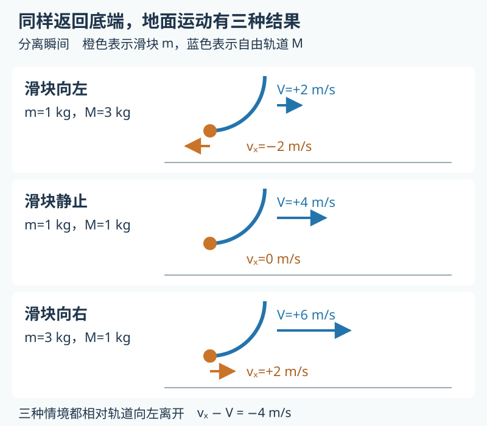
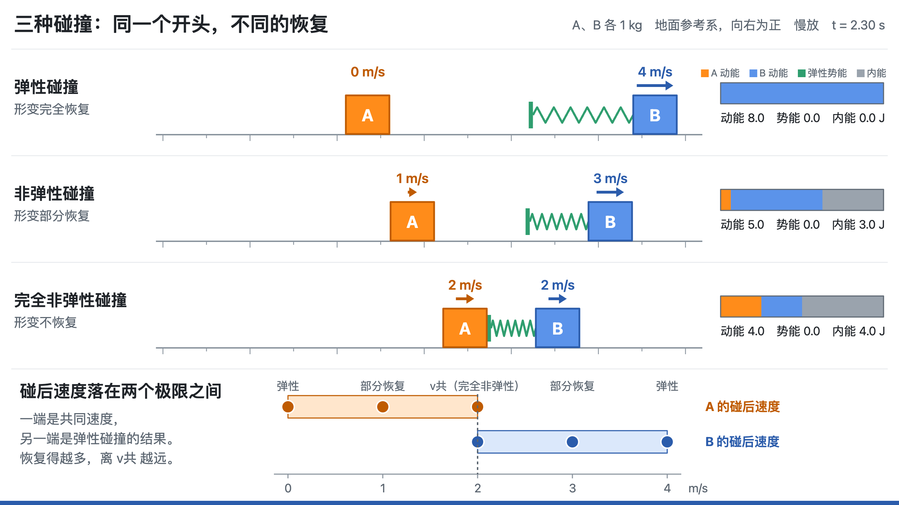
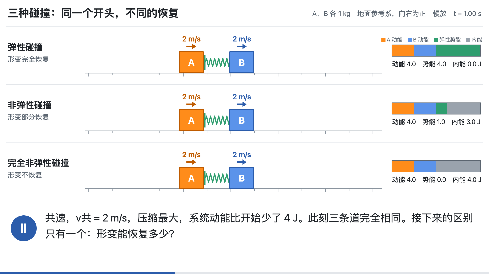
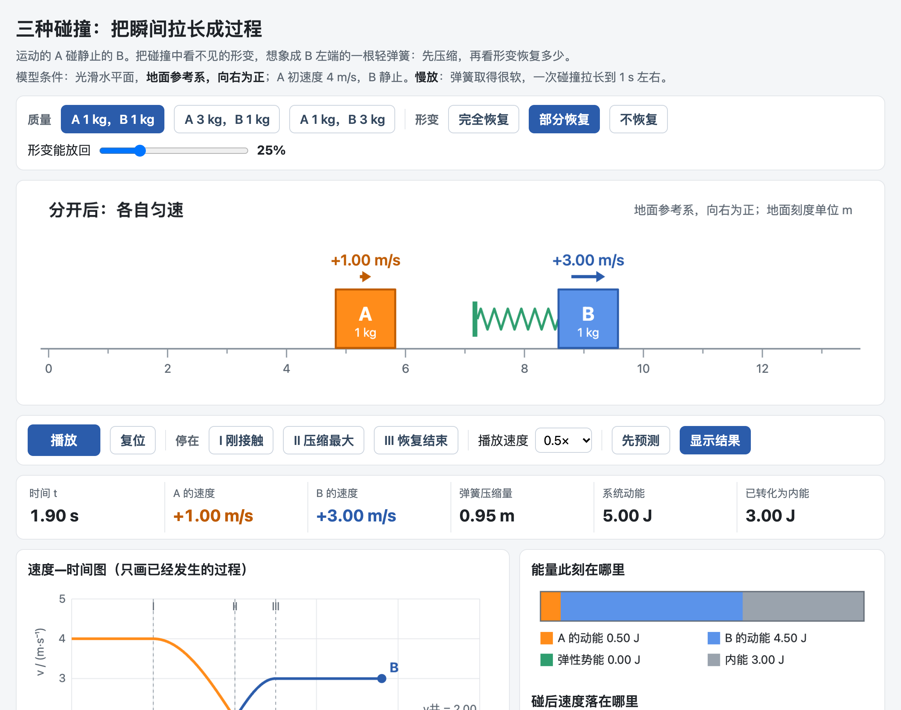
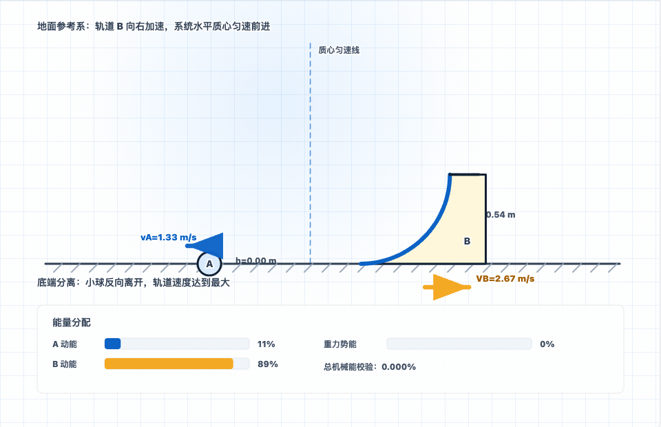
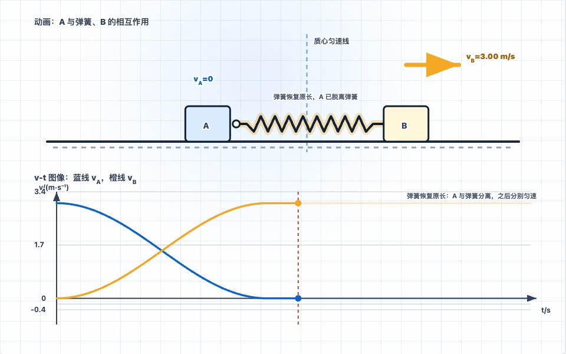
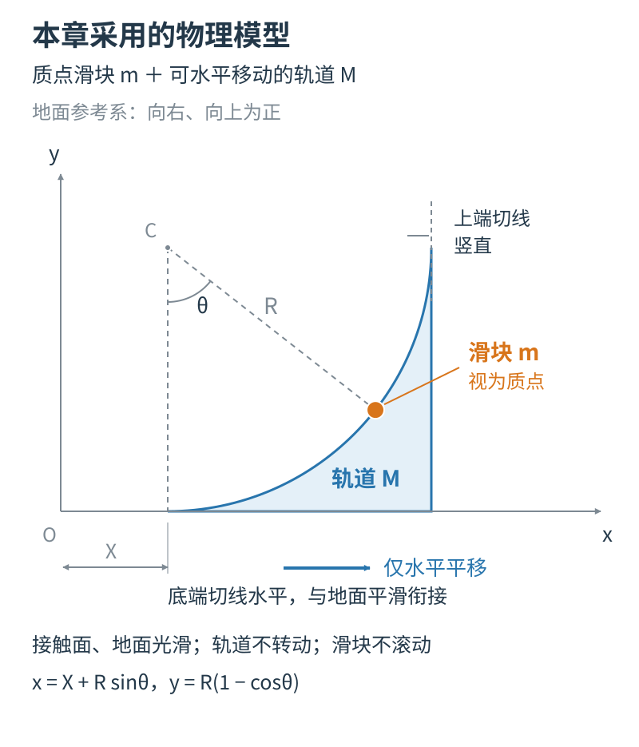
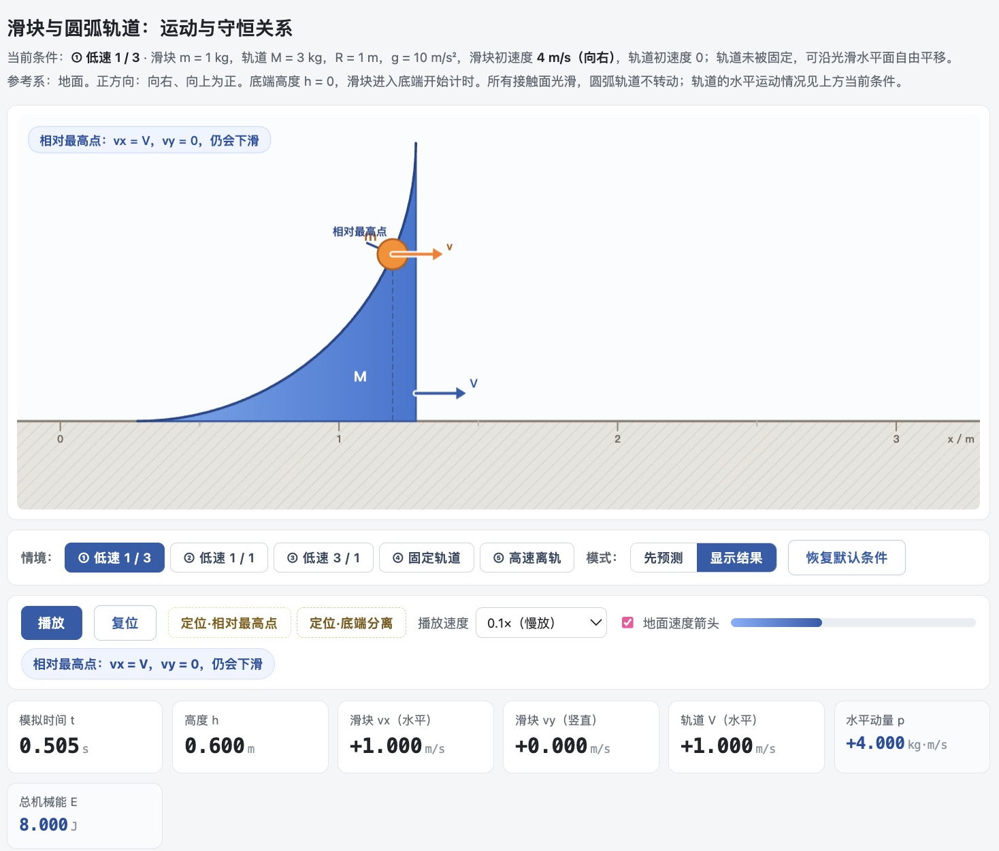
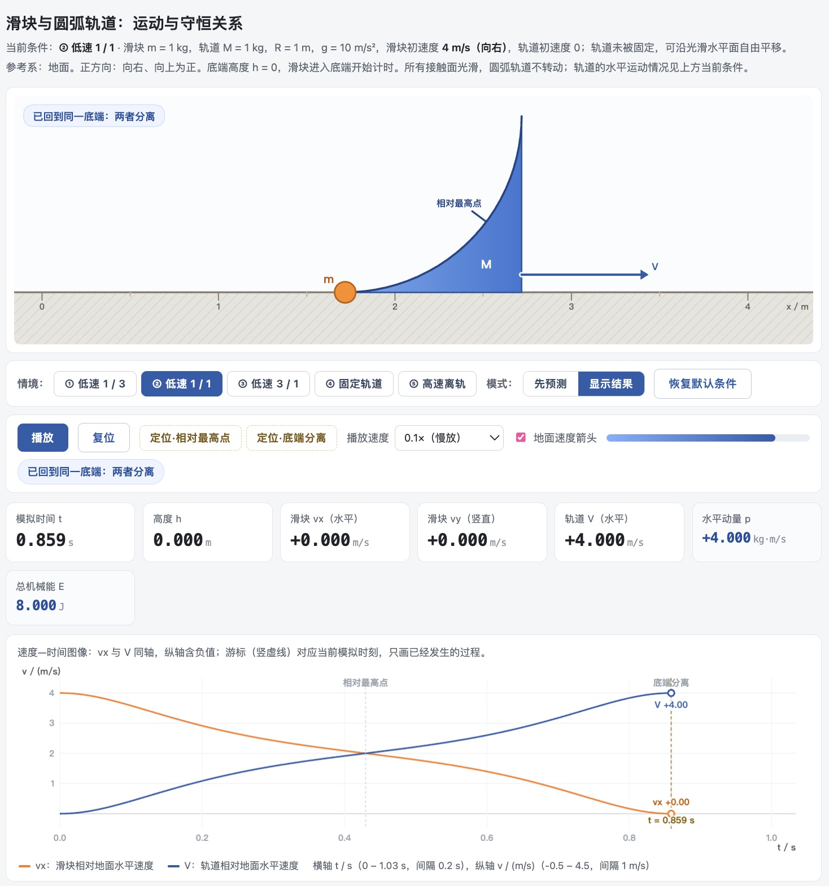
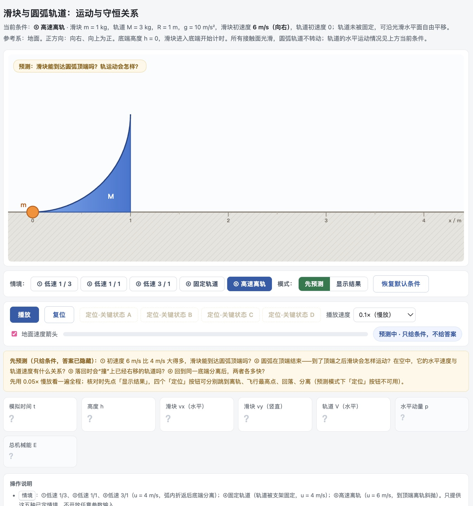

# 第 7 章　弹簧连接与碰撞分离：从圆弧轨道到一组动量模型

滑块沿圆弧轨道滑上去，又退回底端。轨道放在光滑地面上，可以被推着走。只改变滑块与轨道的质量关系，滑块离开轨道以后，相对地面可能向左，可能停在原地，也可能继续向右。



这三种结果与弹性碰撞的三种情况完全一致。滑块冲上轨道又滑下，整个过程相当于与轨道发生了一次弹性碰撞，只是碰撞被拉长到一秒左右，每一刻都看得见。

课本上的碰撞是瞬间的：碰前两个速度，碰后两个速度，中间过程看不见。在两物体之间放一根轻弹簧，或换成一段圆弧、一根轻绳，瞬间就被拉长成过程：动能转化为势能，两者速度相同时势能最大，势能再转化回动能。本章讨论一组这样的动量模型：滑块—圆弧轨道、弹簧—物块、小球—小环、悬绳小球—滑环、小球—半圆槽、小球—曲面小车。外形各异，都可以用同一把尺子看：找出“共速”时刻，再找出“恢复”时刻。

本章先从空白做出圆弧轨道的模拟网页并完整审核，再以它为模板派生弹簧碰撞页，看清哪些可以沿用、哪些必须重算。

## 一、碰撞是一个看不见的黑箱

人教版选择性必修第一册第一章第 3 节“动量守恒定律”、第 5 节“弹性碰撞和非弹性碰撞”。教师用书把第 5 节的重点定为理解两类碰撞的概念及特点，并能用动量守恒定律和机械能守恒定律解决实际问题。教材先用两车碰后粘在一起的实验说明总动能减少，再给小车装上弹性碰撞架，发现总动能基本不变，然后推导弹性碰撞后的速度。“弹性碰撞架”其实是一根短而硬的弹簧，换成软弹簧，碰撞就慢下来、看得见了。

### 三种碰撞，差别只在形变恢复多少



弹性碰撞、非弹性碰撞、完全非弹性碰撞，教材给了三个定义。上图把三种碰撞并排放在三条道上，开头一样，到压缩最大的时刻仍然一样：A、B 共速 2 m/s，系统动能比开始少了 4 J。



此后才分开。形变完全恢复，4 J 全部放回，A 停下，B 得到 4 m/s，这是弹性碰撞。形变不恢复，A、B 粘在一起，一直以 2 m/s 运动，这是完全非弹性碰撞。只恢复一部分，结果落在两者之间：图中放回 1 J，A 是 1 m/s，B 是 3 m/s。

粤教版选择性必修第一册第一章第五节的例题用的也是这个办法：B 的左端连一根轻弹簧，分“弹簧可以恢复到原长”“只能部分恢复”“弹性失效”三种情况讨论。关键是夹在中间的非弹性碰撞。我的想法是这样的（口述原话）：

> 非弹性碰撞我的理解就是说它是一种形变可部分恢复的。所以也就是说它前面压缩完之后呢，它只有一部分恢复了。那么这个过程中它的能量只有一部分释放出来，有一部分呢就是损失掉了。

顺着往下推。恢复阶段，弹簧向右推 B、向左推 A，所以从共速开始，B 只会更快，A 只会更慢；恢复得再多，也超不过完全恢复的结果。质量 $m_1$ 的 A 以 $v_1$ 碰静止的 $m_2$，碰后速度就有了范围：

$$
\frac{m_1-m_2}{m_1+m_2}v_1\ \le\ v_1'\ \le\ \frac{m_1}{m_1+m_2}v_1\ \le\ v_2'\ \le\ \frac{2m_1}{m_1+m_2}v_1 .
$$

中间是共同速度，两头是弹性碰撞的结果。判断“碰后哪一组速度可能”的题，除了动量守恒，另外两条判据正好是这个范围的两头：动能不增加，对应不超过弹性碰撞的结果；A 不能穿过 B，对应不越过共同速度。

我把这段想法讲给 AI，请它做成两样东西。一样是上面的定格动画：29 帧，接触前后每 0.1 s 一帧，恢复阶段每 0.05 s 一帧，Ⅰ（刚接触）、Ⅱ（压缩最大）、Ⅲ（恢复结束）几帧多停几秒；可以用方向键逐帧翻，也有一段 55 秒的视频能放进课件。另一样是模拟页：三组质量，“形变能放回”的比例从 0 拖到 100%，可以停在 Ⅰ、Ⅱ、Ⅲ，下面是 v–t 图、能量条和碰后速度的范围；切到“先预测”，读数、箭头和三张图都藏起来。



用之前有三处要心里有数。真实的碰撞只有千分之几秒，页面用一根很软的弹簧把它拉长到 1 s 左右，画面标了“慢放”。内能怎样记账是页面的简化：损失按比例记在压缩阶段，恢复阶段不再增加；教材例题说的是两个阶段都有一部分转化为内能。碰后速度只取决于放回的比例，不受记账方式影响。“部分恢复”一道比弹性一道更早分开，也是模型的设定，不要让学生当成规律。

两个网页和视频在配套包第 7 章的“三种碰撞”文件夹里。写到这里时，我还没有把它们带进课堂。

### 方程不难列，难在过程

学生常在以下几处出错：

1. **“到了最高点，小球就停住了。”** 滑块到达的是相对弧面的最高位置，此刻两者没有相对运动，但相对地面仍一起向右运动。
2. **“滑回底端，小球一定向左走。”** 滑块相对弧面向左离开，相对地面的方向取决于两者的质量关系。
3. **“轨道固定也一样用动量守恒。”** 轨道被固定以后，支架对系统施加水平外力，水平动量不再守恒，最高点也变高。
4. **“非弹性碰撞损失的动能没有了。”** 学生知道动能减少了，但说不清这部分能量在碰撞过程中的哪一刻、以什么形式存在。
5. **换了外形就认不出来。** 换成一根弹簧、一段圆弧，或轻绳与滑环的组合以后，学生不容易辨认其中相同的守恒关系。

前两处是“瞬间”与“过程”接不上：静态示意图只画得出一个时刻，其余要学生自己补全。第三处是条件变了，规律没有跟着变。模拟网页把瞬间接成连续运动，让学生在关键状态先判断、再看结果；换一种约束，两种结果可以并排比较。

## 二、六个模型，一把尺子

数智育才网站的动量专题已有这组模型。“滑块—斜（曲）面模型”（[https://shuzhiyucai.cn/simulations/momentum/slider-curved-track-model.html](https://shuzhiyucai.cn/simulations/momentum/slider-curved-track-model.html)）提供低速返回、高速飞出再落回两种情形，画面有质心匀速线、地面速度箭头和能量分配条。



“弹簧—小球（物块）模型”把 A、B 和轻弹簧看成一个系统，有两种模式：**接触后分离**，A 撞上 B 一端的轻弹簧，弹簧恢复原长时分离，之后各自匀速；**始终连接**，弹簧可压缩也可伸长，两物体的速度按同一频率周期性变化。画面下方是 v–t 图，旁边的能量条显示 A 的动能、B 的动能和弹性势能各占多少。



六个模型用同一把尺子看：

| 模型 | 系统 | “共速”的时刻 | “恢复”的时刻 |
| --- | --- | --- | --- |
| 滑块—圆弧轨道 | 滑块、轨道 | 滑块到达相对轨道的最高点 | 滑块回到底端分离 |
| 弹簧—物块 | A、B、弹簧 | 弹簧最短，弹性势能最大；始终连接时，弹簧最长也是一次共速 | 弹簧恢复原长：接触模式在这一刻分离；连接模式每次经过原长都是一次恢复 |
| 小球—小环（轻绳约束） | 小球、小环、轻绳 | 小球到达最高点 | 小球回到最低点 |
| 悬绳小球—滑环 | 小球、滑环、轻绳 | 小球摆到最高点 | 小球回到最低点 |
| 小球—半圆槽 | 小球、槽 | 小球到达最高点（未离槽时） | 小球回到最低点 |
| 小球—曲面小车 | 小球、小车 | 小球到达最高点 | 小球滑回底端 |

除弹簧—物块外，都是重力类模型，只有水平方向动量守恒，表里的“共速”指水平方向速度相同。

“共速”时系统动能最小，减少的动能暂存为弹性势能或重力势能。此刻两物体的速度等于完全非弹性碰撞后的共同速度，动能也减少同样多：$\frac12\cdot\frac{mM}{m+M}u^2$；但暂存的势能随后会还原，不能说此刻已发生完全非弹性碰撞。“恢复”时势能全部还原，速度与弹性碰撞后相同。这里的“共速”指两物体的速度完全相同。高速滑块冲出轨道顶端时，水平速度已和轨道相同，却还在向上运动，势能还在增加，这一刻并不是动能最小。曲面小车另有一种情形：小球速度足够大时越过曲面从另一端离开，不经过“恢复”时刻，不能套用弹性碰撞的结果。

## 三、自己做一遍：从一条圆弧轨道开始

### 写清连续动画的模型条件

本章的圆弧轨道采用以下模型：轨道是内凹的四分之一圆弧，底端切线水平，顶端切线竖直，圆弧在顶端结束；轨道只能沿水平面平移，不转动；小物体按质点处理，不计滚动；所有接触面光滑。下面把小物体叫**滑块 $m$**，把承载圆弧的物体叫**轨道 $M$**。



第一组参数取 $m=1\ \mathrm{kg}$、$M=3\ \mathrm{kg}$、$R=1\ \mathrm m$、$g=10\ \mathrm{m/s^2}$。滑块以向右 $u=4\ \mathrm{m/s}$ 的地面速度进入底端，轨道初始静止。以地面为参考系，向右、向上为正。选滑块和轨道为系统，水平方向不受外力；能量关系计入滑块的重力势能：

$$
m v_x+M V=mu,\qquad \frac12m(v_x^2+v_y^2)+\frac12MV^2+mgh=\frac12mu^2.
$$

其中 $v_x$、$v_y$ 是滑块的地面速度分量，$V$ 是轨道的地面速度。滑块沿斜向运动时，水平动量式里只能代 $v_x$，不能代它的速率。后面检查网页，用的也是这两条。

### 第 1 步　发出第一条指令

新建“圆弧轨道教学网页”文件夹，按第 2 章的设置新建任务，把它选为工作空间。把上面的模型示意图拖进输入区，确认附件已经显示，再用文字写清形状、尺寸和运动约束。HTML 是浏览器能直接打开的网页文件，做成一个文件，便于离线使用和传给同事。

第一条指令只需要说清四件事：学生要看什么，按什么条件算，这一版先做哪些功能，用什么结果检查。一时写不全，可以先说出想让学生看清什么，再加一句：“先问我一个你最需要知道的问题。”下面的提示词是把四件事写全的样子：

```text
请做一个高中动量守恒的模拟网页，保存为 index.html，做成一个文件，离线也能打开。

情境：滑块以 4 m/s 向右滑上静止在光滑地面上的四分之一圆弧轨道，轨道可以水平移动。
滑块 1 kg，轨道 3 kg，半径 1 m，g 取 10 m/s²。滑块当质点，不计摩擦和滚动。

我想让学生看清：滑块到“最高点”时并没有停住，两者一起向右运动；之后滑块滑回底端离开。

我算过的结果：最高点高度 0.6 m，两者速度都是 1 m/s；分离时滑块 -2 m/s，轨道 2 m/s。
请用这些结果检查你做的网页。

这一版先做：播放、暂停、复位，显示时间、高度和两个物体的速度。
```

### 第 2 步　打开文件，抓住第一个关键状态

打开回复里的 index.html，先完整播放一次，认清上滑、返回和分离。整个往返只有约 1.01 秒的模拟时间，可以用慢放。再复位，在最高点附近暂停。**暂停冻结的是模拟时间，读数保留的是这一刻的瞬时速度。**

暂停之前，先自己算出最高点：由水平动量守恒，共同速度 $v_c=\dfrac{mu}{m+M}=1\ \mathrm{m/s}$；此时总动能 2 J，初始机械能 8 J，重力势能增加 6 J，所以高度 0.6 m。



继续播放到分离，检查滑块 $v_x=-2\ \mathrm{m/s}$、轨道 $V=+2\ \mathrm{m/s}$。这一版能回答“最高点是否停住”，就可以往下走了。请 WorkBuddy 把它另存为“版本记录/01-基础过程.html”，再继续修改 index.html。

### 第 3 步　让学生先判断、再看结果

课上想让学生先预测再观察，这个活动需要三样东西：答案能隐藏，能准确停在关键状态，停住后还能接着播放。再加两组质量，半径、重力加速度和初速度不变：

| $m,M$（kg） | 最高点共同速度（m/s） | 最大高度（m） | 分离时滑块速度（m/s） | 分离时轨道速度（m/s） |
| --- | --- | --- | --- | --- |
| 1，3 | +1 | 0.6 | −2 | +2 |
| 1，1 | +2 | 0.4 | 0 | +4 |
| 3，1 | +3 | 0.2 | +2 | +6 |

这张表给教师核对用，学生观察前不要显示。最后一行最值得追问：滑块向右 2 m/s，轨道向右 6 m/s，滑块相对轨道的速度是 $2-6=-4\ \mathrm{m/s}$，所以它仍从底端向外离开，只是相对地面向右。画面里保留地面参照，这个区别才看得出来。

提示词：

```text
请先把现在的版本另存一份，再改 index.html。

我要在课上先让学生预测，再看结果：
1. 加一个“先预测 / 显示结果”开关。预测时隐藏所有答案，包括速度数字、箭头、曲线和提示文字。
2. 加“最高点”“底端分离”两个按钮，点了停在那个状态，还能接着播放。
3. 加三组质量：滑块和轨道分别是 1 和 3、1 和 1、3 和 1 千克，其余不变。
4. 在画面上加速度箭头，注明地面参考系、向右为正；下方加滑块水平速度和轨道速度随时间变化的两条曲线，颜色和物体一致，能显示负值。

改完请按三组质量分别核对最高点和分离时的速度。
```

改完以后，留意几个容易出的问题：切换质量后旧曲线和旧答案还留在屏幕上；倍速播放改变了物理状态；游标不跟随当前模拟时刻，曲线和画面对不上；完整的预测曲线没有默认隐藏，学生在预测之前就看到了结果。看到哪一个，就把现象照实告诉 AI。

收到结果后，站在学生的位置走一遍。进入“先预测”，看屏幕上还剩下什么：应当只剩条件和问题，读数显示问号，速度箭头、曲线和核验表都藏起来，情境名和提示文字里也不出现“共速”“滑块静止”这类结论。数字藏了，旁边的说明若还写着答案，学生照样提前看到了结论。

再在上滑途中暂停：橙色曲线的值应等于此刻滑块的水平速度，蓝色曲线应等于轨道速度。到最高点，两条曲线相交。课上可以先让学生根据共速条件猜交点在哪里，再把动画和曲线停在同一时刻对照。

看到不对的地方，反馈写清四件事：**条件、操作、实际看到的、物理上应该是什么。**例如：

```text
条件：m=3 kg，M=1 kg，u=4 m/s，其余为默认值。
操作：定位到底端分离状态。
实际表现：滑块读数为 +2 m/s，但画面箭头向左，截图已附。
预期：地面系中滑块向右，轨道以更大的速度向右；若显示相对速度，应另行标明。
请检查箭头所用的速度量，修正后复看此状态，并检查另外两个预设。
```

先把看见的现象说准确，原因是速度计算、参考系还是位置更新，交给 AI 去查；它改完以后，你回到同一个条件、同一个操作复看。

### 第 4 步　把轨道固定，换一套规律

把轨道固定，画面里的圆弧没有变，受力却变了：固定支架对系统施加水平外力，水平动量不再守恒。仍取 $m=1\ \mathrm{kg}$、$u=4\ \mathrm{m/s}$：

| 观察量 | 自由轨道，$M=3\ \mathrm{kg}$ | 固定轨道 |
| --- | --- | --- |
| 最高点高度 | 0.6 m | 0.8 m |
| 最高点滑块地面速度 | 向右 1 m/s | 0 |
| 离开底端后的滑块速度 | 向左 2 m/s | 向左 4 m/s |
| 滑块与轨道的水平动量 | 守恒 | 不守恒，支架施加水平外力 |

自由轨道的最高点仍有一部分动能留在两物体的整体平移里；轨道固定以后，滑块在最高点动能为零，同样的初始机械能全部转成重力势能，所以爬得更高。这个对照可以在播放前问学生：“为什么轨道能动时，滑块爬得更低？”

提示词：

```text
请先别改文件，先告诉我：轨道固定以后，受力和守恒条件有什么变化，计算要怎么改。
我确认后，再加一个“固定轨道”情境，只用 m=1 kg、u=4 m/s 这一组。
我算的结果：最高点 0.8 m，此时滑块速度 0；回到底端时滑块 -4 m/s。
画面上要说明是固定支架给了水平外力。原来三组自由轨道的情境保留不动。
```

这一步要重新检查的不只是数字，还有检查标准本身：如果 AI 的自检仍要求“滑块与轨道总水平动量不变”，就会把正确的固定轨道结果判成错误。所以要先改检查依据，再检查程序。界面也要一起看：制作中出现过最高点数据对、主标题却还写着可动轨道的“动量守恒演示”，支架外力的说明被边缘截断。

### 往下还能做什么

前四步做完，你手里有一张核对过的圆弧轨道页，也走熟了“写条件—发指令—抓关键状态—改一处”的来回。再往下有三件事，做法收在配套包第 7 章的《圆弧轨道页：第 5—7 步》，这里只说要点。

**高速情境。** 仍是 $m=1\ \mathrm{kg}$、$M=3\ \mathrm{kg}$，把初速度提到 6 m/s，滑块会冲出顶端、飞起、落回，再滑下来。顶端切线竖直，离轨时滑块的水平速度等于轨道速度，$v_x=V=1.5\ \mathrm{m/s}$，竖直速度 $\sqrt7\approx2.65\ \mathrm{m/s}$；飞行最高点 1.35 m；最后从底端分离时滑块 −3 m/s，轨道 3 m/s。这样复杂的过程，先请 AI 讲方案：分几段，每段用什么规律，段与段怎样接上。确认无误再让它写，并要它在离轨和落回两处，各列出事件前、事件时、事件后三个相邻时刻网页实际用的高度和速度。这一句为什么要紧，见第四节。

**把有效的要求存下来。** 请 AI 把对话里积累的模型条件、检查方法和修改记录整理成一份“项目说明”，下次开头先让它读这份文件。

**拿它当模板，派生下一个模型。** 播放控制、图表布局、“画面和读数取同一份数”可以沿用；系统由哪几个物体组成、哪个方向动量守恒、运动方程和各关键时刻的检查数值，必须按新模型重写。我用这个办法派生了一张弹簧碰撞页，劲度系数特意凑成共速恰在 1 s、分离恰在 2 s，四个时刻的读数都能手算核对。

做好的五情境网页，连同审核页、课堂活动单、物理核验算例和计算附录，都收在配套包第 7 章。

## 四、动画会骗人：一组模型要查什么

### 用等质量分离做一次完整审核

先用一个学生也能算、画面上又看得出来的结果，完整走一遍。

**先在纸上算。** 取 $m=M=1\ \mathrm{kg}$，$u=4\ \mathrm{m/s}$。返回底端时高度为零，设滑块、轨道的地面速度为 $v$、$V$：

$$
v+V=4,\qquad v^2+V^2=16.
$$

解得 $(v,V)=(4,0)$ 或 $(0,4)$。方程有两个解，要由过程决定取哪一个：前者是刚进入时的状态；返回时滑块相对轨道向左运动，应取后者。所以分离后滑块地面速度为零，轨道以 4 m/s 向右。

**再对照数字和箭头。** 选“等质量”，切到“显示结果”，打开地面速度箭头，定位到“底端分离”。先核对质量和初速度，再看滑块读数为零、没有速度箭头，轨道读数为正、箭头向右。



**然后继续播放，看位置。** 画面暂停时，“滑块没动”说明不了什么。点击继续播放，以地面刻度为参照：再过 0.175 s，滑块应留在原处，轨道向右移动 $4\times0.175=0.700\ \mathrm m$。

速度为零、箭头没有长度、继续播放位置不变，三件事要一致。任何一项不符，把条件、操作和两张画面交给 AI，改完以后用同样的顺序再查一遍。其他低速情境的独立答案可以用下面几式算：

$$
v_c=\frac{mu}{m+M},\qquad h_{\max}=\frac{M}{m+M}\frac{u^2}{2g}\quad(h_{\max}<R),\qquad v_{\text{分}}=\frac{m-M}{m+M}u,\qquad V_{\text{分}}=\frac{2m}{m+M}u.
$$

全过程的检查基准是初始水平动量 $mu$ 和初始机械能 $\frac12mu^2$。它们随质量变：$(1,3)$ 和 $(1,1)$ 两组是 4 kg·m/s、8 J，$(3,1)$ 一组是 12 kg·m/s、24 J。先确认基准适用于当前参数，再让 AI 批量检查。

审一个网页，不该靠教师在一堆文件里猜哪份数据对应哪个画面。可以让 AI 另做一个审核页，每一项检查都把当前参数和操作、独立算出的预期、实际运行的画面和读数、发现的差异放在一起（提示词见附录 A；发送前先把配套包第 7 章里的物理核验算例和计算附录复制到工作空间，一并交给它）。

### 速度是不是算出来的

做小球—曲面小车时，AI 的第一版画面里，小球几乎是匀速走的。我看了以后连续提了两次意见：

> 小球并没有按照物理规律计算速度。上升过程中，小球是减速的，小车是加速。下降过程中，小球是加速，小车是减速。速度箭头没有跟着正确变化。

> 目前小球的速度还是接近匀速，没有符合系统水平动量守恒和能量守恒的规律。重新校验下，增加一个小车和小球的 v-t 图像，要符合物理计算结果。

第二条意见里有一个很好的办法：要求加一张 v–t 图。动画里的速度箭头长一点短一点，肉眼不容易看出对错；画成曲线，上升段小球的速度是不是在减小、小车是不是在增大，一眼就能看出来。

### 守恒检查可能在重复程序自己的假设

圆弧轨道的程序在接触阶段是用能量关系求速度的，把这些速度再代回能量式检查，误差当然很小。弹簧模型用解析解，“守恒校验”显示 0.000%，也是同一回事：解析解本身就是从两个守恒定律推出来的，这项校验只能检查程序有没有写错公式，检查不出物理错误。可要是程序把到达某个位置的时间拉长了一倍，仍配上原来的速度，守恒式照样成立，运动的快慢却已经错了。

所以要单独检查位置和速度是否按同一个时间在变。圆弧轨道上，在同一运动阶段内用 $[x(t+\Delta t)-x(t-\Delta t)]/(2\Delta t)$ 近似 $t$ 时刻的水平速度，与程序给出的分量比较，再减小 $\Delta t$ 看差异怎样变化。弹簧页上，停在 1 s，用 B 的位移减去压缩量得到 A 的位移：$1.127\ \mathrm m-0.764\ \mathrm m=0.363\ \mathrm m$，与积分 $\int_0^1 v_A\,\mathrm dt=(1-2/\pi)\ \mathrm m$ 一致，速度、物块位置和弹簧长度才算对应同一个时刻。半圆槽、曲面小车这类数值积分模型，还要把时间步长减半再算，看关键时刻是否稳定。

### 报告里的数和画面用的数可能不是同一份

制作高速情境时，AI 的一份检查报告列出离轨高度为 1 m，和理论值一致；但网页显示时实际取的状态，把离轨后的高度置成了零。报告核对的是另存的事件摘要，不是画面实际用的数据。前面要求“事件前、事件时、事件后三个相邻时刻，列出网页实际用的高度和速度”，就是为了发现这种问题。在阶段交接处，位置和速度应当连续；约束改变了，加速度可以突变。

| 检查位置 | 相邻时刻的高度应接近 | 竖直速度应接近 | 要排除的现象 |
| --- | --- | --- | --- |
| 顶端离轨前后 | 1 m | +2.65 m/s | 一离开圆弧，高度突然变成零 |
| 飞行最高点前后 | 1.35 m | 从正值连续经过零变为负值 | 在最高点突然停住，或直接跳到落点 |
| 落回移动顶端前后 | 1 m | −2.65 m/s | 滑块跳回轨道原来的位置，或速度被清零 |

### 数值算对了，解释仍可能是错的

增加固定轨道时，AI 给出的方案正确算出了 0.8 m 和 −4 m/s，接着却说固定轨道“没有分离这件事”，理由是两个物体本来就没有共同的水平运动。这个理由不成立：这里说的分离，是滑块离开圆弧接触面，和轨道动不动无关。读 AI 的方案时，特别留意“所以”“因此”前后，是不是真有成立的物理关系。

### 一个周期是不是完整

做悬绳小球—滑环时，第一版的模拟在小球回到最低点时就结束了。我指出：

> 现在的模拟，小球重新回到最低点，模拟就结束了。但这时候滑环有速度，应该会带动小球，再跑一个过程。要模拟这两个完整过程，才是一个周期。

小球回到最低点是“恢复”的时刻，滑环带着速度继续走，轻绳又会把小球拉起来。只演到这一刻就停，学生会以为运动“结束了”。审核周期性的模型，要看它是否演完一个完整的周期，最后的状态是否和开始时一样（或者正好对称）。

### 外壳统一了，物理没有统一

模板复用的风险是：外壳太像，物理也被顺手搬了过去。把“圆弧轨道”的页面改成“半圆槽”，如果离开曲面后的运动沿用了圆弧轨道的处理（飞出后做斜抛），就错了。半圆槽的离槽瞬间切线是竖直的；在这个页面的初始条件下（小球从槽口或槽口上方由静止释放，槽原来静止），系统水平总动量为零，离槽瞬间两者水平速度相同，合起来又要为零，只能都是零，所以小球离槽后竖直上抛。审核派生出来的模型，要把它当作一个全新的模型来查，每一个关键状态都重新算一遍。

## 五、带进课堂：先在纸上判断，再打开网页

这组模型适合放在学完第一章第 3 节“动量守恒定律”和第 5 节“弹性碰撞和非弹性碰撞”之后，作为多过程的专题。教师用书里有几句话，正好落在这组模型上：

- **参考系。** 各物体的速度必须相对同一个惯性系。圆弧轨道一动，学生就容易拿“相对轨道”的速度去列式，模型里一直保留地面标记，就是为了这一句。
- **每个物体的动量可以变。** 把模型停在上滑、共速、下滑任一时刻，两物体的动量都不同，加起来都一样。我后来在网页上加了三根动量条（滑块、轨道、总和），播放时总动量条始终停在初始值的虚线上；切到固定轨道，总动量条离开虚线。新页面是配套包第 7 章的 `momentum/slider-curved-track-momentum-bars.html`。
- **两个极限。** 第 5 节“练习与应用”第 5 题：$m_B=3m_A$，A 以 $v$ 碰静止的 B，B 碰后最慢 $0.25v$（粘在一起），最快 $0.5v$（弹性碰撞）。弹簧模型把这两个数放在同一个过程里：共速时刻是前者，恢复原长时是后者。

用法上最要紧的是先让学生在纸上留下判断，再打开网页对照。下表每一种错误，都能在网页上找到对应的画面：

| 典型错误 | 错在哪里 | 用网页的哪个画面 |
| --- | --- | --- |
| 最高点时滑块速度为零 | 把“相对轨道最高”当成“相对地面静止” | 定位到最高点，两个水平箭头都向右；再继续播放 |
| 整个系统的动量守恒 | 忽略了竖直方向的外力 | 上升途中暂停：滑块有向上的速度，轨道没有，竖直方向的动量变了 |
| 分离后滑块一定向左 | 混淆相对轨道的速度和地面速度 | 依次切换三组质量，看分离后滑块向左、静止、向右 |
| 轨道固定了也用动量守恒 | 没有重新分析外力 | 固定轨道对照，看最高点变高、滑块在最高点速度为零 |
| 非弹性碰撞的动能“消失了” | 不知道动能暂存为势能 | 弹簧页能量条：压缩时动能变成弹性势能，共速时势能最大；三种碰撞模拟页把放回比例调小，看内能一格怎样出现 |
| 把共速直接当成完全非弹性碰撞 | 忽略了暂存的势能还会释放 | 查看势能条，再继续播放，看储存的能量是否释放 |
| 换了外形认不出来 | 找不到共速与恢复两个状态 | 第二节的六模型对照表 |

上课前，把文件复制到新文件夹，断开网络，在教室电脑上第一次打开；站到后排看正负号和箭头是否看得清；进入“先预测”，看情境名和提示文字有没有替学生说出答案。本章网页的高速情境起初就叫“高速离轨”，等于提前告诉学生滑块会飞出，后来改名为“初速度 6 m/s”。


