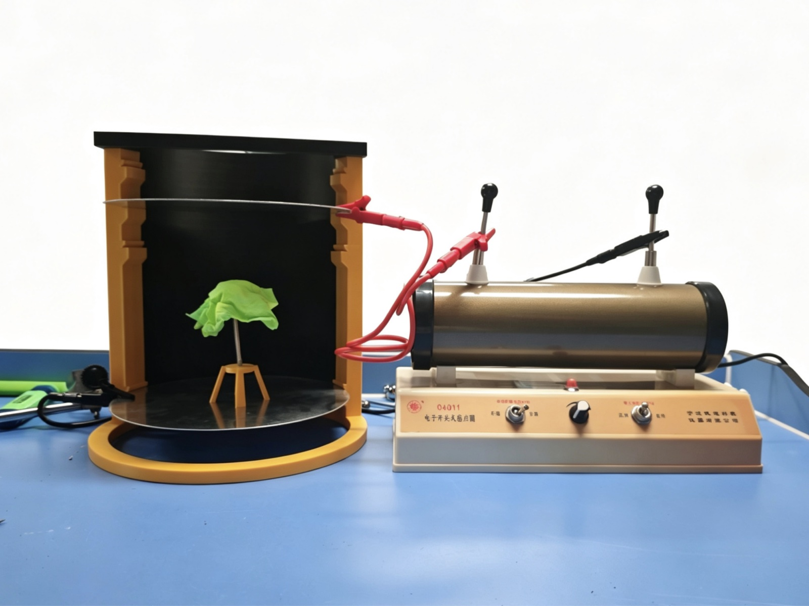
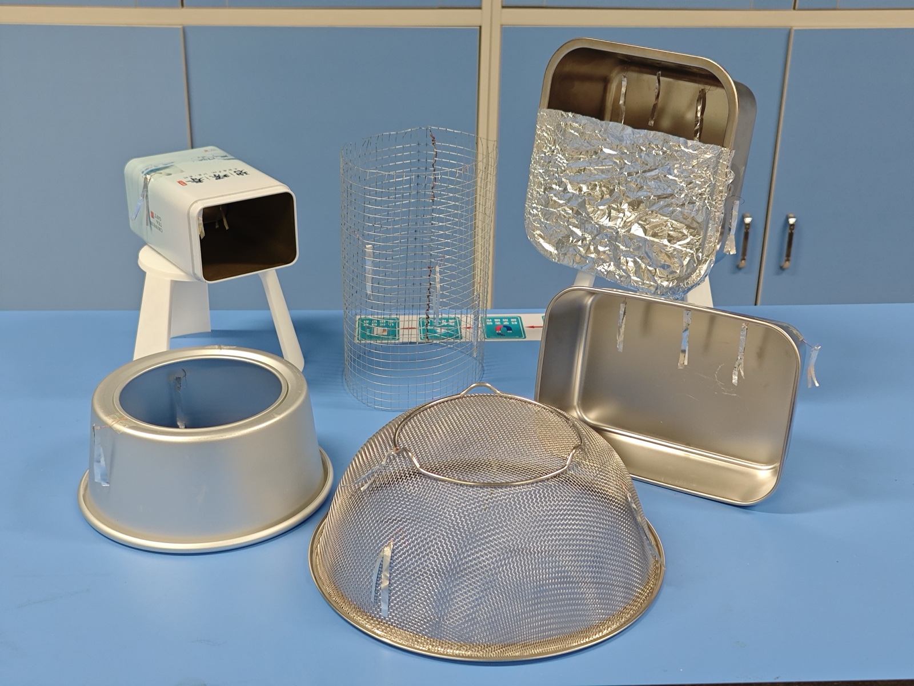
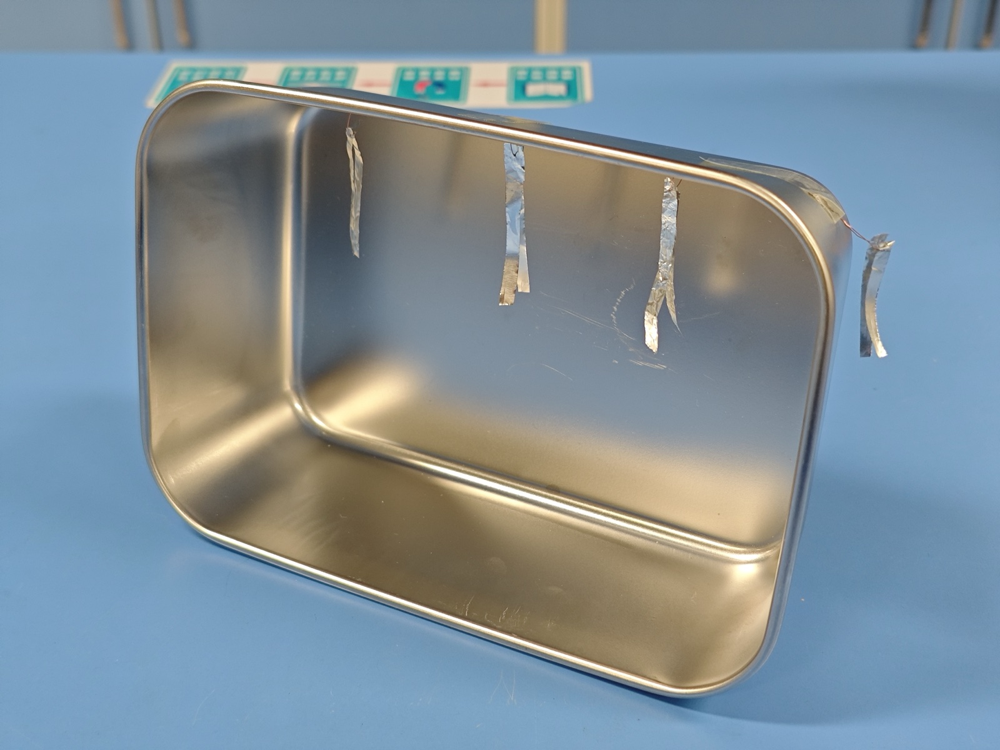
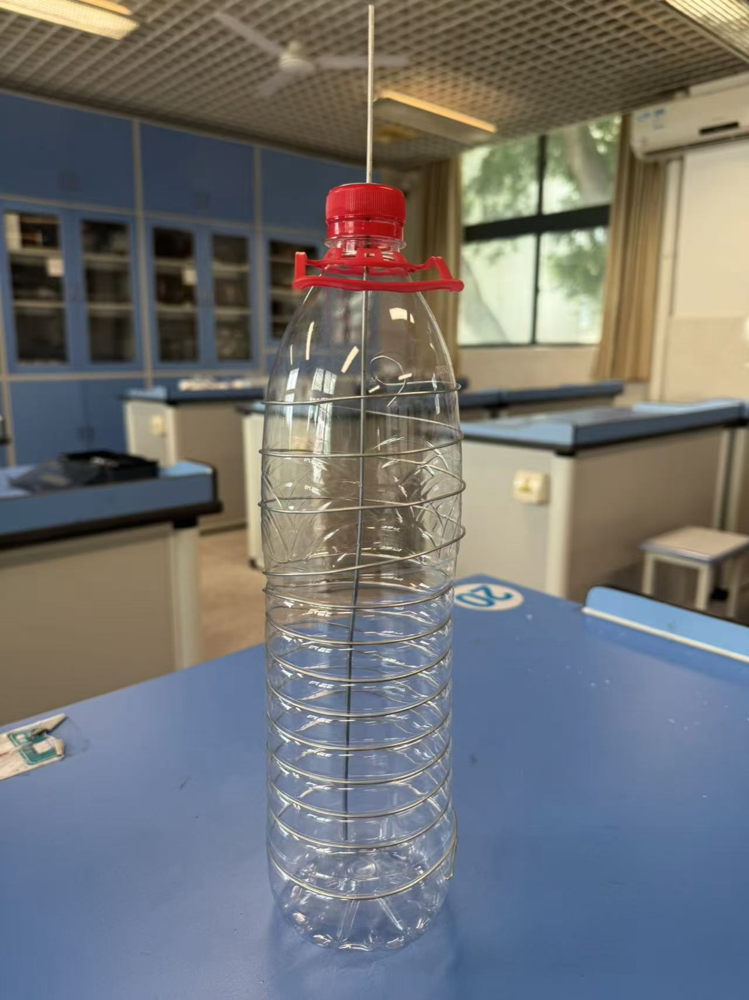
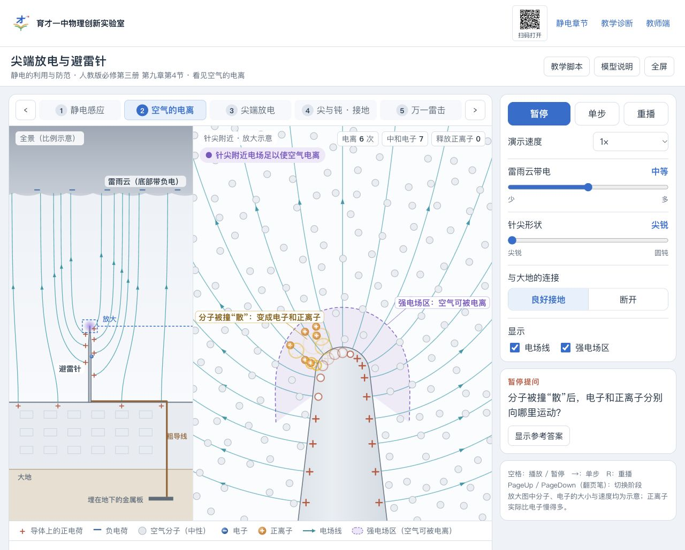
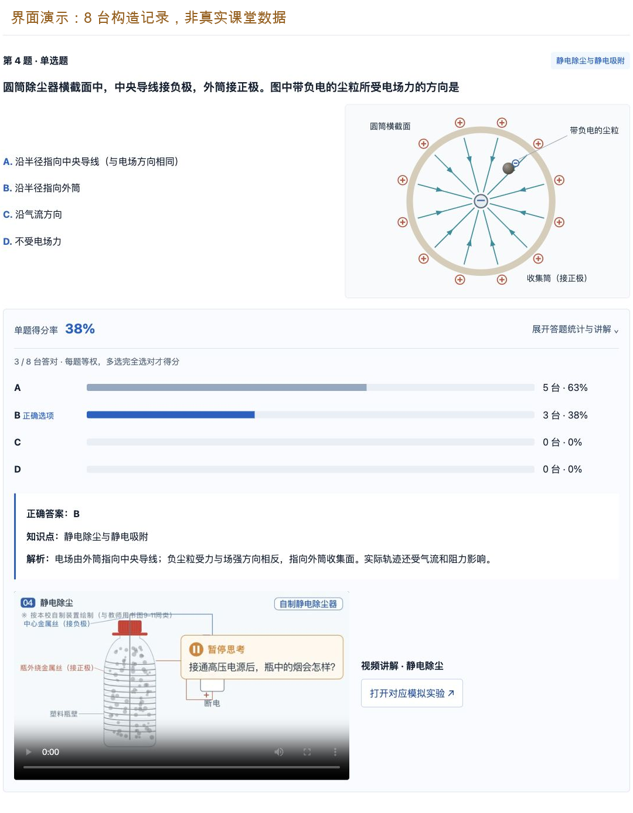

# 第 8 章　静电的防止与利用：厨房里的教具、AI 做的动画和当堂答题



“雷雨天为什么不能在树下躲雨？”2026 年 10 月 15 日，我的同事王士瑜老师在南山区“百花奖”教学比赛的课堂上，用这个问题开始了《静电的防止与利用》（人教版必修第三册第九章第 4 节）一课。一棵用绿布做树冠的小树放在两块金属圆板之间，起电机一开，上方的“云层”打出一道火花，正落在树上，浸过酒精的树冠烧了起来。罩上一只厨房用的金属滤网，再开起电机，火花打在网的外面，网里的树和小人都没事。

这节课内容很多：静电平衡、静电屏蔽、导体上的电荷分布、尖端放电、静电除尘。每一项都有学生能看见的现象，背后都有看不见的过程：电子往哪边移动，感应电荷的电场怎样抵消外电场，尖端附近的空气怎样电离，烟尘怎样带电。

这节课的教学设计、课件和授课出自王士瑜老师。我做的是课件以外的资源：和老师们用厨房用品做实验教具，用 AI 做交互模拟、说明动画，以及一个全班用平板答题、教师当堂看统计的网站。本章讨论三件事：教具怎样做、怎样用；AI 做的动画起初为什么不能用，我怎样把要求说清楚；当堂答题的统计能说明什么、不能说明什么。

## 一、一节课，五个现象，都要看得见又讲得通

教材这一节以静电平衡为核心：先分析导体在电场中达到静电平衡的过程和特点，由“导体内部电场强度处处为 0”引出静电屏蔽，由“电荷分布与导体形状有关”引出尖端放电，最后介绍静电吸附的应用。学生已经学过电场强度、电场线和静电感应。

难处不在结论：“导体内部场强为零”“电荷分布在外表面”“越尖的地方电荷越密”，学生都背得出。难处在过程：教材中静电平衡的三幅图是三个定格，从“电子开始移动”到“移动停止”之间发生了什么，要学生自己补；学生对电子迁移和场的叠加缺乏直观认识，也不太会从现象中抽象模型。

过程补不上，学生就用自己的说法填补。下列说法教材和教师用书都专门纠正过，本课诊断题的选项也据此设计：

| 学生容易这样说                   | 教材或教师用书的说法                                             |
| -------------------------------- | ---------------------------------------------------------------- |
| 静电平衡时，外电场“消失”了     | 外电场仍然存在，只是在导体内部被感应电荷的电场抵消               |
| 静电平衡后，电子完全静止         | 自由电子不再定向移动，仍在做无规则的热运动                       |
| 静电屏蔽是外电场“进不去”       | 外电场进入了导体内部，被感应电荷的电场抵消                       |
| 导体壳要接地才能屏蔽，网状的不行 | 空腔导体不接地也能屏蔽外部电场；金属网也能起屏蔽作用             |
| 尖端放电是尖端上的电荷直接飞出去 | 空气电离后，与尖端电荷符号相反的粒子奔向尖端，与尖端上的电荷中和 |
| 装了避雷针就不会打雷             | 避雷针把雷电引到自身；避雷的关键是良好接地                       |
| 静电除尘把烟尘“消灭”了         | 烟尘带电后在电场力作用下到达电极，被收集起来                     |

40 分钟内，五个现象都要有可见的证据和讲得通的解释。实验负责“看见”，模拟和动画补上看不见的过程，课上答题检查学生是否真的补上了。

## 二、厨房里的教具、一个网站和一节课

### 王士瑜老师的这节课

整节课用开头那个问题串起来：先用雷击演示提出问题；讲静电平衡和静电屏蔽时，回到罩着金属网的那棵树；讲电荷分布时，给装置加一根避雷针；学生再分组做容器和除尘瓶两个实验；最后全班扫码答 4 道题，教师当堂看统计、讲评。带时间的流程表在第六节。

### 演示实验：同一套装置，把整节课串起来

教师做的是演示实验，学生做的是分组实验。演示实验只用一套雷击装置，在课的不同地方往前推一步：开头用它提出问题，讲完静电屏蔽回到它，讲电荷分布时再给它加一根避雷针。学生每次看到的，都是上一次的继续，整节课就这样串了起来。

这些装置大部分是自制的，用到的金属滤网、金属容器等材料就来自厨房。

| 课的环节           | 装置怎样变                                                                                                                     | 看到什么                                                           |
| ------------------ | ------------------------------------------------------------------------------------------------------------------------------ | ------------------------------------------------------------------ |
| 导入：没有避雷针   | 两块圆形金属薄片接起电机正负极，上为“云层”、下为“大地”；一棵小树，树冠是一片绿布，树下放一个小人，表示雷雨天有人在树下躲雨 | 火花打到树上。树冠的布事先浸过酒精，被打中会烧起来，要马上拿去灭火 |
| 导入：罩上金属网   | 厨房的金属滤网，或者一圈铁丝网，罩住树和小人                                                                                   | 火花打在网的外面，网里面没有火花                                   |
| 静电屏蔽           | 回到刚才罩着网的那棵树                                                                                                         | 用“空腔内场强为零”解释网里的树为什么安全                         |
| 电荷分布：有避雷针 | 拿掉网，在旁边立一根针尖朝上的金属针，代表避雷针                                                                               | 火花打在针上，不再打到树                                           |

演示用的电源是学校原有的电子感应起电机。

3D 打印件解决的是“搭得起来、隔得开”的问题。雷击演示要把两块金属片平行地架起来，黄色立柱和黑色顶板就是打印的。分组实验的容器要和桌面隔开，否则电荷经桌面跑掉，铝箔条分不开，所以打印了一个小凳子把容器垫起来。打印方法见第 14 章。

### 分组实验：8 个组，每组一套

课上分 8 个组，每组一套器材：一台学校原有的手摇感应起电机、一套贴了铝箔条的金属容器、一只除尘瓶。两个分组实验，一个看电荷分布在导体的哪个表面，一个是静电除尘。

| 分组实验         | 装置                                                                                                 | 看到什么                                               |
| ---------------- | ---------------------------------------------------------------------------------------------------- | ------------------------------------------------------ |
| 电荷分布在外表面 | 不锈钢盒、茶叶罐等金属容器，里外各贴几组铝箔条，每组两根用胶带贴在一起；容器放在 3D 打印的绝缘小凳上 | 起电机一摇，外表面的两根铝箔条分开，内表面的仍贴在一起 |
| 静电除尘         | 一只可乐瓶那样的塑料瓶，中间竖插一根金属杆，瓶外绕一圈圈铁丝                                         | 瓶里充满烟，一摇起电机，烟很快就清掉了                 |



第一个分组实验用的是厨房里的不锈钢盆、篮子和各种金属容器。我们在里面和外面各贴上几组铝箔条：每组两根，上端用胶带贴在一起，挂在容器壁上。两根铝箔条分开了，说明那里带电了，相当于一个简易验电器。用导线把容器接到手摇起电机的一极，摇动起电机，看哪一面的铝箔条分开。



第二个分组实验是自制的除尘瓶。



中间的金属杆接负极，瓶外绕的铁丝接正极。烟可以有几种来源：把纸烧一下，用它的烟；或者点燃中药用的艾条，很容易冒出浓烟。把烟收进瓶里，盖好，接上起电机。

这几个实验基本上都比较成功。效果最明显的是除尘瓶：学生一接好线、手摇起来，很快瓶里的烟就被清掉了。

### 网站：模拟、动画和当堂诊断

课件以外的资源，都放在数智育才网站的静电专题里，学生扫码就能打开：五个交互模拟（静电平衡、静电屏蔽、电荷分布、尖端放电、静电除尘），五段教具实拍，6 段 10 秒以内的无声说明动画和 6 段约一分钟、有配音的完整讲解，再加课前 4 题、课中 4 题、课后 5 题的诊断。短动画和完整讲解分开做，是因为用途不同：同事需要的是让课件里教材的静态图“动一下”，十秒钟，不配音，教师边放边讲；完整讲解给答错题的学生回看。

网站原来只负责展示，学生答题，结果只在自己的屏幕上。同事觉得课上能看到全班的作答会更好。我一开始以为网站没有后端，不好弄，还想过改用问卷星；跟 AI 讨论以后，直接给网站加了一个服务器端。现在学生扫码就能答题，不用登录，提交后看到自己的报告；教师登录后开启一轮统计，页面每隔几秒刷新。最初设了 50 个学生账号，后来觉得课上再登录太麻烦，改成了免登录。代价是统计的单位是一台终端，知道网址的人都能进来答，正式使用最好还是启用登录。

教师端显示什么，我参照的是不少学校考试后用的智学网，跟 AI 提的要求是：

> 教师端，我希望还是有完整的题目显示，类似智学网这里，有单题得分率，点开之后，有具体选项的得分情况，答案，知识点，还有解析。还有学情，知识点分析。

13 道题归到 6 个知识点，每个知识点连着一个模拟和一段讲解视频；错误选项可以挂一条误区，整个题库写了 19 条，比如“认为静电平衡时外电场‘消失’了”“把负电荷的受力方向当成电场方向”。学生的个人报告显示错在哪题、对应的误区和解析，以及讲解视频和模拟的入口；教师端显示每题得分率，点开看各选项的人数、答案和解析。误区是教师事先写在选项上的，学生选了这个选项，报告就显示这条误区，它不是 AI 读出了学生的想法。和智学网比，这个诊断小得多，只服务这一节课。

## 三、给教师自己理一遍：五个现象，一个静电平衡

这一节给教师自己理一遍。课堂上的解释，以教材和教师用书为界。

### 静电平衡：电子为什么动，又为什么停

把一块不带电的金属导体放进向右的匀强电场 $E_0$。金属中能自由移动的是自由电子，它受力向左，于是向左定向移动。左端电子过剩，带负电；右端电子不足，带正电。正电荷不是正离子跑过去的，是电子离开后留下的。

两端的感应电荷在导体内部产生向左的电场 $E'$。电子越积越多，$E'$ 越来越强。当 $E'$ 与 $E_0$ 大小相等时，导体内部的合场强为零，电子不再定向移动，导体达到静电平衡。这个过程极短。

由此有两个推论。第一，导体内部场强处处为零：如果某处不为零，那里的自由电子就会继续定向移动，导体就还没有平衡。第二，导体外表面处的场强与表面垂直：如果不垂直，沿表面的分量会推动电荷沿表面移动。

### 静电屏蔽：不是进不去，是被抵消了

把导体内部挖空，只要空腔里没有电荷，静电平衡时空腔里的场强也处处为零。外电场并不是“进不去”，它照样穿过这片区域，只是被导体表面感应电荷的电场抵消了。导体壳不需要接地，也不一定要密封，金属网也能起屏蔽作用。

开头的演示里，金属滤网罩住了树和小人，火花只能打到网的外表面，网里没有电场让空气击穿。雷电击中汽车时，车内乘客安全，道理相同。

### 电荷分布：在外表面，尖处密

静电平衡时，导体内部没有净剩电荷，电荷只分布在导体的外表面。“没有净剩电荷”不是说内部没有电荷，而是正负电荷处处抵消。

容器实验就是检验这一条。容器带电后，外表面那组的两根铝箔条带上同种电荷，互相排斥而分开；内表面没有净电荷，两根铝箔条仍贴在一起。

外表面上的分布也不均匀：越尖锐的地方，单位面积上的电荷越多，附近的电场越强；只有孤立的球形导体，表面电荷才是均匀的。“越尖越密”说的是密度，不是“尖端上的电荷多”。

### 尖端放电和避雷针

尖端附近电场很强，空气中残留的带电粒子在强电场中剧烈运动，撞击空气分子，使分子中的正负电荷分离，这叫空气的电离。电离后，与尖端电荷符号相反的粒子奔向尖端，与尖端上的电荷中和，相当于导体从尖端失去电荷，这就是尖端放电。

教材对避雷针的解释是：带电的雷雨云接近建筑物时，由于静电感应，避雷针上出现与云层相反的电荷，通过尖端放电，这些电荷不断向大气释放，中和空气中的电荷，达到避免雷击的目的。教师用书补充：避雷针不是不让雷电发生，而是把雷电引到自身，避免附近的物体受害；避雷的关键是良好接地。

演示里的避雷针立在当“大地”的那块金属片上，这一点和“良好接地”对应。

同一个道理可以正反两用。教材这一节“练习与应用”第 4 题问：点火器的放电电极为什么做成钉尖形，验电器金属杆的上端为什么装一个金属球？前者要在电压不高时也容易放电，后者要在电压较高时也不漏电。课上看完尖头和圆头的对比，用这道题收尾，学生要说的就是“尖端电场强”这一句往哪边用。

### 静电除尘：烟没有被消灭，是被收集了

中间的金属杆细，附近的电场最强，那里的空气最容易被电离。我们的除尘瓶让金属杆接负极：杆附近的空气电离后，电子和负离子在电场力作用下往外跑，途中附着在烟尘颗粒上，使烟尘带负电。电场由瓶外的正极指向中间的负极，带负电的烟尘受力方向与电场方向相反，向外运动，被收集到瓶壁上。

所以通电后烟“不见了”，不是烟被消灭了，而是它沉积到了瓶的内壁上。教师用书描述用矿泉水瓶做的除尘器时也提到，实验后管壁上吸附了一层烟。

塑料瓶壁是绝缘体，瓶外的铁丝在瓶子外面。网站上的除尘模拟因此分了两种图：一种按瓶子的外形画，让学生认得是课上那只瓶子；另一种是等效的圆筒剖面，用来讲电场方向和烟尘受力。前者讲装置，后者讲原理，图注里写明。

## 四、AI 做的动画起初不能用：我怎样把要求说清楚

这一节示范怎样让 AI 做出一段能放进课件的说明动画。先说我自己是怎样走过来的。

### 我的要求是怎样一句句变清楚的

这批模拟和动画，主要是我跟 AI 一起做的。最初那版静电平衡与屏蔽的模拟，功能并不少：能暂停，能改外电场，能拖探针，AI 交付时还列出了几十项检查全部通过。可我看过画面，觉得质量非常一般，不符合我的期望。后来我发现，这里面其实缺少了很多判断和理解。AI 回去对照教材图，发现初版连教材图上的两个字母都标反了；外电场和感应电场本来应该在同一个导体里对照，页面却要观看者在主图和侧栏之间来回找。程序能运行，检查能通过，但没有回答我最关心的问题：学生能不能从画面里看出电子为什么移动、两侧的电荷怎样出现、内部的电场为什么变了。

于是我开始主动给它提供教材和教师用书的截图，跟它讨论，一次说清一个问题。下面是我当时的原话，和它们后来变成的规则：

| 我的原话                                                                                                                                 | 后来变成的规则                                                       |
| ---------------------------------------------------------------------------------------------------------------------------------------- | -------------------------------------------------------------------- |
| “这些净电荷的分布，有没有什么物理规则可以计算？而不是简单的随机模拟”                                                                   | 电荷分布按导体平衡条件和电荷总量计算，不随手撒点                     |
| “在感应过程中，要注意净电荷的总量是不变的。”                                                                                           | 孤立导体感应前后正负电荷等量；画面上的正负号也要看得出等量           |
| “这些电荷太多了，而且有些都跑到导体外面了，这个也不行。有一些作为示意就行。”                                                           | 电荷标记贴着导体表面、落在金属一侧；拥挤时放大主图，不把符号挤进空气 |
| “补充，我们只需要画出净电荷来，正负平衡的电中性部分不用画。在感应过程中，应该正负净电荷会变多，不一定只能是少量，但不要太多变成一团。” | 只画净电荷，不画中性背景；数量随感应增强而增加，但不能多到要数       |
| “拖动过程中，应该有对应的电场线等势线的重连，而不是只有初末位置有”                                                                     | 中间过程也要连续，不能只给起点和终点                                 |
| “要先设计好脚本，动画也是的，每一帧是为了说明什么，要提前做好教学设计，服务教学需求。”                                                 | 先写教学脚本：每个阶段要学生看什么、在哪里暂停、问什么               |
| “模拟尽量符合物理规律，视频动画可以更灵活点，夸张一点，突出主要内容。”                                                                 | 交互模拟守物理模型；动画可以慢放、放大，但不改变方向、守恒和因果     |
| “我们给的解释，不要超过课本的范围。”                                                                                                   | 删去电势论证、具体的密度倍数等超出教材的内容                         |

这一张表就是我的审美方案。它不是一开始就有的，是一次次看图、一次次说“不对”攒出来的。这些原话后来由 AI 对照教材的参考图整理成一份审美文件，约定电荷、电子、场线、运动和课堂画面怎样画，收在附录 E 的“静电”一节；其中跨主题成立的部分，后来提炼成了全书模拟与动画的共通原则。有了它，AI 才有了规范，不然 AI 会非常发散：初版里持续晃动的热运动、可以到处拖的探针读数，都是它自己加的。你要给它做减法。

有一处是 AI 反过来纠正了我。我最初设想“光滑的导体表面电荷是均匀的”，AI 指出，只有孤立的球形导体才是均匀的。教师给出教学判断，AI 给出物理上的边界，两边互相校正。

### Code is cheap, show me the talk

以前在软件工程里我们常说 “Talk is cheap, show me the code”：别光说，拿代码来，看你到底写了什么功能。有了生成式 AI 以后，我的判断正好反过来：

> 这种代码是随时很容易生成的，反而是这种人的思想，说你为什么有这个需求，或者说你的审美是什么，你怎么去检验，你给了什么样的提示词，这种是大家更关心的。你把这些提示词给到了一个强的 AI，那它也能够去很好地完成这个事情。

对没用过 AI 的物理老师来说，这句话的意思是：你不需要会写程序。你需要说清楚的是三件事：学生卡在哪里，这段画面要让学生看懂什么，你怎么判断它画对了。这三件事，物理老师本来就最擅长。

### 在 WorkBuddy 中做一段“静电平衡的建立”

下面以第一段说明动画为例。目标是一段 10 秒以内、无配音、能嵌进课件的动画，补上教材“静电场中的导体”那组静态图之间缺的过程。

先不要急着让它做。第一次可以只说清楚你要什么、哪些不许动，让它先把每一秒打算画什么列出来，你看过再做。

提示词：

```text
我要给高二学生讲静电平衡是怎样建立的，想做一段 10 秒以内、不配音的动画，放在课件里。画面：一块不带电的金属导体放进向右的匀强电场，自由电子向左移动，左边出现负电荷、右边出现正电荷；导体里感应电荷的电场向左，越来越强，最后和外电场抵消，电子不再定向移动。只画净电荷，不画中性的背景电荷，电荷不能画到导体外面。解释不要超过人教版教材的说法。先把你打算每一段画什么、学生应该看哪里列给我，我同意了再做。
```

这一段里，只有教师能定的是：学生是谁、要看懂哪个过程、哪些画法不许出现、解释到哪里为止。其余的交给它。如果它列出的脚本里出现你看不懂的词，比如“关键帧”“插值”，直接问：“这个词是什么意思？跟我要的画面有什么关系？给我两个选择，说说各自的效果。”

第一版可能粗糙一些，看到问题再一句句补。我们实际遇到过这些问题：正负号看起来不等量，学生会以为电荷凭空多了；正号画成了会移动的粒子；平衡时外电场箭头消失了；字幕写成“电子静止”，和教师用书“电子仍做无规则热运动”矛盾；AI 自己加上热运动和闪光，十秒里塞满东西，学生不知道看哪里。看到哪一个，就把现象照实告诉它。

### 先审脚本，再审画面

它交回脚本以后，先不看画面，按下面三个问题读脚本：

1. 每个阶段只有一个主要变化吗？“电子移动”和“场线出现”挤在同一秒，学生就跟不上。
2. 第四阶段，外电场还在吗？字幕是“不再定向移动”还是“静止”？
3. 定格的那一帧，教师能拿它问一个什么问题？问不出来，说明这一帧没有用。

脚本通过了再让它生成。看成品时，暂停在每个阶段，逐项对照：电子往哪边走，正负号是否等量、是否贴在金属里，外电场是否还在，合场是否在平衡时为零。

### 在 WorkBuddy 中实际做一次

新建一个任务，发送前面的提示词，先要分阶段脚本。它先给出一份 9 秒、五个阶段的分镜。下面三处是回复中的原话摘录：

| 阶段       | 它打算怎样画                                                                                           |
| ---------- | ------------------------------------------------------------------------------------------------------ |
| 2.4—5.0 s | “内部出现青色箭头（电子定向移动）向左；左端浮出 2 个蓝‘−’、右端浮出 2 个红‘+’”                  |
| 5.0—7.4 s | “紫色向左箭头从短到长（表示感应电荷的电场增强）；青色箭头同步变短、变淡（电子在减速）；± 增至 3 对” |
| 7.4—9.0 s | “灰右箭头与紫左箭头等长反向，青色箭头消失；导体中央浮出‘E 合 = 0’；两端 ± 定格”                   |

这份脚本把阶段列清楚了，但有两处还要改。第一，只用一根方向箭头代表电子，学生看得到方向，看不到电子从哪里移到哪里；可以跟踪少量电子，而不必把金属内部画满。第二，回复还说“严格讲导体放入后外电场本身会畸变”。在这里采用的给定外场模型中，应当固定 $E_0$，把感应电荷贡献的 $E'$ 单独画出，再由两者叠加说明合场怎样变。把外电场和合电场混在一起，正会造成前面要纠正的误解。

实际发回的修改要求，摘录如下：

```text
第一处：不要只用青色箭头代替自由电子，请跟踪三颗带“−”号的小球向左移动；这些是迁移示意，不是中性背景。两端净电荷用不带圆圈的正负号，始终成对等量；正号只在右端出现，不移动。
第二处：把“外电场本身会畸变”的说法删去。这个教学模型把给定外电场 E₀ 保持不变，感应电荷贡献 E′，变化的是合场；不要把两种场的线段拼成一条总场线。
```

同一条要求还规定：写出“不再定向移动”，注明“过程示意，时间与位移经放大”，加播放、暂停和三个定格按钮。

修改后，WorkBuddy 交回一个离线网页和一个 9 秒、无声的 MP4。网页在配套包第 8 章的 `静电平衡的建立.html`，视频在同一文件夹；双击网页即可打开，视频可插入课件。

不要只看它的完成回复。依次点“起点”“迁移”“平衡”，比较同一颗电子的位置，再看正负号和两种场的箭头。

再拖动时间滑块，看两帧之间是否也保持这些关系。这个动画表现的是迁移方向、场的叠加和平衡条件，不能用它的秒数和位移推算真实金属里的微观运动。

## 五、教具、画面和统计，各查什么

### 教具：对照实验的变量控制住了吗

**避雷针那组对照，先看针和树谁更高。** “有避雷针时火花打在针上”有两种解释：针尖，或者针比树高、离“云层”更近。如果针明显比树高，学生完全可以说“它离得近，所以先被打”。想让这组对照说明尖端的作用，可以让针尖和树顶到上板的距离差不多；还可以把针换成同样高的圆头金属棒再比一次。教材里避雷针的作用本来就包括两方面，课上可以让学生自己说出这两种解释，再问怎样把它们分开。

**容器实验，内壁的铝箔不要贴在口沿附近。** 容器是开口的，口沿附近的内壁也会带一些电荷，贴得太靠上，内壁的铝箔条也可能分开一点。内壁的铝箔贴深一些，越靠近底部越好。容器底下一定要垫绝缘的小凳，否则电荷经桌面跑掉，内外的铝箔条都不分开。

**除尘瓶，先不通电看一会儿。** 烟放在瓶里，自己也会慢慢散开、沉降。先不通电观察一段时间，再接通起电机，比较前后烟消失的快慢。没有这一步，学生无法区分“烟是被电场收走的”和“烟本来就会散”。实验后看看瓶的内壁有没有一层烟，这是“收集”而不是“消灭”的证据。

**法拉第笼，网眼不能太大。** 金属网能屏蔽，前提是网眼比网到树的距离小得多。网眼太大或有缺口，火花可能从缺口钻进去。

### 画面：模拟和动画有没有引入新的误解

审 AI 做的模拟和动画，按物理和表达分开查：

| 查什么     | 怎样查                                                                           |
| ---------- | -------------------------------------------------------------------------------- |
| 方向       | 电子逆着电场方向移动；负电荷受力与场强方向相反                                   |
| 守恒       | 孤立导体感应前后，正负电荷等量；拉尖导体时总电荷不变，只是重新分布               |
| 位置       | 电荷标记在导体表面、金属一侧；电子迁移的路径在金属内，不穿过空腔和空气           |
| 范围       | 解释用教材的说法；具体数值（比如尖端是圆端几倍密）依赖程序设定的形状，不当作结论 |
| 装置与模型 | 瓶子外形和等效圆筒分开标注；塑料瓶壁不能画成金属收集极                           |
| 动画的夸张 | 慢放、放大可以，要注明“示意”；不能改变方向、守恒和因果                         |

尖端放电那一页，我前后让 AI 改了很多轮，效果还是不好。最后我决定不再修补，重做一页：

> 我希望重新做一个尖端放电的模拟网页，之前的效果都不好。我希望看到空气电离的过程，用来解释避雷针的原理。

新做的那一版把雷雨云和避雷针放在全景里，另用针尖的放大图作为主要观察区，分阶段显示感应、电离、持续放电、尖与钝的比较和接地的作用。这一版我直接让它替换了网站上的旧页。旧页改了很多轮还是不对，把目标重新说清楚、换一种画法，比继续修补更快。



对交互模拟，我还有一处有意放宽。在尖端放电的模拟里，我说：“可以有电子雪崩，能说明这个过程。”因为要看清空气电离是怎样发生的。这和“解释不超过课本”并不矛盾：课本说的是“带电粒子撞击空气分子，使其电离”，雪崩是把这句话画出来。判断标准是：这个细节是否帮助学生理解当前这个问题。

### 统计：能说明什么，不能说明什么

教师端的统计很直观，正因为直观，更要知道它的边界：

- **统计的是终端，不是学生。** 免登录时，一台平板算一份；两个学生共用一台，或者有人换了浏览器，数字就和人对不上。
- **每个阶段只算第一次提交。** 学生提交后看了解析再改，不会改变统计。这正好反映课上第一反应。
- **错因是线索，不是诊断。** 选了某个错误选项，系统会提示对应的误区，比如选“负电尘粒受力沿半径指向中央导线”，提示“把负电荷的受力方向当成了电场方向”。但粗心、猜测和不同的推理，可能选出同一个选项。看到某个错误选项人多，要请选它的学生说说理由，再决定怎样讲。
- **4 道题不等于掌握了一个知识点。** 知识点统计只反映这几道题的作答。
- **课前、课中、课后的题不等难。** 三次得分率的变化，不能直接说成“学生进步了”。

## 六、带进课堂：一节 40 分钟的课

下面的设计以同事的教学设计为基础，加了时间分配、易错点和统计的用法。时间分配是本书按 40 分钟估的，原设计没有分配时间。

### 放在什么时候教

本节是第九章最后一节。学生已经学过电场强度、电场线和静电感应；第十章的电势还没有学。所以解释全部用“电场”和“受力”，不用电势。AI 最初做的完整讲解视频里有一段电势论证，后来按“不超过课本”的要求删去了。

### 课前准备

1. **每组器材先试一遍。** 起电机摇几下，看容器外的铝箔条能不能分开；除尘瓶接好线试一次烟。天气潮湿时起电机效果明显变差，要在同一间教室试。
2. **雷击演示，酒精只蘸一点。** 酒精瓶放远，备好湿抹布，树冠被点着立刻拿走扑灭。这一步只由教师做。
3. **平板和网站。** 每组一台平板，提前打开课中诊断；教师端在大屏上登录一次，确认能开启统计。

### 实验安全：先教学生摇，再教学生放电

学生对起电机有畏惧心理。上课时先花一两分钟，教学生怎样摇、怎样放电：每次摇完，把起电机的两个放电极靠在一起，把电放掉，再去碰导线和容器。学生知道了怎样放电，就知道这是安全的，畏惧也就克服了。操作中不要用手去碰放电球。

### 学生会在哪里出错

| 易错点             | 课上的表现                               | 用哪个资源处理                                      |
| ------------------ | ---------------------------------------- | --------------------------------------------------- |
| 正电荷也在移动     | 画图时把正号往右画箭头                   | 说明动画 1：只有带负号的小球在动                    |
| 外电场消失了       | “平衡了，所以没有电场了”               | 暂停在动画 1 平衡的那一帧，问“向右的箭头还在吗？” |
| 屏蔽是“挡住”     | “电场进不去网里”                       | 静电屏蔽模拟：把外部电荷向网拖近，看壳内合场仍为零  |
| 尖端“电荷多”     | “尖的地方电荷多，所以放电”             | 电荷分布模拟：同样面积比较，总电荷不变              |
| 尖端放电是电荷飞走 | “尖端上的电荷跑到空气里”               | 说明动画 4：异号粒子奔向尖端、中和                  |
| 烟被消灭了         | “通电后烟没了”                         | 看瓶内壁；说明动画 6：烟尘带电后到达瓶壁            |
| 负电荷受力方向     | 除尘题里，把负电烟尘的受力画成沿电场方向 | 课中第 4 题，看错选的人数                           |

### 教学目标

1. 知道静电平衡状态及其特点，能解释静电屏蔽、尖端放电和静电吸附。
2. 能用场的叠加分析静电平衡与静电屏蔽，用模型解释尖端放电和静电除尘。
3. 能用铝箔设计实验，判断电荷分布在导体的哪个表面；能观察并分析静电除尘现象。
4. 体会静电技术在环保、生产和安全中的价值，知道雷雨天的安全常识。

### 教学流程

| 环节             | 时间  | 教师                                                                                               | 学生                                                     | 资源                             |
| ---------------- | ----- | -------------------------------------------------------------------------------------------------- | -------------------------------------------------------- | -------------------------------- |
| 1 导入           | 4 min | 问“雷雨天为什么不能在树下躲雨”；演示树被打中；罩上金属网再演示                                   | 观察，猜测金属网为什么能保护                             | 雷击演示装置、金属滤网           |
| 2 静电平衡       | 7 min | 三问：电子怎样运动、在哪里积聚？$E'$ 与 $E_0$ 什么关系？何时停止？播放动画 1，暂停在平衡帧追问 | 回答问题链；说明表面场强为什么与表面垂直                 | 说明动画 1                       |
| 3 静电屏蔽       | 5 min | 问“挖空以后空腔里场强多少”；播放动画 2；回扣导入实验；举例                                       | 解释金属网为什么能保护树；举屏蔽的例子                   | 说明动画 2、雷电击中汽车的视频   |
| 4 电荷分布       | 8 min | 问“楼顶还装了什么”；在雷击装置上加避雷针再演示；组织分组实验，先教放电方法；播放动画 3           | 分组摇起电机，观察内外的铝箔条分不分开；说出电荷在外表面 | 金属容器、手摇起电机、说明动画 3 |
| 5 尖端放电       | 5 min | 请学生读教材，用电荷分布解释尖端放电；播放动画 4、5；问利用与防止                                  | 解释空气电离与中和；举例                                 | 说明动画 4、5                    |
| 6 静电吸附       | 6 min | 组织除尘实验：先不通电观察，再通电；问“烟去哪了”“为什么要高压”；播放动画 6                     | 分组实验，看瓶内壁；建立除尘模型                         | 除尘瓶、艾条、说明动画 6         |
| 7 小结与课中诊断 | 5 min | 小结；全班扫码做课中 4 题；投屏看统计，挑错得最多的一题讲评                                        | 作答，看个人报告                                         | 平板、教师端                     |

合计 40 分钟。时间紧时，优先保留两个分组实验和课中诊断；完整讲解视频不在课上放，留给学生课后按个人报告回看。

### 课中 4 题怎样讲评

课中 4 题分别考：外电场反向后导体怎样重新平衡；等高的尖头和圆头谁先放电；高压带电作业为什么穿含金属丝的工作服；圆筒除尘器中负电烟尘受力方向。每题对应一个模拟和一段讲解视频。

投屏以后，先看得分率最低的那一题，再看那一题哪个错误选项的人最多（为什么这样讲评，见第 1 章第四节）。以除尘那道题为例：

> 圆筒除尘器横截面中，中央导线接负极，外筒接正极。图中带负电的尘粒所受电场力的方向是（　）
>
> A. 沿半径指向中央导线（与电场方向相同）　B. 沿半径指向外筒　C. 沿气流方向　D. 不受电场力

正确答案是 B：电场由外筒指向中央导线，负电荷受力与场强方向相反，指向外筒。如果选 A 的多，就请选 A 的组说一说，先问电场方向，再问负电荷受力方向，然后打开静电除尘模拟，切到横截面，追踪一颗尘粒。这道题的情境就是学生刚做过的除尘瓶：中间负极、外面正极，学生可以回想瓶子里的烟往哪边去了。



课后 5 题留作作业，学生提交后看个人报告，答错的题直接链接到对应的讲解视频和模拟，学生自己回看。

### 板书

```text
静电的防止与利用

静电平衡：E内 = 0，表面场强 ⊥ 表面
  ├ 空腔：E腔 = 0 → 静电屏蔽（金属网、汽车、金属丝工作服）
  └ 电荷在外表面，尖处密 → 尖端放电
                         利用：避雷针、点火器
                         防止：高压设备表面光滑
静电吸附：气体电离 → 粉尘带电 → 移向电极
```
