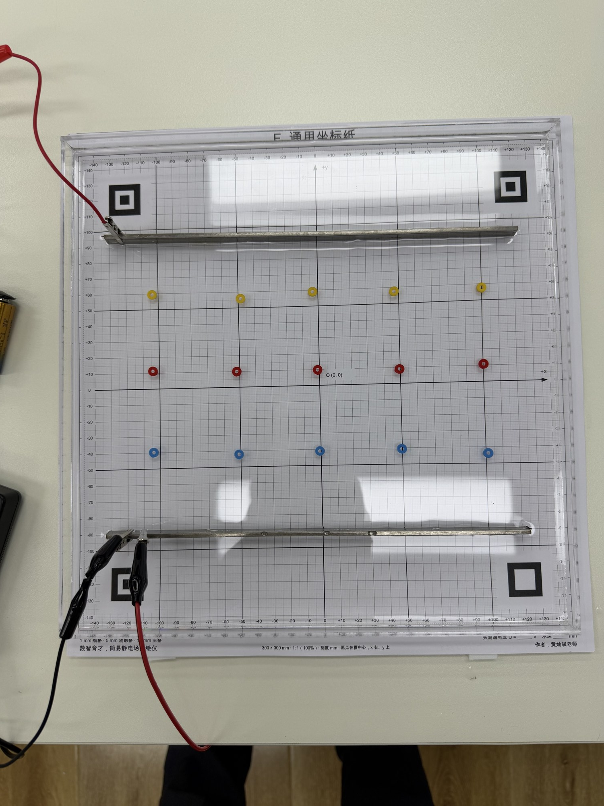
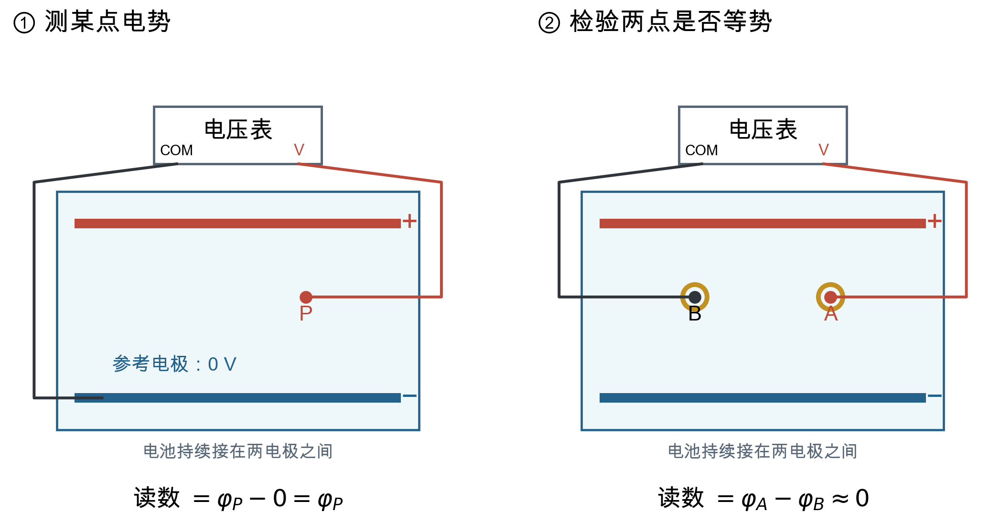
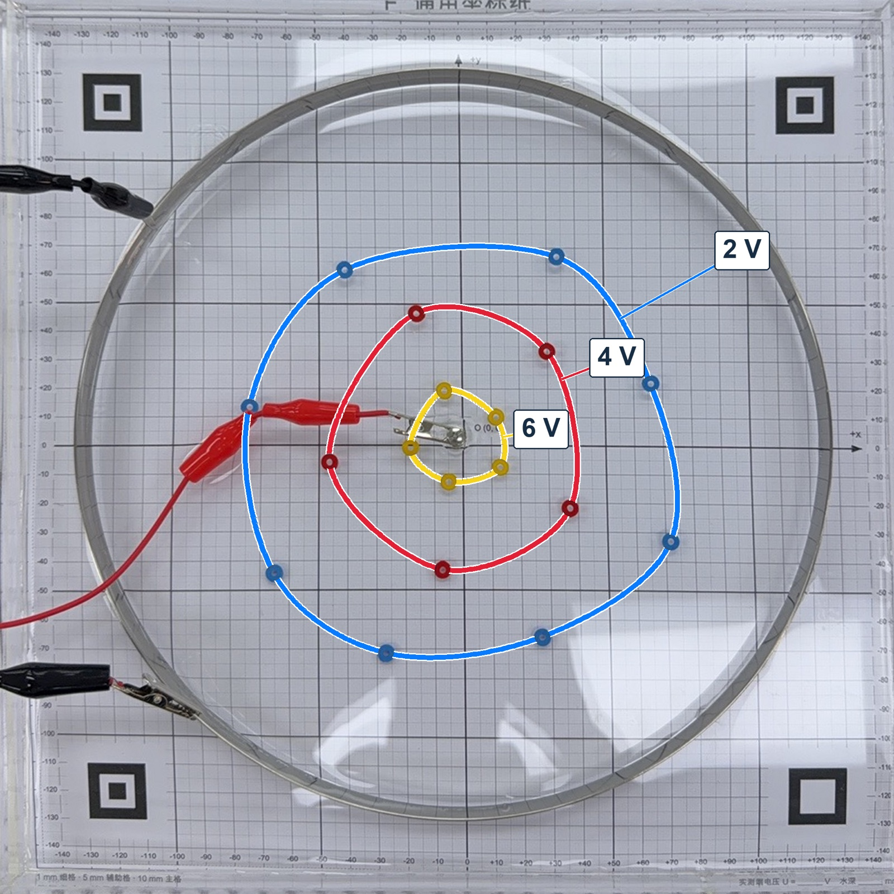
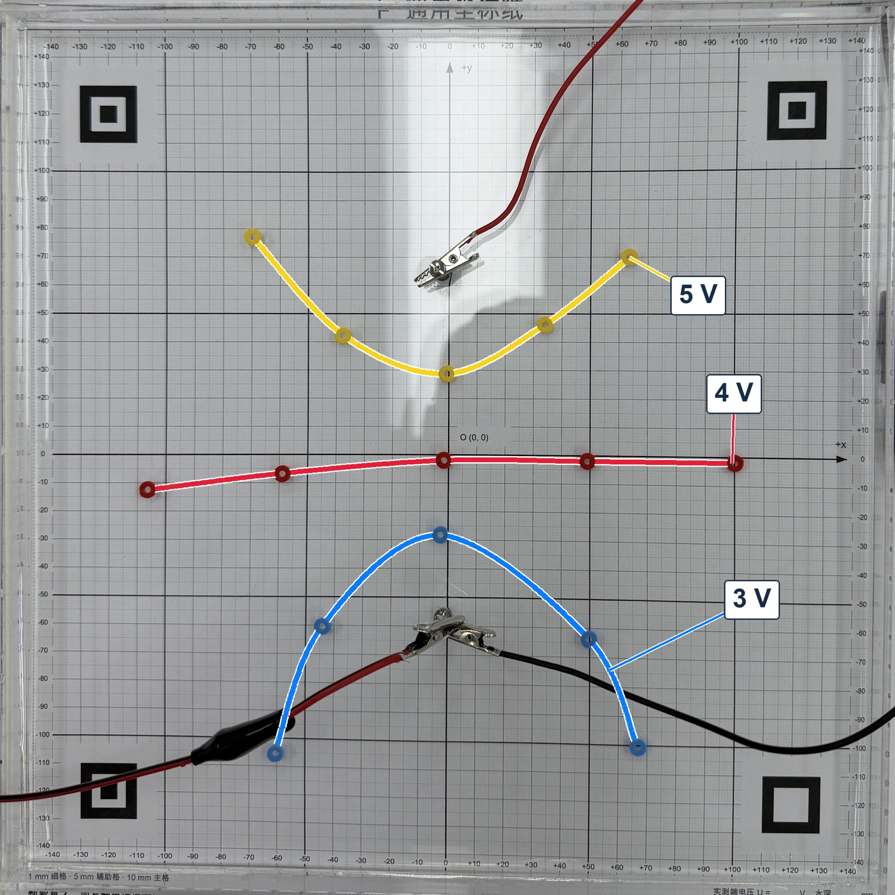
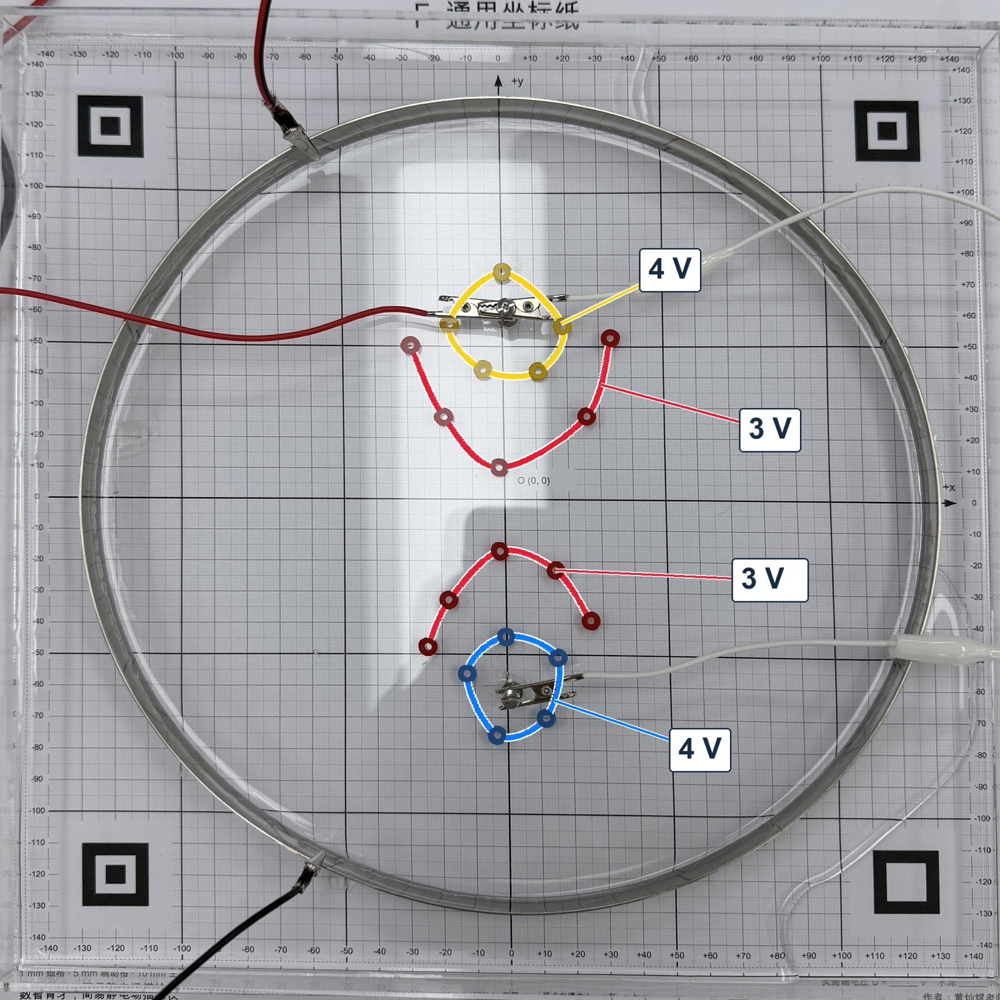
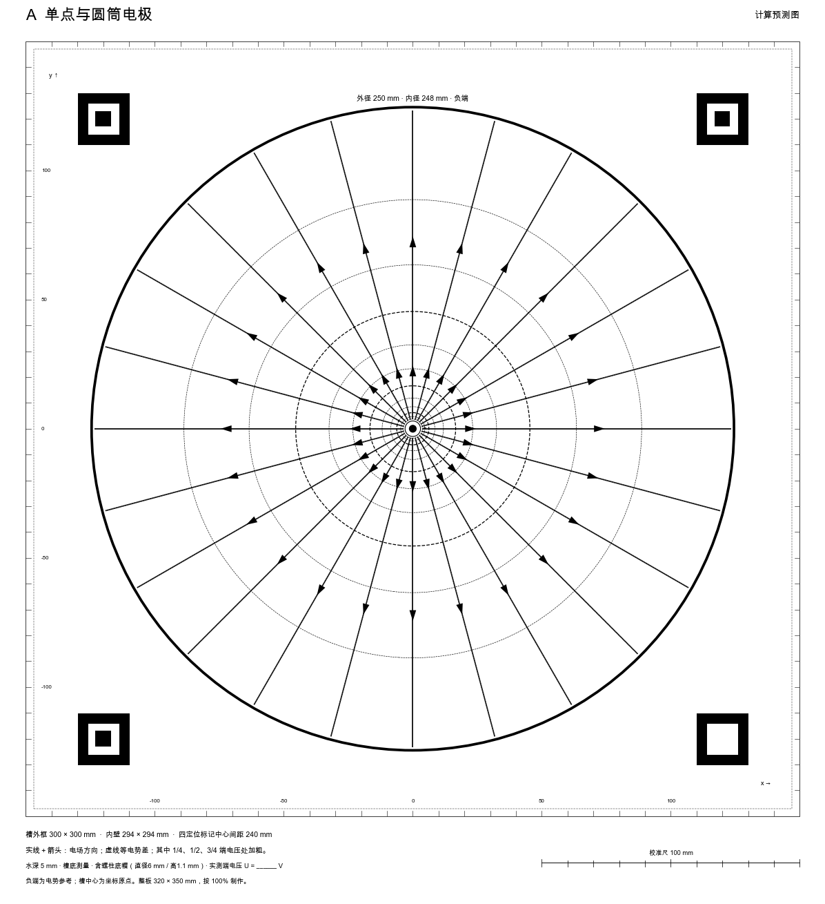

# 第 9 章　一只水槽怎样测出电势：描绘仪与分组实验

学生能背出“电场线跟等势面垂直，并且由电势高的等势面指向电势低的等势面”，却很难说出两块平行金属板之间、一根点电极周围，电势究竟是怎样分布的。课本上的等势面是画出来的，学生没有机会自己测一次。

我的《描绘静电场的等势线》于 2026 年获评广东省中小学实验精品课，使用的是由《简易静电场描绘仪》改进而来的分组实验教具。

这一章介绍一套可以让每组学生动手测电势的装置：一只 30 cm 见方的亚克力浅水槽，一层自来水，两个金属电极，一节 9 V 电池，一只电压表。学生把探针放进水里，找到读数相同的点，用彩色小环标出来，等势线就在水槽里出现了。

本章讲三件事：这套装置为什么能“测”出静电场的电势；测出来的结果可信到什么程度；二十组学生同时测，一节 40 分钟的课怎样组织。测量中有两处和预测对不上，本章把它们找出来并讨论怎样复测；第 10 章进一步用电势地形和剖面图解释电势分布。标记环、调平楔片和收纳盒的建模与打印见第 14 章。

## 一、电势为什么难教

人教版必修第三册第十章第 1、2 节引入电势和等势面。教材用地图上的等高线作类比，给出几种典型电场的等势面图；第 3 节开头又问：电场线密的地方等势线也密，这是为什么？

教师用书指出，电势概念的建立是本章的重点，也是难点：电势能已经比较抽象，需要类比重力势能来学，电势和电势差则更抽象。学生学电场强度时，还能借助力的方向和大小去想；到了电势，只剩下“电势能与电荷量之比”这个定义。对等势面，教师用书的要求是“理解等势面的概念，会画常见电场的等势面”，并提醒学生理解“等势面一定跟电场线垂直”会有困难。

教学中常见的困难有三个：

1. **画不出电势的样子。** 问学生“两块平行板之间哪里电势高”，多数能答；问“一个点电荷周围，电势差相等的相邻等势面相距多远，这个距离随离电荷的远近怎样变化”，就答不上来了。
2. **等势面只是一张别人画好的图。** 第十章没有安排测量等势线的学生实验。学生没有亲手测过，等势面在他们眼里只是一种画法。
3. **记住了“越密越强”，忘了前提。** “等势线越密，电场越强”成立的条件是相邻两线的电势差相同。学生比较疏密时，很少先看电势差。

这三个困难有同一个根源：电势看不见，也没有办法直接测。如果每组学生都能在一个平面里逐点测出电势，再自己连成等势线，电势就有了一个可以讨论、可以检验的具体形象。同一张图上比较几条线的间距，学生又会碰到第 3 节开头那个问题，第 1、2 节和第 3 节就连起来了。

## 二、二十套描绘仪和一节分组实验课

### 每组一套

现在这套装置叫“简易静电场描绘仪”，2026 年 9 月按分组实验的需要批量做了二十套。

每一套的组成如下：

| 部件             | 规格                                                                                                         | 作用                             |
| ---------------- | ------------------------------------------------------------------------------------------------------------ | -------------------------------- |
| 透明亚克力水槽   | 外形 300 mm × 300 mm × 20 mm，壁厚 3 mm                                                                    | 盛一层薄水，水就是导电的“空间” |
| 电极             | 平行板：不锈钢条 250 mm × 10 mm × 3 mm；点电极：螺柱；外圈：不锈钢圆筒，外径 250 mm、内径 248 mm、高 15 mm | 规定两个电势值的边界             |
| 电源             | 一节 9 V 电池                                                                                                | 在两电极之间加电压               |
| 电压表           | 数字电压表（或多用电表的直流电压挡），公共端接负极                                                           | 读出探针处相对负极的电势         |
| 等势点标记       | 黄、红、蓝三色塑料薄环，外径 6 mm、内径 2.4 mm、高 1.6 mm，3D 打印                                           | 放在找到的等势点上               |
| 槽底底图（可选） | 按 1∶1 印刷、对齐水槽：A—E 五种布局的计算预测图，F 是通用坐标纸                                            | 记录位置，或与预测比较           |
| 调平楔片、收纳盒 | 3D 打印                                                                                                      | 让水层等厚；分色收放色环         |

电极有五种布局：A 单点与圆筒、B 两平行板、C 点与板、D 等量同种（两个点电极接正极，外圈接负极）、E 等量异种（两个点电极）。

本章开头那张照片，是用平行板布局实测的结果。槽底垫着通用坐标纸，黄、红、蓝三色环分别标出 6 V、4 V、2 V 的等势点，每种颜色各五个。三排色环各自连成一条和极板平行的直线，这就是匀强电场的等势线。

按我的估算，每套的新增材料在 50 元以内，其中最贵的是水槽，约 25—30 元；电压表等器材实验室本来就有。

### 从一台比赛作品到二十套分组器材

这套器材的前身是我设计的《简易静电场描绘仪》。我以它参加2023年广东省中学物理和小学科学实验教师（实验管理员）实验操作与创新技能竞赛，获高中物理组二等奖。第一版做于2023年秋，是一台演示仪，体积偏大、只有一台，比赛以后没有再进课堂。2026 年 9 月，为了一节分组实验课改成二十套，改进都围绕一个问题：二十组学生同时测，哪些环节最容易出错。

| 改进         | 原来的问题                                                               | 现在的做法                                                                                       |
| ------------ | ------------------------------------------------------------------------ | ------------------------------------------------------------------------------------------------ |
| 电源         | 二十组不可能都配稳压电源                                                 | 每组一节 9 V 电池。电池实际电压在 9 V 上下，学生先测出并记下来                                   |
| 外圈电极     | 原来设想用细金属丝弯成圆圈，只碰到水层的一部分，水层上下的电流分布会不同 | 换成有 15 mm 高度的不锈钢圆筒，贯穿整个水层                                                      |
| 固定电极的胶 | 502 胶干后发白，挡住槽底的底图，不好清除                                 | 改用透明的 AB 胶。这种胶混合后固化很快，粘的时候动作要快；固化后同样不好清除，粘之前先把位置定好 |
| 标记等势点   | 小螺母不好分颜色，拍照后也难辨认                                         | 3D 打印黄、红、蓝三色薄环，一种颜色代表一个电势                                                  |
| 水层厚度     | 教室的桌面不平，水层一边厚一边薄                                         | 3D 打印调平楔片，垫在水槽下面                                                                    |
| 位置记录     | 读数和位置对不上                                                         | 槽底垫 1∶1 印刷的坐标纸或预测图                                                                 |
| 收纳         | 色环很多，课上分发、课后回收很乱                                         | 3D 打印三格收纳盒，按颜色分装                                                                    |

方案是我自己想出来的。换圆筒电极是 AI 提醒的：细金属丝弯成的圈没有高度，水层上下的电流分布会不一样。换胶的建议只对了一半：AB 胶干后透明，固化后却同样难清除。标记环前后改了四版才定下来，见第 14 章。

### 课上，学生用两支表笔证明等势

这套装置在 2026 年 9 月下旬用于我执教的一节广东省实验精品课（学生分组实验课）。五种布局交给不同小组：每组先测出自己的等势点，再用平板把水槽和电表读数传到大屏，向全班展示，最后把五种布局放在一起比较（流程表见第六节）。

展示时，学生的解释成了继续追问的起点。两平行板组被问到“你怎么知道它们是等势线”，学生没有只报读数：

> 我们发现如果把黑色的探头跟红色的探头放在同一条线上，示数约等于零，它们是没有电势差的，我们可以判定这一条就是等势面。

两支表笔都放在同色的环里，电压表读的就是这两个点之间的电势差。读数接近零，两点等势。这样可以直接比较两点电势，省去分别以负极为参考读数后再相减的一步。这种让两点直接比较、看读数是否为零的办法，下文叫零示法。另一组平行板学生用同样的办法验证，并接着说：“因为它每两条等差等势面之间的距离是一致的，它是一个匀强电场。”

单点组被问到哪里难测：

> 我觉得就可能……靠近点电荷，它会比较难测一点……越往里面，它变化得越快，就可能会比较难测一点。你看蓝色的话，这个蓝色圈圈往外，变化都不大。

我顺势追问为什么中间挪一点电势就变很多，学生答：“它越往里面的话，它电场线越密……等势线也就越密。”

等量同种组用表笔沿两螺柱的连线移动：“电极很明显是最高的。我把它往中间移，它会越来越低。再往另外一边移，又会变到最大。”再沿中垂线从中点往外移：“会越来越低。”学生用表笔走出了两个电势峰和中间的一处鞍点。

### 五种布局的实测结果

平行板的结果见前面那张照片。另外四张也是我课前用同一批器材测的，用作课上的对照。槽底垫的是通用坐标纸，原点在槽中心，单位为 mm。色环是实测标记，色环之间的连线是拍照后加上去的辅助线。各槽的端电压统一记为约 9.3 V，这是记录值，不是每槽单独测的；负极为 0。

## 三、水里的电流为什么能“画出”静电场

### 电压表测的是什么

电压表的公共端接在负极上，探针放进水里某一点，电压表显示的是这一点和负极之间的电势差。把负极的电势规定为 0，读数就是这一点的电势。在水里移动探针，找到读数相同的一串点，把它们连起来，就是一条等势线。

### 两种场满足同一个规律

水槽中有持续的电流。电池让电流从正极出发，穿过水层流向负极，形成**稳恒电流场**。这里类比的是无自由电荷区域中的静电势分布。它能代表静电场，是因为两者遵守同一个数学规律。

在水中，电流密度 $\boldsymbol J$ 和电场强度 $\boldsymbol E$ 的关系是 $\boldsymbol J=\sigma\boldsymbol E$，$\sigma$ 是水的电导率。电流稳定以后，水里任何一处都不会越积越多电荷，流进多少就流出多少。水的电导率处处相同时，这就要求电势 $\varphi$ 满足

$$
\nabla^2\varphi=0.
$$

没有电荷的空间里，静电场的电势满足的也是这个方程（拉普拉斯方程）。数学上可以证明：方程相同、整个边界的条件也相同，电势解就相同。因此既要对应电极的形状、位置和电势，也要对应水槽绝缘壁所限制的法向电流；只摆好两个电极、把槽壁当作不存在，对应就不完整。

给高二学生讲到这一步就够了。可以这样说：

> 水里的电流稳定流动时，任何地方都不会堆积电荷；静电场里没有电荷的地方，电势也满足同样的规律。电极和周围边界的条件对应起来，中间的电势分布才对应。所以我们测水里的电势，就等于在测静电场的电势。

### 类比成立的条件

上面的推理有几个前提，装置上的每一个细节都是为它们服务的：

| 条件                 | 装置上的做法                              | 做不到会怎样                                     |
| -------------------- | ----------------------------------------- | ------------------------------------------------ |
| 水层厚度处处相同     | 桌面调平，必要时垫楔片                    | 水深的地方电流多，等势线会偏向一侧               |
| 水的电导率处处相同   | 用同一桶自来水，加水后静置片刻            | 局部电导率不同，分布会畸变                       |
| 电极贯穿整个水层     | 圆筒电极有 15 mm 高，钢条和螺柱都高出水面 | 只碰到水面或槽底的电极，会让水层上下的分布不一样 |
| 电极本身是等势体     | 用金属电极，导线夹在电极上                | 电极内部若有明显电压降，“边界电势”就不确定     |
| 测量时不改变电流分布 | 用内阻很大的电压表（数字表）              | 电压表分走电流，读数偏小                         |

### 水槽和课本上的场，有三处不同

**第一，水槽是平面的。** 水层很薄，电流只在一个平面里流。水槽中央的一根螺柱，相当于一根垂直于纸面的无限长带电直线的截面，而不是一个点电荷。单点与圆筒布局中，点电极半径为 $a$、圆筒内半径为 $R$、两者电势差为 $U$ 时，距中心 $r$ 处的电势为

$$
\varphi(r)=U\,\frac{\ln(R/r)}{\ln(R/a)}.
$$

电势随 $\ln r$ 变化，而三维点电荷的电势随 $1/r$ 变化。两者定性一样：越靠近中心，电势变化越快，等差等势线越密。定量上并不相同：

- 三维点电荷：等差等势面的半径倒数成等差数列，相邻两面的间距大致与 $r^2$ 成正比；
- 水槽中的二维情形：等差等势线的半径成等比数列，相邻两线的间距与 $r$ 成正比。

取 $a=3\ \mathrm{mm}$、$R=124\ \mathrm{mm}$，$3U/4$、$U/2$、$U/4$ 三条等差等势线的半径约为 7.6 mm、19 mm、49 mm，每条约是前一条的 2.5 倍。课上讲“点电荷周围的等差等势面，越靠近电荷越密”时，可以用水槽演示；要计算具体半径或间距，就要提醒学生，这里测的是二维情形。

**第二，槽壁是绝缘的。** 电流不能穿出槽壁，所以紧贴槽壁处，电场没有垂直于槽壁的分量，等势线一碰到槽壁就和它垂直。课本里的静电场画在无限大的空间里，没有这种约束。平行板布局中，钢条的两端离槽壁只有二十多毫米，电流会绕过钢条两端流到板外，板外也有电场，主要在钢条两端附近；钢条背后中部的场很弱，按这只水槽计算，只有板间的约 0.3%（见第四节的预测底图）。所以，水槽测出的是“这只水槽里的场”，和课本上的理想场有差别。要和测量结果比较，预测图必须按真实水槽的尺寸和边界来算。

**第三，电极表面有电化学反应。** 用直流电通过自来水，电极表面会发生电解，负极上常能看到细小的气泡。电化学反应要消耗一部分电压，电池两端的电压不会全部加在水层上。第五节会看到，这一点会直接影响测量结果怎样解读。用低压交流电源配交流电压表，能减小电极极化，但二十组同时做不便配置。本装置选了 9 V 电池，就要正视界面压降：定量比较时，用两侧水中的有效电势。

## 四、垫在槽底的预测底图是怎样来的

预测底图让学生可以先猜、再测、再对照。它是按水槽的真实尺寸、五种电极布局和 5 mm 水深，数值求解水层里的电势分布，画出 $U/4$、$U/2$、$3U/4$ 三条等势线和电场方向，按 1∶1 输出、可以印刷的图。底图上不标具体伏数，$U$ 由学生测出自己那节电池的电压后填写。

这些图是请 AI 算的。交给它的是量出来的东西：槽内 294 mm 见方，两根钢条多长、多厚、相距多远，水深多少，槽壁绝缘，哪块板接正端。要它交回的是能按实际尺寸打印的文件，带一条 100 mm 校准线。

做的过程里，有三处是靠物理看出来的，不必懂程序：

- **槽壁不是电极。** 钢条上规定电势，槽壁上规定电流流不出去。AI 若把四面槽壁都设成 0 V，等于沿四周加了一圈金属电极，算的已经是另一台装置。看图也能发现：有限水槽里，等势线到板端要弯，到槽壁处近似垂直于槽壁；整幅图都是笔直的平行线，就没有按有限水槽来算。
- **“收敛”了，电极却不在网格里。** 初版自检用的网格太粗，格点根本没落进 3 mm 厚的钢条，全是零的结果被报告为“收敛”。
- **箭头反了。** 算出的电场向下，导出的箭头却向上，因为图像坐标和物理坐标的正方向相反。电场从高电势指向低电势，一眼就能看出来。

打印时还有一道坎：310 mm 见方的图，用 A4“适合纸张”打出来就不是 1∶1 了。先用尺子量那条 100 mm 校准线，再把实物放上去对位置。

想自己做一张的读者，完整的提示词、检查顺序和网格加密的做法在配套包第 9 章的《自己做一张预测底图》，做好的预测页和 310 mm 矢量底图也在那里。

## 五、这台装置测得可信吗：两处对不上

一台测量装置做出来，第一件事是检验它测得对不对。最好先用答案最清楚的布局来检验：两平行板之间，中部应当是匀强电场。

### 先写下预测

测量前，先在纸上写出三条预测：

1. 两板中部的等势线和极板平行；
2. 电势差相等的等势线，间距相等；
3. 如果电池电压全部加在两板之间的水层上，电势沿垂直于板的方向均匀变化。两板相距约 184 mm，按记录的端电压 9.3 V，6 V、4 V、2 V 三条线应当在离负极板约 119 mm、79 mm、40 mm 处，也就是坐标纸上 $y\approx+27$、$-13$、$-52\ \mathrm{mm}$。

这里的 9.3 V 是各槽统一填写的端电压记录，不是这一槽当时单独测的。

### 再看实测

回到第二节的平行板照片。先直接从照片上的坐标纸粗读各色环的位置，尚未作透视校正：

| 等势线 | 五个环的 $y$ 坐标大致在 | 平均位置   |
| ------ | ------------------------- | ---------- |
| 黄 6 V | +58 至 +66 mm             | 约 +61 mm  |
| 红 4 V | +10 至 +17 mm             | 约 +13 mm  |
| 蓝 2 V | −37 至 −42 mm           | 约 −39 mm |

两块钢条大约在 $y=+92$ 和 $y=-92\ \mathrm{mm}$ 处。

**预测 1 和 2 成立。** 三排色环各自大致排成一条水平线，和极板平行；三条线的间距分别约 48 mm 和 52 mm，在读数误差范围内相等。两板中部是匀强电场，这个结论站得住。

**预测 3 和照片对不上。** 三条线都比预测的位置高：6 V 线高出约 34 mm，4 V 线约 26 mm，2 V 线约 13 mm，越靠近正极偏得越多。按实测的间距，电势每升高 1 V 约移动 25 mm。照这个比例往两头推：从 2 V 线再往下 50 mm，到 $y\approx-89\ \mathrm{mm}$ 时电势约为 0，正好在负极板附近；外推到正极板 $y\approx+92\ \mathrm{mm}$，电势约 7 V。如果这一槽当时的端电压确是 9.3 V，正极旁的水就比电池电压低约 2 V。这是从一张未作透视校正的照片推出来的粗估，看得出偏差的方向，数值还不可靠。

等量异种那张图指向同一个方向。按 9.3 V 算，两螺柱连线的中点应在 4.65 V 左右，实测 4 V 线却几乎经过中点。两张照片都显示：正极旁边的水，电势可能比电池电压低。

### 偏差可能来自哪里

一种可能的解释是第三节说的电极界面压降：直流电在电极表面引起电解，电极和紧贴它的水之间消耗了一部分电压，这部分电压没有分配到水层里。照这组数据看，这部分电压主要出现在正极一侧。

还有两种可能也会让等势线向正极偏。一是电压表：内阻不够大时，它会分走电流，读数偏低。数字电压表的内阻很大，这一项影响很小；用指针式电压表时，要把它列进来。二是这一槽的端电压没有单独记录，实际值可能低于 9.3 V。

要区分这几种解释，同时核对每槽的实际端电压，以及夹子和电极的接触。具体做法是：

1. 用电压表直接测电池两端，记下这一刻的电压；
2. 把探针贴近正极板（距离 1—2 mm）读数，再贴近负极板读数；
3. 比较电极金属与紧贴电极的水之间的读数差，确定哪一侧存在较大的界面压降。

### 这对课堂意味着什么

**定量预测等势线位置时，采用两侧水层的有效电势。** 课上可以这样处理：

- 让学生比较等势线的形状、方向和间距，这些结论不受电极损失电压的影响；
- 如果要定量预测位置，先测出两电极旁边水中的电势，用这两个值作为两端电势，而不是用电池电压；
- 印刷的预测底图标的是 $U/4$、$U/2$、$3U/4$，也要按同样的办法理解其中的 $U$。

### 单点那张图留下的问题

单点与圆筒那张图有另一种对不上。三圈等势线的半径大约是 16 mm（6 V）、45 mm（4 V）、74 mm（2 V），相邻两圈都差 29 mm 左右，几乎等间距。按第三节的对数式（$a=3$ mm，$R=124$ mm，$U=9.3$ V），三圈应当在 11 mm、25 mm、56 mm 左右，一圈比一圈大两倍多。课上也指出，这一张没有清楚显示“越靠近中心越密”，不宜拿来讲这个结论。

这一处偏差的方向和平行板不同：平行板是整条线平移，单点是三圈的间距规律变了。两种偏差是不是同一个原因，只看照片还判断不了。需要分别检查电极附近的电势和水层厚度，再判断偏差来自哪里。

### 查读数：同色环之间的电势差应当接近零

学生在展示时用的零示法，值得作为每组的固定检查：黑表笔放进一个色环，红表笔依次放进同色的其他环，读数都应接近零；再把红表笔移到相邻颜色的环里，读数应接近两线的电势差。找点时黑表笔留在负极；用零示法自查时才把它移进同色环，查完夹回负极。

如果同色的两个环之间读数明显不为零，说明放环时读数还没稳定，或者环在放下后漂移了。环漂移是课上实际出现过的问题：色环放进水里会浮、会夹气泡，要用表笔针尖穿过环孔，把它按到槽底。

### 查学生的结论：比疏密之前，先问电势差

“等势线越密，电场越强”有一个前提：相邻两线的电势差相同。课上点与板组测的是 4 V、2 V、1 V，相邻两段的电势差是 2 V 和 1 V。我在对照环节专门问了一句：能不能从 1 V 和 2 V 的间距比 4 V 和 2 V 的小，说明那里电场更强？一位学生刚说出“因为它不是……”，我接上：“因为它不是等差等势线。”

不等差时，比较的应当是每一段的平均电场强度，也就是电势差除以间距：

$$
E\approx\frac{|\Delta\varphi|}{\Delta s}.
$$

这里 $\Delta s$ 要沿垂直于等势线的方向量。用平行板那张图估算：6 V、4 V、2 V 三条线的间距约为 48 mm 和 52 mm，每段电势差 2 V，

$$
E\approx\frac{2\ \mathrm V}{0.050\ \mathrm m}=40\ \mathrm{V/m}.
$$

点与板那一组，也可以请学生当场自己读图来算。C 图上，三条线在 $x=0$ 附近各有一个色环，这条竖线大致是螺柱和钢条的对称轴，那里的电场近似沿竖直方向。读出这三个环的 $y$ 坐标，得到 4 V 与 2 V、2 V 与 1 V 两段间距，再分别用 2 V 和 1 V 去除。比一比：间距较小的那一段，场强是不是就大？读数以原照的坐标纸为准，学生自己读、自己算。

课上播放的一段短动画给出了等量异种连线上的情况：电势每隔 1 V 取一条线，靠近电极处相邻两线相距约 7.7 mm，两电极中间相距约 30 mm，对应的电场强度约为 130 V/m 和 33 V/m。这组间距是用教师实测的等量异种结果校准水槽模型后算出来的，电极附近是推算值，不是直接量出的。$1\ \mathrm V\div0.0077\ \mathrm m$ 和 $1\ \mathrm V\div0.030\ \mathrm m$ 这两步除法，可以留给学生当场验算。

### 其他几项基本检验

第一次使用描绘仪时，用现有器材完成以下检查：

| 检验     | 做法                                                                                               | 应当看到                                                                                                                                                                                         |
| -------- | -------------------------------------------------------------------------------------------------- | ------------------------------------------------------------------------------------------------------------------------------------------------------------------------------------------------ |
| 读数稳定 | 探针固定在一点，隔一分钟读三次                                                                     | 读数变化很小；如果一直漂，先查水面是否晃动、接触是否良好                                                                                                                                         |
| 对称     | 在平行板或等量异种布局中，取关于对称线对称的两点                                                   | 左右对称的两点读数相同；分居两电极正中线两侧、位置对称的两点，读数之和约等于两电极旁水中电势之和 |
| 换电池   | 换一节电压不同的电池，先测两电极旁水中的电势，找这两个值中点对应的等势线；再找电池电压一半对应的线 | 按水中有效电势算的中点线，位置基本不变；按电池电压算的 $U/2$ 线如果明显移动，说明电极界面损失了一部分电压                                                                                      |
| 换方向   | 对调正负极                                                                                         | 等势线的形状关于中线对称地翻转                                                                                                                                                                   |

“换电池”这一项，正好可以用来检验前面的界面压降解释。

### 预测图本身也要审核

预测底图是 AI 算出来的，同样需要检查。准备课件时出现过一个例子：一份 AI 写的讲课手册说，等量异种布局中 $U/3$ 和 $2U/3$ 两条等势线是“围住电极的闭合圈”；再请另一个 AI 按同一组计算数据复核，结果这两条线会一直延伸到槽壁，并不闭合。

课本里画的是无限大空间中的等量异种电荷，其中的非零等势线围绕某一个电荷。这只水槽四周是绝缘壁，边界改变了电势分布，课本图的样子搬不过来。所以预测图要按真实水槽计算；AI 对图的文字描述，要回到计算数据上核对。

## 六、带进课堂：一节 40 分钟分组实验课

下面的 40 分钟设计在录制那节课的基础上调整了时间：电势地形与网页演示移到下一节（见第 10 章），展示与讨论留足 12 分钟。按这份时间表还没有完整上过一次。

### 放在什么时候教

两种放法都可以：

- **放在第 2 节“等势面”之后，作为第 3 节的引入。** 学生已经知道等势面和电场线垂直，这节课用实测的疏密引出“电场强度与电势差有什么关系”，第 3 节再推导 $U_{AB}=Ed$。
- **放在第 3 节之后，作为实验课。** 学生已经学过 $U=Ed$，课上可以直接用测出的间距估算电场强度。录制的那节课属于这一种，结论环节请学生用 $U=Ed$ 解释疏密，学生答得出来。

### 每组的准备

1. **调平、加水。** 倒入少量水看是否均匀盖住槽底，不平就垫楔片；加到约 5 mm 水深，电极上沿高出水面，记下实际水深。
2. **测电池、接线。** 先测电池电压记在学案上；电池两极夹在两个电极上，电压表公共端接负极电极，红表笔作探针，导线夹不浸入水中。
3. **试测。** 平行板布局中，探针放在两电极正中，读数应接近两侧水层有效电势的平均值；差得多就按第五节查端电压、接线和水深。
4. **测量、收尾。** 探针竖直插到槽底，找到目标电势就放对应颜色的环；测完拍照，倒水，色环按颜色收回。

用 9 V 电池，不接市电；负极冒气泡是电解，属于正常。

### 器材和分组

两人一组，最多二十组。一人拿红表笔找点，一人看表、放环，测完一种颜色交换。五种布局不必平均分配：

| 布局         | 建议组数 | 理由                                   |
| ------------ | -------- | -------------------------------------- |
| B 两平行板   | 4—5     | 结论最清楚，适合第一个展示             |
| A 单点与圆筒 | 4        | 体会“越靠近中心越难测”               |
| E 等量异种   | 4        | 中垂线是等势线                         |
| C 点与板     | 3—4     | 讨论不等差时怎样比较                   |
| D 等量同种   | 3        | 接线最复杂，测点最难，给动手能力强的组 |

多组同时上课，还要在课前做三件事：每台水槽按学案上的接法核对正负极，D 组的两个螺柱要先用导线连好；色环按颜色分装进收纳盒，每色至少 8 个；教师平板与教室大屏试连一次摄像头直播，确认水槽和电表能同框、读数看得清。

### 学生会在哪里出错

| 易错点           | 课上的表现                         | 处理办法                                                                             |
| ---------------- | ---------------------------------- | ------------------------------------------------------------------------------------ |
| 黑表笔离开负极   | 读数忽高忽低，找不到目标电势       | 找点时黑表笔留在负极；用零示法自查时才把它移进同色环，查完夹回负极。巡视时先看这一项 |
| 读数没稳就放环   | 同色环之间读数不为零               | 表笔竖直轻触槽底，读数稳定再放；放完用零示法复查                                     |
| 色环漂移         | 环浮在水面或放下后移位             | 用针尖穿过环孔按到槽底，等水面平静再测                                               |
| 点挤在一起       | 五个环都在一小段里，看不出线的形状 | 提醒每色分散放 5 个左右，弯曲处多放                                                  |
| 为了画成圆而挪点 | 单点组把环摆成整齐的圆             | 追问：“这个点的读数是多少？”点的位置由读数决定                                     |
| 不等差也比疏密   | “这两条靠得近，所以电场强”       | 先问相邻两线的电势差各是多少                                                         |

### 教学流程

| 环节         | 时间   | 教师                                                                          | 学生                                                 | 器材与资源             |
| ------------ | ------ | ----------------------------------------------------------------------------- | ---------------------------------------------------- | ---------------------- |
| 1 问题与安全 | 3 min  | 电势看不见，课本上的等势线是画好的；能不能自己测？讲三条安全要求              | 听，检查桌上器材                                     | 实物                   |
| 2 器材与原理 | 4 min  | 对着实物介绍薄水层、电极和电压表，说明模拟电势分布的条件                      | 指出两支表笔分别连接哪里、读数表示哪两点的电势差     | 实物、原理动画         |
| 3 操作示范   | 3 min  | 播放操作视频，补充黑表笔、等差、按环沉底三点                                  | 对照学案步骤                                         | 操作视频（1 分 51 秒） |
| 4 分组测量   | 10 min | 巡视：黑表笔位置、读数是否稳定、点是否分散；第 8 分钟起为每种布局选一个展示组 | 测三条等势线，记录三色电势和端电压，用零示法自查     | 描绘仪、学案           |
| 5 展示与讨论 | 12 min | 平板直播展示组水槽；按下面的提问表追问；请每组一人上黑板画                    | 说明三色电势、怎样确认等势、哪里难测；当场用表笔演示 | 平板、大屏、黑板       |
| 6 对照与结论 | 5 min  | 将教师实测图与各组结果并列；问点与板组能否直接比疏密；请学生用 $U=Ed$ 解释  | 对照自己的图；说出结论的前提                         | 教师实测图一页         |
| 7 小结与收纳 | 3 min  | 小结测量方法、检验方法与疏密条件；组织断电收器材                              | 整理器材，色环按颜色收回                             | 板书                   |

合计 40 分钟，可按本校课时调整。若时间紧，可以用实物讲解替代原理动画；超时时，优先保留展示环节里的当场零示检验，黑板画图可以改为平板拍照投屏。

### 展示时问什么

五组各问一个主问题，按现场情况追问，不必问完：

| 布局         | 主问                                       | 追问                                       | 学生应能说到                                     |
| ------------ | ------------------------------------------ | ------------------------------------------ | ------------------------------------------------ |
| B 两平行板   | 凭什么说这片区域接近匀强？                 | 相邻电势差相同吗？间距相等吗？两端附近呢？ | 等差且平行等距，才近似匀强；两端没测，不下结论   |
| A 单点与圆筒 | 哪里最难定位？为什么？                     | 同样挪一小段，中心和外圈读数变化一样吗？   | 靠近中心电势变化快，那里电场强；外圈点要补够     |
| C 点与板     | 靠近螺柱和靠近钢条，线的形状有什么不同？   | 三个电压等差吗？不等差时能直接比疏密吗？   | 近螺柱成弧，近钢条变平；不等差时比较每厘米变几伏 |
| E 等量异种   | 三条线在哪里靠得最近？                     | 中间那条线是什么形状？                     | 两电极连线附近最密；中间那条接近直线，是中垂线   |
| D 等量同种   | 同样的电压，为什么在两个螺柱周围都能找到？ | 沿连线和中垂线，电势怎样变化？             | 两处高电势；连线上中点最低，中垂线上中点最高     |

每组讲完，请他们把红表笔放进同色的几个环，让全班看读数是否相同，再移到相邻颜色的环。这比教师说“这条就是等势线”更有说服力。教师用书讲等势面时提的三个问题，在水槽里都有对应：同色两环之间读数接近零，沿等势线移动电荷不做功；各组画的电场箭头可以检查是否与等势线垂直、从高指向低；五张图里，不同颜色的环从来不交叉，交点处的电势只能有一个值。
