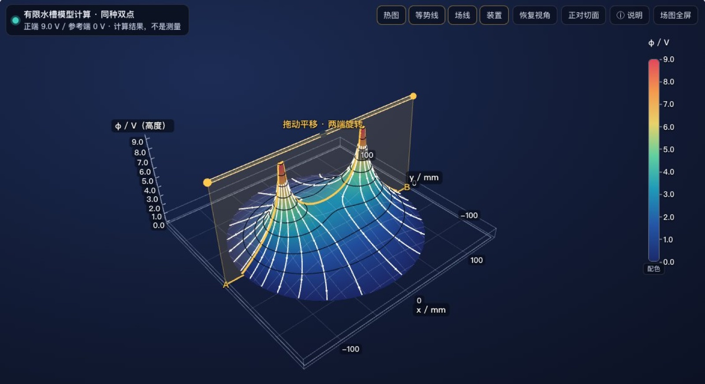
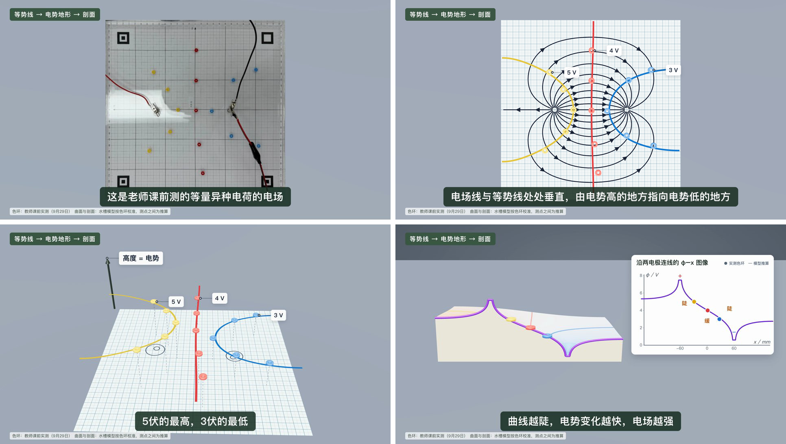
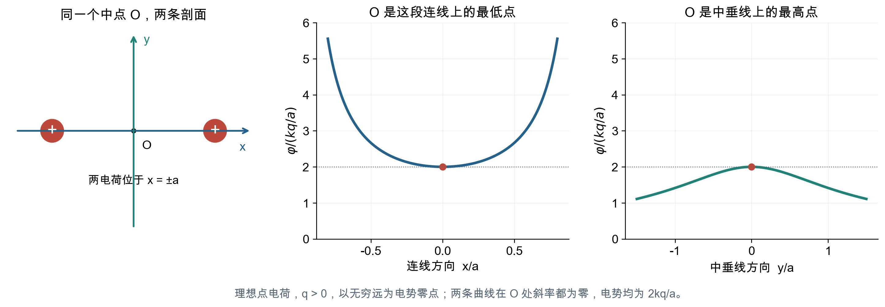
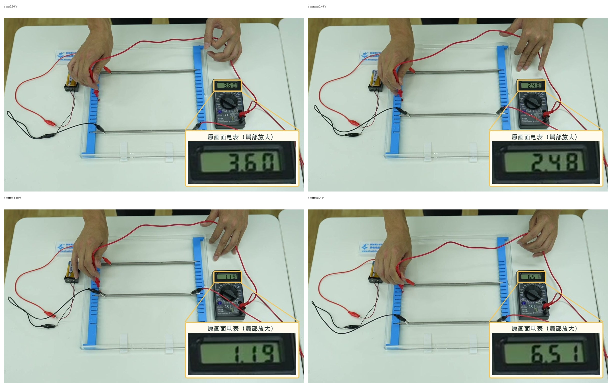
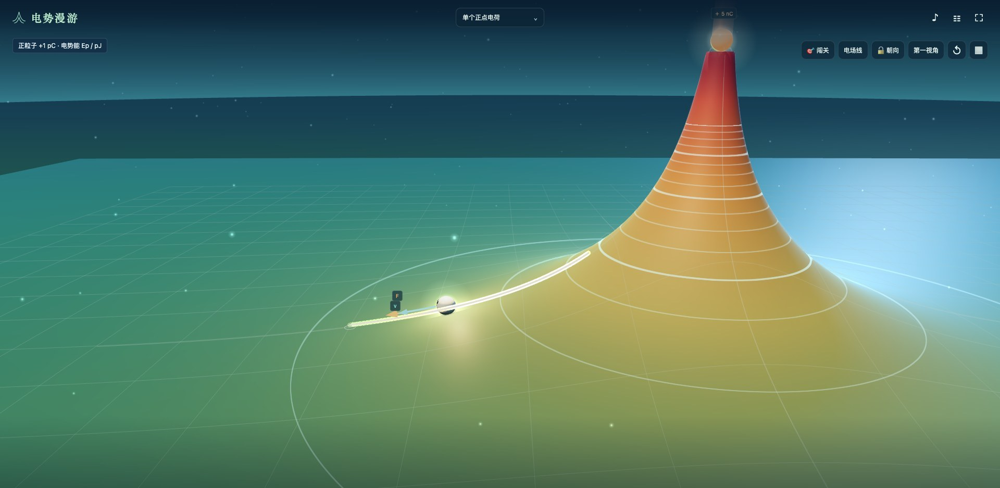

# 第 10 章　从等势线到电势地形：用模型解释实测，再移一移极板



第 9 章结束时，全班测出了五种布局的等势线，也留下两处对不上：平行板的三条线整体偏向正极，单点的三圈几乎等间距。这一章接着做两件事。

第一件是把平面上的等势线“抬起来”：用高度表示电势，得到一张电势地形，再沿一条路径竖直切开，切口就是 φ–x 图像。学生由此看到 φ–x 图从哪里来，斜率为什么和电场有关。第二件是把实测点放进第 9 章那个水槽模型里，看模型能解释哪些偏差、解释不了哪些，再回到水槽去测。章末在水槽里移一移极板，接上电容器的动态问题，再介绍一款课后玩的电势游戏。

## 一、φ–x 图像从哪里来

人教版必修第三册第十章第 3 节建立电势差与电场强度的关系。教师用书写明，本节的重点是匀强电场中 $U_{AB}=Ed$ 的推导，难点是电场强度的另一层意义：它在数值上等于沿电场方向单位距离上降低的电势。学生熟悉的变化率大多是对时间的，“电势对空间位置的变化率”对他们是新东西。教师用书还建议，对一般电场，学生只要定性了解电势差与电场强度的关系。

从匀强电场走向非匀强电场，φ–x 图像也会从直线变成不同形状的曲线。学生阅读这类图时，常见的困难有三种：

1. **不知道曲线从哪里来。** 学生没见过一条电势曲线怎样从平面电场的分布中取得。
2. **把斜率直接当成电场强度。** 斜率的负值是电场沿 $x$ 方向的分量 $E_x=-\mathrm d\varphi/\mathrm dx$。换一条路径，同一个电场切出来的曲线就不同。
3. **把“电场强度为零”和“电势为零”混在一起。** 等量同种电荷连线的中点，电场强度为零，电势却不为零。

到了第 4、5 节，高考题又加了一层：题图是静止的，问的却是变化。移动一块极板，问某个固定点的电势怎样变；给出等势面，问粒子怎样运动。学生要在脑子里让极板动起来，分清哪个量不变、哪个点固定不动。

我最初做这套装置，是因为电势画不出来，学生脑子里没有它的形象；如果能把电势画成三维的图，就可以类比重力场中的高度来理解。电势地形就是这个想法的落地。教材第十章第 2 节用地图上的等高线引出等势面，这一章把这个类比反过来用：从测出的“等高线”出发，把地形还原出来。

## 二、同一组测点的四种画法

下面四个画面取自课上用的一段短动画（63 秒）。用的是我课前测的一组等量异种：画面中左边螺柱接正极，右边接负极，黄、红、蓝色环分别是 5 V、4 V、3 V。



四个画面表达的是同一个电势分布：

| 画法 | 电势怎样表示 | 学生能读出什么 |
| --- | --- | --- |
| 色环照片 | 每种颜色代表一个电势值 | 哪些点等势 |
| 等势线图 | 同一条线上电势相同 | 等势线的形状、疏密，电场线方向 |
| 电势地形 | 竖直高度表示电势 | 哪里高、哪里低，哪里坡陡 |
| φ–x 剖面 | 纵坐标表示电势 | 沿一条路径电势怎样变化，哪一段陡 |

剖面上标着“陡、缓、陡”：靠近两个电极的地方曲线陡，两电极中间曲线缓。这和第 9 章学生测量时的感受一致：靠近电极，表笔挪一点读数就变很多。

数智育才网站上的“静电场实验室”把同一种电极布局分成三层：实测与重建、有限水槽模型、无限空间理想模型。前两层以负极为零，理想模型中的点电荷以无穷远为零。录制的那节课上，我用平板打开这个网页，演示了五种电场的地形。

讲到等量同种时，我把切面放在连线上，再转到中垂线上，问学生中点的电势在连线上是最高还是最低，在中垂线上又是怎样。讲到等量异种时，问中垂线上的电势是多少，答案是零。这句话要配上前提：在理想模型里，电势以无穷远为零，中垂线的电势才是零；在水槽里，负极是零，中垂线的电势是两电极电势的一半左右。演示时最好切换到理想模型再问这个问题，或者直接问学生“在水槽里，中垂线的读数是多少”。



## 三、带进课堂：用实测结果引出 φ–x 图像

这部分内容接在第 9 章的分组实验课之后，用学生自己测出的结果引出 φ–x 图像。它还没有作为一节完整的课上过；其中的网页演示，录制的那节分组实验课上做过一遍。

### 放在什么时候用

放在第十章第 3 节“电势差与电场强度的关系”之后。学生已经推导过匀强电场中 $U_{AB}=Ed$，知道 $d$ 要沿电场方向量。这里把它推广成“剖面越陡，沿该方向的电场分量越大”。

不单独开课时，在第 9 章那节课的“对照与结论”环节播放短动画（63 秒），问一句“哪一段最陡”；网页演示和剖面草图留作课后任务，下一节课用 5 分钟讲评。

### 学生会在哪里出错

| 易错点 | 课上的表现 | 对应的画面或活动 |
| --- | --- | --- |
| 把地形的高度当成空间高度 | “电荷在山顶上” | 网页的说明框和坐标轴都写着“高度表示电势”；让学生说出底面上的坐标是什么，高度是什么 |
| 斜率就是电场强度 | 任意路径的剖面都直接读出 $E$ | 等量同种：同一个中点，连线和中垂线两条剖面的形状完全不同 |
| 电场强度为零，电势也为零 | “中点没有电场，所以电势是零” | 等量同种的鞍部：中点电场强度为零，地形上却有高度 |
| 地形处处是测出来的 | “我们测出了整个地形” | 短动画画面底部的来源说明；网页上实测点和补出的曲面颜色不同 |
| 理想模型和水槽的数值混用 | 用水槽的读数套点电荷公式 | 三层模型对照：形状相近，零点和数值不同 |

### 让学生画一条剖面草图

先把等势线按电势“抬”起来：教材图 10.2-2 讲等高线是地形被水平面截出的交线，反过来，把等势线按电势抬高，就得到地形。播放短动画时，可以在“抬起来”和“切开”两处暂停，问哪些点在同一高度、切口曲线上哪一段陡。然后请各组在本组实测图上画一条剖面草图：

1. 在本组的图上画一条直线路径，标出它和本组三条等势线的交点；
2. 量出每个交点到路径起点的距离，得到三组 $(x,\varphi)$；
3. 两端标出电极的位置。电极旁水中的电势不一定等于电池电压（第 9 章），测过就按读数填，没测过就只标位置；最后连成平滑的草图，交点之间的部分是推测的。

看草图时查五处：两端是否与电极旁水中的电势对应；沿电场线方向是否下降，经过同种电荷之间时是否先降后升；是否靠近电极处陡、远离处缓，平行板中部是直线；等量同种连线中点是否画成最低点、斜率为零；是否写明按哪张图、哪条路径画的。把等量同种的切面从连线转到中垂线，同一个中点分别成了最低点和最高点，这是“电场强度为零不等于电势为零”最直观的例子。

教材第 3 节“练习与应用”第 3 题正是这种类比：图 10.3-5 是初中地理课本里一座小山坡的等高线图，先问左边 a 和右边 b 哪边更陡、球从哪边滚下加速度更大；再把它看成等势线图，问哪边电势降落得快、哪边电场强度大。教师用书提示，这道题要体会“电场强度大的地方是电势降落得快的地方”。剖面草图做完，再做这道题，学生用的是自己画过的坡。

### 用单点那张图做一次讨论

如果学生里有人提出“单点那张图三圈差不多等间距，和课本不一样”，可以用 5 分钟讨论，也可以留作课后研究：

1. 先让学生说，按课本的点电荷，等差等势线应当是什么样子（越靠近中心越密）。
2. 再给出水槽的规律：三圈半径应成等比数列。请学生用实测的 16、45、74 mm 算两个比值。
3. 问：比值不相等，可能是哪里出了问题？引导学生想到水深和电解。
4. 布置课后任务：量一量自己那台水槽中心和边缘的水深。

课后可以让学生打开网站上的“电势漫游”游戏，把小球放到理想点电荷的地形上，看它沿“下坡”加速、在某一点停下再折回（本章第五节）。

## 四、在水槽里移一移极板：固定点的电势往哪边变

静电场的高考题里，电容器动态问题最容易出错：移动一块极板，问某个固定点的电势怎样变。题图是静止的，问的却是变化。数智育才网站的静电场高考题专区（[https://shuzhiyucai.cn/electrostatics/exam/](https://shuzhiyucai.cn/electrostatics/exam/)）收录了 2022—2026 年的 22 道静电场高考题，每题配一个题旁模型；本书配套的《静电场高考题讲义》收了其中几道的原题、解析和检查题旁模型的三个问题。这一节只讲一段水槽演示。

学生常常记住了“板距变小，场强变大”，就以为固定点的电势也跟着变大。我录制静电场精品课时，在水槽里把这个想法拆开过：两次都把板距缩小，固定点的电势却朝相反的方向变。

两条钢条一直接着 9 V 电池，上方接正极，下方接负极。电压表的 COM 端始终接负极板，以它为零电势参考；红表笔每次都回到一个红色色环标出的点 P，P 在水槽里的位置不变。先让正极板不动，把负极板向 P 移近两档；再把负极板放回原处，改把正极板向 P 移近。



两次板距都减小，为什么一个降、一个升？用理想平行板模型解释，忽略边缘效应。设两板电压为 $U$，负极板电势为零，板距为 $d$，P 到负极板的距离为 $h$，到正极板的距离为 $a$，$h+a=d$：

$$
E=\frac Ud,\qquad \varphi_P=Eh=\frac{Uh}{d}=U\left(1-\frac ad\right).
$$

- **负极板不动、正极板移近**：$h$ 不变，$d$ 减小，P 点电势升高，对应 6.51 V。
- **正极板不动、负极板移近**：改看 P 到正极板的距离 $a$，它不变；$d$ 减小，P 点电势降低，对应 2.48 V、1.19 V。

两种情况下场强都增大了。**场强变大，不能单独决定固定点的电势升降；还要看零电势板在哪里，它到 P 的距离怎样变。**

水槽和电容器有一处根本不同：水槽两电极之间有电流，是电阻而不是电容器。接着电池时两极间电压近似不变，对应“电容器与电源相连”；断开电池，电荷立刻经水放掉。所以水槽只能演示“电压不变”的动态问题，不能演示“电荷量不变”的情形。水槽有边界、电极处有接触压降，这些读数只展示趋势，不能代入理想公式反推板距。

## 五、课后玩一玩：AI 做的电势游戏

准备《描绘静电场的等势线》这节精品课时，我除了做模拟网页，还借助 AI 做了一款三维游戏“电势漫游”。课上向学生介绍了它，留给学生课后自己玩。游戏放在数智育才网站上（[https://shuzhiyucai.cn/electrostatics/game/](https://shuzhiyucai.cn/electrostatics/game/)），用电脑或平板的浏览器打开。配套包里有一段 94 秒的宣传片，画面全部是游戏的真实运行录像。

模拟网页和游戏回答的是不同的问题。模拟网页让学生改一个条件，看会发生什么；游戏先给一个目标，让学生自己想办法做到，做不到就调一调再试。“速度太大撞上挡板，调小一点刚好掉头”，这个来回本身就在用物理。

### 游戏里能做什么

游戏把电势能画成地形：试探粒子默认是正电荷，高处电势能高，白线是等势线。地图有六张：单个正、负点电荷，等量同种、等量异种，匀强电场和电子透镜。学生可以拖动小球、拉出箭头给初速度后释放，看它冲坡、折返或绕着电势谷转；也可以闯关，比如在等量异种电荷的地形上体会“轨迹不沿电场线走”，或者沿一条等势线依次走过三个光环，离开太远就要重来。



### 游戏怎样帮助理解静电场

在电势能地形上，小球总被推向更低处，电场力有了一个看得见的方向；带初速度的小球先冲上坡再折返，静止释放的小球轨迹也不一定沿着弯曲的电场线，这正是学生最容易混淆的两件事。我当时对 AI 提的要求是：“有意思、获得新的直观感受、加深物理体会，就已经具有价值；能够进一步帮助想象复杂电场和解决习题，是更进一步的成功。教师也可以成为体验者。”

### 物理条件由教师定

游戏好不好玩，AI 可以一轮轮改；物理条件要由教师定。这款游戏定了四条：显示高度不参与运动，运动只由平面上的电场力决定；点电荷附近的地形做了压缩，所以不同区域比较场强要看读数，不能看坡的陡缓；每一关都先用同一个积分器算出标准轨迹，再把光环放上去，保证能过；学生控制小球行走时不受电场力，界面写明“自由探索”。试玩以后，我提的要求是“好玩、惊艳”、要有示范和提示、等势线不能有锯齿、“音效有点简单”，每一轮改的是画面和声音，运动的计算不变。

```text
我想给静电场做一个三维小游戏，让学生课后玩：把电势能画成地形，小球放上去只受电场力运动，可以给初速度，也可以闯关。先说说你打算怎样保证运动是按物理规律算出来的，地形的高度和真实的运动怎样分开；我确认以后再做。
```

### 放在课后

这节精品课结束后，回看时我写道：“我确实有些求大求全。前期围绕这节课投入了很多，除了自制实验装置，又开发了模拟网站、拍照功能、教学视频、游戏和高考题分析。”当时的结论是：“不能为了后面的视频、软件、题目和游戏，把他们摸索测量方法、讨论证据的过程压缩掉。”所以游戏在课上只做介绍，留到课后。学生在水槽里亲手测过等势线，课后再到游戏里沿等势线走一趟，两件事才接得上。游戏对学习的实际效果，目前还没有做过调查。
