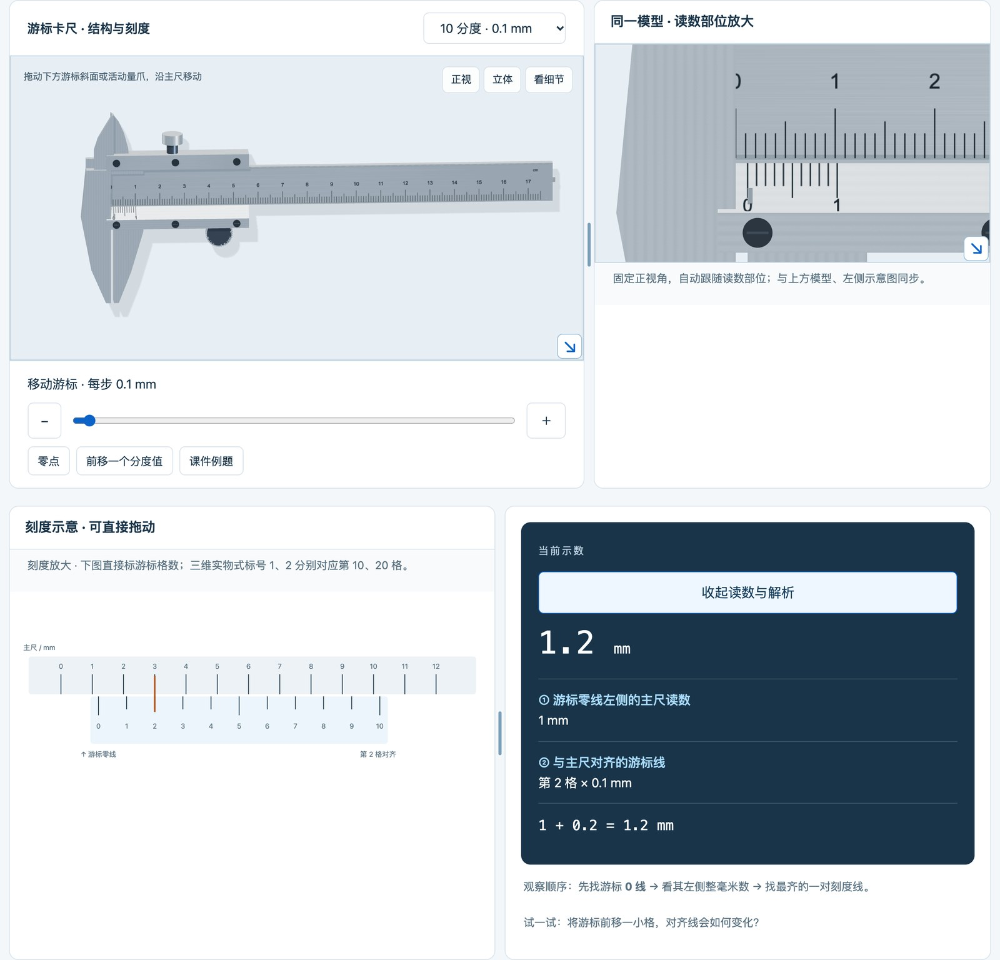
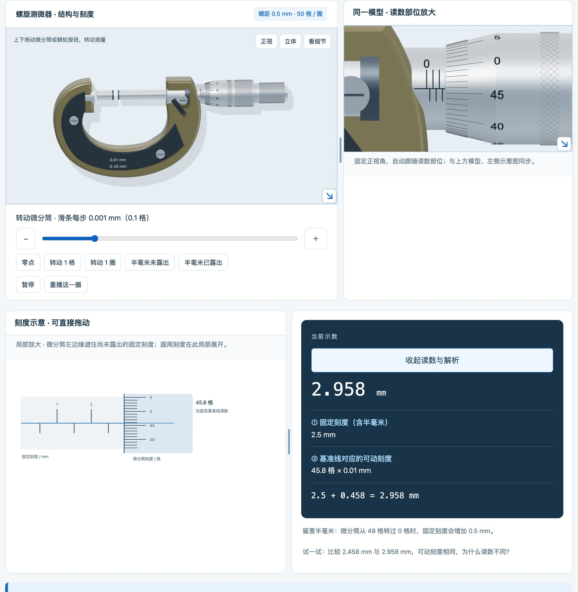
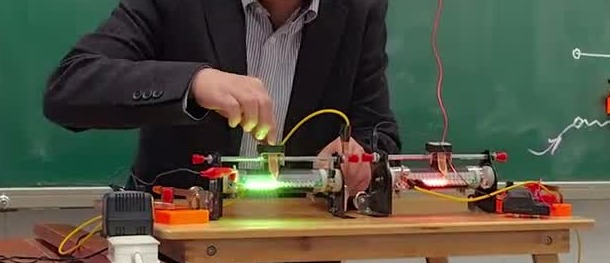
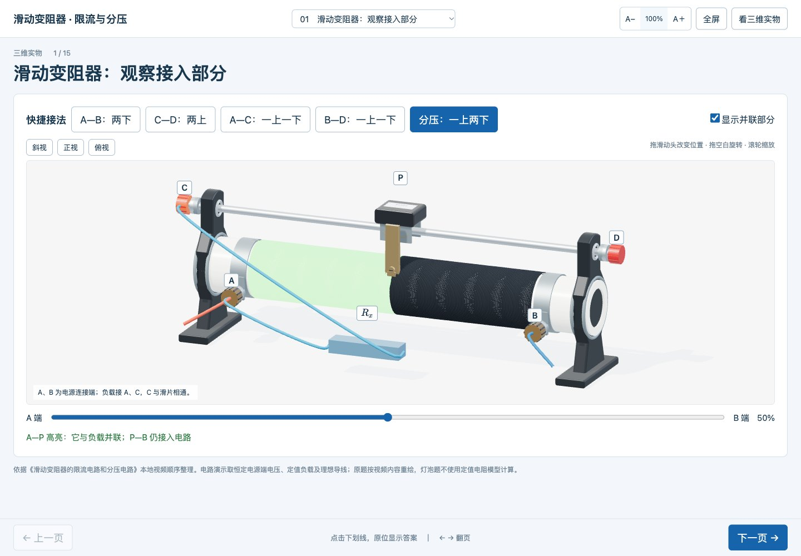
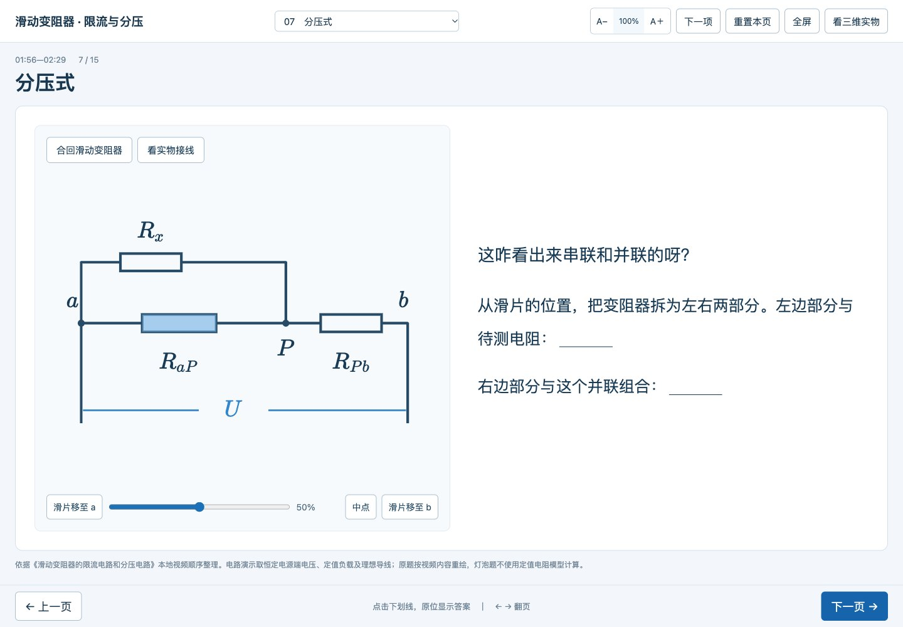
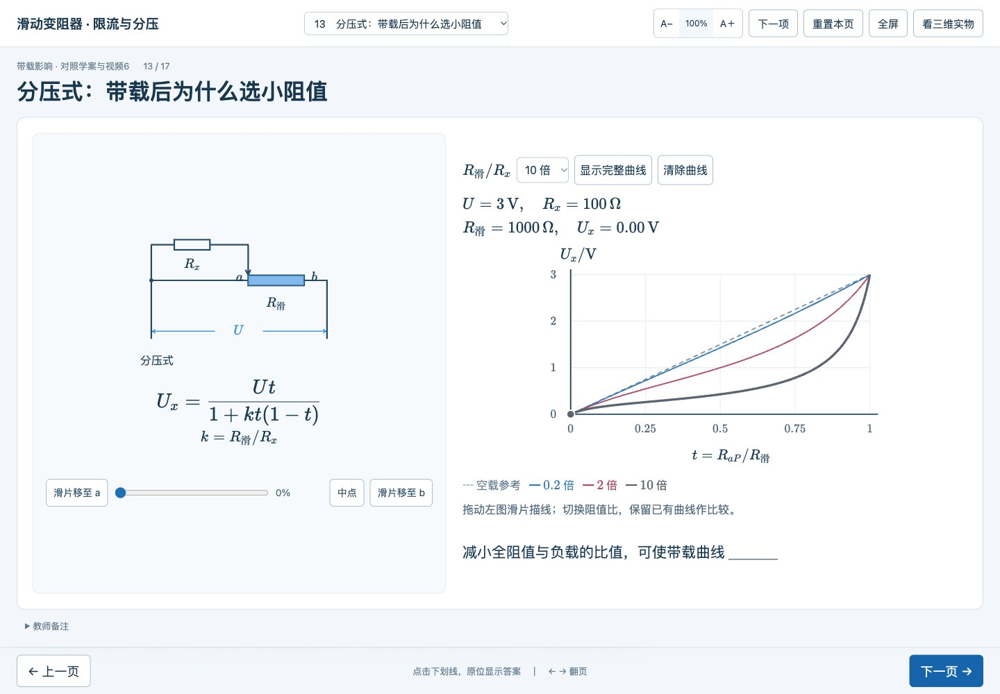
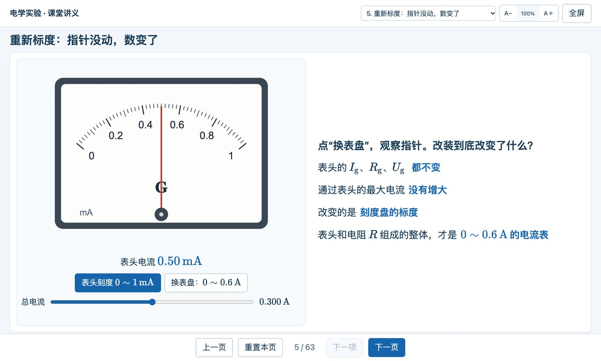
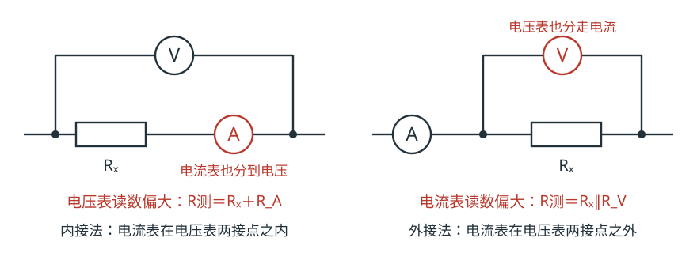

# 第 12 章　电学实验：把器材搬到大屏上



电学实验这一章，器材多，读数细，接法绕。我讲它的时候，手里的东西学生看不清，嘴上的话学生想象不出来。我把这一章要用的器材和讲法，一件件做成了能在大屏上操作的网页：游标卡尺和螺旋测微器、滑动变阻器的限流与分压、电表的改装和内外接。全部放在我们的网站上，同事扫一个二维码就能在自己班里用。

这一章先看做出来的东西，再说每一件为什么要这样做、怎样做出来。我的感受是比原来的课件好讲，学生也容易跟上；这是课堂上的印象，没有测验数据作支撑。

## 一、每年都错的读数：游标卡尺和螺旋测微器

### 全班都看得见我手上的动作

游标卡尺和螺旋测微器的读数，不算难懂，可学生就是容易错。不管怎么讲，每年都错一大片。

我想不能干讲，就去实验室借器材，同桌两人一把卡尺、一只测微器，可以换着用。东西到了学生手里，新的问题来了：我在讲台上演示，推一下游标、拧一下棘轮，除了前排，全班看不见我手上的动作。PPT 上倒是有结构图，可它是死的。

于是我请 AI 把这两件器材做成三维模型，放进网页。模型可以转过来看背面，可以放大看刻度。它还能操作：卡尺的游标尺能左右拖，开口跟着变；测微器的微分筒和棘轮能转，螺杆跟着进退，锁紧以后就拖不动。内测量爪量内径、外测量爪量外径，粗调、微调和锁紧各管什么，这些考点在大屏上一边操作一边讲，后排也看得清。

### 0.1 毫米是怎样量出来的

有了模型，还要把原理讲出来。十分度的卡尺为什么能读到 0.1 mm？游标上的 10 格，对着主尺的 9 mm，每格 0.9 mm，比主尺的一格短 0.1 mm。什么都不夹，零线对零线。夹进 0.1 mm 的东西，游标整体右移 0.1 mm，正好是第 1 格和主尺对齐；夹进 0.2 mm，第 2 格对齐；依此类推。

这段话我讲了很多年，学生看不到，只能跟着想象。现在页面下方有一条放大的刻度示意：我在上面拖游标，下面同步标出第几格对齐。拖到 1.2 mm，“第 2 格对齐”几个字就出现在第 2 条线下面，这一处还可以局部放大。学生看着线一条一条地轮流对齐，这个逻辑不用我多说。



螺旋测微器要理解的是另一件事：可动刻度一圈 50 格，转一圈，螺杆前进 0.5 mm，等于把半毫米切成 50 份。页面上有一个“转动 1 圈”的按钮，点一下，微分筒用大约 6 秒慢慢转完一圈，三维模型、放大窗口和刻度示意一起动，可以暂停，让学生读中间的状态。还有两个预设：“半毫米未露出”和“半毫米已露出”，可动刻度一样，读数差 0.5 mm。漏读半毫米是这只仪器最常见的错，摆在一起，一眼就看出来。

### 题目也搬进来

既然在网页上讲，我就把课件里的原题也放了进来：卡尺 5 道，测微器 6 道，跟在各自的器材后面。题目和答案分开折叠，可以一键展开全部题目、一键展开全部答案、一键全部收起；题图看不清，点一下弹窗放大。这些效果在 PPT 里也能一页页手动设，但远没有这样方便：我对 AI 说一句，它就改好了。

页面标题旁有一个二维码。把它发给同事，他们在自己的教室里打开就能用。一个人做的资源，大家都能用上。

这两个模型是怎样一步步做真的，中间还把内测量爪画反过一次，放在第 14 章讲。

## 二、滑动变阻器：从一段“会发光”的视频学来的讲法

### 四个接线柱，两种接法

初中的滑动变阻器只有限流一种接法，高中多了分压。实验室的变阻器上面两个接线柱、下面两个。学生要弄懂的事不少：为什么限流是“一上一下”，分压是“一上两下”；分的是谁的电压，限的是谁的电流；两种接法的调节范围怎样比。

光讲不行。我想过拿一只实物到讲台上，可后排还是看不清。所以还是建模：做一只三维的变阻器，外形接近实验室里那一种，学生以后做实验，拿到手是熟的。

### 第一版讲不清，我去 B 站找老师

模型好做，难的是怎么讲。我把教材、教师用书、几本教辅的讲法和我自己的课件都交给 AI，请它做一个教学页。做出来是一个八步的实验台，接线、读数、任务都挤在一起，功能很全。我看完对它说：

> “目前做的太复杂了，而且讲不清楚。我重新做一个……”（原话）

我想，讲得好的人那么多，为什么不去学？B 站上有不少老师把这一段讲得很清楚，有人用动画，有人自己做教具。我找了 7 段视频，自己看，也让 AI 去“看”：提取每段的讲解文字和关键画面，整理出他们按什么顺序讲、在哪里停下来提问、用什么办法突破难点。然后选定其中一段《滑动变阻器的限流电路和分压电路》作主线，请 AI 按它的顺序重做。这一版就接近我想要的了。

视频里有一位老师的做法让我印象很深。他在变阻器的电阻丝旁装了一排小灯珠，哪一段接进了电路，哪一段就亮：



“接入的是哪一段”，本来要学生顺着导线去想，他让它自己亮了出来。他用实物做，我用模型做就更容易：三维变阻器接成分压式以后，和负载并联的 AP 段高亮显示。



视频还提醒了我一件事。讲解的时候，答案是一步一步跳出来的，中间留着让学生想的时间。我的页面也该这样，不能一翻页就把答案摊开。我提的要求是：

> “等于后面，是下划线，点击之后把下划线改为答案，类似PPT的效果。”（原话）

于是每一页都是一个电路图加几个问题。等号后面先是一条下划线，我停在“$U_x(\max)=$ ___”这里，等学生说出答案，再点一下。

### 分压式：把变阻器从滑片处拆开

分压式接法，学生常常只记得“三根线”，看不出串并联。第 7 页先给出完整电路，点一下，变阻器从滑片处拆成左右两段：左段与负载并联，右段再和这个并联组合串联。



### 选多大的阻值：让学生自己把曲线拖出来

实验题里常让学生在一大一小两只变阻器里选。为什么分压要选小的？为什么限流要选和待测电阻差不多、或者大几倍的？题目解析里往往给一段分析，没学过的学生读得一头雾水。

我想，这段分析为什么不直接在网页里做出来？第 12、13 页，拖动滑片，右边同步描出负载电压随滑片位置变化的曲线。换一个阻值，从同一端重新拖一遍，旧曲线留着，几条叠在一起比。

> “主要我就想要看到拖动过程中的那个图表的一个变化。”（原话）



变阻器的阻值比负载小，曲线几乎是直线，滑片移多少，电压就变多少；阻值比负载大很多，曲线前面趴着不动，到最后一小段才猛地翘上去。

曲线是学生自己拖出来的，他们还是会问：为什么会这样？这时我抓住一个点讲：滑片停在中点。空载时输出是电源电压的一半；接上负载，左半段和负载并联，电阻变小，分到的电压就不到一半。变阻器阻值越大，这个并联“拉低”得越厉害。从中点这一个状态讲透，再回头看整条曲线，学生就明白了（算法见第五节）。

## 三、电表的改装：指针没动，数变了

电表的改装，传统的讲法是在黑板上画一个粗糙的表盘，再写两行串并联的算式。学生会算分流电阻，却常常说不清：改装以后，表头本身变了没有？



这一页只做一件事：拖动总电流，看表头的指针；再点“换表盘”，指针一动不动，底下的刻度从 0～1 mA 换成了 0～0.6 A。表头的满偏电流、内阻都没变，通过表头的最大电流也没有增大，变的只是刻度盘的标度。原来的表盘和改装后的表盘是什么关系，一目了然。

这一页出自一份 6 节、63 页的投屏讲义《测量电路与系统误差》：电表的改装、内接与外接、金属丝的电阻率、电动势和内阻、多用电表、测电阻的其他方法，以人教版教材和教师用书为依据。有几页设了“先预测”，图像先遮住，学生判断后再显示。讲义和前面的课堂页都在配套包第 12 章。

## 四、自己做一遍：怎样把教学要求说给 AI

下面的简短提示词是为读者整理的起步示例；标“原话”的句子来自我当时的反馈。

**先给材料，再说要讲清什么。** 教材相关页、器材照片、自己的课件、想参考的视频，都可以交给 AI。材料各有分工：课件定范围，视频给讲法，照片定器材的样子。然后说清学生要学会什么，请它先列出讲解顺序，确认以后再做页面。限流与分压，我确认的顺序是：认识结构 → 判断接入了哪一段 → 限流 → 分压 → 带载分压 → 选接法和阻值。

```text
我要给高中生讲限流与分压，重点是接入了哪段电阻、带载后电压怎样变化。请根据教材和器材照片安排讲解顺序，每页只讲一个关系，滑片要能拖动。先做第一页给我看。
```

**一页只讲一个关系。** 第一版的教训就在这里。如果我要花很长时间解释界面怎么用，就该回头问：这一页到底要学生看哪一个变化？

**答案什么时候出现，由我定。** 读数默认藏着，公式后面先留下划线，题目和答案分开展开。这些要求不增加一点物理知识，却决定了我能不能组织学生先想。

**想借鉴别人的讲法，就把视频交给它。** 请它整理出讲解顺序、停顿和提问的位置，再由你来选。自动转写的文字会出错，我们这次就有两只器材的阻值被听错，回到画面上才核对出是 200 Ω 和 100 Ω。视频里的说法也不能照单全收，第五节有几个例子。

误差分析可以用同样的办法。先定一组便于手算的条件：

```text
做一页讲电流表内接和外接。先让学生判断测量值偏大还是偏小，再显示电路和解释。Rx 取 200 Ω，电流表内阻 10 Ω，电压表内阻 2 kΩ，标出电表多测的部分。
```

这组条件下，内接测量值为 $210\ \Omega$，外接约为 $181.8\ \Omega$。电流表内阻有意取得较大，是为了看清偏差，页面要注明。

检查时要一起看开关状态、接线、数值和指针。开关断开时电流本来就是零，不能仅凭“电表不动”判断程序有问题。两路电流的动画如果没有按电流大小计算，就只表示方向和支路，不能用来比较大小，页面上要说明。

## 五、每个结论都自己算一遍

### 1. 限流与分压：先用等效电路推一遍

把恒压电源电压记作 $U$，负载为 $R_x$，变阻器全阻值为 $R$，令 $t=R_{aP}/R$，$k=R/R_x$。限流式只接入一段，与负载串联；分压式接入的 aP 段与负载并联，再与 Pb 段串联：

$$
U_\text{限流}=\frac{U}{1+kt},\qquad U_\text{分压}=\frac{Ut}{1+kt(1-t)}.
$$

验算可以很简单：$U=3\ \mathrm V$、全阻值 $200\ \Omega$、负载 $100\ \Omega$，滑片在中点，两段各 $100\ \Omega$；输出侧并联后 $50\ \Omega$，与另一侧 $100\ \Omega$ 串联，输出 1 V，空载时是 1.5 V。

“一上一下”是外观上的总结，真正的依据是内部连接：接下方两个固定端，全段电阻丝接入，阻值基本不变；接上方两端，接入的是金属杆，电阻近似为零；一个固定端加一个上方端，接入长度随滑片变。闭合开关前的安全位置也由接线决定：限流式让接入电阻最大，分压式让负载电压为零。

### 2. 用这几组数说话

$U=3\ \mathrm V$ 时，限流式的调节范围和“手感”：

| 全阻值／负载（Ω） | $k$ | 负载最低电压 | 滑片从接入最小端移动 10% 行程，已走完全部变化的 |
| ------------------ | ----- | ------------ | ----------------------------------------------- |
| 50／500            | 0.1   | 2.73 V       | 约 11%                                          |
| 50／50             | 1     | 1.50 V       | 约 18%                                          |
| 50／10             | 5     | 0.50 V       | 约 40%                                          |
| 200／5             | 40    | 0.073 V      | 约 82%                                          |

阻值太小，电压调不下去；阻值太大，变化挤在很短的行程里，稍一动就过头。这就是“能调到”和“容易调到”的差别。分压式滑片在中点时，$k=0.2$、1、2、10 对应的负载电压是 1.43、1.20、1.00、0.43 V：全阻值相对负载越小，越接近空载的 1.5 V，曲线越直。

### 3. 选择接法和阻值，要说明条件

| 常见说法                    | 问题                                                                                                                                                 | 改成                         |
| ------------------------------- | ---------------------------------------------------------------------------------------------------------------------------------------------------- | ---------------------------- |
| 提高准确度必须用分压            | 过强。教师用书的算例里，$5\ \Omega$ 变阻器测约 $10\ \Omega$ 的金属丝，限流可调 2～3 V，分压可调 0～3 V，“都可满足实验采集 6～8 组数据描点绘图” | 看所需的调节范围和数据点分布 |
| 分压完全不挑变阻器              | 带载后小阻值才接近线性，太大的阻值调节极不均匀                                                                                                       | 比较曲线，兼顾额定值         |
| 限流至少两倍、取负载的 3～10 倍 | 经验口径，不是定律；上表 $k=5$ 时，10% 的行程就走完约 40% 的变化                                                                                   | 按目标范围算一算，用曲线比较 |

“分压选小阻值”也有代价：电源要给整段电阻丝供电，全阻值越小电流越大。把 $5\ \Omega$、额定 2 A 的变阻器接在 12 V 上，空载电流就有 2.4 A，已经超过额定值。这是流过变阻器的电流，不是负载电流，学生常把两者混在一起。

### 4. 内接和外接

内接法的电压表多测了电流表上的电压，$R_\text{测}=R_x+R_A$；外接法的电流表多测了电压表的电流，$R_\text{测}=\dfrac{R_xR_V}{R_x+R_V}$。



判据里的 $\sqrt{R_AR_V}$ 是近似结果：外接法的相对误差严格是 $\dfrac{R_x}{R_x+R_V}$，令它等于 $\dfrac{R_A}{R_x}$，得 $R_x^2=R_A(R_x+R_V)$。$R_A=1\ \Omega$、$R_V=3000\ \Omega$ 时，近似值 $54.8\ \Omega$，严格值 $55.3\ \Omega$，给学生用近似式没有问题，老师心里要有数。试触法比的是相对变化：把电压表的一个接点换一下，电流表变化的比例大，说明电压表分流影响大，用内接；电压表变化的比例大，用外接。学生容易比成绝对变化。

## 六、带进课堂：停在哪里，问什么

### 放在什么时候用

《限流与分压》课堂页放在《串联电路和并联电路》之后，可以分两次用：先讲结构、限流、分压和带载分压的中点例子，再讲选型。教师用书有一个好办法：在变阻器绕线下端贴一张纸条，分成五等份逐点测量，描出负载电压随滑片位置变化的图像。有实物的话，保留这个贴纸条描点，哪怕只做一组，再用网页把别的阻值补上；亲手测过一条有接触误差的曲线，学生再看网页上光滑的模型曲线，才知道它是什么。误差讲义的内接外接一节放在同一位置，电动势一节放在《闭合电路的欧姆定律》之后。有实物时，还应安排学生实际操作：接触电阻、电池放电时读数漂移、电表反偏，都要动手才碰得到。

### 暂停在哪里，问什么

- 闭合开关前（限流式）：滑片放哪一端？你是怎么判断接入的是哪一段的？
- 滑片在中点（分压式）：接上负载，输出电压变大、变小还是不变？不计算，用等效电阻说理由。
- 切换阻值比之前：请先在纸上画出你以为的曲线。
- 内接法的红色标出来之前：多测的是电压还是电流？是哪个元件上的？
- $U$-$I$ 图纵轴从 1.0 开始时：横轴交点的电流还是短路电流吗？

### 学生可能在哪里出错

- 用外观判断“上面两个接线柱”“滑片向右”。可以旋转装置、交换上方端子，再问一次。
- 把负载电流当成流过变阻器的电流。
- 把“限流”“分压”和“内接”“外接”混为一谈：前者决定怎样控制负载，后者决定怎样读数，是两个维度。
- 先对 $U$、$I$ 取平均再算电阻；或者以为多测几组能减小系统误差。
- 看到两条 $U$-$I$ 线分得很开，以为真实实验里也差这么多。
