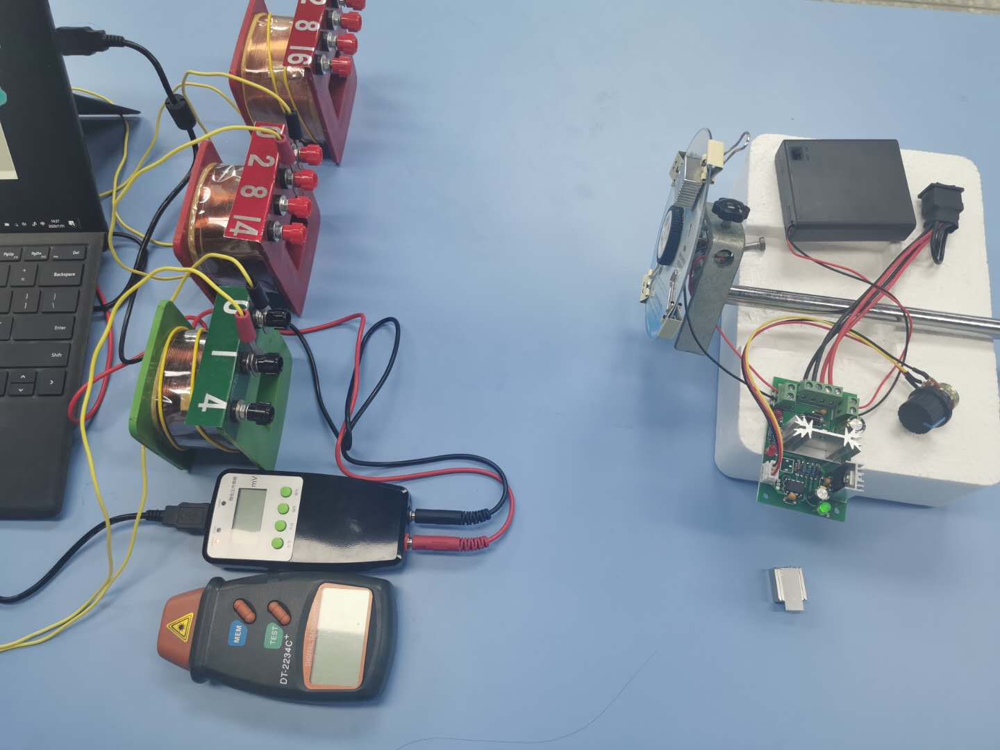
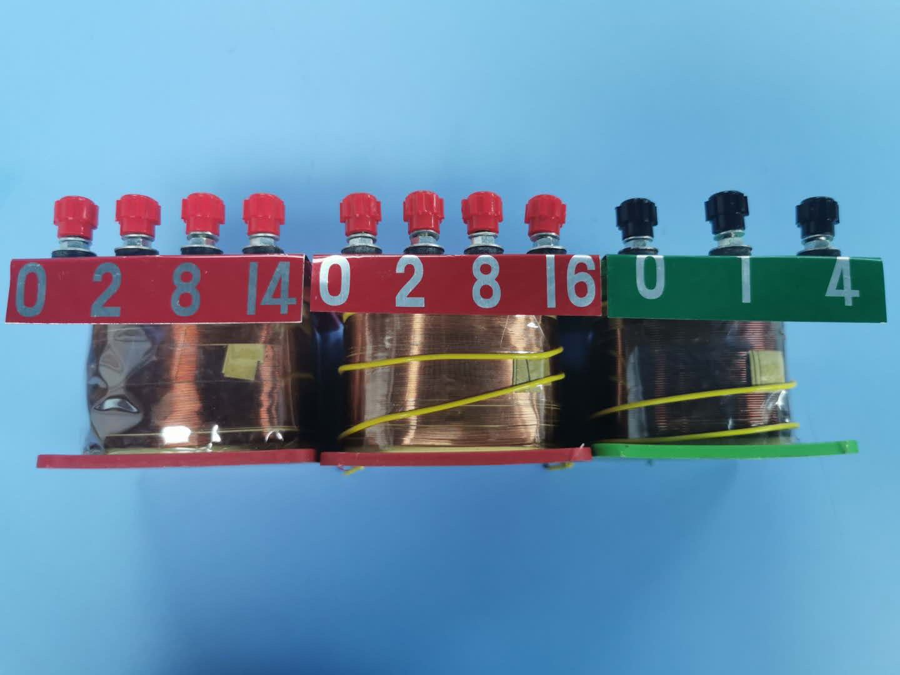
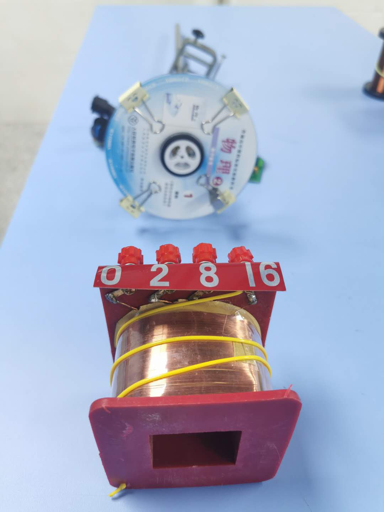
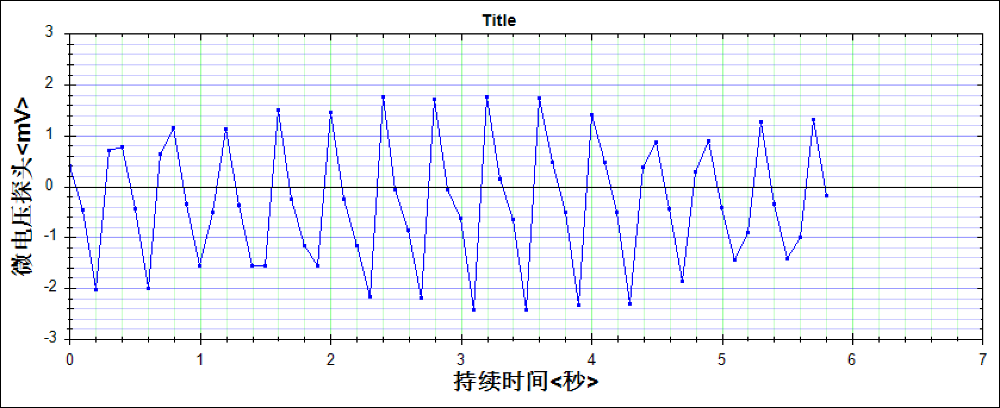
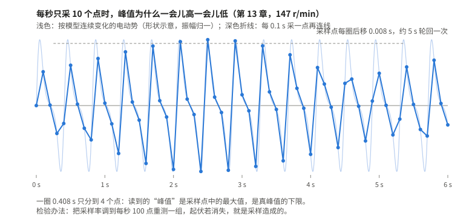
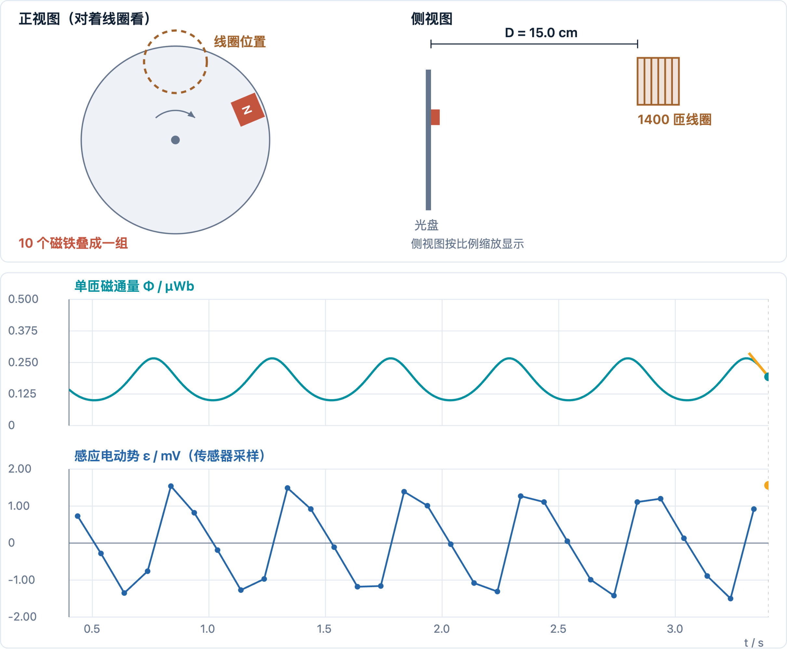
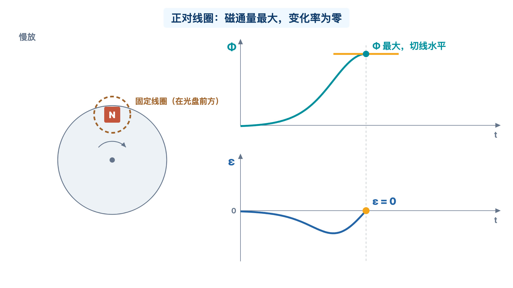

# 第 13 章　法拉第电磁感应定律：把下落的磁铁放到转动的光盘上

主笔：王硕



教材讲法拉第电磁感应定律，用的是定性实验：磁铁插得越快，电表偏得越多；强磁体从更高处落下穿过线圈，电压表的示数也不一样。然后陈述结论：感应电动势跟磁通量的变化率成正比。教师用书说得很直白：这个定律“很难通过定量实验来探究，教材中并没有做要求”。

我想让学生自己测出这个正比关系。最后做成的装置是这样的：几块小钕铁硼磁铁贴在一张光盘边上，光盘由一个能调速的小电机带着转；磁铁每转一圈，从一个固定线圈前面扫过一次；线圈接微电压传感器，电脑上画出电压随时间的波形；转速用一台非接触式转速仪测。学生分三组实验，分别改变线圈匝数、磁铁个数和转速。

这一章先讲这套装置是怎样一步步改出来的，再读它测出的数据和波形，然后是我用它上的实验课，最后是黄灿斌老师一方用 AI 为它做的一个模拟实验和一段说明动画。

## 一、定性实验之后，学生还想知道什么

人教版选择性必修第二册第二章第 2 节“法拉第电磁感应定律”。课程标准对这一条的要求，从“理解法拉第电磁感应定律”改成了“通过实验，理解法拉第电磁感应定律”。教师用书给的教学难点是“对磁通量的变化及磁通量的变化率的理解”。

教材的“做一做”是这样的：线圈套在长玻璃管上，接电压表；强磁体从管口由静止落下，穿过线圈；让线圈离管口 20 cm、30 cm、40 cm、50 cm，记录电压表的示数，再改变匝数、磁体强度重复，“得出定性的结论”。

教师用书围绕这个演示提了三个问题，每个问题都在比较“什么相同、什么不同”。回头看，它们正好对应我后来做的三组实验：

| 教师用书的问题 | 它的分析 | 我的装置里改变的量 | 保持不变的 |
| --- | --- | --- | --- |
| 同样的磁体、同样的匝数，从不同高度释放 | $\Delta\Phi$ 相同，穿过的时间不同 | 转速 | 磁铁、匝数、线圈位置 |
| 同样的高度，磁性强弱不同的磁体 | 时间相同，$\Delta\Phi$ 不同 | 磁铁个数 | 转速、匝数、线圈位置 |
| 同样的磁体和高度，匝数不同 | 电动势是单匝的 $n$ 倍 | 匝数 | 磁铁、转速、线圈位置 |

演示里只能定性地比，“高度”和“强弱”也都不好成倍改变。要把这三个问题变成能测、能作图的实验，就得换一种更好控制的运动方式。

由定性实验直接给出定量结论，学生会有疑问：能不能真的测一测？我想让学生经历一次完整的定量探究，要做的事拆成了四个问题：

1. 怎样改变线圈匝数？
2. 怎样让磁通量的变化量成倍改变？
3. 怎样控制磁通量变化的快慢？
4. 怎样测量变化很快的感应电动势？

我先按“做一做”试，困难很快出现了。用手放磁体，它在玻璃管里会翻转，不是严格的自由落体，各次的速度也不成比例。电压表的指针变化太快，看不清大小；我用手机拍慢动作再逐帧看，要拍很多遍才能拍到指针摆到最大的那一帧，很花时间。

指针看不清，物理上并不意外。从 20 cm 落下，磁体到达线圈时的速度约为 $\sqrt{2gh}\approx2\ \mathrm{m/s}$，几厘米长的磁体穿过线圈只要十几毫秒，而指针式电表摆到位要零点几秒。指针来不及跟上这么短的电压脉冲，它的摆幅反映的不是电动势的峰值。高度从 20 cm 加到 50 cm，速度只增大到约 1.6 倍，还要靠指针去分辨这点差别，定量就更难了。

## 二、从小风扇到光盘：一套能控制、能测量的装置

### 四个问题，四次找器材

器材是一样一样找来的，每一样都对着前面的一个问题。

**线圈。** 实验室有不同匝数的线圈，可每换一次都要重新接线，步骤繁琐。后来我在实验室找器材，看到了可拆卸变压器的线圈：一个线圈上引出几个接线柱，换一个接线柱就换了匝数。



注意照片里是三个线圈。100、400 匝在绿色线圈上，1400、1600 匝分别在两个红色线圈上。所以第一组实验有时只换接线柱，有时要换线圈，换线圈就要把它重新放回原来的位置。

**磁铁。** 想用条形磁铁成倍增加来让磁通量成倍变化，可条形磁铁又重又长，短的磁性又弱。我是从一则“磁力球成了肠胃杀手”的新闻里知道有磁性很强的小磁铁的。上网一搜，形状很多，试了几种，最后选了方形的小钕铁硼磁铁：磁性强，质量轻，增减个数也方便。

**运动方式。** 磁铁下落太快，不好测，那就让它慢下来、可控起来。有一次看到桌上的手持小风扇，我想到：磁铁不一定要穿过线圈，让它像风扇叶片一样从线圈旁边转过去，穿过线圈的磁通量照样会变。要找个圆盘带着磁铁转，我找了几种金属材料，做起来都麻烦，时间也不够。正停滞不前的时候，翻书看到书后附的光盘，眼前一亮：光盘轻，好装，现成。

**调速和测速。** 转速既要能调，也要能测。手持多档小风扇里的调速结构给了我思路。学校创客实验室用过 Arduino 开发板（一种能接传感器、靠编程工作的电路板），我学了一阵，测电压、测磁感应强度不难，测转速的编程却很麻烦。后来我在网上找到直流电机调速板和减速电机，商家在深圳华强北，实地买回组装，这几样部件只花了 30 元左右。转速另用非接触式转速仪测量：激光对准磁铁上贴的反光纸，读出每分钟转数。

**测电压。** 手机慢动作试过了，不是每次都能拍到指针摆到最大处。所幸实验室之前买过一批传感器，我从中找到了微电压传感器，接到电脑上的数字化软件，电压随时间的变化就被记录下来，可以回看。

### 装起来是什么样

整套装置见本章开头的照片。各件器材分别解决一个问题：

| 器材 | 解决哪个问题 | 用的时候要检查什么 |
| --- | --- | --- |
| 可拆卸变压器线圈 | 改变匝数 | 接的是哪两个接线柱；换线圈后位置、朝向是否和原来一样 |
| 小钕铁硼磁铁 | 改变磁场强弱 | 个数、排法、在光盘上的位置 |
| 光盘、减速电机、调速板 | 让磁铁沿同一路径反复经过线圈，快慢可调 | 光盘是否晃动，磁铁是否固定牢 |
| 转速仪 | 测出实际转速 | 读数要记下来，调速旋钮的位置不等于转速 |
| 微电压传感器和电脑 | 记录变化很快的电压 | 每秒采几个点，单位是什么 |



### 转起来以后，波形该是什么样

把下落改成转动，研究的物理关系没有变：仍是穿过线圈的磁通量在变。变的是磁通量变化的方式，它现在由转角决定。

设光盘的角速度为 $\omega$，磁铁的转角为 $\theta=\omega t$。磁铁和线圈的位置、磁铁的排法都不变时，穿过每匝线圈的磁通量只是转角的函数 $\Phi(\theta)$。于是

$$\mathcal E=-N\frac{\mathrm d\Phi}{\mathrm dt}=-N\frac{\mathrm d\Phi}{\mathrm d\theta}\,\omega .$$

这一个式子把三组实验都包含进去了：

- $N$ 加倍，电动势加倍；
- 磁铁加倍，如果每个位置的磁通量都跟着加倍，$\dfrac{\mathrm d\Phi}{\mathrm d\theta}$ 加倍，电动势加倍；
- 转速加倍，同一位置的 $\dfrac{\mathrm d\Phi}{\mathrm d\theta}$ 不变，电动势加倍。

它还说明了一次经过的波形长什么样。磁铁接近线圈，磁通量增大；正对线圈时磁通量最大，这一刻变化率为零，电动势也为零；离开时磁通量减小，电动势反号。所以每转一圈，波形上出现一正一负两个瓣。磁通量最大的时候，电动势恰好为零，这正是教师用书所说的难点：学生要分清磁通量和磁通量的变化率。

再看一个瓣的面积：

$$\int\mathcal E\,\mathrm dt=-N\Delta\Phi .$$

它只取决于磁通量变化了多少，和转得快慢无关。转速加倍，瓣的高度加倍，宽度减半，面积不变。

## 三、三个实验和它们的数据

三组实验都按“只改一个量，其余保持”的思路做。三组数据发表在管佩磊老师和我合写的论文里（《中学物理教学参考》2021 年第 4 期），下面照录。

电压一栏，论文表头写的是 V；同一批实验的波形图，纵轴写的是“微电压探头〈mV〉”，图上读出的数和表中的数一一对应（见第四节）。这里按波形图标 mV。表中的数，是我在波形上“截取稳定区域”，读磁铁从初始位置转到线圈轴心这一段的电动势，也就是磁铁接近线圈那一瓣的峰值。

### 实验一：改变匝数

10 个磁铁，转速不变，线圈位置不变，只改匝数。

| 匝数 $N$ | 100 | 200 | 400 | 800 | 1400 | 1600 |
| --- | ---: | ---: | ---: | ---: | ---: | ---: |
| 电压读数 / mV | 0.02 | 0.04 | 0.08 | 0.16 | 0.28 | 0.34 |

读数与匝数成正比，比值都是每匝 $2\times10^{-4}$ mV，只有 1600 匝略高。

### 实验二：改变磁铁个数

1400 匝，转速不变，线圈位置不变，从 2 个磁铁加到 8 个。

| 磁铁个数 | 2 | 3 | 4 | 5 | 6 | 7 | 8 |
| --- | ---: | ---: | ---: | ---: | ---: | ---: | ---: |
| 电压读数 / mV | 0.07 | 0.10 | 0.14 | 0.17 | 0.21 | 0.24 | 0.30 |

读数随个数近似成正比，每个磁铁约 0.035 mV。我在误差分析里写过：磁铁不可能完全一样，磁感应强度和磁铁个数并不严格成正比，磁通量也就不是严格成倍变化。磁铁个数是能直接操作的量，磁通量是要研究的量，中间隔着磁铁怎样排、离线圈多远。我在教学设计里写的结论是“感应电动势与相同时间内的磁通量变化量成正比”，这一步要靠“磁铁加倍，磁通量大致加倍”来接上。

### 实验三：改变转速

1400 匝，10 个磁铁，位置不变，调速后用转速仪读实际转速。

| 转速 / (r·min⁻¹) | 60 | 83 | 99 | 118 | 138 | 147 |
| --- | ---: | ---: | ---: | ---: | ---: | ---: |
| 电压读数 / mV | 0.68 | 0.97 | 1.29 | 1.52 | 1.70 | 1.78 |

用最小二乘拟合直线，斜率约 0.0129 mV·min/r，截距约 −0.06 mV，和最大读数 1.78 mV 相比很小，可以看作过原点的正比关系。

我当时对这一组的推理是：线圈截面宽度不变，转速越大，磁铁经过线圈所用的时间越短；磁铁个数不变，磁通量变化量相同；所以电动势与磁通量的变化率成正比。这里用的是平均电动势 $\overline{\mathcal E}=N\dfrac{\Delta\Phi}{\Delta t}$。表里记的却是峰值。两者在这个装置上都和转速成正比，由第二节的式子，峰值处的 $\dfrac{\mathrm d\Phi}{\mathrm d\theta}$ 固定，峰值正比于 $\omega$，所以结论成立；但给学生讲的时候，要说清楚记的是哪一个。

## 四、重读波形：峰值为什么忽高忽低

这次写书，黄灿斌老师和我重读了当年的波形图，有几处判断要补上。

### 1. 先认单位

波形图是传感器软件直接画的，纵轴写着 mV。100 匝那幅图，正峰正好在 0.02 处；1400 匝那幅图，正峰约 0.28；99 r/min 那幅图，正峰约 1.3；147 r/min 那幅图，正峰最高约 1.77。它们和三张表里的 0.02、0.28、1.29、1.78 对得上。表头的 V 和波形的 mV 只能有一个对，传感器给出的是 mV。

### 2. 每秒只有 10 个点

仔细看任何一幅波形：点与点之间的间隔都是 0.1 s。传感器每秒只采了 10 个点。

转速 147 r/min 时，光盘转一圈约 0.41 s，一圈只采 4 个点；一正一负两个瓣，每个瓣只分到一两个点。波形看上去是尖尖的三角形，那是把稀疏的点连成折线的结果，不是电压真实的形状。

这带来两件事：

- **读到的峰值是采样点里的最大值，不一定是真峰值。** 真峰值落在两次采样之间时，读数就偏小。所以表中的读数是真峰值的下限。
- **分辨率是 0.01 mV。** 100 匝那幅图里只有 0.02、0.01、0、−0.01、−0.02 几个值。100 匝的读数 0.02 mV 只有两格，差一格就是 50%。实验一里匝数少的几个点，误差比看上去大得多。

### 3. 峰值为什么一会儿高、一会儿低



转速不变，峰值却慢慢起伏。当年我在误差分析里把波动归于固定装置和磁铁重力的影响。重读波形，还有一个原因也说得通：采样点和磁铁经过的时刻在慢慢错开。

147 r/min 时一圈是 $60/147\approx0.408\ \mathrm s$，比 4 个采样间隔多出 0.008 s。每转一圈，采样点相对磁铁位置就后移 0.008 s；后移满一个采样间隔 0.1 s，要转约 12 圈，也就是约 5 s。在这 5 s 里，采样点有时正好落在峰尖上，读数就高；有时落在峰两侧，读数就低。算出来的 5 s，和图上峰值起伏的周期相当。



如果是机械晃动，起伏应该大致每转一圈重复一次，周期是 0.4 s，不是 5 s。要分清两种原因，最直接的办法是把采样率提高，比如每秒 100 个点：若起伏消失，就是采样造成的。

“截取稳定区域”读数，实际上就是挑峰值最高、最整齐的那一段，也就是采样点碰巧落在峰尖附近的那一段。顺带一个提醒：60 r/min 时一圈正好 1 s，等于 10 个采样间隔，采样点每圈都落在同一位置，读数会很“稳定”，却可能一直偏低。表中 60 r/min 那个点读数与转速之比在六个点里最小，是不是这个原因，要更高的采样率才能判断。

### 4. 波形的样子说明线圈离光盘不近

再看波形的形状：光盘转一圈，电压就起伏一次，整圈都在变，没有平静的一段。如果线圈贴近光盘，磁铁只在经过线圈口的那一小段时间里影响它，波形应当是一对尖脉冲，脉冲之间几乎是零。整圈都在变，说明磁铁转到哪里都在影响线圈，线圈离光盘的距离比磁铁转的半径大得多。读数只有零点几到一两毫伏，也指向同一个结论。

第六节的模拟实验把每个磁铁当作一个小磁偶极子来算（磁铁强弱、线圈大小都是估计值）。1400 匝、10 个磁铁、118 r/min，线圈离光盘 3 cm 时，峰值上百毫伏，波形是尖脉冲；离到 15 cm 左右，峰值约 1.5 mV，波形整圈起伏，和实测相像。

### 5. 三组之间能不能比

实验一的 1400 匝，和实验三一样是 10 个磁铁、1400 匝。从实验一 1400 匝那幅波形看，相邻两次经过相隔约 0.5 s，转速约 120 r/min；读数 0.28 mV。实验三里 118 r/min 时读数是 1.52 mV。条件几乎相同，读数差了 5 倍多。

这说明两次实验之间还有未记录的条件改变了，最可能是磁铁到线圈的距离：磁铁稍远一点，磁通量的变化就小很多。每组内部条件是受控的，组内正比关系可信；三组之间不能直接比较数值。按同一模型估计，读数从约 1.5 mV 降到 0.28 mV，线圈只需再远约 8 cm；距离如此敏感，是因为磁铁的磁场随距离衰减很快。这也让学生体会控制变量的分寸：只改一个量，指的是同一组实验之内。记录中要写下磁铁到线圈的距离，以后才能接着比较。

### 6. 记在实验记录里的几项

| 记什么 | 为什么 |
| --- | --- |
| 接的是哪个线圈、哪两个接线柱 | 换线圈和只换接线柱，条件不一样 |
| 磁铁个数、排法、离线圈多远 | 跨组比较要靠它 |
| 转速仪的读数 | 调速旋钮的位置不是转速 |
| 传感器每秒采几个点 | 决定峰值能不能读准 |
| 读的是正峰、负峰还是一个瓣的面积 | 不同读法不能混在一张表里 |

## 五、带进课堂：我的实验课

这节课是我的《法拉第电磁感应定律（实验课）》，以《定量探究法拉第电磁感应定律》为题，2021 年被评为广东省中小学实验精品课；这套装置以《法拉第电磁感应定律定量装置》为题，获 2020 年深圳市中小学实验教学说课活动高中物理一等奖。下面按我的教学设计、学习任务单和作业整理，标“本书建议”的不是课上实际做过的。

### 课前

学习任务单要求学生课前预习教材，学会传感器和数字化软件平台的使用。传感器和软件在课前熟悉，课上的时间才能留给变量和数据。

### 课上的四步

| 环节 | 做什么 |
| --- | --- |
| 定性引入 | 用教材里磁铁插入、拔出线圈快慢的实验引入，学生得出“感应电动势与磁通量变化快慢、线圈匝数有关” |
| 定量探究 | 教师引导，学生分组讨论：要定量研究，需要解决哪些问题？用提供的器材，按控制变量法分组完成三个实验 |
| 数据处理 | 用微电压传感器记录电动势，用 Excel 记录数据、作图、直线拟合 |
| 规律总结 | 由三个结论 $E\propto N$、$E\propto\Delta\Phi$、$E\propto\dfrac{\Delta\Phi}{\Delta t}$ 归纳出 $E\propto N\dfrac{\Delta\Phi}{\Delta t}$ |

学习任务单上的四项任务，对应这条线：由两个定性现象提出猜想；讨论定量探究要解决哪些问题、怎样解决；找器材做实验、处理数据；最后做误差分析和创新点分析。

### 教师用书提醒的一处（本书补充）

教师用书特别提醒，要让学生分清 $\Phi$、$\Delta\Phi$ 和 $\dfrac{\Delta\Phi}{\Delta t}$：$\Phi$ 大，$\Delta\Phi$ 不一定大；$\Delta\Phi$ 大，$\dfrac{\Delta\Phi}{\Delta t}$ 也不一定大，就像 $v$、$\Delta v$ 和 $\dfrac{\Delta v}{\Delta t}$；$\dfrac{\Delta\Phi}{\Delta t}$ 是 $\Phi$–$t$ 图像上切线的斜率。这台装置的波形正好把这件事摆在眼前：磁铁正对线圈时磁通量最大，电动势却是零。在“规律总结”环节，可以把这一刻的波形和 $\Phi$–$t$ 图的切线放在一起讲，第六节的说明动画就是为这一步做的。

### 误差分析与反思

我在教学设计里列了三条误差来源：固定装置和磁铁重力使波形波动；磁铁不完全相同；换线圈时磁铁与线圈的距离有偏差。第三条，正是第四节推测的、两组之间没写进记录的那个条件。

### 作业

作业三项：去实验室找到器材，自己组装做一次定量探究；完成课后习题；有想法的同学分组讨论，对实验提出改进方法。

### 学生可能在哪里卡住，怎样追问（本书建议）

| 学生的说法 | 追问 |
| --- | --- |
| “磁铁正对线圈时，磁通量最大，电动势也最大。” | 那一刻波形在哪里？磁通量还在变吗？ |
| “转得越快，电动势越大，所以转速就是磁通量的变化率。” | 转速仪测的是什么？还要哪些条件不变，转速才和变化率成正比？ |
| “磁铁加倍，磁通量就加倍。” | 新加的磁铁放在哪里？离线圈一样近吗？ |
| “这一组的读数比那一组大，所以……” | 两组之间，除了你改的那个量，还有什么可能变了？ |
| “波形是三角形的。” | 点和点之间隔多久？一个瓣里有几个点？ |

最后一问可以作为作业第 3 题的入口：改进方法不一定是换更好的传感器，先把每秒采样点数调高，就能看清一次经过的真实形状。

## 六、用 AI 做一个模拟实验和一段说明动画

### 要解决的教学问题

装置、波形和公式摆在学生面前，中间还缺一环：磁铁转到哪里，波形走到哪里。真实波形每圈只有几个点，又看不到磁铁的位置；演示时光盘一转就是一圈，来不及停下来想。教师用书说的难点——磁通量和磁通量的变化率——恰好卡在这里：磁通量最大的那一刻，电动势为零。

还有一个问题在课上看不出来：实测的波形为什么是三角形，峰值为什么忽高忽低，换一组实验读数为什么差好几倍。第四节的这些判断，在真实装置上要重测才能验证；在模拟里，可以把距离、采样率一项项单独改给学生看。

黄灿斌老师一方请 AI 做了两样东西，由 AI 按他的授权制作，都按数智育才网站模拟实验室的格式做好，准备和我的装置照片、实测波形一起放到网站上。

### 模拟实验

模拟实验网页里，光盘、磁铁、线圈的结构照我的装置画。可以调的有：线圈匝数（对应三个线圈的接线柱）、磁铁个数和排法（叠成一组，或沿光盘边缘排开）、转速、线圈离光盘的距离，以及传感器每秒采几个点。上图是单匝磁通量和此刻的切线，下图是传感器采到的电动势；可以像课上一样“记录读数”，按匝数、磁铁个数、转速或距离作图拟合。



模型把每个磁铁当作一个小磁偶极子，算出它的磁场穿过线圈的磁通量，再由 $\mathcal E=-N\dfrac{\mathrm d\Phi}{\mathrm dt}$ 得到电动势。磁铁的强弱、线圈的大小没有在实物上测过，用的是估计值，所以页面上的毫伏数只用来比趋势、比条件。

### 说明动画

另一样是一段 15 秒的无声说明动画，分四段，每段看一件事：磁铁接近，磁通量增大，切线变陡，电动势变大；正对线圈，磁通量最大，切线水平，电动势为零；磁铁离开，电动势反向；转速加倍，峰值加倍、时间减半，两块阴影面积相同。交互版可以在任一段暂停，请学生先说下一步会怎样。



### 做这两样东西时，要由教师定的事

**结构照实物。** 让线圈转、磁铁不动，画起来一样简单，可那就不是学生面前的这台装置了。照片里光盘上夹着几个夹子，那是固定用的，不能当成磁铁。

**先让模拟对得上实测的样子。** 早先做过一版动画，用一个单峰函数近似磁通量，画出来是线圈贴近光盘时的尖脉冲，和实测整圈起伏的波形对不上。这一版改用磁偶极子，把线圈距离做成可以调的量。波形像不像实测，就成了一个能检验的问题，第四节第 4 条的判断也由此而来。

**把传感器也放进模拟。** 只画连续的曲线，学生会以为实测的三角形是装置出了毛病。模拟里的传感器按每秒 10 个点、0.01 mV 取整，三角形和峰值起伏就出现了；把采样调高，它们就消失。学生能自己分清，哪些是电磁感应，哪些是测量造成的。

**一段只看一件事。** 动画四段，每段一个变化、一句字幕；曲线不标数值，只比形状、高低和面积。转速加倍时，原来的曲线留作灰色参照，两块阴影放在同一个坐标里比。改转速时横轴始终是物理时间：瓣变高的同时也变窄，“变快”才看得见。

**模型和实测分开放，正负号按约定。** 网页另有一块放我的装置照片和实测波形，不在上面叠模型曲线：用法拉第定律算出来的曲线，不能当作验证法拉第定律的证据。模拟规定线圈的正方向从光盘指向线圈；我的实测波形接近时为正，那取决于传感器怎样接线。比的是“接近和离开反号”，不是哪边一定为正。

### 交给 AI 的上下文和提示词

上下文用的是教材和教师用书的这一节、我的教学设计、装置照片和实测波形、论文。教师用书里那三个“什么相同、什么不同”的问题，和“$\Delta\Phi/\Delta t$ 是切线斜率”这句提醒，决定了模拟要能分别改哪几个量、上图为什么要画切线。提示词只要说清教学问题、装置结构和不许改的地方：

```text
我想给法拉第电磁感应定律的转盘实验做一个模拟实验网页。装置是：磁铁贴在光盘边上随光盘转，线圈固定在光盘前面，这个结构不能改。要能分别改匝数、磁铁个数、转速和线圈离光盘的距离；传感器每秒只采 10 个点，也要模拟出来。附件是教材和教师用书的这一节、教学设计、装置照片、实测波形和论文。先说说你打算怎样算磁通量，算出来的波形和实测像不像，我确认后再做。
```

两样东西都在桌面和手机宽度的浏览器里检查过交互和物理关系，还没有在课堂上用过，也还没有放上网站。文件收在配套包第 13 章的 `electromagnetic-induction/`，模型说明在同一章的配套里。
