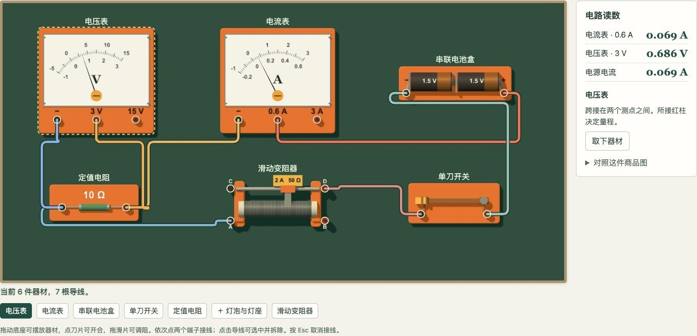
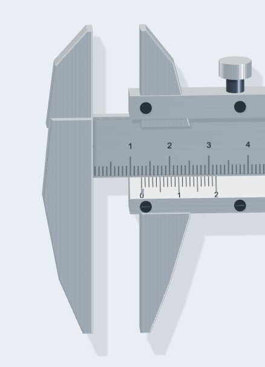
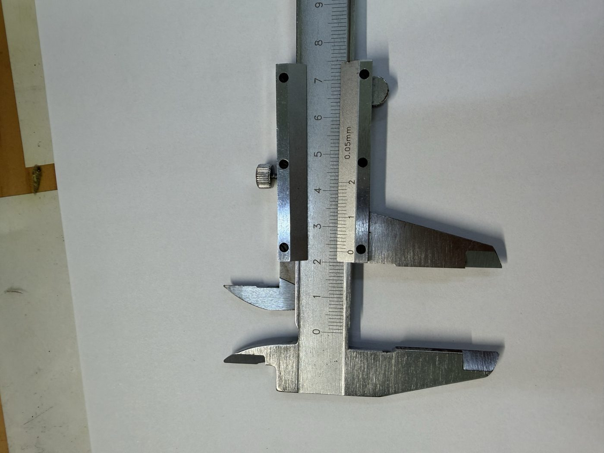
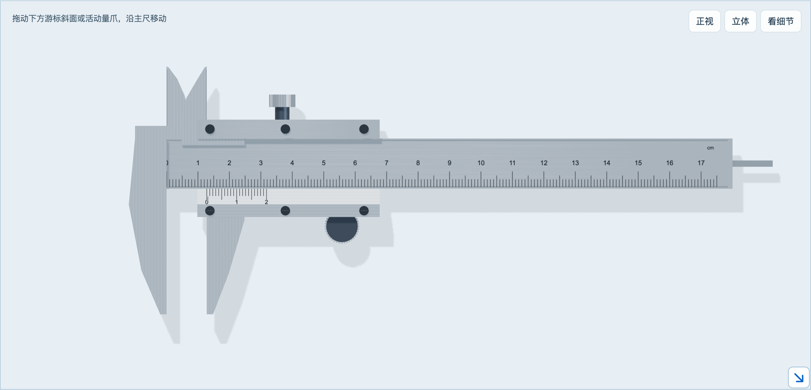
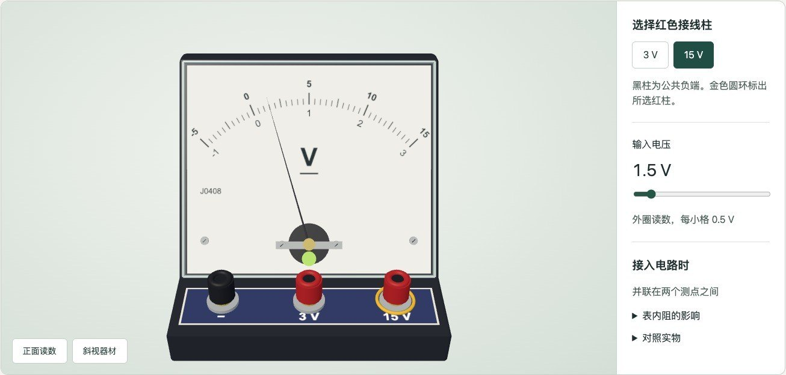
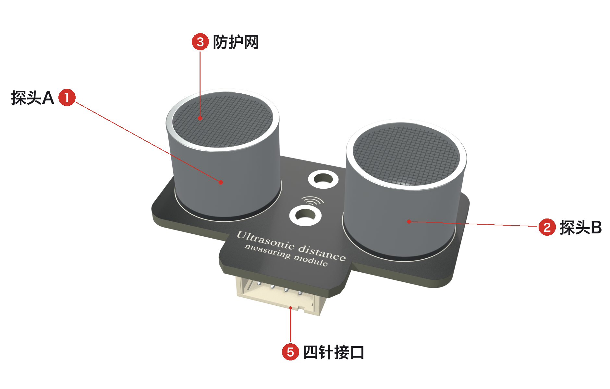
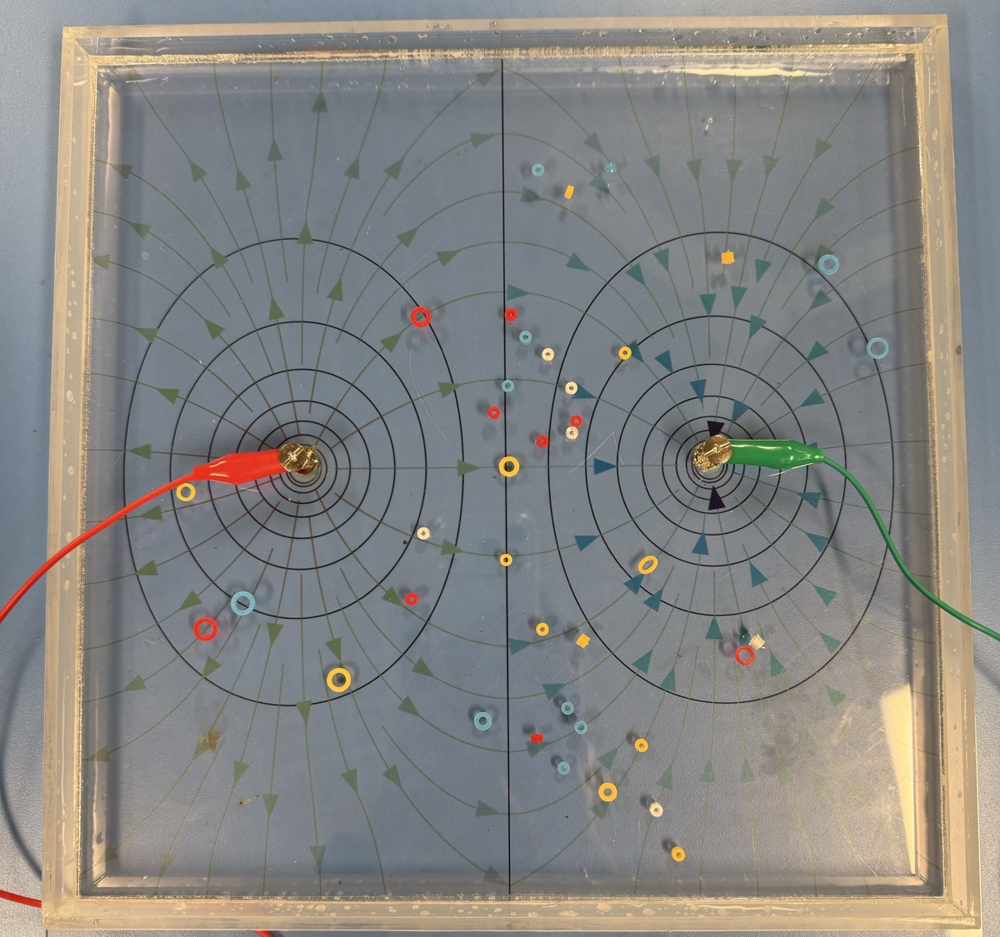
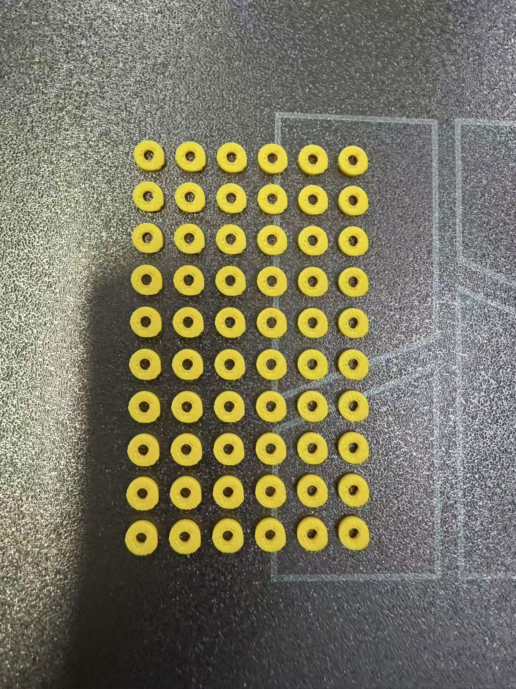

# 第 14 章　三维建模：看清器材，做出零件

我请 AI 做过一把能在屏幕上拖动的游标卡尺。金属光泽有了，滑座上的六枚螺钉有了，拖动游标，读数也对。可是上方那对内测量爪，平直的一面朝向了彼此。内测量爪是量孔径的，平直面应当朝外，贴住孔壁。画反以后，每一个读数依然算得对，这把卡尺却量不了孔。

另一件事发生在水槽边。第 9 章用来标记等势点的小环是 3D 打印的，塑料比水重，轻轻放到水面上，却浮着不沉。

这两件事，正好是三维建模在备课里的两种用处。一类模型留在屏幕上，让学生转着看、拖着试，看清实物图里不易辨认的结构；它要查的是测量面、活动方向和读数对不对得上。另一类要打印出来，做成实验里合用的零件，比如水槽里的标记环、调平楔片和收纳盒；它要查的是尺寸准不准，做出来好不好用。开始之前先想清要哪一类，才知道该给 AI 什么材料、怎样检查。

本章先讲屏幕上的器材模型，再讲那只小环怎样改了四版才定型。

## 一、屏幕模型：学生需要看清什么

游标卡尺的游标移动，对齐线才改变；螺旋测微器的微分筒转一圈，螺杆才前进半毫米。静态题图只给出一个状态，学生还需要看懂这个状态怎样形成。电学器材也有相似的困难：接线柱对应哪排刻度，灯座的两个触点通向哪里，实物导线又对应电路图中的哪一段。

这些问题决定模型需要保留哪些结构、允许哪些动作。制作时可以从一件器材开始，确认其结构和读数正确，再扩展成观察台和电路演示台。

### 精密测量台

打开精密测量台（文件和网址见配套包），上方并排是完整的三维模型和对同一模型读数部位的局部放大，下方是可拖动的刻度示意和默认收起的读数区。

学生可以直接拖动游标尺或活动量爪，让卡尺张开；可以按住微分筒上下拖动，让螺杆进退；拖空白处只改变观察角度，不改变读数。“转动 1 圈”约 6 秒，可以暂停、继续、重播。

卡尺可以在 10、20、50 分度之间切换；螺旋测微器按常见外径型号建模，螺距 0.5 mm，一圈 50 格。页面下方，卡尺一组 5 道、测微器一组 6 道原课件的读数题，题目和答案分别折叠，题图可以放大。

### 器材观察台

17 类电学实验器材放在一个清单里：学生电流表、电压表、干电池与电池盒、单刀开关、导线与接线夹、学生直流电源、旋钮式电阻箱、定值电阻与底座、金属丝与电阻定律演示器、指针式多用电表与表笔、小灯泡与灯座、发光二极管与底座、灵敏电流计表头、毫米刻度尺，再加上已有的游标卡尺、螺旋测微器、滑动变阻器。每一件都能旋转观察，能动的部件能动：学生电表换红色接线柱，刻度排和指针跟着变；灯泡可以从灯座上取下来；电阻箱从俯视角度能读出各盘倍率。

### 磁吸电路演示台

黑板上摆着电池盒、开关、灯泡、定值电阻、滑动变阻器、电流表和电压表。拖动底座能摆放器材，依次点两个接线柱就连上一根线。切换到电路图，刚才接好的线路、开关状态和滑片位置全都保留。



它和第 11 章严力耕老师的活版电路拼图可以放在一起看。拼图是真实的器件吸在真实的黑板上，电流曲线是实测的；这块演示台是屏幕上的模型，读数由电路方程算出。一个有真实的现象，一个可以随时拆、随时重来，还能和电路图互相切换。

## 二、制作屏幕模型：从实拍到可以操作的器材

开头那对画反的内测量爪，是精密测量台上线以后我才发现的。做器材模型的难处就在这里：“看起来像”和“物理上对”是两回事。

这组器材模型由我借助 AI 编程助手制作，已用于课堂。我的感受是比传统课件好用，学生较容易理解；尚无学生测验数据支持效果比较。下面的提示词是为读者整理的起步示例，标“原话”的句子来自当时的反馈。做法在 WorkBuddy 里同样适用。

**第一版只求能动。** 我第一次的要求只有一句：“帮我设计一个网页，要能面向高中生，讲解游标卡尺和螺旋测微器的原理，你可以参考PPT”（原话）。第一版的目的是看物理关系有没有算对：把游标拖到 12.80 mm，在纸上算一遍，主尺读 12 mm，游标第 16 格对齐，$12+16\times0.05=12.80$ mm。对得上，再谈好不好看。我看了第一版说“建模太丑了，没有细节，不真实”（原话），这句话把任务从画示意图变成了建三维模型。

**给照片，说清照片用来核对什么。** 要像手头这把卡尺，就得给照片。我提供了 15 张实拍，要求“特别是读数有关的部位，还有操控的部位。另外，游标卡尺要可以拖动游标尺，螺旋测微器要可以旋转”（原话）。转动观察视角是为了认识结构，移动测量部件才改变示数，两种手势要分开。我说照片里有 10 分度和 20 分度两种卡尺，AI 查看后报告两组照片上能辨认的标记都是 0.05 mm；如果它顺着教师的话说，错误就进了模型。

**三个画面读同一个数。** 我要求螺旋测微器“转动1圈”有动画，模型、读数部位的放大窗口和刻度示意“三者同步”（原话）。落到程序上是一条朴素的规定：三个画面共同读取同一个测量值，只要有一个画面自己算一份，迟早会对不上。

**读数默认收起。** “当前读数，不要直接显示，有地方可以打开读数。”（原话）读数一直显示在旁边，学生就不用看刻度了。

**用实拍做一次彻底的复查。** 开头那次内爪纠错就发生在这里：







照片早就给过了，内爪为什么还是错的？因为前一轮改的是材质、螺钉和操作细节，没有把每个测量面的方向逐条核对。“参考照片”这个要求太宽，AI 能把它理解成外观相似。我这次把对象、标准和范围都说清楚了：

```text
看这张照片里上方两个内测量爪：平直的一面朝外。你现在的模型朝内，请改过来。改完以后，把这两件器材的每个接触面、活动方向和零点状态，对照照片全部查一遍，把发现的其他问题列给我。
```

**让电压表真的换量程。** 后面的器材，我先要清单再要模型，一共 17 类，并划了范围：“目前是面向必修三的电学电路实验的。不需要电磁感应。”（原话）电压表从一个具体动作开始验收：两端仍是 1.5 V，导线从 3 V 柱换到 15 V 柱，指针应从半偏退到满偏的十分之一，转读外圈，读数仍是 1.5 V。如果 AI 只改了旁边的“量程”文字，指针不动，教师一眼就能看出来。



**让一根导线同时属于两幅图。** 做磁吸演示台时，最要紧的是给每个能接线的端子取固定的名字：变阻器 A、B 接电阻丝两端，C、D 接金属滑杆。学生接上一根线，程序只记录它连了哪两个端子；黑板上画弯曲的导线，电路图里画折线，读的都是同一对端子，拖动底座只改位置，拔线才改连接。商品图只作建模参考，版权属于商家，不能放进课件或书里。

### 从已有模型导出教学图

交互模型之外，有时只需要一张角度合适、标注清楚的器件图。已有的三维模型可以继续用于这一步，不必重新建模。

我手上有一套照着实拍做的 Blender 器件模型：ESP32 开发板、OLED 小屏幕、第 4 章测速仪用的 HS-SR04P 超声波测距模块等，测速仪的外壳就是在它们的基础上设计的。WorkBuddy 能调用电脑上装好的 Blender，从这些模型导出没有杂物、角度合适的器件图，再加上部件标注。

讲传感器的组成，要让学生看清哪一部分感受被测量、信号从哪几根引脚出来。一张照片只有一个角度，反光还会挡住字；从三维模型出图，角度和光线都由你定。

标注这一步是 2026 年 10 月 1 日在 WorkBuddy 里做的，用的是一份现成的超声波模块 Blender 工程。先只要一张斜视图，确认 WorkBuddy 能调用 Blender、角度合用，再补正面和背面；背面偏暗时，只要求补亮背面，相机、模型和材质都不动。然后请它先列出准备标哪些部件，再加引线：

```text
给三张图加上部件名称，同一个部件在三张图里用同一个编号。只标这一面实际看得见的东西，文字放外面，引线不要挡住接口内部。无标注图也保留。
```



放大看引线末端，比只看名称更有用。“5 四针接口”的引线，WorkBuddy 自己放大检查后改过一次，仍落在开口内底；另请一个 AI 放大原图复查，指出口沿上的具体位置，引线才移到下口沿外侧。告诉 AI 时要说出“指到哪一块”，只说“标注不太好”，它不知道改哪里。教学图缩到课件实际大小后，再读一次字、看一次落点；改模型时，改前改后用同一个相机、灯光和画幅出图，才看得出改了什么。

## 三、检查屏幕模型：结构、动作和计算要对应

三维模型先审它和手里的实物是否一致、说明是否有依据：

- **资料是这一款。** “ESP32”不足以确定外观：38 针还是 30 针，Type-C 还是 Micro-USB，外观都不一样；同一个商品页里也可能混着两种板的图片。
- **在同一个角度比较。** 模型图和实拍放在同一个角度看，先找同一个接口或安装孔，再逐项对字、元件和接口的位置。
- **数一数，量一量。** 芯片引脚、元件的个数逐个对实拍数；板长、孔距以尺寸图或游标卡尺实测为准，斜拍的照片近大远小。
- **说明要有出处。** 引脚旁的丝印以手里的实物为准；某个芯片是什么，查厂商手册，查不到的标“待查”。

### 1. 电学器材：接触面、运动方向、零点

| 器材 | 查什么 | 预期 |
| --- | --- | --- |
| 游标卡尺 | 下方外测量爪的测量面 | 相向，零点时贴合，开口等于读数 |
| 游标卡尺 | 上方内测量爪的测量面 | 朝外，张开后两面距离等于读数；闭合时两片薄爪不穿插 |
| 游标卡尺 | 10、20、50 分度 | 游标 $N$ 格覆盖主尺 $(N-1)$ mm，分度值 $\frac1N$ mm |
| 螺旋测微器 | 测砧和螺杆 | 同轴，端面相向 |
| 螺旋测微器 | 转动一圈 | 轴向位移 0.5 mm，圆周刻度回到原位 |
| 螺旋测微器 | 半毫米线前后 | 0.499 → 0.500 → 0.501 mm 连续变化 |

金属质感和细节丰富程度代替不了这些检查。“活动量爪一度挡住前几条游标刻线”“微分筒刻线一度悬在表面之外”也只有放大查看模型才能发现，读数算式查不出来。

有一处要向学生交代：网页里“细调”时拖动灵敏度是粗调的五分之一，这是操作上的方便，真实的螺距还是每圈 0.5 mm。棘轮也没有模拟恒定测力，模型的锁紧扳柄只锁定读数。

### 2. 同一个量程，只能有一个答案

电表的刻度和指针要共用同一个角度函数，检查时取零、半量程、满量程和超量程四个状态。多用电表机械调零时，曾经出现指针和示数不同步，就是因为两者分别算。

### 3. 请第二个人沿电流路径找错

我请另一个 AI 独立审核，要求沿着电流路径追，不能只看功能表。审核发现，磁吸灯座把左右导体画到了同一点，看上去像直接短接。把下面这些动作交给没有参与制作的人，请他先写预期，再操作：

| 验收动作 | 预期 | 不符时先查 |
| --- | --- | --- |
| 固定 1.5 V，换接 3 V、15 V 红柱 | 半偏变为十分之一偏，读数仍是 1.5 V | 量程端是否同时驱动表针和刻度排 |
| 点灯预设闭合后取下灯泡，再放回 | 功率变为零，再恢复 | 移除器件时是否也移除了连接 |
| 伏安法预设，滑片从 65% 移到 A 端 | 0.069 A、0.686 V 变为 0.271 A、2.702 V | 接入的是 A 到滑片还是 B 到滑片 |
| 只把电压表 15 V 挡跨接两节电池 | 有约 200 μA 的电流，读数接近 3 V | 内阻设定和电流显示的精度 |

### 4. 哪些是教学设定

灯丝特性、电池内阻、电表内阻都是教学示例值，器材外形按照片估计，没有用校内实物标定。模型旁边放一句“本页内阻为教学设定”，比全部省略好。

## 四、打印零件：把使用要求变成尺寸

屏幕模型可以帮助学生看清器材，水槽实验则需要能实际放进水里的零件。第 9 章的学生找到一个等势点后，要用小环标出位置：环须便于拿取和穿过表笔，放下后不漂、不移位，还要尽量少扰动水中的电流分布。这些使用要求会共同限制外径、内径和高度。

### 色环的四轮试用

| 版本 | 做了什么 | 试用结果 |
| --- | --- | --- |
| 第一版 | 很小、很薄的环 | 又轻又小，放进水里会漂、会夹气泡 |
| 第二版 | 六种尺寸对照：外径 4.4—10 mm，厚 2 mm，还有带倒角、带底部通道的排气款 | 我试用后反馈：“倒数第二小和第三小的是可以的，其他的要么太轻了容易飘走，要么太大了。你把这两个，内径缩小点，高度加高点，这样更重更稳定。” |
| 第三版 | 加厚到 3 mm，内孔缩小；有侧向通气孔和无孔两种对照 | 没有留下对照记录 |
| 第四版 | 先打 0.8、1.2、1.6、2.0 mm 四种高度的无孔薄环比较，再定为实心薄环：外径 6 mm，内径 2.4 mm，高 1.6 mm | 定型。四种高度里选了第二高的 1.6 mm，便于拿取；黄、红、蓝三色各一批 |

第二版试用后，我给出的反馈说清了下一步：保留哪两种，问题出在哪里（太轻会漂、太大），准备怎样改（内径缩小、高度加高）。教师不必先写出专业的建模要求；把样品试过，说出使用时的差别，AI 就有了继续工作的依据。

从“高度加高点”又回到 1.6 mm，是因为后来试用中看到：环只要完全没入水中、不带气泡，薄环也能稳住。减薄高度会减轻小环，也会减少它占据的水层厚度，最终仍要靠入水试用比较。





### 自己练一次：一组只差一个尺寸的试样

想自己走一遍，可以请 AI 做一组对照试样：外径都取 6 mm，只改内径和高度。（这四款是为练习设计的，写作时还没有打印和入水；前面表里的四版，才是真正放进水槽用过的。）

新建一个任务，先用一句话说需求：

```text
我想用小圆环标记水槽里的等势点，要方便手拿和探针穿过。我想比较内孔大小和高度对使用的影响。请帮我做几款尺寸明确、能继续修改的试样，先给参数表和模型看。
```

AI 如果一口气想改外径、内径、高度、侧孔许多项，就把范围收小，固定成四款，每款打 4 个。A 与 B、C 与 D 比孔的大小，A 与 C、B 与 D 比高度。

| 试样 | 外径（mm） | 内径（mm） | 高度（mm） |
| --- | --- | --- | --- |
| A | 6 | 3 | 1.6 |
| B | 6 | 2.4 | 1.6 |
| C | 6 | 3 | 3 |
| D | 6 | 2.4 | 3 |

做的时候有三处要留意。一是单位：示范里 WorkBuddy 调用电脑上已有的 OpenSCAD 生成了模型文件（STL）。STL 只存形状、不存单位，请它读出每个文件的长、宽、高；尺寸大得离谱，多半是单位被当成了米或英寸，要改单位，不要缩放到“差不多大小”。二是填充：PLA 试样从 0.4 mm 喷嘴、0.2 mm 层高、100% 填充开始。内部若留着封闭空腔，平均密度可能小于水，环就真靠浮力浮起来了。三是试法：打印后先用游标卡尺量实际尺寸，每款分两种放法试，直接轻放水面再压入，或先倾斜浸入、排净气泡再在水下松手，记下夹没夹泡、30 秒后移没移位、好不好拿。同款四个表现差别很大时，先查拉丝、残余气泡和入水手法；只有一个“最好用”，还定不了批量尺寸。

学校没有打印机，可以把模型文件和参数表交给通用技术或创客教室的老师代打。尺寸要准的零件用 OpenSCAD 这类按参数建模的工具，画外观图用 Blender，带装配的复杂框架（如第 11 章的拼图模块）用 SolidWorks 等工程软件。

### 同一做法怎样用于其他零件

零件不同，需要先量清的对象也不同：楔片看水槽怎样调平，外壳看器件尺寸与安装位置，框架看触点和磁铁怎样固定。先确定配合关系，再决定尺寸和模型。

- **调平楔片。** 教室桌面不平，水层一边厚一边薄，等势线会偏。楔片垫在水槽下面，推进或退出就能微调高度。原版 70 mm × 25 mm，我试用后认为效果很好；后来为了省料，长宽各减三分之一，一盘打印 40 个。
- **三格收纳盒。** 三种颜色的环分格收放，课后回收不乱。
- **测速仪外壳**（第 4 章）：固定超声波模块、开发板、屏幕和蜂鸣器，是先有器件模型、再设计的。
- **梳齿定位条**（第 10 章配套讲义）：让钢条电极可以换档，改变板距。
- **活版电路拼图的模块框架**（第 11 章）：严力耕老师用 SolidWorks 画，为磁铁、触点、元件预留孔位。

## 五、检查打印件：尺寸与试用结果是否一致

打印出来先用游标卡尺量外径、内径和高度，小孔打印后常偏小；再看一盘里的环是否都圆、首层是否平整，拉丝是否容易挂住气泡。同款几个样品都要试，不能只凭其中一个“好用”就确定批量尺寸。

色环要放进水槽试用：先浸湿、排净气泡，再放到槽底，比较是否容易移位、能否用表笔穿过、手指是否方便拿取。把现象对应到参数表中，再请 AI 调整一个尺寸，原样品和原模型保留，下一轮才有比较依据。

还要检查标记环是否影响测量：表笔固定在一个点，依次记录放环前、放环后和取走环后的读数。放环后的变化明显大于读数本身的波动，就比较更小、更薄的方案。模型和打印件的尺寸、使用时的表现相互对应，才能判断下一步应改哪一项。
