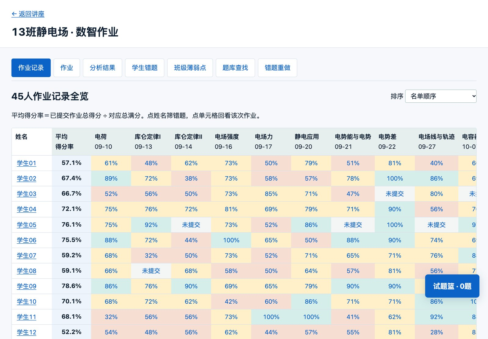
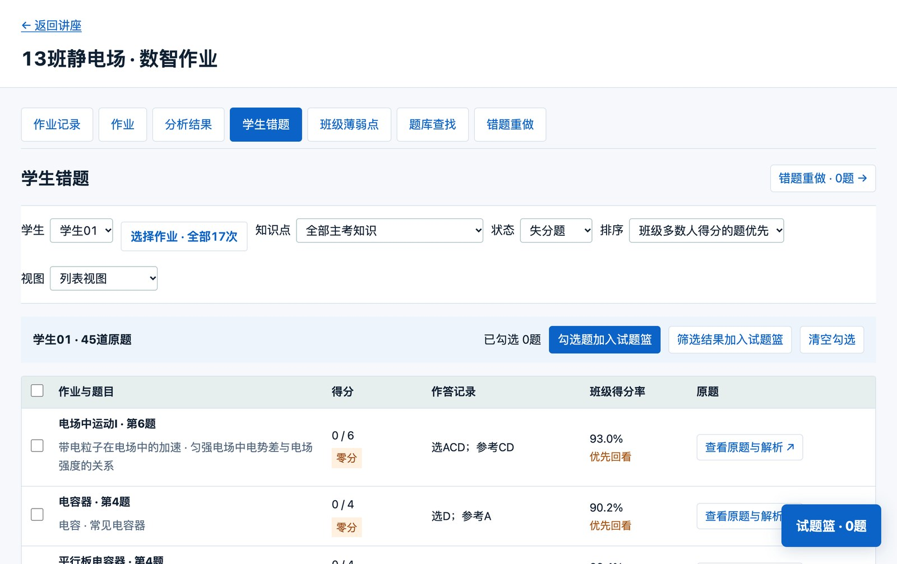
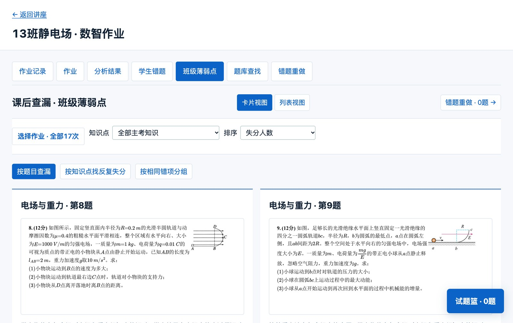
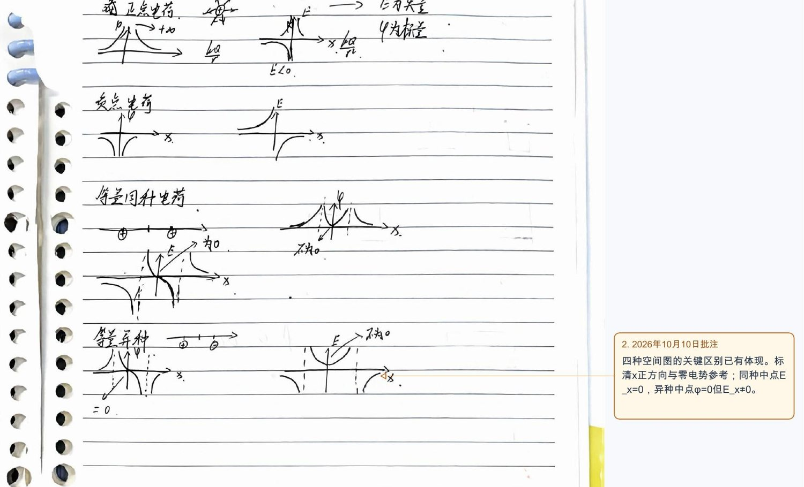
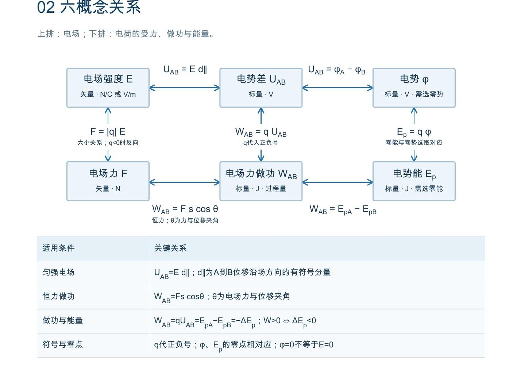

# 第 15 章　学情诊断：错题数据和手写笔记，怎样变成下一节课的安排



我任教的班级用智学网做数智作业。半个学期下来，平台里攒了 17 次静电场作业：45 名学生，173 道原题，181 个计分项，7733 条计分记录。平台给每次作业一张报告，可是任课教师真正想知道的是另外两件事：下节课讲什么，谁需要补什么。

我把这些数据导出来，请 AI 连成一张表，做成了上面这个只在本机打开的网页。我在南山区的一次教师讲座上讲过这套做法。这一章先带你把它的几个页面看一遍，再讲怎样做出来；后面还有另一种材料：学生手写的静电场笔记。一种是分数数据，一种是纸上的图，要解决的是同一个问题。

## 一、先看做出来的东西

### 数智作业工作台

工作台主要有四块：

- **作业矩阵。** 横排作业，竖排学生，看得到每人的加权得分率；未提交不计零。
- **学生错题。** 选一个学生、几次作业、一个知识点，列出失分的题，点题号看原题、答案和解析。
- **班级薄弱点。** 按题目、跨作业重复失分的知识、共同错项三种方式查看。
- **试题篮。** 勾题组成单栏重做卷，不带答案，可以打印；学生先做题，再看解析，重做记录和原成绩分开保存。





顶部有三张清单：全班讲评、个人补习、复测。按默认规则，全班有 105 个讲评备选项，其中 64 项是共同误选，页面先显示 8 项；45 名学生各列 3 项优先任务，共 135 项，其中 131 项是跨作业重复失分。

全班错得最集中的一道题，出现在《静电的防止与利用》的作业里：

> 原来不带电的金属球，在其直径延长线上放一均匀带电细杆。球内直径上 a、b、c 依次靠近细杆。球上感应电荷在三点产生场强大小为 $E_a,E_b,E_c$，则 A. $E_a$ 最大　B. $E_b$ 最大　C. $E_c$ 最大　D. $E_a=E_b=E_c$

正确答案是 C，全班得分率 19%，已知选项的 42 人里有 34 人选了 D。平衡时球内合场强处处为零，学生把“合场强相等”当成了“感应电荷的分场强相等”。感应电荷的场与细杆的场大小相等、方向相反，离细杆越近越大。一个共同误选，比一个平均分更能告诉教师下节课要讲哪句话。这个推断仍是线索，课上要问学生，不能直接认定每个人都是这样想的。

17 次作业里，得分率最低的是《带电粒子在电场和重力场中的运动》55.3% 和《带电粒子在电场中的运动（综合运用）》61.7%，库仑定律、电容器的电容和电场强度都在 78% 以上。不同作业的题目难度不同，这条时间线不能当成能力曲线来读。

把 173 道题按物理的知识结构重新归类，还能看到平台报告里看不到的一层。全班在七条知识主线上的得分率：

| 知识主线 | 班级得分率 |
| --- | --- |
| 图像与力学方法 | 60.0% |
| 带电粒子的运动 | 63.0% |
| 用能量描述电场 | 69.4% |
| 用力描述电场 | 71.2% |
| 电容器与电路响应 | 71.6% |
| 电荷与相互作用 | 75.1% |
| 导体静电平衡与应用 | 75.6% |

最低的两条都要靠力学：带电粒子的运动，本质上是受力分析、运动分解和能量关系搬到电场里。困难可能不在“电场”本身，而在力学方法的迁移。平台报告里的单个知识点标签，看不出这一层。

### 手写笔记的原页批注

静电场讲完以后，我让学生整理笔记，明确要求画六类图：电场线、等势线、$\varphi$–$x$ 图、$E_x$–$x$ 图、电容器充放电的 $I$–$t$ 图和 $U_C$–$t$ 图。收上来的是 36 个学生的 167 张扫描页。我把规则写清楚，请 AI 逐页看，按图打分，并在原页上写批注。

| 项目 | 满分 | 全班平均 | 得分率 | 得 0 分的人数（本次扫描未见） |
| --- | --- | --- | --- | --- |
| 物理规范 | 15 | 11.8 | 79% | 0 |
| 知识整理 | 15 | 11.5 | 76% | 0 |
| 电场线 | 10 | 7.0 | 70% | 3 |
| 等势线 | 10 | 4.1 | 41% | 11 |
| $\varphi$–$x$ 图 | 15 | 6.2 | 41% | 14 |
| $E_x$–$x$ 图 | 15 | 5.2 | 35% | 15 |
| 充放电 $I$–$t$ 图 | 10 | 3.4 | 34% | 21 |
| 充放电 $U_C$–$t$ 图 | 10 | 3.2 | 32% | 22 |

公式和定义抄得不错，一到要自己画的图，得分率就掉到四成左右。



批注的颗粒度可以看下面两条：

> 放电 $U$–$t$ 应开始下降最快，随后逐渐变缓并趋近 0。这里画成后来下降更快，需要重画；$I$–$t$ 的正负约定值得保留。

> 负点电荷的 $E_x$–$x$ 应包含左正、右负两支。先定 $x$ 向右，再用场强方向判断正负；比较场强大小用 $|E_x|$。

AI 还按课堂图做了一份 7 页的示范笔记，物理图由模型计算绘制，不用学生的图。



## 二、平台的报告缺什么

每次作业的报告都看得到平均分和错题，但有几件事平台不替教师做：

1. **十几次作业是分开的。** 一个学生在三次作业里反复错同一类题，单看哪一次都看不出来。
2. **知识点标签太粗。** 平台原有的 40 个标签粒度粗、互相交叉，有一道静电力与轨迹的题被标成了“洛伦兹力”。
3. **零分不等于不会。** 没提交、没作答、选项识别不出来、真的做错，在表里可能都是一个空格或一个零。
4. **手写内容没法统计。** 学生能不能自己画出 $\varphi$–$x$ 图，分数里看不出来，一本本翻又来不及。

## 三、自己做一遍：先对应，再查异常，最后统计

我实际用的是能读写文件、能打开浏览器自查的 AI 编程助手；下面的提示词是为读者整理的起步示例。我把这套做法整理成了两个公开的技能包，一个用于单次考试，一个用于多次作业，里面只有空模板和虚构示例，读者可以下载试用。

### 1. 准备四样材料

从智学网的数智作业里下载四样东西：班级报告、年级报告、题卡（题目和答案）和知识体系。其他平台只要能导出逐人逐题得分和题目，也可以照做。原文件放好不动，AI 的产物另存；带学生姓名和成绩的文件只在本机处理，不要上传到不了解数据去向的服务。

### 2. 第一轮只对应，不分析

```text
这是我下载的几次作业的班级报告和题卡。先别分析。请按学生、作业、题号对应起来，告诉我有多少学生、多少题，哪些地方对不上，哪些题的答案在两份材料里不一样。
```

这一轮查出的问题都不是物理问题，却决定后面的结论能不能信：有两道题题卡和报告的参考答案不一致；4 道原题缺图或缺条件；一道题的图错排在上一题的选项中间；有一条记录选了题面没有的选项 F。这些题保留原分数，不进诊断。

### 3. 分清五种“没得分”

全班这份数据一共 8145 个单元：满分 4526，部分分 814，零分 1753，未作答 640，未提交 412。后三种都没有得分，含义完全不同。还有 180 条的选项无法确定。

```text
未提交、未作答、零分、部分分分开记，选项不确定的写“未知”，不要从分数反推学生选了什么。未提交不算零分。
```

### 4. 教师定排除规则

我定的规则是：作答率不足 50% 的题不进诊断，大多数学生没做，得分率就说明不了掌握情况。选项缺失时作答人数只能算出一个范围，只有范围上限仍不足 50% 才排除，这样排除了 14 个计分项；有一道题作答率在 47.7%～50.0% 之间，保留。教师标记免做的 4 道主观题、答案冲突的 2 道题和待核的 4 道题也不进诊断。

规则一定要写出来。换一条规则，结论就会变。

### 5. 把知识点按物理重新归类

平台的 40 个标签太粗。我让 AI 按物理的知识结构整理成 7 条主线、20 个主题、36 个概念节点，每个节点写明公式、适用条件和易混之处；后来又按智学网现行的 860 节点体系给 173 道题逐题重标，一题可以有多个标签，并分清“主考”和“方法支撑”，每个标签都写依据。

```text
先给这五道题标知识点，每个标签写一句依据，分清主考和方法支撑。我确认了标准，你再标全部。
```

### 6. 三张清单

“重复失分”要定义清楚：同一名学生在至少两次作业里出现，不同学生各错一次不算。

```text
按这些规则列三张清单：全班讲评先列共同误选，个人补习每人三项，优先跨作业重复失分，复测配一道新题。每项都要能点开看到证据题。没作答、未提交和不确定的另列待核。
```

一份个人任务大致是这样：“电势、电势能和电场功的正负”，在 3 次作业的 5 道题 7 个计分项上失分，51 分里丢了 24 分。45 人里排进前三项最多的是“场强定义、矢量叠加与对称补偿”（25 人）、“匀强偏转的分运动、边界与比例”（22 人）、“电势、电势能和电场功的正负”（18 人）。到了学期末，同一套表可以接着累积，全班和个人的学期分析都从这里出。

### 7. 批改手写笔记：把“什么算完成”说死

笔记的评分表由教师定：知识整理 15 分，电场线、等势线各 10 分，$\varphi$–$x$、$E_x$–$x$ 各 15 分，$I$–$t$、$U_C$–$t$ 各 10 分，物理规范 15 分，另有六概念关系图和打印错题各最多加 5 分。后来补收 8 份时，我把页量算作 20 分，内容分按 80% 折算；权重写在评分说明里，第一版结果也保留。

下面几条最值得事先写明：有坐标轴没有曲线不算完成；电路图、场线图和 $\varphi$–$x$ 图互不替代；同一个错误不重复扣分；字迹看不清写“待核”，不凭猜测扣分。名单 46 人，10 人没有匹配到文件，标“未见文件”，只有教师确认才能说“未交”。扫描件可能只是整本笔记的一部分，所以批注写“本次扫描未见”，不写“你没有画”。

```text
这是笔记要求和评分表。先不要打分，告诉我你打算怎样判断每一项、哪些情况拿不准，再用这三份试评，每一项写出是在第几页看到的。批注写在原页对应的图旁边，不要盖住学生的字，原文件另存。
```

做完以后，我把规则整理成技能（第 7 章讲过什么是技能），下次换一组必画内容就能调用。

## 四、统计之前先查什么，结论能说到哪里

### 1. 统计之前查三件事

**特殊评分和异常题。** 一次段考的物理第 10 题，全方向 677 人都得了满分，本班有 17 人没选也得分。直接统计就会得出“全班掌握”的结论。AI 独立复算后发现，参考答案只满足两端的能量差，粒子实际越不过中途的势垒，这道题被整个排除出诊断。AI 的物理复算有时能帮教师发现题目本身的问题。

**计算口径。** 年级率只作同题参照；多选题有部分分，要叫“得分率”，不能叫“正答率”。

**作答率。** 上面已经讲过。

### 2. 结论只能说到这里

- 一题多标签时，失分不能确诊每个知识点都没掌握。
- 一个错误选项是线索，不等于确定的概念误解，要转成追问或复测。
- 主观题没有原答，零分不能写成具体的认知原因。
- 不同作业的难度不同，得分率的高低变化不是能力增长。
- 排进清单的优先级是描述性筛选，不是经过验证的掌握度模型。21 道复测题已经备好，还没有学生成绩。
- 173 道题里有 82 道原件只有答案，解析由 AI 补写并做了推导自校，教师没有逐题审定，用之前要看。

### 3. 笔记图像的物理检查点

AI 看手写图也会看错。复核时把 AI 写的证据翻回原页核对，时间紧就先看最高、最低和标“待核”的几份，可以对着这张表看：

| 图像 | 检查点 |
| --- | --- |
| 等量同种正电荷 | 连线中点 $E_x=0$；无穷远为零势时，中点 $\varphi>0$ |
| 等量异种电荷 | 中点 $\varphi=0$，但 $E\ne0$ |
| 负点电荷的 $E_x$–$x$ | $x$ 向右时，电荷左侧 $E_x>0$，右侧 $E_x<0$ |
| $\varphi$–$x$ 与 $E_x$–$x$ | $E_x$ 等于 $\varphi$–$x$ 斜率的相反数，逐段对上 |
| 跨过点电荷位置 | 曲线不能连过去 |
| 充放电 | $U_C$ 趋近电源电压，$I$ 开始最大再衰减；放电时 $U_C$ 和 $\lvert I\rvert$ 都衰减，开始下降最快 |

公式旁边的条件也常被提醒：36 份反馈里，约 19 人被提醒 $U=Ed$ 只适用于匀强电场，$d$ 是沿场方向的位移分量。这是按关键词的粗略统计。

笔记总分的差距很大（平均 51.8，最低 9.3，最高 92.7），一部分可能来自扫描范围。AI 打的分是初评，这次的分数我逐份看过才发给学生。

## 五、带进课堂：讲什么，补什么

**全班讲评。** 按共同误选排顺序，每题先问“选 D 的同学是怎么想的”，再讲。讲评课件直接从题库取题干和解析图。

**个人补习。** 每人三项，发一张单栏重做卷，不带答案。重做的结果和原成绩分开。

**笔记讲评。** 先讲全班缺得最多的图，可以请学生当场画负点电荷的 $E_x$–$x$，再用示范页对照。再展示几份好笔记，每份只点评三条：题目旁边留下分析过程；相近模型放在一起比较；概念、公式、图像分层整理；把公式之间的联系推出来。学生补画以后再收一次，用同一把尺子比较，才知道讲评有没有用。

**分数和姓名。** 学生是未成年人。分数只给本人看，投屏先隐藏姓名，放到公开网页和书里的都要去掉姓名、学号和分数。展示学生笔记要事先取得同意。
