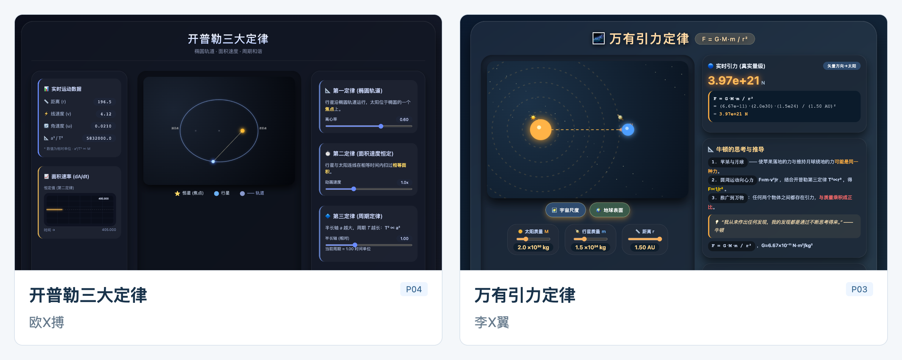
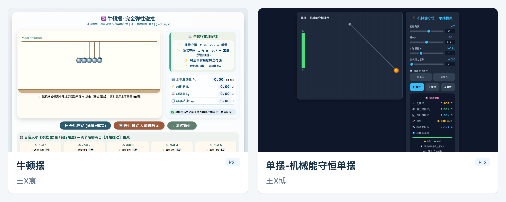
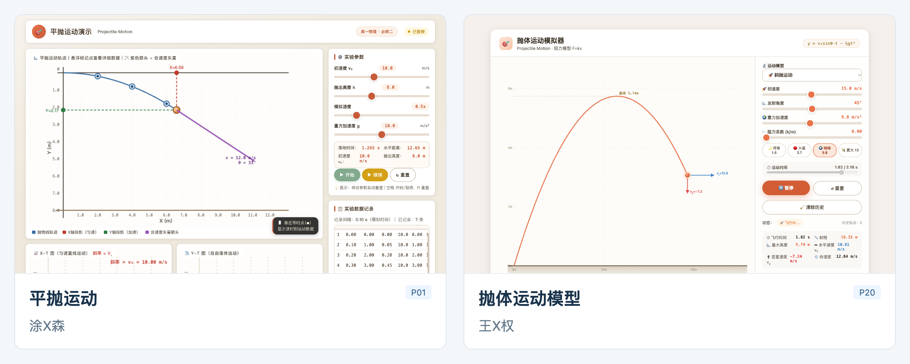
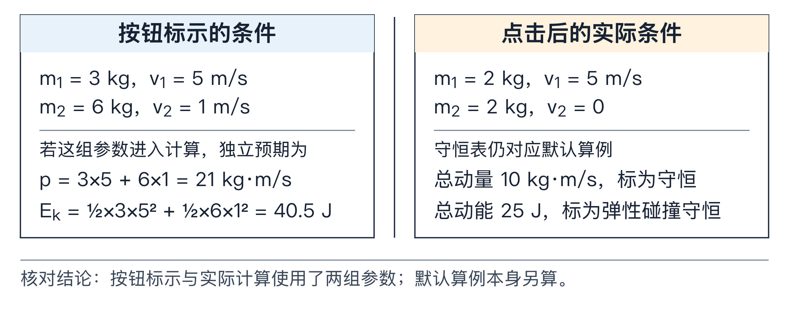
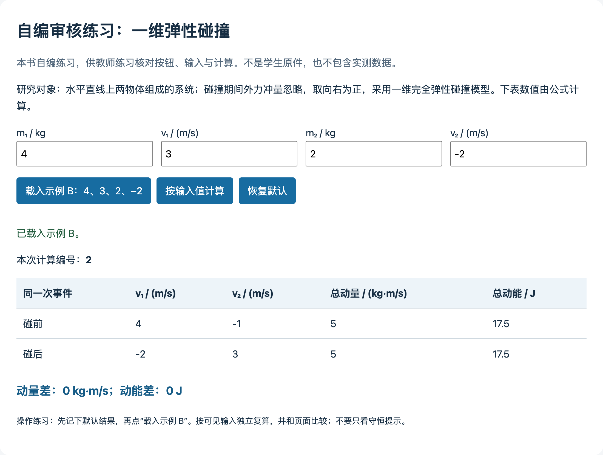

# 第 16 章　学生也用 AI 做网页：怎样审学生作品

下面先看六份学生实际提交的网页。姓名中间已打码，画面取自作品打开或运行时的状态。







前面各章，都是教师自己用 AI 做东西、自己审核。这一章换一个位置：学生也会用 AI 做网页。一个高一学生，五十分钟，就能做出一个有动画、有滑块、有表格的物理网页。页面看上去很完整，教师要回答的问题是：这个网页里的物理，经得起操作和复算吗？学生在做的过程中，自己判断过什么？

这一章讲怎样审学生用 AI 做的物理网页：先看成品，再看对话；能用的保留，不对的退回，并且退回到具体的位置。材料来自我对 25 份学生作品的分析。

## 一、页面完整，物理经得起查吗

《普通高中物理课程标准（2017 年版 2025 年修订）》说，科学思维是“基于事实证据和科学推理对不同观点和结论提出质疑和批判，进行检验和修正”的能力与品格[1]。学生借助 AI 做网页时，检验和修正会落到一些很具体的地方：滑块拖了以后，参与计算的数到底变没变；“实验数据”是测出来的，还是按公式生成的；表格里的“碰撞前”和“碰撞后”，是不是同一次碰撞。

教师审学生作品，常见的两种做法都不够：

1. **看能不能打开、好不好看。** 这只说明网页能用，说明不了物理。
2. **读代码。** 大多数物理教师没有时间也没有必要逐行读代码；而且公式写对了，也说明不了按钮标示的条件真的进了计算。

还有一个更难的问题：页面上的错误，是学生没发现，还是 AI 后来改错了，还是学生发现了但没来得及改？只看成品，分不清。

## 二、25 份学生网页里看到了什么

### 任务和材料

25 名高一学生参加一次 50 分钟的 AI 技能任务，每人围绕一个高中物理知识点，独立做一个能在浏览器里打开、全部内容保存在一个文件里的交互网页。我分析了他们提交的 25 份网页和留下的 158 条与 AI 的交互消息。图中姓名已打码，下文分析用 P01—P25 对应学生作品。

### 三层验收

一个网页可以分三层验收：能打开，能操作，物理可用。前两层检查的是文件和操作，这一章只讨论第三层。

### 四份网页，四个审核落点

**P22：按钮写的数，没有进计算。** 页面上有一个按钮，写着把两球的质量和速度设为 3、5、6、1。点击以后，参与计算的数仍然是默认的 2、5、2、0。页面继续显示“动量守恒”，默认算例本身也是自洽的，只是按钮标示的那个案例根本没有运行。



如果按钮上的数真的带入了，碰前总动量应为 $3\times5+6\times1=21\ \mathrm{kg\cdot m/s}$，总动能 $\frac12\times3\times5^2+\frac12\times6\times1^2=40.5\ \mathrm J$；页面显示的却仍是默认算例的 $10\ \mathrm{kg\cdot m/s}$ 和 $25\ \mathrm J$。只看“能打开”和“公式对不对”，这个问题都发现不了。

**P06：理论生成的数据，被当成实验数据。** 页面用理想自由落体的关系生成速度和高度，再加一点随机变化，称为“模拟实验数据”，用来“验证”机械能守恒。按规律生成数据，再用这批数据验证同一规律，结论已经藏在生成方法里。第 6 章教师用书的提醒是同一个道理：用 $v=gt$ 算速度，等于先假定加速度恰为 $g$，机械能必然守恒，“验证”就成了循环（内容的性质要标明，见第 1 章）。

**P23：碰后速度覆盖了碰前速度。** 一维弹性碰撞的公式能通过复算。可是点击“碰撞”以后，页面把碰后速度写回了原来的输入框，再作为新的“碰前”显示出来。同一次碰撞的初态和末态无法同时看到，守恒也就无从比较。

**P16：一个正面的例子。** 学生没有用“验证”“核查”这样的词，但页面保留了质量、碰前速度、碰后速度、总量和误差，教师可以拿这些数独立复算。页面可不可查，要看它留下了什么证据。

### 学生在对话里说了什么

158 条消息里，学生提出的物理要求从笼统到具体，大致分三层：

| 层次 | 例子（学生原话） | 涉及作业数 |
| --- | --- | --- |
| 原则性要求 | P11：“注意科学性的保证，不要出现科学性错误。” P18：“不出现超纲知识。” | 10 份 |
| 指向具体对象 | P02：初速度“在单次实验过程中不发生变化”；P06：“你应该先说清楚选择的参考平面” | 14 份 |
| 要求留下复查材料 | P11：“给出物体碰撞前和碰撞后的动能和动量”；P16：“使用数值自己算出” | 8 份 |

（各类可以重叠，不能相加。）

学生说出的 11 条可以判断真假的物理说法中，4 条得到当前材料支持，5 条只在补充条件后成立，2 条因为证据不足暂时不能判断。“补充条件后成立”的例子最有教学价值：学生已经抓住了一个正确的关系，只是没写全条件。例如 P09 说光滑面上撤去力后物体做匀速直线运动，抓住了合外力与运动状态的关系，但还要说清研究对象，以及水平方向合力为零。

## 三、自己做一遍：拿一份自编网页练习审核

前面各章，你已经会审自己请 AI 做的网页。这一章新增的是审别人做的：先在浏览器里复现问题，再请 AI 找原因，最后把退回意见写到具体的一步。

下面使用本书自编的审核练习页配套包第 16 章的 `自编审核练习.html`，练习定位和复查参数错误。跟做时只把这份自编文件交给 WorkBuddy。WorkBuddy 用的模型在云端运行，交给它的文件内容可能被发送出去；真实学生作品含姓名、学号或对话时，先去掉这些信息，或者不交给 AI，由教师自己在浏览器里按本节的表检查。

### 1. 先自己操作并复算

用浏览器打开练习页，先看页面说明：两个物体在水平直线上做完全弹性碰撞，碰撞期间忽略外力冲量，向右为正，所有数据由公式生成。默认输入是 $m_1=2\ \mathrm{kg}$、$v_1=4\ \mathrm{m/s}$、$m_2=3\ \mathrm{kg}$、$v_2=-1\ \mathrm{m/s}$。先算：

$$p=2\times4+3\times(-1)=5\ \mathrm{kg\cdot m/s},\qquad E_\mathrm k=\tfrac12\times2\times4^2+\tfrac12\times3\times(-1)^2=17.5\ \mathrm J.$$

记下结果，再点“载入示例 B：4、3、2、−2”。先停住，不点旁边的“按输入值计算”。先问自己：输入框换成了 B，下面的表格应该变成多少？按 B 的数独立计算：

$$p=4\times3+2\times(-2)=8\ \mathrm{kg\cdot m/s},\qquad E_\mathrm k=\tfrac12\times4\times3^2+\tfrac12\times2\times(-2)^2=22\ \mathrm J.$$

再把输入框和表格一起看，表格是否也属于 B？



如果你在浏览器里看到的和这两张图一样，就找到了这份练习特意留下的错误：按钮改变了输入框，实际计算还沿用默认对象。点击示例 B 后，表格仍给出 5 和 17.5；再点“按输入值计算”，才更新成 8 和 22。两种状态下，动量差和动能差都显示为零，所以守恒提示本身说明不了预设案例有没有运行。

### 2. 只把自编练习交给 WorkBuddy

新建一个只放这份自编 HTML 的工作文件夹，学生原件和对话都留在原处，不复制进来。

提示词：

```text
请帮我检查这份自编碰撞网页，先不要修改。按钮写的参数有没有真正进计算？数据是测出来的还是公式算的？请给出能让我自己复现的操作和复算，不要只看页面上的“守恒”提示。
```

先让它检查，再让它改。否则它可能直接交一份改好的网页，教师却不知道原来哪里有问题、改动有没有对准原因。

试做时，WorkBuddy 检查源码并复算后指出：“载入示例 B”只改了输入框，计算仍读取旧的 `state`，也就是程序中保存计算参数的对象。报告开头写明，这是只读的静态检查，没有打开浏览器。所以接下来要在浏览器中点击同一按钮，对照输入框和结果表，检验这条判断。这份检查报告在配套包里。

回复里出现 `state`、“静态推断”这类没见过的词，可以对 AI 说：“请用我听得懂的话解释 state 是什么，它对应页面上的哪个数？”

### 3. 把 AI 结论和自己的证据对照

阅读回复时，找四件事：具体点哪个按钮；页面显示了哪些数；实际计算用了哪些数；用哪组非默认输入复算。AI 若只说“公式正确，动量守恒”，可以这样追问：

```text
我点“载入示例B”后，输入框已经是4、3、2、−2，但表格仍是默认算例的5和17.5。请沿这个按钮检查：输入框里的值和参与计算的值在哪一步同步？先说明原因，不要改其他功能。
```

这句话把教师已经发现的矛盾交给 AI 定位。核对回复后，再到浏览器中点击按钮，确认代码里的原因与页面表现是否对应。

用下面这张表整理本例。换成真实学生作品时仍可沿用；作品没脱敏前，这张表由教师自己操作、复算来填。

| 核对处 | 教师可以保存的证据 | 判断 |
| --- | --- | --- |
| 默认页 | 2、4、3、−1与5、17.5 | 默认算例可复算 |
| 只点击示例B | 输入框4、3、2、−2；表仍5、17.5 | 预设值未进入计算 |
| 再点计算 | B的碰前总动量8、总动能22 | 手动计算路径能够同步输入 |
| 数据来源 | 页面说明与程序计算式 | 理论计算，不是实验测量 |

### 4. 写定向修改要求，再核对修改版

对这份自编练习，修改要求可以这样写（本书试做停在只读检查，这一步没有实际发送）：

```text
退回到“预设参数载入”这一步。点击示例B以后，输入框与计算结果没有同步。请只修正按钮的数据传递，保留原始练习文件，另存“修改版.html”。修改后提交同一路径的操作前后结果：默认值、只点示例B、再点计算、恢复默认。B应为p=8 kg·m/s、Ek=22 J，默认应回到p=5、Ek=17.5。不要新增其他功能。
```

收到修改版后，重新走这四步，并看同一次碰撞的碰前与碰后是否同时保留。B 的弹性碰撞结果应为 $v'_1=-1/3\ \mathrm{m/s}$、$v'_2=14/3\ \mathrm{m/s}$，与碰前共同给出总动量 8 和总动能 22。页面只显示六位小数时，复算会有末位舍入差；按显示精度解释就行，不必为了让差值显示为零去改数。

## 四、一份学生网页，按什么顺序查

### 1. 先查最早的一环

审核按证据链的顺序，从最早的一环查起：对象与条件；公式、数值与单位；参数载入；事件状态；表达是否一致。后面出现矛盾时，退回到最早失效的那一步。

如果改了参数以后实际输入根本没变（P22），后面的守恒表就不必再看了，直接退回到“参数载入”这一步。退回意见指向具体位置，学生才知道该改哪里；一句笼统的“再检查一下”，学生无从下手。

### 2. 五类核查对象

把“物理要正确”拆成五类可以检查的对象，每一类都写清：学生要做什么，交什么证据，什么情况退回。

| 核查对象 | 学生要做的 | 提交的证据 | 退回的条件 |
| --- | --- | --- | --- |
| 对象、条件和数据来源 | 写明研究对象、忽略了什么，数据怎样得到 | 页面上的说明或“数据来源卡” | 数据身份不清；结论超出模型条件 |
| 公式、数值和单位 | 选一组非默认输入，手算关键结果，与页面比较 | 输入、手算式、页面值、差值 | 公式条件不符；单位错；差值说不清 |
| 按钮、滑块和输入框 | 操作前后，记录实际进入计算的量 | 前后截图或数据表 | 文字变了，计算的输入没变 |
| 关键事件的前后状态 | 同时保存同一次事件的初态和末态 | 初态一行、末态一行、事件编号 | 状态被覆盖；两组数据不属于同一事件 |
| 动画、图像、表格和结论 | 固定一组条件，逐项对照几种表达 | 冲突清单或一致性说明 | 对象、时刻、符号、单位、结论不一致 |

教师不必要求每份作品都做完五类。按主题选两三类：碰撞网页优先查参数载入和事件状态；机械能网页优先查数据来源和参考位置。

### 3. 页面上的错，不一定是学生的错

P23 的页面覆盖了碰前状态。可是对话里看不出学生有没有注意到这个问题。这时只能写“提交的页面点了‘碰撞’以后看不到碰前速度”，不能直接记为“学生没发现”。反过来，P16 的学生没有用“核查”一词，页面里却留着可复查的证据，这份检查照样记给学生。

成品和对话要放在一起看：对话说明学生想到了什么、要求了什么；成品说明最后实现了什么。两者对不上时，先确认它们是不是同一次制作的。确认以后，页面上的一处做法可以按下表归属：

| 页面上的这处做法 | 对话里能找到什么 | 怎样记 |
| --- | --- | --- |
| 学生提出，页面兑现了 | 学生的要求原话，加上页面上对应的地方 | 学生的判断 |
| AI 提出，学生同意了 | AI 的建议，加上学生的回应 | 学生采纳了 AI 的判断；追问他为什么同意 |
| 学生提出过，页面没兑现 | 学生原话 | 学生发现了，制作没跟上 |
| 页面有，对话里没有 | 找不到 | 只记提交页的状态，不归给学生 |

### 4. 学生的原话：先肯定关系，再补条件

学生的物理说法常常“部分成立”。反馈可以按三步走：保留正确的关系，补上成立的条件，要求给出验证的证据。

| 学生的说法 | 已经成立的 | 还缺什么 | 可以怎样追问 |
| --- | --- | --- | --- |
| P11：“两球相向而行时不能叫‘追赶’” | 正确区分了相向和追及 | 正方向和碰前碰后的量 | 两球速度各取什么符号？碰撞前后的动量怎样记录？ |
| P04：比较轨道半长轴三次方与周期二次方之比 | 抓住了开普勒第三定律的关系 | 中心天体和单位 | 换一个中心天体，比值怎样变？ |
| P09：光滑面上撤去力后做匀速直线运动 | 合外力与运动状态的关系 | 研究对象；水平方向合力为零 | 撤去的是哪个力？还有没有别的水平力？ |
| P06：理论生成的数据不能再验证预设规律 | 发现了数据和结论同源的问题 | 把循环的原因说成“$v=gt$ 依赖机械能守恒”；真正的前提是假定加速度恰为 $g$ | 速度关系来自哪条定律？怎样得到独立的实验数据？ |
| P17：在“两物体绳子连接”的任务里要求讨论两者 $mr$ 的大小及位置关系 | 知道质量、半径和位置会影响谁先滑动 | 绳是否绷紧、张力方向、摩擦力能调节的范围 | 先画这两个有绳物体的受力图；哪些力能独立调整，哪个约束先失效？ |

P06 那一条特别值得注意：同一句话里，既有一个重要的发现（数据和结论同源），又有一处需要修正的解释（$v=gt$ 由牛顿第二定律和运动学得到，本身不以机械能守恒为前提；循环来自“加速度恰为 $g$”这个假定）。教师要把这两层分开回应，先肯定发现，再纠正解释。

### 5. AI 能帮什么，教师要分什么

AI 可以帮教师做重复的计算、列出按钮与变量的对应、比较页面上的数值、整理冲突清单。它列出的问题，教师要先分出哪些关系到物理。这次 WorkBuddy 的报告还列了一条：每点一次按钮，“本次计算编号”就加一，哪怕参与计算的数没变。前面截图里编号变成 2，就是这个原因。编号怎样计，是页面设计的选择，跟物理无关，不必写进退回意见。

## 五、带进课堂：把审核要求写进作业

### 课前：作业单上写清楚

布置“用 AI 做一个物理网页”这类作业时，在作业单上写明这次要查的两三类对象（第四节表格中选），以及每一类要交什么证据。例如一个碰撞网页的作业单：

```text
任务：用 AI 做一个一维碰撞的交互网页。

提交时附上：
① 一组你自己选的输入（不是默认值），手算碰前、碰后的总动量和总动能，
　 和页面的结果放在一起，写出差值。
② 点击一个预设按钮前后的截图，说明哪些数进了计算。
③ 页面上能同时看到同一次碰撞的碰前和碰后状态吗？截图说明。
④ 一句话：你的页面在什么条件下成立？
⑤ 从你和 AI 的对话里，摘一句你自己提出的物理要求，说明页面哪里因此改了。
```

### 课中：每做完一个功能，留一份最小证据

最小证据可以很小：一组输入、一次手算、操作前后两张截图、一句判断。学生不必交完整的对话，但要交作业单第⑤项那一句；教师也不必读完所有过程。

### 课后：从证据链最早一环抽查

教师先抽查最早的一环：页面写没写清对象和数据来源；再用默认算例复算；然后改一组输入，看它进没进计算。没进，就不看后面，退回“参数载入”；进了，再用这组输入复算，看事件状态和图表。退回意见写清“退回到第几步、改什么、补什么证据”。

### 评价学生的作品

| 层次 | 表现 |
| --- | --- |
| 能用 | 页面能打开，按钮能点，有动画 |
| 能查 | 留下了输入、计算和结果，教师能复算 |
| 能论证 | 学生自己做了非默认输入的复算，说明了数据来源和成立条件，发现了不一致并处理过 |

评价的重心，从“网页像不像成品”移到“学生能否提供支持其物理判断的证据”。

### 学生材料的边界

学生作品的展示和使用，要遵守几条规矩：案例分析使用编号，展示卡片将姓名中间打码；原始文件只在本机保存，交给 WorkBuddy 这类模型在云端的 AI 之前，先脱敏；公开展示要先取得授权并脱敏，不提供原件下载。
