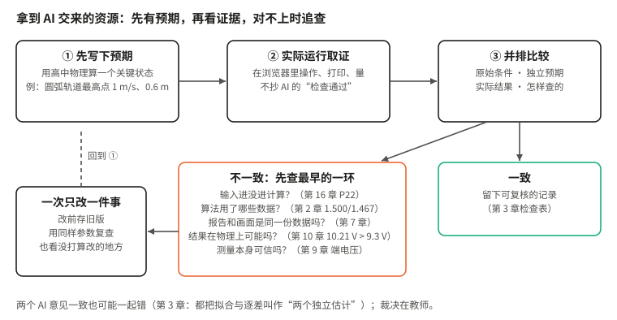

# 附录 B　物理审核清单

第 3 章只讲了一个办法：先写预期，再看结果。这份清单把书里各章用过的检查方法收在一起，再按资源类型整理成可以逐项勾选的表。用的时候不必每项都做：先做“每次都做”的三项，再按资源类型选。

## 一、每次都做的三项

| 序 | 检查 | 怎样做 | 通过的标准 |
| --- | --- | --- | --- |
| 1 | 先算再看 | 打开结果前，自己算出一个关键状态，写下来 | 页面上这个状态的数值与手算一致 |
| 2 | 分清数据身份 | 对每个数、每部分图问一句：测的、算的、模型补的、演示用的？ | 每一类都能说清来源，演示数据标明“非实测” |
| 3 | 查检查本身 | AI 说“检查通过”时，问它检查了什么、怎样检查的 | 检查对象、方法与结果清楚；用独立预期与程序输出对照 |

## 二、三组问题，十种方法

书里各章用过的检查方法归成十种，分在三组问题下面。不必每次十种都做。

### 第一组：条件和物理关系成立吗

| 方法 | 怎样做 | 例子 |
| --- | --- | --- |
| 1 先算再看 | 打开结果之前，自己用高中物理算出一个关键状态，写在纸上。先看了结果再“验证”，人会不自觉地往结果上靠 | 第 2 章纸带页的五个速度；第 7 章圆弧轨道最高点，两者共速 1 m/s、高度 0.6 m |
| 2 推到极端 | 把参数推到特殊值，先想清楚该发生什么，再看程序照不照做 | 第 7 章轨道质量趋于无穷大，就是固定轨道，滑块应以原速率返回 |
| 3 查单位 | 每个输入、每个结果都看一眼单位 | 纸带位置以 cm 输入，不换成 m，速度就差 100 倍 |
| 7 物理上可能吗 | 拿到一个数，先问它在物理上能不能出现 | 在没有内部电源的导电水层模型中，电势不应超出两电极规定的范围 |
| 9 对照教材，读“所以” | AI 写的解释，先问依据在不在教材里，再看“所以”“因此”前后是不是真有成立的关系 | 第 2 章“纸带卡住”被列为等时间间隔的例外 |

### 第二组：输入、计算和画面，是不是同一份

| 方法 | 怎样做 | 例子 |
| --- | --- | --- |
| 4 看过程，不只看终点 | 除了关键时刻的数值，还看相邻时刻之间是否连贯；碰撞、离轨前后分开查。追问一句：“你用什么关系算出这些值，又用什么方法检查它们？”两者是同一个关系，检查就不独立 | 第 7 章只在几个关键点对、中间“凑”出来的动画 |
| 5 分清数据的身份 | 对每个数、每部分图问两句：它从哪里来？是不是按当前输入算的？ | 改了位置没重算，旧图还留在屏幕上；第 10 章地形上，色环是测的，中间是模型补的 |
| 6 不完美的数据和反例 | 除了答案已知的完美数据，再备一组有意加了偏差的，或一个应当失败的输入 | 第 3 章把第 3 段加长 0.30 cm；质量填零和负数才露馅 |

### 第三组：能不能真的拿去用，检查本身靠不靠得住

| 方法 | 怎样做 | 例子 |
| --- | --- | --- |
| 8 拿到纸面和实物上量 | 软件里看着对的东西，打印出来、做出来再量一次 | 空白记录表的打印预览；第 9 章 310 mm 见方的底图不能按“适合纸张”打印 |
| 10 请另一个 AI 独立复查，再查检查本身 | 新开任务，只给原始条件和数据；AI 交来的检查报告，也问一句它是怎样查的 | 两个 AI 都说“两个独立估计”；“24 项检查通过” |

查出问题以后，一次只改一件事：改之前留好旧版；改之后用同样的参数、同样的操作，既看改了的地方，也看没打算改的地方。

## 三、按资源类型

下面各组大致对应《开始之前》的四类载体；文字材料一组，各类载体都会用到。改资源时，一次只改一件事：改前保存，改后用同样的条件比较。

### 自制教具与打印件（第 9、11、14 章）

- [ ] 表面画的符号和内部接线一致：先用万用表通断档逐块测，再接电
- [ ] 接电前测几处关键电阻，与电路图比较；电解电容分清正负极
- [ ] 电源用电池或低压电源，不接市电；导线夹的金属部分不浸在水里，电压表远离水槽
- [ ] 打印件量实际尺寸，不用设计值代替；一批零件抽几件量
- [ ] 放进真实使用场景里试：在水里会不会漂、会不会夹气泡，会不会挡住测量
- [ ] 有和没有这个零件时，同一处读数比较一次
- [ ] 按 1∶1 打印的底图，先用尺量校准线，再放到实物上对位置

### 计算页面（纸带、光电门、机械能守恒：第 2、4、6 章）

- [ ] 用答案已知的“完美”数据试一次，结果全对
- [ ] 用一组有意加了偏差的数据试一次，看算法实际用了哪些数据
- [ ] 按量的有效范围检查输入：质量、周期等须为正；坐标或速度的零与负值可以有物理意义；必填的空白不能默认成零
- [ ] 改一个输入，旧结果立即撤下或随之更新
- [ ] 单位：cm 与 m、ms 与 s 的换算；不输入质量时，能量比较的单位不是焦耳
- [ ] 演示数据标明“非实测”
- [ ] 打印一份：长文字完整，表格不断开

### 传感器与采集网页（第 4、5、11 章）

- [ ] 静止时读数的波动有多大，先测一段再说
- [ ] 表格里分开“设备发来的”和“网页算出的”
- [ ] 横轴用设备时间还是网页收到的时间，要写明
- [ ] 断线、重复、缺失有可见提示，不用上一个值填补
- [ ] 滤波：方法、截止频率写明；原始数据保留；比较滤波前后的起止时刻
- [ ] 核对积分与状态变化：加速度曲线下的面积等于末速度减初速度，首末都静止时才接近零；比较充电和放电两块面积时，要是同一个电容器、充到同一电压再放电，截取的时间段有限，两块面积不必严格相等
- [ ] 在电脑的 Chrome 或 Edge 上实际连接一次，看到新读数

### 模拟动画（第 7 章）

- [ ] 先算再看：关键状态（最高点、共速、分离、最大压缩）的数值
- [ ] 关键状态之后继续播放，看物体是否按规律接着运动
- [ ] 极端参数：一方质量趋于无穷大、两者相等、速度为零
- [ ] 位移差分与相应中间时刻速度相符到离散误差范围；减小时间步后误差应减小，事件切换另查
- [ ] 画面、箭头、数字、曲线游标来自同一状态
- [ ] 箭头注明参考系；正负号与方向一致
- [ ] 预测模式下，数字、箭头、曲线、提示文字、核验表全部隐藏
- [ ] 切换参数后，旧曲线和旧结论清除

### 照片与图像（第 10、14 章）

- [ ] 逐点核对：图上每个标注点，回到原照片找到它
- [ ] 颜色和数值的对应写明
- [ ] 底图没有被拉伸、裁剪或重画
- [ ] 缺测处不当成实测补点；必要的连线、插值或模型补算，单独标明
- [ ] 识别出的点里有没有导线、夹子等误认
- [ ] 三维模型：资料是不是这一款；同角度和实物照片比较；丝印文字和位置

### 模型与拟合（第 9、10 章）

- [ ] 测的和模型算的，在图上和表里分开
- [ ] 拟合出的参数在物理上可能吗（例如无内部电源、同一参考零点的导电层模型中，电势应处于给定边界范围内；越界先核对数据与模型）
- [ ] 删去可疑点后结果变化大不大
- [ ] 模型的边界条件和实际装置一致（绝缘槽壁、电极形状）

### 学生用 AI 做的网页（第 16 章）

- [ ] 学生原件只在本机看，不交给云端模型；练习用自编材料
- [ ] 按钮和滑块：操作前后，进入计算的量真的变了
- [ ] 数据来源：测量、公式生成、随机、手动输入
- [ ] 同一次事件的初态和末态能同时看到
- [ ] 选一组非默认输入手算，与页面比较
- [ ] 发现问题时，退回到证据链最早失效的那一步

### 文字材料（学案、讲稿、说明、AI 的解释）

- [ ] 物理表述准确；依据是不是教材和课程标准
- [ ] “所以”“因此”前后是否真有成立的关系
- [ ] 文字和数据、图像是否一致
- [ ] 课本图样（例如无限空间中的等势线）是否被照搬到不同的边界条件下

### 器材模型与电路模拟（第 12、14 章）

- [ ] 外观之前先查接触面、运动方向和零点，正面看不到的结构转到侧面和背面核对（第 14 章）
- [ ] 模型、放大窗口、刻度示意和电路图读的是同一个状态（第 12、14 章）
- [ ] 换量程时，指针和要读的刻度排同时变化，读数不变（第 14 章）
- [ ] 取能手算的电路，电表内阻算进去，自己算一遍读数（第 12 章）
- [ ] “必须”“至少”“几倍”这类说法问清条件（第 12 章）
- [ ] 小阻值分压校核额定电流，分清流过变阻器的电流和负载电流（第 12 章）
- [ ] 每个偏差自己算出方向和大小；夸张内阻的图要标明（第 12 章）
- [ ] 实测、对他人数据的复算、模型计算分开标注（第 12 章）

### 学情数据与批改手写作业（第 15 章）

- [ ] 统计之前查三件事：特殊评分和异常题、计算口径、作答率
- [ ] 未提交、未作答、零分、部分分、选项未知分开记
- [ ] “重复失分”指同一学生在至少两次作业中出现；误选是线索，不是确诊
- [ ] “未见文件”不等于“未交”，“本次扫描未见”不等于“没画”
- [ ] 有坐标轴没曲线不算完成；一种图不代替另一种；同一错误不重复扣分
- [ ] 抽查最高、最低和标“待核”的几份，把 AI 写的证据翻回原页核对
- [ ] 示范图由模型生成，不照搬学生的图
- [ ] 分数和姓名：投屏前隐藏；对外材料去掉能认出学生的信息；确认工具的数据政策

## 四、请另一个 AI 复查时

1. 新开一个任务，让它看不到前面的对话；条件允许时换一个模型。
2. 只给原始条件和原始数据，不给第一个 AI 的结论和审核页。
3. 请它计算具体的量，不请它评价“对不对”。
4. 两份结果由教师比较，并回到原始条件核对公式、单位与数据；有差异时找出具体原因。两个 AI 意见一致，也可能一起错。
