# 从定性演示到定量探究：法拉第电磁感应实验的改造

## 一、由定性现象提出定量问题

将磁铁插入线圈，电表指针发生偏转；改变运动快慢，偏转幅度也随之变化。这类演示使学生初步认识到，感应电动势与磁通量变化的快慢有关。进一步学习法拉第电磁感应定律时，学生还需要理解：怎样通过实验研究感应电动势与线圈匝数、磁通量变化率之间的定量关系？

王硕老师围绕这一问题改造了实验。她希望在定性观察之后安排学生分组探究，让学生参与变量选择、实验操作和数据解释。她在说课稿中把任务归结为四个问题：如何改变匝数，如何控制磁通量变化的条件，如何控制运动快慢，以及如何测量变化很快的感应电动势。[1]

这四个问题相互关联。改变匝数时，磁铁与线圈的位置不能随意改变；调节磁铁运动快慢时，需要知道实际速度；记录感应电压时，又要保证不同条件下的读数具有可比性。只有把这些环节逐一落实，学生才能由“电表偏转得更多”继续讨论定量关系。

<figure id="fig-1">

<figcaption><strong>图 1　把定量探究的要求转化为实验安排。</strong>依据王硕的说课稿与教学设计整理。每种器材都对应一个具体任务；磁铁数量属于实际操作量，它与磁通量的关系还需要结合装置条件解释。</figcaption>
</figure>

## 二、把下落的磁铁改为随圆盘转动

### 下落方案遇到的两个困难

王硕最初尝试在玻璃管实验的基础上开展定量研究。在她的操作中，磁铁可能在管内翻转，运动状态不易保持一致；电压表指针的变化又很快，难以直接读取最大偏转。她试过用手机慢动作拍摄，再逐帧查看，但需要反复拍摄，仍不容易稳定地捕捉到最大示数。[1]

这里有两个不同的问题。磁铁怎样运动，影响不同次实验能否比较；指针能否读清，影响电压记录是否可靠。慢动作拍摄可以帮助观察，却没有同时解决运动控制的问题。实验需要重新选择一种便于重复和调节的运动方式。

### 磁铁经过线圈，也能改变磁通量

在研究文稿中，王硕回顾了由风扇转动得到的启发：让磁铁在固定线圈附近随圆盘运动，同样可以改变穿过线圈的磁通量。这样，原来一次性的下落过程就转化为沿同一路径反复发生的相对运动，快慢也可以通过电机调节。[2]

她选用了体积较小、便于安装的钕铁硼磁铁，并用光盘作为转动圆盘。磁铁随光盘经过线圈，线圈保持固定，感应电压由传感器记录。这个选择保留了实验要研究的物理关系，同时改变了产生磁通量变化的具体方式。

<figure id="fig-2">
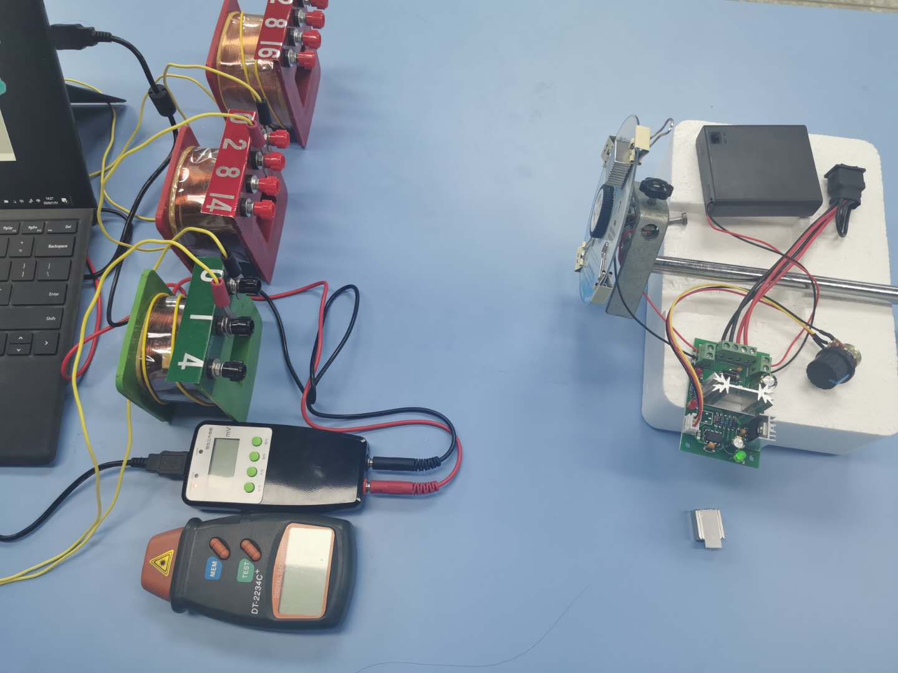
<figcaption><strong>图 2　改造后的实验装置。</strong>左侧是线圈、微电压传感器及电脑，前方是非接触式转速仪；右侧是光盘、电机、调速部分和电源。读图时可分别追踪两条关系：电机怎样带动磁铁运动，线圈的电压怎样进入记录设备。原图来自王硕的实验课课件。[3]</figcaption>
</figure>

<figure id="fig-3">

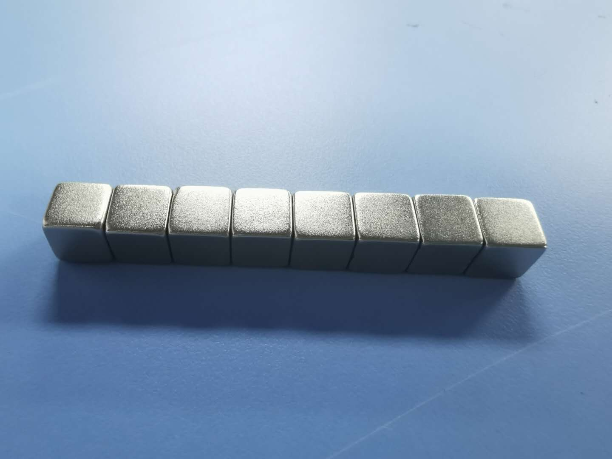
（a）便于组合的小磁铁

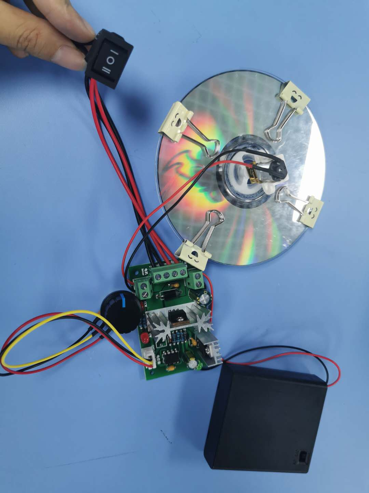
（b）圆盘与驱动部分

<figcaption><strong>图 3　利用现有材料实现可调节的运动。</strong>小磁铁便于安装和改变数量，光盘提供转动载体，电机与调速部分控制运动快慢。照片展示器材结构；磁铁的具体固定位置、组合方式及其与线圈的距离，仍需在每次实验中保持和记录。[3]</figcaption>
</figure>

圆盘能够转动以后，还需处理支撑与位置的稳定性。王硕在说课稿中指出，固定装置的安排及磁铁重力的影响会使波形发生波动；更换线圈时，磁铁与线圈的距离也可能变化。[1]这些反思说明，机械结构的稳定直接关系到数据能否比较。使用时应先检查圆盘、磁铁和支撑是否可靠固定，停机后再调整磁铁或线圈，避免在运动中改变实验条件。

<figure id="fig-4">

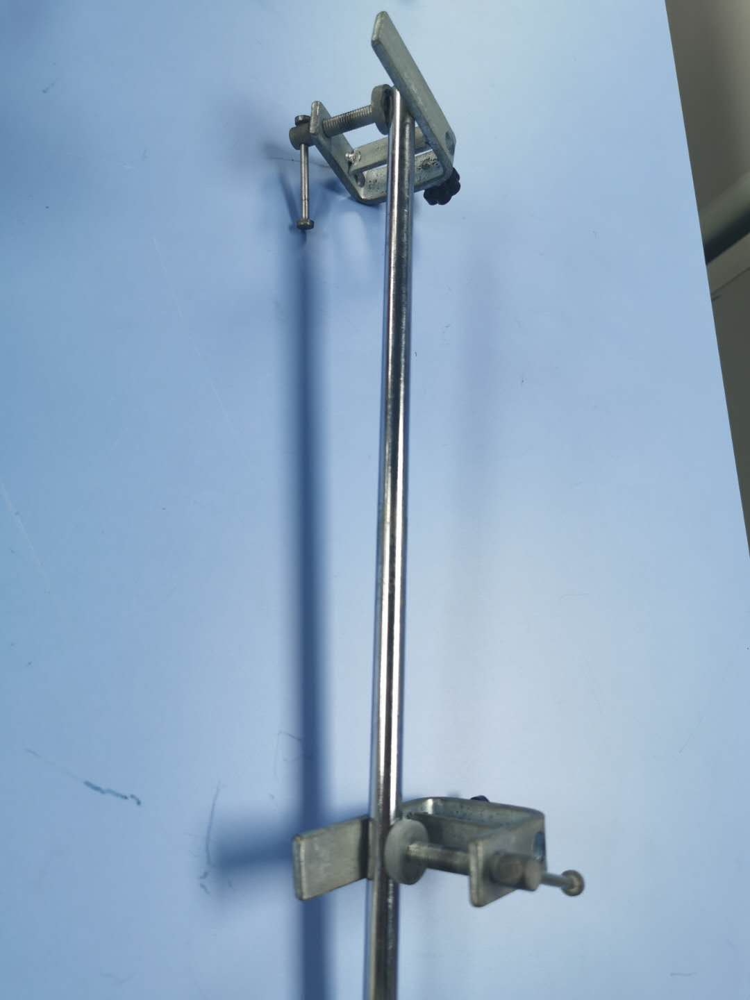
（a）支撑与固定部件

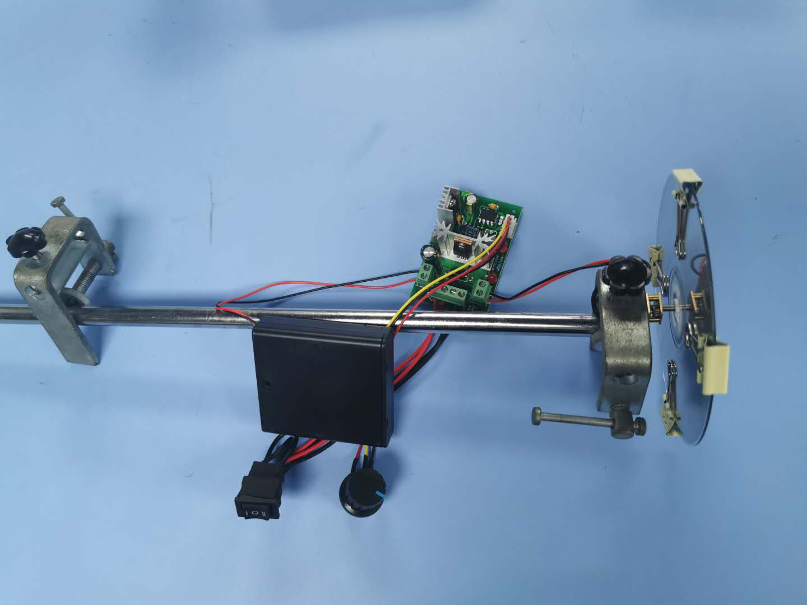
（b）驱动部分的安装关系

<figcaption><strong>图 4　支撑结构也是控制实验条件的一部分。</strong>固定夹与支撑杆用于保持装置位置。比较不同条件前，除检查转速，还要检查圆盘是否晃动、磁铁与线圈的间距是否改变。照片用于说明安装关系，不代替对现场固定可靠性的检查。[3]</figcaption>
</figure>

## 三、为实验变量安排控制与测量

### 选择线圈，减少换接带来的变化

研究匝数与感应电动势的关系，需要改变线圈匝数。王硕最初考虑使用不同匝数的线圈，但反复连接电路比较繁琐。她在实验室寻找器材时发现，可拆卸变压器线圈能够通过不同接线柱选择匝数，便将它用于这一实验。[2]

这种选择减少了换接操作，也提醒教师注意线圈的使用条件：接入了哪一段绕组，实际匝数是多少，线圈位置、朝向和有效面积是否保持。若需要更换线圈，应按原位置重新定位。不能只检查匝数标记，而忽略其他条件已经发生变化。

<figure id="fig-5">

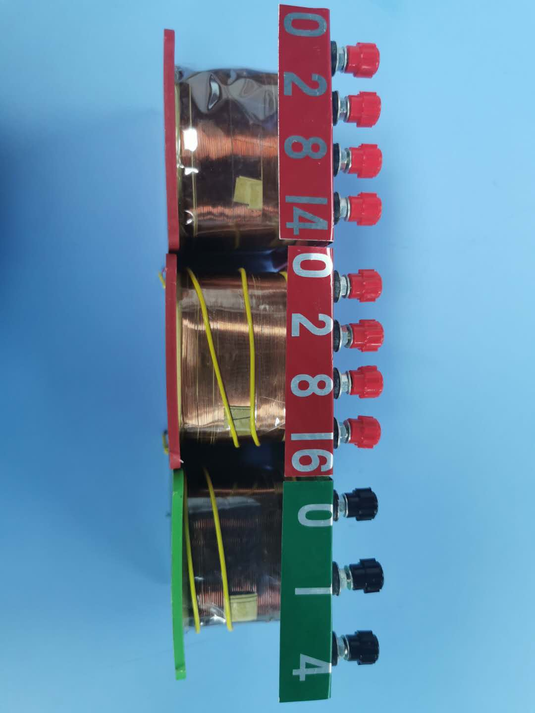

（a）通过接线柱选择绕组

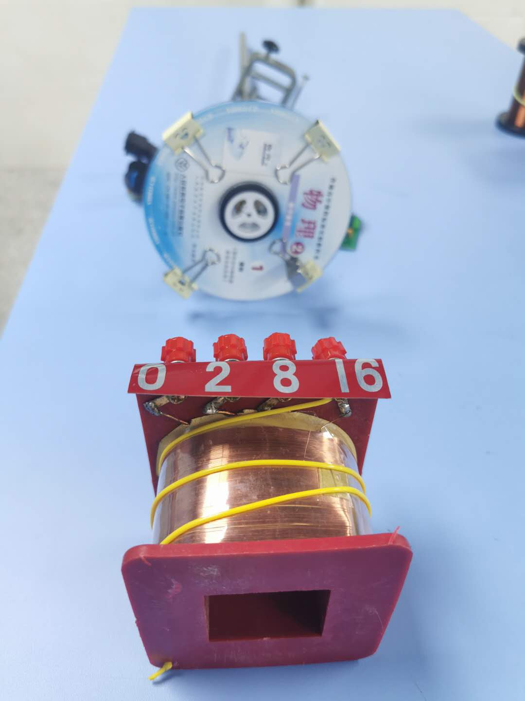
（b）观察线圈与圆盘的位置关系

<figcaption><strong>图 5　改变匝数时，保持几何条件同样重要。</strong>图（a）显示线圈的多个接线柱，具体接法和匝数以器材标识为准；图（b）提示应同时关注线圈与磁铁运动路径的相对位置。原照片保留，没有依据外观补绘接线。[3]</figcaption>
</figure>

### 调节快慢，并测出实际转速

为控制转动，王硕曾学习使用 Arduino——一种可以通过编程连接传感器的开发板。她的研究文稿记载，显示电压和磁感应强度的问题较容易处理，转速测量的编程却比较麻烦。后来，她找到直流调速装置与减速马达，将其组装用于实验，再用独立的非接触式转速仪测量转速。[2]

这次选择使运动控制和速度测量各有承担者。调速旋钮改变电机的运行状态，转速仪给出实际读数。两个位置相近的旋钮刻度，并不保证得到两个预期比例的转速；实验记录应填写测得的转速。

王硕记载，当时购买的相关调速部件约花费 30 元。这个数额说明了她如何借助现成部件解决问题，不包括实验室已有的传感器、电脑和转速仪，也不能作为整套装置的成本。

### 保存波形，才能回看测量过程

微电压传感器接在线圈两端，与电脑上的数字化软件连接，记录电压随时间的变化。与直接读指针相比，保存波形使教师和学生可以回看多个周期，观察峰值是否稳定，比较不同条件下的变化。传感器测得的是接线端的电压；将它用于讨论感应电动势时，还需注意测量设备的输入特性和对线圈的负载影响。

<figure id="fig-6">
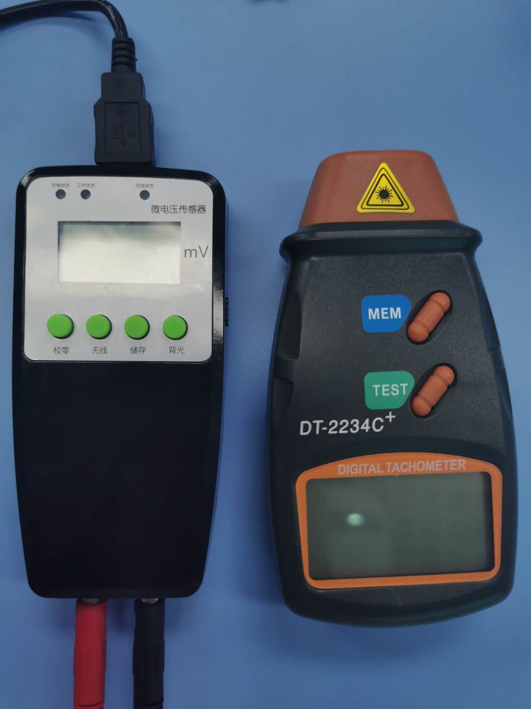
<figcaption><strong>图 6　两种仪器记录不同的量。</strong>左侧微电压传感器记录线圈端电压，右侧转速仪记录转动快慢。原操作说明要求将转速仪对准运动部件上的反光标记。两类记录需要与同一次实验条件对应，不能用调速旋钮位置代替转速读数。[1][3]</figcaption>
</figure>

<figure id="fig-7">
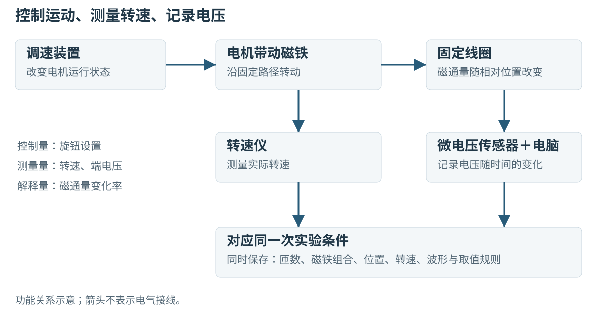
<figcaption><strong>图 7　控制路径与测量路径。</strong>根据原装置整理的功能关系图，箭头表示作用或信息的传递，不表示电气接线。调速、测速与电压记录分别解决“怎样改变”“改变了多少”和“产生什么响应”三个问题。</figcaption>
</figure>

## 四、用三个实验逐步研究感应电压

装置准备好后，王硕安排了三个探究：改变线圈匝数，改变小磁铁数量，以及改变磁铁转速。每次选择一个操作量，并保持其余相关条件，使学生能够说明不同记录之间为何可以比较。[1][4]

### 1. 改变匝数，比较电压记录

第一组实验保持磁铁组合、转速及线圈与磁铁的相对位置，改变线圈匝数。原研究使用 10 个小磁铁，记录了 100、200、400、800、1400 和 1600 匝时的电压变化。操作时，先接入选定绕组，待转动稳定后记录波形，再按相同方法改变匝数、保存记录，最后整理成表并作图。[2][4]

<figure id="fig-8">

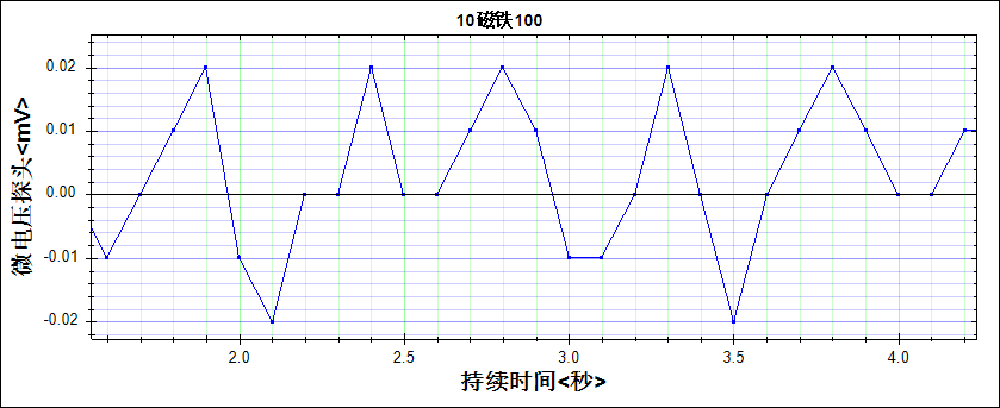
（a）原图标注：10 个磁铁、100 匝

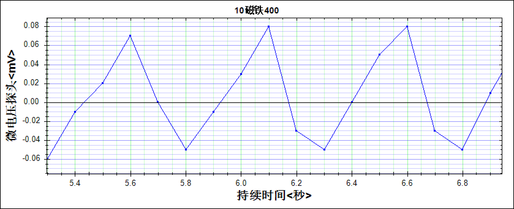
（b）原图标注：10 个磁铁、400 匝

<figcaption><strong>图 8　先读波形，再确定比较方法。</strong>两幅图保留原课件中的测量曲线与坐标。纵轴刻度不同，不能凭曲线在画面中的高度比较电压；应读取坐标数值，并采用一致的取值规则。原图中的周期波动也应保留在讨论中，不以平滑重画代替测量记录。[3]</figcaption>
</figure>

波形有正、负变化，一条曲线不能直接等同于表中的一个数。若取正峰值，就应在各条件下使用相同的选段和取值方法；若取峰峰值或某一过程的平均值，也应明确其定义。原稿提出“截取稳定区域”，但尚未完整说明代表值的提取规则。下表保留原材料的汇总数值，供比较记录趋势；进一步复现实验时，需要同时保存原波形与取值说明。

| 线圈匝数 $N$／匝 | 100 | 200 | 400 | 800 | 1400 | 1600 |
|---|---:|---:|---:|---:|---:|---:|
| 原材料的电压记录值 | 0.02 | 0.04 | 0.08 | 0.16 | 0.28 | 0.34 |

三组数据的原表把电压单位写为 V，现存波形图则标为 mV，二者尚需核对。本节保留原数值，不作单位换算，也不据此计算绝对电压或仪器灵敏度。[2][4]

这一组记录显示，电压代表值随匝数增加而增大，接近线性变化。用它讨论匝数的作用时，还需明确各匝线圈的磁通量变化条件基本一致。线圈位置、面积或磁铁路径的改变，都会影响这项比较。

### 2. 改变磁铁数量，辨认操作量与理论量

第二组实验将线圈设为 1400 匝，保持线圈位置与电机转速，逐步改变小磁铁数量。每改变一次磁铁组合，都应检查固定和位置，待运动稳定后再记录电压。[1][4]

| 小磁铁数量／个 | 2 | 3 | 4 | 5 | 6 | 7 | 8 |
|---|---:|---:|---:|---:|---:|---:|---:|
| 原材料的电压记录值 | 0.07 | 0.10 | 0.14 | 0.17 | 0.21 | 0.24 | 0.30 |

原方案用增加磁铁数量的方法改变磁场及磁通量变化的条件。表中记录随磁铁数量增加而增大，但磁铁数量与磁通量之间还隔着具体的磁场分布和几何条件。王硕在误差分析中已经指出，磁铁无法保证完全相同，磁感应强度与磁铁数量不严格成正比。[1]

教学中可以据此追问：实验直接改变的是什么？要把“磁铁数量增多”进一步解释为“磁通量变化增大”，需要保持哪些条件？学生由此接触到实验建模中的一个具体问题：理论量往往需要通过可操作的量加以控制，两者之间的联系必须说明。

### 3. 改变转速，联系磁通量变化的快慢

第三组实验保持线圈匝数为 1400 匝、磁铁数量为 10 个，并保持运动路径及线圈位置。调节电机后，用转速仪读出实际转速，再记录相应电压。原材料给出如下结果。[4]

| 转速 $r$／（r·min⁻¹） | 60 | 83 | 99 | 118 | 138 | 147 |
|---|---:|---:|---:|---:|---:|---:|
| 原材料的电压记录值 | 0.68 | 0.97 | 1.29 | 1.52 | 1.70 | 1.78 |

转速在这里提供了研究变化快慢的一条路径。磁铁组合、线圈和运动路径不变时，选取相同的起止位置，单匝线圈的磁通量变化量 $\Delta\Phi$ 相同；转得越快，经过该区间所需的时间 $\Delta t$ 越短。由平均感应电动势的大小

$$
|\overline{\mathcal E}|=N\frac{|\Delta\Phi|}{\Delta t}
$$

可知，在这些条件下，所选区间的平均感应电动势大小随转速增加而增大。这里的 $N$ 为匝数，$\Phi$ 指各匝所链磁通量近似相同时的单匝磁通量。选取的区间应有非零的磁通量变化；如果把完整一周的正、负变化全部平均，得到的量便不同。

若表中采用的是波形峰值，则应从瞬时关系解释。在固定几何和磁场条件下，将磁通量写成转角 $\theta$ 的函数，有

$$
\mathcal E(t)=-N\frac{\mathrm d\Phi}{\mathrm d\theta}\omega,
$$

其中 $\omega$ 为角速度。相同位置的磁通量随转角的变化关系保持不变时，角速度越大，相应感应电动势的绝对值越大。这一解释同样要求仪器能够响应所测信号，并且不同转速下的取值规则一致。

因此，这项实验的关键是把转速与经过同一位置区间的时间联系起来。转速仪测量的是转动快慢，磁通量变化率还需要通过模型关系解释。原材料的记录为讨论这一联系提供了实例，具体的代表值定义仍应与原波形对应。

### 4. 用控制条件组织结论

三个实验分别改变匝数、磁铁数量和转速，学生可以将操作记录与物理解释放在一起比较：

| 实际改变的量 | 比较前重点检查 | 结果解释中的关键条件 |
|---|---|---|
| 线圈匝数 | 接入绕组、线圈位置、磁铁组合与转速 | 各匝所链磁通量的变化条件基本一致 |
| 磁铁数量 | 排布、固定方式、磁铁与线圈的距离 | 不能把数量的倍数直接当作磁通量的倍数 |
| 实际转速 | 运动路径、磁铁组合、线圈位置与取值方法 | 同一位置区间的磁通量变化条件保持不变 |

王硕把固定装置、磁铁差异和线圈位置列为误差来源。这些反思可以引导学生回看自己的实验：数据偏离预期时，先检查具体条件及记录方法，再讨论是否需要改进结构或测量。控制变量法也由一句原则落实为能够检查的动作。

## 五、把装置改造转化为学生的探究任务

### 先为实验操作作准备

在王硕的学习任务单中，课前准备包括预习电磁感应内容、完成实验预习，以及学习传感器和数字化软件的使用。[5]这些准备使课中讨论能够集中在变量与证据上。教师可以在正式测量前让学生先说明仪器各自测什么、哪些设置会影响结果，再进入具体实验。

<figure id="fig-9">
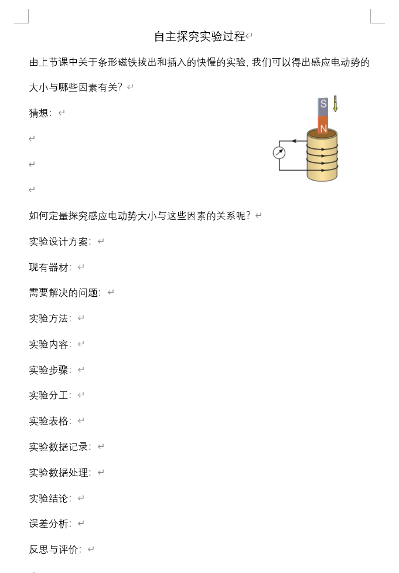
<figcaption><strong>图 9　从猜想到反思的实验预习模板。</strong>原分享材料依次安排猜想、方案、器材、实验步骤、分工、数据记录与处理、结论和反思。图中为未填写模板，用于说明任务设计，不是学生实填成果。[6]</figcaption>
</figure>

### 让学生参与方案和证据的讨论

原学习任务单安排了四项任务：由定性现象提出猜想，讨论定量探究需要解决的问题，寻找器材并开展实验与数据处理，最后分析误差和创新之处。[5]据此组织教学时，可以把学生需要留下的材料和教师需要追问的问题对应起来。

提出猜想时，要求学生说清准备研究的关系。讨论方案时，让学生在装置草图上标出改变的量、保持的条件及测量位置。进入测量后，每组记录应同时保留实验条件和结果；作图后，再说明图像支持了怎样的判断。这样，实验报告就能够呈现由问题到证据的过程。

| 学生完成的任务 | 留下的记录 | 教师可提出的追问 |
|---|---|---|
| 选择要研究的关系 | 猜想及拟改变的量 | 这次比较准备说明什么？ |
| 讨论装置与步骤 | 草图、控制条件、测量安排 | 怎样知道其他条件没有一起改变？ |
| 保存并处理数据 | 波形、读数及取值说明 | 表中的一个数来自波形的哪一部分？ |
| 解释与改进 | 结论、问题及改进建议 | 如果再次测量，你最先检查哪一处？ |

这些追问是依据原任务设计提出的教学用法，可按学生基础选用。对初次接触数字化实验的学生，可以先提供已连接的装置，让他们完成变量选择和记录；操作较熟练后，再增加器材选择与方案设计的自主程度。任务难度应与学生能够承担的操作和推理相适应。

### 用具体问题引出后续改进

王硕的作业要求学生寻找器材组装实验、完成学习任务，并讨论改进方法。[5]延伸任务可以围绕一次实际观察展开，例如圆盘是否晃动、改变线圈后位置能否保持、同一条件下的读数为什么有差别。学生提出改动后，还应说明准备通过什么记录判断改动是否有效。

这项实践把教学需要落实到了具体的器材选择和测量安排中：为了控制运动，她采用电机带动圆盘；为了知道实际转速，她使用独立仪器；为了保存快速变化的信号，她引入微电压传感器。学生沿这些选择继续讨论变量、证据和解释，就能够看到定量探究怎样由一个教学问题逐步形成。

## 资料来源

[1] 王硕：《定量探究法拉电磁感应定律说课稿》，精品课资料中的 Word 稿及 PDF 稿。

[2] 王硕：《基于高中物理学科核心素养，对定量探究法拉第电磁感应定律的研究》，研究与分享文稿。

[3] 王硕：《法拉第电磁感应定律（实验课）》，精品课课件。

[4] 管佩磊，王硕：《新教材实施下的高中物理实验创新研究——以“法拉第电磁感应定律”教学为例》，《中学物理教学参考》，2021，50（4）：36—38。

[5] 王硕：《教学设计》《学习任务单》《作业练习》，法拉第电磁感应定律精品课配套资料。

[6] 王硕：《基于培养学生核心素养能力，物理实验器材创新性和可行性研究》，深圳市分享课件。
