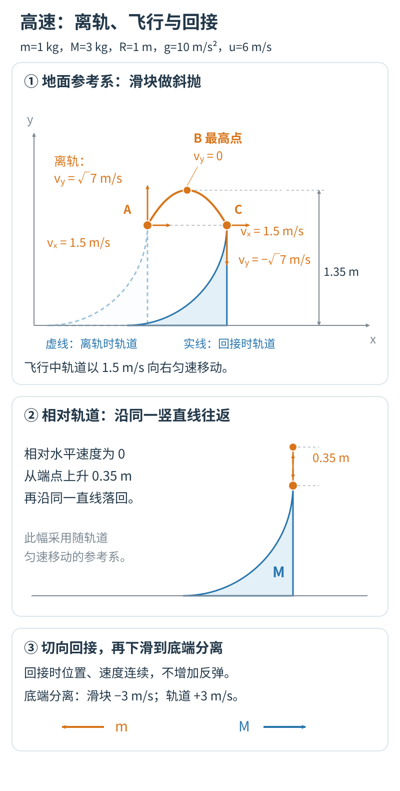
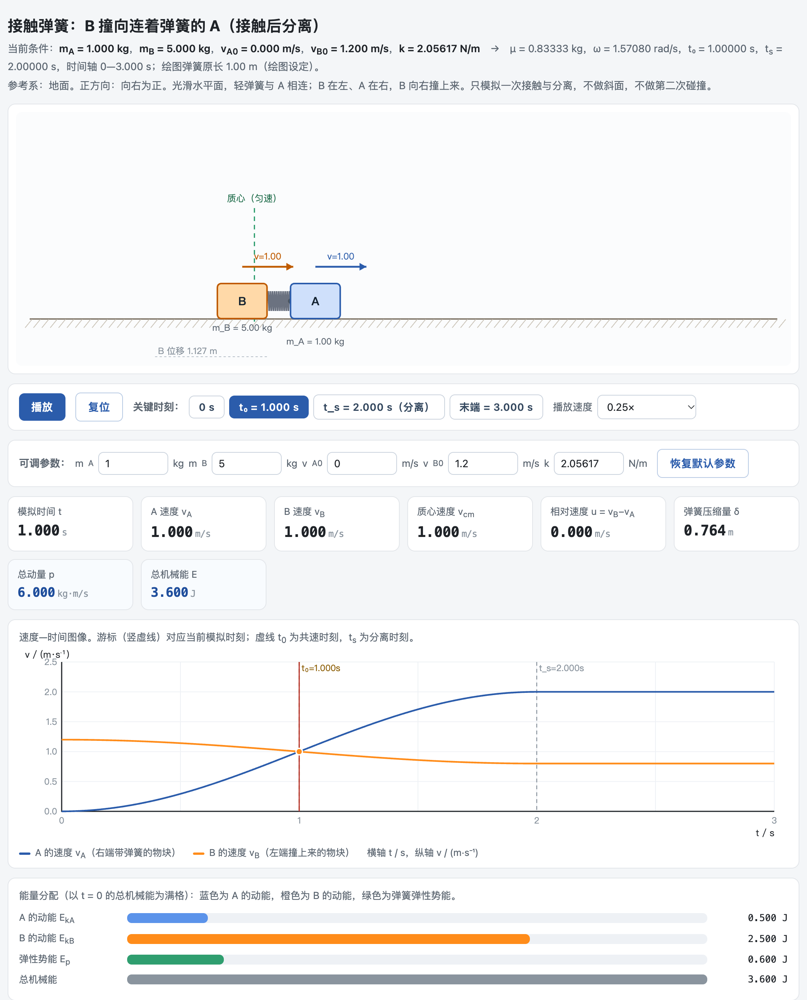

# 圆弧轨道页：第 5—7 步

本文原是《把物理做出来》第 7 章第三节的后三步，正文只留了概要。文中“第四节”指书中第 7 章第四节。

## 第 5 步　提高初速度，处理飞出与落回

回到自由轨道，$m=1\ \mathrm{kg}$、$M=3\ \mathrm{kg}$，把初速度提高到 6 m/s。滑块会冲到顶端、飞出、落回，再沿圆弧下滑，最后从底端离开。顶端切线竖直，滑块相对轨道的水平速度为零，所以离轨时 $v_x=V$。由水平动量和机械能可得 $v_x=V=1.5\ \mathrm{m/s}$，$v_y=\sqrt7\ \mathrm{m/s}\approx2.65\ \mathrm{m/s}$。离轨以后轨道匀速向右，滑块保留同样的水平速度，相对地面作斜抛；换到轨道上看，滑块只是竖直上升又落下，始终对准移动中的顶端。



| 事件 | 高度（m） | 滑块地面速度 $v_x$，$v_y$（m/s） | 轨道速度（m/s） |
| --- | --- | --- | --- |
| 顶端离轨 | 1 | 1.5，$+\sqrt7$ | 1.5 |
| 飞行最高点 | 1.35 | 1.5，0 | 1.5 |
| 回到移动顶端 | 1 | 1.5，$-\sqrt7$ | 1.5 |
| 底端分离 | 0 | −3，0 | 3 |

本例在到达顶端之前支持力一直为正，离轨是因为圆弧在顶端结束，而不是支持力减到零。这一步过程复杂，先让 AI 讲方案，确认无误再写程序：

```text
我想加一个高速情境：初速度改成 6 m/s，其余不变。滑块会冲出顶端、落回、再滑下来。
请先别改文件，先讲清楚：整个过程分几段，每段用什么规律，每段在什么时候开始和结束，段与段之间位置和速度怎么接上。
我算的离轨速度是 vx = V = 1.5 m/s，竖直向上约 2.65 m/s；飞行最高点 1.35 m；最后分离时滑块 -3 m/s，轨道 3 m/s。
```

读方案时看三处：离轨位置是不是随轨道移动的顶端；飞行时是否保留了水平速度；落回后是否真的接上了下滑。三处都对，再让它实现，并加一句：“做完后，在离轨和落回这两处，各取事件前、事件时、事件后三个相邻时刻，列出网页实际用的高度和速度给我看。”这一句很要紧，原因见第四节。还可以请它先说明低速实现里哪些沿用、哪些要改，免得它推倒重来，把已经核对过的低速情境也改坏。

做好的五情境网页，连同审核页、课堂活动单、物理核验算例和计算附录，都收在配套包第 7 章。

## 第 6 步　把有效的要求保存下来

请 AI 把对话里积累的模型条件、检查方法和修改记录整理成“项目说明.md”，分清“已经做了”“已经检查过”“还打算做”。下次接着做，开头先说：“请先读项目说明.md 和 index.html，再处理下面的修改。”文件放在工作空间里，AI 不一定会自己去读。能用在别的资源上的方法，可以存成 Skill，也就是一份可反复使用的工作说明；配套包里有一份配套包第 7 章的 `physics-web-coach/SKILL.md`，读过、认可以后拖进对话即可。

## 第 7 步　用模板派生一个弹簧碰撞页

有了圆弧轨道，再做下一个模型时可以把它当作模板。派生之前，先把两类东西分开：

| 可以沿用 | 必须重写 |
| --- | --- |
| 播放、暂停、复位，关键时刻按钮 | 系统由哪几个物体组成，哪个方向动量守恒 |
| 图表布局和配色 | 运动方程，阶段怎样切换、什么时候结束 |
| 画面、读数和曲线从同一个状态取数 | 各关键时刻的检查数值 |

左列搬过来能省很多事；右列每一项都要按新模型重新确定。我用这个办法从圆弧轨道派生了一张弹簧碰撞页：B 以 1.2 m/s 撞上与静止的 A 相连的轻弹簧，劲度系数特意凑成共速恰在 1 s、分离恰在 2 s，四个时刻的读数都能手算核对。



完整的提示词、解析解、核对表和两处修订（分离后弹簧仍连着 B、调大初速度后两物块穿过彼此）和做好的页面一起收在配套包第 7 章。

