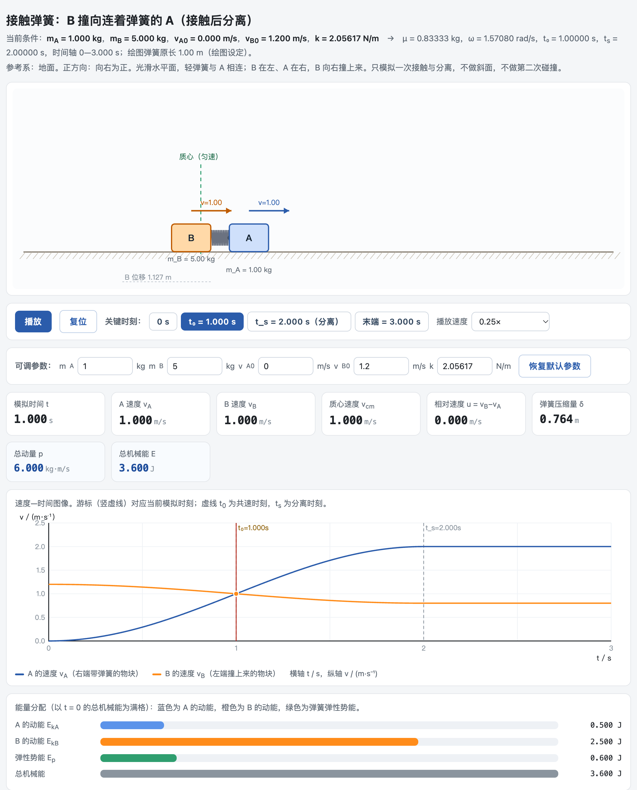

# 从圆弧轨道网页派生弹簧碰撞页：完整步骤

有了圆弧轨道，再做下一个模型时，可以把它当作模板。派生之前，先把两类东西分开：

| 可以沿用 | 必须重写 |
| --- | --- |
| 播放、暂停、复位 | 系统由哪几个物体组成，哪个方向动量守恒 |
| 图表布局和配色 | 运动方程 |
| 画面、读数和曲线从同一个状态取数 | 阶段怎样切换、什么时候结束（分离、离槽、飞出） |
| 关键时刻按钮 | 各关键时刻的检查数值 |

左列搬过来能省很多事；右列每一项都要按新模型重新确定。具体操作时，在同一个工作文件夹里新建任务，把圆弧轨道网页、项目说明和 `physics-web-coach` 交给它，先请它说出实际读到了哪些文件，哪些界面可以沿用。

先做一段条件清楚的接触—分离过程：轻弹簧连在 A 上，B 从左侧撞来，两物体在光滑水平面上运动。

提示词：

```text
请参考我给的圆弧轨道网页，新建一个弹簧碰撞网页，文件名用 spring-collision.html。保留播放、暂停、复位和图表的用法。现在是左边的 B 向右撞上与 A 相连的轻弹簧，A 原来静止，A、B 的质量分别为 1 kg、5 kg，B 初速度 1.2 m/s。弹簧劲度系数取 5π²/24 N/m（约 2.06 N/m），这样压得最短正好在 1 s。两物体在光滑水平面上运动，弹簧恢复原长就分离。我要同时看到物块、两条速度曲线和能量变化，能停在压得最短和恢复原长的时刻。先做这一段。
```

劲度系数是特意凑的：$k=5\pi^2/24\ \mathrm{N/m}$ 时，相对运动的角频率 $\omega=\pi/2\ \mathrm{rad/s}$，共速恰在 1 s，分离恰在 2 s。少了这一句，AI 会自己定一个 $k$，后面表里的时刻和位移就都对不上。A、B 的身份这时最容易混，图上的字母、速度曲线的图例和公式要一起换。

页面用解析解直接驱动画面：直接用公式写出每一时刻的状态，不从初态一小步一小步往前推。设撞来的物体质量 $m_1$、初速度 $v_0$，被撞物体质量 $m_2$、原来静止：

$$\mu=\frac{m_1m_2}{m_1+m_2},\quad \omega=\sqrt{\frac k\mu},\quad v_\mathrm{cm}=\frac{m_1v_0}{m_1+m_2},$$

$$v_1=v_\mathrm{cm}+\frac{m_2}{m_1+m_2}v_0\cos\omega t,\qquad v_2=v_\mathrm{cm}-\frac{m_1}{m_1+m_2}v_0\cos\omega t.$$

质心速度不变，两者的相对运动是简谐运动。接触后分离的情形只取半个周期：$\omega t$ 从 0 走到 $\pi$，相对速度从 $v_0$ 变到 $-v_0$，弹簧恢复原长，正好是弹性碰撞的结果。本例 B 撞 A，代入得 $v_B=1+0.2\cos\omega t$，$v_A=1-\cos\omega t$（单位 m/s）。AI 的回答里多半会出现“约化质量”“解析解”这些词，没学过也不要紧，可以对 AI 说：“我不熟悉‘约化质量’和‘解析解’，请用高中物理的话说说它们在这个弹簧页里各管什么；再给我两三种检查页面算得对不对的办法。”

打开生成的页面，停在几个时刻核对（弹簧原长取 1 m，只用来确定画面中的连接位置）：

| 停在哪一刻 | 本次参数下应当得到 |
| --- | --- |
| 0 s | A 静止，B 为 1.2 m/s；总动量 6 kg·m/s，总机械能 3.6 J |
| 1 s（最大压缩） | A、B 均为 1 m/s，弹性势能 0.6 J；B 的位移约 1.127 m，压缩量约 0.764 m |
| 2 s（分离） | A 为 2 m/s，B 为 0.8 m/s，弹性势能为零 |
| 3 s（分离后） | 两速度仍为 2 m/s、0.8 m/s，位置继续改变 |



初版的速度都对，弹簧的画法却有问题：分离后仍把两端画在 A、B 之间，两物块越离越远，弹簧也被拉长。修订时把要求落实到连接关系：弹簧只连着 A，恢复原长以后，B 与弹簧左端之间要出现空隙。现在 3 s 时弹簧仍长 1 m，B 与弹簧的间隙为 1.2 m。

调参又暴露了一个绘图条件：B 初速度改为 2 m/s 后，最大压缩量约 1.27 m，已经大于原先设的 1 m 原长。理想轻弹簧模型里原长不进入计算，只决定画面上两物块的间距，所以页面可以随参数增大绘图原长，并把它标为绘图设定，两个物块就不会相互穿过。修订后的页面收在 `配套包/第07章/弹簧碰撞页.html`。核对以后，把文件名、A/B 的身份、解析解、分离条件和这组检查数值写进它自己的项目说明；通用技能里只保留方法。


（本文原为书稿原第 8 章（现第 7 章）第三节第 7 步，2026-11-08 按作者决定移入配套包；做好的页面见同一文件夹的 `弹簧碰撞页.html`。）
