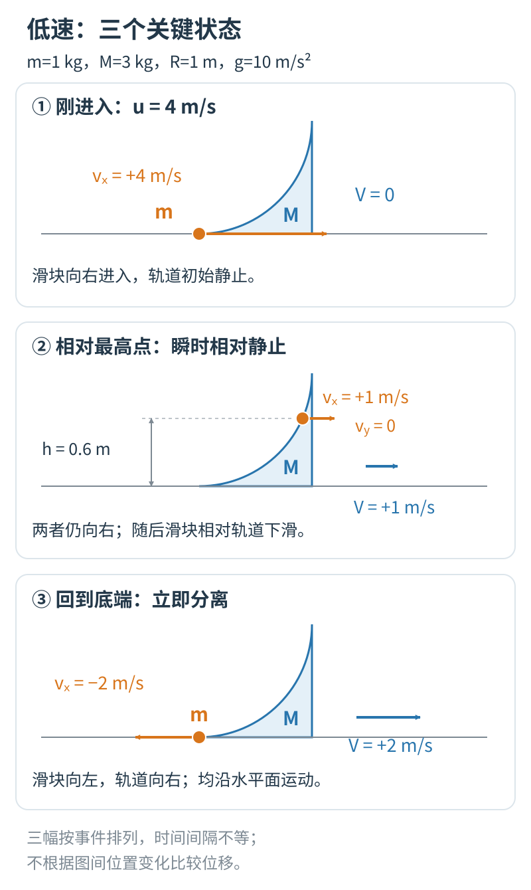
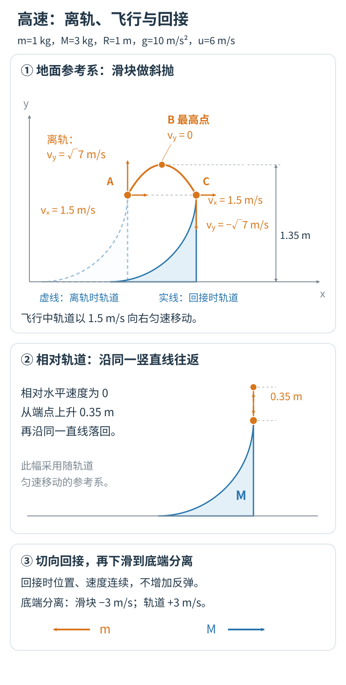

# 怎样检查这个模拟网页：先看现象，再算数值，最后作判断

拿到 AI 生成的网页，教师首先需要回答一个很实际的问题：这个画面能不能拿来帮助学生理解物理？

播放顺畅只是开始。滑块和轨道的运动是否合理，数字与画面是否一致，学生能否看出我们想讲的关系，都需要继续检查。AI 可以帮助计算、查程序和寻找异常；教师要看懂它提供的依据，再决定哪里应当修改、哪些内容适合放进课堂。

这份资料以可移动圆弧轨道为例，说明怎样完成这样的审核。先看第一组情境，再按网页已经增加的功能检查其他情境。供 AI 实现计算的完整方程放在[物理模型与计算附录](物理模型与计算附录.md)，可以作为附件交给它，不必从微分方程开始阅读。

## 先把网页停在一个值得判断的地方

取滑块质量 $1\ \mathrm{kg}$，轨道质量 $3\ \mathrm{kg}$，圆弧半径 $1\ \mathrm m$，重力加速度 $10\ \mathrm{m/s^2}$。轨道开始静止，滑块从底端以 $4\ \mathrm{m/s}$ 向右进入。

滑块按质点处理，不考虑滚动；圆弧内表面与地面都光滑，轨道只能水平移动。下面所说的速度均相对于地面，向右为正。

先播放一次完整过程，再把画面停在滑块相对轨道的最高点。此时应看到：

- 滑块暂时不再沿弧面上升，也还没有开始下滑。
- 滑块与轨道仍然一起向右运动。
- 两者的水平速度相等，均为 $1\ \mathrm{m/s}$；滑块的竖直速度为零。

图中的最高点最值得停下来审。暂停时，先看速度读数和箭头：两者应同为向右 $1\ \mathrm{m/s}$，不能因为画面暂停，就把物理速度显示为零。继续播放或逐步前进时，再对照固定的地面标记检查位移；滑块与轨道应继续运动，滑块逐渐相对轨道下滑。瞬时共速不意味着以后一直一起运动。

### 用高中物理算一遍，判断才有依据

选择滑块与轨道组成的系统，水平方向不受外力。初始水平动量为 $1\times4=4\ \mathrm{kg\cdot m/s}$。设最高点两者共同速度为 $v$，则

$$(1+3)v=4,$$

所以 $v=1\ \mathrm{m/s}$。即使还没有打开网页，我们也已经知道这个关键状态应该怎样运动。

初始动能为 $8\ \mathrm J$。最高点两者仍有动能：

$$E_k=\frac12(1+3)\times1^2=2\ \mathrm J.$$

剩下的 $6\ \mathrm J$ 转化为滑块的重力势能，所以

$$1\times10\times h=6,\qquad h=0.6\ \mathrm m.$$

这三个结果可以放在同一处检查：两者向右、共同速度为 $1\ \mathrm{m/s}$、高度为 $0.6\ \mathrm m$。如果数字正确，画面里的箭头却指向左方，问题仍然没有解决。

## 把“正确答案”和“实际看到的结果”并排放

为了便于教师审核，可以要求 AI 提供一个简洁的检查页面。每个关键状态同时呈现参数、实际画面和实际读数，旁边放上独立计算的预期。AI 的判断放在下面，教师可以对照后写下自己的意见。

以下是检查表的填写方式。右栏应根据打开网页后的观察填写，不能直接抄左栏。

| 要检查的状态 | 教师先算出的结果 | 网页实际表现 |
| --- | --- | --- |
| 刚进入底端 | 滑块向右 $4\ \mathrm{m/s}$，轨道静止 | 观察后填写 |
| 相对最高点 | 两者均向右 $1\ \mathrm{m/s}$，高度 $0.6\ \mathrm m$ | 观察后填写 |
| 返回底端并分离 | 滑块向左 $2\ \mathrm{m/s}$，轨道向右 $2\ \mathrm{m/s}$ | 观察后填写 |

分离状态可以再算一次。水平动量为

$$1\times(-2)+3\times2=4\ \mathrm{kg\cdot m/s},$$

动能为

$$\frac12\times1\times(-2)^2+\frac12\times3\times2^2=8\ \mathrm J.$$

它们与初态相符。但这只能帮助我们确认这个状态，过程还要继续看。比如滑块是否平顺地从底端离开，还是到达底端以后速度突然跳成了答案。

### 可以这样要求 AI 提交审核材料

~~~text
请把当前网页整理成便于物理教师审核的形式。

保留可运行的网页，并另外提供一个可直接打开的审核页面。审核页面使用当前这份网页的真实结果，不用示意图代替运行截图。

每项检查集中放在一起：
当前模型条件与参数；
我给出的理论预期及简短计算；
网页的实际读数与对应画面；
你发现的一致或不一致之处；
留给教师填写的判断。

关键状态可以直接定位，也能从该状态继续播放。截图须看得清对象、参数、读数和状态；发现差异时标出具体位置，并链接回当前网页，方便我重现。
实际读数从运行状态取得，不得把预期答案填进实际结果栏。

你无法执行的检查写清楚需要我怎样操作，不要替我填写观察结果，也不要代替教师写“同意用于课堂”。
~~~

这个要求改变了 AI 的交付方式。它需要把判断所依赖的材料摆出来，教师也就能看见：这条结论依据哪个画面、哪组数据，是否对应自己正在检查的文件。只给一份“全部通过”的文字报告，教师很难继续判断。

审阅的过程也是学习的过程。例如，最高点的速度为什么不为零，改变质量后滑块为什么可能继续向右，都可以在核对画面与计算时重新想清楚。审核页面应便于进入，也应保留进一步查看的依据：简短计算放在旁边，完整推导、原始数据和相关程序按需展开。教师不必一开始读完全部材料，但需要时应当找得到。

## AI 适合查什么，教师还要看什么

有些检查重复而细碎，适合交给 AI。比如遍历几组参数，计算许多时刻的动量和能量，查出第一次明显偏离的时刻。教师则可以把注意力放在条件是否选对、物理解释是否成立，以及画面是否真的帮助学生理解。

两方面会有交叉。教师发现的疑点可以再交给 AI 调查；AI 提出的异常，也需要结合模型条件判断。可以按下面的方式配合：

| 检查内容 | 让 AI 提供的帮助 | 教师据此作出的判断 |
| --- | --- | --- |
| 物理模型 | 列出所用条件、规律与计算依据 | 这些条件是否符合这道题？守恒方向有没有用错？ |
| 数值计算 | 比较理论值与运行值，找出差异出现的时刻 | 差异是显示舍入造成的，还是会影响结论的错误？ |
| 画面表达 | 对照位置、箭头、数字与曲线，标出不一致 | 学生会怎样理解这幅画面？参考系是否容易混淆？ |
| 课堂操作 | 检查暂停、定位、切换参数和复位 | 教师能否顺畅地组织预测、观察与解释？ |

### 请 AI 检查整个过程

本例的总水平动量应始终为 $4\ \mathrm{kg\cdot m/s}$；计入滑块的重力势能后，总机械能应始终为 $8\ \mathrm J$。可以让 AI 把程序计算出的两条曲线画出来。若它们随时间明显变化，就标出变化发生的位置，再检查原因。

有时程序显示的读数只保留两位小数，用这些数字手算会出现舍入差异。让 AI 用程序内部保留的完整数值检查，并说明差异多大、是否影响我们要讲的结论。

还要检查运动的快慢。计算机通常把时间分成许多很小的间隔，逐步算出运动。这个间隔叫“时间步长”。让 AI 用原步长和减半后的步长各算一次，比较最大高度和到达关键状态的时间；如果结果还在明显变化，就不宜急着把它当作稳定结果。

动量和能量看起来守恒，也不能包办所有检查。假如程序让滑块以随意安排的节奏运动，同时贴上符合守恒关系的数字，学生依然会被误导。因此还要用相邻时刻的位置变化检查速度，并把画面与数据对应起来。具体计算交给 AI，教师要能看懂它选了哪一段、比较了什么、为什么认为合理。

### 教师亲自完成一次课堂操作

暂停在上滑途中，看位置、速度箭头与读数能否互相解释。切换到半速播放，观察同一模拟时刻的状态是否保持一致；半速应改变观看节奏，不应改变这道题的物理结果。

再试一次关键状态定位，并从那里继续播放。最后换一组质量，查看参数是否已更新，旧曲线和旧答案是否已经清除。复位以后，应回到当前参数对应的初态。

这几步同时检查物理表达和课堂使用。教师最终认可的应是自己能够说明条件、解释结果、组织学生使用的具体版本。

## 改变质量，用不同结果检验同一种解释

保持初速度 $4\ \mathrm{m/s}$、半径 $1\ \mathrm m$ 与 $g=10\ \mathrm{m/s^2}$ 不变，只改变质量。三个情境最适合检查“相对轨道返回”和“相对地面向左”是否被混为一谈。

| 滑块质量、轨道质量 | 相对最高点 | 从底端分离以后 |
| --- | --- | --- |
| $1\ \mathrm{kg}$、$3\ \mathrm{kg}$ | 高度 $0.6\ \mathrm m$；两者向右 $1\ \mathrm{m/s}$ | 滑块向左 $2\ \mathrm{m/s}$，轨道向右 $2\ \mathrm{m/s}$ |
| $1\ \mathrm{kg}$、$1\ \mathrm{kg}$ | 高度 $0.4\ \mathrm m$；两者向右 $2\ \mathrm{m/s}$ | 滑块静止，轨道向右 $4\ \mathrm{m/s}$ |
| $3\ \mathrm{kg}$、$1\ \mathrm{kg}$ | 高度 $0.2\ \mathrm m$；两者向右 $3\ \mathrm{m/s}$ | 滑块向右 $2\ \mathrm{m/s}$，轨道向右 $6\ \mathrm{m/s}$ |

第三组里，滑块与轨道都向右，轨道运动得更快，所以滑块仍从轨道的左侧离开。教师可以据此判断画面是否同时交代清楚地面参照与相对运动。

第二组也值得在分离后继续播放一小段：滑块应停在地面上的同一个位置，轨道则继续向右。当前配套程序保留了分离后的有限观察区间，到末尾会整体暂停；应在这段区间内比较两个时刻，不能把程序停止播放当作物理过程停止。这里既有数值预期，也有肉眼容易核对的现象。

## 增加新过程，就重新检查发生了什么

### 初速度增大到 $6\ \mathrm{m/s}$

重新使用滑块 $1\ \mathrm{kg}$、轨道 $3\ \mathrm{kg}$，其他条件不变。滑块到达顶端时仍向上运动，会飞出轨道，再落回移动中的顶端。

先让 AI 把各阶段连接起来，再亲自看以下几个状态：

| 状态 | 应看到的现象与数值 |
| --- | --- |
| 离开顶端 | 高度 $1\ \mathrm m$。滑块与轨道的水平速度都是向右 $1.5\ \mathrm{m/s}$，滑块还有向上约 $2.646\ \mathrm{m/s}$ 的速度 |
| 飞行最高点 | 离地高度 $1.35\ \mathrm m$。竖直速度为零，水平仍向右 |
| 落回轨道 | 回到正在移动的顶端；向下速度约 $2.646\ \mathrm{m/s}$，随后沿轨道下滑 |
| 从底端分离 | 滑块向左 $3\ \mathrm{m/s}$，轨道向右 $3\ \mathrm{m/s}$ |

离轨时只说“两者速度相等”不够准确：相等的是水平分量，滑块还在向上运动。飞行时也要看参考系：相对地面是斜抛，相对匀速移动的轨道才是竖直上抛。

这里还有一个模型判断要由教师把握。滑块离轨，是因为圆弧已经到头；不能笼统规定“支持力为零才允许离开”。回落时，滑块相对轨道的速度沿顶端切线，在本理想模型中可以连续接回下滑，不需要另加一次有能量损失的碰撞。

若网页允许任意改变初速度，还应检查“恰好到达顶端”的临界情况。本例临界初速度约为 $5.164\ \mathrm{m/s}$，准确表达式与临界两侧的检查放在计算附录中。

### 把轨道固定

仍取滑块 $1\ \mathrm{kg}$、初速度 $4\ \mathrm{m/s}$。固定轨道以后，最高高度应为 $0.8\ \mathrm m$，最高点滑块瞬时静止，返回底端后向左 $4\ \mathrm{m/s}$。

这一次，固定支架会施加水平外力，滑块与轨道组成的系统不再满足水平动量守恒。AI 如果仍套用“总水平动量必须不变”的检查，就会把正确结果判成错误。

教师需要先判断规律是否适用，再让 AI 按相应规律检查。这个步骤决定了审核的方向，不能只靠增加测试次数替代。

## 有了差异，怎样让 AI 继续改

反馈时，把问题放回具体情境：采用什么参数，做了哪个操作，实际看到什么，依据物理应该怎样。比如，若在等质量情境中看到分离后的滑块还在移动，就把那一段画面和参数一起交给 AI，要求它查明原因。

修改后，用同一组参数和同一种操作重新查看，把修改前后放在一起比较。同时再看受影响的其他情境，避免修正一个地方后破坏原先合理的部分。

教师最后写下的意见可以很具体：“最高点的速度与高度已与手算一致，三组质量的分离方向也能正确显示；但地面标记太淡，投影时学生不易分清参考系，需要调整后再用。”这比一个笼统的“通过”更有助于继续改进。这里举的是审核意见的写法，不代表本项目已经完成实测。

审核应当留下可解释的结论。AI 帮我们扩大检查的范围、整理差异；教师根据看得见的过程、算得清的依据和课堂需要，决定下一步怎样做。
