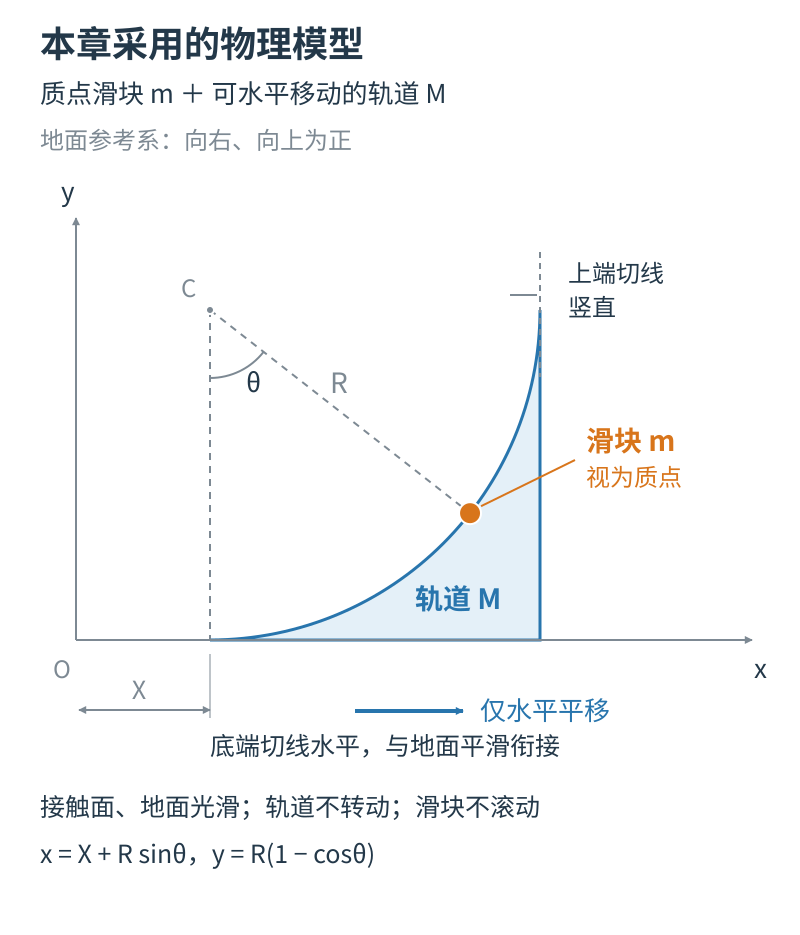

# 可移动圆弧轨道：预测、观察与解释

**教师使用说明**：这份活动单用于已学习动量守恒与机械能守恒的学生。课前先按当前网页支持的范围选择活动，确认预设、显示结果和关键状态定位等操作可以使用。第五部分固定轨道对照可作为选做；网页尚未提供时，仍可作为纸面计算与讨论题。

发给学生时，直接使用[学生版活动单](课堂活动单-学生版.md)，其中只保留学生用页。整份文件留给教师备课；末尾折叠区仍含答案，不随学生版发出。

<!-- 学生版开始：复制时从下一行开始 -->
## 学生用页

班级：__________　姓名：__________　日期：__________

**本次任务**：研究滑块沿一条可以移动的弧面上滑、返回并从底端分离的过程。先判断关键状态，再用网页观察和自己的计算说明理由。重点分清：物体相对轨道怎样运动，相对地面又怎样运动。

**研究条件**：滑块质量为 $m$，按质点处理，不考虑滚动；轨道质量为 $M$，只能水平平移，不发生转动。地面与接触面光滑，无空气阻力。轨道是半径 $R=1\ \mathrm m$ 的内凹四分之一圆弧，左下端切线水平并与水平面平滑相接，右上端切线竖直。轨道初始静止，滑块从左下端以 $u=4\ \mathrm{m/s}$ 向右进入，取 $g=10\ \mathrm{m/s^2}$。

以地面为参考系，向右、向上分别为正，底端高度为零，从滑块进入底端开始计时。没有特别说明时，速度都相对于地面。记滑块速度分量为 $v_x,v_y$，轨道速度为 $V$，滑块高度为 $h$。本单的“相对最高点”指滑块沿圆弧上滑后开始返回的转折位置。

先完成预测栏，再运行网页、揭示结果。观察与预测不同时，保留原预测，在解释栏写明修改依据。

### 一、先选系统，判断能用什么规律

选择滑块与轨道组成的系统，画出系统受到的外力方向，并回答：

1. 哪个方向的合外力为零？哪个动量分量可以按守恒关系分析？

   ____________________________________________________________________

2. 分析能量时，需要计入哪些物体的动能和哪一种势能？

   ____________________________________________________________________

### 二、基准情形：先预测关键状态

先取 $m=1\ \mathrm{kg}$、$M=3\ \mathrm{kg}$。

在下表写出判断或预计数值。暂时不会计算时，先写速度方向及理由。另画一幅你预测的最高点状态图，标出滑块和轨道的速度。

| 待判断状态 | 你的预测 | 判断依据 |
| --- | --- | --- |
| 到达相对最高点时，滑块相对轨道的速度 |  |  |
| 到达相对最高点时，滑块相对地面的 $v_x,v_y$ |  |  |
| 此时轨道的速度 $V$ |  |  |
| 从底端分离后，滑块相对地面的运动方向 |  |  |

状态图与说明：

____________________________________________________________________

____________________________________________________________________

### 三、观察同一过程，记录并计算

写完预测后，选择对应质量预设，再显示结果，观察完整上滑、返回和分离过程。用固定地面标记判断地面运动方向，用滑块相对轨道底端的位置判断相对运动。然后定位到相对最高点与底端分离状态，记录网页读数；若尚不能准确定位，写明观察时刻，不用附近一帧冒充关键状态。

| 状态 | 高度 $h$/m | 滑块 $v_x$/(m/s) | 滑块 $v_y$/(m/s) | 轨道 $V$/(m/s) |
| --- | --- | --- | --- | --- |
| 刚从底端进入 |  |  |  |  |
| 相对最高点 |  |  |  |  |
| 返回底端并分离 |  |  |  |  |

任选两个状态，计算系统的水平总动量，写出代入过程：

____________________________________________________________________

____________________________________________________________________

再比较刚进入与最高点的总动能、重力势能。哪些量改变，哪些关系保持？

____________________________________________________________________

____________________________________________________________________

选一项预测与观察对照，说明你保留或修改判断的理由。若网页读数与独立计算不一致，记下参数和发生的状态，与教师一起检查。

____________________________________________________________________

在最高点继续播放。滑块之后怎样运动？这说明“瞬时共速”与“一直共同运动”有什么区别？

____________________________________________________________________

### 四、只改变质量，比较“相对返回”

保持 $u=4\ \mathrm{m/s}$、$R=1\ \mathrm m$、$g=10\ \mathrm{m/s^2}$。每换一组质量，先预测，再运行。换参数后确认网页已回到该组初态，上一组的结果已清除。

| $m$/kg | $M$/kg | 预测：滑块分离后的地面运动方向 | 观察：滑块 $v_x$/(m/s) | 观察：轨道 $V$/(m/s) | 计算：$v_x-V$/(m/s) |
| --- | --- | --- | --- | --- | --- |
| 1 | 3 |  |  |  |  |
| 1 | 1 |  |  |  |  |
| 3 | 1 |  |  |  |  |

1. 三组分离状态有什么相同与不同？

   ____________________________________________________________________

2. 选一组数据，说明“相对轨道向左返回”能否直接推出“相对地面向左运动”。

   ____________________________________________________________________

3. 找出需要修改的一项预测，写清原判断、新判断和依据；如果预测一致，说明最关键的依据。

   ____________________________________________________________________

### 五、选做：如果轨道被固定

只用 $m=1\ \mathrm{kg}$、$M=3\ \mathrm{kg}$、$u=4\ \mathrm{m/s}$、$R=1\ \mathrm m$、$g=10\ \mathrm{m/s^2}$，把轨道固定在地面上。

先预测：最高高度、最高点速度和底端返回速度会怎样改变？先写预测，独立计算后再用相应网页模式核对。

| 判断项目 | 可移动轨道的观察 | 固定轨道的预测 | 独立计算 | 网页观察（若可用） |
| --- | --- | --- | --- | --- |
| 最高高度/m |  |  |  |  |
| 最高点滑块速度/(m/s) |  |  |  |  |
| 底端返回时滑块速度/(m/s) |  |  |  |  |

仍选滑块与轨道为系统。固定支架带来什么变化？你会怎样检查动量和能量？

____________________________________________________________________

____________________________________________________________________

**完成后提交**：状态图、表内记录、至少一组独立计算，以及一段说明参考系或守恒条件的解释。截图可以帮助展示观察，计算与解释仍需自己完成。

<!-- 学生版结束：复制时到上一段为止 -->
**学生用页结束。**

---

## 教师参考答案

打印或发给学生时，只取上方“学生用页”。下面的答案用于教师备课和核对，不与预测题同时展示。

展开教师参考答案

### 系统与规律

可自由移动轨道情形，滑块与轨道系统的水平合外力为零，水平动量守恒。竖直方向受到重力与地面支持力，总竖直动量一般不守恒。分析能量时将地球计入，计入滑块和轨道的动能及滑块—地球的重力势能。在这一理想模型中，它们的总和保持不变。移动轨道能通过接触作用与滑块交换能量，所以滑块动能与其重力势能之和一般会改变。

### 基准情形

相对最高点处，滑块相对轨道瞬时静止，因而 $v_x=V=v_c$、$v_y=0$。由水平动量守恒和能量关系，

$$
v_c=\frac{mu}{m+M},\qquad
h_{\max}=\frac{M}{m+M}\frac{u^2}{2g}.
$$

这里 $v_c$ 为地面系中的共同水平速度。本单三组质量均有 $h_{\max}<R$，因此转折发生在圆弧内部。

| 状态 | 高度/m | 滑块 $v_x$/(m/s) | 滑块 $v_y$/(m/s) | 轨道 $V$/(m/s) |
| --- | --- | --- | --- | --- |
| 刚进入 | 0 | +4 | 0 | 0 |
| 相对最高点 | 0.6 | +1 | 0 | +1 |
| 底端分离 | 0 | −2 | 0 | +2 |

初始水平动量为 $1\times4=4\ \mathrm{kg\cdot m/s}$，最高点为 $1\times1+3\times1=4\ \mathrm{kg\cdot m/s}$，分离时为 $1\times(-2)+3\times2=4\ \mathrm{kg\cdot m/s}$。

初始总动能为 $8\ \mathrm J$。最高点双方总动能为 $2\ \mathrm J$，滑块重力势能为 $6\ \mathrm J$，总和仍为 $8\ \mathrm J$。此时滑块相对轨道瞬时静止，地面速度仍为 $+1\ \mathrm{m/s}$；继续运动后沿轨道下滑。

### 三组质量比较

回到底端时势能恢复初值。联立水平动量与动能关系，可得相对速度的大小恢复为 $u$；根据“返回底端”的运动方向取 $v_x-V=-u$，于是

$$
v_x=\frac{m-M}{m+M}u,\qquad V=\frac{2m}{m+M}u.
$$

这一步既要使用守恒关系，也要用运动过程确定速度符号。

| $(m,M)$/kg | 最高点共速/(m/s) | 最大高度/m | 分离滑块速度/(m/s) | 分离轨道速度/(m/s) | 分离相对速度/(m/s) |
| --- | --- | --- | --- | --- | --- |
| (1,3) | +1 | 0.6 | −2 | +2 | −4 |
| (1,1) | +2 | 0.4 | 0 | +4 | −4 |
| (3,1) | +3 | 0.2 | +2 | +6 | −4 |

相对轨道的分离速度相同，滑块相对地面分别向左、静止和向右。第三组中轨道向右更快，滑块仍从轨道左侧分离。判断依据是 $v_{\mathrm{相对}}=v_x-V$，不能省略参考系。

### 固定轨道对照

固定轨道速度恒为零。由滑块机械能关系，最高高度为 $u^2/(2g)=0.8\ \mathrm m$，最高点速度为零，返回底端并分离时速度为 $-4\ \mathrm{m/s}$。

固定支架施加水平外力，所选系统的水平动量不守恒：初态为 $+4\ \mathrm{kg\cdot m/s}$、最高点为零、分离时为 $-4\ \mathrm{kg\cdot m/s}$。理想固定约束不做功，滑块的初动能可在最高点全部转化为重力势能。

### 如何看学生的解释

重点查看学生是否说明参考系、是否选择了相应系统和方向，以及能否用自己的计算解释观察。预测有误但能根据数据和规律改正，是需要进一步了解的学习过程；只写结果或抄下页面标签，还不足以判断其推理。网页读数与理论预期不符时，先核对参数、阶段、单位和数值精度，再分析原因。

关键状态与网页操作的检查方法见[物理核验算例](物理核验算例.md)；完整方程与连续运动衔接见[计算附录](物理模型与计算附录.md)。上表是本模型的理论预期，实际网页记录和学生表现应在使用后另行填写。

