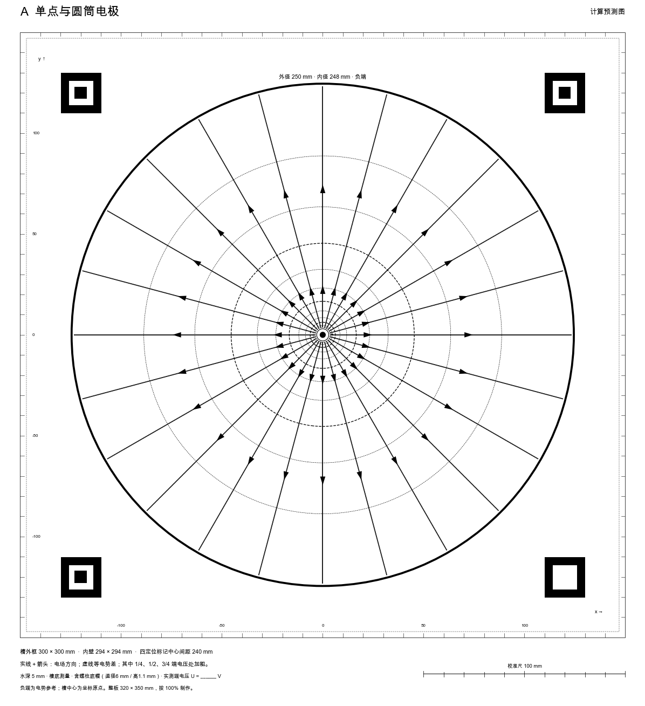
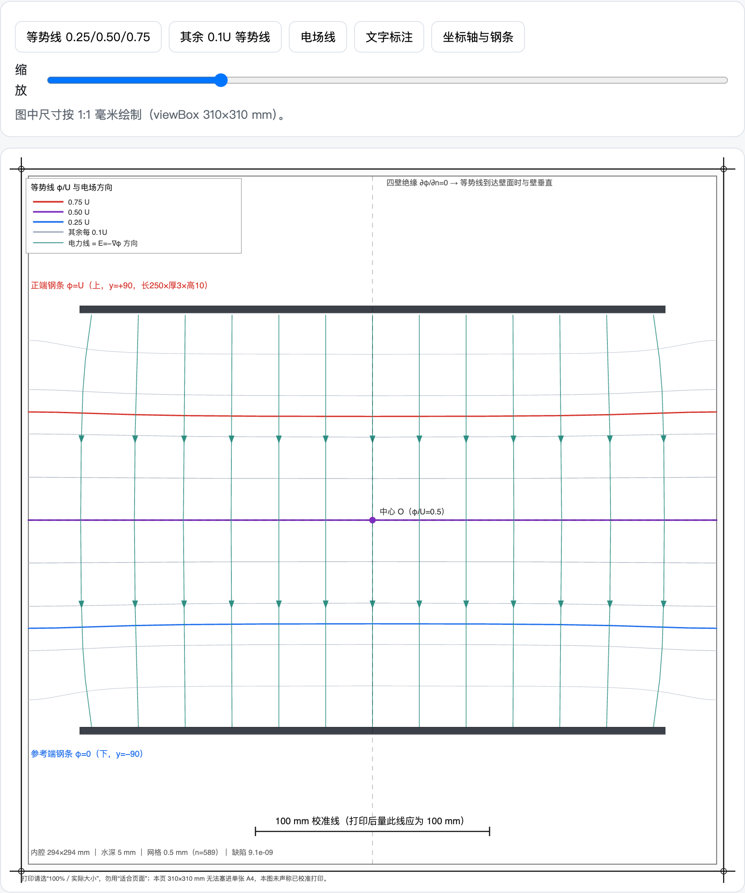

# 自己做一遍：请 AI 算一张预测底图

本文原是《把物理做出来》第 9 章第四节的完整版，正文只留了概要。文中“第三节”“第 10 章”指书中相应章节。

预测底图让学生可以先猜、再测、再对照。它是按水槽的真实尺寸、五种电极布局和 5 mm 水深，数值求解水层里的电势分布，画出 $U/4$、$U/2$、$3U/4$ 三条等势线和电场方向，按 1∶1 输出、可以印刷的图。底图上不标具体伏数，$U$ 由学生测出自己那节电池的电压后填写。



下面从空白做一张平行板预测底图。前面几章你已经会把条件交给 AI、让它做出一个页面，再用关键状态检查它；这一章新增的是：让 AI 在真实水槽的边界上解一个场，再把结果打印成能和实物对齐的 1∶1 底图。

## 在 WorkBuddy 中做一张平行板预测底图

先测量自己的水槽和电极，把“槽有多大”“电极怎样摆”“什么位置接什么电势”写下来。在 WorkBuddy 中按第 2 章的设置，选一个新文件夹新建任务。可以先用下面的提示词，让 AI 把计算所需的条件列出来，再生成图件。

提示词：

```text
我要给平行板水槽做一张可以垫在槽底的等势线预测图。槽内是 294 mm 见方，两根钢条长 250 mm、厚 3 mm、高 10 mm，上下平行摆放，中心线相距 180 mm。水深 5 mm，槽壁绝缘，上板接正端、下板接负端。请按这个有限水槽计算，画出四分之一、二分之一、四分之三电压的等势线，并标电场方向。给我能按实际尺寸打印的文件，加一条 100 mm 校准线。请先确认这些尺寸分别用在哪里。
```

钢条的 10 mm 是竖直高度，俯视图里它的宽度是厚度 3 mm。把这两个方向说清楚，比补一句“请精确计算”有用得多。（180 mm 是底图的设计中心距；实测照片里两钢条相距约 184 mm，第 10 章比较实测时按照片另行计算。）

## 先检查它算的边界，再检查图

请 WorkBuddy 先用文字和一张几何图说明计算区域。内壁是 $x,y=\pm147\ \mathrm{mm}$；钢条上规定电势，槽壁上规定电流不能流出去。这两种边界要分清。如果 AI 把四面槽壁全设成 0 V，就相当于沿四周增加了金属电极，算出的已经是另一台装置。

为了不依赖每节电池的电压，可以先把正端设为 1、负端设为 0，计算电势与端电压的比值 $u=\varphi/U$。三条线就是 $u=0.25$、0.50、0.75；换电压时再乘上实际采用的 $U$。这里的 $U$ 是模型给两边水层的有效电势差；需要定量对照时，先检查电极界面有没有明显压降，再决定能不能把电池读数当作水层两端的电压。

打开它保存的预览页，按下面的顺序看图：中线是不是 $U/2$；左右是否对称；两板中部是否近似平行等距；到了板端，线是否弯曲；到绝缘槽壁处，等势线是否近似垂直于槽壁。后两项能区分有限水槽和理想平行板。整幅图都是笔直的平行线，就说明它没有按有限水槽来算。

回复里出现“网格”“迭代收敛”这类词，请它用你听得懂的话解释，再追加一个要求：

```text
请把网格稍微加密再算一次，比较中心剖面和三条等势线的位置。说明网格间距、停止迭代的条件和两次差别。如果差别仍明显，先修计算，不要只把曲线画平滑。
```

网格是把水面分成许多小格，每个格点存一个电势。加密前后结果基本不变，才说明算得够细。

## 核对电极节点和箭头方向

配套的有限水槽预测页与 310 mm 矢量底图在配套包第 9 章，用的是同一套计算：0.5 mm 网格，中心的无量纲电势约为 0.5，左右对称。



这张图交出来之前改过两处错。初版自检用的网格太粗，网格点根本没落进薄钢条，却把全是零的结果报告为“收敛”；修订后先检查两条钢条是否都有固定电势的节点，再比较加密前后的变化。另一处出在画图：算出的电场向下，导出的箭头却向上，因为图像坐标和物理坐标的正方向相反，转换时又反了一次。教师即使不懂图形程序，也能用“电场从高电势指向低电势”看出这项错误。

## 从文件尺寸检查到实物校准

请 AI 告诉你实际生成的文件名，保留可编辑的矢量图和计算数据。PDF 页面若是 310 mm 见方，用 A4 单页的“适合纸张”打印出来，就已经不是 1∶1 底图了。选能容纳它的纸张并以 100% 或“实际大小”打印；需要拼页时也保持比例。先用尺子量 100 mm 校准线，再量水槽内框的一边是否为 294 mm，最后把实物放上去检查电极与定位标记。

平行板做通以后，可以再试单点与圆筒，用第三节的对数式独立核对三条线的半径。实物螺柱的柱杆和底帽粗细不同，电极半径取多大，越靠近中心的线越敏感；这个近似要告诉 AI，也要写在图旁。

