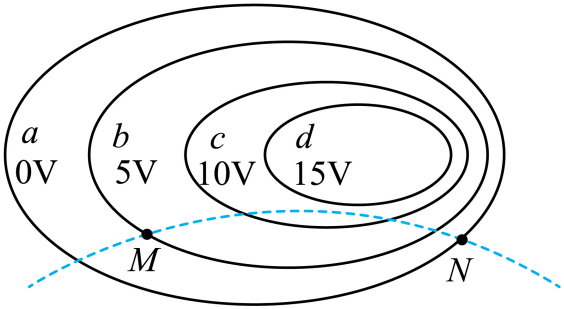
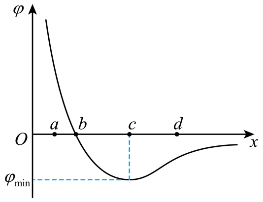
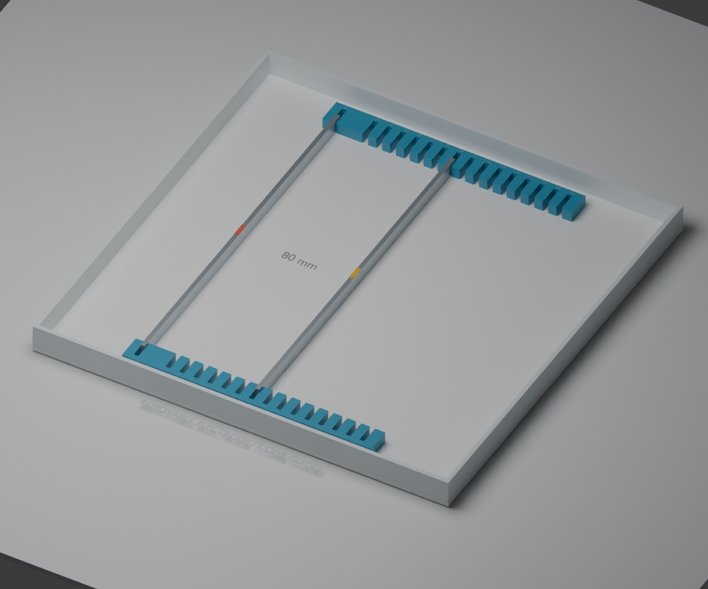

# 第 11 章配套：静电场高考题讲义

正文第六节讲了课堂例题、2025 年江苏卷和 2026 年湖南卷。这里收另外三道真题、一个带电粒子运动的课堂片段、专区“电子透镜聚焦”一页的检查要点，以及在水槽里做电容器题的梳齿定位条设计。题旁模型都在数智育才网站的静电场高考题专区：https://shuzhiyucai.cn/electrostatics/exam/

## 一、带电粒子的运动

### 2024 年甘肃卷（多选）

某带电体产生电场的等势面分布如图中实线所示，虚线是一带电粒子仅在此电场作用下的运动轨迹，$M$、$N$ 分别是运动轨迹与等势面 $b$、$a$ 的交点，下列说法正确的是（　　）

A．粒子带负电荷
B．$M$ 点的电场强度比 $N$ 点的小
C．粒子在运动轨迹上存在动能最小的点
D．粒子在 $M$ 点的电势能大于在 $N$ 点的电势能

**解析**　等势面从外到内依次是 0、5 V、10 V、15 V，电场由内指向外。轨迹向下弯，粒子受力指向凹侧，也就是向外，和电场方向一致，粒子带正电，A 错。右侧等势面比左侧密，$N$ 处电场比 $M$ 处强，B 对。粒子只受电场力，动能与电势能之和不变；沿轨迹电势先升高后降低，经过电势最高的那一点时电势能最大、动能最小，C 对。$\varphi_M=5\ \mathrm V>\varphi_N=0$，正电荷在 $M$ 点的电势能大，D 对。答案 BCD。

讲 C 选项时可以在专区的动画里，在动能最小的那一点暂停，问学生：“这里动能最小，粒子为什么没有停下来？”那一点的速度沿等势面的切线，与电场力垂直，粒子只是“擦过”电势最高的地方，不会像一维运动那样折返。

专区为这道题补出的电场：按原图量出四个椭圆，重建一张与 0、5 V、10 V、15 V 四条等势线逐一重合的平面电势图，再用这张图算轨迹；轨迹的初始位置和速度按原图的虚线选定，算出的 $M$、$N$ 与原图上的位置相差不到原图宽度的千分之一。补出来的电场只是和原图相容的一种，0 V 以外、15 V 以内的部分都是教学设定。

### 2025 年全国卷

匀强电场中，一带正电的点电荷仅在电场力的作用下以某一初速度开始运动，则运动过程中，其（　　）

A．所处位置的电势一定不断降低
B．所处位置的电势一定不断升高
C．轨迹可能是与电场线平行的直线
D．轨迹可能是与电场线垂直的直线

**解析**　电场力恒定，沿电场线方向。初速度逆着电场时，电荷先减速、电势升高，再折回、电势降低，A、B 都不一定。初速度与电场线共线时，电荷做匀变速直线运动，轨迹与电场线平行，C 对。初速度垂直于电场线时，电荷做类平抛运动，轨迹是曲线，不可能是与电场线垂直的直线，D 错。答案 C。

### 2024 年天津卷（多选）

某静电场在 $x$ 轴正半轴的电势 $\varphi$ 随 $x$ 变化的图像如图所示，$a$、$b$、$c$、$d$ 为 $x$ 轴上四个点。一负电荷仅在静电力作用下，以一定初速度从 $d$ 点开始沿 $x$ 轴负方向运动到 $a$ 点，则该电荷（　　）

A．在 $b$ 点电势能最小　　B．在 $c$ 点时速度最小
C．所受静电力始终做负功　　D．在 $a$ 点受静电力沿 $x$ 轴负方向

**解析**　负电荷的电势能 $E_\mathrm p=q\varphi$，$q<0$，把电势曲线上下翻转就是它的电势能曲线：原来的电势谷 $c$ 变成电势能的峰。从 $d$ 到 $a$，$a$ 点电势最高，电势能最小，A 错。$c$ 点电势最低，电势能最大，动能最小，速度最小，B 对。从 $d$ 到 $c$ 电势能增大，静电力做负功；从 $c$ 到 $a$ 电势能减小，做正功，C 错。$a$ 点处电势沿 $+x$ 方向下降，电场沿 $+x$ 方向，负电荷受力沿 $-x$ 方向，D 对。答案 BD。

这道题可以和专区的“$+4q$ 与 $-q$ 的电势曲线”放在一起比较。后一模型由 $+4q$ 和 $-q$ 产生电场，$x$ 正半轴上是一个电势峰；把两个电荷同时反号，峰变成谷，就是这道题的形状。要提醒学生，这里翻转了两次，意义不同：反号源电荷，电场本身变了；把电势换成负电荷的电势能，电场没变，只是换了一种能量的表示。

### 一个课堂片段（未试教）

学完第十章第 5 节以后，可以用 15 分钟做一次“预测—观察—解释”：

1. 投出 2025 年全国卷那道匀强电场题，遮住选项，请学生分别画出三种初速度（顺着电场、逆着电场、垂直于电场）下正电荷的轨迹。
2. 用静电场体验游戏“电势漫游”的匀强电场地图演示：小球逆着电场发射，在速度为零处暂停，问受力方向；继续播放，看它折回。再横向发射，看抛物线。
3. 回到原题逐项判断。

游戏地形的高度默认表示所选粒子的电势能（也可以切换成电势）：选正粒子时，形状和电势地形相同；换成负粒子，地形上下翻转。讲负电荷时由教师切换粒子、演示翻转。

## 二、电子透镜聚焦：电场本身也要查

专区的“电子透镜聚焦”一页对应 2023 年全国甲卷的一道题（这里没有收入原题）：题目给出四幅图，每幅画了电场线和一条电子轨迹，问哪一幅正确。要让电子在模型里飞起来，得先用一组电极把电场算出来，而电极形状画得像，电场不一定对。上下镜像的两个电极加等大反向电压时，中轴线是等势线，沿轴的电场分量为零，这种排列表示不了中轴上向前加速的电场。专区用的是可以计算的电极排列。检查的重点是题目关心的那段轴线上，电场的方向和大小对不对：沿中轴读一遍电势，再判断它能否解释题图中的加速与聚焦。

## 三、在水槽里做电容器的题（只有设计，未打印实测）

水槽可以用来观察移动极板时固定点电势怎样变化。下面是一套用于定位的梳齿条设计，第 11 章那四张移板图里，水槽两侧的蓝色长条就是这类梳齿条，与下面的设计是否完全一致，以实物为准；逐档的板距还没有用直尺实测记录：两条打印的塑料条粘在槽底，齿相向，一块钢条插在固定槽里不动，另一块可以拔出来换档，板距从 20 mm 到 160 mm，每 10 mm 一档，共 15 档。

测量方法：固定板接负极作为 0 V，探针固定在离固定板 $x=30\ \mathrm{mm}$ 处，移动另一块板，读 $P$ 点的电势。理想情况下 $\varphi_P=U\dfrac xd$，$\varphi_P\cdot d$ 应当近似不变。这里的 $U$ 是水层两端的有效电势差，不是电池电压，实做时按第 10 章的方法测出两端水中的电势再算。公式里的 $d$ 和 $x$ 都从钢条相对的表面量起；钢条厚 3 mm，量中心距会差出 3 mm。按比例预计：

| 板距 $d$ / mm | 40 | 60 | 80 |
| --- | --- | --- | --- |
| 预计 $\varphi_P/U$ | 0.75 | 0.50 | 0.375 |

每换一档，先测水层两端的电势差，检查有效电压是否近似不变；再比较 $\varphi_P\cdot d$。若它也近似不变，测量结果就与匀强电场近似下的 $E=U/d$、$\varphi_P=Ex$ 相符。

制作与测量时需要注意：钢条只有 250 mm 长，板距大到 160 mm 时两板之间远不是匀强电场，初次测量宜用 40、60、80 mm 三档；梳齿是绝缘塑料，靠近齿的地方电场会被改变，测点放在两板中段；换档前先断电，钢条两端同时放进同一档，等水面平静再测；每次都用直尺量实际板距，槽的编号不代表板距。梳齿槽宽怎样定，见第 17 章。

课上若用两档板距（如 40 mm 和 80 mm）由教师演示，每换一档都要断电、换档、等水面平静、量板距、测两端电势；学生分组测量更适合留作课外实验。
