> 来源：MinerU 转换（stem-exact rebuild 2026-08-08）

· 教材与教法 ·

# 基于科学思维能力培养的高中物理教学设计

———以“安培力的方向”教学片断为例

颜少芬 付丽萍

（闽南师范大学物理与信息工程学院 ，福建 漳州 363000）

摘 要 科学思维是物理核心素养的核心内容．本文以“安培力的方向”教学片断为例 结合教学内容以培养科学思维能力为目标进行创新设计．利用自制教具 模型建构 搭建 思维”的桥梁 通过自主探究 类比推理 实现科学思维能力的培养

关键词 ： 科学思维 ； 安培力 ； 自制教具

## 1 问题的提出

科学思维是物理核心素养的核心内容 ，［1］ 是从物理学视角对客观事物的本质属性 内在规律及相互关系的认识方式 主要包括模型建构 科学推理 科学论证 质疑创新等要素．［2］ 教育的一个重要目的是要教会学生如何正确地去思考问题培养学生的思维能力．科学思维能力的培养有助于学生建构个人的思维体系 形成一套解决问题的方法和策略， 在面对复杂的科学问题时能有效地提取关键信息， 对不同的观点能提出质疑和创造性的见解

“安培力的方向”是司南版选修3－1第6章第1节“探究磁场对电流的作用”的主要内容．普通高中物理课程标准 （2017年版） 对本片断教学的要求 ：通过实验 认识安培力； 能判断安培力的方向．［2］司南版教材的呈现方式是 ： ① 以铝箔“天桥”实验（如图1所示）引出通电导线在磁场中受到力的作用．在实际教学过程中发现 教材中铝箔纸高度不够 很难同时观察到拱起和下凹现象 且实验过程中如要改变电流方向操作繁琐 不易实现；② 通过实验（如图2所示）定性探究影响安培力的因素（大小 方向同时探究） 然后直接给出左手定则．教材缺少对左手定则建构过程的思维揭示 不利于学生形成科学思维．在学习过程中，学生对安培力的方向与哪些因素有关及3者的空间位置关系缺少感性认识 且学生在科学抽象思维 空间想象等方面的能力还较为薄弱 对左手定则的建立过程存在思维障碍

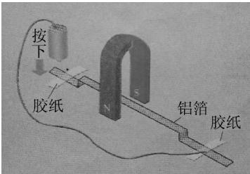

图1 铝箔“天桥”  
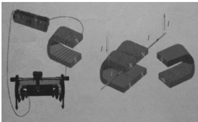  
图2 观察安培力与哪些因素有关实验装置

## 2 以培养科学思维能力为目标的教学设计

基于以上分析 笔者以 “安培力的方向”教学片断为载体 围绕如何培养学生的科学思维能力设计了如图3所示的教学思路

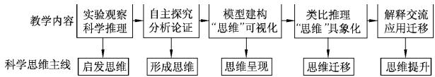  
图3 “安培力的方向”教学设计思路

结合普通高中物理课程标准（2017年版）中物理学科核心素养的水平划分 笔者制定了各教学环节中科学思维要素的学习目标（如表1所示）

表1 科学思维要素学习目标细化表
<table><tr><td rowspan=1 colspan=1>教学环节</td><td rowspan=1 colspan=1>要素</td><td rowspan=1 colspan=1>水平</td><td rowspan=1 colspan=1>学习目标</td></tr><tr><td rowspan=1 colspan=1>环节1</td><td rowspan=1 colspan=1>科学推理</td><td rowspan=1 colspan=1>水平2</td><td rowspan=1 colspan=1>能对“铝箔天桥”实验现象进行分析和推理，提出猜想.</td></tr><tr><td rowspan=2 colspan=1>环节2</td><td rowspan=1 colspan=1>科学推理</td><td rowspan=1 colspan=1>水平2</td><td rowspan=1 colspan=1>能运用控制变量法对实验现象进行分析和推理，获得安培力方向与电流方向、磁场方向有关的结论.</td></tr><tr><td rowspan=1 colspan=1>科学论证</td><td rowspan=1 colspan=1>水平3</td><td rowspan=1 colspan=1>能使用实验数据对比分析论证影响安培力方向的因素.</td></tr><tr><td rowspan=2 colspan=1>环节3</td><td rowspan=1 colspan=1>模型构建</td><td rowspan=1 colspan=1>水平4</td><td rowspan=1 colspan=1>能将安培力方向、电流方向、磁场方向3者的关系转换成模拟式物理模型.</td></tr><tr><td rowspan=1 colspan=1>质疑创新</td><td rowspan=1 colspan=1>水平3</td><td rowspan=1 colspan=1>能从不同的角度思考模拟物理模型的空间位置关系，能提出质疑.</td></tr><tr><td rowspan=1 colspan=1>环节4</td><td rowspan=1 colspan=1>科学推理</td><td rowspan=1 colspan=1>水平4</td><td rowspan=1 colspan=1>左右手类比分析，能结合实验结果进行科学推理，对比得出左手定则.</td></tr><tr><td rowspan=1 colspan=1>环节5</td><td rowspan=1 colspan=1>科学论证</td><td rowspan=1 colspan=1>水平4</td><td rowspan=1 colspan=1>能运用左手定则解释铝箔“天桥”实验的原因和直流电动机的工作原理.</td></tr></table>

## 2．1 环节1：实验观察，科学推理

恰当的情景让学生围绕问题进行探索既能作为课堂教学实施的有力保障， 又能调动、 启 发 学 生 积 极 思考 发现问题 促进教学的有效性．［3］ 为此，笔者利用自制铝箔“天桥”演示仪如图4所示（将铝箔纸 发光二极

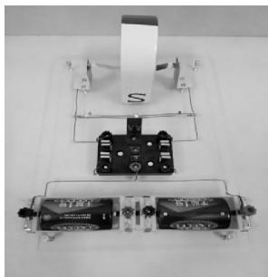  
图4 自制铝箔“天桥”演示仪

管 双刀双掷开关以及干电池连接 让蹄形磁铁跨过“天桥”．通过发光二极管的发光情况可以明显判断电流方向 双刀双掷开关可以快速改变电流方向）创设真实情境 让学生动手实验 观察开关闭合 断开时的实验现象．通过实验观察 科学推理 提出问题

设计意图 ： 科学推理是根据一个判断得出另一个判断的思维形式．［4］ 通过有趣的铝箔“天桥”实验现象巧设问题情境 ，激发学生学习兴趣，产生认知需要 引导学生对实验现象进行分析推理 进而提出合理猜想， 为学生搭建 “观察—思考—质疑”的思维桥梁

教学过程如下

师 通电铝箔纸在磁场中为什么会动起来？  
生 ：铝箔纸的运动状态发生变化  
师 铝箔纸的运动状态为什么会发生变化？  
生 受到了力的作用———安培力  
师 为什么铝箔纸会拱起或下凹呢？  
生 安培力的方向是不同的  
提出问题：安培力的方向与哪些因素有关？

## 2．2 环节2：自主探究，分析论证

在探究 “安培力的方向与哪些因素有关”的教学环节 我们巧用了自制安培力方向演示仪如图5所示（主 要 由 导 体 棒 导轨 蹄形磁铁 接线柱以及开关构成．其中，导体棒可稳定地置于

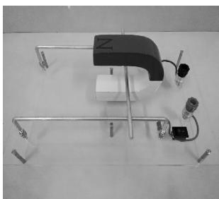  
图5 自制安培力方向演示仪

导轨上 使现象更加直观明显 用船型开关代替传统的单刀单掷开关 更易操作且美观 用接线柱可简便更换电流方向）引导学生进行自主探究．分别观察在初始情况 改变电流方向和改变磁场方向时 磁场 电流 安培力方向的改变情况 并把实验结果记录于图表2中．在实验证据的基础上，通过对比分析 归纳得出 安培力方向与电流方向和磁场方向有关

表2 探究安培力方向实验分析
<table><tr><td rowspan=1 colspan=1>实验</td><td rowspan=1 colspan=1>图示</td><td rowspan=1 colspan=1>磁场方向</td><td rowspan=1 colspan=1>电流方向</td><td rowspan=1 colspan=1>安培力方向</td></tr><tr><td rowspan=1 colspan=1>初始</td><td rowspan=1 colspan=1>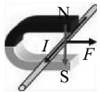</td><td rowspan=1 colspan=1>向下</td><td rowspan=1 colspan=1>垂直纸面向外</td><td rowspan=1 colspan=1>水平向右</td></tr><tr><td rowspan=1 colspan=1>改变电流的方向</td><td rowspan=1 colspan=1>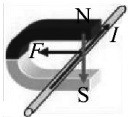</td><td rowspan=1 colspan=1>向下</td><td rowspan=1 colspan=1>垂直纸面向内</td><td rowspan=1 colspan=1>水平向左</td></tr><tr><td rowspan=1 colspan=1>改变磁场的方向</td><td rowspan=1 colspan=1>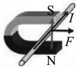</td><td rowspan=1 colspan=1>向上</td><td rowspan=1 colspan=1>垂直纸面向内</td><td rowspan=1 colspan=1>水平向右</td></tr></table>

设计意图 通过实验获取证据 以图表的方式呈现收集到的数据．引导学生基于证据运用控制变量的思想分析论证 归纳推理得出结论 使学生经历“探究—分析论证—归纳”的思维活动

## 2．3 环节3：模型建构，“思维”可视化

物理模型可以划分为两类 一类是模拟式物理模型 另一类是理想化物理模型．［5］通过模型建构过程引导学生经历物理概念和规律的形成过程，是发展科学思维的重要途径．［2］ 为了突破本片断教学的难点问题 找到安培力方向与通电导线电流方向 磁场方向的空间位置关系 我们随手取材 借助生活中的橡皮泥 小木棒和颜料搭建空间立体物理模型 实现“思维”可视化

情境1 问题驱动 ① 安培力的方向与电流方向和磁场方向有关 那么3者是否具有内在的联系呢？②3者是在同一条直线上吗？③3者是在同一个平面内吗？④3者具有怎样的空间位置关系呢？

情境2：模型建构 ： 引导学生利用橡皮泥和3根颜色不同的小木棒动手搭建初始情况3者的空间模型［如图6（a）所示］．通过观察可以发现安培力方向垂直于电流方向 也垂直于磁场方向 3者的空间位置关系是两两垂直的

情境3 质疑推理 改变电流方向 磁场方向是否也满足两两垂直的空间位置关系呢？教学中通过让学生分组搭建不同情况下的模型 生生互动产生质疑 动手实践的过程中同学们发现通过旋转第一个模型可以得到另外两种情况的模型 （如图6所示）．进而分析推理得出 安培力方向 电流方向 磁场方向三者的空间位置关系是固定不变的

(a) 初始情况模型  
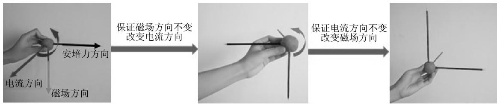  
(b) 改变电流方向模型  
(c) 改变磁场方向模型  
图6

设计意图 在中学物理教学中 模型思维是一种重要的科学思维 模型建构是一种主要的思维方式．通过模型建构过程 实现思维可视化 以此加深学生对3者空间位置关系的理解 突破左手定则建立过程中的思维障碍

## 2．4 环节4：类比推理，“思维”具象化

左手定则可以帮助我们快速判断安培力的方向 类似这样的定则教师们大多是利用教材中的插图 用对比分析的方式来讲解 学生的任务则是学会运用左手定则来判断安培力的方向．很少有人会疑问 为什么要用左手来判断？它又是如何发展而来的？笔者引导学生从生活中的垂直关系入手， 通过左右手类比分析 追根溯源， 帮助学生构建左手定则

情 境 1： 提 出问题 ： 生活中哪些地方也存在两两垂直的关系？ （如墙角 桌角，再过渡到双手）伸出双手，如果让大拇指与四指垂直并与手掌在同一平面内， 会与垂

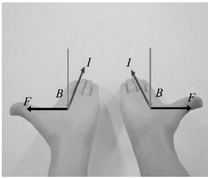  
图7 左右手均满足垂直关系

直于手掌的方向形成两两垂直的关系 左右手都能满足垂直关系 （如图7所示） ， 那么用哪只手来表示安培力的方向呢？

情境2： 类比分析 ： 以图9的实验模型为例 引导学生进行类比分析 若让磁感线垂直穿过手心 （掌心向上） ，四指指向电流的方向 （四指指向纸面） 用大拇指来表示安培力的方向， 此时左手的掌心 四指 大拇指恰好与实

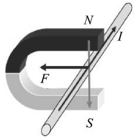  
图8 实验模型

验中的磁场 电流 安培力的方向相对应（如图89所示）．由此再进一步地引导学生总结归纳得出判断3者空间位置关系的一般方法—左手定则（如图10所示）

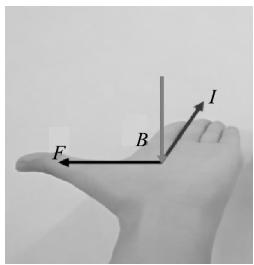  
图9 左手满足实验模型

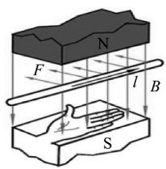  
图10 左手定则图示

情境3 史学渗透 为什么用左手来判断安培力的方向呢？物理学家们起初倾向于用实验仪器来将方向可视化 但仪器不便携带 便思考用生活用品（如手表）来帮助记忆 为了便于教学 物理学家们在前人的基础上不断思考如何用每个人基本都有的物体作为判断工具 于是总结并约定一个个简洁的记忆方法．［6］

设计意图 类比使人们富于联想 触类旁通是获得创造性的启发或灵感的一种有效思维方法．［7］在左手定则的学习过程中 ，双手的几何特征都满足两两垂直的空间位置关系 为什么要用左手而不用右手 却常常被教师们忽视．通过类比分析及揭示物理学家们建立定则的思维过程的教学活动 加强学生认知的完整性和逻辑性 提高学生的形象思维能力

## 2．5 环节5：解释交流 应用迁移

情境1： 解释现象 ： 以图11的实验现象为例引导学生讨论分析此时的磁场和电流方向 ， 并运用左手定则判断安培力的方向 再通过操作检验实验结果

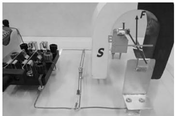  
图11 运用左手定则分析铝箔“天桥”实验

情境2：拓展应用 ： 引导学生了解生活中安培力的应用．拓展延伸提出问题 我们通过学习知道了改变安培力的方向 可以使直流电动机反转（如图12 图13所示） ， 那么如何提高电动机的转速呢？这其中蕴含了哪些物理原理呢？

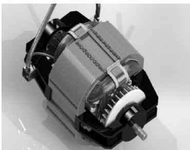  
图12 直流电动机实物图

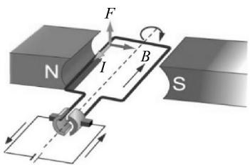  
图13 通电线圈在安培力作用下发生转动

设计意图 物理课程应注重与生产生活 现代社会及科技发展的联系．引导学生运用左手定则解释课前的铝箔“天桥”实验和生活中安培力方向的应用 在分析论证的过程中提升学生的科学思维能力

## 3 结语

物理学家冯 · 劳厄说过 教育给予人们的无非是当一切学过的东西都忘记后所剩下来的东西 而“剩下的东西”就是研究和解决问题的方法这属于科学思维的范畴．［8］观察 实验与科学思维相结合 是物理学科的基本特征．物理教学不是培养只会解题的考试能手 而是培养具有个体思维结构的有用人才．在物理教学中 我们应创设有利于学生提出问题的情境 帮助学生理解物理知识中所体现的科学思维方法 ， 鼓励学生不满足于教材中的结论和教师的讲解 勇于质疑 培养学生的科学思维能力

## 参考文献 ：

1 胡卫平．物理学科核心素养的建构［J］．中学物理教学参考 ，2017，46（13） ：1－3

2 中华人民共和国教育部．普通高中物理课程标准（2017年版） ［S］．北京 ：人民教育出版社 ，2018

3 张喜荣 ，李子明 ， 王新春．情境创设与问题有效性整合的案例研究［J］．物理教师 201738（06） ：40－43

4 廖伯琴．普通高中物理课程标准（2017年版）解读［M］北京 ：高等教育出版社 ，2018

5 张宪魁．物理科学方法教育 ［M］．青岛 ： 青岛海洋大学出版社 ，2000

6 肖凯龙 张军朋．右手螺旋定则的溯源及其教学启示［J］．物理教师 ，2018，39（04） ：39－42

7 李正福 ，谷雅慧．论物理核心素养视野下的科学思维教育内容［J］．课程 · 教材 · 教法 ，2018，38（02） ：97－102

8 刘伟 ，黄显敏．基于核心素养的科学思维培育探索［J］中学物理教学参考 201746（19） ：52－54

（收稿日期 ：2018－12－03）
