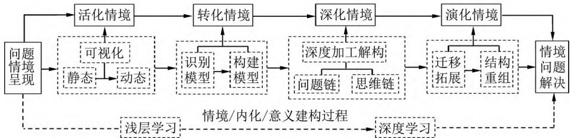
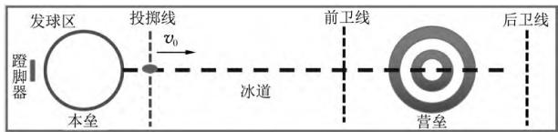
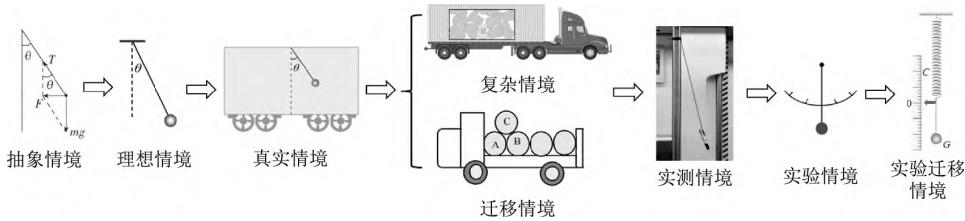
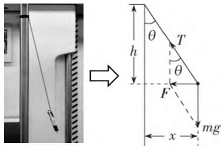
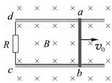
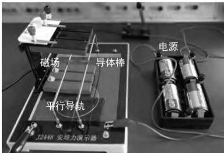
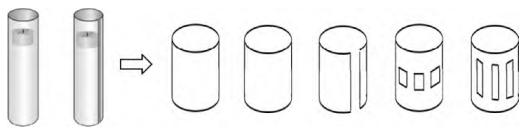
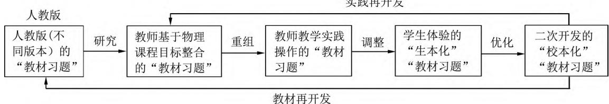
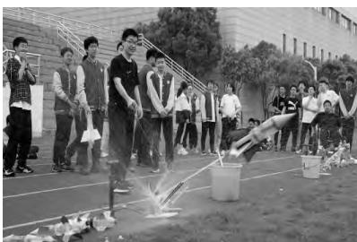

> 来源：MinerU 转换（stem-exact rebuild 2026-08-08）

# 指向物理核心素养的“教材习题”优化开发实践探讨

陆永华

（南京航空航天大学苏州附属中学 ，江苏 苏州 215000）

基金项目：本文为江苏省教育科学“十四五”规划重点课题“指向深度学习的高中物理单元逆向设计与实施的研究”（项目编号：C-b/2021/02/80）阶段性成果.

物理“教材习题”是落实物理核心素养的重要课程资源.《 普通高中物理课程标准 （2017年版2020年修订） 》（以下简称新课标）指出 “通过习题教学 使学生在科学思维 探究能力 实践意识 科学态度等方面得到有效提升.在教学实践中依据物理学科核心素养的要求选择和组织内容 有效促进学生物理学科核心素养的达成.”［1］

## 1 “教材习题”的一线教学实践状况

在教学实践常见的“示范课”“优质课”“常态课”等不同课型中 几乎普遍极少以“教材习题”作为例题 课堂练习或者课后作业.“教材习题”在一线教学实践中面临着较为尴尬的功能 教师普遍对其重视程度不够 研究和开发缺位.与新课标2017匹配编写的新人教版高中物理教材 客观上“教材习题”的质量及其适切性 可教性 以及情境化等方面得到了明显的提高 主观上 教师对以新教材为载体培养学生物理学科核心素养有了更高层次的认识.由此 如何基于丰富的“教材习题”资源 契合“以生为本”的培养物理核心素养的需求同时满足纸笔模式的终结性评价的训练要求 优化开发“教材习题”是十分有意义的一线教学实践研究问题.

## 2 指向物理核心素养的“教材习题”开发合理性分析

“优化教材是教师专业成长的标尺.”［2］ 教师应秉持物理核心素养分析观 充分发挥“教材习题”培育学生物理核心素养的功能.“教材习题”优化开发旨在以“教材习题”为蓝本， 围绕核心素养教学目标设置不同层次的具有挑战性的问题情境任务展开深度学习.通过“知识问题化 问题情境化” ，引导学生经历生动的问题情境 交互的具身体验 意义的自主整合 批判的自我反思和真实的问题解决 ［3］ 巩固 深化和活化物理概念和规律等 帮助学生“形成把情境与知识相关联的意识和能力”［1］发展学生高阶思维 提升问题解决能力.通过深度学习培养物理学科核心素养.

## 3 指向物理核心素养的“教材习题”优化开发教学策略

### 3.1 “教材习题”的“同一情境”系统化纵向开发

高考评价体系中的“情境”即“问题情境” 指的是真实的问题背景 是以问题或任务为中心构成的活动场域.［4］“问题情境”是物理核心素养培养和考查的重要载体 且新版“教材习题”中情境化习题占比明显 力求体现情境的真实性和情境主题的多元化 因此 对“教材习题”中“问题情境”的“系统化”开发具有重要意义.

  
图1 同一“问题情境”深度开发流程

如图1所示 通过对“教材习题”的同一“问题情境”活化 转化 深化 演化等深度开发 引导学生由浅层学习到深度学习.以新教材必修1第4章“运动和力的关系”第5节“牛顿运动定律的应用”中例题为例.

  
图2

案例1.运动员把冰壶沿水平冰面投出 让冰壶在冰面上自由滑行 在不与其他冰壶碰撞的情况下， 最终停在远处的某个位置.按比赛规则 ， 投掷冰壶运动员的队友 可以用毛刷在冰壶滑行前方来回摩擦冰面， 减小冰面的动摩擦因数以调节冰壶的运动.

“冰壶运动”的 “问题情境” 开发过程如下.（1） 活化情境：如图2 图3所示 将“冰壶运动”进行情境还原 通过播放视频讲解规则等方式将“冰壶运动”“可视化” 转为生活实际的动态情境 增加学生对“冰壶运动”的感性认识 使“冰壶运动”情境在脑中形成表象.（2） 转化情境 如表1所示 从物理问题解决角度对“冰壶运动”情境进行深度加工建模为学生搭建从单一结构水平到多元 关联结构水平的思维台阶 拓展训练学生科学思维的实践途径.（3） 深化情境 将“力和运动关系”知识融入关联“问题情境” 结合学生学情 通过设置“问题链”形成“思维链” 在情境问题解决过程中优化认知结构.（4）演化情境 给学生提供一个真实开放的认知情境 体验真实生产生活中问题的复杂性和丰富性 设置“半开放性结构不良问题” 如“运动员为了确保赢得比赛 在赛前适应训练中 研究让冰壶如何精准到达营垒的中心，请问： ① 需要对场地做哪些影响因素的评测？② 在已知哪些物理条件才能评测这些影响因素？”等.将学生置于真实复杂问题情境并分析和解决“冰壶运动”问题 有利于提升学生的证据意识数据解释等科学探究能力 体现了“学习即研究” 有力地促进了深度学习.

  
图3 冰壶运动示意图

表1 冰壶运动问题情境的模型建构
<table><tr><td rowspan=1 colspan=1>问题情境呈现</td><td rowspan=1 colspan=1>模型化建构</td></tr><tr><td rowspan=1 colspan=1>冰壶</td><td rowspan=1 colspan=1>质点</td></tr><tr><td rowspan=1 colspan=1>冰面动摩擦因数不均匀</td><td rowspan=1 colspan=1>动摩擦因数恒定</td></tr><tr><td rowspan=1 colspan=1>冰壶所受变力</td><td rowspan=1 colspan=1>冰壶所受恒力</td></tr><tr><td rowspan=1 colspan=1>冰壶在冰面上的运动</td><td rowspan=1 colspan=1>匀变速直线运动</td></tr><tr><td rowspan=1 colspan=1>冰壶的复杂运动过程</td><td rowspan=1 colspan=1>简单的几个匀变速直线运动的不同过程</td></tr></table>

### 3.2 “教材习题”的“不同情境”层次化横向开发

对“教材习题”中任务目标相同的不同“问题情境”进行“情境化”→“去情境化”→“再情境化”等情境层次化开发 在问题解决过程中由浅层学习逐步迈向深度学习.根据新课标具体课程目标要求“理解牛顿运动定律 能用牛顿运动定律解释生产生活中的有关现象 解决有关问题” 并提出“根据牛顿第二定律 设计一种能显示加速度大小的装置”.［1］

案例2.将人教版必修1第4章“运动和力的关系”第3节例题2（真实情境）和“练习与应用”第6题（迁移情境1） 第5节“练习与应用”第4题（迁移情境2） 章末“复习与提高”第4题（实测情境）和第9题（实验迁移情境）以及鲁科版必修1第5章“牛顿运动定律”第3节“迷你实验室 自制简易加速度计”（实验情境）进行糅合.如图4所示 按照学生认知理解的发展层次 对于“已知物体质量和轻质悬线与竖直方向的夹角为 θ 求解加速度”的“抽象情境”处理基本无障碍，将其赋予“理想情境” ： “在某个水平加速过程中 轻质绳悬挂的小球偏离竖直方向的夹角 θ等于30°求水平加速度的大小及方向.”情境中数据30°是特殊角 不一定与实际情况相符合.“真实情境”中加入了列车加速过程等问题情境内容 夹角一般化角度 θ符合测定实际.“迁移情境”和“复杂情境”虽改为“油桶”和“石块” 但与轻质绳悬挂小球属于“形不似而神似” 定性分析与定量计算相结合引导学生进一步体会运用牛顿运动定律解决问题的思路 逐步形成运动与相互作用的观念.“实测情境”由生活中的真实情境构成 将“良构问题”进行“劣构化” 要求学生自行测量与设计方案 照片是地铁运行的实际情况 所提供的情境数据真实 将学生置于真实复杂情境并分析和解决新的问题.“实验情境”可与“实测情境”相结合 利用轻杆 小球和硬纸板等制作一个简易加速度计 粗略测量运动物体的加速度.在此基础上的“实验迁移情境” 从制作“竖直加速度测量仪”到设计“水平加速度测量仪” 进一步培养学生科学探究和质疑创新能力.通过情境层次化开发 培养学生在真实情境中的问题解决能力有力地促进了学生物理核心素养的发展.

  
图4 不同情境的层次化开发

### 3.3 “教材习题”的“优化解决”信息化辅助开发

新课标指出 “发展学生物理学科核心素养离不开信息技术与物理学习的融合.利用手机等信息技术工具便捷地解决某些物理学习问题.”［1］新版教材编排有数字化实验系统 智能手机 数码相机器材以及数据处理软件等辅助物理教学信息手段系列化 多元化 专业化 为学生提供物理情境的多重表征.

案例3.必修1第4章“运动和力的关系”“复习与提高”第4题 解决过程简化如图5所示 学生将实际问题进行情境化抽象建模 地铁启动向左做加速运动 对笔进行受力分析 利用牛顿第二定律求出加速度 $a = g \tan \theta$ 角度的测量转化为物理量 h 和 x 的测量.学生若融合信息技术手段测量 在乘坐地铁时采用手机慢动作拍摄功能录制地铁启动过程 根据角度和加速度公式可计算任意时刻加速度 提升学生信息技术素养的同时体会“从生活走向物理 ，从物理走向社会”.

  
图5

### 3.4 “教材习题”的“半开放式”问题化进阶开发

学生物理核心素养的培养应正确处理知识、能力、素养之间的关系 不能因噎废食.通过降低 “教材习题”任务情境的结构化程度 将习题改为“半开放式”问题并进行“自问自答”.

  
图6

案例4.选修2第2章“电磁感应”“复习与提高”第6题.如图6所示，电阻 Rab为0.1Ω 的导体棒 ab 沿光滑导线框向右做匀速运动 线框中接有电阻 R 为0.4Ω.线框放在磁感应强度 B 为0.1T的匀强磁场中，磁场方向垂直于线框平面.导体棒ab的长度l为0.4m， 运动的速度 $\mathcal { V } _ { \mathrm { 0 } }$ 为5m／s.线框的电阻不计.

如表2所示 （表中问题设置及深度加工水平仅是举例参考） ， 以浅层学习为起点 ， 提升学生完成任务的自由度.通过学生设置问题层次的“自问自答” 将“碎片化”知识不断深度加工使其“系统化” 培养学生批判地分析问题能力 进行发散性思考 由浅层学习到深度学习循序渐进地发展高阶思维 促进问题解决能力的逐步发展.

表2 问题设置层次与深度加工水平
<table><tr><td rowspan=1 colspan=1>问题设置层次</td><td rowspan=1 colspan=1>深度加工水平</td><td rowspan=1 colspan=1>思维层次水平</td></tr><tr><td rowspan=1 colspan=1>会求导体棒ab运动产生的电动势</td><td rowspan=1 colspan=1>层次1：没有补充任何信息，只关注到导体棒ab 运动切割公式进行求解，属于浅层学习初级水平</td><td rowspan=5 colspan=1>低阶思维：记忆、理解、应用；高阶思维：分析、评价、创造 <!-- PDF亦模糊，据上下文及修订版Bloom分类学重构，原OCR"低除记忆理应解用分评析价创造高阶思维"系竖排合并单元格文字乱序 --></td></tr><tr><td rowspan=1 colspan=1>利用等效电路会求导体棒ab 运动产生的电动势、电源正负极、内阻、外电路等</td><td rowspan=1 colspan=1>层次2:没有补充任何信息，能够根据题给信息结合电路知识求解相关物理量，但问题解决收敛迅速，直接计算得到结论，也没有利用匀速运动等已知信息，对问题的理解相对浅显，属于浅层学习高水平</td></tr><tr><td rowspan=1 colspan=1>会求导体棒ab运动受到的安培力</td><td rowspan=1 colspan=1>层次3:在电路知识基础上，根据力和运动关系求解相关物理量，能够结合已有的部分信息，但问题解决收敛较快，属于深度学习低水平</td></tr><tr><td rowspan=1 colspan=1>会从能量转化和守恒角度求解导体棒 ab 运动安培力功率、电阻Rab和 R 的发热功率及其3 者关系</td><td rowspan=1 colspan=1>层次4：能利用问题提供的正确线索，并将各线索进一步有效整合，从整体上把握问题，属于深度学习水平</td></tr><tr><td rowspan=1 colspan=1>改编习题条件，如将“导体棒ab匀速运动速度v0为5 m/s”改为”初始速度v0为5 $\mathrm { m } / \mathrm { s }$ ,从电路、力和运动、能量及图像等角度设问并解决</td><td rowspan=1 colspan=1>层次5:通过改变习题条件，设置问题具有多样性，有多种收敛方式，在原问题基础上进行合理拓展，能超越问题本身归纳出新的结论，属于深度学习高水平</td></tr></table>

### 3.5 “教材习题”的“过程分析”实验化探究开发

新课标指出 “应注重科学探究 尤其应注重实验.”［1］将“教材习题”进行“实验化”开发有助于学生深化理解物理概念和规律 在实验中活化知识，培养科学探究能力.

案例5.选修2第2章“电磁感应”“复习与提高”第6题（详见3.4中例题）.通过如图7所示实验及操作变式 使学生显性化理解“动—电—动”发电式导轨和“电—动—电”电动式导轨两种基本单杆切割模型 从实验现象中理解安培力充当动力与阻力 帮助学生剖析电路与动力学问题.

  
图7

案例6.选修2第2章“电磁感应”第3节“练习与应用”第3题.比较科技馆中磁铁在铝管和有裂缝铝管中下落情况进行“实验化”开发并拓展.如图8所示 5个管除了第1个是塑料管 其余均是铝管 比较强磁铁分别在塑料管 铝管 有裂缝铝管 水平开小方口铝管 竖直开小方口铝管下落情况并分析原因，有助于学生理解楞次定律的“阻碍”本质特征 培养学生的科学思维和科学探究能力.“教材习题”的“实验化”开发同时为课堂习题教学提供了丰富的问题情境素材.

  
图8

### 3.6 “教材习题”的“母题结构”图式化建构开发

“母题”具备基础性 代表性 扩展性等特征是可大量派生系列习题的共同本质形式的问题或问题框架.［5］“教材习题”具备向不同的广度和难度方向扩展加工的弹性要求 很多高考题和模拟题能够见到“教材习题”的身影.构建与“教材习题”的“母题结构”相匹配的图式 有助于解决纸笔模式评价的训练需求.

认知心理学中的图式是一种由主体已往的经验所形成的关于某一常见的 复杂的概念或问题或现象的记忆组块.［6］ 构建丰富图式有利于活化学生长时记忆中的物理知识组块 在问题解决中一旦激活问题匹配图式 即可自动表征问题并执行相应的解题程序.

案例7.选修2第2章“电磁感应”“复习与提高”第6题 （详见3.4中例题） 为例进行“母题结构”图式化建构开发为“单棒＋电阻”模型.诸如通过 $F _ { A } = B I L , I = \frac { E } { R + r }$ 和 $E = B L v$ 推导 $F _ { A } =$ $\frac { B ^ { 2 } L ^ { 2 } v } { R + r }$ ； 由 $q = \overline { { I } } t , \overline { { I } } = \frac { E } { R + r }$ 和 $\begin{array} { r } { E = n \ \frac { \Delta \Phi } { \Delta t } } \end{array}$ 推导 $q =$ $n \frac { \Delta \Phi } { R + r }$ ，或从动量角度－ $B \bar { I } L t = 0 - m v _ { 0 }$ 和 $q = \overline { { I } } t$ 推导 $q = \frac { m v _ { 0 } } { B L }$ 等 丰富学生脑中相关问题图式 帮助学生在表征问题过程中快而准地模式识别 从而提高问题表征能力.

## 4 指向物理核心素养的“教材习题”优化开发的 教学实践思考

教材理解范式聚焦于教材的使用与二次建构开发.教师应把“教材习题”视为一种不断被开发和发展的动态性课程资源 从深层次 多视角 全方位拓展优化开发互融共生的“教材习题”教与学 实现“教材习题”价值的增值功能.如图9所示 多途径优化开发“教材习题”的目标殊途同归优化开发涉及5个层面的四重转化 基于人教版（不同版本） 的“教材习题” 按照物理课程目标挖掘“教材习题”蕴含的丰富意义和潜在价值功能重组整合为教学实践能够有效操作的 “教材习题” 形成师生与“教材习题”之间的深度对话 并根据学生学情及学习体验进行调整实现 “生本化” 从而进一步开发“教材习题”的“校本化” 继而循环再开发促进“教材习题”的持续优化.当然“习题教学的作用不仅仅是为了得到答案 ，而是要全面提高学生的问题解决能力”［1］ 为培养学生的物理核心素养添砖加瓦.

教材是培养物理学科核心素养的重要载体教师应努力实践落实物理核心素养的教材分析观 教学观和评价观 “读懂 读通和读活”教材 构建教材多元解读与师生多元对话相统一的教材增值理解与实践样态 探索从“教材”走向“学材”的路径开发，助推学生物理核心素养和教师专业的共同发展.

  
图9 “教材习题”合理开发实践转化的流程图

（下转第23页）

<!-- 存疑：以下“下转第23页”至“上接第19页”之间的内容（含长征5G载人登月火箭、水火箭实践、图6“水火箭的实践”）来自同期另一篇文章《基于HPS的高中物理单元整合教学》，因 PDF 跨页接排被 MinerU 误并入本文。陆永华本文正文止于上文“共同发展”，以下误入内容保留备查。 -->

角度去审视知识的应用 联系当下的社会热点议题 让学生进行研究与实践 对单元所学知识与方法进行拓展与亲身体验．这也为当下的“课程思政”找到了一个方向和突破口

本单元内容与很多社会议题关联 例如“高空坠物”“快递包装”问题等．对这些问题的分析与改进 将极好地培养学生的科学态度与责任．另外在学习火箭的知识中 让学生认识到我国的航天事业发展能如此迅速与火箭技术的持续创新是分不开的

我国最新研制的长征5G载人登月运载火箭目前已经转入初样研制阶段 将在2026年前后首飞．其将我国奔月运载能力由8．2t提升至27t是实现中国2030年前载人登陆月球和航天强国建设的重要战略支撑．其采用三级半的设计 总长约为90m 起飞重量约为2200t

这是大家普遍关注的社会热点问题 也是科学技术前沿问题．让学生课后查阅资料，用水火箭来模拟长征5G载人登月运载火箭发射过程．先让学生小组合作初步设计与制作水火箭 然后教师对学生设计的产品提出改进建议 学生对材料使用不当或者设计不合理的地方进行更改 然后放在发射架上发射 如图6所示．注重收集所加水与整个火箭的质量比 所加的发射压强（发射架的压强表可测）与飞行的距离等数据 对火箭的发射原理进行应用与验证

  
图6 水火箭的实践

（上接第19页）

<!-- 以上为同期另一篇 HPS 文章误入内容。“值理解与实践样态…”已上移与上文“教材增”处衔接，此处原 PDF 跨页断点保留。 -->

## 参考文献 ：

1 中华人民共和国教育部．普通高中物理课程标准（2017年版2020年修订） ［S］．北京 人民教育出版社 2020

2 钟启泉．“优化教材”—教师专业成长的标尺［J］．上海教育科研，2008（1）：7－9

3 任虎虎．指向深度学习的高中物理思维型课堂构建的研究［J］．物理教师，2019（7）：28－31

4 中华人民共和国教育部考试中心．中国高考评价体系说明［M］．北京：人民教育出版社，2019

5 盛宝骥，陆建隆．高中物理“母题”的结构设计与教学策略［J］．物理教师，2011（6）：9－11

6 陆永华．高中生物理问题表征的差异分析及教学策略［J］．物理教师，2018（11）：31－35

（收稿日期 ：2022－12－05）

<!-- 以下为同期另一篇文章（基于HPS的高中物理单元整合教学）的残余正文和参考文献，因 PDF 跨页接排被 MinerU 误并入本文，非陆永华本文内容，保留备查。 -->

这个过程可以反复进行几轮 即在每次发射后 让学生反思 如何进一步提升火箭的载重和降低成本？在改进的基础上重新发射 对自己的想法进行校验．这实际上是工程实践的过程．通过有效的工程实践 促进学生对科学本质的理解 实现“做中学”“用中学”和“悟中学”

基于 HPS的高中物理单元整合教学就是让历史映照教学 让社会进入教学 让生活融入教学 让文化浸润教学 让哲学点亮教学．学生在单元学习的过程中获得知识理解 思维进阶 物理观念 情感体验 价值体认和审美表现等多样化的学习结果

## 参考文献（同期另一篇 HPS 文章，非本文）：

1 迈克尔 · 马修斯．科学教学———科学史和科学哲学的贡献［M］．北京 ：外语教学与研究出版社 2022

2 托马斯 · 库恩．科学革命的结构（第4版） ［M］．北京 ：北京大学出版社 2012

3 张健 ，王华 ，李春密．促进科学本质认识的 HPS教学过程构建———以“牛顿第一定律”教学为例 ［J］．物理教师 ，2021，42（02） ：12－16

4 袁维新．科学的本质与科学本质教育 ［J］．课程 · 教材 · 教法 ，2004（07） ：68－73

5 郭小玲．引导式反思 将 HPS教育融入中学物理教学的方式［J］．教育理论与实践 ，2018（11） ：59－61

6 郭元祥．论学科育人的逻辑起点 内在条件与实践诉求［J］．教育研究 ，2020（04） ：4－14

7 中华人民共和国教育部．义务教育物理课程标准（2022年版） ［S］．北京 北京师范大学出版社 2022

8 廖东军 任风竹．体现科学本质的 HPS教学———以“原子的核式结构模型”教学为例［J］．物理教师 ，2022，43（03） ：26－30

9 任虎虎．基于 HPS促进高中物理深度学习的教学探索———以人教版新教材“电磁感应现象及其应用”教学为例［J］．物理教师，2022，43（1）：21－24，28

（收稿日期 ：2022－09－30）

<!-- 以上为同期另一篇 HPS 文章的参考文献；陆永华本文参考文献 1—6 已在前文（上文）完整列出，此处原有的重复 3—6 及重复收稿日期 2022－12－05 已删除。 -->