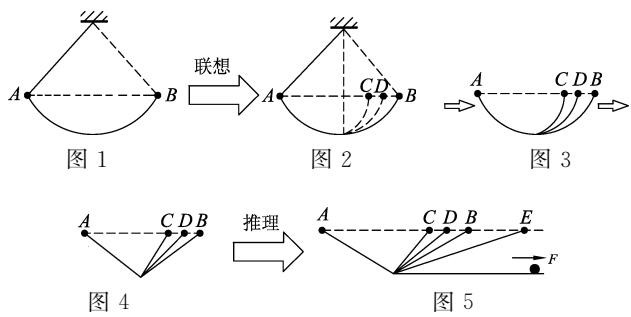

> 来源：MinerU 转换（stem-exact rebuild 2026-08-08）

# 提升学生抽象思维能力的 “可视化方法”的思考与实践

尹庆丰

（常州市武进区礼嘉中学 ，江苏 常州 213176）

摘 要 ： 思维可视化教学可以为初高中学习创建一个台阶 帮助学生从形象思维向抽象思维发展 有效地提升抽象思维能力 让学生尽快地适应高中学习 进而激发学生对物理知识的学习兴趣 更好地培养他们的学科思维能力

关键词 ： 抽象思维能力 ；可视化方法 ；高中物理教学

## 1 “思维可视化”的内涵

思维可视化 （Thinkingvisualization） 是指以图示或图示组合的方式把原本不可见的思维路径 结构 方法及策略呈现出来 使其清晰可见的过程．通俗地讲 就是把大脑中的思维“画”出来的过程．将思维可视化运用到学科教学中 可以实现零散知识系统化 隐性思维显性化 解题规律模型化

运用思维可视化方法及技术进行教学 使知识更易被理解和记忆， 有效发展学生的思维能力及学习兴趣．在传统课堂上 教师多以灌输方式向学生传授知识 学生主要通过以死记硬背的方式反复做题巩固知识点．然而只关注知识不关注知识背后“思维”的教学方式危害巨大 ：［5］ 它会使学生长期处于浅思考 不思考的状态， 久而久之， 学生的思维发展必然受阻 思维能力必然弱化 限制思维深度 淡化问题解决能力 抑制学生核心素养的有效发展．应用思维可视化方法，教学的焦点从“知识层”深入到“思维层” 推动教师与学生一起思考 进行思维共振 思想争鸣 提升物理课程的思维容量 在师生互动及生生互动中持续 系统地锻炼与发展师生的思维能力

## 2 初高中学生思维发展的特点

高一新生进入物理学习后 通常认为物理“难学” 主要体现在两个方面 ： 初高中物理知识与方法的广度和深度具有较大差异； 初高中学生思维水平存在不同的要求．初中物理的学习偏向依托丰富具体的形象思维 定性了解物理的基本概念基本规律和简单计算等 而高中物理注重以物理概念规律理解为前提的抽象思维的训练．实际教学中高中教师常常忽视“可视化方法”的教学， 导致在思维呈现过程中教师的教与学生的学不能和谐统一

## 2．1 初高中学生抽象思维水平不够成熟

北京师范大学阎金铎先生曾说过 学生在初中阶段的思维发展处于具体形象思维向抽象思维过渡的阶段 而在高中阶段开始进入抽象逻辑思维阶段．故而中学物理课程设置应兼顾学生思维发展特点 初中物理多以具体形象的生活情境以及简单有趣的小实验来开展教学活动 高中物理采用模型建构和逻辑推理为主来设计课堂教学

笔者以苏科版初中物理8年级上册教科书（以下简称“初中教材”）和人教版高中物理必修1教科书（以下简称“高中教材”） 为例 分析统计教材中的图片数和实验数 （见表1所示） 发现初中物理教材总体以图片为主 文字为辅 一册教材中总图片数达276张 其中生动有趣引人思考的生活实验场景占到总图片数的88％， 同时实验个数也多达33个 平均每节内容 （共23小节） 就大约有1．5个实验．而高中教材中生动具体的图片数所占比例仅为62％ 动手操作的实验只有7个

表1
<table><tr><td></td><td>生动具体的 图片数</td><td>单调抽象的 图片数</td><td>实验个数</td></tr><tr><td>初中教材</td><td>243 张</td><td>33 张</td><td>33个</td></tr><tr><td>高中教材</td><td>82个</td><td>55 张</td><td>7个</td></tr></table>

初中物理主要采用实际图片和模拟图片为主 凸显创设贴近学生的生活情景 以形象思维为主 定性了解基本的概念 科学地解释生活现象；高中物理以模拟图片和数据图表为主， 注重模型建构 设计科学探究过程 科学的处理实验数据与解读证据 通过定量计算来解决物理问题

对于实验教学中的演示实验和学生实验来说 演示实验突出直观的实验现象 能培养学生的观察能力 学生实验要求较强的动手能力 使学生认识科学探究中的7个要素 体验物理知识的发现过程

从表1可知 初中物理创设具体形象的生活情境 简单的情景符合初中生的认知特点 解决构建丰富形象的情境作为思维锻炼的平台 形象思维得到了有效地发展．高中教材几乎没有提供这样的学习情景 学生的形象思维失去了运作的思维媒介———丰富具体的物理情境， 而抽象思维此时还不够成熟．为了推进学生抽象思维的发展 教师需要帮助学生搭建形象思维向抽象思维过渡的桥梁 设法创造相应的物理情境 引导学生经历分析 总结和归纳的过程 以便达到提升抽象思维的目的

因此，考虑中学生在不同阶段学习物理的思维水平 高中物理教学仍需要延续类似初中物理课堂的“可视化方法”教学 给予学生思维发展的平台与空间， 高效 有意义地习得知识， 提高他们抽象思维的水平

## 2．2 初高中学生抽象思维与形象思维的发展

物理学是一门以实验为基础的科学 感性思考似乎是有违理性思考的精确性 严谨性．但美国艺术心理学家鲁道夫 · 阿恩海姆在《艺术与视知觉》一书中提出“视觉思维”这一概念 即视觉器官在感知外物时， 视知觉并不是对刺激物的被动复制 而是一种积极的理性思维活动———经过大脑加工选择出“视觉意象” 并将这一心理意象作为思维的媒介 再进行必要的思维活动．随着对思维活动的深入研究 人们对形象思维与抽象思维有了更准确的认识．《中国中学教学百科全书》中是这样阐述这两种思维的， 抽象思维与形象思维是理性认识中的两种不同方式．它们都是建立在感性认识的基础上的 只是进行的方式不同．在实际思维过程中 形象思维与抽象思维二者是相辅相成，互相沟通的

如今的高中物理课堂中 很多教师为了节省时间以达到 高效教学”的目标 常常简化物理对象以及模型 通过抽象的逻辑描述和习题训练来快速强化学生的抽象思维能力 结果导致学生头脑中的 视觉意象”逐渐模糊变少 影响了学生理性抽象思维的发展

事实说明， 抽象思维的机械训练并不是提升学生抽象思维能力的良好途径 而提供学生所需要的感性认识 视觉意象 学生能自主的在脑海中建立与知识问题相关的“意象库” 再经由教师的引导 对意象进行有意义的整合和加工 概括抽象出物理概念或规律 学生的抽象思维能力便能顺利 自然地得到锻炼与提升

## 3 高中物理教学中运用 “可视化方法” 的实践探索

解决上述初高中物理教学中的“断层” “台阶”问题 科学有效地提升学生抽象思维能力 “可视化方法”教学应成为高中物理教师首先要考虑的一种教学方式．但是又不能照搬初中物理的教学模式．如何在高中物理教学中使用“可视化方法” 有效地提升学生的抽象思维能力 是每一位教师值得深思的．下面笔者列举两个这方面的教学案例 希望能起到一点抛砖引玉的作用

## 3．1 高中物理抽象知识的“可视化方法”的教学实践（案例及分析）

高中物理相比于初中物理出现了一些离生活实际较远的抽象概念和规律 但概念源于生活 是为了便于物理问题的研究 经过深度抽象而构建的．例如“质点” “点电荷” “加速度”等等．在实际教学中 不少教师都选择一笔带过 不做深入的探讨分析．笔者认为 对于简单而容易掌握的并具有代表性的物理概念不应小觑 应进行一定程度的“可视化”教学设计 让学生有思维空间得到拓展既感受到高中物理并非那么难学 又领悟到高中物理的学习要点与科学思维方法 为后续学习类似的概念时能举一反三 真正做到一步一个脚印地提升抽象思维能力．这里先以“质点”教学为例具体阐述“可视化方法”的教学的优势

## 3．1．1 整合现代教育技术，使质点概念的教学形象、具体化

## 这里介绍一段相关的课堂实录

教师播放鸽子飞行的视频， 开始时屏幕上有几个“点”自远而近在运动．（视频展示逐步进行）

师 ：这些“点”在怎样运动？

生 ：好像在沿曲线运动

师 ：能看到是什么物体在运动吗？

生 ：运动的“点”似乎是飞行的飞机

师 ：要了解它的飞行路线，一定要知道它是飞机吗？

生 ：没必要

师 ：将它们分别看成是点的运动可以吗？

生 ：可以．（全班回答）

师 （使视频中的飞行物渐渐变大） 现在能看清楚它们是什么吗？

生 ：是振翅飞行的鸽子．（鸽子的近景特写 ： 肌肉 羽毛均显示明显）

师 如果要了解鸽子是怎么样借助空气来飞行的 这时能将它们各自看成点吗？

## 生 ：不能 ！

师 ： （视频暂停）在自然界中 影响物体运动的因素通常比较复杂 要同时研究各种因素的作用是十分困难的．物理学中常常忽略问题的次要因素 抓住影响问题的主要因素 从而将问题简化后进行研究．对于鸽子的飞行， 研究其飞行路线时，鸽子的大小 形状及生理状态完全可以忽略 只要将鸽子的飞行看成一个“有质量的点”的运动就可以了．但是当要研究鸽子飞行的姿态时就不可以将它看成点了

## 3．1．2 “质点”概念建立的教学说明

“质点”是学生进入高中学习的第一个抽象的物理概念．虽然“质点”的学习难度并不大 但却是让学生触及抽象思维方式的一个重要契机．有不少教师往往没有重视“质点”概念的教学价值 而主要是通过学生自学完成学案材料 教师强调要点后便迅速完成了教学任务．在这样的教学过程中 学生并没有经历深入的思维过程 只是为了完成教师布置的任务 机械地进行练习题答案的寻找及概念的识记．可是在上面的案例中 学生可在生动具体的物理情境中 思考教师提出的问题 再联系自己的已有的知识 经验 由特殊到一般概括抽象出“质点”的概念 教学效果就非常好了．正因为质点模型的建立具有较高的思维价值 教师就应该为学生创设抽象思维训练的平台 让学生能够轻松愉快地进行从形象向抽象思维的锻炼 从中也可提升他们学习的兴趣和品味

## 3．2 初高中衔接知识的“可视化方法”的教学实践（案例及分析）

借助学生初中物理的学习基础 做好初 高中物理知识之间的衔接 采用 可视化方法”的教学可以发挥其更大的优势 如对于“重力” “牛顿第一定律” “能量守恒定律”的教学等等．笔者认为，高中学生继续学习初中已学过的知识 必然是希望他们能有新的 更多收获，使他们的知识结构能更加完整 同时也使科学方法教育得到充实和深化．下面以“牛顿第一定律”的教学为例 简要展示高中物理教学中的“形象 具体化”是指向抽象思维提升的教学层次

3．2．1 显化科学方法教育 使“牛顿第一定律”的教学形象、具体化

如图1－图5所示 教师带领学生经历并从中领悟伽利略当年得出力与运动关系结论的思维过程．（限于篇幅 具体教学过程本文从略）

## 3．2．2 “牛顿第一定律”难点突破的教学说明

“牛顿第一定律”在初高中课本中均设有单独的一节 定律的表述 及其应用的内容大致相同但“牛顿第一定律”都被认为是较为抽象难懂的物理规律 也是培养学生抽象思维能力的一个良好的平台．由于学生已对“牛顿第一定律”的认识 所以对“牛顿第一定律”进行实验探究时 很多教师会选择做初中就已经做过的“探究阻力对小车运动的影响”实验来降低难度 而对于伽利略理想实验则只是简单的言语描述 导致学生不明白为什么伽利略会想到做斜面实验 更无法体会到伽利略的创造性思维在理想斜面实验里的科学魅力初中阶段 学生的抽象思维水平较低 对高度抽象的牛顿第一定律往往难以理解 初中教材中设置了逐步弱化阻力作用的小车斜面实验来进行理想情况的思考与分析 这是符合初中学生的思维水平的．但高中再次学习牛顿第一定律时，与学生探讨的不仅是力与运动的关系 而是要抽象出“物体的惯性无时无刻的存在” ，深刻体会伽利略创造性的科学思维方法．伽利略从常见的单摆装置（教堂的吊灯）进而联想并推理到理想斜面实验 以具体材料的支撑（吊灯） 形成意象 （单摆） ， 进而再调动意象（单摆）进行加工处理（单摆→曲面→斜面 均等高）再运用到逻辑推理 （一边的斜面变成水平 ：小球将永无止境地运动下去）得出结论．这种科学的思维过程是教师值得研究的 并应进一步思考如何将此转化成易于学生理解的知识与方法．在物理教学中将蕴含重要科学思维方法的物理学史实作为课堂介绍的重点之一， 重现伽利略当年的探究过程 刻意激发学生的思维火花 从科学家的研究中获取相关的物理知识与 （下转第35页）

了这一物理知识在历史长河中的演变过程及其来龙去脉 这是人类认识的发展过程．在物理教学中如果能够展现这个相对完整的物理学史 就可以让学生个体的认识经历或复演这个发展过程 学生在相互比较 批判中会更容易理解物理知识的内涵 理解科学研究的思想方法 形成批判性思维的意识和能力

## 3．3 帮助学生理解科学的本质， 丰富科学哲学思想

物理学史是人类探索自然奥秘的奋斗史 它有助于学生理解科学的本质 （科学知识的本质科学探究的本质以及科学事业的本质［15］ ） ， 有助于培养学生辩证唯物主义的科学史观 丰富他们的科学哲学思想．如果能够呈现相对完整的物理学史 将有助于学生形成更为完备的思想 如 ： 科学是不断进步的 任何科学理论都是真理的绝对性和相对性的统一体 ， 没有终极的绝对真理 ； 影响科学研究的因素很多 科学研究的发现有必然性也有偶然性 科学进步的道路是曲折的 不是线性的 不是一蹴而就的 科学研究是一项全人类的事业 许多人为科学发现做出了贡献 即便他们没有成为最终的发现者 也为科学的成功发现做出了基础性的工作 ； 科学家是一个个伟大而平凡的人 而不是“神” 都具有局限性 我们要学习他们的知识经验 研究方法 精神品质 用于改进自己的学习和工作 ，而不是不明就里地盲目信奉和崇拜

## 参考文献 ：

1 人民教育出版社．普通高中物理必修1［M］．北京：人民教育出版社，2006：68，48－49

2 胡化凯．物理学史二十讲［M］．合肥 ： 中国科学技术大学出版社 2009：192191－192195

3 郭奕玲 沈慧君．物理学史［M］．北京 ： 清华大学出版社 199322－23242547－48

4 郭贵春．科学方法论的先驱———浅析亚里士多德的物理学方法［J］．山西大学学报 1986（4） 12－17

5 阎康年．牛顿的科学发现与科学思想［M］．长沙 ： 湖南教育出版社 ， 1989：136－138

6 赵峥．物理学与人类文明十六讲［M］．北京 ： 高等教育出版社 200852－53

7 ［日］广重彻 李醒民 译．物理学史［M］．北京 求实出版社 1988：6787

8 阎康年．关于牛顿运动基本三定律的发现过程和年代问题［J］．物理 ，1982（10） ： 635，640

9 A．柯依列 ， 李艳平 ， 等译．伽利略研究［M］．南昌 ： 江西教育出版社 2002：90

10 斯蒂芬 · F· 梅森 上海外国自然科学哲学著作编译组译．自 然 科 学 史 ［M］．上 海 ： 上 海 人 民 出 版 社1977：159

11 郭奕玲 ， 沈慧君．物理学史［M］．北京 ： 清华大学出版社 2005：12

12 郭桂周 ， 于海波．“牛顿第一定律”物理学史辨———兼论宗教对近代科学起源的推动作用 ［J］．物理教师2012（11） 54

13 牛顿 ， 王克迪译．自然哲学之数学原理［M］．北京 ： 北京大学出版社 ， 2006：1，8

14 向义和．大学物理导论 ：物理学的理论与方法、历史与前言（上册） ［M］．北京 ：清华大学出版社 1999：96

15 刘健智．中学生科学本质观的测量指标研究［J］．教育测量与评价，2009（7）：31

（收稿日期：2016－03－26）
