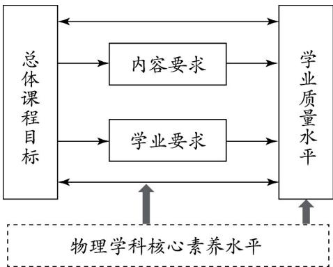

学科课程教材与教学

# 《普通高中物理课程标准（2017年版） 》 的变化

彭前程（人民教育出版社 物理室 ， 北京 100081）

摘要 《普通高中物理课程标准 （2017年版） 》 与 《普通高中物理课程标准（实验） 》 相比 在理念 目标 内容 评价等部分都有很大变化 课程目标由三维教学目标变为核心素养培养目标 ； 课程结构由必修加三个系列选修变为必修加选择性必修和选修； 内容要求由侧重知识要求向物理观念 科学思维 体验 探究等多方面要求转变； 学习要求及评价由单一的 “内容要求” 变为由 “内容要求” “学业要求” 和 “学业质量水平” 组成的综合评价体系 了解和把握好这些变化的含义与本质， 对核心素养教育有促进作用。

关键词 ：高中物理课程标准 ； 课程目标； 内容变化； 学业质量

中图分类号 ：G633．7 文献标志码 ：A 文章编号 ：1000－0186（2018）09－0099－08

2017年底教育部颁布了 《普通高中物理课程标准 （2017年版） 》 （以下简称 《标准》 ）和 《普通高中物理课程标准 （实验） 》 相比 《标准》 有许多新的思想 内涵及变化， 需要我们认真学习 悉心体会， 以指导今后的高中物理教育。

## 一、 《标准》 修订的背景

自2004年 我国各省 （自治区 直辖市）相继开始了一轮高中课程改革 十几年的课程改革促进了物理课程理念的更新 教学方式以及学习方式的变革 为全面提升学生物理学科素养奠定了基础 然而实施中也产生了一些问题 例如， 有些省份的学生学习的内容不同 ， 给大学教育带来了困难； 科学思维培养要求不够具体 ； 选修2系列课程几乎没有学生选择 ， 形同虚设等

另外， 近年来许多国家 地区以及国际组织相继开展了 “核心素养” 研究及实践 为了适应新形势的要求， 提高我国公民的教育质量 ， 这一时期我国也相继出台了一些重要的文件 2010年7月国务院颁布的 《国家中长期教育改革和规划发展纲要 （2010—2020年） 》 提出 “德育为先 能力为重 全面发展” 的教育政策 2012年党在十八大报告中明确指出 “坚持教育为社会主义现代化建设服务 为人民服务 把立德树人作为教育的根本任务 ， 培养德智体美全面发展的社会主义建设者和接班人 ”［1］为了进一步落实党的 “立德树人” 根本任务， 2014年3月30日， 教育部印发了 《关于全面深化课程改革落实立德树人根本任务的意见》 根据国际教育发展以及国内教育要求 ， 2014年教育部组织专家开始我们学生发展核心素养指标体系研究 2016年9月该指标体系正式提出

在此背景下 ， 教育部组织专家对各个学科的课程标准进行了修订。

## 二 课程标准内容的具体变化分析

## （一） 课程性质与理念

## 1．课程性质的变化

《标准》 在 “课程性质” 部分 分别从物理学科本身的性质以及在高中课程中的地位与作用作了阐述 对于学科性质 《标准》 明确提出“物理学基于观察与实验 建构物理模型 应用数学工具 通过科学推理和论证 形成系统的研究方法和理论体系”［2］p．1也就是说， 物理学是基于事实 通过推理论证等形成的研究方法和理论 这是对物理学较为准确的概括 比2003年版具体 便于教学实践中把握与落实

对于物理课程在高中的地位与作用 《标准》明确提出 ： “高中物理课程是普通高中自然科学领域的一门基础课程 ， 旨在落实 “立德树人” 根本任务， 进一步提升学生的物理核心素养 ， 为学生的终身发展奠定基础 促进人类科学事业的传承与社会的发展 ［3］p．1与2003年版 “高中物理是普通高中科学学习领域的一门基础课程 ， 与九年义务教育物理或科学课程相衔接 ， 旨在进一步提高学生的科学素养 ”［2］p．1的叙述相比 《标准》的阐述更具体 全面 准确 强调 “立德树人”思想， 突出物理核心素养， 指出课程是为了学生的终身发展服务的性质

## 2．课程理念的变化

《标准》 关于课程理念包括五个方面 （1） 注重体现物理学科本质 培养学生物理核心素养（课程目标） ； （2） 注重课程的基础性和选择性满足学生终身发展的需要 （课程结构） ； （3） 注重课程的时代性 ， 关注科技进步和社会发展需求（课程内容） ； （4） 引导学生自主学习 提倡教学方式多样化 （课程实施） （5） 注重过程评价促进学生核心素养的发展 （课程评价） 这五个方面第一条是核心， 其他四个方面为第一条 “注重体现物理学科本质 培养学生物理核心素养”服务 与2003年版课程标准相比 《标准》 关于理念阐述的结构没变 ， 只是具体表述不同 ， 特别是第一条的表述变化较大 ， 这一条是我们理解新课程理念的核心。

《标准》 第一条具体的表述为 “高中物理课程注重体现物理学科的本质 ， 从物理观念 科学思维 科学探究 科学态度与责任等方面提炼学科育人价值 充分体现物理学科对提高学生核心素养的独特作用 为学生终身发展 应对现代和未来社会发展的挑战打下基础” 与2003年版的课程标准比较 可以看出 《标准》 在课程理念上的主要变化是将原来的 “知识与技能” “过程与方法” 和 “情感态度与价值观” 三个方面的目标要求 变为 “物理观念” “科学思维” “科学探究” 和 “科学态度与责任” 四个核心素养方面的要求 这就使得我们对高中物理教学的理念从比较概括的 “三维目标” 变为具体、 可操作的 “核心素养”

## （二） 核心素养与课程目标

## 1．核心素养的理解

《标准》 将物理学科的核心素养界定为 ： “是学生通过学科学习而逐步形成的正确价值观念必备品格和关键能力” ， 主要包括 “物理观念”“科学思维” “科学探究” 和 “科学态度与责任”四个方面［3］p．3。 在这四个方面中， 后两个与原课标中的内涵及要求相差不多 而 “物理观念” 和“科学思维” 则是新增加的 ， 内涵也较为丰富

对于物理观念的理解 关键要把握 “是物理概念和规律等在头脑中的提炼与升华” 这里概念和规律是基础 把握住了概念和规律 就把握住了主体 教学中要注意概念和规律的深度理解和灵活应用 物理概念和规律在整个高中物理课程中数量是非常之多的 ， 进一步将它分类 提炼则形成物理观念 《标准》 将物理观念分为 “物质观念” “运动与相互作用观念” 以及 “能量观念” 这样界定的物理观念类似于国际科学教育中的核心概念 （coreconcept） 、 大 概 念 （bigidea） 要落实物理观念的教学 一是要注意把握概念和规律教学的主体 二是要注意在一定的概念 规律的基础上适时加以总结 提升， 使得学生既对概念和规律有深刻的理解 同时在其之上能形成统领这些概念和规律的大概念———物理观念 只有在进行概念 规律的教学中适时注意将有关概念加以提升 ， 才能使物理观念的教学得以水到渠成地建立起来

在物理教育中 还有一个非常重要的方面就是科学思维教育 ， 物理教育中概念和规律的建立是基础 科学思维的培养是核心 在高中阶段之所以要学习许多的物理观念 是要学习物理的知识和观念 更是要培养学生的科学思维能力学生的科学思维能力培养起来了 他们就变得更加聪明 就能够解决实际中遇到的问题 所以在物理教学中要充分重视科学思维的培养 《标准》 将科学思维分为 “模型建构” “科学推理”“科学论证” 和 “质疑创新” 四个要素 在这四个要素中 “科学推理” 与 “科学论证” 是逻辑推理与论证中的两个重要方面 ， 含义比较清楚 ，而在 “模型建构” 这一要素的教学中 要注意抽象 概括等思维方法的学习 因为在建构模型时一定要将实际问题中的次要因素忽略 抽象出本质的属性并加以概括推广到一般 所以模型建构教学中一定涉及抽象和概括思维的教学 四个要素中的另一个 “质疑与创新” 指的是思维中的品质特性 它不是一种具体的思维 而是说思维培养中不只是要注意根据原有理论的逻辑推理 ， 也应该注意质疑与创新

应该说明的是 《标准》 中所说物理核心素养的四个方面是物理教育中有机的整体 不能割裂开来 物理观念教学中肯定会涉及科学思维的训练 科学态度的培养 科学探究的运用等 在这四个核心素养中， 物理观念是基础， 科学思维是核心 科学探究是方式 科学态度与责任是必备品格 育人的最终目标 教学中要注意这四位一体的全面设计 不能只重视某一个方面而忽视其他方面

## 2．课程目标的变化

2003版的课程目标是从 “知识与技能” “过程与方法” “情感态度与价值观” 三个方面来展开的 而 《标准》 的课程目标则是从物理核心素养的角度来阐述的

《标准》 一开始就开宗明义指出 ： “高中物理课程应在义务教育的基础上 进一步促进学生物理学科核心素养的养成和发展 ”［3］p．5 接下来分别用四个自然段从 “物理观念” “科学思维” “科学探究” 和 “科学态度与责任” 四个方面来阐述具体的课程目标

例如 第二自然段是以对 “科学思维” 的要求来展开的 ： “具有建构模型的意识和能力； 能运用科学思维方法， 从定性和定量两个方面对相关问题进行科学推理 找出规律 形成结论； 具有使用科学证据的意识和评估科学证据的能力能运用证据对研究的问题进行描述 解释和预测 具有批判性思维的意识 能基于证据大胆质疑 从不同角度思考问题 追求科技创新” 从中我们可以看出 这一段关于 “科学思维” 的课程目标分别从科学思维的 “模型建构” “科学推理” “科学论证” 和 “质疑创新” 四个要素对整个课程提出了目标要求

也就是说， 《标准》 是从物理核心素养的各个二级指标对课程目标提出了具体的要求 分清课程目标表述的结构及确切的涵义 有利于我们更好地理解 把握和处理好课程目标

## 3．物理学科核心素养与三维目标

《标准》 以核心素养为出发点提出整个课程的目标要求 内容要求 学业要求等 而2003年版课程标准则是以三维目标为基础 对整个课程提出全面要求 要使核心素养理念下的教学顺利进行 就要回答核心素养与三维目标的关系

我们知道 核心素养是在新时代的视角下对人们所需品格与能力等的提练 ， 物理学科核心素养是物理学科育人价值的集中体现 是学生通过物理课程的学习逐步形成的正确价值观念必备品格和关键能力 而这些品格与能力 与三维目标所说的知识 技能 方法 态度等有着非常重要的联系 《标准》 在对原三维目标中的知识与技能 过程与方法 情感态度价值观进行分析、 整合后， 提出了物理学科核心素养［3］p．iv。 核心素养是对三维目标要求的进一步的明确与细化 其内涵更清楚 具体 例如 在三维目标中的 “过程与方法” 中 并没有指出高中物理阶段应该学习哪些具体的方法 ； 而在物理核心素养的“科学思维” 要求中， 则提出了 “模型建构” “科学推理” “抽象思维” “控制变量” “极限思想”等方法 不过， 尽管三维目标没有像核心素养要求这样具体， 但是它也从三维目标的角度较全面地规定了我们教学中所应该关注的方面 并没有偏重若遗漏 所以 以往较好的 能体现学生主动学习的教学设计我们仍然可以借鉴

另外， 从育人价值上看 ， 核心素养更注重教育的整体性以及个人的发展 因此核心素养既是对三维目标的继承 ， 更是对三维目标的发展与超越。

## （三） 课程内容的变化

从整个的内容分布来看 《标准》 中的必修加选择性必修的内容与2003年版课程标准的必修加3系列的内容相当 所以这里只对必修及选择性必修的内容与原来课程标准相应内容进行

比较。

为了便于看出两个版本的不同 下面用表格的形式列出了各二级主题下具体内容的增 删调整情况及原因分析

表1 共同必修内容变化
<table><tr><td colspan="1" rowspan="1">主题</td><td colspan="1" rowspan="1">增加、删除及调整</td><td colspan="1" rowspan="1">原因分析</td></tr><tr><td colspan="1" rowspan="1">机械运动与物理模型</td><td colspan="1" rowspan="1">将原来“通过对质点的认识，了解物理学研究中物理模型的特点，体会物理模型在探索自然规律中的作用”调整为“经历质点模型的建构过程。知道将物体抽象为质点的条件，能将特定实际情境中的物体抽象成质点。体会建构物理模型的思维方式”增加“体会科学思维中的抽象方法和物理问题研究中的极限方法”将匀变速直线运动的规律从“了解”调整为“理解”删去“体会数学在研究物理问题中的重要性。”增加“通过实验，认识自由落体运动规律。结合物理学史的相关内容，认识物理实验与科学推理在物理学研究中的作用”</td><td colspan="1" rowspan="1">模型建构是科学思维中四个要素之一，对质点模型的建构要求具体、明确，有利于体会建模的思想和方法速度与加速度的建立可以很好地体现极限的思想和抽象思维方法匀变速直线运动的规律是高中物理学习中重要的规律之一，应提高要求数学在物理学习中的重要性贯穿整个物理学，不必在某一处提及原来自由落体运动在例中体现，没有充分体现其在中学物理中的地位，其中伽利略研究问题的方法没得到应有的加强</td></tr><tr><td colspan="1" rowspan="1">相互作用与运动规律</td><td colspan="1" rowspan="1">“通过实验了解物体的弹性”调整为“通过实验了解胡克定律”“认识滑动摩擦、静摩擦规律”调整为“知道滑动摩擦和静摩擦现象”力的合成和分解从“理解”调整为“了解”“用力的合成和分解分析生活问题”调整为“用共点力的平衡条件分析生产生活问题”</td><td colspan="1" rowspan="1">了解胡克定律比原要求要高，因为后续学习要用到胡克定律，如简谐运动。学生实验也增加了胡克定律，内容要求与实验相一致关于摩擦说现象比规律准确，摩擦力可以说规律降低力的合成与分解的要求，减轻学生负担共点力平衡是核心知识，调整后的说法更准确</td></tr><tr><td colspan="1" rowspan="1">机械能及其守恒定律</td><td colspan="1" rowspan="1">增加“定性了解弹性势能”增加“体会守恒观念对认识物理规律的重要性”“关心常见机械功率的大小及意义”调整为“了解常见功率的大小及意义”删除“举例说明功是能量变化的量度”删除“通过实验，探究恒力做功与动能变化关系”</td><td colspan="1" rowspan="1">补充对弹性势能的要求加强“守恒观念”的教学“关心”不是一个具体的认知要求，改为“了解”更准确功是能量变化的量度在动能定理、重力势能的变化与做功的关系处均有体现，没有必要重复提出要求如果实验用类似探究匀变速直线运动实验装置，一是改变力、质量来做实验繁难，二是实验的具体作法与探究匀变速直线运动雷同，此次没有把它列入学生实验，内容中也不作要求</td></tr><tr><td colspan="1" rowspan="1">曲线运动与万有引力定律</td><td colspan="1" rowspan="1">增加“通过实验，了解曲线运动，知道物体做曲线运动的条件”增加“通过实验，探究并认识平抛运动的规律”将“会用运动合成与分解的方法分析抛体运动”调整为“体会将复杂运动分解为简单运动的物理思想”增加“探究并了解匀速圆周运动向心力大小与半径、角速度、质量的关系”</td><td colspan="1" rowspan="1">通过实验及分析了解曲线运动的条件，便于学生理解一般意义的力与运动的关系通过实验认识平抛运动的规律是非常重要的一个方面，应该加强加强复杂运动分解为简单运动的思想加强实验探究，会使学生更好地理解与掌握向心加速度与各量关系的含义</td></tr><tr><td colspan="1" rowspan="1">牛顿力学的局限性与相对论初步</td><td colspan="1" rowspan="1">只保留“初步了解相对论时空观和微观世界的量子特征”删除“知道狭义相对论的实验基础、基本原理和主要结论”和“初步了解广义相对论的几个主要观点以及主要观测证据”</td><td colspan="1" rowspan="1">课时所限，保留相对论、量子化主要观点，删去具体内容的要求部分量子初步的内容移至选择性必修3中</td></tr><tr><td colspan="1" rowspan="1">静电场</td><td colspan="1" rowspan="1">将“原子结构”改为“原子结构模型”“点电荷”改为“点电荷模型”增加“体会探究库仑定律过程中的科学思想和方法”增加“体会用物理量之比定义新物理量的方法”电场强度由“理解”调整为“了解”电势差由“理解”调整为“了解”了解生产生活中关于静电的利用与防护能分析带电粒子在电场中的运动情况。能解释相关的物理现象观察电容器的充、放电现象</td><td colspan="1" rowspan="1">加强模型建构科学思维的学习库仑定律学习不能仅限于公式的学习，要强调其中科学方法的学习加强科学思维方法的学习降低电场强度及电势差的要求，适当减轻学生的负担静的利用与防护是生活中常见的现象，加强应用是强调素养的一个方面带电粒子在电场中的运动是物理学习中重要的内容，后续学习也去用到加强实验的要求对学生理解该内容非常必要</td></tr><tr><td colspan="1" rowspan="1">电路及其应用</td><td colspan="1" rowspan="1">增加“了解串、并联电路电阻的特点”删去“初步了解多用电表的原理”增加“理解电功、电功率”焦耳定律由“知道”调整为“理解”增加“能分析和解决家庭电路中的简单问题，能将安全用电和节约用电的知识应用于生活实际”删去“逻辑电路和集成电路”的内容</td><td colspan="1" rowspan="1">串、并联电路电阻的定量关系初中不要求，高中应明确要求多用电表只要求会使用，不要求原理。而多用电表的使用已放在“用多用电表测量电学中的物理量”实验中，内容中不再单独列出电功、电功率是高中物理的重要内容，应该提出明确要求焦耳定律的要求应该与电功、电功率的要求一致加强安全用电的意识限于课题，删去部分过于技术的内容</td></tr><tr><td colspan="1" rowspan="1">电磁场与电磁波初步</td><td colspan="1" rowspan="1">产生感应电流的条件由“理解”调整为“了解”增加“知道光的能量是不连续的。初步了解微观世界的量子化特征”</td><td colspan="1" rowspan="1">知道什么条件下可以产生感应电流即可，降低在此分析过难、繁杂的问题加强“能量量子化”现代物理思想的教学</td></tr></table>

表2 选择性必修内容变化
<table><tr><td colspan="1" rowspan="1">主题</td><td colspan="1" rowspan="1">增加、删除及调整</td><td colspan="1" rowspan="1">原因分析</td></tr><tr><td colspan="1" rowspan="1">动量与动量守恒定律</td><td colspan="1" rowspan="1">“通过实验，理解动量”调整为“通过理论推导和实验，理解动量定理”</td><td colspan="1" rowspan="1">动量定理应在高中物理中明确提出要求。通过理论推导和实验来学习动量定理，能够帮助学生更好地理解和把握这部分内容</td></tr><tr><td colspan="1" rowspan="1">机械振动与机械波</td><td colspan="1" rowspan="1">删去“惠更斯原理”</td><td colspan="1" rowspan="1">限于课时，删去难度较大、中学应用并不广泛的惠更斯原理</td></tr><tr><td colspan="1" rowspan="1">光及其应用</td><td colspan="1" rowspan="1">删去“用激光观察全息照相”</td><td colspan="1" rowspan="1">删去许多学校不易实现的实验</td></tr><tr><td colspan="1" rowspan="1">磁场</td><td colspan="1" rowspan="1">“会计算安培力的大小”调整为“会计算匀强磁场中安培力的大小”</td><td colspan="1" rowspan="1">使安培力大小的计算明确要求在匀强磁场中</td></tr><tr><td colspan="1" rowspan="1">电磁感应及其应用</td><td colspan="1" rowspan="1">“理解法拉第电磁感应定律”调整为“通过实验，理解法拉第电磁感应定律”“知道交变电流，能用函数表达式和图像描述交变电流”调整为“通过实验，认识交变电流。能用公式和图像描述正弦交变电流”删去“通过实验，了解电容器和电感器对交变电流的导通和阻碍作用”增加“了解发电机和电动机工作过程中的能量转化”</td><td colspan="1" rowspan="1">中学生对法拉第电磁感应定律的理解必须建立在实验的基础上，故明确提出对实验的要求强调实验的作用。描述中“公式”比“函数表达式”更准确限于课时，对此部分不作要求强调应用的意识</td></tr><tr><td colspan="1" rowspan="1">电磁振荡与电磁波</td><td colspan="1" rowspan="1">增加“认识电磁学在人类生活和社会发展中的作用”增加“初步了解场的统一性和多样性，体会物理学对统一性的追求”增加“通过实验，了解电磁振荡”删去“了解电磁波的应用和在科技、经济、社会发展中的作用”</td><td colspan="1" rowspan="1">删去多条具体内容中类似“在人类生活和社会发展中的作用”，统一在上位概念“电磁学”里体现加强物理观念中“物质观”的教学，体会物理学中对统一理论基本目标的追求电磁振荡是比较抽象的概念，实验可帮助学生更好地理解电磁振荡的产生电磁波的应用在具体内容中有要求，“在经济、社会中的作用”放在电磁学中统一说</td></tr><tr><td colspan="1" rowspan="1">传感器</td><td colspan="1" rowspan="1">增加“用传感器设计并制作简单的自动控制装置”学生实验</td><td colspan="1" rowspan="1">强调这部分内容动手实践的作用</td></tr><tr><td colspan="1" rowspan="1">固体、液体和气体</td><td colspan="1" rowspan="1">删去“知道阿伏加德罗常数的意义”增加“知道分子运动速率分布图像的物理意义”删去“认识温度是分子平均动能的标志。理解内能的概念”删去“了解液晶的微观结构。通过实例了解液晶的主要性质及其在显示技术中的应用”“知道饱和汽、未饱和汽和饱和气压。了解相对湿度。举例说明空气的相对湿度对人的生活和植物生长的影响”</td><td colspan="1" rowspan="1">阿伏加德罗常数的意义在化学中已详细学习，物理中直接应用即可。分子运动速率分布图像对理解分子运动速率分布的统计规律非常重要，应该明确要求限于课时，在微观理论部分对分子平均动能和内能不作要求。内能只在热力学第一定律作为宏观量来要求。限于课时，删去热学中的一些非主干知识</td></tr><tr><td colspan="1" rowspan="1">热力学定律</td><td colspan="1" rowspan="1">删去“初步了解熵是反映系统无序程度的物理量”</td><td colspan="1" rowspan="1">限于课时，删去难度较大的有关熵的内容</td></tr><tr><td colspan="1" rowspan="1">原子与原子核</td><td colspan="1" rowspan="1">知道四种基本相互作用删去“能简单解释轻核与重核内中子数、质子数具有不同比例的原因””知道链式反应的发生条件。了解裂变反应堆的工作原理。了解常用裂变反应堆的类型。知道核电站的工作模式”</td><td colspan="1" rowspan="1">自然界最基本的相互作用的内容，学生应该知道。同时了解科学为追求统一所做出的贡献限于课时，删去难度较大、过于技术的内容</td></tr><tr><td colspan="1" rowspan="1">波粒二象性</td><td colspan="1" rowspan="1">“根据实验说明光的波粒二象性”调整为“能根据实验结论说明光的波粒二象性”删去“了解康普顿效应”“知道光是一种概率波”“知道电子云”“初步了解不确定性关系”增加“了解微观世界的量子化特征。体会量子论的建立对人们认识物质世界的影响”</td><td colspan="1" rowspan="1">加强科学思维中所说的“证据”意识限于课时，删去一些具体知识，加强微观世界基本特点和主要观点的了解</td></tr></table>

## （四） 课程评价体系

与2003年版课程标准比较 ， 《标准》 在学生学习评价方面增加了 “学业要求” “学业质量”“物理学科核心素养的水平划分” 等内容 建立了比较完整的课程评价体系

## 1．评价内容

## （1） 物理学科核心素养水平

为了使物理学科核心素养要求更明确 《标准》 对核心素养提出了五级水平的要求 这些核心素养水平是 “内容要求” “学业要求” 特别是“学业质量水平” 提出的基础

## （2） 内容要求

根据核心素养的要求 《标准》 对具体的内容提出了教学上的要求 ， 这些内容要求主要与各知识点相对应 用 “知道 “认识” “理解” 等行为动词对认知性学习目标做出要求 ， 用 “经历”“体验” “感受” 等行为动词对体验性学习目标做出要求

## （3） 学业要求

为了对学生的学习结果要求更具体 明确《标准》 在每个模块后给出了学生学业要求 每个模块的学业要求是学生学习完这个模块后应该达到的学习要求 ， 学业要求从核心素养的角度对学生最后能达到什么样的能力水平提出要求 学业要求只是学习完本模块后 ， 对学生能达到什么样的能力水平提出了统一的要求 ， 没有给出水平等级 因此它可以作为评价的依据来评价学生的学业情况 但是它不能作为标准来进行准确的测量。

## （4） 学业质量

为了对学生学习完高中物理课程进行评价《标准》 对学生学习的 “学业质量” 提出了要求制定了有五级水平的 “学业质量水平” 相当于给出了学业质量标准 学业质量标准是以学科核心素养及其表现水平为主要维度 ， 结合课程内容， 对学生学业成就表现的总体刻画。［3］p．45学业质量水平是针对学生学业状态给出的水平测量的标尺， 它既是日常教学的依据 ， 也是选拔性考试的依据 学业质量水平二是高中毕业生应达到的合格要求， 是学业水平合格考试的命题依据 ， 学业质量水平四是用于高等院校招生录取的学业水平等级性考试的命题依据。［3］p．48 《标准》 不仅对学业水平考试的要求做了明确的规定 而且对学业水平考试的试卷命题提出了实施建议

## 2．评价体系结构

《标准》 从 “课程目标” “内容要求” “学业要求” “学业质量水平” 等多方面对学习 教学学业水平等进行了描述与要求 ， 构成了一个完整的学生学习指导与评价体系 各部分的关系如图1所示。

  
图1 评价结构示意图

根据学生发展核心素养及物理学科核心素养制定的总体课程目标 ， 需要进一步分解 明确细化 结合 “物理学科核心素养水平” 《标准》给出了 “内容要求” “学业要求” 根据 “内容要求” “学业要求” 和 “物理学科核心素养水平” ，形成 “学业质量水平” 其中， “内容要求” 主要在认知、 技能、 体验等方面提出要求； “学业要求” 则主要是从物理学科核心素养四个方面对该模块内容的整体要求 ； “学业质量水平” 则是整个高中物理课程检测的标准 是日常教学及高中学业水平考试命题的重要依据

《标准》 是我们进行高中物理教学的依据认真地分析 了解和把握其中有关内容的变化 ，以及变化的含义与本质 对核心素养教育有积极的促进作用。

## 参考文献 ：

［1］ 胡锦涛．坚定不移沿着中国特色社会主义道路前进为全面建成小康社会而奋斗———在中国共产党第十八次全国代表大会上的报告 ［R］．北京 ： 人民出版社 ， 2012

［2］ 中华人民共和国教育部．普通高中物理课程标准（实验） ［S］．北京 ： 人民教育出版社 ， 2003

［3］ 中华人民共和国教育部．普通高中物理课程标准（2017年版） ［S］．北京 ： 人民教育出版社 ， 2018

（责任编辑 ： 李化侠）

# TheChangesofNational High School Curriculum Standards of Physics （ 2017 Edition ）

PengQiancheng

（ Physics Editorial Department ， People s Education Press ， Beijing 100081， China ）

Abstract： Compared with the National High School Curriculum Standard of （Experimental Edition） ， therevised Standard （ 2017 Edition） hadsignificantchangesincurriculum ideas， objectives， contents， andevaluation．Specifically， therevisedcurriculum objectivesfocuson constructingthecoreideas， butnotonlyontheformerthree－dimensionalobjectives （e．g．content knowledgeandskill processandmethods attitudesandvalues）．Therevisedcurriculumisconsistedof threecompulsoryandthreeselective－compulsorysections insteadoftwocompulsoryandthreeelective sections．For knowledgerequirement， exceptcontentknowledge， the new standardsalsoraised demandingonphysicscoreconcepts， scientificthinking， andscientificinquiry．Inthenewstandard， curriculum evaluationis a compositive system consisted with knowledge requirement studying requirementandthelevelsofstudyingachievement．Knowingthemeaningandnatureofthesechanges， willprovidegreatcontributiontopromotingkeycompetenciesbasededucation

Keywords： National High School Curriculum Standard of Physics ； curriculumobjectives； changesof contents；levelsofstudyingachievement
