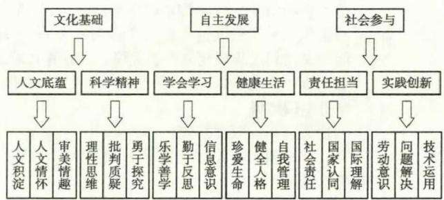
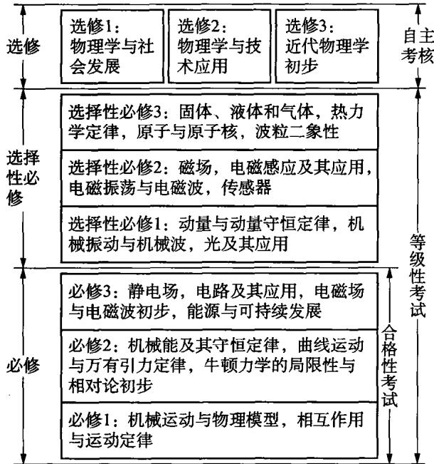
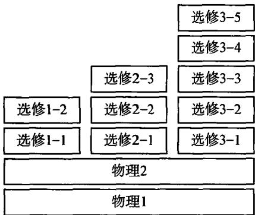
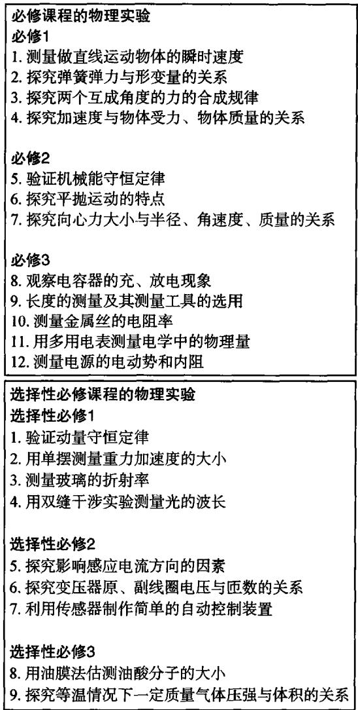

# 《普通高中物理课程标准》(2017年版)要点解读

廖伯琴（西南大学科学教育研究中心西南大学物理科学与技术学院重庆400715）

摘要为全面深化课程改革、落实立德树人根本任务，《普通高中物理课程标准》(2017年版)于2018年初正式颁布。修订后的物理课程标准更注重落实物理课程的育人功能，体现课程的基础性、系统性与选择性，加强对评价改革的引导。本文从物理学科核心素养提炼、普通高中物理课程结构调整、学生必做实验要求及学业质量水平探索四个方面进行了要点解读。

关键词课程标准核心素养课程结构物理实验学业质量

文章编号 1002-0748(2020)2-0002

中图分类号G633·7

文献标识码 A

为了将立德树人的要求落到实处，《教育部关于全面深化课程改革落实立德树人根本任务的意见》(以下简称《意见》)提出要充分认识全面深化课程改革、落实立德树人根本任务的重要性和紧迫性；准确把握全面深化课程改革的总体要求；着力推进关键领域和主要环节改革；切实加强课程改革的组织保障。此《意见》强调要研制学生发展核心素养体系和学业质量标准，根据学生的成长规律和社会对人才的需求，回答“培养什么人、怎样培养人”的问题；提出要修订课程方案和课程标准，依据学生发展核心素养体系，进一步明确各学段、各学科具体的育人目标和任务，完善高校和中小学课程教学有关标准[1]。在此基础上，研制了《中国学生发展核心素养》，从文化基础、自主发展、社会参与三个方面提炼了中国学生发展核心素养，综合体现为人文底蕴、科学精神、学会学习、健康生活、责任担当、实践创新等六大素养，具体细化为人文积淀、人文情怀、审美情趣、理性思维、批判质疑、勇于探究、乐学善学、勤于反思、信息意识、珍爱生命、健全人格、自我管理、社会责任、国家认同、国际理解、劳动意识、问题解决、技术运用18个基本要点(见图1)[2]。

为了全面深化课程改革落实立德树人根本任务，教育部于2014年启动了对普通高中课程标准的修订。普通高中物理课程标准修订组(以下简称修订组)按照教育部部署，对2003年颁布的《普通高中物理课程标准(实验)》(以下简称实验版物理课标)进行了修订。下面侧重介绍关于《普通高中物理课程标准(2017年版)》(以下简称2017版物理课标)的修订要点。

  
图1 中国学生发展核心素养结构图

## 1 提炼学科核心素养，凸显课程的育人功能

在本世纪初启动的第八次基础教育课程改革中，教育部分别在2001年颁布了《义务教育课程标准》(实验稿)，2003年颁布了普通高中课程标准，2011年颁布了《义务教育课程标准》(2011年版)，在这三次颁布的课程标准中，都强调了三维课程目标，即知识与技能、过程与方法和情感态度价值观。相对双基目标(基础知识、基本技能)，三维目标对课程功能的体现已是一个进步。随着时代对人才培养需求的提升，已有国家课程标准不足之处逐渐凸显。

## 例如，实验版物理课标提出的课程总目标为[3]：

“学习终身发展必备的物理基础知识和技能，了解这些知识与技能在生活、生产中的应用，关注科学技术的现状及发展趋势。

学习科学探究方法，发展自主学习能力，养成良好的思维习惯，能运用物理知识和科学探究方法解

决一些问题。

发展好奇心与求知欲，发展科学探索兴趣，有坚持真理、勇于创新、实事求是的科学态度与科学精神，有振兴中华，将科学服务于人类的社会责任感。

了解科学与技术、经济和社会的互动作用，认识人与自然、社会的关系，有可持续发展意识和全球观念。

从以上对总目标的描述可见，在实验版物理课标中更侧重要求学生要做什么，如要求学生“学习”“了解”“关注”“认识”“发展”等，对学生为什么要“学习”“了解”“关注”“认识”“发展”等方面关注不够。若继续分析实验版物理课标中关于“知识与技能”“过程与方法”“情感态度与价值观”三个维度课程目标的描述，指向比较明确的还是要求学生做什么，至于学生为什么要做这些，对学生成长有什么意义，则提炼不够。2017版物理课标修订过程中，修订组对这些问题进行了探索。修订组在理解物理学内涵的基础上，经过国际比较、国内调研、反复讨论等，凝练出高中物理学科核心素养，这是学科育人价值的集中体现，是学生通过学科学习而逐步形成的正确价值观念、必备品格和关键能力。物理学科核心素养主要包含“物理观念”“科学思维”“科学探究”“科学态度与责任”四个方面[4]。

“物理观念”是从物理学视角形成的关于物质、运动与相互作用、能量等的基本认识；是物理概念和规律等在头脑中的提炼与升华；是从物理学视角解释自然现象和解决实际问题的基础，主要包括物质观念、运动与相互作用观念、能量观念等要素。

“科学思维”是从物理学视角对客观事物的本质属性、内在规律及相互关系的认识方式；是基于经验事实建构物理模型的抽象概括过程；是分析综合、推理论证等方法在科学领域的具体运用；是基于事实证据和科学推理对不同观点和结论提出质疑和批判，进行检验和修正，进而提出创造性见解的能力与品格，主要包括模型建构、科学推理、科学论证、质疑创新等要素。

“科学探究”是指基于观察和实验提出物理问题、形成猜想和假设、设计实验与制订方案、获取和处理信息、基于证据得出结论并作出解释，以及对科学探究过程和结果进行交流、评估、反思的能力，主要包括问题、证据、解释、交流等要素。

“科学态度与责任”是指在认识科学本质，认识“科学·技术·社会·环境”关系的基础上，逐渐形成的探索自然的内在动力，严谨认真、实事求是和持之以恒的科学态度，以及遵守道德规范，保护环境并推动可持续发展的责任感，主要包括科学本质、科学

态度、社会责任等要素。

凝练出物理学科核心素养，有利于促进教师思考：物理学是什么？物理课程的功能是什么？为什么要学这些内容？为什么要了解科学探索的过程与方法？例如，学生为什么学习质点？某新版教科书通过“素养提升”栏目特别指出，关于质点教学，不仅让学生学习质点这个概念，更重要的是通过相关内容学习，使学生能在特定情境中将物体抽象为质点，知道建立质点模型的条件与方法，能体会建构物理模型的思维方式，能认识物理模型在探索自然规律中的作用[5]。再如，学生为什么要学习超重与失重？此新版教科书在“素养提升”栏目中指出，学习该内容是为了使学生能理解牛顿运动定律的内涵，能用牛顿运动定律解释生产生活中的相关现象(超重与失重现象)、解决一些相关的实际问题，培养学生的运动与相互作用观念[5]。

与实验版物理课标的三维课程目标比较可见，2017版物理课标更加凸显物理课程的育人功能，更能体现三维课程目标的内涵。物理学科核心素养的四个方面是物理学科本质和教育功能的集中体现，它们既有侧重，又有相互联系及渗透。教师教学应关注的是如何从提升学生物理核心素养的视角进行物理教学设计、改进教学方式、提高教学效果[6]。

## 2 调整结构，强调课程基础性、系统性与选择性

本次调整的课程结构，有利于落实立德树人根本任务要求，体现物理课程的育人功能；满足普通高中课程方案的要求，开设必修、选择性必修和选修课程；遵循学生认知规律及学科特点，设计循序渐进的课程内容；关注学生多元发展，设计具有基础性和选择性的课程；融入理论和实践新成果，设计先进并具有操作性的课程。

如图2所示，高中物理必修课程是全体学生必须学习的课程，注重全体学生的共同基础和现代公民对物理学的基本需求，注重课程的基础性，由必修1、必修2和必修3构成。选择性必修课程是学生根据个人需求与升学要求选择学习的课程，注重课程的系统性，由选择性必修1、选择性必修2和选择性必修3构成。选修课程是由学生自主选择学习的地方或校本课程，注重课程的选择性，由选修1、选修2和选修3构成[4]。

在实验版物理课标的课程结构(见图3)中，高中物理有必修课程和三个选修系列课程，这些课程中也关注了学生学习的基本需求，强调了高中物理课程的基础性、系统性与选择性，考虑了物理学科的整体特点，为学生有个性地发展提供了平台。然而，由于升学、招生等原因，物理课程的系统性和选择性皆受到影响。本次课程结构调整，既为全体学生发展、国民科学素养提升设计必修课程，也为国家物理人才的培养、学生有个性的发展设计了选择性必修和选修课程，体现了课程的基础性、系统性与选择性[7]。

  
图 2 2017 版物理课标的课程结构图

  
图3 实验版物理课标的课程结构图

## 3 加强实践，体现物理学科的育人内涵

物理学是以实验为基础的学科，物理课程应注重引导学生进行科学实践。在2017版物理课标中，必修课程有12个学生必做实验，选择性必修课程有9个学生必做实验，共计21个学生必做实验（见图4)[4]。这些实验的提出，既考虑了在不同的内容板块的分布，也考虑了必修与选择性必修的布局；既考虑了常规的验证实验和测量实验，还考虑了具有一定开放程度的探究实验和制作实验。

在实验版物理课标中，当时为了让学生做更多的物理实验，因此没有专门列出学生必做实验，但在实施中，由于没有明确学生必做实验，则使中学物理实验教学有弱化的趋势。2017版物理课标对学生提出必做实验的要求，将有利于引导学生做中学，体会科学探究内涵，发展学生物理学科核心素养。

  
图4 2017版物理课标的学生必做实验

教师在设计物理实验时，应思考学生做此实验的意义是什么。如，在做学生实验“探究加速度与物体受力、物体质量的关系”时，得出结论只是实验的一部分。上述教科书在“素养提升”栏目中指出通过该实验使学生“能从生活中的现象提出可探究的物理问题；能在他人帮助下制订科学探究方案，有控制变量的意识，会使用实验器材获取数据；能根据数据形成结论，会分析导致实验误差的原因；能参考教科书撰写有一定要求的实验报告，在报告中能对实验操作提出问题并进行讨论，能用学过的物理术语等交流科学探究过程和结果。提升实验设计能力与科学推理能力”[5]。这样的提炼从问题、证据、解释、交流几个方面凸显了该实验的育人功能。

## 4 重视评价引导，落实物理课程的育人功能

如何评价教与学的效果？如何测试学生的素养提升？这是落实物理课程育人功能的关键。在本轮课标修订中，修订组探索了关于学科核心素养的测试问题，依据物理学科核心素养中的“物理观念”“科学思维”“科学探究”“科学态度与责任”四个方面，结合课程内容的要求制定了学业质量要求，并且根据问题情境的复杂程度、知识和技能的结构化程度、思维方式或价值观念的综合程度等对学业质量划分了5级水平。其中，学业质量水平2是高中毕业生应达到的合格要求，是学业水平合格性考试的命题依据；学业质量水平4是用于高等院校招生的学业水平等级性考试的命题依据。

如图5所示[4]，在水平2中的第一段，对应的是与“物理观念”有关的要求：“了解所学的物理观念和规律，能解释简单的自然现象，解决简单的实际问题”；水平4的要求则侧重“理解”，要求学生“能正确解释自然现象，综合应用所学的物理知识解决实际问题。”再如，在水平2的第二段，对应的是与“科学思维”有关的要求：“能在熟悉的问题情境中应用所学的常见的物理模型；能对比较简单的物理问题进行分析和推理，获得结论；能使用简单和直接的证据表达自己的观点；具有质疑和创新的意识。”水平4的相关要求则为“能将实际问题中的对象和过程转换成所学的物理模型；能对综合性物理问题进行分析和推理，获得结论并作出解释;能恰当使用证据证明物理结论；能对已有结论提出有依据的质疑，采用不同方式分析解决物理问题”(其他要求不再一一赘述)。仔细研读学业质量的不同水平要求，能看出由水平1到水平5的不断提升。这是一个有意义的探索性的工作，有利于教师学业质量观的改变，落实物理课程的育人功能。

2017版物理课标注重将物理学科核心素养的要求融入课程的各个方面，无论是内容要求还是实施建议等皆注重引导教师将物理核心素养的培养落到实处。课程标准中的样例与活动建议是对内容要求的进一步细化，教学提示是从培养学生核心素养的视角提出的教学建议，学业要求则是从物理观念、科学思维、科学探究和科学态度与责任四个方面提出对相关内容的要求。课程标准中的教学与评价建议引导教师如何基于物理核心素养的提升、结合教学实际情况，创造性地开展教学与评价工作。

## 5 结语

我们有教育的理想，为了人类的文明进步、为了民族素质提升、为了受教育者的素养提升，我们应不断践行教育理念！当然，在追求教育理想的过程中，常会受到现实的挑战。若每个有追求的教育者都能在具有挑战性的现实中做力所能及的努力，教育的理想就会逐渐变为现实！

<table><tr><td>水平2</td><td>（1）了解所学的物理概念和规律，能解释简单的自 然现象，解决简单的实际问题。（物理观念） (2)能在熟悉的问题情境中应用所学的常见的物理 模型；能对比较简单的物理问题进行分析和推理，获 得结论；能使用简单和直接的证据表达自己的观点； 具有质疑和创新的意识。(科学思维） （3）能观察物理现象，提出物理问题；能根据已有 的科学探究方案，使用所学的基本的器材获得数据； 能对数据进行整理，得到初步的结论；能撰写简单的 报告，陈述科学探究过程和结果。（科学探究） (4)认识到物理学是基于人类有意识的探究而形成 的对自然现象的描述与解释，并需要接受实践的检验； 有学习物理的兴趣，具有实事求是的态度，能与他人 合作；认识到物理研究与应用会涉及道德与规范问题 了解科学·技术·社会·环境的关系。（科学态度与</td></tr><tr><td>水平4</td><td>责任） （1）理解所学的物理概念的规律及其相互关系，能 正确解释自然现象，综合应用所学的物理知识解决实 际问题。（物理观念） (2)能将实际问题中的对象和过程转换成所学的物 理模型；能对综合性物理问题进行分析和推理，获得 结论并作出解释；能恰当使用证据证明物理结论；能 对已有结论提出有依据的质疑，采用不同方式分析解 决物理问题。（科学思维） （3）能分析相关事实或结论，提出并准确表述可探 究的物理问题，作出有依据的假设；能制订科学探究 方案，选用合适的器材获得数据；能分析数据，发现 其中规律，形成合理的结论，用已有的物理知识进行 解释；能撰写完整的实验报告，对科学探究过程与结 果进行交流和反思。（科学探究） (4)认识到物理研究是一种对自然现象进行抽象的 创造性工作；有学习和研究物理的内在动机，坚持实 事求是，在合作中既能坚持观点又能修正错误；能依 据普通接受的道德与规范认识和评价物理研究与应用 具有保护环境、节约资源、促进可持续发展的责任感。 (科学态度与责任)</td></tr></table>

图 5 学业质量中关于水平2 与水平4 的描述

## 參考文獻

[1]教育部.教育部关于全面深化课程改革落实立德树人根本任务的意见[Z].教基二[2014]4号,2014.3:30.

[2]中国学生发展核心素养研究成果正式发布[N]. 中国教育报，2016-9-14.

[3]教育部.普通高中物理课程标准(实验)[S].北京：人民教育出版社，2003.4.

[4]教育部.普通高中物理课程标准(2017年版)[S].北京：人民教育出版社，2018.1.

[5] 廖伯琴.普通高中教科书《物理》(必修第一册)[M]. 济南：山东科学技术出版社，2019.7.

[6]廖伯琴.以学生发展为本改进普通高中物理课程[J].人民教育，2018(10):36.

[7]廖伯琴.为国富民强培养物理人才[J].基础教育课程，2018(1)：51.