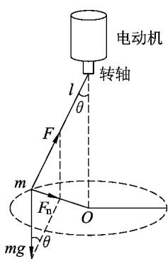
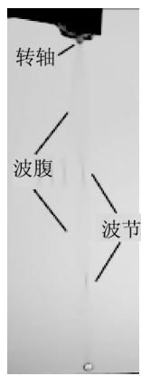
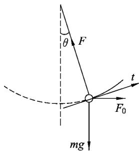
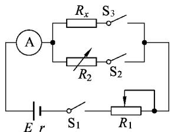
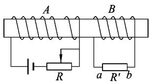

> 来源：MinerU 转换（stem-exact rebuild 2026-08-08）

· 复习与考试 ·

# 理论与实验相结合

# ———习题教学培养核心素养的重要途径

林辉庆

（杭州市余杭高级中学 浙江 杭州 311100）

摘 要：物理是以实验为基础的学科，理论与实验相结合既是物理学科的特点，也是物理研究和解决物理问题的基本方法．文章说明用理论探讨与实验探究相结合的方法进行习题教学的含义，给出两个教学示例，总结其对提升学生物理学科核心素养的作用．

关键词 ：习题教学 ；理论与实验相结合 ；物理学科核心素养

## 1 引言

核心素养的理念应该落实于教育教学的各个环节，习题教学是中学各科教学的重要组成部分，是培育学科核心素养的重要阵地．尤其是在当前的教学现状下，习题教学在课时上占有相当大的比例，如何通过习题教学培养学生的核心素养更加值得研究．对此，已有一些教师从提升物理学科核心素养的视角审视原有的习题教学，发现其存在的问题，提出了相应的对策．［1－4］ 例如，针对“重模型，轻实际”的现象，提出应重视真实情境习题的教学；针对“重训练，轻思维”的现象，提出习题教学应让学生面对并解决新问题；针对“重传授，轻发现”的现象，提出习题教学应重视学生通过亲身探究解决问题．

笔者认为，当前的习题教学除如上各种不良现象外，还普遍地存在着一种违反物理学科本质特征的现象，那就是“重理论，轻实验”．如果说，在新课教学中，教师会进行一些演示实验，或让学生做一些随堂小实验，让学生完成教科书中编排的“学生实验”，那么，在习题教学中是几乎见不到实验的，即使对于实验题，教师也基本上只从理论上分析讲解，学生也只用记忆的实验知识和有关的理论知识进行思考．理论脱离实验的习题教学，不利于学生发展理论联系实际的意识和能力；所练习的知识与技能，也不能被学生用来应对生产生活中的有关问题．

## 2 理论探讨与实验探究相结合的习题教学

《普通高中物理课程标准》在“课程性质”中指出：“物理学基于观察与实验，建构物理模型，应用数学工具，通过科学推理和论证，形成系统的研究方法和理论体系．”［5］ 可见，理论与实验相结合是物理学的本质特征，是最基本的研究方法，当然也是最基本的解决问题的方法，是提升物理学科核心素养的基本途径．习题就是待解决的问题．对于真正的、不能直接套用原有知识和方法求解的习题，理论探讨与实验探究相结合是有效的解题方法和途径．

理论探讨与实验探究相结合的习题教学，并非只用现象新奇的实验来激发学生的学习兴趣或创设问题情境，也并非只用实验验证理论推导的结果，而是强调理论探讨与实验探究在解决问题全过程中真正的有机结合．具体地说，就是当我们解决问题（不管是理论应用题还是实验题）时，如果在理论探讨上遇到困难，可以通过实验寻找解决问题的方向或问题的答案；对于实验指示的解题方向或问题答案，再从理论上进行推导、论证；在实验探究中，往往会观察到新现象，发现新问题，这又需要我们从理论上加以探讨；如此，理论探讨与实验探究相互激发，相互促进，使我们对问题的认识不断深入、全面直至彻底解决．教学中，我们也可以通过实验创设习题情境，让学生从中发现问题、提出问题，然后通过理论探讨与实验探究相结合的方法解决问题．

## 3 理论探讨与实验探究相结合的习题教学示例

### 3．1 圆锥摆的偏角

题1．如图1所示，长 $l$ 的细绳下端拴一个质量为 $m$ 的小球，上端固定在转轴上，转轴带动小球在水平面内做匀速圆周运动．求转轴的角速度分别为 $\omega _ { 1 } = \sqrt { \frac { g } { 2 l } }$ 和 $\omega _ { 2 } = \sqrt { \frac { 2 g } { l } }$ 时细绳偏离竖直方向的夹角θ．

  
图1 圆锥摆

解析：根据小球的受力与牛顿第二定律列出

$$
m g \tan \theta = m \omega ^ { 2 } l \sin \theta .\tag{1}
$$

解得

$$
\mathrm { c o s } \theta = \frac { g } { l \omega ^ { 2 } } .\tag{2}
$$

把 $\omega _ { 1 }$ 代入（2）式得到 $\cos \theta = 2$．

我们知道 $\cos \theta \leqslant 1$，$\cos \theta = 2$ 是没有意义的．可是小球的运动总应该处于某一状态（θ值）呀？在此，理论探讨陷入了困境．

这时可以通过实验观察真实的情况：当电动机转速较小时，小球一直处于转轴正下方旋转而不被甩开，如图2，可见 $\omega$ 较小时 $\theta = 0$．这里，由于电动机转轴不完全竖直或电动机固定不稳固产生震动，在细绳上产生波并经小球反射叠加形成驻波．学生没有学习机械波知识，教师在此只要向学生作简要说明，为后续学习留下悬念．

图2　$\omega$ 较小时的细绳与小球

那么，问题又来了，$\theta = 0$ 这个事实上的结果难道不能从理论上推出？经检查，原来是求解过程中丢失了一个根．严格地，求解时应将（1）式化为

$$
\sin \theta \left( \frac { g } { \cos \theta } - \omega ^ { 2 } l \right) = 0 .\tag{3}
$$

上式解的个数与 $\omega$ 的取值有关．

当 $\omega \leqslant \omega _ { 0 } = \sqrt { \frac { g } { l } }$，$\left( \frac { g } { \cos \theta } - \omega ^ { 2 } l \right) \geqslant 0$，（3）式只有一个解 $\sin \theta = 0$，即 $\theta = 0$．

当 $\omega > \omega _ { 0 } = \sqrt { \frac { g } { l } }$，（3）式有两个解，分别为 $\theta _ { 1 } = 0$，$\cos \theta _ { 2 } = \frac { g } { l \omega ^ { 2 } }$．

由于 $\omega _ { 1 } < \omega _ { 0 }$，因此解为 $\theta = 0$．

对于 $\omega$ 较小时 $\theta = 0$ 这个实验结果，很多学生提出这样的解释：这是由于小球初始是竖直悬挂的，不会受到“离心力”作用；只要设法让小球偏离竖直位置，受“离心力”作用，它就应该能被甩开．

对此我们用实验检验：让轴稳定转动，然后拨动小球使其离开竖直位置，结果看到小球做复杂的运动但幅度不断减小，最后又回到竖直位置．

这又产生了理论上的问题：小球离开竖直位置后受到“离心力”的作用，为什么又会回到竖直位置？

通过讨论认识到，“离心力”要使小球偏离竖直位置，而重力要使小球回到竖直位置，所以需要综合考虑这两者的作用．以转动的轴为参考系，小球受力如图3，其中离心力 $F _ { 0 } = m \omega ^ { 2 } l \sin \theta$，小球所受合力在切线 t方向的分量为

  
图3　转轴参考系中小球的受力

$$
\begin{array} { r } { F _ { t } = F _ { 0 } \cos \theta - m g \sin \theta = } \\ { m ( \omega ^ { 2 } l \cos \theta - g ) \sin \theta = k \sin \theta . } \end{array}
$$

当 $\omega \leqslant \omega _ { 0 } = \sqrt { \frac { g } { l } }$ 时，上式中 $k = m \left( \omega ^ { 2 } l \cos \theta - g \right) < 0$，从而有 $F _ { t } < 0$．所以，小球只要离开 $\theta = 0$ 的位置，$F _ { t }$ 的作用就会使它回到原位置．或者说，此时，小球在 $\theta = 0$ 的状态是稳定的．

$\omega _ { 2 } > \omega _ { 0 }$，理论上 $\theta$ 有两个解，即 $\theta _ { 1 } = 0$ 和 $\theta _ { 2 } = \frac { \pi } { 3 }$．那么这里的问题是，小球到底处于哪个状态？只能处于某一个状态，还是两个状态都有可能？

实验观察发现，即使让小球最初处于 $\theta _ { 1 } = 0$ 的位置，轴以较快的速度转动时，小球即刻会偏离竖直位置，最后稳定在 $\theta _ { 2 }$ 位置．而小球以 $\theta _ { 2 }$ 的偏角运动时，用吹风机吹动小球使它离开原位置，它也很快会回到原来的稳定状态．可见小球只能处于偏角为 $\theta _ { 2 }$ 的状态．

为什么会这样？通过理论研究发现，当 $\omega > \omega _ { 0 }$ 时，$\theta _ { 1 } = 0$ 的状态是不稳定的，$\theta _ { 2 }$ 的状态是稳定的．

这是一个理论应用题．很难想象，只从理论上探讨而不通过实验观察，能使问题得到如此彻底、全面的解决．

### 3．2 等效替代法测电阻

题2．一个被测电阻 $R _ { x }$ 大小约为3kΩ，现要测量它较为准确的阻值，可用的器材有：

电流表 $\mathrm { A } _ { 1 }$ 和 $\mathrm { A } _ { 2 }$，量程分别为0．5mA 和 $1 \ \mathrm { m A }$，内阻约为几十欧姆；滑动变阻器 $R _ { 1 }$，最大阻值为10kΩ；电阻箱 $R _ { 2 }$，阻值范围为0～9999．9 $\Omega$；电源 $E _ { 1 }$ 和 $E _ { 2 }$，电动势分别为4V 和6V，内阻约为零点几欧姆；单刀单掷开关、导线若干．

要求选择合适的器材，设计测量电路，使测量结果尽可能准确，说明测量方法．不计电阻箱电阻的误差．

求解：通过讨论，学生能设计出图4电路用替代法测电阻 $R _ { x }$，能理解通过电流表 $\mathrm { A }$ 的电流大些（下面取满偏电流 $I _ { \mathrm { m } }$），电阻的测量误差小．但是，学生普遍认为用替代法测电阻很“准确”，电流表用 $\mathrm { A } _ { 1 }$ 或

  
图4　替代法测电阻

$\mathrm { A } _ { 2 }$，电源用 $E _ { 1 }$ 或 $E _ { 2 }$ 都是一样的．

替代法测电阻是否很准确？实验能直接给出有说服力的回答．图4中 $\mathrm { A }$ 选 $\mathrm { A } _ { 1 }$，$E$ 选 $E _ { 1 }$，实验中我们会看到，调节电阻箱“$\times 1000$”的旋钮，$\mathrm { A } _ { 1 }$ 指针偏角变化明显，但调节“$\times 100$”旋钮，在某一个范围内（例如“3”到“6”）观察不到指针偏角的变化，调节“$\times 10$”及以下的旋钮，指针偏角都不会发生变化．可见，在这里用替代法测电阻误差有几百欧姆．

电阻100 Ω、100 Ω地变化，而电流表指针竟然不动，学生很惊讶．有些人提出，可能是指针偏角的变化很小，我们肉眼看不出来．对于这个猜想，可以引导学生通过计算检验．

电流为 $I _ { \mathrm { m 1 } } = 0 . 5 \ \mathrm { m A }$ 时，电路中总电阻 $R = \frac { 4 \ \mathrm { V } } { 0 . 5 \ \mathrm { m A } } = 8000 \ \Omega$．让电阻增加100 Ω，电流为 $\frac { 4 } { 8100 } \ \mathrm { A } = 0 . 494 \ \mathrm { m A }$，电流变化 $( 0 . 5 - 0 . 494 ) \ \mathrm { m A } = 0 . 006 \ \mathrm { m A }$．量程0．5mA 的电流表1小格对应电流为 $0 . 01 \ \mathrm { m A }$，$0 . 006 \ \mathrm { m A }$ 对应0．6格，指针偏转0．6格，我们不可能观察不到．

此时，教师向学生指出，任何电流表都有准确度．中学物理实验常用的磁电式电表，准确度等级是2．5，它表示由于轴与轴承摩擦等原因，指针示数的不确定度为 $I _ { \mathrm { m } }$ 的2．5％．即通过电流表的电流变化一般要大于2．5％ $I _ { \mathrm { m } }$，指针偏角才会变化．要求学生据此计算替代法测电阻的误差，看与实验结果是否相符．

在图4中，用 $R _ { 2 }$ 代替 $R _ { x }$ 时，电源内阻 $r$、电流表内阻 $R _ { A }$ 和 $R _ { 1 }$ 是不变的，把它们的和用 $R _ { 0 }$ 表示，即 $R _ { 0 } = r + R _ { A } + R _ { 1 }$．接通 $R _ { x }$ 时

$$
I = \frac { E } { R _ { 0 } + R _ { x } } .\tag{4}
$$

用 $R _ { 2 }$ 代替 $R _ { x }$ 时，当观察到电流表指针指在同一位置，实际电流可能存在着最大为2．5％ $I _ { \mathrm { m } }$ 的差值 $\Delta I$，设对应的电阻差值为 $\Delta R$，于是有

$$
I + \Delta I = \frac { E } { R _ { 0 } + R _ { x } - \Delta R } .\tag{5}
$$

考虑到 $\Delta R \ll ( R _ { 0 } + R _ { x } )$，由上两式可得到

$$
\Delta R \approx \frac { E } { I } \cdot \frac { \Delta I } { I } = \frac { E } { I ^ { 2 } } \times 2 . 5 \% I _ { \mathrm { m } } .\tag{6}
$$

由（6）式可见，$I$ 越大测量误差 $\Delta R$ 越小，这与学生直觉想到的结论一致．$I$ 取最大值 $I _ { \mathrm { m } }$，$\Delta R$ 最小，为

$$
\Delta R \approx \frac { E } { I _ { \mathrm { m } } } \times 2 . 5 \% .\tag{7}
$$

取 $E = E _ { 1 } = 4 \ \mathrm { V }$，$I _ { \mathrm { m } } = I _ { \mathrm { m 1 } } = 0 . 5 \ \mathrm { m A }$，由上式求得 $\Delta R = 200 \ \Omega$．这与前面的实验结果相符．

由（7）式可以看出，$E$ 取小的值，$I _ { \mathrm { m } }$ 取大的值，即电源选 $E _ { 1 }$，电流表选 $\mathrm { A } _ { 2 }$，电阻的测量误差较小，求得 $\Delta R = 100 \ \Omega$．可以用实验验证这一理论推导的结果：此时使电流表指针不动的电阻箱“$\times 100$”挡的旋钮拨动范围比原来小．

这是一个实验题．如果只从理论方面思考而不进行真实的实验观察，学生对替代法测电阻的误差及其大小的决定因素就不可能获得确切的理解．

## 4 理论探讨与实验探究相结合的习题教学促进核心素养提升

从上面的示例可以看出，通过理论探讨与实验探究相结合的方法解决问题，学生对用到的知识和技能会获得全面而确切的、本质而非字面的理解．例如，学生经历“圆锥摆的偏角”的问题解决过程后，对向心加速度、力与运动的关系等知识和力的合成与分解、解方程等技能达到的理解水平，经历“等效替代法测电阻”的问题解决过程后，对等效替代法、误差概念、欧姆定律等知识和误差估算的技能达到的理解水平，都是单纯从理论方面解决问题所不能达到的．这些被深刻理解了的、与真实现象和实际探索过程相联系的知识与技能，既有利于提高应试成绩，也能迁移至生产生活中的有关情境．

用实验寻找解决问题的线索或验证理论推导的结果，用理论解释实验观察到的新现象、新问题，对学生都是极具吸引力和挑战性的任务．学生经历全情投入的追求理论与实验相一致的曲折的解决问题过程，推理论证能力，基于事实证据和科学推理提出观点或对某种观点进行质疑批判的能力，会得到很好的锻炼；发现问题、提出问题，作出猜测并进行推理，用实验事实检验推理结果的科学探究能力，会得到切实的提高；严谨认真、实事求是和持之以恒的科学态度会得到培养；能从理论与实验的一致中，感受物理理论与物理研究的魅力，增强学习物理的兴趣和动力．（下转第94页）

<!-- 存疑：以下"距离惯性/楞次定律"相关内容（第4节4.1-4.4、第5节及对应参考文献）经与 PDF 原文核对，属于另一篇文章（讲楞次定律的"磁通量惯性/距离惯性/能量守恒"四法等价），并非本文（林辉庆"理论与实验相结合"）的内容。原 PDF 第4页因知网排版"下转/上接"页码交错，将两篇文章混排在一起，MinerU 忠实记录所致。按"不删内容"原则保留原文，但请引用时勿当作本文内容使用。 -->

记录得到的结果进行对照，发现两者是一致的．同时，也可以用“距离惯性”和楞次定律同时检验其他情形，发现结果都是相同的．可见，“距离惯性”和楞次定律在本质上也是一致的．

## 4 对“楞次定律”的应用

<!-- 存疑：本节4至5节、参考文献[1][2][3]属另一篇楞次定律文章（见上文存疑注释），非本文林辉庆内容。 -->

示例：如图4所示，当滑动变阻器 $R$ 的滑片向左滑动时，试用能量守恒、磁通量惯性、距离惯性等方法确定流过负载 $R'$ 的感应电流的方向．

  
图4

解答：螺线管 A 通电后，其中的磁场方向是水平向右，其右端是N极；当滑动变阻器 $R$ 的滑片向左滑动时，螺线管 A 中的电流增大，从而导致螺线管 B 中的磁通量增大．

### 4．1 用“能量的转化和守恒定律”求解

螺线管 B 中的磁通量增大，相当于螺线管 A 做靠近螺线管 B 运动的情形→螺线管 B 获得了感应电流和电能→螺线管 A 受到一个与运动方向相反的磁场阻力（即背离螺线管 B 的线圈向左）→螺线管 A 和螺线管 B 之间的磁场阻力是排斥力→螺线管 B 的左端是 N 极→利用安培定则就可以确定流过负载 $R'$ 的感应电流的方向是从 $a$ 流向 $b$．

### 4．2 用“磁通量惯性”求解

螺线管 B 中的磁通量增大→由于“螺线管 B 中磁通量的大小”具有“磁通量惯性”，此时螺线管 B 中感应电流的磁场一定会“阻碍”螺线管 B 中磁通量的增加→螺线管 B 中感应电流产生的磁场方向与螺线管 A 对螺线管 B 的磁场方向是“相反的”→螺线管 B 中感应电流产生的磁场的方向是向左的→利用安培定则就可以确定流过负载 $R'$ 的感应电流的方向是从 $a$ 流向 $b$．

### 4．3 用“距离惯性”求解

螺线管 B 中的磁通量增大，相当于螺线管 A

（上接第91页）

最后还要指出，理论探讨与实验探究相结合的习题教学，能培养学生理论联系实际的意识和能力，而这种意识和能力是学生发展核心素养基本要素之一的实践能力的基础．

## 参考文献：

1 沈文炳．基于核心素养的习题教学［J］．物理教学探讨，2017，35（3）：25－27．

2 沈金林．基于核心素养导向的物理习题教学策略［J］．物理教学，2019，39（4）：2－6．

3 李祥．例谈基于物理核心素养提升的习题课教学［J］．物理教师，2017，38（8）：92－93．

4 叶晓军．在习题教学中培养学生的物理核心素养［J］．中学物理教学参考，2018，47（10）：9－11．

5 中华人民共和国教育部．普通高中物理课程标准［M］．北京：人民教育出版社，2018．

6 林辉庆．对“圆锥摆”认识的一个盲点［J］．物理教学探讨，2006，24（4）：36－37．

（收稿日期：2020－09－07）

<!-- 存疑：以下"4.3续/4.4/5总结与实践"及参考文献[1][2][3]属另一篇楞次定律文章 -->

做靠近螺线管 B 的运动，即螺线管 A 和螺线管 B 之间的距离缩短→由于“螺线管 B”和“螺线管 A”之间的距离具有“距离惯性”→螺线管 B 具有远离螺线管 A 的趋势→螺线管 B 与螺线管 A 之间的磁场力是排斥力→螺线管 B 的左端一定与螺线管 A 右端是同名磁极（即为 N 极）→利用安培定则就可以确定流过负载 $R'$ 的感应电流的方向是从 $a$ 流向 $b$．

### 4．4 用“楞次定律”求解

螺线管 A 中的电流增大，导致螺线管 B 中的磁通量增大→依照“楞次定律”的要求，螺线管 B 中感应电流产生的磁场会阻碍螺线管 B 中的磁通量增大→螺线管 B 中感应电流产生的磁场是向左的→利用安培定则就可以确定流过负载 $R'$ 的感应电流的方向是从 $a$ 流向 $b$．

这些结果表明，能量守恒、磁通量惯性、距离惯性与“楞次定律”在本质上是一致的．

## 5 总结与实践

从上面的讨论和应用的过程可以发现，利用能量守恒定律、或者磁通量惯性、或者距离惯性来确定感应电流的方向，在本质上都是要求“感应电流产生的磁场总是阻碍引起该感应电流的磁通量的变化”，这与“楞次定律”是相同的．可见，在判定感应电流的方向时，这四种方法是等价的，它们相互映衬、相互理解．因此，在教学中，我们可以采用能量守恒、磁通量惯性、距离惯性等3种方法，来帮助学生理解“楞次定律”的本质内容．这种做法，我们已经进行了教学实践，实践结果表明，这种做法可以有效地帮助学生掌握“楞次定律”的本质．

## 参考文献：

1 邹漪，彭振中．自制发光楞次定律演示仪［J］．物理教师，2016（6）：51－53．

2 王理想．浅谈中学物理自制教具的开发［J］．物理教师，2015（10）：43－46．

3 李科敏，苏卡林，李奇云，徐旭玲，张娜．“大气压强”的教学设计［J］．物理教师，2017（1）：16－19．

（收稿日期：2020－07－15）