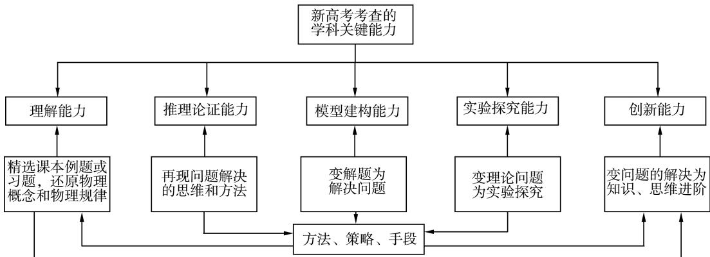
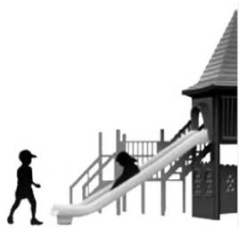
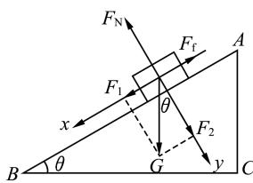
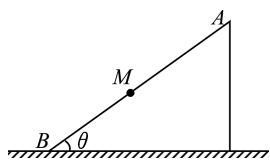
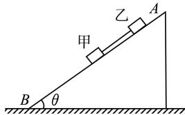
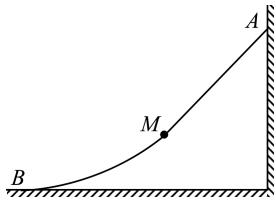
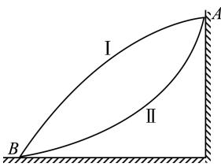
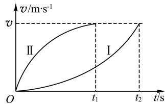
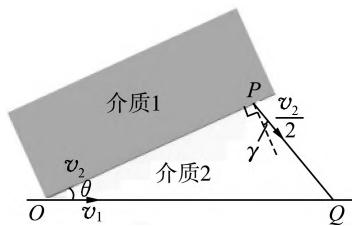

> 来源：MinerU 转换（stem-exact rebuild 2026-08-08）

# 聚焦科学思维能力的高三物理习题教学

———以“课本例题”的一题多变教学为例

田维金 李家天

(北京师范大学贵阳附属中学,贵州 贵阳 550081)

摘 要:习题课是重要课型之一,也是培养学生关键能力的一种重要途径.重视课本,挖掘课本中的例题或习题,还原物理概念和物理规律.通过课本中的例题或习题讲解质疑与创新,变“解题”为“解决问题”,变“物理问题”为“实验探究”,变“解决问题”为“知识、思维进阶”.以普通高中物理课本中的一道例题教学为例,实践探索“一题多变”的习题教学模式,逐步发展学生的关键能力,增强高三物理习题教学效果.

关键词:高三物理;习题教学;一题多变;学科关键能力

在《中国高考评价体系》指引下,物理试题依托“一核四层四翼”的高考评价体系理念,以核心价值为统领,以物理学科素养为导向,以必备知识考查为基础,通过创新试题情景设计,加强理论联系实际,增强试题的开放性和探究性,强化关键能力的考查.[1]长期以来 高三物理习题教学目标往往被功利化为培养训练学生“题海求生”的知识和技能,习题教学变成了对学生机械地强化训练的手段,教师变成了“灌题漏斗”,学生变成了“解题机器”,教师或学生却忽视了新高考考查理解能力、推理论证能力、模型建构能力、实验探究能力及创新能力等关键能力的考查.这不仅降低了习题教学的效能,也严重影响了学生的身心发展.[2]因此,只有探索新的习题教学模式,才能充分发挥高三物理习题教学的育人功能.笔者以课本中的一道例题教学为例实践探索高三物理习题教学新模式供大家参考,以培养学生的学科关键能力,提高教学质量.

## 1 高三物理习题与试题的主要区别

在高三物理习题教学中,很多教师经常试题、习题不分,把高考试题或高考模拟题当成习题用,没有正确理解习题与试题的功能和设计思路,导致习题教学效果不佳.

习题与试题的功能不同.试题以“选拔”和“引导”为目的,具有甄别学生和指导物理教学的作用;习题以“建构”和“培养”为目的,具有建立物理概念规律、构筑物理知识构架和培育学生各种能力、养成良好态度的作用.

习题与试题设计的思路不同.物理试题设计重视知识的覆盖,争取考查更多知识点,提出的问题是相互割裂的,考查学生“会不会”,选择题只重结果,通过结果判断学生素养.习题设计是把核心素养可纸笔测验评价的部分细化为具体的“解题素养”并布局在习题中,突出个别知识和素养,防止干扰核心主题 相互关联地提出问题 想方设法让学生“会”,重视学生经历解答过程,学生素养在过程中提升.

## 2 新高考下高三物理习题教学思路

实践证明,将习题教学游离于物理过程分析之外,轻知识结构化的做法,不但阻碍了学生学科关键能力的发展,而且对学生物理素养的提高也很难奏效.[3]

习题教学的育人价值和功能不言而喻,在高三物理习题教学中教师需要把握以下几点:一是帮助学生完善知识构建,为形成物理观念奠基.二 是 引 导 学 生 将 物 理 知 识 与 实 践 相 关联,以物理视角剖析实际问题.三是帮助学生建构物理模型,会把现实原型转换为理想模型去分析和解决问题.四是使学生在习题教学中经历多种思维形式的科学推理过程,素养在过程中提升.五是鼓励学生敢于质疑,勇于创新,合理设计研究方案,正确认识物理学,增强学生掌握 科 学 知 识 的 责 任 感.教 师 只 有 重 视 教材,深度开发课本中的例题或习题,还原物理概念和规律,[4]明确高三物理习题课的目标,把握高三物理习题课的导向,才能开展有效的习题教学.笔者认为高三物理习题教学思路如图 1 所示.

  
图 1 聚焦学科关键能力的高三物理习题教学思路

## 3 聚焦关键能力的高三物理习题教学实践

### 3.1 精选课本中的例题或习题,培养学生对概念和规律的理解能力

例题.(普通高中教科书 人民教育出版社 必修第1册第73页例题1)某幼儿园要在空地上做一个滑梯,如图 2 所示,根据空地的大小,滑梯的水平跨度确定为 6 m.设计时,滑板和儿童裤料之

  
图 2 例题中的题图

间的动摩擦因数取 0.4,为使儿童在滑梯游戏时能

在滑板上滑下,滑梯至少要多高?[5]

解析:设斜面倾角为 θ,用 l、b 和 h 分别表示 AB、BC 和 AC 的长度,建立直角坐标系如图 3 所示.

  
图 3 例题解析中力的正交分解图

在 x 轴方向上,

$$
m g \sin \theta - F _ { \mathrm { f } } = 0 .\tag{1}
$$

在 $y$ 轴方向上,

$$
m g \cos \theta - F _ { \mathrm { N } } = 0 .\tag{2}
$$

儿童受滑动摩擦力为,

$$
F _ { \mathrm { \scriptsize ~ f } } = \mu m g \cos \theta .\tag{3}
$$

又因为

$$
\mathrm { s i n } \theta = \frac { h } { l } , \mathrm { c o s } \theta = \frac { b } { l } .\tag{4}
$$

联立式(1)~(4)解得 h=2.4 m.即滑梯至少要 2.4 m 高,儿童才能从滑梯上滑下.

### 3.2 变课本例题或习题为实验题,培养学生的实验探究能力

变式 1:若在上述例题中已知滑板的水平跨度为 6 m,高度为 2.4 m.为使小孩能从滑梯上滑下,请问滑板与儿童裤料之间的动摩擦因数不能超过多少? 如何测量儿童裤料与滑板之间的动摩擦因数 $\mu ?$

解析:为使小孩能从滑梯上滑下,应满足

$$
m g \sin \theta \geqslant \mu m g \cos \theta . \tag{5}
$$

又因为

$$
\mathrm { t a n } \theta = { \frac { h } { b } } .\tag{6}
$$

联立式(5)(6)解得

$$
\mu { \leqslant } 0 . 4 .\tag{7}
$$

即 $\mu$ 不能超过0.4.

由牛顿第二定律得

$$
m g \sin \theta - \mu m g \cos \theta = m a . \tag{8}
$$

因为

$$
\mathrm { c o s } \theta = \frac { b } { l } .\tag{9}
$$

联立式(6)(8)(9),解得

$$
a = \frac { h } { b } - \frac { a l } { g b } .\tag{10}
$$

由式(10)可知,可用刻度尺测量滑板的高度 h、滑板的水平跨度 b 及滑板的长度 l,可用加速度传感器测量小孩运动的加速度 $a$ ,即可测出儿童裤料与滑板之间的动摩擦因数 $\mu$ .

### 3.3 从解题到解决问题,培养学生的建模能力

变式 2:将上述例题中的滑梯等效为如图 4 所示的斜面物理模型.设滑梯质量为 M,未固定在水平地面上,滑梯斜面倾角为 θ,质量为 m 的儿童

  
图 4 问题情境图

从斜面顶端A 点由静止开始沿斜面下滑,滑到 B点恰好静止,整个过程中滑梯保持静止状态.已知儿童裤料与滑梯 AM 段的动摩擦因数 $\mu _ { 1 } { < } \mathrm { t a n } \theta$ 与 MB 段的动摩擦因数 $\mu _ { 2 } > \mathrm { t a n } \theta$ .请计算儿童在下滑的过程中地面对滑梯的摩擦力和支持力大小?(已知重力加速度为 $g$ )

解析:在 AM 段,因为 $\mu _ { 1 } { < } \mathrm { t a n } \theta$ ,所以

$$
m g \sin \theta { \textstyle > } \mu m g \cos \theta .\tag{11}
$$

则儿童在 AM 段做匀加速直线运动的加速度大小为

$$
a = g \sin \theta - \mu g \cos \theta .\tag{12}
$$

以儿童和滑梯整体为研究对象,将加速度沿水平方向和竖直方向分解.根据牛顿第二定律可得地面对滑梯的摩擦力方向水平向左,大小为

$$
f { = } ( M { + } m ) g \mathrm { c o s } \theta ( \mathrm { s i n } \theta { - } \mu _ { 1 } \mathrm { c o s } \theta ) .\tag{13}
$$

地面对滑梯的支持力方向竖直向上,大小为

$$
F _ { \mathrm { { N } } } = ( M + m ) g \mathrm { c o s } \theta ( \mathrm { c o s } \theta + \mu _ { 1 } \mathrm { s i n } \theta ) .\tag{14}
$$

分析得到地面对滑梯的支持力小于儿童和滑梯的总重力.

在 MB 段,因为 $\mu _ { 2 } > \mathrm { t a n } \theta$ ,所以 <!-- 存疑：PDF 原文/pypdf 提取均显示 μ1>tanθ，但据上下文（AM 段 μ1<tanθ 加速、MB 段减速、式(17)(18) 用 μ2）此处应为 μ2，疑为原文下标印刷错误 -->

$$
m g \sin \theta { < } \mu m g \cos \theta .\tag{15}
$$

则儿童在MB 段做匀减速直线运动的加速度大小为

$$
a = \mu g \mathrm { c o s } \theta - g \mathrm { s i n } \theta .\tag{16}
$$

以儿童和滑梯整体为研究对象,根据牛顿第二定律可得地面对滑梯的摩擦力方向水平向右,大小为

$$
f = ( M + m ) a _ { x } = ( M + m ) g \cos \theta ( \mu _ { 2 } \cos \theta - \sin \theta ) .\tag{17}
$$

地面对滑梯的支持力方向竖直向上,大小为

$$
F _ { \mathrm { { N } } } { = } ( M { + } m ) g \mathrm { c o s } \theta ( \mathrm { c o s } \theta { + } \mu _ { 2 } \mathrm { s i n } \theta ) .\tag{18}
$$

分析得到地面对滑梯的支持力大于儿童和滑梯的总重力.

### 3.4 再现解决问题的思维和方法,培养学生的推理能力

变式 3:将上述例题中的情景改为足够长的斜面滑梯静置于水平地面上,且滑梯未固定在水平地面上,滑梯斜面倾角$\theta = 3 0 ^ { \circ }$ ,如图 5 所示.质量

  
图 5 问题情境图

均为 20 kg 的甲、乙两儿童用一根轻绳连接,乙与斜面之间的动摩擦因数为 $\frac { \sqrt { 3 } } { 3 }$ ,甲与斜面之间的摩擦力忽略不计.现两儿童从斜面上的某一位置同时由静止滑下,两儿童在运动的过程中滑梯始终处于静止状态.已知重力加速度 $g = 1 0 \mathrm { \ m / s ^ { 2 } }$ ,则下列说法正确的是

(A)地面对滑梯的摩擦力方向水平向左,大小为 $100 \sqrt { 3 } \ \mathrm { N }$ .

(B)运动过程中,轻绳上的拉力大小为 100 N.

(C)乙的机械能增大,甲的机械能减小.

(D)甲减小的机械能等于乙增大的动能.

解析:由于乙与滑梯斜面之间的动摩擦因数为 $\frac { \sqrt { 3 } } { 3 }$ ,则乙对滑梯的压力在水平方向的分力与乙对滑梯的摩擦力在水平方向的分力等大反向,所以地面对滑梯的摩擦力与甲对滑梯的压力的水平向右分力等大反向.

由上述分析可知地面对滑梯的摩擦力水平向左,大小为

$$
f { = } m g \cos 3 0 ^ { \circ } { \sin } 3 0 ^ { \circ } { = } 5 0 { \sqrt { 3 } } \ \mathrm { N } .\tag{19}
$$

对两儿童整体沿滑梯斜面方向有

$$
2 m g \sin \theta - \mu m g \cos \theta = 2 m a .\tag{20}
$$

设轻绳拉力为 T,对甲沿滑梯斜面方向有

$$
m g \sin \theta - T = m a .\tag{21}
$$

联立式(20)(21)解得

$$
T = 5 0 \ \mathrm { N } .\tag{22}
$$

滑梯斜面对乙的摩擦力有

$$
f _ { \mathrm { { Z } } } = \mu m g \cos \theta = 1 0 0 ~ \mathrm { N } .\tag{23}
$$

由于轻绳拉力对甲做负功,轻绳拉力与摩擦力的合力对乙做负功,则甲、乙的机械能均减小.

由于滑梯斜面对乙的摩擦力与乙受重力沿滑梯斜面的分力等大反向,则乙所受的合力等于绳的拉力,则甲减小的机械能等于乙增大的动能.

综上所述(D)选项正确.

### 3.5 变解决问题为知识、思维进阶,培养学生的创新能力

变式 4:为满足儿童游玩时的不同需求,将上述例题中的斜面滑板改成由光滑的倾斜滑板 AM 和粗糙的弧形滑板 MB 连接而成,两滑板在 M 点平滑连接,如图 6

  
图 6 问题情境图

所示.儿童能够自由地从滑板顶端 A 点由静止下滑,在下滑的过程中儿童克服 MB 段的摩擦力做功为 $w _ { \mathrm { f } }$ .问:若增大 AM 段高度,儿童仍然从滑板顶端由静止下滑,儿童在 MB 段运动的过程中克服摩擦力做功如何变化?

解析:由于儿童在 MB 段运动的过程中处于超重状态,故增大 AM 段的高度后,儿童到达 MB段的任意相同位置时速度较大,对轨道的压力较大,受到 MB 段滑板的摩擦力也较大,而 MB 段的路程不变,故儿童在 MB 段克服摩擦力做功较多.

变式 5:为满足儿童游玩时的不同需求,将例题中的斜面滑板改成两种类型的弧形面滑板(底端有缓冲装置),其装置简化模型如图 7 所示.两弧形滑板的长度相

  
图 7 问题情境图

同,不计两滑板的摩擦,现两儿童同时从滑板顶端 A 点分别沿两滑板由静止下滑,请问谁先到达滑板底端 B 点?

解析:设滑板任意位置的切线方向与水平面之间夹角为 θ.儿童受到的合力

$$
F _ { \mathrm { \scriptsize ~ 合 } } = m g \sin \theta .\tag{24}
$$

根据牛顿第二定律可得儿童的加速度

$$
a = g \sin \theta .\tag{25}
$$

两儿童沿滑板 Ⅰ、Ⅱ 下滑的过程中倾角 θ 分别增大和减小,根据式(25)可知两儿童分别做加速度增大和减小的加速运动,再根据机械能守

  
图 8 v-t 图像

恒定律可得两儿童到达滑梯底端时的速度大小相等,再定性作出两儿童运动的 v-t 图像如图 8 所示.由于两滑板的长度相同,v-t 图线与 t 轴围成的面积相等,所以分析可得沿滑板 Ⅱ 滑行的儿童先到达滑板底端 B 点.

## 4 结语

实践证明:开展”一题多变”的习题教学模式能够开拓学生创新思维的维度,有助于培养学生发散思维,在遇到问题时学生从各个角度出发对问题进行思考和探究,使学生更好地发现问题、分析问题及解决问题,学生的关键能力得到逐步发展.在习题教学中,让学生从题海中解放出来,加强学生对基本物理概念、物理规律的深刻理解;注重培养学生科学思维与研究方法,让物理实验贯穿习题教学,培养学生用实验探究问题的意识;[6]理论联系实际,学会真实情景下的问题解决,促进物理观念的形成,发展学生的核心素养.[2]

## 参考文献:

[1] 中华人民共和国教育部考试中心.中国高考评价体系[M].北京:人民教育出版社,2019.

[2] 唐双虎,左祥胜.回归物理习题教学本原 发展学生学科关键能力[J].物理教师,2023(6):84-88.

[3] 陈恒.中学物理习题变式教学探究[J].物理教学,2011(10):14-17.

[4] 潘华君,鲍建荣.指向科学思维培养的专题复习教学设计策略———以“电磁感应中的动力学和能量问题”为例[J].物理教师,2024(4):91-93;97.

[5] 彭前程,秦建云.普通高中教科书 物理 必修 第1册(第1版)[M].北京:人民教育出版社,2019.

[6] 蒋天林.让物理实验贯穿习题教学[J].物理教师,2024(3):88-90.

(收稿日期:2024-05-11)

---

<!-- 以下为同期他文的“上接第86页”片段，MinerU 误并入本文末尾，与正文无关，保留以备查 -->

## (上接第86页)

段速度不同的运动,等效为 B 球从垂足 N →(碰撞点)P→Q 的两段速度大小均为 $v_{2}/2$ 的运动(OP 的时间与 NP 的时间相等).由图 4 易得 N、P、Q 3 点共线时,距离最短、运动的时间最短,即 A 球速度最大,此时 $\angle O P Q = 1 2 0 ^ { \circ }$ 为定值,即 A 球速度最大值的极值条件为,B 球碰前(碰后)速度方向与挡板法线的夹角 $\beta = { 6 0 } ^ { \circ }$ .由图 4 得 $\sin ( \theta + 3 0 ^ { \circ } ) = \dfrac { v _ { 2 } ( t _ { 1 } + t _ { 2 } ) / 2 } { v _ { 1 \mathrm { m a x } } ( t _ { 1 } + t _ { 2 } ) } = \dfrac { v _ { 2 } } { 2 v _ { 1 \mathrm { m a x } } }$ ,即

$$
v _ { 1 \mathrm { { m a x } } } = \frac { v _ { 2 } } { 2 \sin ( \theta + 3 0 ^ { \circ } ) } .\tag{5}
$$

式(5)与式(4)一致,但其得出的过程中突出考查考生科学思维能力的高低,运算十分简洁.

后续的分析讨论与常规思路和方法中对式(4)的分析讨论相同,在此不再赘述.

### 3.2 类比光的折射现象,应用费马原理求解

B 球与挡板的碰撞点为 P,两球在 x 轴上的相遇点为 Q,由图 2 可知 B 球碰前和碰后两个速度所在直线间的夹角为

$$
\angle O P Q = 1 8 0 ^ { \circ } - 2 ( \alpha + \theta ) .
$$

由于 B 球与挡板碰撞前后的速度不同,类比光在不同介质(速度不同)中的折射现象,根据费马原理———光在指定的两点间传播,实际的光程总是一个极值.[2]由此可知光在不同介质中两点间

的折 射 路 径 是 以光程为最小值,即时间 为 最 小 值 的路程传播.

如图 5 所示,B球与挡板碰前在介质 1 中运动,碰

  
图 5 类比光的折射现象