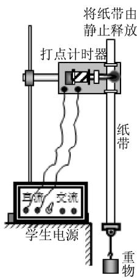
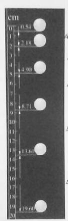
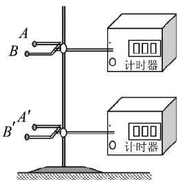

# 优化学生实验教学,提升核心素养——以“验证机械能守恒定律”教学设计为例

俞丽萍

（浙江省春晖中学，浙江 绍兴 312300）

摘 要：学生实验课是物理教学的重要部分，优化学生实验教学是提升学生物理核心素养的有效途径之一．本文以实验“验证机械能守恒定律”为例，探讨了在核心素养背景下，学生实验教学的优化问题．

关键词：核心素养；学生实验；教学；优化

学生实验课是物理教学的重要部分，优化学生实验教学是提升学生物理核心素养的有效途径之一．本文以学生实验“验证机械能守恒定律”为例，探讨如何优化学生实验教学，提升学生的物理核心素养问题．

## 1 在实验中完善能量观念

设计意图：高中物理应该以提升学生物理学科的核心素养为目标，物理核心素养包括物理观念、科学思维、科学探究、科学态度和责任4个要素．物理观念包括物质观念、运动观念、相互作用观念、能量观念及其应用等要素．实验“验证机械能守恒定律”属验证性实验，为人教版教材（2010年4月第3版）必修2第7章第8节的相应内容．学生在初中阶段对重力势能、弹性势能和动能以及机械能守恒定律都已经初步有所了解，但理解不深入，对于“守恒”的思想学生接触不多．本章内容处于学生对能量理解的起始阶段，从重力势能、弹性势能和动能的讨论，然后讨论了动能定理，在此基础上讨论了机械能守恒定律．动能定理主要是讨论了合外力做功与动能变化之间的关系，而机械能守恒定律主要是要使学生体会和建立“守恒”的思想．机械能守恒定律也是为后续内容———能量守恒定律与能源作一定的铺垫．可见，机械能守恒定律的内容在整章内容中起到了一个很好的承上启下的作用，而实验“验证机械能守恒定律”是在理论推导的前提下，机械能守恒的实验验证．目的是让学生通过实际操作和计算进一步加强对机械能守恒定律的理解，深化学生思维，提高动手能力．这对于学生建立能量的观念，理解能量守恒的物理思想，提升物质观念核心要素起着重要作用．

教学片段：

请学生思考：

问题1：机械能守恒定律成立的条件是什么？

问题2：机械能守恒定律的常见表达式有哪些？

主要是 $E_{\mathrm{k}1}+E_{\mathrm{p}1}=E_{\mathrm{k}2}+E_{\mathrm{p}2}$ 或 $\Delta E_{\mathrm{k}\text{增}}=\Delta E_{\mathrm{p}\text{减}}$（$\Delta E_{\mathrm{k}\text{减}}=\Delta E_{\mathrm{p}\text{增}}$）．

除此之外，实验结论的得出过程，也是学生对于“守恒”思想的理解过程，对能量观点的完善过程．

## 2 在科学探究中掌握科学方法

设计意图：学生实验教学要求学生掌握相应的知识和实验操作技能，例如，能控制实验条件，正确地进行实验操作；能根据纸带下落的距离，掌握测量瞬时速度的方法．更重要的是要让学生明确开展科学探究的一般方法，培养学生实事求是、严谨的科学态度．

教学片段：

### （1）明确验证性实验的一般思路

学生实验分为验证性实验和探究性实验．探究性实验如“探究加速度与力、质量的关系”等．验证性实验的目的就是证明已知结论是否正确．本堂课我们主要是要从实验验证机械能守恒定律是否正确．

问题3：如何验证机械能守恒？

$E_{\mathrm{k}1}+E_{\mathrm{p}1}=E_{\mathrm{k}2}+E_{\mathrm{p}2}$ 或 $\Delta E_{\mathrm{k}\text{增}}=\Delta E_{\mathrm{p}\text{减}}$ 式子中左边与右边的值大小是否相等．

### （2）分组讨论，设计实验

4位学生为一组，要求学生利用实验室现有的实验器材，设计实验方案．

根据实验室现有的实验器材（已在实验桌上放置）：电火花计时器、铁架台、纸带、钩码（30 g）、重锤（一端可固定纸带）、塑料小球、刻度尺、天平、弹簧秤．

要求学生选取需要的实验器材，设计实验方案．

### 学生设计实验方案1

选取实验器材：电火花计时器、纸带、钩码（约30 g）、刻度尺、天平．

实验基本步骤：①利用天平测出钩码的质量；②将电火花计时器竖直固定在铁架台上，纸带一端穿过打点计时器，一端与钩码相连；③释放钩码后，在纸带上打出一系列的点；④对纸带进行实验数据处理，在纸带上取两点，算出这两点的速度大小，并量出这两点间的距离，分别算出 $\Delta E_{\mathrm{k}\text{增}}$ 和 $\Delta E_{\mathrm{p}\text{减}}$，验证是否相等．

### 学生设计实验方案2

选取实验器材：电火花计时器、纸带、重锤、刻度尺、弹簧秤．

实验基本步骤：①弹簧秤下面挂重锤，重锤静止时，读出弹簧秤的读数，根据 $m=G/g$ 计算出钩码的质量；②将电火花计时器竖直固定在铁架台上，纸带一端穿过打点计时器，一端与重锤相连；③释放重锤后，在纸带上打出一系列的点；④对纸带进行实验数据处理，在纸带上取两点，算出这两点的速度大小，并量出这两点间的距离，分别算出 $\Delta E_{\mathrm{k}\text{增}}$ 和 $\Delta E_{\mathrm{p}\text{减}}$，验证是否相等．

### 学生设计实验方案3

选取实验器材：电火花计时器、纸带、重锤、刻度尺．

①将电火花计时器竖直固定在铁架台上，纸带一端穿过打点计时器，一端与重锤相连；②释放重锤后，在纸带上打出一系列的点；③对纸带进行实验数据处理，在纸带上取两点，算出这两点的速度大小，并量出这两点间的距离，分别算出 $\frac{1}{2}{v_t}^2-\frac{1}{2}{v_0}^2$ 和 $gh$，验证是否相等．

### 学生设计实验方案4

选取实验器材；电火花计时器、纸带、重锤、刻度尺、天平．

实验基本步骤：①利用天平测出重锤的质量；②将电火花计时器竖直固定在铁架台上，纸带一端穿过打点计时器，一端与重锤相连；③释放重锤后，在纸带上打出一系列的点；④取某个位置 A 为重力势能的零势能点，计算得到 A 点的速度，进而计算得到 A 点的动能，再找到一点 B，计算得到 B 点的速度，进而计算 B 点的动能．用刻度尺量出 A、B 两点之间的距离，计算得到 B 点对应的重力势能，验证 $E_{\mathrm{k}1}+E_{\mathrm{p}1}=E_{\mathrm{k}2}+E_{\mathrm{p}2}$ 是否成立．

### （3）师生讨论，完善实验方案

在学生提出自己小组设计的实验方案后，教师进行总结时，并请学生思考．

师：用弹簧秤测物体的质量与用天平测物体的质量，哪种方法更加好？

生：利用天平测更加好，弹簧秤在测质量的过程中，需要根据 $m=G/g$ 进行计算，若我们 $g$ 取 $9.8\ \mathrm{m/s^2}$ 或取 $10\ \mathrm{m/s^2}$ 都会存在比较大的实验误差．

师：与纸带相连的重物选钩码还是重锤？

生：都可以．因为都是体积小、密度大的重物．

师：请大家仔细观察钩码与重锤，它们是怎么与纸带相连的？

生：我们应该选重锤，重锤有与纸带相连的装置，而钩码无法与纸带很好相连．

师：可不可以不测重物的质量？

生：若采用 $\Delta E_{\mathrm{k}\text{增}}=\Delta E_{\mathrm{p}\text{减}}$，则 $\frac{1}{2}m{v_t}^2-\frac{1}{2}m{v_0}^2=mgh$，则两边的 $m$ 可以约去，故可以不用测重物的质量．若采用 $E_{\mathrm{k}1}+E_{\mathrm{p}1}=E_{\mathrm{k}2}+E_{\mathrm{p}2}$，则 $\frac{1}{2}m{v_1}^2+mgh_1=\frac{1}{2}m{v_2}^2+mgh_2$，两边也可以约去．故可以不测重物的质量．

师：可以用图像法验证吗？

生：可以．若用图像法验证，则从纸带上选取多个点，测量从第一点到其余个点的下落高度 $h$，并计算个点速度的平方 $v^2$，然后以 $\frac{1}{2}v^2$ 为纵轴，以 $h$ 为横轴，根据实验数据画出 $\frac{1}{2}v^2-h$ 图线．若在误差允许的范围内图像是一条过原点且斜率为 $g$ 的直线，则验证了机械能守恒．

### （4）根据实验设计，收集实验数据

根据交流情况，选取方案3或方案4，两位学生为一组，动手进行实验．

## 3 在交流中提高评估反思能力

设计意图：有效的交流是相互学习一条很好的途径．通过交流，提高了学生的语言表达能力，对实验探究过程和结果评估、反思的能力．同时，学生在实验中出现的问题会暴露出来，通过交流加深理解，例如在本实验中通过交流明确对实验误差的产生条件作定性分析，并提出采取措施减小误差；能根据实验数据得出实验结论；能对实验中出现的不正确操作能够及时纠正．

教学片段．

### （1）实验误差的分析

师：大家都进行了实验，请学生们分析这个实验的实验误差主要来自哪些地方？如何减小实验误差？

生：本实验重物和纸带在下落过程中要受到各种阻力作用，改进的办法是打点计时器要稳定地固定在铁架台上，打点计时器平面与纸带限位孔调整到竖直方向，以减小摩擦阻力．重物要选用密度大、体积小的物体，这样可以减小空气阻力的影响，从而减小实验误差．

### （2）实验结论的表述

师：大家得到的实验结论是什么？

生甲：重物动能的增加量与重力势能的减小量相等．

师：你们组得到的动能的增加量与重力势能的减小量的数值是完全一样的吗？

生乙：在实验误差允许的范围内，重物动能的增加量与重力势能的减小量相等，重物的机械能守恒．

### （3）不当操作的纠正

师：老师在大家做实验的过程中，发现有一组学生在释放纸带以前的实验状态（如图1所示），请大家找出其中的不当之处．

生丙：打点计时器接了直流电源．

  
图1

生丁：重物离打点计时器太远．

## 4 在不同实验设计方案中提高思维深度

设计意图：除了已经采用的实验设计方案外，还有其他的实验方案能验证机械能守恒定律吗？同样的实验装置，还能完成什么实验？这些问题的讨论能培养学生的深度思维，从而提高学生的科学素养．

教学片段．

### （1）相同的实验，不同的方案

除了我们动手做得实验以外，还要其他一些实验方案．

频闪照片法：如图2所示，用频闪照片代替打点计时器和纸带，类似于纸带上速度的求法，计算出小球在某个位置的速度．求出小球在两个位置的速度，测出小球在两个位置之间的距离，进而进行验证．

  
图2

  
图3

光电计时器测速法：如图3所示，利用光电门和计时器测出重物通过两个光电门的时间，根据 $v=\frac{\Delta x}{\Delta t}$ 计算出重物通过光电门时的速度，测出两个光电门之间的距离，进而进行验证．

### （2）相同的器材，不同的实验

利用本实验提供的重物、打点计时器、学生电源等实验器材，还可以测当地的重力加速度，完成“探究功与速度变化关系”实验．

教后反思：传统的实验教学主要以对物理知识和规律的掌握为目的，而核心素养背景下的学生实验教学，更加关注的是以实验为载体，如何提高学生的核心素养．要促使学生核心素养的提升，教学过程必须以学生为中心，而不是以教师的教导为中心．本实验虽然是一个验证性的实验，但在实验设计阶段，在提供实验器材的前提下，学生以小组为单位，选择合适的实验器材，自己设计了实验方案．对于实验器材和实验过程设计中出现的问题，教师及时进行了指导，使实验过程更加合理化．在此教学环节，充分发挥了学生学习的主动性．

复述表达，能够培养学生学生严密的逻辑思维能力．在本教学设计中，教师引导学生进行反思，反思自己的实验方法，反思自己的收获．通过反思，达到巩固知识发展能力的目的．

学习者对新旧知识的的联系，对大量信息的整合，都反映了学习者的深度学习．本教学设计通过“相同的实验，不同的方案”和“相同的实验器材，不同的实验”的讨论，加深了学生对于相关实验及实验器材的理解深度，引导学生进行深度学习，而深度学习是提高学生核心素养的有效途径．不同的教学设计，在提升学生物理核心素养的作用是不同的．我们在物理教学过程中，应选取最有效最为合适的教学方法进行教学，从而更有效地提升学生的物理核心素养．

参考文献：

[1] 徐艺玲．利用气垫导轨改进机械能守恒定律验证实验［J］．物理通报，2016（7）：84-85．

[2] 王卫．加强实验教学 落实课标要求［J］．物理通报，2016（7）：82-83．

[3] 江山，张平昭．基于物理核心素养拓展物理实验课程［J］．物理教师，2016（11）：35-37．

[4] 罗祖兵．深度教学：“核心素养”时代教学变革的方向［J］．课程·教材·教法，2017（4）：20-26．

（收稿日期：2017-06-30）
