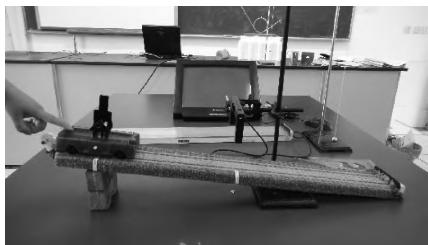
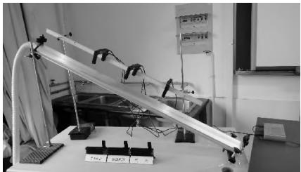
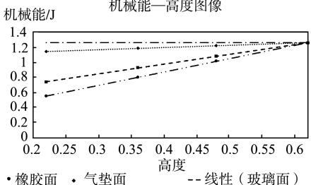

# 双新背景下如何提升高中物理课堂教学的有效性———"机械能守恒定律"的课例改进与反思

蒋 磊

(上海市朱家角中学,上海 201713)

摘 要:在新课程新教材改革的背景下,围绕改进高中物理课堂的有效教学这一课题进行探索.以高中物理"机械能守恒定律"这一课例为载体,从真实问题、实验探究、课堂设问等多个方面阐述了现代物理教学不仅传授知识,更需要注重培养学生发现问题、分析问题与解决问题的能力,培育学生的核心素养.这也将促进学生今后的终身学习.

关键词:核心素养;自主探究;有效教学

在新课程新教材改革的今天,怎样鼓励学生解决真实情境下的问题,提升学生的思维能力,培育他们的核心素养,使他们在探究过程中乐于学习、勤于思考,勇于探索.这是每位教育工作者一直在不断思考和探索的问题.

在双新背景下,笔者所在学校提出"课植"理念:"课",即"课新知",学习书本的知识与规律;"植",即"植新能",提升学生的创新精神和实践能力,倡导在培育学生"课新知"的同时,聚焦学生"植新能"的提升."课新知"和"植新能"的课堂实践模型包括:情境问题、知识建构、拓展迁移、理解内化等.

物理课堂是学生学习物理知识与规律的主要阵地.目前我们面临的物理知识涉及方方面面,并且始终都在不断地变化,试图把所有知识都教给学生,已成为不可能的残酷现实,而聚焦学生"植新能"的培育已成为当务之急.要实现这个目标,需要我们不断改进课堂教学,通过解决真实情境下的问题,激发学生学习的兴趣,充分调动学生的积极性、主动性;通过科学探究,培养学生的物理思维和研究能力,促进深度学习,使课堂"沸腾"起来.此外,课堂动态的掌握,课堂教学效果的检验还要靠科学、及时的信息反馈,以便教师随时调整,从而使学生主体地位得以充分地发挥.

笔者以高中物理必修3教材(上科版)第7章第5节"机械能守恒定律"一课为例,围绕提升学生"课新知"和"植新能",对物理课堂进行了实践探索.

## 1 真实的情境引入是物理课堂的美丽序曲

情境引入就如找工作初次见面给人的第一印象,对成功上好一堂课有非常重要的影响,是一堂好课必不可少的一部分.我们俗称:"课伊始,趣已生."在双新背景下,真实问题的情景引入能激发学生物理学习的兴趣,更能启发学生将物理与生活紧密联系,激励学生用物理知识去解决生活中的实际问题.当然情境也要考虑到能否有效地为课堂教学内容服务,而且要尽可能发挥情境引入的最大功效,简单地说"用足情境".

"机械能守恒定律"这课笔者第1次试讲时,选用的情境引入是从复习旧知识动能与重力势能的定义出发,从知识体系的完整性来说,是完整的,但从新授课的趣味性来说还不够.因此,在专家的指导下,笔者重新设计,通过3个物理小实验(分别是自由落体、单摆、沿斜面下滑运动)引入课题,第2次试讲后,感觉比之前有趣了,但是物理是一门与生活紧密联系的学科,这样的设计缺乏生动的实例支撑.于是,笔者采用了"上海地铁龙阳站的站台为什么设计在高处"这一来源于生活实例的问题引入新课,似乎很不错了,但试讲下来,发现这么好的情境引入笔者没有充分"用足",情境引入的作用不仅引人入胜,激起学生的学习兴趣,更是为整个课堂教学服务的.因此笔者在分析地铁站的设计实例中融合了回顾旧知识(即动能与重力势能的定义等),补充新定义(即机械能的定义),再从"节能减排"的设计理念中渗透德育教育,增强学生"绿色环保、节约能源"观念的重视.最后课结束时,首尾呼应拓展应用在地铁进出站的过程中"机械能是否守恒"的新知识,这样就把情景引入的功效最大程度地发挥了.

## 2 自主的科学探究是核心素养的重要环节

一堂好课评判的标准不在于教师讲课多么激情澎湃,多么滔滔不绝,而在于学生是否完全沉浸在知识的海洋中,激流前行.尤其是以实验探究为载体的物理课堂,更需要注重培养学生层层深入、勇于实验探究的思维能力,这些都是学科核心素养培育的要求.因为这些既是推动科学发展的源泉,又是课堂教学前进的动力,更是授予学生的终身学习之"渔",正所谓"课进行,趣正浓".

"机械能守恒定律"一课中,我们知道在实验室条件下,无法完成守恒的实验设计,因为实际情况下,总会有阻力做功,机械能一般会损失,因此教材上是通过理论推导得出守恒定律,再通过学生实验进行验证.

那么,这个高中阶段非常重要的守恒定律能否通过学生的自主实验来探究呢?能,虽然实验做不到机械能守恒,但可以以实验事实为依据,外推出守恒的定律,这也是一种科学探究的思维方法.

自主探究环节中遵循学生猜想—实验探究—归纳小结的线索.先请学生猜想,在动能与重力势能转化的过程中,机械能总量是否发生变化.学生自然想到可能会不变.接着,请学生根据桌上的器材自行设计方案,通过DIS实验来研究(如图1所示),这是开放的实验设计.实验操作后当然会发现机械能减少了,与猜想不符,形成学生的思维冲突,那是怎么回事呢,激励学生进一步探究.经过分析后发现,原来是有摩擦阻力做功了,机械能损失了,这个结论对不对呢?能否再用实验来进一步证实呢?学生会很有兴趣地选用橡胶斜面、毛巾斜面、气垫斜面继续进行研究,如图2所示,并画出它随高度变化的图像(如图3所示).发现:随着粗糙程度越来越小,机械能损失得也越来越小,外推出如果是光滑的斜面,图像将是一条平行于横轴的直线,机械能将不损失即机械能的总量保持不变.这里采用了无限逼近的实验方法和外推的思维方法,与伽利略理想实验的思维方法有异曲同工之妙.这样的实验探究过程,学生不仅容易理解机械能守恒定律,更能帮助他们培养科学研究的思维能力,有助于终身学习.

  
图1 DIS实验

  
图2 实验过程

  
图3 机械能—高度图像

## 3 递进的设问语言是深度课堂的跳跃音符

课堂的语言是教师与学生间交流的桥梁,提问不仅要简洁明了使"学生明白",更要层次分明、由浅入深,使"学生容易明白".逻辑清晰、层层递进的设问能提高课堂教学的有效性,是一堂物理课高效与否的关键.

"机械能守恒定律"一课中,课堂的设问是从"动能与重力势能间能否发生转化?""如何转化的?""转化过程中,动能与重力势能的总量是否发生变化?"这3个层次逐层递进,展开新授课的教学.

又如在学生实验探究部分,当学生研究了毛巾面上一种机械能损失的情况后,教师适时地鼓励思考:"各组同学都只选用了一种斜面进行实验,看到有机械能损失的情况,你们的结论对不对呢?"接着,教师继续:"那么,为什么机械能会损失了呢?"学生思考交流后,教师适当启发:"根据同学们的推理,摩擦力做功使机械能损失了,摩擦力做功不同,机械能损失得相同吗?那我们该如何继续实验探究呢?"学生观察桌上的仪器后,自然想到可以尝试用橡胶面、玻璃面继续进行实验.可见,课堂的语言犹如穿珠子的线把一堂课贯穿成一个统一的整体,简洁精要的语言则像翡翠项链的丝线既结实又美观,更像乐章中跳跃的音符,将高潮演绎得淋漓尽致.

在物理课堂有效教学的探索中,我们还在尝试一些其他的办法,例如通过课堂单元教学设计来统筹规划物理教学,通过设计适合我校学生发展的单元作业,来促进学生的自主学习等等,最终的目标是实现物理课堂的有效教学,培育学生物理学科的核心素养.因为如果学生是远航的帆船,那么教师就是帆,根据环境调整方向,使学生能在知识的海洋遨游;如果学生是展翅高飞的小鸟,那么教师就是鸟的翅膀,让学生在科学的天空自由翱翔.教师应让学生成为学习的主人,逐渐养成科学的思维能力.让教师不断思索自己的物理课堂,找到适合自己的教学特色,它将是教师一辈子都追求探索不完的宝贵财富!

参考文献:

1 许国梁.中学物理教学方法[M].北京:高等教育出版社,1993.

2 朱智贤,林崇德.思维发展心理学[M].北京:北京师范大学出版社,1986.

(收稿日期:2024-03-10)
