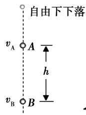
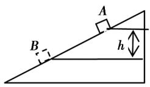
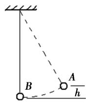
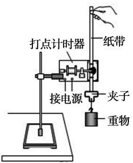
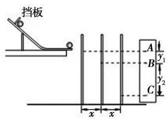
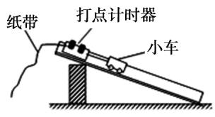
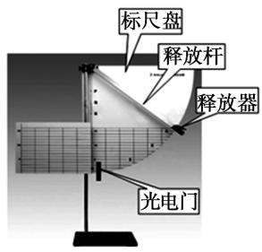

# 基于核心素养的教学设计——实验：验证机械能守恒定律

孙丁共1 梁旭2

(1. 苍南中学 浙江 温州 325800; 2. 浙江省教育厅教研室 浙江 杭州 310012)

摘 要: 以核心素养为目标，通过任务分解、情境创设和问题设计，以“验证机械能守恒定律实验”为例，具体阐述如何以教学内容为载体，以情景提问为引导，以探究活动为主体．并就思维引导、实验、教学活动方式提出了建议．最终达到核心素养目标的过程．

关键词: 核心素养;教学设计;验证机械能守恒实验;任务;问题情景

文章编号: 1008-4134(2019)01-0047

中图分类号: G633.7

文献标识码: B

作者简介: 孙丁共(1980—)，男，浙江苍南人，本科，中学高级教师，研究方向: 高中物理学科教学; 梁旭(1962—)，男，浙江上虞人，本科，中学特级教师，浙江省高中物理教研员，研究方向: 中学物理教学目标、方法和策略．

## 1 任务分解

任务1: 根据实验目的设计实验方案．

任务2: 分析论证确定可行的实验方案．

任务3: 进行实验并记录处理数据．

任务4: 呈现结果，分析总结．

## 2 教学活动

任务1: 根据实验目的设计实验方案．

问题情景: 常见运动模型，如图1～3所示．问题见表1．

图1

图2

图3

表1

<!-- 存疑: 原刊表1无行分隔线，问题与目标栏的分组按原刊版面文字对位推断，组2含问题2~4、组3含问题5~8 -->

<table><tr><td>问题</td><td>问题指向的素养目标</td></tr><tr><td>1. 我们的目的是验证机械能守恒，考虑到学生还不了解弹簧弹性势能的表达式，需要验证的机械能守恒只涉及哪些能量?</td><td>知道本实验验证的机械能守恒只涉及动能与重力势能(物理观念)</td></tr><tr><td>2. 验证机械能守恒需要选择满足机械能守恒条件的情景，也需要选择运动过程中的任意两个状态，你想到了怎样的情景? 3. 如图1、2、3所示是同学们设计的实验情景，图2是物块从光滑斜面下滑．如何做到接近“光滑”?</td><td>能够根据实验目的设计符合要求的实验情景(科学探究)</td></tr><tr><td>4. 如图3，为了使下摆小球的运动能够稳定，怎么办?为了方便读出高度差，怎么办? 5. 有同学提出用气垫导轨，也有同学提出用小车?你们会选择哪种器材，理由是什么? 6. 如图1、2、3所示，测得了m、h就可知道势能的变化，用什么方法测量速度值呢? 7. 速度值可以用打点计时器，也可以用光电门和速度传感器，还可以用平抛运动规律和测量水平、竖直位移，对于图1、2、3所示装置，你会选择哪一个?为什么? 8. 实验中物体的质量是否一定需要测量?</td><td>会从实验精度、仪器充足、操作方便等多角度思考，根据实验目的选择实验器材(科学探究)</td></tr></table>

教学建议:

(1) 思维引导建议: 如何做到接近“光滑”? 气垫导轨是一种方案，但需要有充足数量的气垫导轨供学生分组实验; 因小车的滚动摩擦很小，用小车也是一个可行的方案．测量速度值可以用打点计时器，也可以用光电门和速度传感器，虽然打点计时器会有一些摩擦及拖着纸带，但器材简单、使用方便和比较熟悉，光电门和速度传感器通常只在打点计时器不适合的地方使用，例如图3中让球拖一条纸带运动，既不方便，阻力也会很大．考虑到动能表达式和势能表达式中都有质量m，实验时并不需要测量质量．

(2) 教学活动建议: 对问题1，可以让学生思考后回答; 对问题2，可以先让学生思考并展示，其他同学补充; 对问题3、4、5，可以让学生思考后回答，其他同学补充; 问题6、7，是一个具有开放性的问题，要给学生一定的思考和小组讨论时间，然后交流，教师进行补充说明，对问题8，可以先让学生回答，其他同学补充．

任务2: 分析论证确定可行的实验方案．

问题情景: 按照前面的实验设计得到如图4～图7所示的实验装置．问题见表2．

图4

图5

图6

图7

表2

<table><tr><td>问题</td><td>问题指向的素养目标</td></tr><tr><td>1. 图4和图6装置都是用打点计时器测量速度值的，哪种方案误差小? 2. 图5装置造成机械能损失的因素有哪些?小球转动时是否具有动能?你能否测得小球转动的动能? 3. 图7装置的研究对象是谁?释放杆的机械能变化吗?造成机械能损失的因素有哪些?这些因素产生的误差大吗? 4. 通过前面的分析，你会选择哪种装置进行实验?</td><td>会根据实验装置分析误差，选择合适的装置(科学探究)</td></tr></table>

教学建议:

(1) 思维引导建议: 图4和图6装置比较，都有纸带的阻力，但图6装置小车还受到摩擦力作用，对于空气阻力来说，小车截面也比重锤大．图5装置由于是滚动，摩擦力没有做功，只有空气阻力做功，机械能损失比较小，但小球滚出轨道时不仅有 $\frac{1}{2}mv^2$，还有小球转动具有的动能(初中演示过麦克斯韦滚摆)，利用平抛规律和水平、竖直位移的测量，虽然能够得到速度，根据小球半径和速度值求得转动角速度，但不知转动动能的表达式仍无法得到转动的动能．图7装置的研究对象是释放器，但释放杆在运动过程中的机械能也在变化，严格说来应该是释放器与释放杆构成的整体机械能守恒．如果从整体来看，释放杆的运动是一种转动，动能无法测得; 如果不计释放杆的质量，实验误差就会增大．

(2) 教学活动建议: 对问题1，可由学生回答，其他同学补充; 对问题2，可先让学生独立思考，然后小组讨论，再交流分享，教师适时进行提示和讲解; 对问题3，可先让学生独立思考，后小组讨论，再交流分享，教师适时进行提示和讲解; 对问题4，可由学生回答，其他同学补充．

任务3: 进行实验并记录处理数据．

问题情景: 如图4所示．问题见表3．

表3

<table><tr><td>问题</td><td>问题指向的素养目标</td></tr><tr><td>1. 对于如图4所示的实验装置空气阻力无法避免，我们是否能让其产生的影响小一些?怎么办?</td><td>知道应选用质量大一些的重锤，使空气阻力的影响减小一些(科学探究)</td></tr><tr><td>2. 对于如图4所示的实验装置，纸带阻力无法避免，我们是否能让其产生的影响小一些?怎么办?</td><td>知道打点计时器应竖直固定，限位孔在同一竖直线上，纸带应竖直提起后释放(科学探究)</td></tr><tr><td>3. 若要验证机械能守恒定律的表达式中的初速度为零?此时所选纸带的第1、2两点间距需要满足什么条件?</td><td>知道初速为0时纸带的第1、2两点间距约为2mm(物理观念)</td></tr><tr><td>4. 若要验证的机械能守恒定律在任意位置都是成立的，此时表达式是怎样的?</td><td>会根据实验需要列出相应的机械能守恒定律表达式(科学思维)</td></tr><tr><td>5. 实验中的速度值是用 $v=gt$ 得到的吗?$v$ 怎样得到?</td><td>知道速度值不能用 $v=gt$ 得到，只能通过纸带数据用 $v_{t/2}=x/t$ 计算得到(科学探究)</td></tr><tr><td>6. 本实验能不能每隔四个点选一个计数点?为什么?</td><td>能够通过估算确定合适的计数点间的时间间隔(科学思维)</td></tr><tr><td>7. 你设计的实验数据记录表是怎样的?实验数据的有效数字位数有何要求?</td><td>能根据实验要求，设计验证机械能守恒定律的数据记录表，规范操作并正确记录数据(科学探究)</td></tr><tr><td>8. 实验安装与操作时应注意什么?你在实验时遇到什么问题和困难?</td><td>在获取实验数据时做到严谨，在结论得出时有充分依据(科学态度与责任)</td></tr></table>

教学建议:

(1) 思维引导建议: 空气阻力无法避免，选择重锤的质量大一些能让空气阻力的影响小一些．纸带阻力无法避免，将打点计时器竖直固定，限位孔在同一竖直线上，纸带竖直提起后释放就能使纸带的阻力减小．本实验中的速度值不能用 $v=gt$ 得到，因为 $v=gt$ 就隐含着机械能守恒，“证明”就成为逻辑循环，只能通过纸带数据用 $v_{t/2}=x/t$ 计算得到．

(2) 教学活动建议: 对问题1、2，可让学生独立回答，其他同学补充; 对问题3、4，在学生独立思考的基础上写出表达式，教师选择典型展示，其他同学进行评价; 对问题5、6，在学生独立思考的基础上小组讨论，再交流，教师根据需要进行补充和讲解; 对问题7，可让学生独立回答，其他同学补充; 对问题8，根据学生实验时遇到的问题，教师进行个别答疑．

任务4: 呈现结果，分析总结．

问题情景: 展示部分小组的实验数据记录及结论．问题见表4．

教学建议:

(1) 教学活动建议: 对问题1，可以让学生回答，其他同学补充; 对问题2，可由相关小组同学回答，其他同学提出问题进行讨论，教师必要时点拨与补充; 对问题3，可在学生呈现实验结果并说出实验中碰到的问题后，与其他组同学和教师一起讨论解决．

表4

<!-- 存疑: 原刊表4无行分隔线，问题2、3与"科学态度与责任"目标的分组按原刊版面文字对位推断 -->

<table><tr><td>问题</td><td>问题指向的素养目标</td></tr><tr><td>1. 实验表明动能增加量与重力势能减小量相等吗?两者相差大吗?</td><td>会分析误差产生原因，提出改进措施(科学探究)</td></tr><tr><td>2. 这一组的数据误差比较小，你们在实验的过程特别注意了什么? 3. 这一组的数据误差比较大，实验中还应该有哪些注意与改进之处?</td><td>在讨论时既能坚持自己观点又能修正错误(科学态度与责任)</td></tr></table>

(收稿日期: 2018-09-17)
