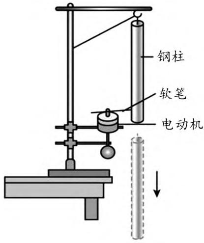
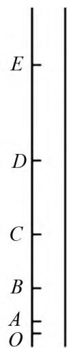

# 深度学习视域下高中物理实验教学设计研究——以“验证机械能守恒定律”实验为例

金凤官(江苏省南通市海门实验学校 226100)

【摘 要】 随着教育理念的不断更新和发展,深度学习逐渐成为教育领域关注的焦点.在高中物理实验教学中,引导学生进行深度学习有助于提高他们的物理素养和综合能力.本文以“验证机械能守恒定律”实验为例,探讨深度学习视域下高中物理实验教学设计的策略和方法,旨在为提高高中物理实验教学质量提供参考.

【关键词】 深度学习;高中物理;实验教学

高中物理作为一门基础性学科,对学生的科学思维和实践能力培养具有重要意义.实验教学是高中物理教学的重要组成部分,通过实验可以帮助学生更好地理解物理概念和规律,培养学生的观察能力、动手能力和创新思维.然而,在传统的高中物理实验教学中,往往存在着学生被动参与、实验过程流于形式等问题,难以达到理想的教学效果.深度学习强调学生对知识的深入理解和应用,注重培养学生的批判性思维、创新能力和解决实际问题的能力.因此,将深度学习理念引入高中物理实验教学,对于提高实验教学质量具有重要的现实意义.

## 1 深度学习的内涵

在高中阶段,物理学科作为自然科学的重要组成部分,对于培养学生的逻辑思维、科学素养以及解决实际问题的能力具有不可忽视的作用.而深度学习作为一种高效的学习方式,在高中物理学习中具有重要的意义.

首先体现在对知识的深入理解上.高中物理知识体系较为复杂,涵盖了力学、热学、电磁学、光学、近代物理等多个领域.深度学习要求学生不仅要记住公式和定理,更要理解其背后的物理概念、原理和规律.

例如 在学习牛顿第二定律时,不仅要知道F=ma 这个公式,更要明白力是改变物体运动状态的原因,加速度与力成正比、与质量成反比的本质关系.通过深入理解,能够将物理知识融会贯通,构建起完整的知识框架.

其次,深度学习强调知识的迁移与应用.高中物理知识并非孤立存在,而是相互联系、相互渗透的.深度学习要求学生能够将所学的物理知识灵活运用到不同的情境中,解决实际问题.

例如 在学习了电学知识后,能够运用欧姆定律、电功率等知识来分析家庭电路中的问题,或者解决电路设计方面的挑战.这种知识的迁移与应用能力,使学生能够真正掌握物理知识的实用价值,提高解决实际问题的能力.

再者,深度学习注重培养学生的批判性思维和创新能力.在高中物理学习中,学生不应盲目接受书本上的知识和结论,而应敢于质疑、善于思考.对于一些经典物理实验的结果,学生可以思考实验方法是否存在局限性,是否有改进的空间.通过批判性思维,激发创新意识,培养学生探索未知、解决复杂问题的能力.

## 2 深度学习视域下实验教学片段设计

下面以“验证机械能守恒定律”实验教学片段为例,分析深度学习视域下的实验教学.

## 环节1:教材原型实验原理阐述

本实验验证极其简单情形下的机械能守恒──自由落体运动.在该过程中,物体重力势能减小,动能增加,根据机械能守恒定律可知,物体减小的重力势能等于增加的动能.即等式成立,就能验证机械能守恒.

## 环节2:常规纸带实验

教师进行实验演示并引导学生进行实验操作:

(1)使用打点计时器与纸带,记录重物自由落体运动过程;

(2)数据处理与分析.

## 环节3:拓展利用视频分析软件,减小阻力误差影响

用纸带法研究自由落体运动时,打点计时器与纸带的接触摩擦带来的实验误差较大.为了便于学生日常开展实验,接下来介绍利用智能手机对物体落体运动进行视频分析,验证机械能守恒定律.

实验原理:验证机械能守恒定律,由于在自由落体运动过程中只有重力对物体做功,遵守机械能守恒定律,即重力势能与物体动能之和保持不变.规定最高点为零势能点,利用 Video Physics软件实时记录每个点的高度h 与速度v,计算出物体机械能 E=$m g h + \frac { 1 } { 2 } m v ^ { 2 }$ 的总和并转化为图像,若得到的 E-t图像为一条常数函数,则可验证机械能守恒定律.

设计意图 通过三个环节的设计,学生不仅能够掌握教材原型实验,而且能较熟练运用现代科技验证机械能守恒定律.同时,教学设计层层递进,培养了学生的质疑创新能力和批判性思维,达到深度学习的目的.

## 3 教学评价与反馈

例 某实验兴趣小组利用如图1 所示的装置验证机械能守恒定律.将铁架台固定在实验桌的边缘,用细线将钢柱挂在铁架台上,在铁架台的下部再固定一电动机(轴上装软笔).电动机转动时,软笔尖每转一周(时间间隔为 T)就在钢柱表面画一条痕迹.如图2,在钢柱上从痕迹 O 开始选取5条连续的痕迹 A、B、C、D、E,测得它们到 O 的距离分别为$h _ { A } \ 、 h _ { B } 、 h _ { C } 、 h _ { D } 、 h _ { E }$ .重力加速度 g 已知.

  
图1

  
图2

(1)在实验操作过程中,应 .

(A)先打开电源使电动机转动,后烧断细线使钢柱自由下落.

(B)先烧断细线使钢柱自由下落,后打开电源使电动机转动.

(2)软笔尖画痕迹 D 的瞬间,钢柱下落的速度$\boldsymbol { v } _ { D } =$ .(用题中物理量表示)

(3)设各条痕迹到O的距离为h,对应钢柱的下落速度为v,画出 ${ \boldsymbol { v } } ^ { 2 } - h$ 图像,发现图线接近一条倾斜的直线,若直线斜率近似等于 ,则钢柱下落过程中机械能近似守恒.

解析 (1)实验操作时,为了使软笔在钢柱表面画上的痕迹条数多一些,应该先打开电源使电动机转动,后烧断细线使钢柱自由下落,故选(A).

(2)根据匀变速直线运动中间时刻速度等于该段过程的平均速度,则画出痕迹 D 时,钢柱下落的速度为 $v _ { D } = \frac { h _ { E } - h _ { C } } { 2 T }$.

(3)钢柱下落过程中,只有重力做功,重力势能的减小量等于动能的增加量,即 $m g h = \frac { 1 } { 2 } m v ^ { 2 }$ ,整理有 $v ^ { 2 } = 2 g h$ ,如果 ${ \boldsymbol { v } } ^ { 2 } - h$ 图像是一条倾斜直线,且斜率 k 近似等于 $2 g$ ,则钢柱下落过程中机械能近似守恒.

点评 本例采用教材实验原理验证机械能守恒定律,但在数据的处理方式上和教材中的有所不同,本例采用图像来处理,使得过程简洁、科学,实现了深度学习的效果.

## 4 结语

在深度学习视域下进行高中物理实验教学设计,需要教师转变教学观念,创新教学方法,以学生为中心,引导学生积极参与实验探究活动,培养学生的创新思维和实践能力.在“验证机械能守恒定律”实验教学中,通过问题驱动、小组合作和探究式教学等方法,激发了学生的学习兴趣和主动性,提高了学生的实验探究能力和数据处理能力.

## 参考文献:

[1]王启超.深度学习视域下的高中物理实验教学探析[J].数理天地(高中版),2023(06):68-70.

[2]严灿云.“深度学习”视域下高中物理实验教学例谈[J].物理教师,2014,35(12):53-54.

[3]张晓希.深度学习视域下的高中物理实验教学对策[J].中学理科园地,2022,18(04):16-18.