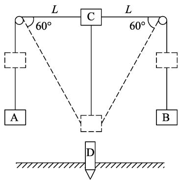
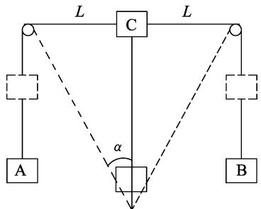
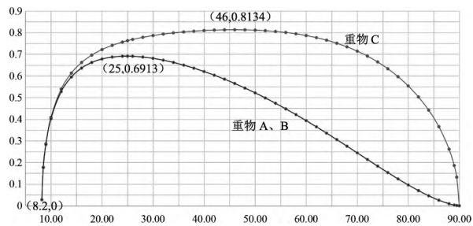
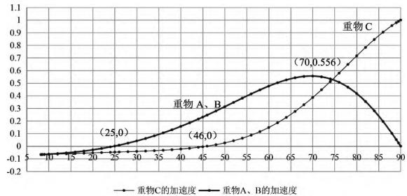
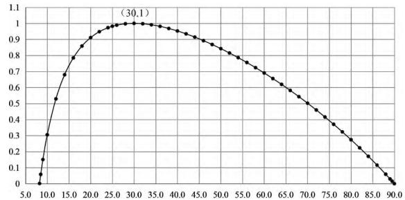
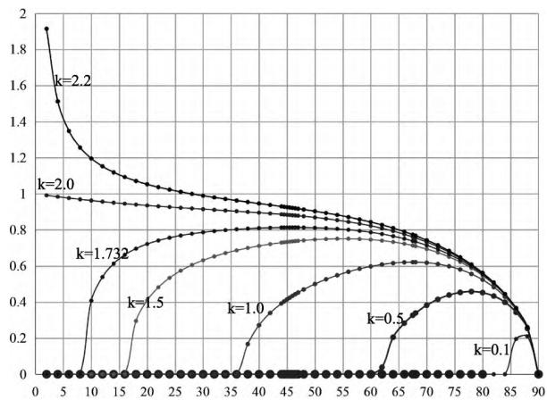
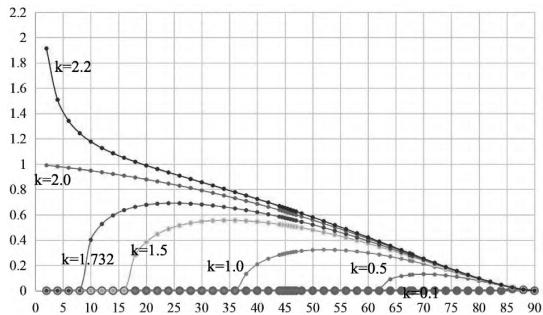
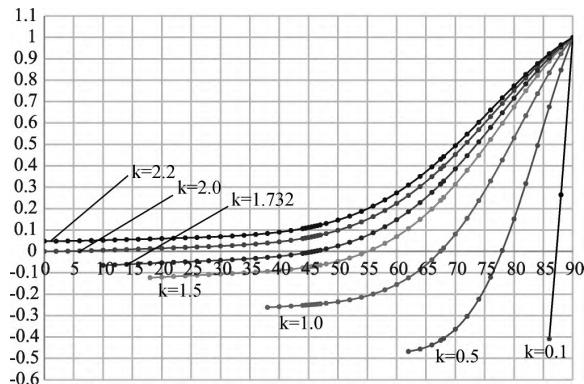
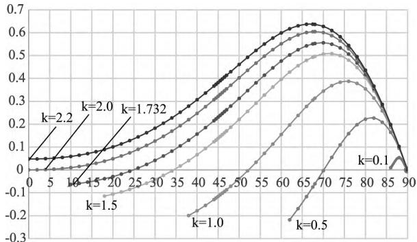

> 来源：MinerU 转换（stem-exact rebuild 2026-08-08）

· 现代教学技术 ·

# 可视化教学在高考问题分析中的妙用

# ———以2022年湖北高考压轴题为例

陈栋梁

（吴江盛泽中学 ，江苏 苏州 215228）

摘 要： 以2022年湖北高考压轴题为例， 探讨运用EXCEL等工具来实现可视化教学， 求解复杂物理问题中物理量的极值、 变化趋势、 拐点以及取值范围等．从这些量化关系更直观、 清楚地理解试题中物理问题的本质．

关键词： 可视化教学； 数值分析； EXCEL

<!-- 基金项目（PDF原文）：本文系苏州市教育科学"十四五"规划2021年度课题"可视化教学提升物理思维品质的研究"（项目编号：2021/LX/02/170/05）研究成果之一． -->

## 1 可视化教学

可视化教学是指运用一切可能的图示 动画声音 视频和实验等技术和手段对教学的所有环节进行设计和整合 进而实施教学的过程.［1，2］ 在教学过程中充分利用知识可视化理论和思维可视化理论 可以使凸显内涵要素的抽象或具体形态的外延可视化 可以使本来隐于头脑中的思维过程外显化可视化.在高三教学或高考题分析中 经常会存在一些复杂的物理问题，由于数学水平或物理知识所限，仅仅通过函数表达式很难判断其物理内涵和规律而运用EXCEL的数值分析方法和图像功能等可视化教学技术 可以很好地解决这个问题.

## 2 可视化教学实践研究 ： EXCEL 数值分析及图像分析

例1.（2022年湖北高考压轴题） 打桩机是基建常用工具.某种简易打桩机模型如图1所示， 重物A、B和C通过不可伸长的轻质长绳跨过两个光滑的等高小定滑轮连接 ，C与滑轮等高（图中实线位置）时，C到两定滑轮的距离均为 L.重 物 A和 B的质量均为 m， 系统可以在如图虚线 位 置 保持静 止， 此 时 连 接 C 的 绳 与 水 平 方 向 的 夹 角 为60°.某次打桩时，用外力将 C拉到图中实线位置 ，然后由静止释放．设C的下落速度为 $\sqrt { \frac { 3 g L } { 5 } }$ 时， 与正下方质量为 $2m$ 的静止桩 D正碰， 碰撞时间极短，碰撞后C的速度为0，D竖直向下运动 $\frac { L } { 1 0 }$ 距离后静止（不考虑C、D再次相碰）．A、B、C、D均可视为质点．

  
图1 原题示意图

（1） 求 C的质量；

（2） 若D在运动过程中受到的阻力 F 可视为恒力，求 F 的大小；

（3） 撤掉桩D 将C再次拉到图中实线位置然后由静止释放，求 A B C的总动能最大时C的动能

其中第（3）问，参考答案是通过系统机械能守恒求出表达式 然后通过数学求导的方式求出 ABC的总动能最大的位置 ，即图中虚线所在位置

此高考题涉及3个物体的运动关系 它们构成多质点运动系统 其中物体A B同步 而与物体C的运动互为逆行．原题中 C物体往下运动 C物体动能先增加后减小至0 而势能在单调减小；AB物体向上运动 动能先增加后减小至0 而势能单调地增加．由于3个物体动能 势能增大或减小并不同步，系统两种能量变化呈现“竞争” ，单从物体相互位置关系（位形关系）无法直接确定系统动能与势能的转换， 单从位形关系也无法直接看出系统各能量的变化及极值关系．于是教学中 有人就会提出 虚线所在位置 为何是系统总动能最大的位置 是巧合还是必然？这个位置 是不是也是A BC3个物体动能最大的位置？在下落过程中A BC3个物体的速率（或动能）变化是如何变化的 有何规律？A BC3个物体的质量改变后 是不是还是有这样的规律？仅通过参考答案的特殊解答是无法看出这些规律的 也无法全面地了解此情境中各物理量的变化规律.

上述困难无法通过教师的讲解得以解决 而可视化技术可以细致描述复杂系统的相关物理量变化关系.这正是发挥可视化技术优势的领域.

本文采用EXCEL的数值分析方法和图像功能等可视化教学技术 帮助和引导学生全面深入地理解复杂和抽象问题.

## 2.1 重物A BC的速率的数值及图像分析

如图2所示 重物C下落至任意位置时 速率为 $v$ ， 由牵连速度关系可得 重物 A B的速率为 $v _ { \mathrm { A } } = v _ { \mathrm { B } } = v \cos \alpha$ ， 则由系统机械能守恒定律 可得

  
图2 任意位置示意图

$$
\frac { 1 } { 2 } m _ { \mathrm { C } } v ^ { 2 } + \frac { 1 } { 2 } \times 2 m ( v \cos \alpha ) ^ { 2 } = m _ { \mathrm { C } } g \frac { L } { \tan \alpha } - 2 m g L \Big ( \frac { 1 } { \sin \alpha } - 1 \Big ) ,
$$

解得

$$
v = \sqrt { \frac { \frac { m _ { \mathrm { C } } } { m \tan \alpha } - \frac { 2 } { \sin \alpha } + 2 } { \frac { m _ { \mathrm { C } } } { 2 m } + \cos ^ { 2 } \alpha } g L } \ ,
$$

$$
v _ { \mathrm { A } } = v _ { \mathrm { B } } = \sqrt { \frac { \frac { m _ { \mathrm { C } } } { m \tan \alpha } - \frac { 2 } { \sin \alpha } + 2 } { \frac { m _ { \mathrm { C } } } { 2 m } + \cos ^ { 2 } \alpha } g L } \ \cos ^ { 2 } \alpha .
$$

从上述表达式很难直接看出或求出重物 ABC速率的极大值以及变化规律 会给教学带来一定的困扰 此时 可利用EXCEL的数值分析方法和图像功能等可视化技术手段.

按照原题题意 ${ \frac { m _ { \mathrm { C } } } { m } } = { \sqrt { 3 } }$ ，并将重物A、B、C的速

率表达式无量纲化 ，

$$
\frac { v } { \sqrt { g L } } = \sqrt { \frac { \frac { 2 \sqrt { 3 } } { \tan \alpha } - \frac { 4 } { \sin \alpha } + 4 } { \sqrt { 3 } + 2 \cos ^ { 2 } \alpha } } , \quad ( 0 ^ { \circ } \leqslant \alpha \leqslant 90 ^ { \circ } )
$$

$$
\frac { v _ { \mathrm { A } } } { \sqrt { g L } } = \frac { v _ { \mathrm { B } } } { \sqrt { g L } } = \sqrt { \frac { \frac { 2 \sqrt { 3 } } { \tan \alpha } - \frac { 4 } { \sin \alpha } + 4 } { \sqrt { 3 } + 2 \cos ^ { 2 } \alpha } \cos ^ { 2 } \alpha } . \quad ( 0 ^ { \circ } \leqslant \alpha \leqslant 90 ^ { \circ } )
$$

在EXCEL中，使 $\alpha$ 从 $0 ^ { \circ } \sim 90 ^ { \circ }$ 变化，进行数值计算，然后分别以 $\frac { v } { \sqrt { g L } } , \frac { v _ { \mathrm{A} } } { \sqrt { g L } }$ 为纵轴， 以 $\alpha$ 为横轴，建立坐标系， 用散点图即可绘得 图像如图3所示.

  
图3 重物A、B、C速率随角度变化规律

结合题目实际情境， 由图像可知： 当夹角 $\alpha$ 从 $90 ^ { \circ }$ 逐渐减小的过程中， 重物A、B、C的速率都是先增大后减小.重物C速率最大时， 对应的夹角 $\alpha \approx 46 ^ { \circ }$ ；重物A、B速率最大时， 对应的夹角 $\alpha \approx 25 ^ { \circ }$ .重物A、B、C速率再次为0时， 对应同一个角度， 为 $\alpha \approx 8.2 ^ { \circ }$ ，即小环下滑最大距离时，对应的夹角 $\alpha \approx 8.2 ^ { \circ }$ .这样就可以求出重物C下滑最大距离约为6.9L.

## 2.2 重物A BC的加速度的数值及图像分析

重物A BC的加速度直接制约重物 A B C的速率的变化规律 所以只有理解加速度的变化规律 才能更深入地理解速度的变化规律．因此用EXCEL的数值分析方法和图像功能 完整展示加速度随时间变化的规律显得非常有必要.

在任意角度 α 时，对重物 A B C分别受力分析，设重物C的加速度大小为 $a _ { 1 }$ ， 重物 A、B的加速度大小为 $a _ { 2 }$ 由牛顿第二定律 可得

$$
\sqrt { 3 } m g - 2 T \cos \theta = \sqrt { 3 } m a _ { 1 } , \quad T - m g = m a _ { 2 } .
$$

$$
a _ { 1 } \cos \alpha + \frac { ( v \sin \alpha ) ^ { 2 } } { L / \sin \alpha } = a _ { 2 }
$$

及 $v = \sqrt { \frac { \frac { 2 \sqrt { 3 } } { \tan \alpha } - \frac { 4 } { \sin \alpha } + 4 } { \sqrt { 3 } + 2 \cos ^ { 2 } \alpha } g L }$ ，

联立得

$$
a _ { 1 } = \frac { C _ { 1 } - 4 \sin ^ { 2 } \alpha \cos \alpha ( \sqrt { 3 } \cos \alpha - 2 + 2 \sin \alpha ) } { \left( \sqrt { 3 } + 2 \cos ^ { 2 } \alpha \right) ^ { 2 } } g ,
$$

$$
a _ { 2 } = \frac { C _ { 1 } \cos \alpha + 2 \sin ^ { 2 } \alpha ( 3 \cos \alpha - 2 \sqrt { 3 } + 2 \sqrt { 3 } \sin \alpha ) } { \left( \sqrt { 3 } + 2 \cos ^ { 2 } \alpha \right) ^ { 2 } } g ,
$$

其中 $C _ { 1 } = ( \sqrt { 3 } - 2 \cos \alpha ) ( \sqrt { 3 } + 2 \cos ^ { 2 } \alpha )$ .数值计算结果如图4所示.

  
图4 重物A、B、C的加速度随角度变化规律

由图所知： 当夹角 $\alpha$ 从 $90 ^ { \circ }$ 逐渐减小的过程中，重物C的加速度由 $g$ 逐渐减小为0， 再反向略微增加； 重物A、B的加速度从0开始， 先增大至某值再逐步减小为0， 然后反向略微增加.重物C加速为0时（重物C的速率最大）， 对应的夹角 $\alpha \approx 46 ^ { \circ }$ ； 重物A、B加速度为0时（重物A、B的速率最大）， 对应的夹角 $\alpha \approx 25 ^ { \circ }$ .所以重物C的加速度为0时， 重物A、B的加速度不为0， 两者加速度不同时为0， 即重物C和重物A、B速率最大值位置是不一样的.

## 2.3 重物A BC组成的系统动能之和的数值及图像分析

能量问题是跟动力学问题紧密联系的.原题中第（3）小问，参考答案通过系统机械能守恒和数学求导的方式解答出系统总动能最大的位置为$\alpha = 3 0 ^ { \circ }$ ， 即整个系统的原始平衡位置， 也就是图1原题示意图中的虚线位置.将重物 A B C组成的系统动能之和 进行可视化研究 可以完整地显示整个系统动能之和的变化规律以及极值位置.

由系统机械能守恒， 得 $E _ { \mathrm { 总 } } = m _ { \mathrm { C } } g \frac { L } { \tan \alpha } - 2 m g L \Bigl ( \frac { 1 } { \sin \alpha } - 1 \Bigr ) = m g L \Bigl ( \frac { \sqrt { 3 } } { \tan \alpha } - \frac { 2 } { \sin \alpha } + 2 \Bigr )$ .数值计算结果如图5所示.

  
图5 重物A、B、C的系统总动能随角度变化规律

由图可知： 当夹角 $\alpha$ 从 $90 ^ { \circ }$ 逐渐减小的过程中，系统动能之和是先增大后减小.系统动能最大时，对应的夹角 $\alpha$ 恰好为 $30 ^ { \circ }$ .所以， 虽然 $30 ^ { \circ }$ 是系统动能最大对应的角度， 但却不是重物C动能最大的位置， 也不是重物A、B动能最大的位置. $\alpha = 25 ^ { \circ }$ 是重物A、B动能（速率） 最大的位置； $\alpha = 30 ^ { \circ }$ 是系统总动能最大的位置； $\alpha = 46 ^ { \circ }$ 是重物C动能 （速率）最大的位置；他们动能最大值位置不同.

## 2.4 不同质量比时 重物 A B C速率的数值及图像分析

原题中， 只讨论了重物A、B、C在特殊质量时的变化规律；为使学生更深入理解该物理问题， 可以引导学生进行可视化探究， 重物C和重物A、B在不同质量比时速率变化的规律．

设重物C质量为 $m _ { \mathrm { C } }$ ， 重物A、B质量为 $m$ ， 在任意角度 $\alpha$ 时小环的速率为 $v$ ， 重物A、B速度为 $v _ { \mathrm { A } }$ ，由系统机械能守恒

$$
\frac { 1 } { 2 } m _ { \mathrm { C } } v ^ { 2 } + \frac { 1 } { 2 } \times 2 m ( v \cos \alpha ) ^ { 2 } = m _ { \mathrm { C } } g \frac { L } { \tan \alpha } - 2 m g L \Big ( \frac { 1 } { \sin \alpha } - 1 \Big ) .
$$

解得 $v = \sqrt { \frac { \frac { m _ { \mathrm { C } } } { m } \times \frac { 1 } { \tan \alpha } - \frac { 2 } { \sin \alpha } + 2 } { \frac { m _ { \mathrm { C } } } { 2 m } + \cos ^ { 2 } \alpha } g L } \ ,$

$$
v _ { \mathrm { A } } = v _ { \mathrm { B } } = \sqrt { \frac { \frac { m _ { \mathrm { C } } } { m } \times \frac { 1 } { \tan \alpha } - \frac { 2 } { \sin \alpha } + 2 } { \frac { m _ { \mathrm { C } } } { 2 m } + \cos ^ { 2 } \alpha } g L } \cos ^ { 2 } \alpha .
$$

设 $\frac { m _ { \mathrm { C } } } { m } = k$ ， 使 $\alpha$ 从 $0 ^ { \circ } \sim 90 ^ { \circ }$ 变化， 令 $k = 0.1, 0.5, 1.0, 1.5, 1.732, 2, 2.2$ ， 进行数值计算， 即可绘得图6和图7.

  
图6 不同质量比时，重物C速率随角度变化规律

  
图7 不同质量比时，重物A、B速率随角度变化规律

由图可知：当质量比 $k < 2$ 时， 夹角 $\alpha$ 从 $90 ^ { \circ }$ 逐渐减小的过程中， 重物A、B、C的速率都是先增大后减小， 但同一质量比的情况下， 重物C和重物A、B的最大速率对应的角度不一致.当质量比为 $k = 2$ 时， 即重物C和重物A、B质量相等时， 重物A、B、C的速率都是一直增加的， 最后趋于一个稳定值.当质量比为 $k > 2$ 时， A、B、C的速率都是一直增加的， 且越增越快.

## 2.5 不同质量比时 重物 A B C加速度的数值及图像分析

类似的方法， 可以引导学生进行可视化探究， 重物A、B、C在不同质量比时， 加速度随时间的变化规律．

$$
m _ { \mathrm { C } } g - 2 T \cos \theta = m _ { \mathrm { C } } a _ { 1 } , \quad T - m g = m a _ { 2 } .
$$

$$
a _ { 1 } \cos \alpha + \frac { ( v \sin \alpha ) ^ { 2 } } { L / \sin \alpha } = a _ { 2 } ,
$$

及 $v = \sqrt { \frac { \frac { 2 \sqrt { 3 } } { \tan \alpha } - \frac { 4 } { \sin \alpha } + 4 } { \sqrt { 3 } + 2 \cos ^ { 2 } \alpha } g L }$ ，

联立得

$$
a _ { 1 } = \frac { C _ { 2 } - 4 m \sin ^ { 2 } \alpha \cos \alpha ( m _ { \mathrm { C } } \cos \alpha - 2 m + 2 m \sin \alpha ) } { ( m _ { \mathrm { C } } + 2 m \cos ^ { 2 } \alpha ) ^ { 2 } } g ,
$$

$$
a _ { 2 } = \frac { C _ { 2 } \cos \alpha + 2 m _ { \mathrm { C } } \sin ^ { 2 } \alpha ( m _ { \mathrm { C } } \cos \alpha - 2 m + 2 m \sin \alpha ) } { ( m _ { \mathrm { C } } + 2 m \cos ^ { 2 } \alpha ) ^ { 2 } } g ,
$$

其中 $C _ { 2 } = ( m _ { \mathrm { C } } - 2 m \cos \alpha ) ( m _ { \mathrm { C } } + 2 m \cos ^ { 2 } \alpha )$ .设 $\frac { m _ { \mathrm { C } } } { m } = k$ ， 使 $\alpha$ 从 $0 ^ { \circ } \sim 90 ^ { \circ }$ 变化， 令 $k = 0.1, 0.5, 1.0, 1.5, 1.732, 2, 2.2$ ， 进行数值计算， 即可绘得图8和图9.

  
图8 不同质量比时，重物C的加速度随角度变化规律

  
图9 不同质量比时，重物A、B的加速度随角度变化规律

由图可知： 当质量比 $k < 2$ 时， 夹角 $\alpha$ 从 $90 ^ { \circ }$ 逐渐减小的过程中， 重物C的加速度由 $g$ 逐渐减小为0，再反向增加， 最后趋于不变； 但质量比 $k \geqslant 2$ 时， 重物C的加速度一直减小， 最后趋于不变.当质量比为 $k < 2$ 时， 夹角 $\alpha$ 从 $90 ^ { \circ }$ 逐渐减小的过程中， 重物A、B的加速度先增加再减小， 再反向增加；当质量比为 $k \geqslant 2$ 时， 夹角 $\alpha$ 从 $90 ^ { \circ }$ 逐渐减小的过程中，重物A、B的加速度先增加， 再减小， 最后趋于不变.

## 3 结语

在高中物理各类考试中 尤其是高考 物理竞赛 自主招生等选拔性考试中 我们经常会碰到一些复杂的物理量表达式 仅仅通过函数关系很难完整地看出其变化趋势 极值等问题 从而对物理量的内涵 规律难以完整清晰地理解.而利用EXCEL的数值分析方法和图像功能 用可视化的手段 就是解决此类问题的一条新的有效途径 可以达到事半功倍的效果.

## 参考文献 ：

1 刘濯源．基于“未来课堂”的思维可视化研究［J］．中国信息技术教育 ，2013（01） ：83－84

2 刘濯源．思维可视化：减负增效的新支点［J］．中小学管理，2014（06）：10－13

3 陈栋梁．可视化教学在高中物理问题解决中的妙用［J］．物理教学探讨 ，2022（7） ：65－69

4 宋勇．从基于经验到基于证据的物理可视化教学实践研究———以“探究凸透镜成像规律”为例 ［J］．物理教师 ，2022（1） ：36－38

5 刘健智， 程婷．GeoGebra软件在物理可视化教学中的应用［J］．物理教师，2021（6）：70－73

6 季正华．基于奥苏伯尔解决问题理论的习题可视化教学［J］．物理教师 ，2018（4） ：7－10

（收稿日期 ：2023－01－26）