> 来源：MinerU 转换（stem-exact rebuild 2026-08-08）

物理 实验

# 在“双新”背景下，例谈 GeoGebra 软件在高中物理教学中的应用

明翔宇 陈俊（重庆市第八中学校 重庆 400030）

摘 要 在“双新”教育改革背景下，如何切实提高学生的学科核心素养是摆在我们面前的重要命题。利用 GeoGebra 软件强大的计算和画图功能，针对高中物理教学中的一些重难点，通过形象的图象和动画，实现可视化教学，不仅能突破传统教学的局限性，提高教学效率，还能加深学生对问题理解的深度，培养学生的探究精神。

关键词 双新 GeoGebra 可视化教学 现代教育技术

文章编号 1002－0748（2022）4－0022

中图分类号 G633.7

文献标识码 B

本轮由国家主导的“双新”（新课程、新教材）教育改革，是一个系统化的改革举措，包括新课程方案、新课程标准、新教材、新教学方式、新评价和新高考等方面。本次改革明确提出，学校要开展情境化教学，关注应用性、综合性、探究性和开放性问题，以培养学生的科学探究能力和解决实际问题的能力。只有当“教师机械地教、学生被动地学”转变成教师和学生通过情境实践和问题探究学习时，才能真正提升学生的学科核心素养，培养学生的创新精神。

笔者在一线教学实践中发现，利用 GeoGebra 软件，可以展示一般实验无法演示的物理过程，显示理论分析无法做到的动态可视性，弥补黑板板书的不足，能有效解决教学重难点，提高课堂教学效率。同时，GeoGebra 很容易上手，完全遵守物理规律和数学表达式，可以同学生一起，通过改变参数、设置变量等方式探究物理规律，让学生在学习过程中获得理性思考和逻辑分析的能力，帮助学生提高研究和解决问题的能力。

## 1 利用 GeoGebra 展示图象的物理意义

理解各种图象的斜率、截距和面积的意义是高考中的一大热点，也是教学的重难点。例如理解 $v\text{-}t$ 图象下方的面积表示位移，这是微元法思想的启蒙，是重要的物理思想，也是学生初学时的一大难点。在 GeoGebra 中绘制微元法的变化过程，改变分割次数 $n$，可发现 $n$ 越大，$n$ 个矩形面积无限逼近原梯形面积，如图 1 和图 2 所示。

课件制作核心步骤：

（1）设置滑动条 $a$、$v_0$，范围分别为 $-5$ 到 $5$；滑动条 $n$ 范围为 $1$ 到 $80$。

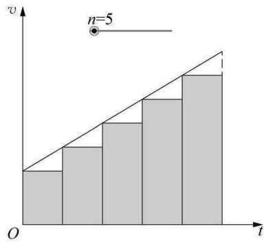  
图1

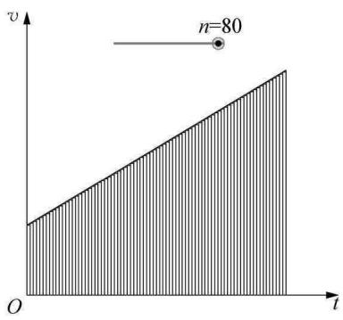  
图2

（2）在指令栏输入：如果$\left(0 \leqslant t \leqslant 10,\ v_{0}+at\right)$。

（3）在指令栏输入：下和$\left(t,\ 0,\ 10,\ n\right)$。<!-- PDF亦模糊：原PDF"下和(f, 0, 10, n)"中f疑似变量t，无法确认 -->

在 2009 年、2010 年高考江苏卷中分别出现 $\varphi\text{-}x$ 图象和 $E\text{-}x$ 图象，题目如下。

例1（2009 年江苏高考）空间某一静电场的电势 $\varphi$ 在 $x$ 轴上分布如图 3 所示，$x$ 轴上两点 B、C 的电场的电场强度在 $x$ 方向上的分量分别是 $E_{Bx}$、$E_{Cx}$，下列说法中正确的有（ ）

（A）$E_{Bx}$ 的大小大于 $E_{Cx}$ 的大小（B）$E_{Bx}$ 的方向沿 $x$ 的正方向（C）电荷在 O 点受到的电场力在 $X$ 方向上的分量最大

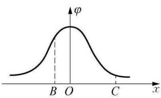  
图3

（D）负电荷沿 $x$ 轴从 B 到 C 的过程中，电场力先做正功，后做负功。

例2（2010 年江苏高考）空间有一沿 $x$ 轴对称分布的电场，其电场强度 $E$ 随 $x$ 变化的图象如图 4 所示。下列说法中正确的是（ ）

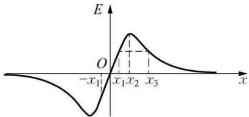  
图4

（A）$O$ 点的电势最低  
（B）$x_{2}$ 点的电势最高  
（C）$x_{1}$ 和 $-x_{1}$ 两点的电势相等（D）$x_{1}$ 和 $x_{3}$ 两点的电势相等

为了让学生更好地理解图象的意义，用 GeoGebra 进行模拟，画出 $\varphi\text{-}x$ 图象和 $E\text{-}x$ 图象。设置电荷电量、电荷间距、中垂线上点到电荷的距离为参数变量，拖动滑动条改变参数，可以很直观地观察到 $x$ 轴上各点的电势和 $x$ 方向场强大小的变化，同时还展示了场强叠加的平行四边形随参变量的变化而变化，如图 5 和图 6 所示。

课件制作核心步骤：

（1）设置滑动条 $Q$（电荷量）、$L$（电荷间距）、$d$（中垂线上到 O 的距离）。

（2）描绘 $\varphi\text{-}x$ 图，在指令栏输入：$\varphi(x) = \frac{2kQ}{\sqrt{L^{2}+x^{2}}}$

（3）描绘 $E\text{-}x$ 图，在指令栏输入：$E(x) = \frac{2kQ}{L^{2}+x^{2}} \cdot \frac{x}{\sqrt{L^{2}+x^{2}}}$

（4）描绘点 A，输入指令：$A = \left(x(C) + \frac{kQ}{L^{2}+d^{2}} \cdot \frac{d}{\sqrt{L^{2}+d^{2}}},\ -\frac{kQ}{L^{2}+d^{2}} \cdot \frac{L}{\sqrt{L^{2}+d^{2}}}\right)$

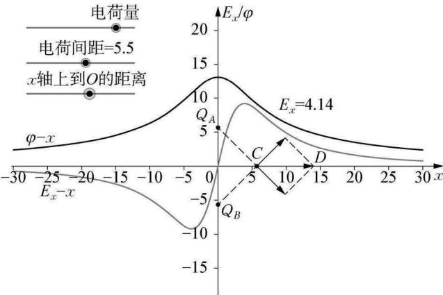  
图5

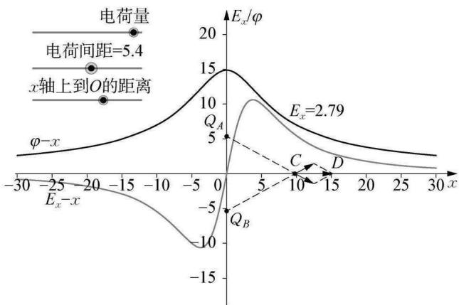  
图6

用向量工具连接 C、A 两点，得到 $Q_{A}$ 在 C 点的场强；同理描绘点 B，得到 $Q_{B}$ 在 C 的场强；分别过 A 作 CB 的平行线，过 B 作 CA 的平行线，描绘两平行线交点 D，用向量工具连接 CD，得到 C 点的合场强。

## 2 利用 GeoGebra 呈现抽象的物理模型

电场中等势面等概念，学生感觉很抽象，不容易建立起空间上的直观感受。用 GeoGebra 制作在平面上两点电荷周围的等势线，改变电荷电量，观察等势面的变化，可以很直观地得到等量同种、等量异种电荷的等势面。同样也能得到不等量电荷周围的等势面，还能观察其中一个电荷电量从零开始变化时，从孤立点电荷的等势面逐步变化的过程，加深学生对等势面的认识，如图 7、8 和 9 所示。

课件制作核心步骤：

（1）设置滑动条调节两电荷电量 $Q_{A}$ 和 $Q_{B}$，设置滑动条 $d$ 表示两电荷的间距。

（2）描绘 A 点、B 点做为空间中的两点电荷，输入

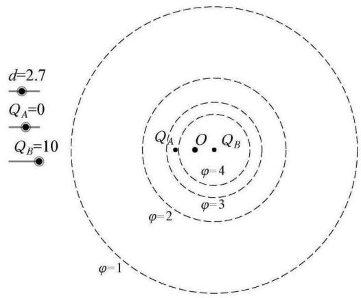  
图7

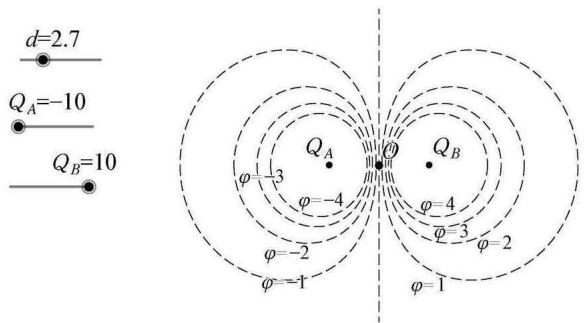  
图8

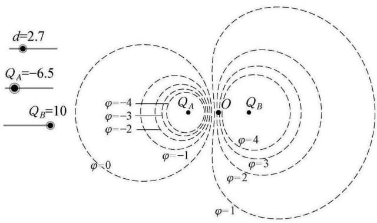  
图9

指令：$A = \left(-\frac{d}{2}, 0\right),\ B = \left(\frac{d}{2}, 0\right)$。

（3）在指令栏输入：$\varphi_{0}(x, y) = \frac{kQ_{A}}{\sqrt{(x-x(A))^{2}+y^{2}}} + \frac{kQ_{B}}{\sqrt{(x-x(B))^{2}+y^{2}}}$，得到电势为 0 的等势面。用类似的思想，作出电势之和分别为 $5, 4, 3, 2, 1, 0, -1, -2, -3, -4, -5$ 的等势线函数，得到平面空间中的一族等势线。

## 3 利用 GeoGebra 动态展示物理过程

动态平衡问题是力学中的一个重点知识，应用范围广泛。例如，在斜面上被挡板挡住的小球处于静止状态，缓慢旋转挡板与斜面间的夹角，小球处于动态平衡状态。在日常教学中，利用黑板板书只能展示某一状态的受力分析，难以直观展示动态变化过程。利用 GeoGebra 则能动态展示整个变化过程，拖动挡板顶端小圆点，即可旋转挡板，展示在不同角度下的受力分析图，如图 10 所示。

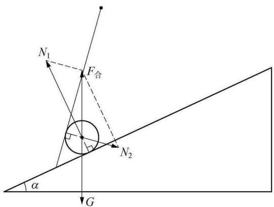  
图10

课件制作核心步骤：

（1）确定小球球心位置：作斜面和挡板的角平分线，再作与斜面平行且间距为 0.5（半径）的直线，两直线的交点为球心 C 点。

（2）作重力矢量箭头所在的点 G，在指令栏输入：$G = (x(C),\ y(C)-2)$（指令中的 2 表示重力的大小，可根据作图大小调整）；同理作两支持力合力矢量箭头所在的点 F，分别用向量工具连接 OG 和 CF。

（3）分别过球心作斜面和挡板的垂线 $f$ 和 $g$，再过 F 点分别作 $f$ 和 $g$ 的平行线，交点为 $N_{1}$ 和 $N_{2}$，用矢量工具连接球心和 $N_{1}$、$N_{2}$，用线段工具连接 F 点和 $N_{1}$、$N_{2}$。

（4）根据展示的需要，改变各矢量颜色、线段虚实，隐藏不必要的点。

用类似的思想，可以制作动态平衡中的相似三角形问题，如图 11 所示。拖动图中小球，可观察小球在任意位置时各力的变化规律。

分析有界磁场中带电粒子的运动时，常常需要用到动态圆思想，即带电粒子轨

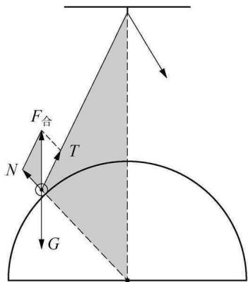  
图11

迹半径大小变化形成的缩放圆和速度方向变化形成的旋转圆。在突破这个教学难点时，教师常会用到自制的圆形教具，能较好地帮助学生直观地观察动态圆的变化过程，但自制教具通常比较粗糙、可变参数有限、演示效果不够理想。用 GeoGebra 模拟粒子运动轨迹，设置速度大小和方向为变量，拖动参数滑动条，能动态展示缩放和旋转的圆，参数调节简单便捷，展示效果准确、直观。

在圆形边界磁场中，从磁场边界射入带电粒子，调节粒子速度大小，即可改变轨迹半径。当轨迹半径小于磁场半径时，再调节粒子入射速度方向，可展示粒子击中磁场边界的区域范围，如图 12 所示；当轨迹半径大于磁场半径时，调节速度方向，可展示粒子在磁场中运动的最长时间，如图 13 所示；当轨迹半径等于磁场半径时，调节入射粒子的速度方向，会观察到所有粒子出射方向均相互平行（磁聚焦或磁发散现象），同时，连接入射点、磁场圆心、出射点和轨迹圆心的四边形也会自动出现，更加清晰地展示空间几何关系，如图 14 和图 15 所示。

轨道半径 $r$ ＞ 磁场半径 $R$  
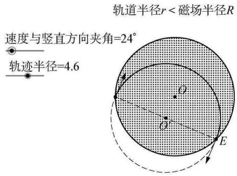  
图12

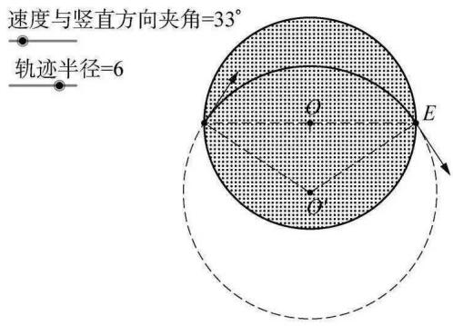  
图13

轨道半径 $r$ ＝ 磁场半径 $R$  
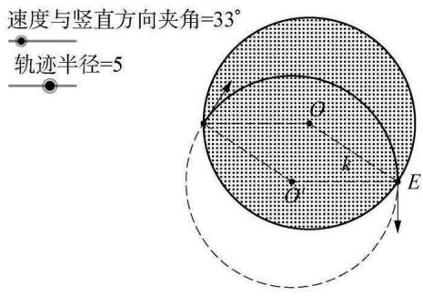  
图14

轨道半径 $r$ ＝ 磁场半径 $R$  
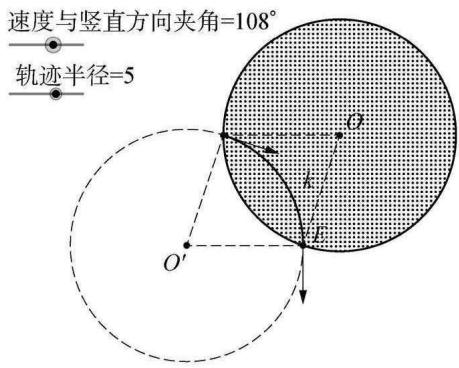  
图15

## 4 利用 GeoGebra 探究实验规律

在改变一个被测电阻两端的电压时，可采用滑动变阻器的分压或限流式接法。教师通常会总结，分压式接法调压范围大，可实现从零可调，常采用阻值较小的滑动变阻器；限流式接法连线简单，调压范围有限，不能实现被测电阻两端的电压从零可调，常采用阻值较大（相对被测电阻）的滑动变阻器。在这些总结描述中，采用的都是模糊的语言，也很少有人定量研究滑动变阻器的阻值对电压调节的影响。为了进一步研究这个问题，用 GeoGebra 绘制出分压式或限流式接法下，随着滑动变阻器阻值的改变，被测电阻所分得电压的变化图象，设置滑动变阻器的最大阻值为变量，改变其最大阻值，可比较在最大阻值取不同值的情况下，电压的变化情况。

观察电压变化曲线，当被测电阻约 50 Ω，滑动变阻器的最大阻值也为 50 Ω 时，无论限流式接法还是分压式接法，随着滑动变阻器的阻值变化，被测电阻两端的电压近似线性变化，表示滑动变阻器能比较顺滑地改变被测电阻两端的电压，调节能力好，只是限流式接法的调压范围较小，如图 16 所示；若调节滑动变阻器的最大阻值为 500 Ω，我们会观察到被测电阻两端的电压曲线在某些范围内非常陡峭，即被测电阻两端的电压变化很快，不便于实验操作和电压调节，如图 17 所示。因此，当滑动变阻器的最大阻值比被测电阻大得多的时候，无论限流还是分压，调压能力都不好，应选用最大阻值和被测电阻阻值差不多的滑动变阻器。

滑动变阻器的限流和分压（滑动变阻器的最大阻值＝50）  
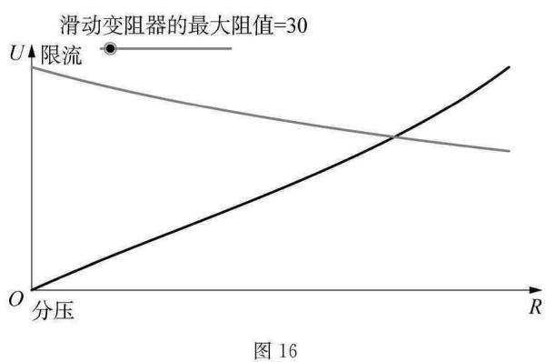  
图16

滑动变阻器的限流和分压（滑动变阻器的最大阻值＝500）  
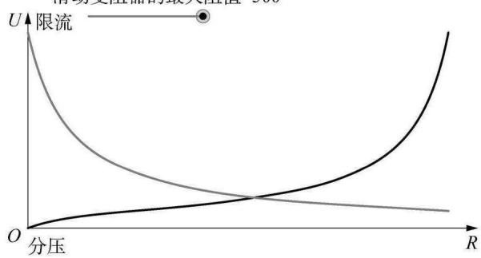  
图17

课件制作核心步骤：

（1）设置滑动条变量 $R$，表示滑动变阻器的最大阻值；设置横坐标长度变量为 $n$。

（2）指令栏输入指令：$R_{1}(x) = \operatorname{if}\left(0 \leqslant x \leqslant n,\ \frac{R}{n}x\right)$，用于计算滑片和某一端的电阻值。

（3）指令栏输入表示限流式接法被测电阻两端的电压公式：$f(x) = U \frac{R_{x}}{R_{1}(x) + R_{x}}$。

（4）指令栏输入表示分压式接法被测电阻两端的电压公式：$g(x) = U \frac{\frac{R_{x} R_{1}(x)}{R_{x} + R_{1}(x)}}{\frac{R_{x} R_{1}(x)}{R_{x} + R_{1}(x)} + R - R_{1}(x)}$。

## 5 结语

GeoGebra 是一款非常优秀的开源软件，在高中物理教学实践中有很多重要但不容易讲透的规律和习题，大都可以借助 GeoGebra 软件对其进行可视化展示，消除学生的思维障碍，促进学生的深度思考，帮助学生建立清晰的物理图景，从而更好地理解物理规律，提高学生的物理学科核心素养。

## 参考文献

[1] 陈琳，桑芝芳．GeoGebra 软件在中学物理教学中应用探析——以一道动态平衡试题为例[J]．中国教育技术装备，2020(7)：32-33．

[2] 黄北京．用 GeoGebra 辅助高中物理微元思想的教学[J]．物理教师，2013(4)：58-59．

---

<!-- 以下内容为 PDF 第 5 页底部"（上接第 28 页）"另一篇论文（利用传感器验证动量守恒/弹性碰撞实验）的节选，并非 LIT-0017 正文。MinerU 转换时与本文正文混排，单独保留以备核查。 -->

## 【附】（上接第 28 页）利用传感器验证动量守恒定律（节选）

第二次实验 $E_{3} = \left\{\left[\hat{p}_{1} - (\hat{p}_{2} + \pmb{p}_{3})\right] \div \pmb{p}_{1}\right\} \times 100\% = 4.7\%$。

说明质量大小不同的两铁球一维弹性碰撞的动量基本上也是守恒的。

### 4 实验装置的优点

（1）用光电门和数据采集器的方法做实验，提高了实验效率，节约了时间。

（2）用小球悬挂的方法，比让小球在某一斜面上运动带来的摩擦阻力会更小。

（3）能方便调节到两球碰撞时的对心状态做实验。

（4）比在气垫导轨上做实验方便，真正实现刚性碰撞。

（5）巧妙应用了重垂线。

### 5 实验结论

在误差允许的范围内，如果一个力学系统所受合外力为零或在某方向上的合外力为零，则该力学系统总动量守恒或在某方向上守恒（动量守恒定律表达式：$m_{1}v_{1} + m_{2}v_{2} = m_{1}v_{1}^{\prime} + m_{2}v_{2}^{\prime}$）。因此，上述的实验验证了动量守恒定律。弹性碰撞的分析能够对学生以后学习分子、原子等微观粒子之间碰撞奠定一定的基础。

利用传感器和数据采集器做物理实验，可以提高学生学习物理的兴趣，开发学生的智力和思维。

总之，传感器在物理实验中的应用可以增强学生的实践机会，有利于学生掌握多样化的实验方法。

### 参考文献

[1] 普通高中课程标准实验教科书编写组．物理选修 3-5[M]．北京：人民教育出版社，2010．

[2] 周香．数字化实验系统对传统物理实验的改进[J]．中国教育信息化，2008(6)．

[3] 中国科协青少年科技中心．第三十二届全国青少年科技创新大赛获奖作品集[M]．北京：科学普及出版社，2018．