# 基于发展科学思维高三实验复习课有效教学策略———以“验证机械能守恒定律”为例

秦付平 沈 强( 合浦廉州中学 广西 北海 536000)

摘 要:高三物理复习课是否有效和高效，关键还是要看学生是否具备独立思考能力和发展学科核心素养，在复习力学实验时显得尤为重要，在难以重复做实验的真实情景下，有效激活学生的独立思考能力是发展科学思维最好的策略． 本文立足实践教学，通过实验原理预设、创设情境性问题、实验规律重组、关注真实情景等方法促进学生科学思维，探索出一种高三实验复习的有效方法．

关键词:科学思维;有效教学;实验复习课;策略

中图分类号: G633. 7

文献标识码: B

文章编号: 1008 － 4134( 2021) 11 － 0022 － 04

一直以来，就高三物理一轮复习力学实验部分来说，常用的方法是 “实验原理回顾—典型例题评析—学生针对训练”的三环节法． 这是我们常见到的方法，也是被大多数物理教师认可的方法，但依然认为这是一种以教师为课堂中心，教师按照课程的目标设计和自己的意愿不断让学生被动地接受复习． 从发展核心素养之物理科学思维能力的视角分析，这是不可取的，复习效果可想而知，显然不是最佳的． 在复习实验时，诚然，我们难以让学生再进实验室重复实验过程，而我们应该探讨的问题是复习力学实验时如何有效和如何高效，就要灵活不断变换、探讨教学策略提升核心素养． 例如，复习时我们还要思考学生处于什么状态，还缺少什么方式去提高学生的实验能力，怎样才能做到有效复习实验，如何发展科学思维，如何促进学生的思维由 “低级”到 “高级”的有效进阶，最大限度地发展科学思维．

以“验证机械能守恒定律”为例，这个实验在高中物理力学中具有非常重要地位，是高中阶段物理教学中为数不多的关键守恒规律之一，也是能量守恒定律的特殊原理实验，既能考查学生的认知和能力，也能有效地发展和提升核心素养，它所隐藏的守恒思想是培养学生物理观念和科学探究的绝佳素材，在历年高考命题中也经常出现． 笔者通过实践教学探讨出一种以“激活认知—原理归纳—例题总结—思维提升”的基本教学思路，能有效地激发学生的复习兴趣，达到提高复习的针对性和时效性的做法．

## 1 厘清实验过程构架，创设情境性问题，激活原有认知

实验的基本过程和基本构架，这是每一位学生必须清楚的问题，在复习时先让学生总结概括出实验的基本套路和基本步骤，如图1 所示．

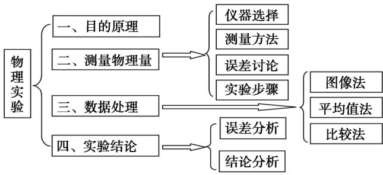  
图1

厘清实验过程构架，创设情境性问题激活原有认知． 激活学生的原有认知是高三物理有效的复习前提，激活原有认知不仅能 “节约时间”，还能重现曾经学生做过的实验． 因此，笔者以调动学生积极性为基本出发点，设置情境性问题，通过问题逐一展开引导分析，来激活学生原有的认知，同时从课堂对话交流中探测学生学习进阶的起点．

教师提问:

(1) 有哪些常见的机械能守恒的例子?

(2) 如何设计实验验证机械能守恒?

(3) 你设计的实验原理是什么? 如何进行验证?

学生讨论之后，努力通过思考提取大脑中的机械能守恒的实例、实验、规律，建立各种实验模型，讨论实验的原理、方法、操作和误差分析等等． 通过简单的对话，基本了解到学生掌握的基本情况，有利于下一步教学．

## 2 预设实验原理探讨，创设探究性问题，化被动为主动

通过学生讨论之后，使得教师讲解的东西和学生探究的问题出现在 “最近发展区”． 对于高三同学来说，很多同学往往对知识掌握很多，但不一定全面，经常出现“会而不全，学而不精”的情况． 在预设物理实验时，教师可以充分考虑学生已经掌握了很多的物理实验，能举出诸多的机械能守恒的例证． 因此，让同学们讨论交流，探讨几个验证机械能守恒的物理现象．

讨论分析:

方法1． 利用自由落体运动来验证机械能守恒定律，如图2 所示，其原理为 $m g h = \frac { 1 } { 2 } m v ^ { 2 }$

方法2． 利用小球被绳子拉着往下摆自由摆动验证机械能守恒定律，如图3 所示，原理为 $m g l = \frac { 1 } { 2 } m v ^ { 2 } .$

方法3． 水平面上放一滑块，利用钩码拉动的连接体模型验证机械能守恒，如图 4 所示，原理为 $m g s = \frac { 1 } { 2 } ( M + m ) v _ { 2 } ^ { 2 } - \frac { 1 } { 2 } ( M + m ) v _ { 1 } ^ { 2 }$．

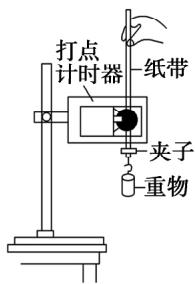  
图2

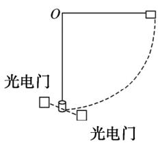  
图3

方法4． 利用物体的平抛运动来验证机械能守恒，如图5 所示， $E _ { \mathrm { p } } = { \frac { 1 } { 2 } } m v ^ { 2 }$ ，需要说明的是，这个一般用作探究弹性势能与什么因素有关或探究弹力做功与动能变化关系． 因为平抛初速度可以通过高度和水平距离来测量． 若用平抛运动来验证机械能守恒，就要测出平抛的初速度和末速度，这时末速度不易测量．

应对策略:

逐一分析以上的实验原理，通过讨论和诊断学生认知，科学分析验证机械能守恒定律的常见原理和方法，预设实验情境，探讨创设探究性问题，通过实验分析让学生思路化被动为主动． 方法 1 中，我们通过自由落体运动验证机械能守恒是教材常见方法，再让学生讨论测量、操作、实验误差等等进行思考，特别强调了速度的求解方法等等． 趁热打铁，教师可以逐一分析方法2、方法3 和方法4 中的方案，让学生列出几个满足机械能守恒定律的关系式，根据原理和实验方法，讨论需要测量的物理量等等． 原理的总结和预设，可以有效地促进学生整体架构能力的发展和复习进阶的高效，从学生的学习氛围不难看出学生对验证机械能守恒收获很大．

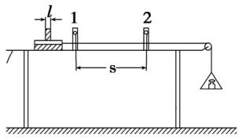  
图4

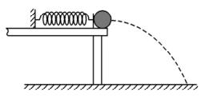  
图5

## 3 精选例题问题导向，总结创新性实验，万变不离其宗

物理实验原理是物理实验的核心，掌握原理可使学生对物理原理和规律进一步升华． 通过原理预设之后，可以精选例题深度评析，总结创新性实验，分析大量问题和例题，让学生以不变应万变． 让学生以原理出发知晓题型万变不离其宗的特点． 对于已经掌握的、常见的几种验证机械能守恒的方法，教师已经让学生明白了通过几种方法，可以精心挑选几个例题分析，在解决具体问题时升华 “知识和能力、过程与方法”等要素的高阶层次．

例题1 如图 6 甲所示，一位同学利用光电计时器等器材做“验证机械能守恒定律”的实验． 有一直径为 d、质量为 m 的金属小球由 A 处静止释放，下落过程中能通过A 处正下方、固定于 B 处的光电门，测得A、B 间的距离为 H( H≫d) ，光电计时器记录下小球通过光电门的时间为 t，当地的重力加速度为 $g .$ 则

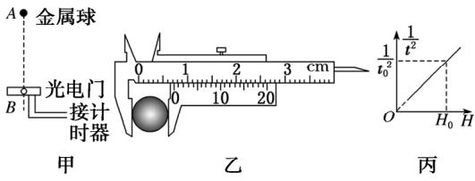  
图6

(1) 如图6 乙所示，用游标卡尺测得小球的直径d = cm．

(2) 多次改变高度 H，重复上述实验，作出 ${ \frac { 1 } { t ^ { 2 } } } - H$ 的变化图像如图 6 丙所示，当图中已知量 $t _ { 0 }$、$H _ { 0 }$ 和重力加速度 $g$ 及小球的直径 d 满足以下表达式:<!-- 公式缺失，PDF亦为图片 -->时，可判断小球下落过程中机械能守恒

(3) 实验中发现动能增加量 $\Delta E _ { \mathrm { k } }$ 总是稍小于重力势能减少量 $\Delta E _ { \mathrm { p } }$ ，增加下落高度后，则 $\Delta E _ { \mathrm { p } } - \Delta E _ { \mathrm { k } }$ 将 ( 选填 “增大” “减小 ”或 “不变” ) ．

教学策略:

问题1． 本题验证机械能守恒，要求作出 $\frac { 1 } { t ^ { 2 } }$ 随 H变化的图像的目的是什么?

问题2． 依据图像写出表达式．

问题3． 从原理出发，自由落体运动的机械能守恒原理是 $m g h = \frac { 1 } { 2 } m v ^ { 2 }$ ，那么如何转化为时间来表示?光电门测量速度表达式是什么?

通过一系列创设问题导向后，不难分析本题的重点是分析验证机械能所利用的实验原理，即分析用光电门测小球下落到 B 点的速度和表达式． 结合 ${ \frac { 1 } { t ^ { 2 } } } - H$ 图线判断小球下落过程中机械能守恒，同时分析实验误差 $\Delta E _ { \mathrm { { p } } } - \Delta E _ { \mathrm { { k } } }$ 随 H变化的规律．

例题2 某同学用如图7 所示的装置验证机械能守恒定律． 一根细线系住钢球，悬挂在铁架台上，钢球静止于A 点． 光电门固定在 A 的正下方，在钢球底部竖直地粘一片宽度为 d 的遮光条． 将钢球拉至不同位置由静止释放，遮光条经过光电门的挡光时间 t 可由计时器测出，将 $v = { \frac { d } { t } }$ 作为钢球经过A 点时的速度． 记录钢球每次下落的高度 h 和计时器示数 t，测量并比较钢球在释放点和 A 点之间的势能变化大小 $\Delta E _ { \mathrm { p } }$ 与动能变化大小 $\Delta E _ { \mathrm { k } }$ ，就能验证机械能是否守恒．

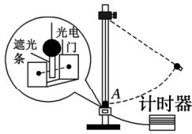  
图7

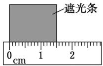  
图8

( 1) 用 $\Delta E _ { \mathrm { p } } = m g h$ 计算钢球重力势能变化的大小，式中钢球下落的高度 h 应为测量释放时的钢球球心到 之间的竖直距离

A． 钢球在A 点时的顶端 B． 钢球在A 点时的球心 C． 钢球在A 点时的底端

( 2) 用 $\Delta E _ { \mathrm { k } } = \frac { 1 } { 2 } m v ^ { 2 }$ 计算钢球动能变化的大小，用刻度尺测量遮光条宽度，示数如图 8 所示，其读数为cm． 某次测量中，计时器的示数为0．0100s． 则钢球的速度为 v = m / s．

( 3) 表1 为该同学某次实验的结果．

表 1
<table><tr><td rowspan=1 colspan=1> $\Delta E _ { \mathrm { p } } ( \times 1 0 ^ { - 2 } \mathrm { J } )$ </td><td rowspan=1 colspan=1>4.892</td><td rowspan=1 colspan=1>9.786</td><td rowspan=1 colspan=1>14.69</td><td rowspan=1 colspan=1>19.59</td><td rowspan=1 colspan=1>29.38</td></tr><tr><td rowspan=1 colspan=1> $\Delta E _ { \mathrm { k } } ( \times 1 0 ^ { - 2 } \mathrm { J } )$ </td><td rowspan=1 colspan=1>5.04</td><td rowspan=1 colspan=1>10.1</td><td rowspan=1 colspan=1>15.1</td><td rowspan=1 colspan=1>20.0</td><td rowspan=1 colspan=1>29.8</td></tr></table>

他发现表中的 $\Delta E _ { \mathrm { p } }$ 与 $\Delta E _ { \mathrm { k } }$ 之间存在差异，认为这是由于空气阻力造成的． 你是否同意他的观点? 请说明理由．

(4) 请你提出一条减小上述差异的改进建议:

教学策略:

问题1． 本题验证机械能守恒实验的原理是什么?

问题2． 光电门测量的速度是利用球的直径还是遮光片?

问题3． 从原理出发，小球机械能守恒原理是 $m g l = \frac { 1 } { 2 } m v ^ { 2 }$ ，那么动能增量为什么比重力势能变化小?( 空气阻力)

问题4． 问题3 中，为什么动能变化比重力势能变化大? 测量的速度大小与什么因素有关?

问题5． 本题利用光电门测钢球的瞬时速度，思考遮光片尺寸大好还是小好?

显然，万变不离其宗，通过一系列创设问题导向，实验设计需要从实验原理出发． 从物理原理上设计和追寻问题，既是让学生能在创新的问题中找到方向和思路，又可以让学生在低迷状态中很快适应并回到巅峰状态，能积极地调动学生的认知和能力，解决问题也就从容不迫．

例题3 某研究性学习小组利用气垫导轨验证机械能守恒定律，实验装置如图 9 所示． 在气垫导轨上相隔一定距离的两处安装两个光电传感器 A、B，滑块P 上固定一遮光条，若光线被遮光条遮挡，光电传感器会输出高电压，两光电传感器采集的数据上传至计算机． 滑块在细线的牵引下向左加速运动，遮光条经过光电传感器 A、B 时，通过计算机可以得到如图 10所示的电压 U随时间 t 变化的图像．

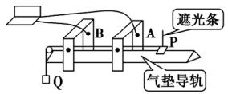

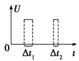  
图9

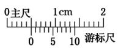  
图10  
图11

(1) 实验前，接通气源，将滑块( 不挂钩码) 置于气垫导轨上，轻推滑块，当图 10 中的 $\Delta t _ { 1 }$ $\Delta t _ { 2 }$ ( 选填“＞” “= ”或“＜ ”) 时，说明气垫导轨已经水平．

(2) 用游标卡尺测遮光条宽度 d，测量结果如图11 所示，则 d = mm．

(3) 滑块 P 用细线跨过气垫导轨左端的定滑轮与钩码 Q 相连，钩码 Q 的质量为 m． 将滑块 P 由图 9 所示位置释放，通过计算机得到的图像如图 10 所示，若 $\Delta t _ { 1 }$、$\Delta t _ { 2 }$ 和 d 已知，要验证滑块和钩码组成的系统机械能是否守恒，还应测出 ( 写出待测物理量的名称及符号) ．

(4) 若上述物理量间满足关系式 ，则表明在上述过程中，滑块和钩码组成的系统机械能守恒．

教学策略:

问题1． 本题验证机械能守恒实验的原理是什么?

问题2． 两个光电门测量的速度变大还是变小?

问题3． 实验前为什么要检查气垫导轨是否水平?有什么作用?

问题4． 从原理出发，小球机械能守恒原理是 $m g s = \frac { 1 } { 2 } ( M + m ) v _ { 2 } ^ { 2 } - \frac { 1 } { 2 } ( M + m ) v _ { 1 } ^ { 2 }$ ，各物理量怎样测量?

本题实验的难点是为什么要检查气垫导轨是否水平及连接体的利用，这一系统机械能守恒代替单个物体的机械能守恒，利用光电门测滑块的瞬时速度，需要光滑的水平面，因此教学过程中设计提问和策略需要根据例题精析不断转化．

总结几个例题后不难发现，这样的复习课不再以教师为中心，而是以教师提问为引导，让学生思考和讨论，以回忆知识和实验原理为出发点，通过优化、重组、归纳、总结等环节让学生有效地自我监测和自我完善，提升复习效果．

## 4 关注物理实验重组，促进学生思维，发展应用能力

中学物理教师常说的一句话是: “提问得好即教的好”，复习实验课也不例外，有效的问题和真实的情景不仅能激发学生原有的认知，还能唤醒和回忆学生所学的知识和方法． 心理学研究表明，物理的真实情景有利于学生产生长久的记忆，即我们再次通过物理的真实情景就可以容易实现学生回忆曾经已有的知识和物理规律，教师只要善于抓住这一特点，就可以再次让学生顺利进入思维的活跃状态，然后采取相应策略激发学生深度学习，如引起认知冲突，促进认知结构的重组、搭建学生思维，促进学生思维不断自省和学习能力的螺旋式上升．

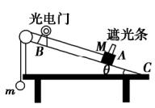

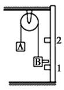  
图12

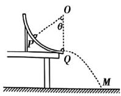  
图13  
图14

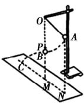  
图15

高三复习实验的主要目的是激活学生认知，在真实的物理情景中促进思维，培养娴熟的解题能力，发展各种应用能力． 教师作为引导和教学策略，也可以在总结机械能守恒定律的各种常规实验后，关注创新性题型，培育学生深度学习和有效教学． 在关注物理真实情景、促进学生思维、发展应用能力时，教师分析、巩固原有的知识体系． 例如，以常见的验证机械能守恒的实验为原型，图12、图13 中利用连接体在斜面上进行改装，从实验原理出发，也不难分析，图 14 和图15 中却是利用小球在等效圆周摆运动验证机械能守恒，总结重组这些创新性实验例子，从实验原理出发，使思路和能力很快被激活． 可见，关注物理真实情景，不断重组实验，应对各种题型，促进学生思维，发展应用能力是十分有益的．

## 5 结束语

教师在备课过程中，通过实验原理预设、问题导向、关注实验真实情景等环节，不难发现这样的复习课可以改变以教师为中心的教学模式． 对学生来说可以让知识“回归” “激活” “构建” “重组”，发展学生独立思考的能力和优化认知结构，进而发展科学思维能力． 对教师来说也可以完善物理实验教学策略，提升教学能力，为高三物理复习课堂带来新的气息．

参考文献:

［1］唐华． 高三数学复习有效教学策略的实验研究 ———以大理市 DL 中学数列复习内容为例［D］． 昆明: 云南师范大学，2017．

［2］张晓莉． 高三物理复习有效教学策略研究［D］． 昆明:云南师范大学，2009．

［3］鲁世明． 浅谈高三后期物理复习有效教学的策略［J］．中学物理，2016，34( 13) : 1 － 2．

( 收稿日期: 2021 － 01 － 17)