> 来源：MinerU 转换（stem-exact rebuild 2026-08-08）

· 教材与教法 ·

# 基于奥苏伯尔解决问题理论的习题可视化教学

季正华

（常州市北郊高级中学 ，江苏 常州 213031）

摘 要：阐述了基于奥苏伯尔解决问题理论开展的习题可视化教学尝试，以具体案例探析了习题可视化教学的策略，以追寻高中物理习题教学的更多智慧．

关键词：习题教学；解决问题；可视化教学

习题教学是物理教学的重要组成部分 习题教学可以帮助学生理解 巩固 活化物理知识与技能；可以帮助学生建立、掌握、拓展解决问题的思路与方法；可以帮助学生提升学习能力与品质．高中物理习题条件隐含 对象复杂 过程抽象 模型综合等特点使学生在问题的建构 分析 求解与再认知方面造成困难．如何将抽象 复杂 综合的问题简洁 清晰 直观的呈现给学生 习题可视化教学不失为一种有效的教学方式

## 1 可视化与习题可视化教学

可视化最早是指利用计算机图形学和图像处理技术将数据转换成图形或图像在屏幕上显示出来．后来在引导技术中可视化又称为“可视思考／视觉化思考”，指将声音转化为可视的图或文字，便于简化复杂性以增强研讨过程中的思考．随着多媒体技术的发展，可视化教学技术被广泛应用于课堂教学［1］．知识、思维被图形或视频可视化地表征，方便了师生、生生沟通并促进了学生的思维，提升了教学效果．

基于如图 1 所示的奥苏伯尔解决问题模式［2］，笔者认为习题可视化教学不能停留在利用图像或视频等展示习题分析、求解的技术层面，而应该在习题情境呈现、条件目标明确、推理分析、过程检验等解决问题环节中，采用更丰富的手段使习题讲评过程可视化，以突显解决问题的一般过程，使学生深入理解物理知识与规律，提升学生思维能力与品质．下面结合具体案例探析习题可视化教学的实践．

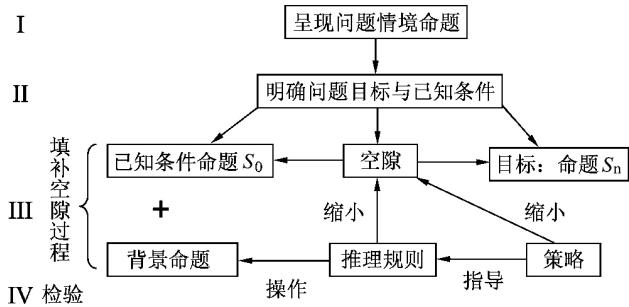  
图1 奥苏伯尔解决问题模式

## 2 习题可视化教学案例与评析

### 2．1 习题情境可视化 ， 助推学生物理模型的自主建构

案例1．如图2所示 理想变压器的副线圈接入电路的匝数由触头 Q调节．原线圈加上电压为U1的交流电 ，副线圈输出端接有定值电阻 R0和滑动变阻器 R，则

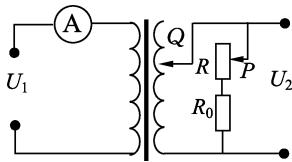  
图2

（A） 若 Q 位 置 不 变 ， 将 P 向 上 滑 动 ， $U _ { 2 }$ 变大

（B） 若 Q位置不变 ， 将 P 向上滑动 ， 电流表的读数变小

（C） 若 P 位置不变 ， 将 Q向上滑动 ， 电流表的读数变大

（D） 若 P 位置不变 将 Q向上滑动 变压器的输入功率不变

本题考查理想变压器“动态分析” ， 往往学生因不理解“制约关系”原理及推理分析程序 ，正确率较低．若采用一般口头讲解来弥补学生对“制约关系”的认知不足 在以后的练习中学生还会出错．笔者尝试在可拆变压器的原副线圈回路中各串一小灯泡 让“制约关系”的原理以灯泡亮暗的现象可视化地呈现出来 装置及现象如图3所示．图3（a） （b） 实验让学生在具体情境中深刻领会“$P _ { 2 } \to P _ { 1 } ,\ I _ { 2 } \to I _ { 1 }$”的制约关系．图3（c） 实验拓展演示 电感在交流电路中的作用．最后让学生结合推理流程图 （ 如图4） 得出正确答案．实践表明 将习题情境及推理流程可视化加深了学生对理想变压器“动态分析”模型的感性与理性认识 起到了很好的教学效果

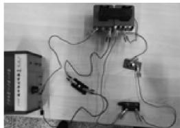  
图3(a)  
铁芯闭合、原副线圈电路闭合现象：两盏灯泡均能发光

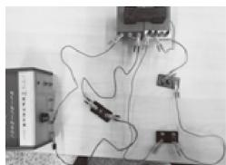  
图3(b)  
将实验(a)中副线圈电路断开 现象：两盏灯泡均不发光

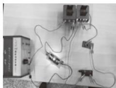  
图3(c)  
铁芯不闭合、原副线圈电路闭合现象：仅原线圈回路的灯泡能发光

$$
U_1 \xrightarrow[\text{决定}]{\dfrac{U_1}{U_2} = \dfrac{n_1}{n_2}} U_2 \xrightarrow[\text{决定}]{I_2 = \dfrac{U_2}{R_\text{负载}}} I_2 \xrightarrow[\text{决定}]{P_2 = P_1\,(U_1 I_1 = U_2 I_2)} I_1 \xrightarrow[\text{决定}]{P_1 = U_1 I_1} P_1
$$

图4

评析 对物理知识的认知和物理模型的建构过程是学生与情境交互的过程 学生只有融入到实际情境中 才能建构出有意义的知识．换句话说 情境是一切认知的基础［3］．借助演示实验重现物理问题情境 不仅可以促使学生思维认知由抽象到形象的转变， 在情境中完成物理模型认知建构 而且可以激发学生的学习热情和兴趣

### 2．2 审题分析可视化，利于学生物理意识的经验积累

案例2．如图5所示，质量 M＝4kg的小车长 $L = 1 . 4 \mathrm { ~ m ~ }$ ， 静止在光滑水平面上 ，其上面右端静止一质量 $m = 1 \mathrm { ~ k g }$ 的小滑块 小车与木板间的动摩擦因数 $\mu { = } 0 . \ 4$ ，用一水平恒力 F 向右拉小车，g 取 $1 0 ~ \mathrm { m / s ^ { 2 } }$ <!-- 存疑：PDF原文作"小车与木板间"，但本案例对象为小车与小滑块，疑为"小车与滑块间"之误 -->

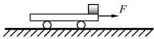  
图5

（1） 若恒力 $F { = } 1 0 \ \mathrm { N }$ ，小滑块与小车间的摩擦力为多大？

（2） 滑块与车间不发生相对滑动的恒力 F 要满足的条件？ <!-- 存疑：PDF原文作"车间"，疑为"车之间"或"车"之误 -->

（3） 若恒力 F＝28N 要使滑块从小车上恰好滑下来 力 F 至少应作用多长时间？

第（3）问属于动力学问题的难题 ，主要难在审题．一般而言，学生审题难在不能直接看出题目条件的内涵 不能从题目的陈述中正确辨析题目所给具体条件或要求过程 不能转换条件及建立分析条件之间的关系．基于对奥苏伯尔解决问题理论第 Ⅱ 阶段的理解 笔者用如图6所示的审题流程图可视化第（3） 问的审题教学．通常 物理习题的文本表述可以转化为物理情景 物理情景可以转化为具体的物理条件（或要求） 物理条件（或要求）可以转化为数学条件（或要求）．审题可视化教学的核心是让学生掌握基本操作要领———转化使学生在习题情境命题与认知结构之间建立联系 逐个分析题目条件的内涵 理解问题并转化条件 最终将习题作为一个整体来把握

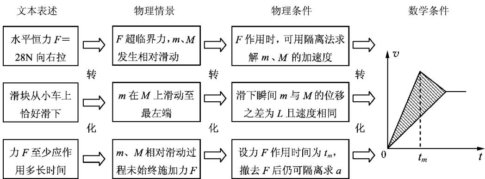  
图6

评析 审题能力的培养是习题教学的重要目标．正确审题有利于形成解决问题的正确思路 增强学生解决问题的能力．空洞化的言语提醒与形式化的圈点勾画很难提升学生的审题水平 审题的核心是转化， 可视化的审题转化过程是学生理解条件内涵的过程 也是明辨各条件或要求之间关系的过程．因此 审题可视化教学将有利于学生发展理解能力和分析能力

### 2．3 综合推理可视化 ，促进学生物理思维的能力提升

案例3．如图7，垂直纸面向里的匀强磁场大小 B＝0．6T 的上方有一水平板 ab， 在距 ab 距离为 l＝10cm 处， 有放射源 S 向纸面内各方向发射速度大小均为 $v = 3 . 0 \times 1 0 ^ { 6 } \ \mathrm { m / s }$ 的 α 粒子，已知 α 粒子比荷 $q / m { = } 5 . \ 0 { \times } 1 0 ^ { 7 } \ \mathrm { C / k g }$ ， 求 $a b$ 上被 α粒子打中的区域的长度

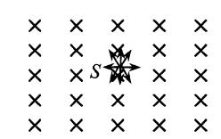  
图7

学生能注意到 α 粒子的入射方向的不同 采用“旋转轨迹圆”策略 得出 α 粒子打中的 ab 边界右端的最远点为轨迹圆直径与边界的交点 A．多数学生会由对称思维推理填补与问题目标之间的空隙，得出“α 粒子打中的 ab 边界左端的最远点与右侧最远点A 对称”的错误答案．为了纠正学生解决问题中填补空隙过程的错误 笔者制作了如图8的教学道具， 使学生直观理解“旋转轨迹圆”的推理结果的不对称性．值得一提的是 此教具的使用让不少“带电粒子在有界磁场中运动问题”的可视化习题教学难点迎刃而解

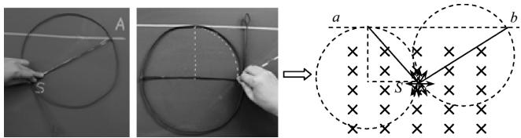  
图8

评析 习题教学过程中 教师既要帮助学生调动认知结构中与解决习题相关的知识 方法 也要指导学生考虑综合推理的注意事项 更要教会学生如何缩小习题条件与求解问题之间的空隙 因为填补空隙是解决问题的核心．借助于自制教具或思维导图的习题可视化教学方式 不仅可以使学生的综合推理由抽象向形象转变 也可以在问题空隙填补过程中判断逻辑推理的合理性 还可以促进学生物理思维能力的提升

### 2．4 检查校验可视化，促使学生原有认知的重新建构

案例4．如图9（甲）所示 质量 $m = 2 \mathrm { ~ k g }$ 的 滑块与质量 M＝1kg的足够长的木板静止叠放在光滑水平面上 它们间的动摩擦因数 $\mu { = } 0 . 2$．作用于滑块的水平力 F 随时间 t 变化如图9（乙） 所示 $t { = } 2 . 0 \ \mathrm { s }$ 时撤去力 ，最终滑块与木板间无相对运动．取 $g = 1 0 \mathrm { ~ m / s ^ { 2 } }$ ．求 ： （1） $t = 0 . \mathrm { ~ 5 ~ s ~ }$ 时滑块的速度大小； （2） 0～2．0s内木板的位移大小 ； （3） 整个过程中因摩擦而产生的热量

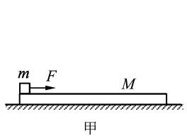  
图9(甲)

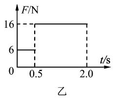  
图9(乙)

第 （1） 问 正 确 率 不 足10％，学生错误地认为在0～0．5s内 $F _ { \mathrm { 1 } } > f _ { \mathrm { m } }$，m 在 M 上发生滑动 如图10所示．究其原因， 学生既没有全面掌握“动力学分离问题” 也没能校验“F1＞f ”是不是 m 在 M 上滑动的充分条件．以“题海战术”为特征的应试教育让学生养成了“不回头看”的解题习惯．为了培养学生解决问题“检验”的习惯，笔者应用“MindMapper”软件可视化思维过程 让学生检验推理规则的同时发现“从动的木板加速度比主动的滑块大”的矛盾 如图11所示．接着， 分析滑块与木板相对静止时其摩擦力随外力 F的变化，让学生理解：当 f＝fm 时，外力 $F { = } \left( M { + } m \right) \frac { f _ { \mathrm { m } } } { M }$ 同时得出相对滑动的充分条件是 $F > \left( M + m \right) \frac { f _ { \mathrm { m } } } { M }$ ， 不是“$F > f _ { \mathrm { m } }$”．最后， 通过“仿真物理实验室”软件模拟了滑块与木板的运动 获取了其速度－时间图像 如图12所示．学生最终直观理解了“动力学分离问题”的临界条件 ：① 力学条件 $f = f _ { \mathrm { m } }$，② 运动学条件 $a _ { \text{主动} } \geqslant a _ { \text{从动} }$

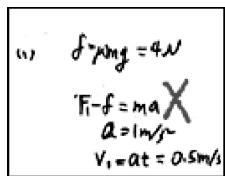  
图10

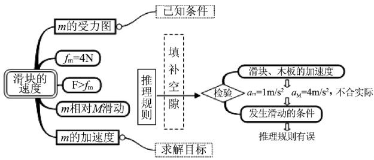  
图11

评析 ： 检验是解决问题过程的重要步骤 习题教学中教师要注重学生检验习惯的养成．运用思维导图将推理过程可视化 有利于校验推理的正确性 也有利于检查填补空隙的简洁性．同时 可视化的检验往往能发现原有认知结构中的各种成分的作用 不仅促进学生原有认知的重新建构 也为培养学生解决问题的习惯与能力指明了方向

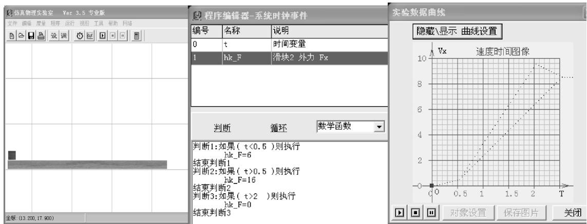  
图12

## 3 小结

基于奥苏伯尔解决问题理论的习题可视化教学应立足于习题情境 审题分析 综合推理 检查校验等方面的可视化．实验演示 审题流程图 自制教具 思维导图 仿真软件等工具在习题可视化教学中可以发挥重要作用．习题可视化教学可以增强课堂教学的直观性和趣味性 同时也使学生掌握了解决问题的基本思路 提高了习题教学的效果，提升了学生解决问题的能力

参考文献：

1 李万龙．可视化及其在地理教学中的应用［J］．中学地理教学参考，2013（9）：33－35．

2 邵瑞珍．学与教的心理学［M］．第1版．上海：华东师范大学出版社，1990：64－94．

3 张振新，吴庆麟．情境学习理论研究综述［J］．心理学，2005，28（1）：125．

（收稿日期：2017－10－25）

---

<!-- 存疑：以下“结束语+BOPPPS教学模式+参考文献1—8+收稿日期2017-11-03”疑为上一篇论文（BOPPPS教学模式相关）的结尾片段，被期刊版面挤入本论文起始页（PDF第1页底部），不属于本文。MinerU将其误并入正文，已移至此处保留备查，不删内容。 -->

## 3 结束语 <!-- 存疑：疑为上一篇论文标题 -->

BOPPPS教学模式将课堂教学分成了6大模块，其实践性与可操作性都非常强．对于刚踏上讲台的新教师而言，BOPPPS教学模式涵盖了有效课堂教学的重要环节，可以让他们迅速掌握如何充分发挥学生主观能动性，条理化、合理化地展开课堂教学，而不会再因为紧张而一味地对学生“满堂灌”；对于教学经验丰富的资深教师而言，BOPPPS教学模式则提供了一种自我审视的途径，为其改进教学设计、改善教学效果提供了一种新的思路和理论指导．

同时有必要指出的是，笔者通过探索与实践发现，BOPPPS教学模式本身只是一种教学理念，它给出了一种课堂教学设计的框架，在实际教学过程中应该根据不同的教学课程、不同的教学内容、不同的教学设备、不同的教学对象等对BOPPPS模式的每个模块进行适当地调整，而不是死搬硬套．应用BOPPPS教学模式的目的正是希望通过将课堂有机分解，使之更适合学生的认知心理，提升学生学习的参与度，从而提高教学效果，实现多元化教学目标．

参考文献 <!-- 存疑：以下为上一篇论文（BOPPPS）的参考文献 -->

1 曹丹平，印兴耀．加拿大BOPPPS教学模式及其对高等教育改革的启示［J］．实验室研究与探索，2016，35（2）：196－200．

2 Janice B. Johnson, etc. Instructional Skills Workshop Handbook For Participants［M］. OSW Advisory Committee, 2006.

3 王晶莹．美国探究教学模式评述［J］．上海教育科研，2010（4）：61－63．

4 陈卫卫，鲍爱华，李清等．基于BOPPPS模型和问题驱动教学法培养计算思维的教学设计［J］．工业和信息化教育，2014（6）：8－11．

5 罗兆华．施教为学，促进建构［J］．物理教师，2004，25（10）：3－5．

6 刘玲玉．基于BOPPPS模型的翻转课堂“微课”设计探索［J］．时代报告（学术版），2014（9）：169－171．

7 洛林·安德森．布鲁姆教育目标分类学［M］．蒋小平等，译．北京：外语教学与研究出版社，2009．

8 阮华．每一位学生都可以成为研究者［J］．物理教师，2015，36（8）：67－69．

（收稿日期：2017－11－03） <!-- 存疑：疑为上一篇论文的收稿日期 -->

<!-- /存疑 -->