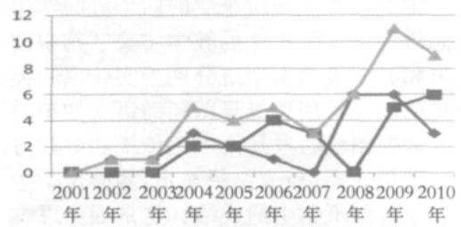
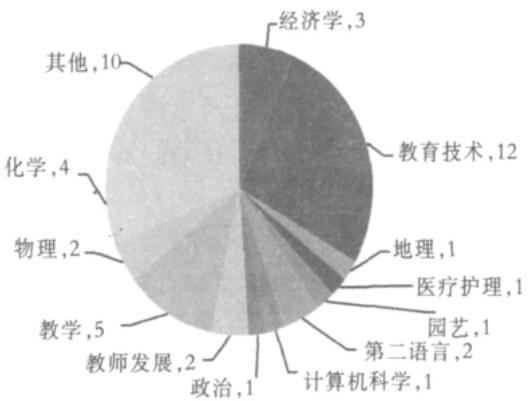
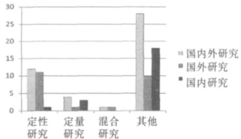

> 来源：MinerU 转换（stem-exact rebuild 2026-08-08）

# 2001—2010 年中外思维导图教育应用研究综述

张海森

（对外经济贸易大学 多模态语言工程实验室 北京 100069）

摘要：本文旨在通过探究过去十年（2001- 2010年）中外思维导图教育应用研究现状，为我国教育界学者和教育实践者更为清晰地了解思维导图的教育应用的实践奠定基础，并藉此为思维导图的未来研究提供一些建议 基于对中外两个著名学术数据库关于思维导图教育应用学术论文的检索，本文综述了中外学者在思维导图的教育应用学科领域 采用的研究方法 重点关注的研究主题以及所得出主要研究结论等几个方面的问题，最后对本研究的局限性和未来研究的方向进行了说明

关键词：思维导图；教育应用；信息表征；知识可视化

中图分类号：G434

文献标识码：A

## 一、 引言

思维导图的教育应用起始于上个世纪 60 年代初期[1] 用于信息处理 即将信息加以归纳和综合 辅助人们思考复杂问题和表征信息[2] 思维导图使用者将信息表征工具 包括图片 图形 词语等 加以组合运用 通过呈现概念之间的层次关系[3]和思维顺序关系[4] 实现概念表征的可视化 这种可视化能够使使用者从一种全局和整体的视角思考问题 进而能够提高使用者的思维灵活性[5]和发散思维能力[6] 思维导图的教育应用被认为有助于教师和学习者在思考过程中 以一种可视化的方式 创造性地探索 修正和总结某一学习问题的想法[7] 它的应用有助于增强记忆力 提高学习效率和创造性地解决学习过程中的问题[8] 正像 Lewis 和 Landale 所言 思维导图使教师和学习者 通过有助于视觉感官刺激的关键词 符号 颜色和联想意象等 增强记忆力 进而有助于提高教学和学习的效率[9] 用思维导图的创始人 Buzan的话来讲 “利用思维导图 你可以有效地提高记笔记的效率 提升你的记忆力 增强你的创造力 并使你做事时充满乐趣” [10]

近年来 思维导图作为一种可视化教学辅助工具[11] [12]业已引起中外学者的广泛关注 学者们不仅探索思维导图的内涵 同时也将其应用于不同学科教学之中 本研究的目的在于通过揭示思维导图教育应用的研究现状 探究过去十年（2001-2010 年）中中外学者在思维导图的教育应用学科领域 采用的研究方法 重点关注的研究主题以及所得出主要研究结论等几个方面的问题 为我国教育界学者和教育实践者更为清晰地了解思维导图的教育应用的实践奠定基础 并藉此为思维导图的未来研究提供一些建议。

为达到此目的 本研究重点回答如下三个问题（1）思维导图主要在哪些学科领域得到了应用？ （2）以往的研究采用了哪些研究方法？ （3）这些研究主要关注了哪些问题并得出哪些结论？

## 二、 研究方法

## 1. 论文样本及数据库的选取

根据本研究的目的 研究论文样本分为两类 中文学术性研究论文和外文学术性研究论文 外文学术性研究论文在本文中是指以英语为撰写语言的论文 论文样本的选取遵循如下标准 （1）论文源于国际和国内有影响力的学术数据库 （2）论文的发表时间限定于 2001-2010 年间 （3） 论文的语言为中 英文两类 （4）论文检索基于论文关键词进行

中文学术论文源自于中国知网（CNKI）的中国期刊全文数据库 在论文检索时 限定论文检索期刊为教育类（教育理论与教育管理 学前教育 初等教育 中等教育 高等教育 职业教育和成人教育与特殊教育）核心期刊 外文学术论文源于国际上以收录教育类期刊著称的 ERIC （Education Resources In-formation Center）数据库 该数据库被称之为世界上最大的在线教育文献数字图书馆[13] 可见 从这两个数据库检索到的思维导图论文 在一定程度上可以代表所限定年代学术研究的最新成果

论文收集分为两个步骤 第一 外文文献的收集 首先 通过大学图书馆登录 ERIC 数据库 然后按照本研究确定的论文检索标准 对相关检索指标进行相关设置 在检索时 检索词分别使用“mindmapping” “mind maps” 和 “mind map” 确保在最大程度上提高思维导图论文的覆盖率

中文相关期刊的检索过程与外文期刊类似 检索关键词为“思维导图” 为了确保期刊论文的代表性 本研究在论文选取范围上 选取了“核心期刊”因为核心期刊论文被普遍认为其质量高于非核心期刊的论文的质量 因此其代表性高于非核心期刊的论文

从论文选取过程可以看出 中外文期刊的选取采用了同一标准 这样能够使得学术论文的可获得性保持了一致 与此同时 基于数据库的论文选取不仅使论文的选取具有客观性而且还有助于未来的验证性复制研究 （ Replication Study ） [14] 。

## 三、 研究结果与讨论

## 1.最近十年思维导图教育应用研究的论文发表情况

思维导图的教育应用研究已有数十年的历史，但就最近十年的论文发表情况来看，这方面的研究凸显其日渐活跃的趋势。从数量上来看，各年度发表的数量不一，但呈曲折上升趋势（见图 1）。具体来讲，这段时间的论文总发表量为 45 篇，其中 23 篇为国外发表的论文，占全部论文的 51.1%；22 篇为国内核心期刊发表的论文，占全部论文总量的 48.9%。从年度发表的论文总量来看，2009 年有 11 篇，为年度最多（24.4%），而 2001 年最少，发表篇数为零。相比较而言，国内的相关研究在 2001—2002 年间以及 2008 年度无相关论文发表，国外分别在 2001 年和 2007 年也无相关论文发表。从年度发表的趋势来看，国内相关研究与国际上相关研究在各年度的论文发表分布及趋势基本上相同。

  
图 1 思维导图教育应用研究论文的年度分布及趋势

从文献的分析来看 出现思维导图教育应用研究数量较少以及年度论文短缺的原因可以归为思维导图的术语问题和本研究的检索限制 “思维导图这一术语与另外一个术语‘概念图’在多数文献中经常互换使用 只是近些年来 学者们倾向于使用 ‘思维导图’这个术语”[15] 可见 如果将本研究的检索限制扩大涵盖“思维导图”和“概念图”两个检索词 本研究的样本会大大增加[16] 之所以没有如此操作是因为 “思维导图”和“概念图”界定的等同性或差异性尚未形成一种一致的看法 例如 赵国庆和陆志坚认为 “概念图和思维导图有着紧密的联系 但又有着潜在的不同 ”[17] 他们的这一观点同样得到了Wheeldon[18]的认同 他认为 虽然二者都是与经验知识 知觉和记忆视觉表征的意义相关联 但它们之间存在着显著的差异 概念图是一种组织和表征知识的图形工具 其涉及独特的概念 通常这些概念呈现在圆圈或方块图形中 概念之间的线段和连接词表示一种层级关系 相比较而言 尽管思维导图也是一种图形 但其在表征词 想法 任务等时 往往与一个核心词或想法相连接并围绕这个核心词或想法放射性地展开 内容的结构安排更具有灵活性 杨凌对二者的差异做了更为全面地剖析 从定义上看 前者注重的是建构的过程 而后者则注重的是建构的结果 从知识表征的方式来看 前者呈现的是一个知识网络 而后者呈现的是一个思维过程 从创作的方法上看 前者重在建立概念之间的关系 而后者则是重在建立一个基于核心词或想法有序的意义图形[19]简而言之 “就核心概念而言 ‘思维导图’ 只有一个核心概念 而‘概念图’却可包含多个核心概念 从内容表征的结构上看 前者呈树形等级结构形状 而后者则呈现一个意义表征网络”[20] 以上观点也同样得到了 Ahlberg[21]的认同 认为二者之间存在着截然的不同 当然 也有学者提出不同看法 D' Antoni,Zipp & Olson 认为 作为一种认知工具 二者不存在差别 唯一不同的仅仅是信息组织方式的不同[22] 黎加厚在接受一次访谈时也谈到 所有用图示方法来表征想法的工具都可称为 “概念图”[23] Lloyd Boyd和 Exter[24]也认为 尽管二者存在某种差异 但“思维导图”只不过是“概念图”的一种形式而已。 Lanzing,Stoyanov, & Kommers 则对这两个词语不加区分 认为二者为同义词[25] 可见 关于二者是应“合二为一”还是“一分为二”在学术界仍一直存在着争议 故而本文的研究中未将这两个概念混为一谈

## 2. 思维导图研究涉及的教育学科领域

思维导图的教育应用涉及多个学科 但从统计结果来看 应用最多的前三个学科为教育技术学 数学和化学 从论文数量上看 关于教育技术学科的应用最多 为 12 篇 占总数的 27% 数学学科的应用为 5篇 占总篇数的 11% 化学学科的应用为 4 篇 占总篇数的 9% 其他学科的应用则较为分散（见下页图 2）

从学科应用的特征来看 尽管思维导图可以应用于不同学科以及不同教育水平学习者的学习过程之中[26] 但过去十年的思维导图应用研究表明 这一认知工具更多地用于提高学习者的认知能力 即通过相关课程 如我国的“信息技术基础”“数学”和“化学”等课程以及国外的 Science 等课程 提高学习者对教学内容的理解力和学习效率 从思维导图教育学科应用的使用者来看 这一认知工具的应用有赖于思维导图教育应用推动者的技术敏感度和教学创新的自我驱动力 从文献的分析来看 教育技术学科的教师更有意愿尝试将新兴技术作为提升教学效率的手段 与此同时 他们的教学创新自我驱动力也比较强 因为这些教师所进行的教学创新是在非制度性激励条件下进行的 出自于个人的自主行为 因此 这些教师在教育创新采纳中常常会成为技术采纳的领跑者 正像 Rogers 所言 他们能够起到领跑技术采纳的作用[27]

  
图2 思维导图的教育学科领域应用分布及篇数

## 3. 思维导图教育应用研究所采用的研究方法

在学术研究中，研究方法至关重要，而这种重要性体现在研究方法的科学性上。“科学研究的方法应体现实证研究结果的标准和过程，证明所得出的结论与现实世界正在发生或已经发生的事情相吻合”［28］。“实证”意味着所得出的研究结论应基于现实世界的数据，而非基于个人逻辑推理或思辨所得出的结论［29］。从研究设计来看，研究方法可分为定性、定量和混合研究方法三种类型［30-31］。根据这三种分类，本研究对过去十年的思维导图教育应用研究所采用的研究方法进行了统计分析（见图 3）。

  
图3 思维导图教育应用研究方法统计图

总的来看 思维导图的教育应用研究方法已经突破了个人思辨性的传统研究方式 基于科学研究方法的研究业已初露端倪 从统计来看 个人思辨性的论文占总数的 62.2% 定性研究占 26.7% 定量研究占 8.9% 混合性研究占 2.2% 从国内外研究分别来看 国内研究的思辨性研究（40%）多于国外的类似研究 （22.2% ） ； 国外的定性研究 （24.4% ） 多于国内定性研究（2.2%） 但国内定量研究（6.7%）多于国外的定量研究（2.2%）

## 4. 思维导图研究关注的问题及主要结论

思维导图的信息表征具有发散性[32] 非线性结构化[33-35]和整体性的 （ Holistic ） [36]特点 便于信息的组织 并使信息可视化 因此便于信息的加工[37] 由于这一工具的认知功能与人类大脑的认知功能相类似[38][39] 因此有助于信息的储存和提取 进而有益于教学和学习效率的提升 纵观过去十年的思维导图研究 研究者主要关注了如下三个方面的问题

第一 思维导图应用的学科教学有效性问题Abi-El-Mona 和 Adb-El-Khalick[40]在 8 年级的科学课上开展了一项采用思维导图和采用传统笔记总结方法学习科学概念的比较实验 他们把 62 名学生随机分为实验组和控制组 实验组的学生接受思维导图使用的培训 并使用这一认知工具帮助理解科学概念 控制组的学生通过传统的笔记总结法学习科学概念 并将完成学习任务的时间作为干扰变量研究结果表明 实验组的概念理解成绩显著高于控制组 其研究发现 中心概念描述 主要和次要概念之间的联系描述以及有效地使用颜色来表征概念有助于对所学概念的理解 Ismail, Ngah 和 Umar[41]的研究表明 以思维导图作为协作学习工具有助于计算机专业的学生提高他们的编程能力和解决问题能力 以及提升元认知水平 林建才 董艳和郭巧云[42]在针对新加坡一所小学的语文写作教学中也得出了积极的结论 他们选择了一所小学的四个班的学生进行了利用思维导图学习中文的教学实验 其中四年级的两个班和五年级的两个班分别为实验班和控制班 实验班的教师采用思维导图辅助语文知识与技能的教学 而控制班的教师则采用传统的讲授方法讲授同样的教学内容 研究结果显示 实验班学生的成绩显著高于控制班学生的成绩 这是因为思维导图的应用提高了学习者的学习兴趣 抽象知识概念变得可视化 方便了对所学知识的加工 因此能够帮助提高学习者的理解力和记忆力 张怡天 陆真邹正和沈书君[43]利用思维导图提高中学生化学解决能力的定量研究中也验证了思维导图在教学中的良好效果 另外 在 Eriksson & Hauer[44]的一项利用思维导图培养学生的市场营销技能的定性研究中发现 教学中使用思维导图有助于激发学生的学习兴趣 提高他们的学习主动性和对所学内容的专注度其他一些研究者的研究也都对这一认知工具在提升教学效率的作用方面给予了肯定[45-49]

第二 思维导图的辅助教学设计问题 思维导图被认为是“一种出色的 e-Learnin 工具 可以有效地组织和导航网络内容和文档 [50] 由 C l 和W ll [51]开展的一项英国开放大学的研究证明 思维导图可以作为一种有效的教学设计支持工具 帮助设计者实现预期目标 他们认为 思维导图是一种方便教学设计者使用 有助于组织和表现设计内容的工具 更重要地是 这种工具使设计者之间在设计过程中能够有效地分享和研讨设计思路 Thorpe[52]采用定性和定量相结合的研究方法 利用思维导图研究了一门在线课程的设计问题 指出思维导图能够以一种可视化的方式表征一系列学习任务的设计它不仅可以清晰地表征一项特别任务的序列 同时还可以表征具有类似结构的任务群 这种任务的表征方式可以使设计者以宏观和全局的视角把握设计内容 并且根据不同的情景和不同的教学目标实现学习任务 情景和目标的完美结合 魏小山和袁健[53]在高中信息技术课程的教学设计实践应用研究中也认为 思维导图作为教学设计工具是一种有效的教育技术手段 有助于激发学生参与教学活动 有利于学习者之间实现对所学知识的共同建构

第三 思维导图作为教学策略的问题 思维导图作为一种认知工具不仅可以帮助学生提高学习效率[54] 同时作为一种教学策略也可以提高教学效率Zipp, Maher 和 D' Antoni[55]将思维导图作为一种称之为 “思维导图学习方法 ” （Mind Mapping LearningTechnique）的教学策略应用于培养学生的批判性思维能力 其研究表明 这种教学策略的应用能够帮助学生有效地组织 优化和整合学习内容 何露也认为 “思维导图作为一种教学策略 能有效地改变学生的认知方式 特别对化学这门课来说 思维导图能帮助学生将零散的化学知识结构化 条理化和系统化 从而提高学生的学习热情与学习效果 ”[56]Goodnough & Long[57]的研究也表明 思维导图作为一种教学策略不仅能够激发学生的学习热情和兴趣 与此同时还能够使他们利用图形和色彩表达自己的想法

## 四、 结论

综合以上研究 可以看出 ： （1）中外思维导图的教育应用研究总量呈逐年上升的趋势 但学科应用分布差异较大 （2）从研究方法来看 研究者已经超越个人教学经验总结性及思辨性的研究方式 定性定量或二者相结合的研究方法已经得到了初步的采用 （3）从研究的问题来看 研究者更多关注思维导图的教学应用效果 辅助教学设计以及教学策略应用等三个方面的问题 （4）从研究结论来看 思维导图能够帮助学习者实现学习内容图式化 思维过程可视化以及零散知识点的一体化 有助于激发学习者学习动机 辅助学习者理解学习内容 因此对提高教学效率具有积极的意义

本研究是对思维导图教育应用的文献回顾 未来研究可以扩大语种文献检索范围 探究中 英文文献以外相关研究的最新进展 除此 可在检索词中涵盖“思维导图”和“概念图”两个关键词 从更为广泛的视角 研究其教学应用的潜在价值 另外 还可以在不同教育层次中的不同学科中 特别是在大学教育学科领域 如大学英语课程的词汇 阅读 写作等方面教学中 采用定性 定量或混合式研究方法 开展实证性应用研究

## 参考文献:

[1] Buzan, T., & Buzan, B. The mind map book: how to use radiant thinking to maximize your brain ’ s untapped potential [M]. New York: Penguin press ， 1993.

[2][3][15] Warwick, P., & Kershner, R.. Is there a picture of beyond? Mind mapping, ICT and collaborative learning in primary science[C]. Warwick, P. Wilson, E., & Winterbottom M.Teaching and learning primary science with ICT[A]. Berkshire, England: Open University Press,2006: 108-127.

[4][6][17] 赵国庆 ， 陆志坚.“概念图 ”与 “思维导图 ”辨析[J]. 中国电化教育, 2004, (8): 42-45.

[5] Mento, A. J., Martinelli, P. & Jones, R. M. Mind mapping in executive education: applications and outcomes [J]. Journal of Management Development, 1999,18(4): 390-407.

[7] Dymoke,S. . An overview of learning[C] .S. Dymoke and J. Harrison .Reflective teaching and learning: A guide to professional issues for beginning secondary teachers[A]. London: Sage,2008. 45-68.

[8] Prashnig, B. The power of diversity: new ways of learning and teaching through learning styles[M]. Stafford, UK: Network Educational Press, 2004.

[9] Lewis, C., & Landale, A. The Extraordinary Reader [M]. Berkshire, UK: Vale House Press, 2007.

[10] Clawson, J. G. S., & Haskins, M. E. Teaching management: a field guide for professors, and corporate trainers [M]. Cambridge, England: Cambridge University Press, 2006.

[11] Young, L. E., Maxwell, B., Paterson, B. L., & Woff, A. Decision making in nursing education: a model to support student-centered learning[C].L. E. Young and B.L. Paterson .Teaching nursing: developing a student-centered learning environment [A]. Philadelphia, PA: Lippincott Williams & Wilkins, 2007.26-55.

[12] Selby, H. Advocacy: preparation and performance [M]. Sydney,

NSW: The Federation Press, 2009.

[13] The Pennsylvania State University. ERIC DATABASE-Educational Resources Information Center [DB/OL]. http://www. libraries.psu.edu/psul/ebsl/special\_topics/eric.html

[14] Geuens, G.Where does business research go from here? Food-forthought on academic papers in business research [J]. Journal of Business Research,2010,(11):5-9.

[16] Nesbit, J. C., & Adescope, O. O. Learning with concept and knowledge maps: A meta-analysis[J]. Review of Educational Research, 2006,(76): 413-448.

[18] Wheeldon, J. Mapping mixed methods research: methods, measures, and meaning [J]. Journal of Mixed Methods Research, 2010, 4(2): 87-102.

[19] 杨凌. 概念图、思维导图的结合对教与学的辅助性研究[J]. 电化教育研究, 2006, (6): 59-61.

[20] Lanzing, J. Everything you always wanted to know about Concept Mapping[C].P. A. M. Kommers. Conceptual support systems for learning[A]. Amsterdam: IOS Press, 2004.47-72.

[21] Ahlberg, M. Concept mapping as an innovation: documents, memories and notes from Finland, Sweden, Estonia and Russia 1984-2008.[DB/OL]. http://cmc.ihmc.us/cmc2008papers/ cmc2008-p288.pdf.

[22] D' Antoni, A. V., Zipp, G. P., & Olson, V. G. Interrater reliability of the mind map assessment rubric in a cohort of medical students [J]. BMC Medical Education, 2009,9(19): 1-8.

[23] 齐伟.与黎加厚教授谈概念图[J].信息技术教育,2003, (9): 34-36.

[24] Lloyd, D., Boyd, B., & Exter, K. Mind mapping as an interactive tool for engaging complex geographical issues[J] . New Zealand Geographer, 2010,66(3): 181 188.

[25] Lanzing, J.W.A., Stoyanov, S., Kommers, P.A. M. Concept mapping as a tool and method for generating, detecting and implementing new ideas[C].B. P. L. M. den Brinker, P. J. Beek, A. N. Brand, F. J. Maarse, & L. J. M. Mulder. Cognitive ergonomics, clinical assessment, and computer-assisted learning [A]. Lisse, The Netherlands: Swets & Zeitlinger, 1999.90-103.

[26] Payne, T., & Turner, E.Dyslexia: A parents' and teachers' guide [M]. Clevedon, England: Multilingual Matters, 1999.

[27] Rogers, E. M. . Diffusion of innovations (4th ed.) [M]. New York: Free Press, 1995.

[28] Cuff, E. G., & Payne, G. C. E. Perspectives in sociology [M]. London: Allen & Unwin, 1979.

[29][30] Punch, K. F. Introduction to research methods in education [M]. London: Sage, 2009.

[31] Creswell, J. W. Research design: qualitative, quantitative, and mixed method approaches [M]. Thousand Oaks, CA: Sage, 2003.

[32] Taylo, R., & Humphrey, J. Fast track to the top: 10 skills for career success [M]. London: Kogan Page, 2002.

[33] 蔡铁权,叶梓.思维导图在社会性科学议题教学中的应用[J]. 教育科学研究, 2009, (12) ： 52-55.

[34][45] 张武威 黄宇星.“思维导图”应用于“物理解题”的探究[J]. 电化教育研究 ， 2009, (9) ： 97-101.

[35][46][50] Ruffini, M. F. Using e-maps to organize and navigate online content [J]. EDUCAUSE Quarterly, 2008,(1): 56-61.

[36] Karnes, F. A., & Bean, S. M. Leadership for students: a practical guide for ages 8-18 [M]. Woco, TX: Profrock Press, 1995.

[37] Lewis, C., & Landale, A. The extraordinary reader [M]. Berkshire,

UK: Vale House, 2007.

[38] Jonassen, D. H., Beissner, K., & Yacci, M. Structural knowledge: Techniques for representing, conveying, and acquiring structural knowledge [M]. Hillsdale, NJ: Lawrence Erlbaum Associates, 1993.

[39] Gentry, T. A., & Wakefield, J. A. Methods for measuring spatial cognition[A].D. M. Mark and A. U. Frank.Cognitive and linguistic aspects of geographic space [C]. Dordrecht, the Netherlands: Kluwer Acadmic Publishers, 1993.185-217.

[40] Abi-El-Mona, I., & Adb-El-Khalick, F. The influence of mind mapping on eighth graders' science achievement[J]. School Science and Mathematics, 2008 108(7): 298-312.

[41] Ismail, M. N., Ngah, N. A., & Umar, I. N. The effects of mind mapping with cooperative learning on programming performance, problem solving skill and metacognitive knowledge among computer science students[J]. Journal of Educational Computing Research, 2010 42(1): 35-61.

[42] 林建才 董艳 郭巧云. 思维导图在新加坡小学华文教学中的实验研究[J]. 中国电化教育 ， 2007, (10) ： 65-68.

[43] 怡人天 陆真 邹正 沈书君. 应用思维导图提高学生化学问题解决能力——化学教学转型探索之行动研究报告[J]. 中学化学教学参考,2010,(5) ： 12-14.

[44] Eriksson, L. T., & Hauer, A. M. Mind map marketing: a creative approach in developing marketing skills[J]. Journal of Marketing Education, 2004, 26(2): 174-187.

[47] 吴志丹. 协作建构思维导图在数学复习课中的应用探究[J]. 电化教育研究, 2010.(7) ： 108-110.

[48] 何赛平. 思维导图应用于信息技术复习课的实践探索[J]. 中国电化教育,2009, (7) ： 99-102.

[49] 陈敏. 思维导图及其在英语教学中的应用[J]. 外语电化教学,2005, (101) ： 36-41.

[51] Conole, G., & Weller, M. Using learning design as a framework for supporting the design and reuse of OER[J]. Journal of Interactive Media in Education, 2008, （5 ）: 1-13.

[52] Thorpe, M.Effective online interaction: Mapping course design to bridge from research to practice[J]. Australasian Journal of Educational Technology, 2008 24(1): 57-72.

[53] 魏小山 ，袁健. 协作构建思维导图在信息技术课堂中的应用[J].中国电化教育 ， 2007, (9) ： 85-88.

[54] Futrell, R. T., Shafer, D. F., & Shafer, L. Quality software project management[M]. Upper Saddle River, NJ: Prentice Hall 2002.

[55] Zipp, G. P., Maher, C., & D' Antoni, A. V. Mind Maps: Useful schematic tool for organizing and integrating concepts of complex patient care in the clinic and classroom[J]. Journal of College Teaching & Learning, 2009 ， 6(2): 59-68.

[56] 何露. 利用思维导图提高化学教学的有效性[J]. 教学导刊 ，2009,(12) ： 47-49.

[57] Goodnough, K., & Long, R.Mind Mapping: A graphic organizer for the pedagogical toolbox[J]. Science Scope, 2002 ， 25(8): 20-24.

## 作者简介：

张海森，博士，副教授，硕士生导师，研究方向为新兴技术的外语教育应用、现代技术环境下的教师发展、数字化外语课程研发等（haisenzhang@uibe.edu.cn）。

誅收稿日期：2011年3月22日责任编辑：马小强
