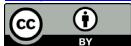

# 思维可视化工具助力高阶科学思维培养——以《牛顿第一定律》教学设计为例

徐 萌

杭州师范大学物理学院，浙江 杭州

收稿日期：2026年4月23日；录用日期：2026年5月21日；发布日期：2026年5月28日

## 摘 要

随着新课程改革的推进，高中物理教学越来越注重学生科学思维的培养。思维可视化作为一种将抽象思维具象化的教学手段，在培养学生高阶科学思维方面能够发挥重要作用。而现阶段的思维可视化研究以知识网络构建为导向，主要聚焦概念图、思维导图等结构表征，虽有效促进了知识体系的显性化，但未能深入触及科学思维的本质内核。本文旨在突破知识表征的单一维度，探讨如何通过思维可视化教学培养高中生的科学思维，进一步挖掘思维可视化工具在帮助学生将思维过程显性化、暴露思维路径、提升科学思维品质中能够发挥的作用，并通过设计具体的教学案例为后续的教学实践提供参考。

关键词

高中物理，科学思维，思维可视化，教学设计

# The Thinking Visualization Tool Helps to Cultivate High-Level Scientific Thinking —Taking the Teaching Design of “Newton’s First Law” as an Example

Meng Xu

School of Physics, Hangzhou Normal University, Hangzhou Zhejiang

Received: April 23, 2026; accepted: May 21, 2026; published: May 28, 2026

## Abstract

With the advancement of the new curriculum reform, high school physics teaching pays more and more attention to the cultivation of students’ scientific thinking. As a teaching method that concretizes abstract thinking, thinking visualization can play an important role in cultivating students’ high-level scientific thinking. At the present stage, the research on thinking visualization is guided by the construction of knowledge network, mainly focusing on the structural representation such as concept map and mind map. Although it effectively promotes the explicitation of knowledge system, it fails to deeply touch the essential core of scientific thinking. This paper aims to break through the single dimension of knowledge representation, explore how to cultivate high school students’ scientific thinking through thinking visualization teaching, further explore the role of thinking visualization tools in helping students to make the thinking process explicit, expose the thinking path, and improve the quality of scientific thinking, and provide reference for subsequent teaching practice by designing specific teaching cases.

## Keywords

High School Physics, Scientific Thinking, Thinking Visualization, Teaching Design

Copyright © 2026 by author(s) and Hans Publishers Inc.   
This work is licensed under the Creative Commons Attribution International License (CC BY 4.0). http://creativecommons.org/licenses/by/4.0/

Open Access

## 1. 引言

## 1.1. 科学思维培养的重要性与内涵

教育部印发的《普通高中物理课程标准(2017年版2025 年修订)》中明确指出“科学思维”是物理学科核心素养的四大核心维度之一，使学生形成“基于证据的推理能力、模型建构的系统思维、批判创新的认知品质”。科学思维涵盖“模型建构、科学推理、科学论证、质疑创新”四大要素，其培养目标直接呼应《中国学生发展核心素养》中“学会学习”与“实践创新”的要求，要求学生在解决真实物理问题时，能够基于观察提出物理问题、通过抽象概括形成物理概念与规律，这超越了传统教学中对公式记忆与计算技能的片面追求，指向物理学科本质的思维建模过程。

思维是智力与能力的核心，思维品质是学生思维能力高低的反映，培养思维品质是“发展智能的突破口”[1]，同时又是落实核心素养、促进深度学习的必然路径。在全球科技创新竞争背景下，科学思维作为“可迁移的认知工具”，直接影响学生处理不确定性问题的能力，这与我国“强基计划”对拔尖创新人才思维品质的要求高度契合。因此，注重科学思维的培养以提升学生的思维品质，对学生的发展具有至关重要的意义。

## 1.2. 学科特征与现实困境

高中物理知识体系具有抽象性与逻辑严密性，传统教学中，学生常因无法具象化物理过程而形成思维断层，导致科学思维发展受阻。

以科学思维中的“模型建构”为例，课程标准要求“从实际问题中抽象物理模型”，现阶段高中学生的建模能力较弱，且在理解和建构物理模型方面存在诸多问题。实际教学实践中，学生对模型的应用存在两极化倾向：将模型建构简化为“题型归类”(如“滑块木板模型 = 动量守恒”)，或脱离情境讨论理想化模型(如质点、点电荷)的数学特性。这种割裂导致学生面对真实情境(如体育运动中抛体轨迹分析)时，模型迁移应用能力薄弱。

这种矛盾还表现在思维过程隐匿化，导致教学反馈脱节，即科学推理、科学论证、质疑创新的思维过程无法直观表现。大多教师主要通过习题正确率判断学生思维水平，但这种方式无法捕捉推理中的逻辑断裂点。例如，在牛顿运动定律应用中，学生常混淆“力的瞬时效应”与“运动过程积累”，此类思维漏洞在传统纸笔测试中难以暴露。

## 1.3. 以思维可视化策略作突破

近年来，思维可视化作为一种创新的教学策略，逐渐受到教育研究者的关注。思维可视化的概念从知识可视化的概念中催生，主要聚焦于思维可视化的培训方法、思维工具作为学习策略的应用，以及如何通过思维工具开发学习者的脑力等方面，其研究重点在于探索有效的“工具”与“方法”[2]。

思维可视化能够将原本隐藏在学生头脑中的思维过程外显化，使教师能够直观地观察到学生的思考路径，及时发现学生思维中的问题并给予指导。同时，学生也能通过可视化工具清晰地看到自己的思维过程，从而更好地进行自我反思和调整。

2012至 2025年间，我国思维可视化与物理教学结合的研究不断增多，高频词汇有：思维导图、概念图、流程图等工具应用。现有研究仍缺乏与科学思维要素的系统关联。现阶段的思维可视化研究主要以知识网络构建为导向，聚焦概念图、思维导图等结构表征，虽有效促进了知识体系的显性化，但仍然未能深入触及科学思维的本质内核。在教学实践中存在教师在使用工具时局限于使用“思维导图”、仅梳理知识结构的现象，未能有效促进学生思维的发展。

## 2. 思维可视化理论概述

## 2.1. 概念界定

思维可视化(Thinking Visualization)是指通过图形、符号、模型或数字技术等媒介，将个体内隐的思维过程、逻辑关系及知识结构外显为可观察、可操作的可视化表征形式的过程。其本质是通过显性化工具(如思维导图、流程图等)或技术手段(如虚拟仿真、动态建模等)，将抽象思维转化为具象表达，从而降低认知负荷，促进深度理解与高阶思维发展。

在理论建构上，刘濯源老师提出了“隐性思维显性化”理论，指出思维可视化是借助特定的技术和手段，将原本抽象且难以察觉的思维过程(包括思维路径和方法)清晰地呈现出来，强调通过图示技术外显思维过程，推动思维可视化与学科教学的融合[3][4]。

多年来思维可视化工具在国外教育领域得到了充分发展。现阶段，国内使用较多的思维可视化工具主要包括思维导图、概念图以及赵国庆教授总结的八大思维图示法[5]。这些工具有各自的使用场景和着力点，在课堂实践中需与具体学科的知识相结合。

## 2.2. 应用于科学思维发展的策略讨论

在新课标中将科学思维定义为“从物理学视角认识客观事物的本质属性、内在规律及相互关系的方式，是基于经验事实建构物理模型的抽象概括过程，是分析综合、推理论证等方法在科学领域的具体运用”。思维可视化工具既可以作为学习工具(辅助知识建构与思维发展)，也可以是评价工具。

思维可视化工具的应用需紧扣物理学科特征和科学思维发展规律，我们可以通过针对“模型建构、科学推理、科学论证”三大要素，来论证其在物理与科学教育中的应用价值及应用策略。

## 2.2.1. 模型建构

物理学科高度依赖模型化思维，学生需将复杂现象抽象为可分析的物理模型。思维可视化可以为发展科学建模能力提供支撑。一方面通过思维可视化工具将建模过程(如假设提出、变量分析、模型验证)分阶段外显，使学生能够清晰识别问题本质，掌握“抓主要因素、忽略次要因素”的建模策略。同时，学生通过分支结构分析不同模型(如质点模型、刚体模型)的应用场景，结合思维导图的动态延展性，从中心主题(如“自由落体模型”)发散至具体案例(如有初速度与初速度为 0、多阶段运动过程等)，深化对模型本质的理解，帮助学生快速定位模型适用边界。

## 2.2.2. 科学推理

科学推理强调思维的逻辑性和探索性，其核心是将理论与实证相结合，通过逻辑思维方法对现象进行分析与验证[6]，不仅包含传统的归纳、演绎、类比推理，还涉及控制变量、因果推理、概率推理等复杂形式。有教师针对高中生物学科指出，使用流程图引导学生分布推导和使用复杂流程图展示复杂问题的多路径推理，可帮助理清问题解决中的思维过程[7]。在物理学科中，可以以科学探究和科学问题解决过程作为框架流程和引导，强化逻辑链条的直观性。

## 2.2.3. 科学论证

科学论证则需基于证据与逻辑推理构建严谨的主张体系，包含基于事实证据提出科学主张、通过逻辑推理进行论证与反驳等。学生需在复杂情境中提取有效证据(如实验数据或现象观察)，运用归纳、演绎或类比推理建立主张与证据的逻辑关联，并能在批判性思维驱动下审视论证的科学性与严谨性。

从支架式教学视角看，学生的科学论证能力并非自发形成，而是在外部支持下逐步内化。此时使用思维可视化工具，可为学生提供从经验性表达走向规范性科学论证的路径支持。如使用鱼骨图拆解科学论证过程后，引导学生在“问题情境”–“证据假设”–“逻辑推演”–“验证或结论”的分支结构中进行内容填充；又如使用 Toulmin 模型呈现“主张、证据、理由、支持、反驳”等要素，帮助学生更直观地发现自己的论证链条中是否存在证据不足、推理跳跃或反驳缺失等问题。

综上所述，通过尝试将思维可视化工具与学科内容的深度融合，结合动态化、互动性技术手段，可以探索提升学生科学思维品质、落实物理核心素养的实践路径。同时需要注意辨析思维工具与“概念图”的区别[8]，教师应避免将其简化为静态的知识整理工具，而应着力构建可视化过程与思维发展之间的互动反馈机制，提升“思维含量”，避免陷入“只梳理知识、不发展思维”的误区。

## 3. 教学案例设计

## 3.1. 设计思路

本课例设计聚焦于高中物理“牛顿第一定律”教学中学生模型建构能力的发展，并兼顾其科学推理能力的提升，探索动态词云与分层模板两类思维可视化工具在前概念诊断、模型抽象与推理外显中的应用机制。主要教学目标为突破“力是维持运动原因”的前概念迷思，建立“惯性”本质的科学认知。

## 3.2. 教学实施框架

## 3.2.1. 前概念显化阶段

教学活动：使用动态云图互动工具 Mentimeter，要求学生匿名提交对“静止的足球被踢出后为何最终停下？”和“太空中的飞船关闭引擎后会如何运动？”这两个问题的直觉回答，并收集学生反馈进行讨论评价。

教学策略：实时生成词频统计图，显示“摩擦力”“阻力”“自然停止”等高密度前概念词汇，通过词频云图暴露学生的迷思概念，掌握学生前概念水平，并将认知冲突可视化，对比学生初始推理与科学解释，制造和外显认知冲突。

## 3.2.2. 思维过程显化阶段

教学活动：介绍人类对力和运动关系的历史发展过程，对比亚里士多德和伽利略的观点，引导学生思考力和运动的关系。教师提供“现象–条件–变量–理想化处理–模型结论–适用边界”的分层模板，

引导学生分析“伽利略理想斜面实验”文本。学生标记事实描述、假设条件与推理结论部分，再进一步判断哪些因素应保留、哪些因素可忽略，从而逐步形成“若阻力趋近于零，物体将保持原有运动状态”的理想实验模型。

教学策略：提供思维模板分层组织信息，以降低认知负荷，帮助学生理清科学推理的关键路径，实现概念重构与转变。

教学活动：播放伽利略理想实验动画视频，请学生填写实验现象与对应的逻辑推理表格，如“随着摩擦力逐渐减小，小球最终到达的位置越来越接近等高线”推理出“如果没有摩擦，小球将能够到达原来的高度”。

教学策略：强化学生对理想实验条件下物理行为的理解，帮助学生建立物理模型，理解牛顿第一定律的初步模型。

教学活动：继续分析实验现象，如“随着右侧斜面越来越平缓，小球总是能够非常靠近等高线，运动距离越来越远”，并推理“当斜面最终变为水平面时，小球无法达到原来的高度，将永远运动下去”。

教学策略：引导学生进行科学推理，从实验现象中抽象出物理原理，进行科学论证，理解力与运动的关系，进一步理解惯性概念。

教学活动：总结实验，填写表格，得出“力不是维持物体运动的原因，物体会停下来是因为受到摩擦阻力的缘故”这一结论。

教学策略：通过填写表格完善学生的科学论证过程，促进其形成科学结论。

## 3.2.3. 教学评价阶段

通过学生的学案填写情况，从学生修改论证结构的次数与类型反馈思维路径，如从“摩擦力使物体停止”→“阻力改变运动状态”的表述迭代，反映从单向因果关系到多因素分析的思维扩展。要求学生用表情符号标注思维卡点，并记录解决策略(如“重新分析实验数据”)。

课后请学生以思维导图的形式上交课堂笔记，要求体现核心概念网络、实验证据链和推理论证的逻辑链，建立“观察→假设→建模→验证”的科学探究路径。

## 4. 总结与讨论

本研究中以《牛顿第一定律》为例，设计了通过思维可视化培养学生科学推理与模型建构能力的教学实施框架，包括前概念显化阶段和思维过程显化阶段的教学活动与策略。与以往将思维可视化主要用于知识整理不同，本文更强调其在模型建构与科学推理发展中的过程支持功能，旨在帮助学生实现从经验直觉到科学认识的转变。

词云软件在前概念显化阶段有一定的应用前景，不仅能够帮助教师了解学生的前概念和认知冲突，还能够促进学生的自我反思。学生在看到自己的回答和思维过程被可视化呈现时，能够更清晰地认识到自己的错误认知和思维漏洞。教师不仅能够据此快速识别学生的认知起点和共性误区，还能够借助高频词汇之间的关联外显认知冲突，为后续教学活动的针对性设计提供依据。从教学功能上看，词云工具的价值并不只在于收集答案，更在于将学生原有认知结构转化为可诊断、可反思的对象，从而增强课堂起始阶段的问题指向性。

分析物体运动状态改变的原因时，学生可以通过分层分析的方式呈现思考过程，理解物理模型不是对现实情境的简单复制，而是对关键因素进行筛选、抽象和理想化处理后的科学建构。由此，学生对牛顿第一定律的理解不再停留于结论记忆层面，而是逐渐形成“从现象出发–进行推理–建构模型–解释规律”的思维路径。

在教学评价中，通过思维导图，学生可以清晰地看到力、运动、惯性等概念之间的关系，从而更深入地理解牛顿第一定律的内涵。帮助学生梳理物理知识脉络，强化知识之间的内在联系，使学生在解决物理问题时，不再局限于单一知识点，而是能够从整体上把握物理概念与规律，实现知识的深层建构。

研究表明，在高中物理教学中，思维可视化工具的有效使用，关键不在于工具形式本身的新颖性，而在于其是否能够与学科核心思维任务形成匹配。不同的思维可视化工具有不同的特点和适用场景，比如概念图适用于呈现概念之间的层级结构和逻辑关系，思维导图则更侧重于激发学生的发散性思维。在物理教学中，教师应根据具体的教学内容和目标，选择合适的思维可视化工具，不仅要熟悉各种思维可视化工具的使用方法，还要能够根据学生的思维特点和学习需求，设计有效的教学活动和评价方式。

## 参考文献

[1] 焦满巧. 高中物理教学中培养学生深刻性思维品质的教学策略探讨与实践[D]: [硕士学位论文]. 南京: 南京师范大学, 2020.

[2] 赵慧臣, 王玥. 我国思维可视化研究的回顾与展望——基于中国知网 2003-2013 年论文的分析[J]. 中国电化教育, 2014(4): 10-17.

[3] 刘濯源. 基于思维可视化的优质课程资源开发策略[J]. 基础教育参考, 2016(23): 3-6.

[4] 刘濯源. 思维可视化: 减负增效的新支点[J]. 中小学管理, 2014(6): 10-13.

[5] 赵国庆. 别说你懂思维导图[M]. 北京: 人民邮电出版社, 2015.

[6] 廖伯琴, 李洪俊, 李晓岩. 高中物理学科核心素养解读及教学建议[J]. 全球教育展望, 2019(9): 12.

[7] 谭连桂. 浅析思维可视化工具在提高学生科学思维素养上的应用[J]. 中学生物学, 2021, 37(5): 13-16.

[8] 杨佳洁, 周海龙. 基于学科教学的概念图与思维导图辨析[J]. 教学与管理, 2018(9): 77-79.