# 物理实验的设计如何指向学生科学思维的培养

蒋 炜 波 王 宏 清 华 大 学 附 属 中 学 北 京 100084

摘 要 科 学 思 维是物理 学科核 心 素 养之一 是一种 学 生 通过物 理 学 习 能 够 获得 的 思 维 方 式 是 学 生 能 够 受 益 终 的 重要能 力 物 理 实 验是物 理 教学 的 重要部 分 ， 好的 实 验设计 应 该 能 够 让科 学 思 维 的 培 养 事 半 功 倍 教 学 中 应 该 如何针 对科 学思 维 的 培养去设计 实验呢 笔 者在 文献调 研和教学 实践的 基础 上进行 了 一 些探索 尝 试

关键词 科 学 思 维 物 理 实验设计

文 章 编 号 00 2 － 0 7 4 8 （ 20 9 1 2 － 0 0 1 0

中 图 分 类 号 G6 3 3 ． 7

文 献标识码 B

科学思维是从物理学视角 对客观事物的本质属性 规 及 互关 认识方式 是基于经验事实建构理想模型的抽象概括过程 是分析综合 推理论证 方法 化 是基于事实证据和科学推理对结 质疑 批 检验和修正 进而提 造性见解的能力 与 品质［1 ］ 科学思维主要包括 模型建构 科学推理 科学论证 质疑创新等［ 2 ］

而物理实验是物理研究 的 起源 是物理研究 的要 手段 养学生 的创新能 和思维能力 方面有不可替代的作用？ 物理实验能够给学生提供真实的情景 通过对实验现象的观察 思考 表述和分析 帮助学生发现问题 分析问题和解决问题

科学思维的培养离不开创设真实的物理情景 而物理实验就能够很好地完成这一任务 那么应该从哪些方面去设计实验以便帮助培养学生的科学思维呢

## 1 化抽象为直观的实验设计策略

物理 的许多问题情景都很抽象 对学生的想象力和逻辑思考能力要求都很高 因此抽象思维是很多同学物理学习 的一大障碍 如果物理实验要能够让学生非常直观地观察到物理现象和物理过程 将会极大地帮助学生抽象思维 模型构建等科学思维的养成

在光 反射实验 光路的 清 晰显示 能够很好地帮助学生构建反射模型 帮助学生 的科学思维培养 在物理学史 中 一千多年前 的 阿拉伯 学者阿尔哈 曾 在无意 间 找到 了 显示光路的方法 他在监狱中借助飞扬 的尘土 看到 了 光在空气 中 的传播路径 基于此 笔者设计 以 烟雾或水雾 为媒介显示光的传播路径 （ 见 图 1 ） 模拟 阿尔 哈 曾 的监狱场景制造实验仪器 带学生穿 回到 了千年以前 让学生在空气中清晰地看到光的反射现象

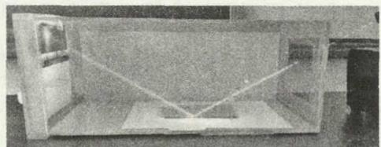  
图 1 模拟阿尔 哈 曾用 烟 雾显示光路的场景

在引 入之后 为 了 让学生 的 物理模 型构建更为深刻 笔者设计了一个大型的反射演示仪 该仪器基本结构是一个直径 60 cm 高 50 cm 的 亚 克力 圆筒 将激光笔架设在圆筒顶部 亚克力 圆筒被放置在了一个转盘上可以 360 度水平转动 见图 2 W

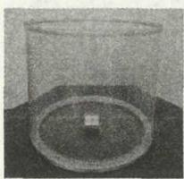  
（ a ）

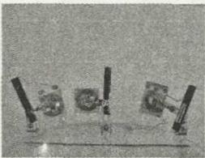

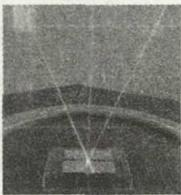  
（ b ）  
（ c ）  
图 2 可 3 6 0°旋转 的光 的反射演示仪

在这个实验场景 中 学生不仅仅体验到 了 光 的反射立体情景 将抽象转化为 了具体 更是在光路转动过程 中深人理解并构建 了 反射情景 而且将光 的反射和运动巧妙联系在 了一起 帮 助学生从具体再次抽象出 光的反射模型 在潜移默化之 中 促进培养了学生 的科学思维和物理观念

要注意的是 化抽象为直观 并不是为了 降低学生的抽象思维能力 而是让学生在见识经历过一次真实的场景之后 能够对抽象 的情境模型理解更加深刻 从而在脑海 中加深印象 以便帮助他们在后续的学习中能够更好地借助曾经经历过的真实场景去处理和构建新的抽象模型

## 2 化旁观为体验的实验设计策略

不 建物理模 型 还是源 真实情景 的 质疑创新，都需要建立在学生对物理情景和物理规律体验基础上 科学思维的培养需要我们设计出体验性强的物理实验

因此 学生不只是物理实验的观察者 而应该是验 参 者 在条件允许 的情况下学生应该能够亲身体验物理实验 的情景 在体验过程 中 自 己去 深对情景的理解和感受

一 验 让学生 己 坐在小上 感受小车滑行距离和水平面光滑程度之间 的关这种 式远远好 让学生在一 观察 比较小车在不 同 粗糙程度 水平 面上滑 行 的 距离见 在真实的实验体验基础 上 学生很容经过科学推理得到“如果水平面光滑 小车将一直运 下去”的结论 使只是一次这样的实验体验也好过教师无数次的引 导 帮助和分析

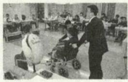  
（ a ）

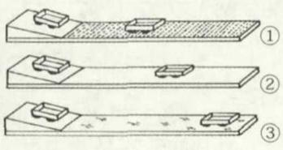  
（ b ）  
图 3 牛 顿第 一定 律实验

类似的 在研究单摆的运动规律时 由 于单摆做简谐运动 的近似要求 单摆的摆角 需要小于 5° 而常见的摆线长度不过 m 左右 这时候 的小球振 幅仅仅约 m 演示实验会非 常不 明 显 不直观 完全没有顾及到学生的实验体验 尤其是对那些坐 的位置较为靠后的学生更是如此 因 此这样 的实验难 以 帮助学生建立起来简谐运动 的模型

如果我们可以做一个摆长为十米甚至更长 的单摆 此时即使摆角 被限制在 5° 振幅也能达到90 cm现 将会非 常 明 显 此 外还 可 以 用 小 木 板 替代摆球 让学生坐在木板上 己 充 当 单摆小球做简谐运动 让学生亲 体验一下单摆的运动 感受单摆小球的速度 位置 加速度 的 变化 感受木板对 己 的 支持 的变化 时测M 己 的运动周期 这样学生 的学习 效果将会完全不一样

让学生亲身体验参与体验物理实验 只要经历一次 学生就能够建立起深刻形 象 的物理情景 和模型 无论是在教师教学上还是学生学 上 样验设计都能带来极大的便利

## 3 化复杂为简洁的实验设计策略

实验情景如果过于复杂 或者 验仪器 操过于复杂，亦或是实验过程中有较多的分散学生注意力 的地方 学生就难免在理解实验仪器或操作这些方面花费较多 的 时 间 精力 会极 地 低学生对实验重要现象的观察程度 此时想让学生从这些复杂的情境 中去抽象出 模型和主 就难上加难

简易化的并且主 旨 突 出 的实验情景非 常重要比如演示磁体消磁 的实验 可 以用酒精灯加热吸附在金属杆上 的磁铁直至磁铁掉下来为 止 见 图 4再 比如用力 敲击被磁铁磁化的钢尺后钢尺 的磁性即可 失 这样的演示实验和操 非常 但是 学生带来的震撼和影响是 巨 大的 从而能够更加 突 出想要达到 的实验 的

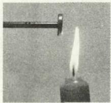  
（ a ）

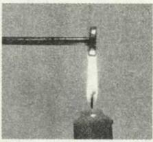  
（ a ）

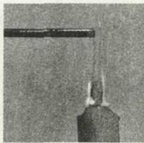  
b  
图 4 消磁实验

类似的 在光的衍射教学中 我们往往会用到专业的衍射装置进行演示 但是这些装置要么太小现象不 明显 要么有明显现象但是不易观察 而且还需要给学生解释很 多装 置 的结构组成 因 此实验显得不够简洁精炼

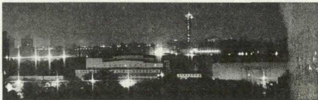  
图 5 透过纱窗 观察光的衍射现象

其实光的衍射现象在生活 中 是很普遍 的 教学的时候完全可 以 从生 活 中取材 ， 甚 至是让学生 自 己去从生活 中找到衍射情景 比如夜晚透过纱窗 观看马路上的路灯 就会发现路灯会呈现 出 四 角 芒 星 的现象 见图 5 这正是灯光经过小方格形纱窗 呈 现出 来 的衍射现象 这种 实验不仅 简 洁明 了 很 利 于拉近学生与光的衍射之 间 的距离 还 能够 引 导学生思考为什么光芒会呈现出 四 角芒星呢 是什么导致呢 改 纱窗 的 小方格结构还 会 出 现 四 角 芒 星吗 从而为后续的利用衍射现象来分析物体形状结构做好充分的铺垫

验器材 单 验现象 显 实验原理主 突 的演示 实验 能极 大地帮 助学生透过物理 质 帮助他们构建抽 象 的物理模型 非常有助于学生科学思维的养成

## 4 牵动思维链条的实验设计策略

一个实验如果 能够引 起学生 的链式思 考 帮助学生将 己 的所学融会贯通 这个实验的教学价值将是不言而喻的 这样 的实验也非常符合培养学生科学思维的要求

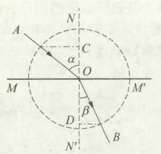  
图 6 光 的折射实验 图

比如在验证折射规律 见 图 6 的 时候 是通 过直接测量 度计算正弦值更好 还是通过测量长度正弦 更好 实验 就需要 给学生创造这样 的机会让学生都去进行实 际测量 多次测量后用实验结果去 印证谁的测量误差更小 学生最后会发现测量长度得到的折射率结果精度更高误差更小 可是为什么会这样呢

面对这样 的疑 问 此时可 以 由 老师引 导学生分析 也可 以 让学生 己 分析 在 弧度 制 中 弧 长 L＝ 径 X 圆 心 角 度 假设 长 度 测 量 的 误差 是0 1 mm 某一次通过弧长和半径 的长度测量计算得到 的角 度测 量值误差 〇 ° 那 么 如 果继续增 大半径 弧长也会 随之增 大 虽 然 长 度 的 测 量误差保持mm 不变 但是弧长和半径 的长度都增 加 了 因此计算 出 的角 度将会更加精确 误差将会小于 〇 1°

或者也可 以让学生逆 向 思考 如果用 量 角 器直接测量角度 的误差是 〇 1° 那么半径为 1〇 cm 时 由弧度 制 公 式 计 算 得 到 的 弧 长 的 误 差 会 达 到0 17 mm 如果半径增加到 20 cm 弧长误差则会达到 0 34 mm 以此类推 可见量角 器带来 的既定 的角度误差对弧长的影响 会随着半径的增大而增 大反之 由 弧长长度测量带来的既定的长度误差对角 度的影响 将会随着半径的增大而减小 可见利用测量长度来计算角 度 测量结果会精确很多 尤其是利用半径较大的弧长来计算角度 结果将非常精确

在分析清楚以后 可 以 引 导学生进一步分析 在万有引 力 定律引 力 常量 G 的测量实验 中 卡文迪许为何要在扭秤装置上加上平面镜 （ 图 7 中 的 M 呢此时学生应该能够很轻易 地 回 答 了 而且这时 学生对“光杠杆放大”的理解也会深人很多 了

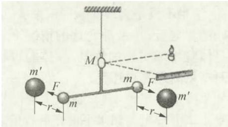

可能的话 还可 以接着引 导学生分析 库仑扭秤实验中为什么没有安装平面镜 为什么 不需要利 用“光杠杆放大”呢 于是两个扭秤实验的对 比就 然而然地发生 了 在这样的 实验情境 导下 学生 的思维链条被牵动 了 真正将学生科学思维 培 在“润物细无声” 中实现了

## 5 帮助引发质疑的实验设计策略

质疑是科学思维 中 的重 要部分 质 疑不是一 般性地提出 问题 而是首先对学习 的 内 容经过独立深入的充分分析 然后提 出 质询性 的 问题 即 质疑要求学生对事物情景有深入理性的分析 有理有据地提出 疑问 质疑体现了 学生从发现问题到 提 出 问 题的 能 力 提升 ［ 5 ］

物理实验 的一项重 要 作用 就是 引 发学 生 的 质疑 给学生的质疑提供机会

比如在利用欧姆定律测 量 电 阻的 时候 可 以 设计让学生分别 用 图 8 中 的 两 种 方式测 量 相 同 的 电阻 然后 比较实验结果 学生会发现 电流表 的 内 接法测量结果总是大于外接法的测量结果 这是为 什么 呢 这两个结果难道不该是一样的吗

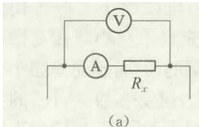

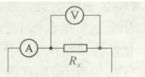  
图 8 电流表 的 内 接法 U） 和外接法 b 测 电阻

（ 下 转第 9 页 ）

<!-- 删除相邻文章的续表标记。 -->

<!-- 删除跨栏拼入的相邻文章表格：
<table>…</table>
-->

<!-- 删除跨栏拼入的相邻文章总结段。 -->

<!-- 删除相邻文章残留参考文献。 -->

（上接前文）

是什么地方出 问题了 呢 欧姆定律有问题 还是仪器有问题 于是关于欧姆定律适用条件的学习就可以顺理成章地展开 经过对欧姆定律的适用条件的讨论 最终学生会发现这个实验中 欧姆定律是没有问题的

如果欧姆定律没有问题 那么就是实验仪器的问题了 于是也就能够顺理成章地开展电表测量原理 以及电流表和 电压表的结构和改装 的学习 学生最后 不管是 流表还是 压表 都需要有电流通过电表 才能够完成测量

接下来在承认 流表和电压表有电流流过和电阻的基础上 再让学生利用欧姆定律去分析实验结果 然就能够解释为什么 内 接法测量结果总是大于外接法 了

这样的实验设计 既能够牵动学生的思维链条又能够引 发学生 的质疑创新 非常适合培养学生 的科学思维

## 6 结束语

科学思维包含很多方面 诸如模型建构 推理论证等等 不管是那一方面的科学思维的培养 都不可能离开真实的情景 缺少情景的科学思维培养很容易片面化 而且也只有真实的情景才能够让学生在身临其境中去锻炼 自 己 的思维 才能让学生养成的科学思维更加丰富饱满 且能够经得起时间的洗礼能够深深地印刻在学生的头脑中

而作为物理教学 的重要组成部分 物理实验承担着为科学思维的培养创设情景的角 色 设计能够帮助培养学生科学思维的物理实验 能够让物理教学变得更加简洁高效 也能够让学生 的科学思维养成更加事半功倍

## 参 考文 献

1 教育部． 普通髙 中物理课程标准 2017 年版 ） S 北京 人 民教育 出 版 社 ， 2 0 1 8

［ 2 1 郭 玉 英 ． 从 三 维 目 标 到 物 理 核 心 索 养 ［J ］ ． 物 理 教 学 ， 2 0 1 7 （ 1 1 ） ．

3 田 成 良 对中学物理仪器教学的思考 物理教学 2018 10

4 蒋炜波 教学设计如何指向学生物理观念的培养 基础教育 课 程 ， 2 0 1 9 （ 4 ）

5 蒋炜波 科学思维 中提 出 质疑 的 方 法策 略研究 物理教学2 0 1 9 （ 6 ）
