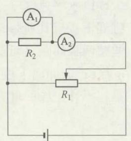

# 物理教学中科学思维发展层级模型的构建初探

蒋炜波（清华大学附属中学 北京 100084）

摘要 本文在布鲁姆思维认知层次和科学思维核心素养水平层次基础上，探索构建了科学思维发展的层级模型，显化科学思维的内涵要素，尝试以思维发展为 导向的物理教学。

关键词 科学思维 思维发展 物理教学

文章编号 1002－0748(2021)10－0005

中图分类号 G633．7

文献标识码 B

《普通高中物理课程标准（2017年版）》中提出了物理学科四个方面的核心素养，其中的科学思维是构成物理学科核心素养内涵极其重要的组成之一。新课标中将科学思维的水平划分为5个层次，用以评价反映学生的科学思维发展水平。但是在实际物理教学中，该如何从具体操作中对学生的科学思维进行发展培养，不同水平层次的科学思维具体应该包含哪些要素，又该如何以科学思维发展为导向设计并实施教学，都是教师面临的现实问题。因此，探寻能够指导教学实施、操作性强的科学思维发展的实践性理论，是非常必要且具有重要现实意义的。

基于此，笔者在布鲁姆教育目标分类理论的基础上，结合新课标中科学思维的水平层次划分，以教学实践为基础，探索建构了科学思维发展的层级模型，并尝试以科学思维发展为 导向去实施物理教学。

## 1 布鲁姆认知思维理论与科学思维水平层级的关联

### 1．1 布鲁姆目标分类理论

在本杰明·布鲁姆提出的教育目标分类理论中，人的认知思维过程从低到高分为六个层次，即识记、理解、应用、分析、综合和评价。

识记，是指认识并记忆，包括专业术语、客观事实、原理理论、知识框架、规则标准、方法途径等等，是单纯的识别记忆。理解，是指对识记的对象有初步的、浅显的认识领会。应用，是指在理解所学内容的基础上，对所学内容进行初步使用实践。分析，是指将事物内在的组成要素分解清楚，从而使相互间的关系更加明确，结构更加清晰。综合，是指以分析为基础，对已经分解清晰的各个要素再次有机地整合起来，以便创造性地解决问题。评价，是指理性深刻地对事物的本质做出有说服力的判断，是综合各种资料信息做出的符合客观事实的推断。布鲁姆的认知思维理论中，识记、理解、应用属于较低层次的思维，分析、综合、评价属于较高层次的思维。

### 1．2 科学思维的层次水平

在《普通高中物理课程标准（2017年版）》中，将科学思维分为5个水平层级，各水平层级表现描述见表1，可以看到，科学思维的水平层级和布鲁姆认知思维理论是存在着对应关系的。

表 1 科学思维的 5 个水平层级［1］与认知思维的关系
<table><tr><td rowspan=1 colspan=1>水平</td><td rowspan=1 colspan=1>科学思维</td><td rowspan=1 colspan=1>认知思维</td></tr><tr><td rowspan=1 colspan=1>水平1</td><td rowspan=1 colspan=1>能说出一些简单的物理模型，能对常见的物理现象进行简单分析，能区别观点和证据，知道质疑创新的重要性</td><td rowspan=1 colspan=1>识记、理解</td></tr><tr><td rowspan=1 colspan=1>水平2</td><td rowspan=1 colspan=1>能在熟悉的情境中应用常见的物理模型，能对简单的现象进行分析和推理并获得结论，能使用简单和直接的证据表达自己的观点，具有质疑和创新的意识</td><td rowspan=1 colspan=1>识记、理解、应用</td></tr><tr><td rowspan=1 colspan=1>水平3</td><td rowspan=1 colspan=1>能在熟悉的情境中根据需要选择恰当的模型解决简单的物理问题，能对常见的物理现象进行分析和推理，获得结论并做出解释。能恰当使用证据表达自己的观点，能对已有的观点提出质疑，从不同的角度分析解决物理问题</td><td rowspan=1 colspan=1>识记、理解、应用、分析、质疑</td></tr><tr><td rowspan=1 colspan=1>水平4</td><td rowspan=1 colspan=1>能将实际问题中的对象和过程转换为物理模型，能对综合性的物理问题进行分析推理，获得结论并做出解释。能恰当使用证据证明物理结论，能对已有的结论提出有依据的质疑，采用不同方式分析解决物理问题</td><td rowspan=1 colspan=1>识记、理解、应用、分析、综合、质疑</td></tr></table>

续表
<table><tr><td>水平</td><td>科学思维</td><td>认知思维</td></tr><tr><td>水平5</td><td>能将较复杂的实际问题中的对象和过程转换为物理模型，能在新情境中对综合性的物理问题进行分析推理，获得正确的结论并做出解释。能考虑证据的可靠性，合理使用证据，能从多个视角审视检验结论，解决物理问题具有一定的新颖性</td><td>识记、理解、应用、分析、综合、质疑、评价、创新</td></tr></table>

## 2 科学思维发展的层级模型

### 2．1 科学思维发展层级模型的建构

通过对比新课标中科学思维水平层次划分和布鲁姆的认知思维理论可以发现，随着科学思维水平层级的提升，其对应的认知思维等级也越来越高，越来越全面，但科学思维中蕴含的质疑创新却并没有在布鲁姆认知思维模型中明确体现出来，这表明新课程标准在科学思维方面提出了比布鲁姆认知思维模型更全面的思维发展要求。鉴于此，可以结合布鲁姆认知思维模型和物理学科核心素养理念，构建科学思维发展的层次模型，该模型包含三个思维阶层，见表2。

表 2 科学思维发展水平层次
<table><tr><td rowspan=1 colspan=1>思维阶层</td><td rowspan=1 colspan=1>对应的认知思维</td><td rowspan=1 colspan=1>科学思维水平</td></tr><tr><td rowspan=1 colspan=1>低阶思维</td><td rowspan=1 colspan=1>识记、理解、应用</td><td rowspan=1 colspan=1>水平1、水平2</td></tr><tr><td rowspan=1 colspan=1>中阶思维</td><td rowspan=1 colspan=1>推理、论证、分析、综合、系统化</td><td rowspan=1 colspan=1>水平3、水平4</td></tr><tr><td rowspan=1 colspan=1>高阶思维</td><td rowspan=1 colspan=1>评价、质疑、创新、迁移、建构、创造</td><td rowspan=1 colspan=1>水平5</td></tr></table>

低阶思维是指低层次的思维认知水平，主要用于学习既定知识（即侧重获取输入），以及完成简单的任务（即低层次输出），不要求较复杂的情境和问题，不涉及复杂综合模型的使用。低阶思维包含识记、理解、应用等方面，指向科学思维水平1和水平2层级。

中阶思维是指超越单纯的知识获取输入的思维认知水平，主要用于对已经学习的知识的内化升华（即侧重加工整理），以及完成有一定难度的任务（即高层次输出），此时涉及的情境也较为复杂，用到的模型也更加综合。中阶思维包含推理、论证、分析、综合、系统化等方面，指向科学思维水平3和水平4层级。

高阶思维是指高层次认知能力的思维认知水平，是对学习者在利用已有认知解决实际复杂问题过程中所需要的各种能力的发展培养，高阶思维包括评价、质疑、创新、迁移、建构、创造等，指向科学思维水平5层级。

### 2．2 科学思维发展层次模型的意义

科学思维发展的层次模型，是以布鲁姆认知思维模型为基础，以物理学科核心素养培养为导向，是对科学思维这一学科核心素养的结构化、层级化、显性化，以便借此在教学中更加有针对性地进行科学思维的培养。

利用科学思维发展的层次模型指导物理教学，侧重学生的思维发展，要求在教学设计的每一个具体环节都有明确的思维指向，同时还要统筹规划整节课的思维发展，包括整体的思维发展难度、思维顺序编排、思维参与情况等各个方面，具体的设计如表3所示。

表 3 科学思维发展模型下的教学设计
<table><tr><td rowspan=1 colspan=1>教学环节</td><td rowspan=1 colspan=1>环节内具体项目</td><td rowspan=1 colspan=1>思维指向</td><td rowspan=1 colspan=1>思维水平</td></tr><tr><td rowspan=2 colspan=1>环节一</td><td rowspan=1 colspan=1>项目1:</td><td rowspan=1 colspan=1></td><td rowspan=1 colspan=1></td></tr><tr><td rowspan=1 colspan=1>……</td><td rowspan=1 colspan=1></td><td rowspan=1 colspan=1></td></tr><tr><td rowspan=2 colspan=1>环节二</td><td rowspan=1 colspan=1>项目1：</td><td rowspan=1 colspan=1></td><td rowspan=1 colspan=1></td></tr><tr><td rowspan=1 colspan=1>……</td><td rowspan=1 colspan=1></td><td rowspan=1 colspan=1></td></tr><tr><td rowspan=2 colspan=1>……</td><td rowspan=1 colspan=1>项目1:</td><td rowspan=1 colspan=1></td><td rowspan=1 colspan=1></td></tr><tr><td rowspan=1 colspan=1>……</td><td rowspan=1 colspan=1></td><td rowspan=1 colspan=1></td></tr></table>

思维发展模型下的教学设计，并不需要推翻原有的教学设计模式，而是在原有的教学设计模式中增加思维指向和思维水平两部分，从而能够借此明确教学环节中具体指向的思维层次，以及整节课或者整个单元的思维水平分布，最终做到在教学中有计划、有针对性地对学生的科学思维进行培养。

科学思维发展模型对物理教学的导向作用，具有很好的兼容性。不论是常见的教学环节模式，还是问题解决模式、大概念单元教学模式，不论是初中物理教学还是高中物理教学，科学思维发展模型都能够在思维发展层面对教学进行有效的梳理和引导。

### 2．3 科学思维发展层级模型的应用案例

#### （1）高中物理"光的折射"新课教学

如何有理有据地阐述清楚折射率的定义，以及折射率与光在介质中的传播速度之间的关系，一直是高中物理"光的折射"的教学难点。从实验探究入手虽然能够测量出角度关系，可是仍然无法解答为什么入射角和折射角的正弦值之比会恒定不变，更不能回答折射率与光的传播速度之间的关系缘由，最终导致学生的思维发展始终处于较低层次。

笔者在教学中，将学科发展史引入教学，在解决教学问题的同时，引导学生充分认识到物理和数学的关联与区别。首先通过折射角和入射角的关系探寻，在解决物理知识学习的同时，让学生认识到数学发展对物理的重要意义。然后通过费马时间最短原理的探讨，在解决折射率和光速之间的关系问题的同时，也让学生认识到物理问题和数学探讨的本质不同。最后通过惠更斯原理的简介，让学生采用物理情境完成折射率的推导，最终达成物理和数学的统一关系，解决数学带来的"光有意识"的困惑。

整节课的设计始终关注到学生的思维发展，与传统的教学相比，高阶思维和中阶思维明显增加，教学环节设计见表4。需要注意，教学中可以针对不同的班级学生的层次，有选择性地对环节三中的高阶思维项目进行删减，实施分层教学。

表 4 思维发展导向下高中物理"光的折射"新课教学
<table><tr><td rowspan=1 colspan=1>教学环节</td><td rowspan=1 colspan=1>环节内具体项目</td><td rowspan=1 colspan=1>思维指向</td><td rowspan=1 colspan=1>思维水平</td></tr><tr><td rowspan=1 colspan=1>环节一复习回顾</td><td rowspan=1 colspan=1>项目1：初中反射定律、折射规律回顾</td><td rowspan=1 colspan=1>识记、理解、应用</td><td rowspan=1 colspan=1>低阶思维</td></tr><tr><td rowspan=4 colspan=1>环节二反射和折射现象中的角度关系</td><td rowspan=1 colspan=1>项目1：实验。在光射入水中时同时发生反射和折射现象，测量入射角、反射角、折射角并比较它们的大小</td><td rowspan=1 colspan=1>综合、分析</td><td rowspan=1 colspan=1>中阶思维</td></tr><tr><td rowspan=1 colspan=1>项目2：请分析，折射角、反射角和入射角存在什么样的关系？</td><td rowspan=1 colspan=1>推理、分析、综合</td><td rowspan=1 colspan=1>中阶思维</td></tr><tr><td rowspan=1 colspan=1>项目3：了解折射定律的发现历史，以及三角函数的发展历史，总结折射定律和折射率</td><td rowspan=1 colspan=1>识记、理解、应用</td><td rowspan=1 colspan=1>低阶思维</td></tr><tr><td rowspan=1 colspan=1>项目4：典型折射问题讨论(垂直观察池塘变浅、平行玻璃砖光路、三棱镜光路）</td><td rowspan=1 colspan=1>推理、论证、系统化</td><td rowspan=1 colspan=1>中阶思维</td></tr><tr><td rowspan=4 colspan=1>环节三为什么会发生折射</td><td rowspan=1 colspan=1>项目1：从反射到折射，辨析路程最短和时间最短，利用费马时间最短原理，推导折射率，得出折射率与光速之间的关系</td><td rowspan=1 colspan=1>推理、论证、迁移、建构</td><td rowspan=1 colspan=1>中阶思维、高阶思维</td></tr><tr><td rowspan=1 colspan=1>项目2：讨论：光的传播为什么遵循时间最短原理？光有意识吗？</td><td rowspan=1 colspan=1>评价、质疑</td><td rowspan=1 colspan=1>高阶思维</td></tr><tr><td rowspan=1 colspan=1>项目3：惠更斯原理简介，并用于推导折射率</td><td rowspan=1 colspan=1>推理、论证、建构、创新</td><td rowspan=1 colspan=1>中阶思维、高阶思维</td></tr><tr><td rowspan=1 colspan=1>项目4：相对折射率探讨</td><td rowspan=1 colspan=1>推理、分析、系统化</td><td rowspan=1 colspan=1>中阶思维</td></tr></table>

#### （2）初中物理"磁现象"复习教学

传统的"磁现象"复习课中，学生的思维主要集中在识记、理解和应用三个低阶思维层面，高阶思维鲜有涉及。低阶思维和高阶思维的全面发展，必然需要创设恰当的情境予以支持。磁现象章节由于涵盖的内容很广，学生很难抓住一条复习的主线，因此创设的情境需要能够有效地将整节内容贯穿始终，以大任务统领的问题解决模式驱动学生完成复习。

教学中笔者选择了学生生活中常见的动圈式扬声器，设计了"探秘扬声器中的电磁现象"这一大任务，下设四个子任务问题：扬声器的哪部分具有磁性？扬声器可以改装成起重机吗？扬声器是如何通电发声的？扬声器可以利用声音来发电吗？每一个子任务均包含数个小任务问题，每一个小问题都有明确的思维层级指向，从而有效地完成了对学生各阶层思维的培养和发展。教学问题的设计见表5。

表 5 思维发展导向下初中物理"磁现象"复习教学
<table><tr><td rowspan=1 colspan=1>大任务</td><td rowspan=1 colspan=1>子任务问题</td><td rowspan=1 colspan=1>小任务问题</td><td rowspan=1 colspan=1>思维指向</td><td rowspan=1 colspan=1>思维水平</td></tr><tr><td rowspan=14 colspan=1>探秘扬声器中的电磁现象</td><td rowspan=4 colspan=1>任务一：扬声器的哪部分具有磁性？</td><td rowspan=1 colspan=1>问题1：什么样的物体具有磁性？</td><td rowspan=1 colspan=1>记忆</td><td rowspan=1 colspan=1>低阶思维</td></tr><tr><td rowspan=1 colspan=1>问题2：有哪些方法能够检验物体是否有磁性？</td><td rowspan=1 colspan=1>理解、应用</td><td rowspan=1 colspan=1>低阶思维</td></tr><tr><td rowspan=1 colspan=1>问题3：你选择的方法需要怎样操作并进而判断磁性？是否能够同时完成磁性和磁极的检验？</td><td rowspan=1 colspan=1>分析、设计、解释、评价</td><td rowspan=1 colspan=1>中阶思维高阶思维</td></tr><tr><td rowspan=1 colspan=1>问题4：如何形象地描述和表征磁体的磁性？</td><td rowspan=1 colspan=1>记忆、理解</td><td rowspan=1 colspan=1>低阶思维</td></tr><tr><td rowspan=3 colspan=1>任务二：扬声器可以改装成起重机吗？</td><td rowspan=1 colspan=1>问题1：磁铁作为起重机有哪些不足与优势？</td><td rowspan=1 colspan=1>分析、评价</td><td rowspan=1 colspan=1>中阶思维高阶思维</td></tr><tr><td rowspan=1 colspan=1>问题2：如何改变一个物体的磁性？</td><td rowspan=1 colspan=1>记忆、理解、分析、评价</td><td rowspan=1 colspan=1>低阶思维高阶思维</td></tr><tr><td rowspan=1 colspan=1>问题3：还有什么地方需要改变物体的磁性？未来还可能有哪些应用前景？</td><td rowspan=1 colspan=1>创造</td><td rowspan=1 colspan=1>高阶思维</td></tr><tr><td rowspan=4 colspan=1>任务三：扬声器是如何通电发声的?</td><td rowspan=1 colspan=1>问题1：扬声器发声的基本原理是什么？</td><td rowspan=1 colspan=1>记忆</td><td rowspan=1 colspan=1>低阶思维</td></tr><tr><td rowspan=1 colspan=1>问题2：改变发出声音的方法有哪些？</td><td rowspan=1 colspan=1>理解、应用、分析</td><td rowspan=1 colspan=1>低阶思维中阶思维</td></tr><tr><td rowspan=1 colspan=1>问题3：生产生活中有哪些场景需要利用磁场对通电导线的作用力？</td><td rowspan=1 colspan=1>创造</td><td rowspan=1 colspan=1>高阶思维</td></tr><tr><td rowspan=1 colspan=1>问题4：（拓展）利用磁铁、线圈等一些简单的物品，你能制作一个扬声器吗？</td><td rowspan=1 colspan=1>设计、制作、创造</td><td rowspan=1 colspan=1>高阶思维</td></tr><tr><td rowspan=3 colspan=1>任务四：扬声器可以利用声音发电吗？</td><td rowspan=1 colspan=1>问题1：发电的基本条件是什么？</td><td rowspan=1 colspan=1>记忆</td><td rowspan=1 colspan=1>低阶思维</td></tr><tr><td rowspan=1 colspan=1>问题2：利用声音发电，你觉得有什么困难？</td><td rowspan=1 colspan=1>分析、评价</td><td rowspan=1 colspan=1>中阶思维高阶思维</td></tr><tr><td rowspan=1 colspan=1>问题3：如果利用声音发电变成了现实，你最想用它来做什么？</td><td rowspan=1 colspan=1>创造、设计</td><td rowspan=1 colspan=1>高阶思维</td></tr></table>

## 3 思维发展需要注意的问题

### 3．1 明晰思维发展的路径

大到一个学年和学期，小到一个单元和一节课，物理教学中既需要明确学生当前的思维水平，即思维发展的起点状态，又需要明确经过物理学习以后学生应该达到的思维水平，即思维发展的目标状态。在此基础上，明晰从思维起点到达思维目标的思维发展路径，在学年、学期、单元和课时上都能够有较为明确的思维发展目标，从而通过有计划的课程规划和教学实施，最终完成对学生科学思维的培养。

要注意的是，教学中并不是每一节课都需要在思维层次的各个方面对学生进行培养。一方面教师很难在短时间内面面俱到，另一方面学生的认知能力和思维水平都很有限，也无法承受在短时间内进行全方位的思维发展提升。思维发展应该与物理课程一起形成有机的体系，每一节课都有其鲜明的思维发展目标，能够在某一思维层面有所突破，从而通过系统的物理课程学习，最终完成系统的思维培养。因此，统筹规划进行单元教学设计，将课程和思维有机结合在一起进行系统的教学，是发展学生科学思维的重要策略。

### 3．2 明确思维发展的工具

思维发展是一个在情境中综合运用各种能力解决问题的过程，在这一过程中，学生需要调动各种思维工具，在解决问题的同时促进自己的思维发展。这些思维工具的具体内容视教学而定，既包括所需要的数学工具，也包括必要的学科知识和规律，还包括那些能够帮助解决问题的物理模型和思维定势。此外，思维自身也是学生思维进一步发展的工具，学生已经具备的抽象思考、归纳分析、问题解决、质疑创新、迁移建构等等思维，都是学生解决问题和发展思维所需要的工具。

具体一个单元或一节课的学习所需要的思维工具都有哪些？学生已经具备的思维发展工具有哪些？还缺少什么工具？还需要做什么样的工具补充？这些问题都是教师在课前进行教学设计的时候需要特别考虑的。帮助学生补充所缺乏的思维工具，本就应该是教学的基本内容之一。

### 3．3 重视物理情境的创设

2020年发布的《中国高考评价体系》，明确了试题情境在高考命题中的承载作用，因此在教学中也应当凸显出情境的教学承载作用，从而真正做到教学和评价相统一。情境是运用多媒体、实物、实验、案例、学史、文字、图像、数据等各种形式，围绕一定主题进行设置的。物理学习需要以物理情境为载体，利用情境给学生提供获取知识和发展思维所需要的环境，给学生搭建展示自己学科素养的平台［2］。

教学中可以搭建基于物理实验的情境，实验情境不能过于复杂，要求能够有效地支撑学生的思维发展，实验情境要能够化抽象为直观、化旁观为体验、化复杂为简洁，还要能够牵动思维链条，帮助引发学生的质疑等等［3］。教学中还可以基于物理学史和生活实践搭建情境，这一类情境往往不需要过于专业的实验器材，所反映的内容也很贴近学生的生活实际，因此特别容易与学生已有的认知产生共鸣，从而达到启发思考、培养思维的目的。

### 3．4 环节间思维衔接要顺畅

物理教学通常以一系列小的教学环节来开展，在一个环节中侧重解决一部分问题，将这些环节串接起来就是完整的一节物理课。可见，教学环节既是教师进行教学设计并实施教学的基本单元，也是学生完成知识学习的基本单元，自然更是学生思维发展的基本单元。

章节与章节之间、课时与课时之间的科学思维发展需要统筹规划，需要通过单元教学进行整体设计，那么课时内部的教学环节之间的思维发展自然也需要统筹安排。课堂教学的环节化与生产线的流水作业是类似的，能够提高教学的效率，给学生的学习带来便利。教学中需要注意，在突出具体环节目标主旨的同时，环节之间也一定要衔接紧密、思维平滑，环节之间的情境转换不能过于突兀，思维跳跃不能过于明显，要给学生搭建足够的思维台阶，才能切实帮助学生思维发展。

### 3．5 各个思维层次要均衡

各阶层思维在教学中的时间占比上应该较为均衡，如果整节课中低阶思维占比过重，甚至没有中阶和高阶思维，那么学生在学习过程中更多的只是机械式的信息输入，虽然整节课都在忙于记忆和做好笔记，但这种简单的重复并没有达到发展学生思维的目的。

但是一节课中的中阶思维和高阶思维也不能占比过大，尤其是高阶思维。思维层次越高，给学生的学习带来的难度也就越大，学生的认知能力和学习精力尚不足以支撑一整节课的高强度思维发展，这时候适当地设计低阶思维环节，既能够给学生的思维发展搭设好台阶，又能够让各层次思维彼此映衬呼应。

此外，高阶思维并不一定需要设置在一节课的最后环节。学生内在的思维发展需要依托于各个外在的教学环节的实施，而教学环节又需要视具体的教学内容而定，因此各阶层思维的分布也需要服从教学的安排。科学思维的发展是教学的重要目的，教学中切忌为了思维发展而生硬地设计教学环节，环节的设计要让学生的思维张弛有度，思维的发展也要让环节的衔接徐缓顺畅，思维和环节有机结合方能相得益彰。

### 3．6 进行跨学科的思维融合

学科教学都能够发展学生的思维，学生作为各学科认知的学习者，其头脑中的认知自然不局限于某一个学科，因此从学生的发展角度出发，需要教师在教学中引导学生进行跨学科的融合，从而在超越单一学科的更广泛的综合层面上，促进学生思维的全面发展。

物理学作为一门基础学科，很容易与数学、化学、生物、地理、历史、信息技术、通用技术等各个学科相融合，教学中应该开发设计相应的学科整合案例，也可以联合其他学科教师进行有针对性的跨学科教学设计，从而达成单学科无法做到的思维发展目标。

### 3．7 以思维发展实施分层教学

分层教学，不应该体现在学科知识层面，而应该体现在思维发展层面。学科教学中，学科知识和规律对不同的学生群体而言都是相同的，所有的学生都应该掌握学科最基本的必备知识和关键能力。而对于思维发展层面，不同的学生群体则应该有不同的设计，依据学生的具体情况使用针对性的教学策略，从而最终完成对学生思维的培养。

实际问题的处理过程是学生从物理学视角分析和解决生产生活中的实际问题的过程，它需要学生具有系统的物理观念、严谨的科学思维、规范的科学探究和高度的科学态度与责任。<!-- 存疑：此段在 PDF 中位于"分层教学"段之后，但其内容（"实际问题处理""物理观念"）与上下文 3.7 分层教学主题不直接衔接，疑为版面交错排入的另一篇文章片段；其后文"因此，思维发展是分层教学的核心钥匙……"才回到本文 3.7 的分层教学主题。保留原文，待核 -->

因此，思维发展是分层教学的核心钥匙，不论是通过下放更高年级的学科知识对学有余力的群体进行所谓的超前学习，还是通过反复的刷题练习对学有不足的群体进行所谓的提高学习，都不是真正的分层教学。学生个体之间的发展差异，不是源于学科知识的多少，而是源于思维发展的程度。分层教学，需要让思维发展需求不同的学生都能够在学习中有所收获，给学生充分的自主发展空间，调动其学习的主动性。因此，从思维发展层面实施分层教学，是一种极为有效地促进学生个性发展的教学策略。

<!-- 以下为 PDF 版面交错排入的另一篇文章（电流表/实际问题主题）内容，与本篇 LIT-0024 无关；其中"因此，思维发展是分层教学的核心钥匙……"段为本文 3.7 段落的重复，已在上文归位，此处保留 PDF 原貌以便核对 -->

（ 上 接 第 1 3 页 ）

应改 为 如 图 13 所示 由 于 电流表 $\mathbf { A } _ { 1 }$ 的 内 阻和待测 电 阻差不多 故 干 路 电 流 是 电 流 表$\mathbf { A } _ { 1 }$ 示 数 的 两 倍 这 样 能 做 到两 只 电 流 表指 针 的 偏 转 角 度差不 多 且 指 针 偏 转 可 以 较大 故 图 13 所 示 的 设 计 方 案要优于图 3 所示 的设计方案

  
图 1 3

## 3 结 束 语

实际问题的处理过程是学生从物理学视角 分析和解决生产生活 中 的 实 际 问 题 的过程 它需要学生

因此 思维发展是分层教学的核心钥匙 不论是通过下放更高年级的学科知识对学有余 的群体进行所谓 超前学 还是通过反 刷题练有不足 群体进行所谓 提高学习 都不是真正分层教学 学生个体之间 的发展差异 不是源 学科知识的多少 而是源于思维发展 的程度 分层教学 需要让思维发展需求不 同 的 学生都能够在学习中有所收获 给学生充分的 主发展空间 调动其学习 的主动性 因此 从思维发展层面实施分层教学是一种极为有效地促进学生个性发展 的教学策略

<!-- 以上为另一篇文章交错内容 -->

## 4 结束语

作为学科核心素养之一，科学思维的发展无疑将给学生的一生带来深远的影响，它给学生带来了发现问题、思考问题和解决问题的方法途径，从而能够帮助他们有效地解决人生发展中所面临的各种困难。

因此，以思维发展为 导向开展物理教学，是非常有必要的。为了促进学生思维的发展，教学中需要统筹各种因素，既有学生自身的个性特点，又有认知思维的发展规律，还有学科教学的知识任务，更有教师自身的认识观念。作为教学的实施者，教师所面临的挑战是巨大的，但这种挑战对教师而言也是一种成长的激励。

## 参 考 文 献

［1］郭玉英，苏明义．新版课程标准解析与教学指导 高中物理［M］．北京：北京师范大学出版社，2018．

［2］蒋炜波，赵坚．试题情境：实现"四层""四翼"承载作用的重要载体［J］．物理教学，2020（10）：25，36．

［3］蒋炜波，王宏．物理实验的设计如何指向学生科学思维的培养［J］．物理教学，2019（12）：10—12，9．

<!-- 以下为 PDF 版面交错排入的另一篇文章（实际问题主题）的结尾段与参考文献，与本篇 LIT-0024 无关 -->

具有系统的物理观念 严谨的科学思维 规范 的科学探究和高度 的科学态度与责任 在教学中 以实际问题为背景 渗透实际问题解决的基本策略 关注学生思维 难 有效地实施指 实际问题处理 教学能培养学生运用物理知识解决生产生 活 中 实际问题的意识和能力 培养学生的物理学科核心素 养 进而形成学生发展过程中所需要的必备品格和关键能力

## 参 考 文 献

［1］中华人民共和国教育部．普通高中物理课程标准（2017年版）［S］．北京：人民教育出版社，2018．

［2］齐国元．基于真实问题指向素养培育的教学设计［J］．物理通报，2020（10）：26—28．