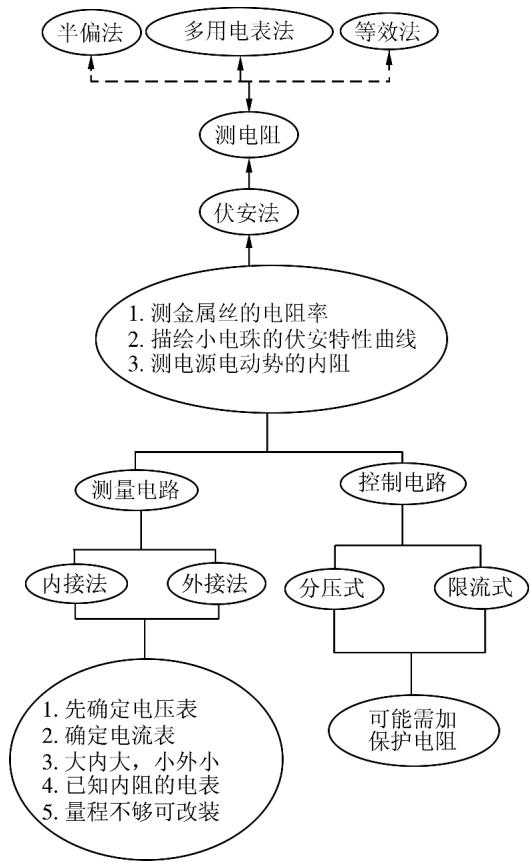
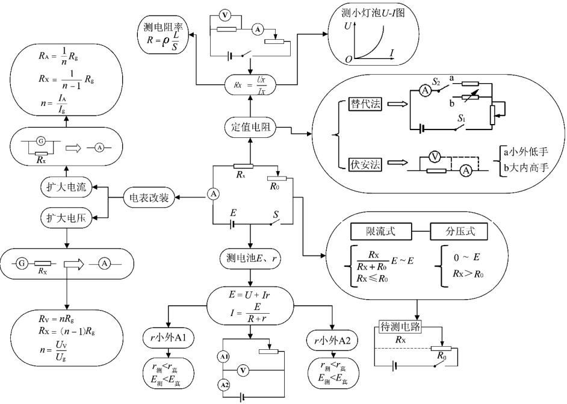

> 来源：MinerU 转换（stem-exact rebuild 2026-08-08）

# 论可视化教育理论与高中物理教学创新

张 鹉（福建省晋江市侨声中学 ，福建 晋江 362271）

摘 要 在对高中学生进行学科学习难度的调查中 很多学生都认为物理学科的学习难度大．如果我们在高中物理课堂上运用“思维导图”来进行教学 则可将教师头脑袋中的物理理论 概念与知识等 用“可视化”的形式呈现出来．这样 ，教师就能够将物理知识与技能更加精准地呈现给学生 ，学生也能够更好地掌握物理知识的整体架构．本文介绍了具象化的思维导图制作方法 及其在高中物理教学中的作用

关键词 ： 思维导图 ； 新思维具象法 ； 可视化 ； 思维可视化

“思维导图”来源于“思维可视化”理论 它是英国心理学家托尼 · 布赞提出的一种图解形式记笔记的方法，他通过运用图文并重的方法 ，把各级主题的隶属关系用与相关的“层级图”表现出来建立起一种“记忆链接” 它将原本在人的头脑中“不可见”的思维用图的方式呈现出来 这就是我们常说的“思维导图”．“思维导图”的出现，使人们对知识的理解更加清晰 直观 便于记忆

## 1 何谓“具象化”的“思维导图”

在高中物理学习的过程中 有一部分学生不善于主动而深入地去剖析所学内容， 无法将不同知识点之间的联系找出来建立起一套知识结构对学习内容的记忆比较“散” 导致物理学习成绩难以提高，若在高中物理教学中引进并运用好思维可视化教学的“导学案” ， 教师则可以通过清晰的知识框架 帮助学生高效地梳理学习内容 加深学生对教学内容的理解 其中“思维导图”就是很好的方法．“思维导图”具有“具象化”具象型标志其特点是直观 便于识别和记忆 容易产生亲和力和丰富的想象力．人类的思维活动具有复杂性 就其关于“思维”分类［1］ 的研究中 就有古典的二分法（即形象思维和逻辑思维） 还有现代的 我国著名科学家钱学森先生的三分法（形象思维 逻辑思维和灵顿思维） 这些分类中都不可否认地提到了“形象思维” 就是当我们在判断周边事物时 常常用形象化也就是“具象化”的方法把各类事物进行分类 具象思维是个体对其意识中的物象资料进行有目的加工 （构建 运演 判别） 的操作活动［2］例如高中物理教学中给学生一个“物质”的概念之前，其实学生已在自己的头脑中形成了这样一个“物质”的具象．确立这种具象来自于人的意识 这种意识使本来无法看见的 或者说根本就没有形状的物质，变成了可以“看得见”的具体的立体的形态．学生在产生和确定这些概念之前 就必然已经在头脑中形成了这种物质形态的立体的具体的形象了．尽管这种物质形态 我们没有看见过或根本就无法看见，但是，我们在头脑中却能建立这种物质形态的具体的形象 建立这种想象的思维活动 是将一个复杂形象“模型化” 即抽象成一个较简单的形象 在对新形象进行形象思维或者抽象的思维 形成“具象思维” 在形象思维活动过程中 就要用到概念 判断 推理…等逻辑思维的形式 然后我们再将它绘制出来让自己和别人都能“看见” 这就是我们在物理教学中运用“思维导图”来引导学生学习的目的 让学生自己和教师看到物理概念 规律等在学生头脑中是如何形成的掌握到什么程度

## 2 如何绘制“具象化”的“思维导图”

要绘制出一份好的“具象化”的“思维导图”并不是一件简单的事情 这需要学习者对所学知识和规律的深层次的掌握与领会 不同的学习者对知识概念的理解 掌握程度不同 就会有不同的归类法 从而绘制出不同的“思维导图” “思维导图”本身没有好坏之分 最主要的目的是帮助学生更好 更深刻地理解所学知识 同时便于学生牢固地记忆，以便在解决实际问题时能快速地提取知识绘制“思维导图”这种技能是需要学生在教师的指导下 开展一些基本方法的训练 然后再不断引导 启发和模拟 最终由学生自己独立完成的过程．绘制思维导图常见的方法有两类 ，即电脑绘制

和手工绘制

方法1．采用电脑多媒体技术．运用“思维导图”教学软件 例如 MM2009Pro软件 教师可以利用该软件的强大功能 将物理教学中的知识重点概念等进行“可视化”呈现 引导学生观察 理解并学会自己制作“具象思维导图”．例如在电学实验中 测定金属丝的电阻率 描绘小电珠的伏安特性曲线 测电源电动势等实验中 涉及到的测量方法有伏安法 它们都用到了电流表 电压表 滑动变阻器等元件 这些实验可以分为控制电路和测量电路两部分 控制电路中又涉及到滑动变阻器的分压和限流两种接法 测量电路涉及到电流表的内接 外接方法 测电阻时还涉及到利用电流表或电压表读数的“半偏法”进行测定， 这几个实验学生往往忘记或运用时显得杂乱 每次遇到这类问题的处理 也都屡屡出错 为此 教师就可以通过指导学生来绘制一份内部关联性较强的思维导图 将“测金属丝的电阻率” “描绘小电珠的伏安特性曲线”和“测电源电动势和内阻”3个主要实验进行整合 让学生更加清晰 明确地掌握好这些实验方法

  
图1

图1“具象思维导图”是指导学生通过电脑软件制作而成的 它绘制的导图结构简捷 内联关联性强 分类清楚 可以让学生更好地掌握与记忆运用“思维导图”软件制作的优点是可以方便地插入或添加内容，但同时这以是它的缺点，由于方便修改 这会让思维导图的制作者前期的思考不够深入 会导致“思维导图”会无限制地扩大 反而不利于对物理知识 概念的提炼

方法2．手绘“具象思维导图”．在用电脑绘制出上图后 本人在实际的教学中 指导要求学生运用此法用 A4大小的纸张手工绘制自己的“思维导图” 这种经提炼指导后的手工绘制法在实际教学中有更多的运用．第1步 要求学生准备一张 A4大小的纸张 结合针对相关概念 重点 规律等进行构思 第2步 将主题在纸张的中点进行定位（若能用自己喜欢又与知识点结合紧密的图最佳） 然后根据其隶属层级关系运用适当的技巧进行手绘制作．这样做的好处在于学生要在一张 A4纸上将较多的知识点 概念通过逻辑及隶属关系画好 学生是要认真去动一番脑筋的 这有助于学生更深层次去理解物理的概念 寻找物理知识间的规律．再者， 将物理知识间的关联绘制成一张“图”之后 学生的“形象记忆”增加 达到把抽象的物理概念和规律具物化 具象化的目的 学生对知识的掌握和记忆会更深刻 持久．在复习电学实验后要求学生绘一份导图 如图2就是其中一位学生绘制的“思维导图”

此份学生制作的“具象思维导图” 首先采用了电源 电流表 待测电阻 滑动变阻器构成一个简单的串联电路 由此电路作为基本点 向外延伸为4大分支．分支1 梳理了限流式和分压式的测量范围及测量结果与真实值的误差问题 ； 分支2：整理了测电源电动势和内阻的基本原理 电流表内外接的方法及测量结果等 ； 分支3： 拓展了定阻电阻的测量方法 实验原理图 伏安特性曲线等；分支4：进一步拓展了电流表的改装内容 ， 涉及到电流表 电压表扩大量程 改装方法及测量等内容 很好地把电学常见的实验进行了有机整合．有了这样一张图 学生就对所学知识有了较高程度的认知和理解 帮助学生更好地掌握这些规律和使用方法．无论是运用软件制作或手工绘制“思维导图” 它们都具有将物理知识间的架构得到鲜明 直观的体现， 因为在人的大脑认知结构中 ， 图像传送与记忆信息能力优于文字的传递 更加有助于学生的记忆

  
图2

## 3 “具象思维导图”在高中物理教学中的作用

思维图是把物理知识中的一些要素 按照其内部的联系创建的一种可视化的网络结构．利用视觉化的方法进行说明 将物理学中的各种学习概念相融合而成．在高中物理的教学中运用“具象思维导图”的方式开展教学 能够促进学生对于物理学习的思考 并能更深层次地进行探索 在实践中将物理规律与生活经验结合起来 帮助学生正确掌握与熟练应用物理规律

## 3．1 帮助教师改进教学

（1） 提升物理教师的教学能力 教师在长期运用“具象思维导图”授课的过程中 会进一步优化物理概念间的关系 引导学生科学思考 能够更突出物理的教学原理与概念 促使学生将所学的知识进行系统性与概念性的消化 慢慢形成物理教师的一种应用概念图开展教学的新模式

（2） 教师还能够充分利用学生绘制的“具象思维导图”这一珍贵信息 及时反思和评价自己的课堂教学 例如教学中哪些知识点讲了 哪些有遗漏 哪些问题没讲清楚等 进而依据学生的“思维导图” 反过来对自己物理教学和方法进行改进

## 3．2 促进学生学习 提高教学成绩

（1） 物理“具象思维导图”的结构看起来并不复杂 但却帮助学生了解物理知识间的层级结构与特点 教师也可以通过观察学生亲手绘制的“思维导图”明确学生对所学知识的理解程度．再者，教师还可以通过学生制作出来“思维导图”的完整度，发现学生在高中物理学习时中会投入的时间和精力的多少

（2） 构建知识框架 加深学生对教学内容的理解．在高中物理学习的过程中 有相当的部分学生不会主动深入剖析所学内容 无法将物理概念 知识与规律等内容之间的联系找出来建立“知识框架” 因而会造成对所学知识的记忆比较零散 记忆量又大 使得物理学习水平难以提高．我们采用“思维可视化”的模式进行课堂教学 学生可以通过教师清晰的知识框架梳理教学内容 加深学生对教学内容的理解．例如 在讲授“带电粒子在复合场中的运动”时 教师则可以以电场和磁场的性质入手，将带电粒子在电场中的加速 运动电荷在磁场中的圆周运动等规律用“具象思维导图”的方式进行知识和概念的整合 然后 结合习题情境过程 受力及状态来进行分析 形成一般意义上的解题思路 这样学生就可以将复杂的复合场问题逐一解决．再如，我们可以把实验原理相近的物理探究实验 用“思维导图”进行有机整合 在力学中的“研究匀变速直线运动”的实验中 就可以将“探究物体是否做匀变速运动 （求加速度）” “匀变速直线运动的速度与时间的关系” “匀变速直线运动的位移与时间的关系”甚至还可以将“自由落体运动”这几个实验 通过物理实验原理 将其探究方法 测量量等内容联系起来 建立一个系统的知识框架，有效帮助学生掌握其知识和技能

（3） 帮助学生提高记忆力 提高学习效率．在每一节课教学结束之后 教师或要求学生及时通过“具象思维导图”将所学重要知识和规律“绘制”出来 最终提炼成一张“具象图” 使学生更清晰了解学习重点 促使学生掌握物理知识 提高学生物理学习效率

（4） 能较完整地诠释物理知识。由于思维导图的可视化特征，我们可以整合具体的题目或问题，把题目中所涉及的因素依据一定规律进行创立，形成“可视化”的知识架构，这样可以避免学生因知识概念的杂乱而产生排斥学习物理的心理。我们利用“思维导图”具备整体化的特点，可以把“导图”中的知识进行完整的诠释。高中物理教学对物理学教学质量的要求在逐年提高，但由于高中物理学大部分知识是抽象性概念，使得高中物理教学难度增大。为了能更好地提高高中物理教学质量，帮助学生能更加简单、明了地掌握好物理知识，可以通过思维可视化教学模式进行教学改革。

## 参考文献：

1 钱学森．关于思维科学［M］．上海：上海人民出版社，1986

2 刘天君．禅定中的思维操作［M］．北京：人民体育出版社，1994：6

（收稿日期：2018-05-03）
